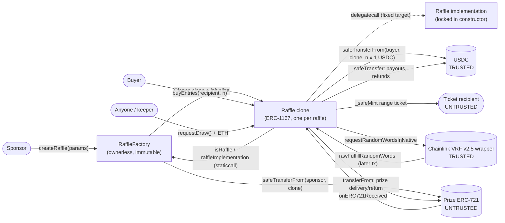
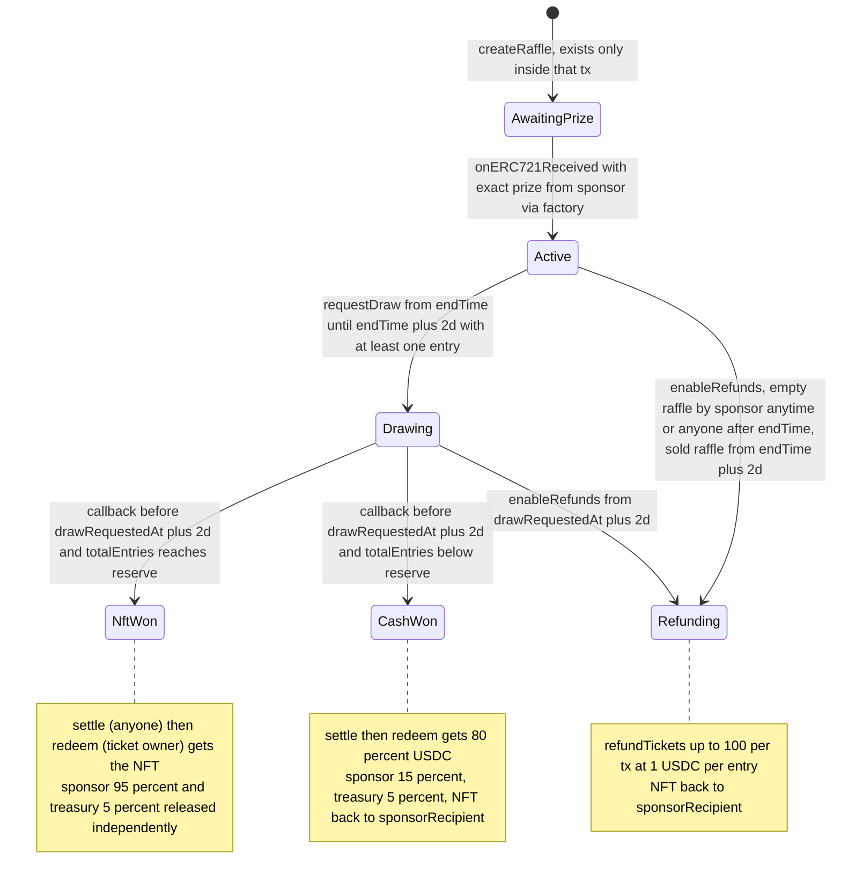
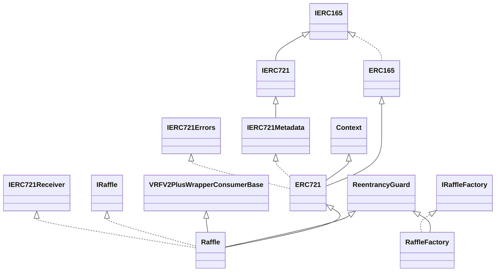
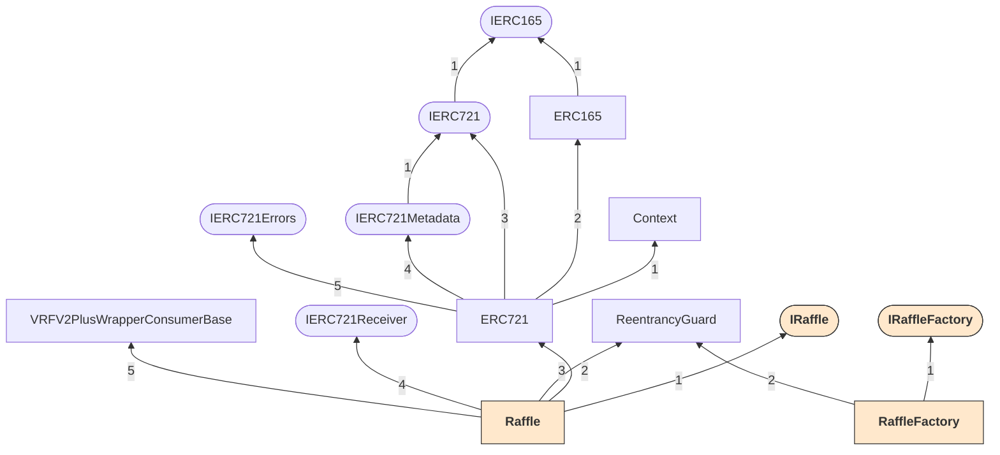
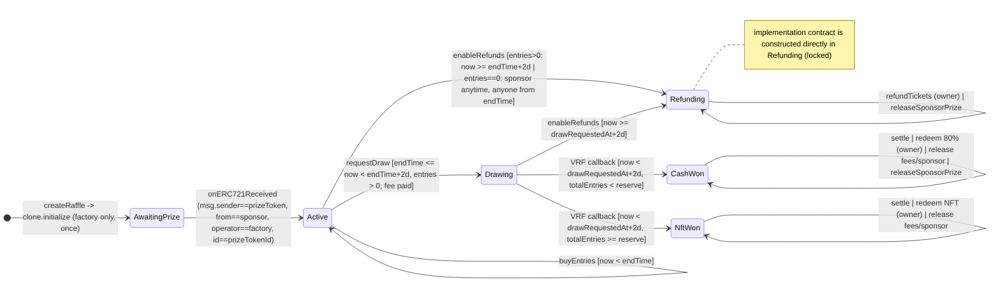
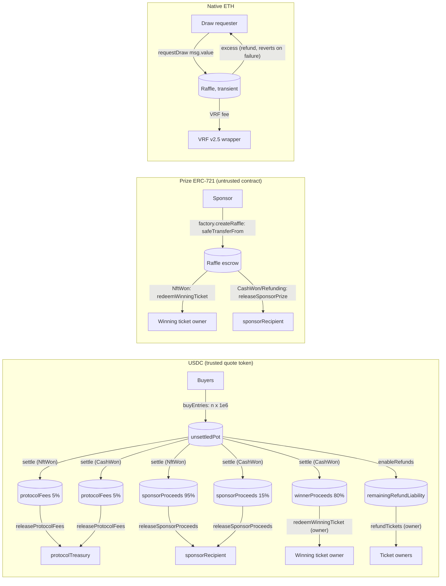

# FIRST-PASS — Anthropic provider lane (raffle.fun audit r001)

Assembled: 2026-10-21T09:19:07.179392+00:00
Scope: cold first-pass outputs of the lane's harness cells and the supplementary review, exactly as produced. Harness-native
tools ran inside some cells (e.g. Slither/Echidna/Foundry inside ToB secure-workflow-guide; Slither in other ToB stages). Each
such cell is labelled TOOL-ASSISTED in the index; the others are source-only.
Every included report was produced from a fresh copy of the frozen clean context (no tests, audit history,
scanner results or peer output). This file adds no reconciliation, deduplication, triage or tool results. Lane tool
campaigns (Slither, Aderyn, Echidna, Medusa, Halmos, Foundry, SMTChecker, mutation) were run in the separate
validation copy and are deliberately excluded here. Severity labels are each harness's own and are unadjudicated.
After sealing, this file is never edited. Corrections go in reconciliation/ as appended documents.

## Cell index
### CLAUDE-PASHOV — COMPLETE — cold; model-run local forge/solc proof sketches inside specialists
- attempt: `runs/CLAUDE-PASHOV/attempt-01`
- identity: init.model=claude-opus-5-5; assistant models={'claude-opus-5-5': 104}; subagent models={'claude-opus-5-5': 376}; modelUsage=['claude-opus-5-5']; runner=2.1.299; effort requested=max (provider echo: unknown); exit=0; duration_s=2387.4
- note: pashov solidity-auditor @8ce544c, --loop 1 (memory off), 12/12 specialists completed, native dedup/gates + assemble.sh
  - report `runs/CLAUDE-PASHOV/attempt-01/preserved/.solidity-auditor/runs/20261021-005507/full-report.md` sha256 `982136c59da18814399ae94e4b5c70a91a4b6cdeae104f7720ac37676e723ea3` (8804 bytes) [embedded below]
  - report `runs/CLAUDE-PASHOV/attempt-01/preserved/.solidity-auditor/runs/20261021-005507/run-1.md` sha256 `53d5ee7aaad5ceed3cd2162639d334af24166f79864ba567d410a364ac364aa6` (8799 bytes) [embedded below]
  - artifact `runs/CLAUDE-PASHOV/attempt-01/preserved/work-pashov-ai-audit-report-20261021-005507.md` sha256 `982136c59da18814399ae94e4b5c70a91a4b6cdeae104f7720ac37676e723ea3` (8804 bytes) [hash-bound, not embedded]
  - artifact `runs/CLAUDE-PASHOV/attempt-01/preserved/.solidity-auditor/runs/20261021-005507/scope.tsv` sha256 `603a5f24bca366f7c2c64a1855dcffafb3eaf29410dfeb2b5ef611333e3337fa` (294 bytes) [hash-bound, not embedded]
  - artifact `runs/CLAUDE-PASHOV/attempt-01/final-result.md` sha256 `04b38997ccb262f808dbcc4f5d4c4bfac1860614f26e567641e1606e0b2ad36b` (1353 bytes) [hash-bound, not embedded]
### CLAUDE-GEBAL — COMPLETE (cold source-only review); test-inclusive deterministic run BLOCKED
- attempt: `runs/CLAUDE-GEBAL/attempt-01-review`
- identity: init.model=claude-opus-5-5; assistant models={'claude-opus-5-5': 61}; subagent models={}; modelUsage=['claude-opus-5-5']; runner=2.1.299; effort requested=max (provider echo: unknown); exit=0; duration_s=1044.8
- note: gebal @9ad2464; run a184629e; snapshotHash 1c720af5…; contextHash cbec7142…; schema-valid import (4 observations)
  - report `runs/CLAUDE-GEBAL/native-attempt-01/review.json` sha256 `b3d18d105ab058096e0939e298340f766d4da1c3019d4cb3d9414a332f354884` (14636 bytes) [embedded below]
  - report `runs/CLAUDE-GEBAL/native-attempt-01/report.md` sha256 `e107439416d40e1719a9d627f8adae65a7442690099df927ac00ad5d3dca8ea4` (17498 bytes) [embedded below]
  - artifact `runs/CLAUDE-GEBAL/native-attempt-01/report.json` sha256 `35ef421690002e2ea914ad4d5d73054e6b746e4095fdbdea73b192169f2e2801` (48773 bytes) [hash-bound, not embedded]
  - artifact `runs/CLAUDE-GEBAL/native-attempt-01/context.json` sha256 `8d369d1df586d4560530a072ef7406bbe65978ee55097e262a9eb47896d71ef2` (748022 bytes) [hash-bound, not embedded]
  - artifact `runs/CLAUDE-GEBAL/native-attempt-01/findings.txt` sha256 `754bba025e5aeb5fa6fb86a66946d99355da57de64bfb77f3f1c07474cb2d0f2` (12325 bytes) [hash-bound, not embedded]
### CLAUDE-TOB / S1 audit-context-building — COMPLETE (attempt-02; attempt-01 stopped) — source-only context, 1 slither call
- attempt: `runs/CLAUDE-TOB/S1/attempt-02`
- identity: init.model=claude-opus-5-5; assistant models={'claude-opus-5-5': 80}; subagent models={}; modelUsage=['claude-opus-5-5']; runner=2.1.299; effort requested=max (provider echo: unknown); exit=0; duration_s=4027.1
- note: workflow audit-context; context building only (no vulnerability verdicts by design)
  - report `runs/CLAUDE-TOB/S1/attempt-02/preserved/TOB-S1-audit-context-building.md` sha256 `f7f720894eae441fe1c5bcc330cfd6088f2d978ea7063a17e60a480881c56354` (6390 bytes) [embedded below]
  - report `runs/CLAUDE-TOB/S1/attempt-02/preserved/audit-context/DOSSIER.md` sha256 `490566b02369d3c8f59e691d741c952f0fab2038f62a0814e83345388587f6e1` (97868 bytes) [embedded below]
  - artifact `runs/CLAUDE-TOB/S1/attempt-02/preserved/audit-context/functions/01-Raffle.redeemWinningTicket-L309-346.md` sha256 `102b8a109c64159a3b5730afbd383a36818c2b5d8e20db3d7c558df37f5e6e6e` (33196 bytes) [hash-bound, not embedded]
  - artifact `runs/CLAUDE-TOB/S1/attempt-02/preserved/audit-context/functions/02-Raffle._settleWinningTicket-L533-558-reached-via-settleWinni.md` sha256 `5f62ffad36b4c0473f2f7dbd9e9533086da4b06fc61f9f8b0d29c63591271894` (27585 bytes) [hash-bound, not embedded]
  - artifact `runs/CLAUDE-TOB/S1/attempt-02/preserved/audit-context/functions/03-Raffle.buyEntries-L209-237.md` sha256 `0b095bdafe3f728bf6cdfff17e5c718c33efd6d112e1a8925e961e8e433b2912` (31493 bytes) [hash-bound, not embedded]
  - artifact `runs/CLAUDE-TOB/S1/attempt-02/preserved/audit-context/functions/04-Raffle.refundTickets-L349-372.md` sha256 `c9a60803cd2c99875eef1d91078add54863ac5cc655d91cf08de5472f8cead7d` (32124 bytes) [hash-bound, not embedded]
  - artifact `runs/CLAUDE-TOB/S1/attempt-02/preserved/audit-context/functions/05-Raffle.enableRefunds-L276-301.md` sha256 `7c7a8082ba026db79f8b5cebe92e6bf9c4ee09df620d2d0dae0b65e617fd4af8` (25483 bytes) [hash-bound, not embedded]
  - artifact `runs/CLAUDE-TOB/S1/attempt-02/preserved/audit-context/functions/06-Raffle.fulfillRandomWords-L509-524-reached-via-inherited-raw.md` sha256 `ecbf55b04ef74048f9b5dcada87fb560825c8d93e0fc1b91b437333bc1ce4b0a` (24718 bytes) [hash-bound, not embedded]
  - artifact `runs/CLAUDE-TOB/S1/attempt-02/preserved/audit-context/functions/07-Raffle.requestDraw-L240-273.md` sha256 `4aa1f2246aaac49f89b1258aa48698365d67e326f669722c00ab47832c09f505` (34653 bytes) [hash-bound, not embedded]
  - artifact `runs/CLAUDE-TOB/S1/attempt-02/preserved/audit-context/functions/08-RaffleFactory.createRaffle-L97-148.md` sha256 `bbf86825fa64b983eed31ea0f87d091c10d56ccbc243efac5fb8ce1551d04086` (36921 bytes) [hash-bound, not embedded]
  - artifact `runs/CLAUDE-TOB/S1/attempt-02/preserved/audit-context/functions/09-Raffle.onERC721Received-L416-431.md` sha256 `c42a76220366387121735463ef9e7c56550880447cacbb518f5eaf4b130a9f60` (27054 bytes) [hash-bound, not embedded]
  - artifact `runs/CLAUDE-TOB/S1/attempt-02/preserved/audit-context/functions/10-Raffle.releaseSponsorPrize-L395-407.md` sha256 `290c594bdc6a971e0fc3b7c3e6405b731bed55302715b90f24294106063d786e` (28965 bytes) [hash-bound, not embedded]
  - artifact `runs/CLAUDE-TOB/S1/attempt-02/preserved/audit-context/functions/11-Raffle._update-override-L497-502-with-inherited-ERC721-trans.md` sha256 `7a38bc014397aa755634a9250999ea6202b30551d53a563af1dd569f86891f4f` (33596 bytes) [hash-bound, not embedded]
  - artifact `runs/CLAUDE-TOB/S1/attempt-02/preserved/audit-context/functions/12-Raffle._isProtocolDestination-L593-605.md` sha256 `959efe17c0188e888eb578b480b246a0b566e86f1f2a721c1929b2e1e4693bb9` (24484 bytes) [hash-bound, not embedded]
### CLAUDE-TOB / S2 entry-point-analyzer — COMPLETE — TOOL-ASSISTED (harness-native Slither/solc)
- attempt: `runs/CLAUDE-TOB/S2/attempt-01`
- identity: init.model=claude-opus-5-5; assistant models={'claude-opus-5-5': 114}; subagent models={}; modelUsage=['claude-opus-5-5']; runner=2.1.299; effort requested=max (provider echo: unknown); exit=0; duration_s=1415.2
- note: 
  - report `runs/CLAUDE-TOB/S2/attempt-01/preserved/TOB-S2-entry-point-analyzer.md` sha256 `b175795b0ab76d8171db2caa015174e0c6608e38babd64281050e054dd84062e` (65718 bytes) [embedded below]
### CLAUDE-TOB / S3 token-integration-analyzer — COMPLETE — TOOL-ASSISTED (Slither/forge/echidna)
- attempt: `runs/CLAUDE-TOB/S3/attempt-01`
- identity: init.model=claude-opus-5-5; assistant models={'claude-opus-5-5': 104}; subagent models={}; modelUsage=['claude-opus-5-5']; runner=2.1.299; effort requested=max (provider echo: unknown); exit=0; duration_s=2654.6
- note: no on-chain checks (no RPC authorized)
  - report `runs/CLAUDE-TOB/S3/attempt-01/preserved/TOB-S3-token-integration-analyzer.md` sha256 `f3fdf283c4007c97fb08f57b660449951c465cbfda4690afef37973900bdc0ca` (109406 bytes) [embedded below]
### CLAUDE-TOB / S4 guidelines-advisor — COMPLETE — TOOL-ASSISTED (Slither/forge)
- attempt: `runs/CLAUDE-TOB/S4/attempt-01`
- identity: init.model=claude-opus-5-5; assistant models={'claude-opus-5-5': 136}; subagent models={}; modelUsage=['claude-opus-5-5']; runner=2.1.299; effort requested=max (provider echo: unknown); exit=0; duration_s=1752.2
- note: 
  - report `runs/CLAUDE-TOB/S4/attempt-01/preserved/TOB-S4-guidelines-advisor.md` sha256 `a22164ad27f77c8e3bdea84d38e5d751a5ecc844d6dc245376dce927818f2557` (81566 bytes) [embedded below]
### CLAUDE-TOB / S5 spec-to-code-compliance — COMPLETE workflow (attempt-03; 01 stopped, 02 killed) — PARTIAL requirement coverage (10/248 checked by native limit)
- attempt: `runs/CLAUDE-TOB/S5/attempt-03`
- identity: init.model=claude-opus-5-5; assistant models={'claude-opus-5-5': 77}; subagent models={}; modelUsage=['claude-opus-5-5']; runner=2.1.299; effort requested=max (provider echo: unknown); exit=0; duration_s=3989.4
- note: workflow spec-compliance run wf_5507b8b7-46f
  - report `runs/CLAUDE-TOB/S5/attempt-03/preserved/TOB-S5-spec-to-code-compliance.md` sha256 `a84bd609d50ccae5d05fe96e37e79c3ce7794eb857ea28b527c5f0b90f6dcca9` (23179 bytes) [embedded below]
  - artifact `runs/CLAUDE-TOB/S5/attempt-03/preserved/spec-compliance/requirements/01-REQ-22.md` sha256 `f911ca6bad4555aed2b8471f19391841e118ccbc4cc2f95e761bdbd3d345b095` (10179 bytes) [hash-bound, not embedded]
  - artifact `runs/CLAUDE-TOB/S5/attempt-03/preserved/spec-compliance/requirements/02-REQ-23.md` sha256 `1d6ecfe5255bc680d3516cb216ed2037b7e9b96cc89115b2f7de4b2dd3383713` (15867 bytes) [hash-bound, not embedded]
  - artifact `runs/CLAUDE-TOB/S5/attempt-03/preserved/spec-compliance/requirements/03-REQ-24.md` sha256 `69ff253ef69554ab448ce25f42007e3f1e23ea8fee15d011ef063469271dd6d3` (13185 bytes) [hash-bound, not embedded]
  - artifact `runs/CLAUDE-TOB/S5/attempt-03/preserved/spec-compliance/requirements/04-REQ-25.md` sha256 `5819959d5be3a14d98750348db4dc7c0328edd3e0b604eb5eacda90223f21389` (11617 bytes) [hash-bound, not embedded]
  - artifact `runs/CLAUDE-TOB/S5/attempt-03/preserved/spec-compliance/requirements/05-REQ-33.md` sha256 `40d121c849bd43d1f84f3d2205c6c7f18a695510bc65ecdeb4f2d5cc234ff5e7` (9718 bytes) [hash-bound, not embedded]
  - artifact `runs/CLAUDE-TOB/S5/attempt-03/preserved/spec-compliance/requirements/06-REQ-35.md` sha256 `6a51387143c2c8a026422952c9590972f6bf9b502d05704966e902580a240e7e` (13258 bytes) [hash-bound, not embedded]
  - artifact `runs/CLAUDE-TOB/S5/attempt-03/preserved/spec-compliance/requirements/07-REQ-38.md` sha256 `91439119c3788e317ccf744c58038f45bf5eaf0e9d7a8cbaab3d170b5dc28720` (15165 bytes) [hash-bound, not embedded]
  - artifact `runs/CLAUDE-TOB/S5/attempt-03/preserved/spec-compliance/requirements/08-REQ-44.md` sha256 `61faaf0f2db683a24a9de50b944b6d78692b6c5775e98080da9c9fc0b4633006` (14988 bytes) [hash-bound, not embedded]
  - artifact `runs/CLAUDE-TOB/S5/attempt-03/preserved/spec-compliance/requirements/09-REQ-009.md` sha256 `f80ca445bdba2d7b5298c71d4fed419fbdbb6f7ade5c05612e1daff69110cb65` (10065 bytes) [hash-bound, not embedded]
  - artifact `runs/CLAUDE-TOB/S5/attempt-03/preserved/spec-compliance/requirements/10-REQ-010.md` sha256 `83b2867638232bd8569f340a163bfff2e6fd2649bc2b8326ad4e5709706e9a20` (9956 bytes) [hash-bound, not embedded]
### CLAUDE-TOB / S6 secure-workflow-guide — INCOMPLETE — timed out at 75 min before final assembly; partial report sections preserved — TOOL-ASSISTED (Slither/Echidna/Foundry/mutation)
- attempt: `runs/CLAUDE-TOB/S6/attempt-01`
- identity: init.model=claude-opus-5-5; assistant models={'claude-opus-5-5': 541}; subagent models={}; modelUsage=[]; runner=2.1.299; effort requested=max (provider echo: unknown); exit=143; duration_s=4510.0
- note: report/ parts written before timeout
  - report `runs/CLAUDE-TOB/S6/attempt-01/partial-artifacts/report/01-front-step1-3.md` sha256 `89c9d1260aaba5f0e482a923484224b92d36af64ae93ca1fe44983bca9b6ef6c` (32978 bytes) [embedded below]
  - report `runs/CLAUDE-TOB/S6/attempt-01/partial-artifacts/report/02-step4.md` sha256 `e48debc16268cf0db26d5dc9f21c940e0cd1b854d15e49b41ae79c6071afa9ad` (16053 bytes) [embedded below]
  - report `runs/CLAUDE-TOB/S6/attempt-01/partial-artifacts/report/03-step5-findings.md` sha256 `beb1358b1c1b9434ad447dddcba50978656f4d8759216e669507fcca01fdf9ea` (19761 bytes) [embedded below]
  - report `runs/CLAUDE-TOB/S6/attempt-01/partial-artifacts/report/04-action-plan.md` sha256 `f28a0b8e96dfb5f2d34fa4684c086966398e496c0feb20f755413f82a100c1b8` (4395 bytes) [embedded below]
  - artifact `runs/CLAUDE-TOB/S6/attempt-01/partial-artifacts/report/01-front-step1-3.md` sha256 `89c9d1260aaba5f0e482a923484224b92d36af64ae93ca1fe44983bca9b6ef6c` (32978 bytes) [hash-bound, not embedded]
  - artifact `runs/CLAUDE-TOB/S6/attempt-01/partial-artifacts/report/02-step4.md` sha256 `e48debc16268cf0db26d5dc9f21c940e0cd1b854d15e49b41ae79c6071afa9ad` (16053 bytes) [hash-bound, not embedded]
  - artifact `runs/CLAUDE-TOB/S6/attempt-01/partial-artifacts/report/03-step5-findings.md` sha256 `beb1358b1c1b9434ad447dddcba50978656f4d8759216e669507fcca01fdf9ea` (19761 bytes) [hash-bound, not embedded]
  - artifact `runs/CLAUDE-TOB/S6/attempt-01/partial-artifacts/report/04-action-plan.md` sha256 `f28a0b8e96dfb5f2d34fa4684c086966398e496c0feb20f755413f82a100c1b8` (4395 bytes) [hash-bound, not embedded]
  - artifact `runs/CLAUDE-TOB/S6/attempt-01/partial-artifacts/report/coverage-table.md` sha256 `2271d4cc70c8e7c4b84f4c8a68efe6ce834debbef72b7c173f31a4e64875572b` (1321 bytes) [hash-bound, not embedded]
  - artifact `runs/CLAUDE-TOB/S6/attempt-01/partial-artifacts/report/fuzz-results.md` sha256 `a4baf6ba7efcce1efda5361bb0aa5b5732ffdbc1c0ffe95fedfb14345395b48d` (1128 bytes) [hash-bound, not embedded]
  - artifact `runs/CLAUDE-TOB/S6/attempt-01/partial-artifacts/report/mutation-table.md` sha256 `48e7f2f21802641535f1e0978dc71a4fa999312590e81b033f2315bea2f036a2` (5407 bytes) [hash-bound, not embedded]
### CLAUDE-SIMAO — BLOCKED — provider safeguard refused all 12 lenses ([reasoning_extraction]); no findings
- attempt: `runs/CLAUDE-SIMAO/attempt-01`
- identity: init.model=claude-opus-5-5; assistant models={'claude-opus-5-5': 50, '<synthetic>': 3}; subagent models={'claude-opus-5-5': 83, '<synthetic>': 12}; modelUsage=['claude-opus-5-5']; runner=2.1.299; effort requested=max (provider echo: unknown); exit=1; duration_s=719.9
- note: money map + bundles preserved; see BLOCKED.md
  - report `runs/CLAUDE-SIMAO/attempt-01/BLOCKED.md` sha256 `16c300757316da789ab27e4404d0823c5780ff474128141d4db83aae53531ca5` (1328 bytes) [embedded below]
  - artifact `runs/CLAUDE-SIMAO/attempt-01/preserved/.audit-simao-VxctT4/lens-1-bundle.md` sha256 `8d492cd21aba7d92bacdae9bbf9901ab3dfed193ac3f69112d1e53134629c8d8` (122663 bytes) [hash-bound, not embedded]
  - artifact `runs/CLAUDE-SIMAO/attempt-01/preserved/.audit-simao-VxctT4/lens-10-bundle.md` sha256 `895938827f134291c598e0fe06663a27acb3a64747f4a4cc2596c692ffd2da20` (123217 bytes) [hash-bound, not embedded]
  - artifact `runs/CLAUDE-SIMAO/attempt-01/preserved/.audit-simao-VxctT4/lens-11-bundle.md` sha256 `067eb497b8cd97c8a1bf171b85d2183ad02048c7652133148f3878c3538f5fde` (123996 bytes) [hash-bound, not embedded]
  - artifact `runs/CLAUDE-SIMAO/attempt-01/preserved/.audit-simao-VxctT4/lens-12-bundle.md` sha256 `e9b42772cef210a04fb70e839f599a91557e34c0b000b6d64ae51cc580456525` (123255 bytes) [hash-bound, not embedded]
  - artifact `runs/CLAUDE-SIMAO/attempt-01/preserved/.audit-simao-VxctT4/lens-2-bundle.md` sha256 `aeddcefdd3b7bc33acb874d6ebc7ba1d746b1b9a477a6855da031fa4b1b0fefe` (122055 bytes) [hash-bound, not embedded]
  - artifact `runs/CLAUDE-SIMAO/attempt-01/preserved/.audit-simao-VxctT4/lens-3-bundle.md` sha256 `ae94912f37c463629ec0302ac61156303d2d14eba93330b7ea4d0ef66ebfc758` (122762 bytes) [hash-bound, not embedded]
  - artifact `runs/CLAUDE-SIMAO/attempt-01/preserved/.audit-simao-VxctT4/lens-4-bundle.md` sha256 `a87c8fbf6ccbec0efff21be957b7e5c70ae8d6d0ce4bfc84507934f5bffdee8d` (123136 bytes) [hash-bound, not embedded]
  - artifact `runs/CLAUDE-SIMAO/attempt-01/preserved/.audit-simao-VxctT4/lens-5-bundle.md` sha256 `12ab29c21a07f365aacd1ca69aae7f84c469e82da9a3b2bbc9ff0418d946c441` (122966 bytes) [hash-bound, not embedded]
  - artifact `runs/CLAUDE-SIMAO/attempt-01/preserved/.audit-simao-VxctT4/lens-6-bundle.md` sha256 `a41e9e80b172a81ada0013702f175dcdd80025c045486ff5d64746e3edf6424c` (122233 bytes) [hash-bound, not embedded]
  - artifact `runs/CLAUDE-SIMAO/attempt-01/preserved/.audit-simao-VxctT4/lens-7-bundle.md` sha256 `53f909289e4be751919583c8df3dcf22b3549eed14b8eea11773373d1f6d8c8b` (123049 bytes) [hash-bound, not embedded]
  - artifact `runs/CLAUDE-SIMAO/attempt-01/preserved/.audit-simao-VxctT4/lens-8-bundle.md` sha256 `26aeb155c46e123c5b12dc4516f878226fac7c973fc6e6805b8d22e77a2565e8` (122907 bytes) [hash-bound, not embedded]
  - artifact `runs/CLAUDE-SIMAO/attempt-01/preserved/.audit-simao-VxctT4/lens-9-bundle.md` sha256 `bce7e3e6a6c31331f1721dda32db1961bba51c1e91b9e0ac17cb5a858913c855` (122988 bytes) [hash-bound, not embedded]
  - artifact `runs/CLAUDE-SIMAO/attempt-01/preserved/.audit-simao-VxctT4/money-map.md` sha256 `37e29642a6758ca8a4718cef25643056ebd699765297b3eec53845d089ce2aa9` (13574 bytes) [hash-bound, not embedded]
  - artifact `runs/CLAUDE-SIMAO/attempt-01/preserved/.audit-simao-VxctT4/source.md` sha256 `582515d025b0a386ef25467644098b1d086dfecd2f4b2a914239c5bd9c78b56d` (87028 bytes) [hash-bound, not embedded]
### CLAUDE-OPENKRITT — BLOCKED — no supported engine/provider route (bundled Claude Code 2.1.215 < 2.1.280; no container host; interactive-only login)
- attempt: `runs/-`
- identity: n/a
- note: see runs/CLAUDE-OPENKRITT/attempt-01/BLOCKED.md
  - report `runs/CLAUDE-OPENKRITT/attempt-01/BLOCKED.md` sha256 `03a7b330c843e2bcc95239dfcb12ee76eb9949098d6b4138aaaba767dc6572e2` (2734 bytes) [embedded below]
### CLAUDE-SUP (supplementary, not a harness cell) — COMPLETE — cold; model-run local forge/solc proof sketches
- attempt: `runs/CLAUDE-SUP/attempt-01`
- identity: init.model=claude-opus-5-5; assistant models={'claude-opus-5-5': 95}; subagent models={}; modelUsage=['claude-opus-5-5']; runner=2.1.299; effort requested=max (provider echo: unknown); exit=0; duration_s=1772.4
- note: 
  - report `runs/CLAUDE-SUP/attempt-01/preserved/SUP-REPORT.md` sha256 `35ad372be5ab00e29a9add1810ab9a933be0b440de67ce42abf2262f39060ecf` (34489 bytes) [embedded below]
  - artifact `runs/CLAUDE-SUP/attempt-01/preserved/sup-notes/poc/cache/solidity-files-cache.json` sha256 `efee52dc9e57b58f19690478c6849546bf7ad6152e57214c853959036ce86e47` (144669 bytes) [hash-bound, not embedded]
  - artifact `runs/CLAUDE-SUP/attempt-01/preserved/sup-notes/poc/foundry.toml` sha256 `01f6b795e248aa38e922b1b4258f94675773f8d7b1af9932bb2a1a2800418e02` (551 bytes) [hash-bound, not embedded]
  - artifact `runs/CLAUDE-SUP/attempt-01/preserved/sup-notes/poc/out/Base.sol/Base.json` sha256 `9f58af4d97c4e3d69e9346d5d8c67ac223ee0e3768c4c992fd65c71c41bfae8d` (27324 bytes) [hash-bound, not embedded]
  - artifact `runs/CLAUDE-SUP/attempt-01/preserved/sup-notes/poc/out/Bytes.sol/Bytes.json` sha256 `cadabbd527f6c5b1df2068c87e7806efc44f6988e1d0b74e396905c8f73ce676` (6362 bytes) [hash-bound, not embedded]
  - artifact `runs/CLAUDE-SUP/attempt-01/preserved/sup-notes/poc/out/Clones.sol/Clones.json` sha256 `a08275c8a184212ad2daa93fa3b7038acca6a64ebe0106b33879d9054d7e111d` (5625 bytes) [hash-bound, not embedded]
  - artifact `runs/CLAUDE-SUP/attempt-01/preserved/sup-notes/poc/out/ColdGas.t.sol/ColdGasTest.json` sha256 `d9f2366e6c332ac8380737a6aa1cd9165fa978e1893ce033622b0b0f66d84e00` (184282 bytes) [hash-bound, not embedded]
  - artifact `runs/CLAUDE-SUP/attempt-01/preserved/sup-notes/poc/out/ColdGas.t.sol/VmCool.json` sha256 `386f137adfff952f0c0d90a0239d6f41a95c14ac72f0cccac6e18bbf1529f743` (28060 bytes) [hash-bound, not embedded]
  - artifact `runs/CLAUDE-SUP/attempt-01/preserved/sup-notes/poc/out/Context.sol/Context.json` sha256 `ea817e894b29808203942b37f8f0434b5771978a8d5c443ffb0e8befea0b5a6d` (3377 bytes) [hash-bound, not embedded]
  - artifact `runs/CLAUDE-SUP/attempt-01/preserved/sup-notes/poc/out/Create2.sol/Create2.json` sha256 `5293bef1b2a7f938d932754692b635bb11cdc946c39cb8c179b32147dfb7b244` (5990 bytes) [hash-bound, not embedded]
  - artifact `runs/CLAUDE-SUP/attempt-01/preserved/sup-notes/poc/out/CreationWindow.t.sol/CreationWindowTest.json` sha256 `cb18e8b417b8efff25c03da005c72f6f81127cb5167db16b21b1b80638bd0b3a` (183060 bytes) [hash-bound, not embedded]
  - artifact `runs/CLAUDE-SUP/attempt-01/preserved/sup-notes/poc/out/CreationWindow.t.sol/EvilSponsor.json` sha256 `90cedb6201d3077df17af7bd7354fc8f3376fa17d76a534ff5a23c5cd96d12dd` (33996 bytes) [hash-bound, not embedded]
  - artifact `runs/CLAUDE-SUP/attempt-01/preserved/sup-notes/poc/out/CreationWindow.t.sol/LyingPrize.json` sha256 `b0231f159cb6fee4ab282cd5c877eeebc8a7179ea32190b5ce18e33372009573` (38168 bytes) [hash-bound, not embedded]
  - artifact `runs/CLAUDE-SUP/attempt-01/preserved/sup-notes/poc/out/ERC165.sol/ERC165.json` sha256 `baa5546f2de7dba5b42eb97e37a5451f80d1211180ca8e5f2c378e199dca0971` (5741 bytes) [hash-bound, not embedded]
  - artifact `runs/CLAUDE-SUP/attempt-01/preserved/sup-notes/poc/out/ERC20/IERC20.sol/IERC20.json` sha256 `6ad8b6469155094d59ad23eade9566aa824ba5d61ebdd9ceafbb1f7d96d655d6` (12446 bytes) [hash-bound, not embedded]
  - artifact `runs/CLAUDE-SUP/attempt-01/preserved/sup-notes/poc/out/ERC721/IERC721.sol/IERC721.json` sha256 `cf3a472100cc672f243e7aaccbad68bad25ce5bb9cf8580a41b3c2817f68abfc` (21057 bytes) [hash-bound, not embedded]
  - artifact `runs/CLAUDE-SUP/attempt-01/preserved/sup-notes/poc/out/ERC721/IERC721Receiver.sol/IERC721Receiver.json` sha256 `cb4522db589f3f81cecb10e5a84f7d6670195e2bd2dfb3b9709605c7951f67d2` (4827 bytes) [hash-bound, not embedded]
  - artifact `runs/CLAUDE-SUP/attempt-01/preserved/sup-notes/poc/out/ERC721.sol/ERC721.json` sha256 `8273615772e9effc1fc1b80bb64b4ecfb17345a8ace173b053020b0ac6a2e922` (37885 bytes) [hash-bound, not embedded]
  - artifact `runs/CLAUDE-SUP/attempt-01/preserved/sup-notes/poc/out/ERC721Utils.sol/ERC721Utils.json` sha256 `50545c8cac72bf321228d0b94dcd35ec498ff6aad96e969e88cf03903d9136af` (5640 bytes) [hash-bound, not embedded]
  - artifact `runs/CLAUDE-SUP/attempt-01/preserved/sup-notes/poc/out/Errors.sol/Errors.json` sha256 `aba2c87b459ea0fc2ef6e912895fa423ae43c53024b261810ccff183599e2213` (5340 bytes) [hash-bound, not embedded]
  - artifact `runs/CLAUDE-SUP/attempt-01/preserved/sup-notes/poc/out/Findings.t.sol/FindingsTest.json` sha256 `ece5dc77e793145b2d1aeaf70b820ed4ce55d6643811a87796afd4b9cec43587` (241364 bytes) [hash-bound, not embedded]
  - artifact `runs/CLAUDE-SUP/attempt-01/preserved/sup-notes/poc/out/IERC1363.sol/IERC1363.json` sha256 `78b5b141ab96eaa20542159834c9167479b110670ab90855eb7178018ae1f2d8` (30533 bytes) [hash-bound, not embedded]
  - artifact `runs/CLAUDE-SUP/attempt-01/preserved/sup-notes/poc/out/IERC165.sol/IERC165.json` sha256 `b0ebee9ee7992000d453f9275da8c801e843b45270a962f1ecdedb064513d479` (4565 bytes) [hash-bound, not embedded]
  - artifact `runs/CLAUDE-SUP/attempt-01/preserved/sup-notes/poc/out/IERC20.sol/IERC20.json` sha256 `7d1056e0128562cd58df1b53625b4b09bb99c8a2d9f0b9cafbbc3d4b807e4c1b` (13035 bytes) [hash-bound, not embedded]
  - artifact `runs/CLAUDE-SUP/attempt-01/preserved/sup-notes/poc/out/IERC20Metadata.sol/IERC20Metadata.json` sha256 `d5562b9954d3e9d02c8dc193f4c08d507928a24412f588eb035698174c4b4dad` (14992 bytes) [hash-bound, not embedded]
  - artifact `runs/CLAUDE-SUP/attempt-01/preserved/sup-notes/poc/out/IERC721.sol/IERC721.json` sha256 `9d7228003141ac4d2ba6d3687202909756daf787c55f8c2d1551840ae0defb2f` (21939 bytes) [hash-bound, not embedded]
  - artifact `runs/CLAUDE-SUP/attempt-01/preserved/sup-notes/poc/out/IERC721Metadata.sol/IERC721Metadata.json` sha256 `97fe0078b1e94275c5b1396f317ee844a2c7dccc85baac19d4fac40be16dbfb2` (25120 bytes) [hash-bound, not embedded]
  - artifact `runs/CLAUDE-SUP/attempt-01/preserved/sup-notes/poc/out/IERC721Receiver.sol/IERC721Receiver.json` sha256 `9cec99c95288f11b959b6005d701144fb04ecea97daac19114e65b6d756009b7` (5415 bytes) [hash-bound, not embedded]
  - artifact `runs/CLAUDE-SUP/attempt-01/preserved/sup-notes/poc/out/IRaffle.sol/IRaffle.json` sha256 `bc3cee46606587dbda283d1b1736022eeb4c58686581e23f8b5abbd8ddcd048a` (99621 bytes) [hash-bound, not embedded]
  - artifact `runs/CLAUDE-SUP/attempt-01/preserved/sup-notes/poc/out/IRaffleFactory.sol/IRaffleFactory.json` sha256 `693334124cc6f0af24ee37503837b397d185511496cd3eac8202c3426039f8be` (27221 bytes) [hash-bound, not embedded]
  - artifact `runs/CLAUDE-SUP/attempt-01/preserved/sup-notes/poc/out/IVRFV2PlusWrapper.sol/IVRFV2PlusWrapper.json` sha256 `6d8f4ed23a719264f0d7455fc3b5ab18b5072431a02e0dd22572fa449f6a348a` (15632 bytes) [hash-bound, not embedded]
  - artifact `runs/CLAUDE-SUP/attempt-01/preserved/sup-notes/poc/out/Independence.t.sol/IndependenceTest.json` sha256 `29a6a64f89720a6286f2b5c4b1f2a1fe787bac91b0c6b0b62df9ff2dc929582a` (202415 bytes) [hash-bound, not embedded]
  - artifact `runs/CLAUDE-SUP/attempt-01/preserved/sup-notes/poc/out/Lifecycle.t.sol/LifecycleTest.json` sha256 `8dd3619504f599f8af441440d89ca2d8d2ef4acf9da0ecfb0a86ea534da86c03` (362148 bytes) [hash-bound, not embedded]
  - artifact `runs/CLAUDE-SUP/attempt-01/preserved/sup-notes/poc/out/Lifecycle.t.sol/ReentrantRecipient.json` sha256 `007a422c569ef7c8a793d90dce43a083227c9755c74a922381d3bd7f5c2357c2` (34884 bytes) [hash-bound, not embedded]
  - artifact `runs/CLAUDE-SUP/attempt-01/preserved/sup-notes/poc/out/LinkTokenInterface.sol/LinkTokenInterface.json` sha256 `360c99a679ee313226e3f4db282b50576b2e63dcf3bfde4f47bd360449d1cd4c` (12287 bytes) [hash-bound, not embedded]
  - artifact `runs/CLAUDE-SUP/attempt-01/preserved/sup-notes/poc/out/LowLevelCall.sol/LowLevelCall.json` sha256 `af76c1af7b06e1f2ee4ea93a39fd126d5769f48e54edd12437f9e68ed6f49feb` (3743 bytes) [hash-bound, not embedded]
  - artifact `runs/CLAUDE-SUP/attempt-01/preserved/sup-notes/poc/out/Math.sol/Math.json` sha256 `a1447a1d359af1e971a1bde97fc5783d8f1d1e47095d69879991fac328317fa8` (5448 bytes) [hash-bound, not embedded]
  - artifact `runs/CLAUDE-SUP/attempt-01/preserved/sup-notes/poc/out/Mocks.sol/MockNFT.json` sha256 `c32818a5ec1afa61bf0ad53662e7e8f8254297bdc4983f460930d35fdc6eae95` (70530 bytes) [hash-bound, not embedded]
  - artifact `runs/CLAUDE-SUP/attempt-01/preserved/sup-notes/poc/out/Mocks.sol/MockUSDC.json` sha256 `5bfbadc092bcbe34a20d44f84d2e8bd486a6640363d96fa06ac2a3cf8a86cc7f` (34348 bytes) [hash-bound, not embedded]
  - artifact `runs/CLAUDE-SUP/attempt-01/preserved/sup-notes/poc/out/Mocks.sol/MockVRFWrapper.json` sha256 `f9373c7c4f3ee2d0c652544371c8de221c385737bc7695935170ec057d1d1b41` (50739 bytes) [hash-bound, not embedded]
  - artifact `runs/CLAUDE-SUP/attempt-01/preserved/sup-notes/poc/out/Mocks.sol/ReceiverWallet.json` sha256 `6800902b79e3ccc924115f7d1914c70842ab420b25eab714d1c1a5a82a92b8c8` (19565 bytes) [hash-bound, not embedded]
  - artifact `runs/CLAUDE-SUP/attempt-01/preserved/sup-notes/poc/out/Mocks.sol/StickyApprovalNFT.json` sha256 `bacaf44315dfaf8639019843c7e0c4c2225785d1a870542559078ef44a1c0c6a` (34051 bytes) [hash-bound, not embedded]
  - artifact `runs/CLAUDE-SUP/attempt-01/preserved/sup-notes/poc/out/Mocks.sol/Vm.json` sha256 `0cb39524fe99ffe81cf41e971b02644c4385fbb5692758730500929d4072f342` (19386 bytes) [hash-bound, not embedded]
  - artifact `runs/CLAUDE-SUP/attempt-01/preserved/sup-notes/poc/out/Panic.sol/Panic.json` sha256 `6ef301b3e5b7a31da633b0e8db66c243fe50b4709a1a4369c46ccf9f92fa38f8` (4574 bytes) [hash-bound, not embedded]
  - artifact `runs/CLAUDE-SUP/attempt-01/preserved/sup-notes/poc/out/Raffle.sol/Raffle.json` sha256 `e1cea2e97a439bf35b7a4d6d675407ab93cf1907c2d0e58cfdc5b9ed5e5ab448` (265641 bytes) [hash-bound, not embedded]
  - artifact `runs/CLAUDE-SUP/attempt-01/preserved/sup-notes/poc/out/RaffleConstants.sol/RaffleConstants.json` sha256 `83795fa8c4be2a46af04714ce330353d298a971400559d643469b45ca8f04304` (3794 bytes) [hash-bound, not embedded]
  - artifact `runs/CLAUDE-SUP/attempt-01/preserved/sup-notes/poc/out/RaffleFactory.sol/RaffleFactory.json` sha256 `f319b3697804ef2290d84d7dfce73e9091a79f45244227c8dc39af6c7542da4f` (116931 bytes) [hash-bound, not embedded]
  - artifact `runs/CLAUDE-SUP/attempt-01/preserved/sup-notes/poc/out/RandomWalk.t.sol/RandomWalkTest.json` sha256 `882d395c03c0fb676bdbf2955c1e41ef4d565f3f5eb2e7fac67b98b2e2879878` (292389 bytes) [hash-bound, not embedded]
  - artifact `runs/CLAUDE-SUP/attempt-01/preserved/sup-notes/poc/out/ReentrancyGuard.sol/ReentrancyGuard.json` sha256 `f85762c02fc1dcd09878115a9b906daee95cad5817de0fab9bdadc57935c550d` (4356 bytes) [hash-bound, not embedded]
  - artifact `runs/CLAUDE-SUP/attempt-01/preserved/sup-notes/poc/out/SafeCast.sol/SafeCast.json` sha256 `f0a97401fed363ce417b994673b29eac90855374cc9cdc0a772c76bb117a9fc5` (6372 bytes) [hash-bound, not embedded]
  - artifact `runs/CLAUDE-SUP/attempt-01/preserved/sup-notes/poc/out/SafeERC20.sol/SafeERC20.json` sha256 `09939d7ccde47ed46467cce9537d255f64c898dcb13bbd91ece666f6ad3fbf2c` (8261 bytes) [hash-bound, not embedded]
  - artifact `runs/CLAUDE-SUP/attempt-01/preserved/sup-notes/poc/out/SignedMath.sol/SignedMath.json` sha256 `bba5ebde1205baf7341f5c43c2967889b24a55ee167bd7e233c41efd787b4b6b` (4528 bytes) [hash-bound, not embedded]
  - artifact `runs/CLAUDE-SUP/attempt-01/preserved/sup-notes/poc/out/StorageSlot.sol/StorageSlot.json` sha256 `36cca542be88aba9a7e6314dc55258ff54b8904cdc3547c53a26b169167199ef` (4576 bytes) [hash-bound, not embedded]
  - artifact `runs/CLAUDE-SUP/attempt-01/preserved/sup-notes/poc/out/Strings.sol/Strings.json` sha256 `246b8ebf38b1e4de1f852da941fb1bbb276fa45e545b641f2296ac49048e5d28` (9676 bytes) [hash-bound, not embedded]
  - artifact `runs/CLAUDE-SUP/attempt-01/preserved/sup-notes/poc/out/VRFV2PlusClient.sol/VRFV2PlusClient.json` sha256 `0df6c0776f0f5a02c806bbaced535ee509c1b0c441a8cab5ead589d0d16bafc2` (3919 bytes) [hash-bound, not embedded]
  - artifact `runs/CLAUDE-SUP/attempt-01/preserved/sup-notes/poc/out/VRFV2PlusWrapperConsumerBase.sol/VRFV2PlusWrapperConsumerBase.json` sha256 `73c90de2e23e5a54c5a1ba9c26a7a567042ac37e8d97e15f809ae8791626b729` (8658 bytes) [hash-bound, not embedded]
  - artifact `runs/CLAUDE-SUP/attempt-01/preserved/sup-notes/poc/out/WalkCoverage.t.sol/WalkCoverageTest.json` sha256 `fe07e3303e00528457064c760d7776c8f597ff59a8cc0b69a926778907da4425` (306103 bytes) [hash-bound, not embedded]
  - artifact `runs/CLAUDE-SUP/attempt-01/preserved/sup-notes/poc/out/build-info/28b28e1eb3c86180.json` sha256 `7b4afb723754983eeb4a31d6a7df7963e2e3f32ce4d7213f34913d3c7c77af5b` (8314 bytes) [hash-bound, not embedded]
  - artifact `runs/CLAUDE-SUP/attempt-01/preserved/sup-notes/poc/out/build-info/36da5500eabd6c2b.json` sha256 `9f57054e0cfa24f6939f32c7b2e7a79f061b9d04a47491cf9f2c47332e178477` (8312 bytes) [hash-bound, not embedded]
  - artifact `runs/CLAUDE-SUP/attempt-01/preserved/sup-notes/poc/out/build-info/42b469bd42ef66fc.json` sha256 `dd5bfa852c1f1e4fa8a7be5cf02256f4e596c674477be9a3599977a06ef139a4` (8345 bytes) [hash-bound, not embedded]
  - artifact `runs/CLAUDE-SUP/attempt-01/preserved/sup-notes/poc/out/build-info/679286f958ef637a.json` sha256 `3fa9dbb2826b12165b85cdab895536ccebb00b1920588c5b37680314b2678786` (8311 bytes) [hash-bound, not embedded]
  - artifact `runs/CLAUDE-SUP/attempt-01/preserved/sup-notes/poc/out/build-info/8fab42a307c5e617.json` sha256 `8dd2a0c17faebcf45e7a9cfb8cc7b1e150392e2c2027a39a72731bbb96ab913f` (8162 bytes) [hash-bound, not embedded]
  - artifact `runs/CLAUDE-SUP/attempt-01/preserved/sup-notes/poc/out/build-info/b325b17887ae4009.json` sha256 `9838f68779a6c334a4ce3fc83842ea9bedd4b1a3c2c752be94cdc2c8d30ee6fb` (8316 bytes) [hash-bound, not embedded]
  - artifact `runs/CLAUDE-SUP/attempt-01/preserved/sup-notes/poc/out/build-info/cfd7da1d1fae52a8.json` sha256 `d37131d58188d58844174028e38f2ac05e263039f92a5d32546244002f96a994` (8313 bytes) [hash-bound, not embedded]
  - artifact `runs/CLAUDE-SUP/attempt-01/preserved/sup-notes/poc/out/build-info/ee1366d3e816b2e3.json` sha256 `fe1f6c1cfb86ce27f54a02b61edfd0cd1e4e581ff41140031b8f1f79cb651f21` (8318 bytes) [hash-bound, not embedded]
  - artifact `runs/CLAUDE-SUP/attempt-01/preserved/sup-notes/poc/out/draft-IERC6093.sol/IERC1155Errors.json` sha256 `c5872d8d72b2fa0c11b7017815e20d93a619a4658e823274934820ace8fbfd5e` (8714 bytes) [hash-bound, not embedded]
  - artifact `runs/CLAUDE-SUP/attempt-01/preserved/sup-notes/poc/out/draft-IERC6093.sol/IERC20Errors.json` sha256 `513b815f131891a537d4f7079b98c6270e7c7590c8bd33710eb3999b3177eae4` (7764 bytes) [hash-bound, not embedded]
  - artifact `runs/CLAUDE-SUP/attempt-01/preserved/sup-notes/poc/out/draft-IERC6093.sol/IERC721Errors.json` sha256 `5239dd239e5a8bc26cd284888b24b874ec64528491475e4883fd828488dfea5a` (8632 bytes) [hash-bound, not embedded]
  - artifact `runs/CLAUDE-SUP/attempt-01/preserved/sup-notes/poc/out/interfaces/IRaffle.sol/IRaffle.json` sha256 `613a314765b0746c1147eb04003351c67b82e9cce3769083ba937d1768e26d59` (99033 bytes) [hash-bound, not embedded]
  - artifact `runs/CLAUDE-SUP/attempt-01/preserved/sup-notes/poc/out/interfaces/IRaffleFactory.sol/IRaffleFactory.json` sha256 `7471d71665048e09d5fed69580f24e72432a5e05c8de9bf89a272b04d23a2697` (26633 bytes) [hash-bound, not embedded]
  - artifact `runs/CLAUDE-SUP/attempt-01/preserved/sup-notes/poc/out/interfaces/IVRFV2PlusWrapper.sol/IVRFV2PlusWrapper.json` sha256 `474260728779141bb3e4dd6fda28ce3f45f31515a646563ca95911d7e8453a75` (15043 bytes) [hash-bound, not embedded]
  - artifact `runs/CLAUDE-SUP/attempt-01/preserved/sup-notes/poc/out/introspection/IERC165.sol/IERC165.json` sha256 `f568bd45d59ebf286e2871a4c6e1b4f0dbcf885fc2adc6d4e456bfe5ca131708` (3977 bytes) [hash-bound, not embedded]
  - artifact `runs/CLAUDE-SUP/attempt-01/preserved/sup-notes/poc/out/math/Math.sol/Math.json` sha256 `596b0f73abfa369966dd3298191a91bd639bea38c0847ebbfea949727ba0d17f` (4272 bytes) [hash-bound, not embedded]
  - artifact `runs/CLAUDE-SUP/attempt-01/preserved/sup-notes/poc/out/src/Raffle.sol/Raffle.json` sha256 `7b37b68d034d30c537e1965105438e2a460f86eaeb3c9ec573a7a1d03c79a85a` (264169 bytes) [hash-bound, not embedded]
  - artifact `runs/CLAUDE-SUP/attempt-01/preserved/sup-notes/poc/src/Imports.sol` sha256 `ea03f9b37f261e46891917197a41991ce68880d036c037098ebdc86ef37809c4` (158 bytes) [hash-bound, not embedded]
  - artifact `runs/CLAUDE-SUP/attempt-01/preserved/sup-notes/poc/src/Mocks.sol` sha256 `8079626f2d7b6927dffc9db597c718ad366daeac1b3ed1a309c01d5754838c3b` (9867 bytes) [hash-bound, not embedded]
  - artifact `runs/CLAUDE-SUP/attempt-01/preserved/sup-notes/poc/test/Base.sol` sha256 `e51a99cba784dc3f35492d6110f8c05699443ff2786f9b5fc1c0bdb4623612cc` (4634 bytes) [hash-bound, not embedded]
  - artifact `runs/CLAUDE-SUP/attempt-01/preserved/sup-notes/poc/test/ColdGas.t.sol` sha256 `7449115ae327fe4d1049ac43edc8aea17d7fb1f5f7e7c79d8ca4c9614ab9d2e4` (855 bytes) [hash-bound, not embedded]
  - artifact `runs/CLAUDE-SUP/attempt-01/preserved/sup-notes/poc/test/CreationWindow.t.sol` sha256 `2731bf876bbd1db0969c7d4f6def7da636ed9d9f8cb996142be08ec81d110049` (2533 bytes) [hash-bound, not embedded]
  - artifact `runs/CLAUDE-SUP/attempt-01/preserved/sup-notes/poc/test/Findings.t.sol` sha256 `783127dbe1f20177334754c82015555bbda0eb3fdbebafd37995324c42c83808` (6913 bytes) [hash-bound, not embedded]
  - artifact `runs/CLAUDE-SUP/attempt-01/preserved/sup-notes/poc/test/Independence.t.sol` sha256 `24aacf6e96a248a97fdd40a053b81f4e26e2b392c37d0624ef551da754e9a7fa` (1966 bytes) [hash-bound, not embedded]
  - artifact `runs/CLAUDE-SUP/attempt-01/preserved/sup-notes/poc/test/Lifecycle.t.sol` sha256 `35965f82b7859370e2f2a731c0555a18882ee713ba0e8913864bcea8b3a7fe99` (18594 bytes) [hash-bound, not embedded]
  - artifact `runs/CLAUDE-SUP/attempt-01/preserved/sup-notes/poc/test/RandomWalk.t.sol` sha256 `f3efc68699e74a7e557dc91d2f387627b9a9ccedf3a3c87d3b8d5aca7c0bb077` (13483 bytes) [hash-bound, not embedded]
  - artifact `runs/CLAUDE-SUP/attempt-01/preserved/sup-notes/poc/test/WalkCoverage.t.sol` sha256 `4f26b75d56c8f5f5df86ce0d873d37482eb13d04ccbae35a9b4f8d3e71654c42` (2116 bytes) [hash-bound, not embedded]
  - artifact `runs/CLAUDE-SUP/attempt-01/preserved/sup-notes/scope-sha256.txt` sha256 `c146f8bb547ccfe020dc80b784ff7e2a2b3c60023e20b5f95bd3758ee1dd553c` (557 bytes) [hash-bound, not embedded]
  - artifact `runs/CLAUDE-SUP/attempt-01/preserved/sup-notes/test-run.txt` sha256 `45f6e46f04a77c94fd81eac3154d485098239f62d510b73e8be2ed6a404ba0eb` (2774 bytes) [hash-bound, not embedded]

# Verbatim original reports


---

## ORIGINAL: CLAUDE-PASHOV — `runs/CLAUDE-PASHOV/attempt-01/preserved/.solidity-auditor/runs/20261021-005507/full-report.md`

sha256 `982136c59da18814399ae94e4b5c70a91a4b6cdeae104f7720ac37676e723ea3`

````text
# 🔐 Security Review — work

---

## Scope

|  |  |
| --- | --- |
| **Mode** | filename |
| **Files reviewed** | `packages/contracts/src/Raffle.sol` · `packages/contracts/src/RaffleFactory.sol` · `packages/contracts/src/interfaces/IRaffle.sol`<br>`packages/contracts/src/interfaces/IRaffleFactory.sol` · `packages/contracts/src/libraries/RaffleConstants.sol` |
| **Confidence threshold (1-100)** | 75 |

---

## Findings

[75] **1. `_update` allows ticket transfers during a pending VRF request**

`Raffle._update` · Confidence: 75

**Description**
`_update` allows transfers in `Drawing`, so an attacker who reads the VRF fulfillment buys the winning ticket or sells losing tickets before the callback runs.

**Fix**

```diff
     function _update(address to, uint256 ticketId, address auth) internal override returns (address previousOwner) {
+        if (status == Status.Drawing) revert InvalidStatus(status);
         if (to != address(0) && _isProtocolDestination(to, address(prizeToken))) {
             revert UnsafeProtocolDestination(to);
         }
```

---

[75] **2. `releaseSponsorProceeds` pays the sponsor before NFT delivery in `NftWon`**

`Raffle.releaseSponsorProceeds` · Confidence: 75

**Description**
A sponsor who controls the prize contract takes 95% of the pot, then pauses or moves the NFT, so the winner gets nothing.

**Fix (Option A — restrict)**:

```diff
     function releaseSponsorProceeds() external override nonReentrant returns (uint256 amount) {
+        if (status == Status.NftWon && !prizeClaimed) revert InvalidStatus(status);
         amount = sponsorProceeds;
         if (amount == 0) revert NoSponsorProceeds();
```

**Fix (Option B — restrict with timeout)**:

```diff
     function releaseSponsorProceeds() external override nonReentrant returns (uint256 amount) {
+        // Pay `sponsorProceeds` in `NftWon` only after the NFT reaches the winner, with a timeout for a winner who never redeems.
+        if (status == Status.NftWon && !prizeClaimed && block.timestamp < uint256(resolvedAt) + SPONSOR_CLAIM_TIMEOUT) {
+            revert InvalidStatus(status);
+        }
         amount = sponsorProceeds;
         if (amount == 0) revert NoSponsorProceeds();
```

---

Findings List

| # | Confidence | Title |
|---|---|---|
| 1 | [75] | `_update` allows ticket transfers during a pending VRF request |
| 2 | [75] | `releaseSponsorProceeds` pays the sponsor before NFT delivery in `NftWon` |

---

## Leads

_Vulnerability trails with concrete code smells where the full exploit path could not be completed in one analysis pass. These are not false positives — they are high-signal leads for manual review. Not scored._

- **`_isProtocolDestination` treats every address with no code as safe** — `Raffle._isProtocolDestination` — Code smells: the `destination.code.length != 0` branch skips `isRaffle` for an address with no code; anyone can compute the next clone address from the factory nonce; `releaseSponsorPrize` and the NFT branch of `redeemWinningTicket` send the NFT with no check at delivery; a ticket sent to the empty predicted address passes `_update` — A future clone address passes the check as `sponsorRecipient` or ticket owner, so the prize NFT or the ticket later stays in that clone. Only the party that chose the address loses, and we found no gain for a third party.
- **Settlement credits 95% to the sponsor before NFT delivery** — `Raffle._settleWinningTicket` — Code smells: `_settleWinningTicket` sets `sponsorProceeds = grossPot - protocolFee` in `NftWon` and moves no prize; any caller can run `settleWinningTicket`; `releaseSponsorProceeds` reads neither `winnerRedeemed` nor `prizeClaimed`; only `redeemWinningTicket` moves the NFT, through `prizeToken.transferFrom` on an untrusted contract — Settlement credits the sponsor 95% before NFT delivery, so a prize contract that blocks `transferFrom` leaves the winner with nothing. DESIGN.md makes the sponsor claim independent on purpose, and we did not find an honest prize that fails this way.
- **The sponsor buys entries toward the reserve at a 5% cost** — `Raffle.buyEntries` — Code smells: `buyEntries` accepts the sponsor, and any other address of the sponsor, until `endTime`; `fulfillRandomWords` sets `NftWon` when `totalEntries >= reserveEntries`; `_settleWinningTicket` pays 95% of the pot, sponsor entries included, to `sponsorRecipient`; a sponsor who also controls the prize contract can force `NftWon` this way and then block NFT delivery — The sponsor gets back 95% of what it pays, so it buys entries at 5% cost to reach the reserve or lower other buyers' odds. DESIGN.md does not forbid sponsor entries, and a `msg.sender` check does not stop a second address.
- **The reserve check counts the sponsor's own entries** — `Raffle.fulfillRandomWords` — Code smells: `fulfillRandomWords` compares `totalEntries` with `reserveEntries`, and `totalEntries` includes entries that the sponsor buys; in `NftWon`, `_settleWinningTicket` gives `grossPot - protocolFee` to the sponsor — A sponsor buys the missing reserve entries and gets 95% back, so the sponsor turns `CashWon` into `NftWon` for a 5% fee. We found no on-chain fix that stops a sponsor who uses a second address.
- **Mempool readers learn the winning entry ahead of the callback** — `Raffle.fulfillRandomWords` — Code smells: `fulfillRandomWords` sets `winningEntry` to `randomWords[0] % totalEntries + 1`; the coordinator computes `randomWords[0]` from the VRF proof in the pending fulfillment calldata; `_update` allows ticket transfers while `status` is `Drawing` — An attacker who reads the VRF fulfillment in the mempool buys the winning ticket from an open listing first. We did not confirm that mainnet VRF nodes send the fulfillment to the public mempool.
- **`releaseSponsorPrize` has no runtime check of the recipient** — `Raffle.releaseSponsorPrize` — Code smells: `_isProtocolDestination` skips the `isRaffle` lookup for an address with no code, so `initialize` accepts the next clone address as `sponsorRecipient`; `Clones.clone` uses CREATE, so anyone can compute that address from the factory nonce; `_transferQuote` checks the recipient again at payout, but `releaseSponsorPrize` calls `prizeToken.transferFrom` with no check; `releaseSponsorProceeds` then reverts with `InvalidQuoteDestination` on every call — When the sponsor sets `sponsorRecipient` to a future clone address, any caller can send the prize NFT into that clone. This breaks the DESIGN.md rule against asset moves between clones, and we found no loss for any party other than the sponsor.
- **`createRaffle` checks prize ownership only after the transfer** — `RaffleFactory.createRaffle` — Code smells: `createRaffle` calls `prize.safeTransferFrom(msg.sender, raffle, params.prizeTokenId)` with the operator approval that sponsors gave the factory; no check before the transfer shows that `msg.sender` owns the token; `onERC721Received` takes `from` and `operator` from the prize token; the attacker then cancels the empty raffle with `enableRefunds`, and `releaseSponsorPrize` sends the NFT to the attacker's `sponsorRecipient` — An attacker can take an NFT that a victim approved to the factory, if the prize token ignores `from`. We did not find a deployed ERC721 that does this.
- **Clone addresses depend only on the factory nonce** — `RaffleFactory.createRaffle` — Code smells: `Clones.clone` uses CREATE, so the clone address depends only on the factory nonce; `buyEntries` takes no raffle ID, prize or parameter hash, so a call cannot bind to the raffle that the buyer saw — If a reorg reorders two `createRaffle` calls, a pending `buyEntries` call pays into a different raffle at the same address. An attacker cannot cause the reorg, and we did not measure how often it occurs.
- **`createRaffle` trusts the prize contract to report the escrow** — `RaffleFactory.createRaffle` — Code smells: `Raffle.onERC721Received` accepts the deposit when `msg.sender == address(prizeToken)`, so the prize contract can call it and move no token; the `prize.ownerOf` check after the transfer reads the same contract; in `NftWon`, `releaseSponsorProceeds` does not read `prizeClaimed` — A sponsor who deploys a fake prize contract passes every escrow check and takes 95% of the buyer USDC in `NftWon`. The winner gets nothing, and we did not confirm if the design accepts this risk.

---

> ⚠️ This review was performed by an AI assistant. AI analysis can never verify the complete absence of vulnerabilities and no guarantee of security is given. Team security reviews, bug bounty programs, and on-chain monitoring are strongly recommended. For a consultation regarding your projects' security, visit [https://www.pashov.com](https://www.pashov.com)

````


---

## ORIGINAL: CLAUDE-PASHOV — `runs/CLAUDE-PASHOV/attempt-01/preserved/.solidity-auditor/runs/20261021-005507/run-1.md`

sha256 `53d5ee7aaad5ceed3cd2162639d334af24166f79864ba567d410a364ac364aa6`

````text
# Run 1 — solidity-auditor

<!--RUN pass=1 of=1 stamp=20261021-005507 sha=none agents=12/12-->

Pass 1 of 1 · 2026-10-21 · `none` · 12/12 agents returned.

## Findings

<!--F key=raffle|-update|transfer-after-vrf-request conf=75 kind=FINDING agents=8-->

[75] **`_update` allows ticket transfers during a pending VRF request**

`Raffle._update` · Confidence: 75

**Description**
`_update` allows transfers in `Drawing`, so an attacker who reads the VRF fulfillment buys the winning ticket or sells losing tickets before the callback runs.

**Fix**

```diff
     function _update(address to, uint256 ticketId, address auth) internal override returns (address previousOwner) {
+        if (status == Status.Drawing) revert InvalidStatus(status);
         if (to != address(0) && _isProtocolDestination(to, address(prizeToken))) {
             revert UnsafeProtocolDestination(to);
         }
```

<!--/F-->

<!--F key=raffle|releasesponsorproceeds|payment-before-delivery conf=75 kind=FINDING agents=4-->

[75] **`releaseSponsorProceeds` pays the sponsor before NFT delivery in `NftWon`**

`Raffle.releaseSponsorProceeds` · Confidence: 75

**Description**
A sponsor who controls the prize contract takes 95% of the pot, then pauses or moves the NFT, so the winner gets nothing.

**Fix (Option A — restrict)**:

```diff
     function releaseSponsorProceeds() external override nonReentrant returns (uint256 amount) {
+        if (status == Status.NftWon && !prizeClaimed) revert InvalidStatus(status);
         amount = sponsorProceeds;
         if (amount == 0) revert NoSponsorProceeds();
```

**Fix (Option B — restrict with timeout)**:

```diff
     function releaseSponsorProceeds() external override nonReentrant returns (uint256 amount) {
+        // Pay `sponsorProceeds` in `NftWon` only after the NFT reaches the winner, with a timeout for a winner who never redeems.
+        if (status == Status.NftWon && !prizeClaimed && block.timestamp < uint256(resolvedAt) + SPONSOR_CLAIM_TIMEOUT) {
+            revert InvalidStatus(status);
+        }
         amount = sponsorProceeds;
         if (amount == 0) revert NoSponsorProceeds();
```

<!--/F-->

## Leads

<!--F key=raffle|buyentries|reserve-self-purchase kind=LEAD agents=4-->

- **The sponsor buys entries toward the reserve at a 5% cost** — `Raffle.buyEntries` — Code smells: `buyEntries` accepts the sponsor, and any other address of the sponsor, until `endTime`; `fulfillRandomWords` sets `NftWon` when `totalEntries >= reserveEntries`; `_settleWinningTicket` pays 95% of the pot, sponsor entries included, to `sponsorRecipient`; a sponsor who also controls the prize contract can force `NftWon` this way and then block NFT delivery — The sponsor gets back 95% of what it pays, so it buys entries at 5% cost to reach the reserve or lower other buyers' odds. DESIGN.md does not forbid sponsor entries, and a `msg.sender` check does not stop a second address.

<!--/F-->

<!--F key=raffle|-settlewinningticket|sponsor-paid-without-delivery kind=LEAD agents=2-->

- **Settlement credits 95% to the sponsor before NFT delivery** — `Raffle._settleWinningTicket` — Code smells: `_settleWinningTicket` sets `sponsorProceeds = grossPot - protocolFee` in `NftWon` and moves no prize; any caller can run `settleWinningTicket`; `releaseSponsorProceeds` reads neither `winnerRedeemed` nor `prizeClaimed`; only `redeemWinningTicket` moves the NFT, through `prizeToken.transferFrom` on an untrusted contract — Settlement credits the sponsor 95% before NFT delivery, so a prize contract that blocks `transferFrom` leaves the winner with nothing. DESIGN.md makes the sponsor claim independent on purpose, and we did not find an honest prize that fails this way.

<!--/F-->

<!--F key=raffle|fulfillrandomwords|vrf-fulfillment-frontrun kind=LEAD agents=2-->

- **Mempool readers learn the winning entry ahead of the callback** — `Raffle.fulfillRandomWords` — Code smells: `fulfillRandomWords` sets `winningEntry` to `randomWords[0] % totalEntries + 1`; the coordinator computes `randomWords[0]` from the VRF proof in the pending fulfillment calldata; `_update` allows ticket transfers while `status` is `Drawing` — An attacker who reads the VRF fulfillment in the mempool buys the winning ticket from an open listing first. We did not confirm that mainnet VRF nodes send the fulfillment to the public mempool.

<!--/F-->

<!--F key=raffle|fulfillrandomwords|reserve-threshold-pumping kind=LEAD agents=1-->

- **The reserve check counts the sponsor's own entries** — `Raffle.fulfillRandomWords` — Code smells: `fulfillRandomWords` compares `totalEntries` with `reserveEntries`, and `totalEntries` includes entries that the sponsor buys; in `NftWon`, `_settleWinningTicket` gives `grossPot - protocolFee` to the sponsor — A sponsor buys the missing reserve entries and gets 95% back, so the sponsor turns `CashWon` into `NftWon` for a 5% fee. We found no on-chain fix that stops a sponsor who uses a second address.

<!--/F-->

<!--F key=raffle|releasesponsorprize|missing-runtime-destination-check kind=LEAD agents=2-->

- **`releaseSponsorPrize` has no runtime check of the recipient** — `Raffle.releaseSponsorPrize` — Code smells: `_isProtocolDestination` skips the `isRaffle` lookup for an address with no code, so `initialize` accepts the next clone address as `sponsorRecipient`; `Clones.clone` uses CREATE, so anyone can compute that address from the factory nonce; `_transferQuote` checks the recipient again at payout, but `releaseSponsorPrize` calls `prizeToken.transferFrom` with no check; `releaseSponsorProceeds` then reverts with `InvalidQuoteDestination` on every call — When the sponsor sets `sponsorRecipient` to a future clone address, any caller can send the prize NFT into that clone. This breaks the DESIGN.md rule against asset moves between clones, and we found no loss for any party other than the sponsor.

<!--/F-->

<!--F key=raffle|-isprotocoldestination|future-clone-destination kind=LEAD agents=1-->

- **`_isProtocolDestination` treats every address with no code as safe** — `Raffle._isProtocolDestination` — Code smells: the `destination.code.length != 0` branch skips `isRaffle` for an address with no code; anyone can compute the next clone address from the factory nonce; `releaseSponsorPrize` and the NFT branch of `redeemWinningTicket` send the NFT with no check at delivery; a ticket sent to the empty predicted address passes `_update` — A future clone address passes the check as `sponsorRecipient` or ticket owner, so the prize NFT or the ticket later stays in that clone. Only the party that chose the address loses, and we found no gain for a third party.

<!--/F-->

<!--F key=rafflefactory|createraffle|spoofable-prize-escrow kind=LEAD agents=1-->

- **`createRaffle` trusts the prize contract to report the escrow** — `RaffleFactory.createRaffle` — Code smells: `Raffle.onERC721Received` accepts the deposit when `msg.sender == address(prizeToken)`, so the prize contract can call it and move no token; the `prize.ownerOf` check after the transfer reads the same contract; in `NftWon`, `releaseSponsorProceeds` does not read `prizeClaimed` — A sponsor who deploys a fake prize contract passes every escrow check and takes 95% of the buyer USDC in `NftWon`. The winner gets nothing, and we did not confirm if the design accepts this risk.

<!--/F-->

<!--F key=rafflefactory|createraffle|confused-deputy-nft-pull kind=LEAD agents=1-->

- **`createRaffle` checks prize ownership only after the transfer** — `RaffleFactory.createRaffle` — Code smells: `createRaffle` calls `prize.safeTransferFrom(msg.sender, raffle, params.prizeTokenId)` with the operator approval that sponsors gave the factory; no check before the transfer shows that `msg.sender` owns the token; `onERC721Received` takes `from` and `operator` from the prize token; the attacker then cancels the empty raffle with `enableRefunds`, and `releaseSponsorPrize` sends the NFT to the attacker's `sponsorRecipient` — An attacker can take an NFT that a victim approved to the factory, if the prize token ignores `from`. We did not find a deployed ERC721 that does this.

<!--/F-->

<!--F key=rafflefactory|createraffle|create-reorg-address-swap kind=LEAD agents=1-->

- **Clone addresses depend only on the factory nonce** — `RaffleFactory.createRaffle` — Code smells: `Clones.clone` uses CREATE, so the clone address depends only on the factory nonce; `buyEntries` takes no raffle ID, prize or parameter hash, so a call cannot bind to the raffle that the buyer saw — If a reorg reorders two `createRaffle` calls, a pending `buyEntries` call pays into a different raffle at the same address. An attacker cannot cause the reorg, and we did not measure how often it occurs.

<!--/F-->

````


---

## ORIGINAL: CLAUDE-GEBAL — `runs/CLAUDE-GEBAL/native-attempt-01/review.json`

sha256 `b3d18d105ab058096e0939e298340f766d4da1c3019d4cb3d9414a332f354884`

````text
{
  "schemaVersion": 1,
  "snapshotHash": "1c720af585db73b5867c91437f75776b3ef6ee9c6d7aa70ee51fe85dbad994ad",
  "contextHash": "cbec71422797334035a6a1ab2b5b6a22768aeb2d0a8b727b85d146017c351c7a",
  "review": {
    "observations": [
      {
        "title": "Prize escrow and delivery are verified only through the untrusted prize contract, and NftWon sponsor proceeds do not depend on delivery",
        "description": "Stated requirement: exactly one ERC721 prize is escrowed atomically at creation, a met reserve awards the NFT, and arbitrary prize contracts are untrusted. Observed code: the factory accepts escrow when the prize contract itself reports prize.ownerOf(tokenId) == clone and the clone reports Active (RaffleFactory.sol 127-134). The clone activates whenever msg.sender == prizeToken calls onERC721Received with operator == factory and from == sponsor (Raffle.sol 421-428), and a dishonest prize contract can make that call during the factory's safeTransferFrom without moving any token. Winner delivery is confirmed only by prizeToken.ownerOf as well (Raffle.sol 329-337). In NftWon, settlement unconditionally allocates 95% of gross to sponsorProceeds (Raffle.sol 543-555), and releaseSponsorProceeds pays it whether or not the prize was ever delivered (Raffle.sol 375-381). Inferred impact: suppose the prize contract is fake, upgradeable, pausable, blocklisting or transfer-restricted, including a genuine collection whose admin colludes with the sponsor. Then an NftWon raffle can pay the sponsor 95% of gross while the winner's redemption either reverts forever or reports success with no real transfer. Refunds, CashWon cash redemption, sponsor/treasury USDC releases and other clones never call the prize contract, so the impact is limited to that raffle's buyers. The interface states that supported prizes are honest, standards-compliant ERC-721s (IRaffle.sol 14-15), which is narrower than the stated trust model. Independent sponsor/treasury claims are themselves a stated requirement, so this is a residual design risk rather than an implementation slip. The owner can either document it for buyers and integrators, or adopt the defensive property 'in NftWon, sponsor proceeds become releasable only after the NFT is actually delivered'. That property would conflict with the current claim-independence requirement, and it would not protect against a contract that fakes ownerOf.",
        "severity": "low",
        "confidence": "high",
        "source": [
          { "path": "packages/contracts/src/RaffleFactory.sol", "start": 127, "end": 134 },
          { "path": "packages/contracts/src/Raffle.sol", "start": 421, "end": 428 },
          { "path": "packages/contracts/src/Raffle.sol", "start": 329, "end": 337 },
          { "path": "packages/contracts/src/Raffle.sol", "start": 543, "end": 555 },
          { "path": "packages/contracts/src/Raffle.sol", "start": 375, "end": 381 },
          { "path": "packages/contracts/src/interfaces/IRaffle.sol", "start": 14, "end": 15 }
        ],
        "assumptions": [
          "Per the stated requirements, prize contracts may be malicious, upgradeable or admin-controlled, and the sponsor may control or collude with that admin.",
          "Buyers rely on on-chain escrow signals (PrizeDeposited, prizeToken.ownerOf) because frontend discovery is only advisory.",
          "No allowlist of prize collections is intended, since no administrator or mutable configuration is permitted."
        ]
      },
      {
        "title": "Winning ticket can be identified from the pending VRF fulfillment while tickets remain transferable during Drawing",
        "description": "Stated requirement: tickets are transferable ERC721 claims; frontend discovery is advisory and transaction decisions must reread current chain state. Observed code: _update allows transfers in every lifecycle state, including Drawing (Raffle.sol 491-502; IRaffle.sol 12-13). totalEntries is frozen once the sale ends (Raffle.sol 216 and 242), and the callback maps the first random word deterministically to randomWords[0] % totalEntries + 1 (Raffle.sol 509-521). Inferred: under Chainlink VRF v2.5 the random words can be computed from the proof carried in the coordinator's fulfillment transaction. A party that sees that transaction before inclusion (public mempool or block builder) therefore knows the winning entry, and through ticketRange the winning ticket, before any chain state changes. It can place transactions ahead of the fulfillment that fill an outstanding marketplace listing for the winning ticket, or sell losing tickets into standing offers. Rereading chain state cannot protect those counterparties because nothing has changed on-chain yet. Raffle accounting is unaffected; the cost falls on holders or bidders with standing orders during Drawing. One defensive property would be to freeze ticket transfers while status == Drawing. That is a product decision against the current design of tickets being transferable in every lifecycle state.",
        "severity": "informational",
        "confidence": "medium",
        "source": [
          { "path": "packages/contracts/src/Raffle.sol", "start": 491, "end": 502 },
          { "path": "packages/contracts/src/Raffle.sol", "start": 509, "end": 521 },
          { "path": "packages/contracts/src/Raffle.sol", "start": 216, "end": 216 },
          { "path": "packages/contracts/src/Raffle.sol", "start": 242, "end": 242 },
          { "path": "packages/contracts/src/interfaces/IRaffle.sol", "start": 12, "end": 13 }
        ],
        "assumptions": [
          "The VRF wrapper and coordinator sources are not in the pinned context. Based on general knowledge of VRF v2.5, the random words are assumed to be derivable from the fulfillment calldata (the proof's gamma) before inclusion.",
          "The fulfillment transaction is visible to searchers or builders before inclusion, and tickets trade through on-chain orders that third parties can fill or that holders can accept."
        ]
      },
      {
        "title": "Sponsor prize return is not re-screened at release time, and counterfactual clone addresses pass creation-time destination checks",
        "description": "Stated requirement: never move assets between raffle clones. Observed code: sponsorRecipient is screened only at creation. The factory checks isRaffle[sponsorRecipient] (RaffleFactory.sol 163-169), and initialize calls _isProtocolDestination (Raffle.sol 193-195), which checks the registry only when the address already has code (Raffle.sol 593-605). CREATE addresses follow from the factory address and nonce, so future clone addresses are predictable, and an address the factory will later use for a clone passes both checks while it has no code. At payout time, _transferQuote re-screens and reverts for a registered raffle (Raffle.sol 564-567), but releaseSponsorPrize sends the NFT to sponsorRecipient with no screen (Raffle.sol 395-407). If that address later becomes a clone, anyone can call releaseSponsorPrize in CashWon or Refunding and move the prize into the other clone. There it sits outside accounting with no way out, and releaseSponsorProceeds reverts permanently. Ticket mints and transfers are screened only when they happen (Raffle.sol 497-500), so a ticket sent to a counterfactual clone address becomes permanently unclaimable once that clone exists. Either state requires the sponsor or holder to choose such an address, so the impact is self-inflicted and unlikely. The point is that the requirement is enforced at runtime for USDC payouts but not for the prize-return path.",
        "severity": "informational",
        "confidence": "high",
        "source": [
          { "path": "packages/contracts/src/Raffle.sol", "start": 395, "end": 407 },
          { "path": "packages/contracts/src/Raffle.sol", "start": 564, "end": 567 },
          { "path": "packages/contracts/src/Raffle.sol", "start": 593, "end": 605 },
          { "path": "packages/contracts/src/Raffle.sol", "start": 193, "end": 195 },
          { "path": "packages/contracts/src/RaffleFactory.sol", "start": 163, "end": 169 },
          { "path": "packages/contracts/src/Raffle.sol", "start": 497, "end": 500 }
        ],
        "assumptions": [
          "The sponsor or a ticket holder chooses, deliberately or by mistake, an address equal to a CREATE address the factory will use for a later clone. No third party can force this choice.",
          "'Never move assets between raffle clones' is read as an absolute custody invariant, not as best effort against already-registered clones only."
        ]
      },
      {
        "title": "Empty-raffle exit timing differs from the stated refund deadline: the sponsor can exit at any time, anyone else at sale end",
        "description": "Stated requirement: request window [sale end, end+2days) and refunds open at deadline. Observed code: when status is Active and totalEntries == 0, enableRefunds uses endTime as the deadline and exempts the sponsor from it entirely (Raffle.sol 279-284). The sponsor can therefore move an unsold raffle to Refunding at any time before the first purchase, after which releaseSponsorPrize returns the prize because it accepts Refunding (Raffle.sol 395-399). Anyone else can do the same at endTime rather than endTime + 2 days. The interface documents this sponsor cancellation right (IRaffle.sol 37 and 322-324), but the stated requirements do not mention it. No buyer funds are exposed: the branch requires zero sold entries, and a purchase racing the cancellation simply reverts. The sponsor is a per-raffle role, not a protocol administrator. Recorded so the owner can confirm that the requirements intend this sponsor right and the endTime deadline for empty raffles.",
        "severity": "informational",
        "confidence": "high",
        "source": [
          { "path": "packages/contracts/src/Raffle.sol", "start": 279, "end": 284 },
          { "path": "packages/contracts/src/Raffle.sol", "start": 395, "end": 399 },
          { "path": "packages/contracts/src/interfaces/IRaffle.sol", "start": 37, "end": 37 },
          { "path": "packages/contracts/src/interfaces/IRaffle.sol", "start": 322, "end": 324 }
        ],
        "assumptions": [
          "'Refunds open at deadline' is read as the draw-request deadline (endTime + 2 days) or the callback deadline. The requirements do not say which deadline applies to a raffle with no entries."
        ]
      }
    ],
    "gaps": [
      "Source-only pass: no compilation, test, fuzz, invariant, symbolic-execution or prover run was performed. Nothing in this review is backed by execution evidence, and no coverage was measured.",
      "The Chainlink VRFV2PlusWrapper and VRF coordinator implementations are not in the pinned context; only IVRFV2PlusWrapper, VRFV2PlusWrapperConsumerBase and VRFV2PlusClient are. The following was assumed from general knowledge: the callback is asynchronous and delivered at most once per request with the requested callback gas; a failed callback is not retried; the native price uses tx.gasprice; request IDs are unique; random words can be derived from fulfillment calldata. The timing-window and liveness conclusions depend on these assumptions.",
      "The canonical USDC implementation is not in context. Standard ERC20 behavior without fees, hooks or rebasing was assumed, per the requirements. USDC blacklisting or pausing could freeze a clone or permanently block payouts to the per-raffle immutable sponsorRecipient or protocolTreasury. This was treated as an accepted trusted-dependency risk and not assessed further.",
      "Dependency sources were taken as given by the snapshot hashes and were not diffed against upstream @openzeppelin/contracts 5.6.1 or @chainlink/contracts 1.5.0, the versions pinned in pnpm-lock.yaml. Spot reads found nothing non-standard in ERC721, ERC721Utils, ReentrancyGuard, SafeERC20, Math.mulDiv, Clones or VRFV2PlusWrapperConsumerBase. ReentrancyGuard uses a namespaced slot whose zero value in uninitialized clones is treated as not entered.",
      "remappings.txt maps only @openzeppelin/contracts and forge-std, so resolution of @chainlink/contracts relies on Foundry auto-remapping from libs = [lib, node_modules]. Import resolution and compilation with solc 0.8.36 / cancun were not verified.",
      "Existing tests, deployment scripts, Hardhat configuration, actual deployment parameters (USDC, wrapper and treasury addresses) and frontend or indexer code were outside the snapshot and not reviewed.",
      "Callback gas sufficiency was estimated from the code, not measured: 300,000 gas covers a handful of storage reads and writes plus one event through the clone delegatecall. The worst-case gas of a 100-ticket refund batch was also estimated, not measured.",
      "Economic behavior was assessed only qualitatively. No observation was raised because each of these cases follows the stated design: the sponsor buying entries to cross the reserve, who pays for the single VRF request, buyers preferring the refund path when the reserve is missed, and the requester's fee being lost if fulfillment fails.",
      "A winning ticket that is never redeemed has no deadline or fallback, for example one held by a contract that cannot call redeemWinningTicket. The NFT or cash allocation can then stay locked indefinitely. This matches the stated rule that redemption requires the current ticket owner, so it was not raised as an observation.",
      "Properties checked by reading only, with no defect found (unproven): (1) liabilities always sum to gross sales; (2) refunds pay exactly ENTRY_PRICE per entry and burn before paying; (3) gross is always a multiple of 1e6, so the 5% and 80% splits are exact and the sponsor remainder leaves no dust; (4) the buy, request, callback and refund boundaries match the stated windows and cannot overlap at the same timestamp; (5) the callback only writes storage and does not revert on decodable input; (6) initialization is factory-only and one-time, and the implementation is locked; (7) every state-changing entry point is nonReentrant except the standard ERC721 functions, the status-gated receiver hook and the wrapper-only callback; (8) any raffle reaches an exit no later than 30 + 2 + 2 days after creation.",
      "Independence disclosure: this pass used only context.json and the harness instructions in this directory. No peer findings, analyzer output or evaluation labels were seen. General background knowledge of OpenZeppelin, Chainlink VRF v2.5 and USDC was used and is labeled as an assumption wherever relied on."
    ]
  }
}

````


---

## ORIGINAL: CLAUDE-GEBAL — `runs/CLAUDE-GEBAL/native-attempt-01/report.md`

sha256 `e107439416d40e1719a9d627f8adae65a7442690099df927ac00ad5d3dca8ea4`

````text
# Gebal assessment

Run: a184629e-4470-49a4-96a4-44695a238c6a

**Outcome: succeeded**

An empty findings list is not a security certificate\. Completed checks establish only their stated coverage\.

**Source-only run: no compiler, static analyzer or executable test coverage.**

Snapshot: 1c720af585db73b5867c91437f75776b3ef6ee9c6d7aa70ee51fe85dbad994ad

## Incomplete checks

All planned tasks completed. Coverage remains limited to the checks below.

## Scope and requirements

Ethereum NFT raffle; immutable factory, ERC-1167 clones with immutable implementation\. One entry costs 1,000,000 units of canonical six-decimal USDC\. One purchase mints a transferable ERC721 ticket representing a contiguous inclusive range\. Exactly one ERC721 prize is escrowed atomically at creation\. Reserve met awards NFT and 95% sponsor / 5% treasury\. Reserve missed awards 80% gross to winner, 15% sponsor, 5% treasury\. Refund outcome pays 100% per entry and returns prize\. Rounding is floor on aggregate protocol fee; remainder must be allocated without loss\. No administrator, mutable configuration or upgrade\. Request window \[sale end, end\+2days\); callback accepted strictly before request timestamp\+2days\. Refunds open at deadline\. Callback records result only\. Settlement is permissionless, storage-only; redemption requires current ticket owner, burns claim atomically, and must revert all effects on delivery failure\. Sponsor and treasury can claim independently after settlement\. Never move assets between raffle clones\. Quote token and Chainlink wrapper are trusted canonical dependencies; arbitrary prize contracts and ticket recipients are untrusted\. Frontend discovery is advisory; transaction decisions must reread current chain state\. Requirements source: frozen clean-context DESIGN\.md \(audit r001\), composed before scanner results and historical findings; source determines actual behavior\.

Authorized: packages/contracts/src, packages/contracts/foundry\.toml, packages/contracts/remappings\.txt, pnpm-lock\.yaml

Project path: packages/contracts

Explicit dependency paths: packages/contracts/node\_modules/@openzeppelin/contracts, packages/contracts/node\_modules/@chainlink/contracts

Execution policy: Exact file remappings were resolved from uniquely matching authorized library paths and are included in the approved plan\. Only profile\.default is selected; other profiles, RPC endpoints and formatting configuration are not loaded\. Controller overrides output/cache/script paths, denies FFI/filesystem/RPC and dependency downloads, and disables automatic remappings\. Configured fuzz/invariant campaigns are replaced by the disclosed fixed seed and bounded campaign\. Tests requiring denied capabilities cannot be validated\. Source-only intake does not establish compiler, test, property or security coverage\.

Excluded/absent: 

## Check evidence

- intake: succeeded. Recorded 39 authorized files\. Build configuration unsupported; see diagnosis\.
  Evidence: 1edfcee4dba01314e4f3d3d56239cb1f1e173238759796866e0a9bbedc0de16c

## Findings requiring human review

### Prize escrow and delivery are verified only through the untrusted prize contract, and NftWon sponsor proceeds do not depend on delivery

Severity: low; confidence: high; evidence: model; disposition: needs-review

Stated requirement: exactly one ERC721 prize is escrowed atomically at creation, a met reserve awards the NFT, and arbitrary prize contracts are untrusted\. Observed code: the factory accepts escrow when the prize contract itself reports prize\.ownerOf\(tokenId\) == clone and the clone reports Active \(RaffleFactory\.sol 127-134\)\. The clone activates whenever msg\.sender == prizeToken calls onERC721Received with operator == factory and from == sponsor \(Raffle\.sol 421-428\), and a dishonest prize contract can make that call during the factory's safeTransferFrom without moving any token\. Winner delivery is confirmed only by prizeToken\.ownerOf as well \(Raffle\.sol 329-337\)\. In NftWon, settlement unconditionally allocates 95% of gross to sponsorProceeds \(Raffle\.sol 543-555\), and releaseSponsorProceeds pays it whether or not the prize was ever delivered \(Raffle\.sol 375-381\)\. Inferred impact: suppose the prize contract is fake, upgradeable, pausable, blocklisting or transfer-restricted, including a genuine collection whose admin colludes with the sponsor\. Then an NftWon raffle can pay the sponsor 95% of gross while the winner's redemption either reverts forever or reports success with no real transfer\. Refunds, CashWon cash redemption, sponsor/treasury USDC releases and other clones never call the prize contract, so the impact is limited to that raffle's buyers\. The interface states that supported prizes are honest, standards-compliant ERC-721s \(IRaffle\.sol 14-15\), which is narrower than the stated trust model\. Independent sponsor/treasury claims are themselves a stated requirement, so this is a residual design risk rather than an implementation slip\. The owner can either document it for buyers and integrators, or adopt the defensive property 'in NftWon, sponsor proceeds become releasable only after the NFT is actually delivered'\. That property would conflict with the current claim-independence requirement, and it would not protect against a contract that fakes ownerOf\. Assumptions: Per the stated requirements, prize contracts may be malicious, upgradeable or admin-controlled, and the sponsor may control or collude with that admin\.; Buyers rely on on-chain escrow signals \(PrizeDeposited, prizeToken\.ownerOf\) because frontend discovery is only advisory\.; No allowlist of prize collections is intended, since no administrator or mutable configuration is permitted\.

Source: packages/contracts/src/RaffleFactory\.sol:127-134, packages/contracts/src/Raffle\.sol:421-428, packages/contracts/src/Raffle\.sol:329-337, packages/contracts/src/Raffle\.sol:543-555, packages/contracts/src/Raffle\.sol:375-381, packages/contracts/src/interfaces/IRaffle\.sol:14-15

Artifacts: 24f406a76a4bd574fbef454d3509fc5f3126c5a0781711eb6eff954298e1fe06

### Winning ticket can be identified from the pending VRF fulfillment while tickets remain transferable during Drawing

Severity: informational; confidence: medium; evidence: model; disposition: needs-review

Stated requirement: tickets are transferable ERC721 claims; frontend discovery is advisory and transaction decisions must reread current chain state\. Observed code: \_update allows transfers in every lifecycle state, including Drawing \(Raffle\.sol 491-502; IRaffle\.sol 12-13\)\. totalEntries is frozen once the sale ends \(Raffle\.sol 216 and 242\), and the callback maps the first random word deterministically to randomWords\[0\] % totalEntries \+ 1 \(Raffle\.sol 509-521\)\. Inferred: under Chainlink VRF v2\.5 the random words can be computed from the proof carried in the coordinator's fulfillment transaction\. A party that sees that transaction before inclusion \(public mempool or block builder\) therefore knows the winning entry, and through ticketRange the winning ticket, before any chain state changes\. It can place transactions ahead of the fulfillment that fill an outstanding marketplace listing for the winning ticket, or sell losing tickets into standing offers\. Rereading chain state cannot protect those counterparties because nothing has changed on-chain yet\. Raffle accounting is unaffected; the cost falls on holders or bidders with standing orders during Drawing\. One defensive property would be to freeze ticket transfers while status == Drawing\. That is a product decision against the current design of tickets being transferable in every lifecycle state\. Assumptions: The VRF wrapper and coordinator sources are not in the pinned context\. Based on general knowledge of VRF v2\.5, the random words are assumed to be derivable from the fulfillment calldata \(the proof's gamma\) before inclusion\.; The fulfillment transaction is visible to searchers or builders before inclusion, and tickets trade through on-chain orders that third parties can fill or that holders can accept\.

Source: packages/contracts/src/Raffle\.sol:491-502, packages/contracts/src/Raffle\.sol:509-521, packages/contracts/src/Raffle\.sol:216-216, packages/contracts/src/Raffle\.sol:242-242, packages/contracts/src/interfaces/IRaffle\.sol:12-13

Artifacts: 24f406a76a4bd574fbef454d3509fc5f3126c5a0781711eb6eff954298e1fe06

### Sponsor prize return is not re-screened at release time, and counterfactual clone addresses pass creation-time destination checks

Severity: informational; confidence: high; evidence: model; disposition: needs-review

Stated requirement: never move assets between raffle clones\. Observed code: sponsorRecipient is screened only at creation\. The factory checks isRaffle\[sponsorRecipient\] \(RaffleFactory\.sol 163-169\), and initialize calls \_isProtocolDestination \(Raffle\.sol 193-195\), which checks the registry only when the address already has code \(Raffle\.sol 593-605\)\. CREATE addresses follow from the factory address and nonce, so future clone addresses are predictable, and an address the factory will later use for a clone passes both checks while it has no code\. At payout time, \_transferQuote re-screens and reverts for a registered raffle \(Raffle\.sol 564-567\), but releaseSponsorPrize sends the NFT to sponsorRecipient with no screen \(Raffle\.sol 395-407\)\. If that address later becomes a clone, anyone can call releaseSponsorPrize in CashWon or Refunding and move the prize into the other clone\. There it sits outside accounting with no way out, and releaseSponsorProceeds reverts permanently\. Ticket mints and transfers are screened only when they happen \(Raffle\.sol 497-500\), so a ticket sent to a counterfactual clone address becomes permanently unclaimable once that clone exists\. Either state requires the sponsor or holder to choose such an address, so the impact is self-inflicted and unlikely\. The point is that the requirement is enforced at runtime for USDC payouts but not for the prize-return path\. Assumptions: The sponsor or a ticket holder chooses, deliberately or by mistake, an address equal to a CREATE address the factory will use for a later clone\. No third party can force this choice\.; 'Never move assets between raffle clones' is read as an absolute custody invariant, not as best effort against already-registered clones only\.

Source: packages/contracts/src/Raffle\.sol:395-407, packages/contracts/src/Raffle\.sol:564-567, packages/contracts/src/Raffle\.sol:593-605, packages/contracts/src/Raffle\.sol:193-195, packages/contracts/src/RaffleFactory\.sol:163-169, packages/contracts/src/Raffle\.sol:497-500

Artifacts: 24f406a76a4bd574fbef454d3509fc5f3126c5a0781711eb6eff954298e1fe06

### Empty-raffle exit timing differs from the stated refund deadline: the sponsor can exit at any time, anyone else at sale end

Severity: informational; confidence: high; evidence: model; disposition: needs-review

Stated requirement: request window \[sale end, end\+2days\) and refunds open at deadline\. Observed code: when status is Active and totalEntries == 0, enableRefunds uses endTime as the deadline and exempts the sponsor from it entirely \(Raffle\.sol 279-284\)\. The sponsor can therefore move an unsold raffle to Refunding at any time before the first purchase, after which releaseSponsorPrize returns the prize because it accepts Refunding \(Raffle\.sol 395-399\)\. Anyone else can do the same at endTime rather than endTime \+ 2 days\. The interface documents this sponsor cancellation right \(IRaffle\.sol 37 and 322-324\), but the stated requirements do not mention it\. No buyer funds are exposed: the branch requires zero sold entries, and a purchase racing the cancellation simply reverts\. The sponsor is a per-raffle role, not a protocol administrator\. Recorded so the owner can confirm that the requirements intend this sponsor right and the endTime deadline for empty raffles\. Assumptions: 'Refunds open at deadline' is read as the draw-request deadline \(endTime \+ 2 days\) or the callback deadline\. The requirements do not say which deadline applies to a raffle with no entries\.

Source: packages/contracts/src/Raffle\.sol:279-284, packages/contracts/src/Raffle\.sol:395-399, packages/contracts/src/interfaces/IRaffle\.sol:37-37, packages/contracts/src/interfaces/IRaffle\.sol:322-324

Artifacts: 24f406a76a4bd574fbef454d3509fc5f3126c5a0781711eb6eff954298e1fe06


## Coverage gaps

- No semantic, test, or property coverage established by intake\.
- External agent provenance, token usage and spend are unknown\.
- Imported observations do not complete blocked local checks or establish any property\.
- Source-only pass: no compilation, test, fuzz, invariant, symbolic-execution or prover run was performed\. Nothing in this review is backed by execution evidence, and no coverage was measured\.
- The Chainlink VRFV2PlusWrapper and VRF coordinator implementations are not in the pinned context; only IVRFV2PlusWrapper, VRFV2PlusWrapperConsumerBase and VRFV2PlusClient are\. The following was assumed from general knowledge: the callback is asynchronous and delivered at most once per request with the requested callback gas; a failed callback is not retried; the native price uses tx\.gasprice; request IDs are unique; random words can be derived from fulfillment calldata\. The timing-window and liveness conclusions depend on these assumptions\.
- The canonical USDC implementation is not in context\. Standard ERC20 behavior without fees, hooks or rebasing was assumed, per the requirements\. USDC blacklisting or pausing could freeze a clone or permanently block payouts to the per-raffle immutable sponsorRecipient or protocolTreasury\. This was treated as an accepted trusted-dependency risk and not assessed further\.
- Dependency sources were taken as given by the snapshot hashes and were not diffed against upstream @openzeppelin/contracts 5\.6\.1 or @chainlink/contracts 1\.5\.0, the versions pinned in pnpm-lock\.yaml\. Spot reads found nothing non-standard in ERC721, ERC721Utils, ReentrancyGuard, SafeERC20, Math\.mulDiv, Clones or VRFV2PlusWrapperConsumerBase\. ReentrancyGuard uses a namespaced slot whose zero value in uninitialized clones is treated as not entered\.
- remappings\.txt maps only @openzeppelin/contracts and forge-std, so resolution of @chainlink/contracts relies on Foundry auto-remapping from libs = \[lib, node\_modules\]\. Import resolution and compilation with solc 0\.8\.36 / cancun were not verified\.
- Existing tests, deployment scripts, Hardhat configuration, actual deployment parameters \(USDC, wrapper and treasury addresses\) and frontend or indexer code were outside the snapshot and not reviewed\.
- Callback gas sufficiency was estimated from the code, not measured: 300,000 gas covers a handful of storage reads and writes plus one event through the clone delegatecall\. The worst-case gas of a 100-ticket refund batch was also estimated, not measured\.
- Economic behavior was assessed only qualitatively\. No observation was raised because each of these cases follows the stated design: the sponsor buying entries to cross the reserve, who pays for the single VRF request, buyers preferring the refund path when the reserve is missed, and the requester's fee being lost if fulfillment fails\.
- A winning ticket that is never redeemed has no deadline or fallback, for example one held by a contract that cannot call redeemWinningTicket\. The NFT or cash allocation can then stay locked indefinitely\. This matches the stated rule that redemption requires the current ticket owner, so it was not raised as an observation\.
- Properties checked by reading only, with no defect found \(unproven\): \(1\) liabilities always sum to gross sales; \(2\) refunds pay exactly ENTRY\_PRICE per entry and burn before paying; \(3\) gross is always a multiple of 1e6, so the 5% and 80% splits are exact and the sponsor remainder leaves no dust; \(4\) the buy, request, callback and refund boundaries match the stated windows and cannot overlap at the same timestamp; \(5\) the callback only writes storage and does not revert on decodable input; \(6\) initialization is factory-only and one-time, and the implementation is locked; \(7\) every state-changing entry point is nonReentrant except the standard ERC721 functions, the status-gated receiver hook and the wrapper-only callback; \(8\) any raffle reaches an exit no later than 30 \+ 2 \+ 2 days after creation\.
- Independence disclosure: this pass used only context\.json and the harness instructions in this directory\. No peer findings, analyzer output or evaluation labels were seen\. General background knowledge of OpenZeppelin, Chainlink VRF v2\.5 and USDC was used and is labeled as an assumption wherever relied on\.

## Provenance and cost

Method: native-review-v1; adapter: 0.2.0

Tool image: unavailable; compiler: 0\.8\.36; EVM: cancun

Planned direct provider/model: none

External reviewers: claude-code-2\.1\.299 / claude-opus-5-5 \(effort max requested; provider-returned model claude-opus-5-5\). External provenance, usage and spend are unverified.

Recorded direct API tokens: 0; reserved: 0. Monetary cost: unknown. Local compute cost is not measured.

The JSON report retains manifests, settings, decisions, invocations, source hashes, timelines and coverage records. Artifact IDs resolve through the local store or CLI evidence command.

````


---

## ORIGINAL: CLAUDE-TOB / S1 audit-context-building — `runs/CLAUDE-TOB/S1/attempt-02/preserved/TOB-S1-audit-context-building.md`

sha256 `f7f720894eae441fe1c5bcc330cfd6088f2d978ea7063a17e60a480881c56354`

````text
# TOB-S1: audit-context-building index

Index of the dossier produced by the Trail of Bits `audit-context-building:audit-context` workflow.

- **Arguments:** `path: packages/contracts/src`, `outDir: audit-context`.
- **Run ID:** `wf_613f2bac-ec8`.
- **Agents:** 14 of 14 completed, with 0 errors, 0 skips and 0 empty results (about 65 minutes in total).

The dossier is context only. It does not name vulnerabilities, assign severity or propose fixes. Unenforced assumptions
are recorded as assumptions, not as findings.

## Scope

**In scope:**

- `packages/contracts/src/Raffle.sol`
- `packages/contracts/src/RaffleFactory.sol`
- `packages/contracts/src/interfaces/IRaffle.sol`
- `packages/contracts/src/interfaces/IRaffleFactory.sol`
- `packages/contracts/src/libraries/RaffleConstants.sol`

**Context only:**

- OpenZeppelin 5.6.1 and Chainlink 1.5.0 sources under `packages/contracts/node_modules`.
- `DESIGN.md`, used as the specification.

No file under `packages/` was modified. Every file the run wrote is under `audit-context/`.

## Files

| Path | Size | Contents |
| --- | --- | --- |
| [`audit-context/DOSSIER.md`](audit-context/DOSSIER.md) | 1,479 lines | System-model synthesis that draws on all 12 records |
| `audit-context/functions/NN-*.md` | 12 files, 5,500 lines | Per-function records, listed below |

## DOSSIER.md section map

| § | Line | Contents |
| --- | --- | --- |
| 0 | 10 | Sources, scope, build context, citation key (`L`, `RF`, `IR`, `RC`, `[NN]`, `UA-`, `U-`, `S-`, `W`, `CFI-`) |
| 1 | 58 | Inventory: contract roles, `RaffleConstants` values, record list, code without a record, repository limits |
| 2 | 135 | Architecture: deployment topology, clone ABI surface (9 guarded mutators), lifecycle state machine, function-by-status matrix, asset channels (USDC, prize NFT, ETH, tickets) |
| 3 | 301 | Actors and trust boundaries, guard domains, external-call windows W1–W13, transitive reach |
| 4 | 380 | State model: factory, clone config, sale and ticket state, draw state, accounting buckets, flags, bucket values by phase |
| 5 | 504 | End-to-end flows F0–F7: deploy, create, sale, draw request, resolution, refund branch, win branch, ticket circulation |
| 6 | 639 | Cross-function invariants CFI-1 to CFI-17 |
| 7 | 930 | Timeline model (sale end, request window, callback window, refund deadlines) |
| 8 | 951 | Destination screening (`_isProtocolDestination`) and prize admission model |
| 9 | 1018 | Divergences: between records, between the orientation and the records, and between documents and code (11 rows in §9.3) |
| 10 | 1105 | Unenforced assumptions UA-01 to UA-60, copied verbatim, with a cluster index |
| 11 | 1228 | Nine fragility clusters, where complexity concentrates |
| 12 | 1313 | Open questions U-01 to U-26 (from records) and S-01 to S-03 (raised in synthesis) |
| App. A | 1456 | Entrypoint quick reference: guard, gate, writes and external calls for each entrypoint |

## Per-function records

Every record uses the same sections:

1. Purpose
2. Inputs & Assumptions
3. Outputs & Effects
4. Block-by-Block
5. Cross-Function Dependencies (callees, callers, shared state, invariant couplings)
6. Open Questions

| # | Function | Source lines | Lines |
| --- | --- | --- | --- |
| [01](audit-context/functions/01-Raffle.redeemWinningTicket-L309-346.md) | `Raffle.redeemWinningTicket` | Raffle.sol L309–346 | 565 |
| [02](audit-context/functions/02-Raffle._settleWinningTicket-L533-558-reached-via-settleWinni.md) | `Raffle._settleWinningTicket`, reached from `settleWinningTicket` and `redeemWinningTicket` | Raffle.sol L533–558 | 448 |
| [03](audit-context/functions/03-Raffle.buyEntries-L209-237.md) | `Raffle.buyEntries` | Raffle.sol L209–237 | 521 |
| [04](audit-context/functions/04-Raffle.refundTickets-L349-372.md) | `Raffle.refundTickets` | Raffle.sol L349–372 | 524 |
| [05](audit-context/functions/05-Raffle.enableRefunds-L276-301.md) | `Raffle.enableRefunds` | Raffle.sol L276–301 | 430 |
| [06](audit-context/functions/06-Raffle.fulfillRandomWords-L509-524-reached-via-inherited-raw.md) | `Raffle.fulfillRandomWords`, reached via the inherited `rawFulfillRandomWords` | Raffle.sol L509–524 | 384 |
| [07](audit-context/functions/07-Raffle.requestDraw-L240-273.md) | `Raffle.requestDraw` | Raffle.sol L240–273 | 386 |
| [08](audit-context/functions/08-RaffleFactory.createRaffle-L97-148.md) | `RaffleFactory.createRaffle` (also covers `_validateCreateParams` and clone `initialize`) | RaffleFactory.sol L97–148 | 406 |
| [09](audit-context/functions/09-Raffle.onERC721Received-L416-431.md) | `Raffle.onERC721Received` | Raffle.sol L416–431 | 443 |
| [10](audit-context/functions/10-Raffle.releaseSponsorPrize-L395-407.md) | `Raffle.releaseSponsorPrize` | Raffle.sol L395–407 | 510 |
| [11](audit-context/functions/11-Raffle._update-override-L497-502-with-inherited-ERC721-trans.md) | `Raffle._update` override, plus the inherited ERC-721 transfer, mint and burn paths | Raffle.sol L497–502 | 488 |
| [12](audit-context/functions/12-Raffle._isProtocolDestination-L593-605.md) | `Raffle._isProtocolDestination` | Raffle.sol L593–605 | 395 |

## Code without a dedicated record

The workflow did not give these their own records. They are covered inside other records or in the dossier:

| Code | Covered in |
| --- | --- |
| `RaffleFactory` constructor (L65–92) | DOSSIER §5 F0, App. A |
| `RaffleFactory._validateCreateParams` (L154–179), `_requireContract` (L183–185) | [08] |
| `Raffle` constructor (L155–166), `_validatedVrfWrapper` (L610–613) | DOSSIER §1.1, §2.3, §9.2; [06], [07] |
| `Raffle.initialize` (L176–206) | [08], [12] |
| `releaseSponsorProceeds` (L375–382), `releaseProtocolFees` (L385–392) | DOSSIER §2.4, §2.5, App. A; [02], [12] |
| `_transferQuote` (L564–567) | [01], [04], [12] |
| `_requireWinningTicket` (L579–585), `_requireStatus` (L573–575) | [01], [02], [03], [04], [07] |
| `drawRequestDeadline` (L458–460), `callbackDeadline` (L463–465) | DOSSIER §7; [05], [06], [07] |
| `receive` and the remaining views | DOSSIER §1.3, §2.2, App. A (read from source) |
| `IRaffle`, `IRaffleFactory` (declarations and NatSpec) | DOSSIER §9.3, which compares documents with code |
| `RaffleConstants` | DOSSIER §1.1 (value table) |
| Chainlink `rawFulfillRandomWords` and `requestRandomnessPayInNative` (dependencies) | [06], [07] |

````


---

## ORIGINAL: CLAUDE-TOB / S1 audit-context-building — `runs/CLAUDE-TOB/S1/attempt-02/preserved/audit-context/DOSSIER.md`

sha256 `490566b02369d3c8f59e691d741c952f0fab2038f62a0814e83345388587f6e1`

````text
# System Model Dossier: `packages/contracts/src` (raffle.fun v1)

> This document builds context for the hunting phase. It covers structure, state, flows, trust boundaries,
> cross-function invariants, unenforced assumptions and open questions. It does not name vulnerabilities,
> assign severity, propose fixes or describe exploits. An unenforced assumption is recorded as an unenforced
> assumption and nothing more.

---

## 0. Sources, scope and notation

**Scope.** `packages/contracts/src`:

- `RaffleFactory.sol` (186 lines)
- `Raffle.sol` (614)
- `interfaces/IRaffle.sol` (521)
- `interfaces/IRaffleFactory.sol` (150)
- `libraries/RaffleConstants.sol` (43)

Inherited code that is part of the deployed ABI or its behavior is included as context:

- OpenZeppelin Contracts 5.6.1: `ERC721`, `ERC721Utils`, `ReentrancyGuard`, `SafeERC20`, `Math`, `Clones`, `Context`.
- Chainlink contracts 1.5.0: `VRFV2PlusWrapperConsumerBase`, `IVRFV2PlusWrapper`, `VRFV2PlusClient`.

**Inputs:**

- the twelve per-function records (§1.2) under `audit-context/functions/`;
- the orientation supplied with this synthesis task;
- `DESIGN.md`;
- a direct reading of the source for code that has no record (§1.3).

**Build and deployment context:**

- Compiler: solc 0.8.36, EVM `cancun`, optimizer at 200 runs (`foundry.toml` L7-L10; `hardhat.config.ts` L14-L37).
- Configured networks: Sepolia and Ethereum mainnet, both `chainType: "l1"` (`hardhat.config.ts` L38-L57).
- Dependency pins: `package.json` L27-L30. Vendored file hashes: `dependency-hashes.json`.

**Citation key**

| Prefix | File |
| --- | --- |
| bare `Lnnn` | `packages/contracts/src/Raffle.sol` |
| `RF` | `src/RaffleFactory.sol` |
| `IR` / `IRF` | `src/interfaces/IRaffle.sol` / `src/interfaces/IRaffleFactory.sol` |
| `RC` | `src/libraries/RaffleConstants.sol` |
| `E` / `U` | OZ `token/ERC721/ERC721.sol` / `token/ERC721/utils/ERC721Utils.sol` |
| `RG` / `SE` / `CL` / `M` | OZ `utils/ReentrancyGuard.sol` / `token/ERC20/utils/SafeERC20.sol` / `proxy/Clones.sol` / `utils/math/Math.sol` |
| `VCB` / `IW` | Chainlink `vrf/dev/VRFV2PlusWrapperConsumerBase.sol` / `vrf/dev/interfaces/IVRFV2PlusWrapper.sol` |
| `DESIGN` | `DESIGN.md` (L2 is the whole specification paragraph; L4 is the provenance note) |
| `[NN]` | per-function record `audit-context/functions/NN-*.md` |
| `UA-NN`, `U-NN`, `S-NN`, `W-N`, `CFI-N` | unenforced assumption (§10), open question carried from records (§12.1), open question raised here (§12.2), external-call window (§3.3), cross-function invariant (§6) |

A statement marked **(derived)** is not made by any single record. It combines records, and it cites the records
and lines it rests on.

---

## 1. Inventory

### 1.1 Contracts and roles

| Unit | Role | Mutable state | Notes |
| --- | --- | --- | --- |
| `RaffleFactory` | Ownerless, non-upgradeable factory. It is the only caller allowed to initialize a clone, it acts as operator for the prize escrow, and it keeps the clone registry. | `raffleCount`, `raffleById`, `idByRaffle`, `isRaffle`, guard slot | Immutables: `quoteToken`, `vrfWrapper`, `protocolTreasury`, `raffleImplementation` (RF L33-L42). Its only state-changing function is `createRaffle` (RF L97-L148). |
| `Raffle` implementation | Supplies the code for every clone. Its own storage is locked by the constructor. | none in use | Constructor sets `initialized = true` and `status = Refunding` (L164-L165). |
| `Raffle` clone (ERC-1167 proxy, deployed with CREATE) | Escrows one prize NFT, tracks five USDC buckets, issues the "raffle.fun Ticket" ERC-721, and consumes Chainlink VRF v2.5 with native payment. | All Raffle storage, the ERC-721 ledger, its own guard slot | Shares the implementation's immutables `factory`, `quoteToken`, `i_vrfV2PlusWrapper`, `i_linkToken` (L55, L58; VCB L34-L35). |
| `IRaffle`, `IRaffleFactory` | ABI, events, errors, NatSpec | none | Trust-model text lives at IR L12-L15 and IRF L7-L9. |
| `RaffleConstants` | Fixed economics, timing and limits | none | See the table below. |

`RaffleConstants` values (RC L12-L42):

| Constant | Value |
| --- | --- |
| BPS (basis-point denominator) | 10_000 |
| Protocol fee | 500 bps |
| Cash-winner share | 8000 bps |
| Entry price | 1_000_000 (one USDC at 6 decimals) |
| Quote-token decimals | 6 |
| Refund batch limit | 100 tickets |
| Maximum sale duration | 30 days |
| Draw-request timeout | 2 days |
| Callback timeout | 2 days |
| VRF callback gas limit | 300_000 |
| VRF request confirmations | 30 |

### 1.2 Per-function records used

| Record | Function | Lines |
| --- | --- | --- |
| [01] | `Raffle.redeemWinningTicket` | L309-L346 |
| [02] | `Raffle._settleWinningTicket`, reached from `settleWinningTicket` (L304-L306) and from `redeemWinningTicket` (L315) | L533-L558 |
| [03] | `Raffle.buyEntries` | L209-L237 |
| [04] | `Raffle.refundTickets` | L349-L372 |
| [05] | `Raffle.enableRefunds` | L276-L301 |
| [06] | `Raffle.fulfillRandomWords`, reached from the inherited `rawFulfillRandomWords` (VCB L101-L107) | L509-L524 |
| [07] | `Raffle.requestDraw` | L240-L273 |
| [08] | `RaffleFactory.createRaffle` | RF L97-L148 |
| [09] | `Raffle.onERC721Received` | L416-L431 |
| [10] | `Raffle.releaseSponsorPrize` | L395-L407 |
| [11] | the `Raffle._update` override, plus the inherited ERC-721 paths that reach it | L497-L502 |
| [12] | `Raffle._isProtocolDestination` | L593-L605 |

### 1.3 Code without a dedicated record

The following code has no record of its own. This dossier describes it from the source and from the records of
its callers and callees.

- `RaffleFactory` constructor (RF L65-L92).
- `RaffleFactory._validateCreateParams` (RF L154-L179). Analysed inside [08].
- `Raffle` constructor (L155-L166).
- `initialize` (L176-L206). Analysed inside [08] and [12].
- `releaseSponsorProceeds` (L375-L382).
- `releaseProtocolFees` (L385-L392).
- `receive` (L171-L173).
- `_transferQuote` (L564-L567). Analysed inside [01], [04] and [12].
- The views `getVrfRequestPrice`, `estimateVrfRequestPrice`, `ticketRange`, `drawRequestDeadline`,
  `callbackDeadline`, `accountedQuoteBalance` and `grossSales` (L436-L475).

### 1.4 Repository facts that limit what can be resolved

- **No tests, scripts, deployment modules or off-chain consumers exist.**
  - DESIGN L4 says none are provided.
  - `foundry.toml` L3-L4 and `hardhat.config.ts` L9 name `test/` and `script/` directories. Neither exists.
  - `package.json` L15 and L22-L25 reference `scripts/check-coverage.mjs`, `slither.config.json`,
    `ignition/modules/RaffleFun.ts` and `scripts/write-deployment.ts`. None exists.
- **The Chainlink wrapper and coordinator source is not vendored.** `node_modules/@chainlink` contains only
  `IVRFV2PlusWrapper.sol`, `VRFV2PlusWrapperConsumerBase.sol`, `VRFV2PlusClient.sol` and
  `LinkTokenInterface.sol` ([06], [07]).
- **No USDC source exists in the repository** ([03]).
- **A grep over `src` finds no `selfdestruct`, `delegatecall`, `balanceOf`, `this.` call or `fallback`.** This
  matches [03], [10] and [12], and was re-run for this synthesis.

---

## 2. Architecture

### 2.1 Deployment topology

```
Deployer ──constructor(quote, wrapper, treasury)──► RaffleFactory   (ownerless; createRaffle is nonReentrant)
                                                     │ immutables: quoteToken, vrfWrapper, protocolTreasury,
                                                     │             raffleImplementation
                                                     │ storage:    raffleCount, raffleById, idByRaffle, isRaffle
                                                     ├─ CREATE @ factory nonce 1   ─► Raffle implementation
                                                     │                                (initialized=true, status=Refunding)
                                                     └─ CREATE @ factory nonce k+1 ─► clone with raffleId k
                                                                                     (ERC-1167 → DELEGATECALL to implementation;
                                                                                      own storage; shared immutables factory,
                                                                                      quoteToken, i_vrfV2PlusWrapper, i_linkToken)
Trusted externals:   USDC (quoteToken); Chainlink VRF v2.5 native wrapper (its coordinator is not vendored)
Untrusted externals: per-raffle prize ERC-721 (chosen by the sponsor); ticket recipients; draw requester;
                     sponsorRecipient
```

**(derived) Nonce labels.** The nonces in the diagram follow from four facts:

- A contract's nonce starts at 1 (EIP-161).
- RF L89 (the implementation) and RF L106 (clones) are the factory's only CREATE operations ([12] coupling 2).
- RF L89 runs once, in the constructor, and uses nonce 1.
- A reverted `createRaffle` rolls back both the `raffleCount` increment (RF L105) and the nonce increment
  ([08], [12]).

So raffle ID k is always deployed at factory nonce k+1. See CFI-12.

### 2.2 Clone ABI surface

- **Inheritance.** `Raffle is IRaffle, ERC721, ReentrancyGuard, IERC721Receiver, VRFV2PlusWrapperConsumerBase`
  (L28).
- **What Raffle overrides:**
  - `name` and `symbol` (`pure`, L479-L487);
  - `_update` (L497);
  - `fulfillRandomWords` (L509);
  - `onERC721Received` (L416).
- **What Raffle does not override:** `_ownerOf`, `transferFrom`, `safeTransferFrom`, `approve`,
  `setApprovalForAll`, `_msgSender` ([11]).
- **Guarded mutators.** These nine share one reentrancy slot per clone (RG L36-L37):

  | Function | Line |
  | --- | --- |
  | `buyEntries` | L212 |
  | `requestDraw` | L240 |
  | `enableRefunds` | L276 |
  | `settleWinningTicket` | L304 |
  | `redeemWinningTicket` | L309 |
  | `refundTickets` | L349 |
  | `releaseSponsorProceeds` | L375 |
  | `releaseProtocolFees` | L385 |
  | `releaseSponsorPrize` | L395 |

- **Unguarded external entry points:**
  - `initialize` (L176);
  - `onERC721Received` (L416);
  - `rawFulfillRandomWords` (VCB L101);
  - the ERC-721 functions `approve`, `setApprovalForAll`, `transferFrom` and both `safeTransferFrom` overloads
    (E L93-L136);
  - `receive`, which always reverts (L171-L173);
  - views, including the inherited `getBalance`, `getLinkToken`, `i_vrfV2PlusWrapper`, and `supportsInterface`
    (which reports IERC721, IERC721Metadata and IERC165, E L45-L50).

  There is no `fallback`.
- **Fresh clones.** A new clone's guard slot holds 0. The guard treats 0 as "not entered" because it only tests
  for the ENTERED value, 2 (RG L112-L114; [09]).

### 2.3 Lifecycle state machine

```
                         initialize (L205; factory-only, once)
 fresh clone (status 0) ─────────────────────────────────────► AwaitingPrize
                                                                   │ onERC721Received (L428), only inside RF L128
                                                                   ▼
            ┌──────────────────────────────────────────────────  Active  ────────────────────────────────────┐
            │ requestDraw (L252)                                    │ enableRefunds (L299)                    │
            │ E ≤ t < E+2d, totalEntries ≥ 1, fee paid              │ no sales: sponsor any t, or anyone t ≥ E │
            ▼                                                       │ sold:     anyone t ≥ E+2d               ▼
         Drawing ── enableRefunds (L299), anyone, t ≥ R+2d ─────────────────────────────────────────►  Refunding
            │ fulfillRandomWords (L521): wrapper only, t < R+2d, id match, 1 word, not in flight
            ▼
  NftWon (totalEntries ≥ reserveEntries)   or   CashWon (totalEntries < reserveEntries)

  Implementation instance: the constructor writes Refunding (L165). It has no outgoing transition.
  E = endTime, R = drawRequestedAt, t = block.timestamp.
```

| Transition | Written at | Function | Gate | Caller |
| --- | --- | --- | --- | --- |
| deploy → Refunding | L165 | constructor | implementation only | factory constructor (RF L89) |
| fresh → AwaitingPrize | L205 | `initialize` | `!initialized` (L177) and `msg.sender == factory` (L178) | the factory, inside `createRaffle` (RF L109-L121) |
| AwaitingPrize → Active | L428 | `onERC721Received` | status, `msg.sender == prizeToken`, `tokenId`, `from == sponsor`, `operator == factory` (L421-L426) | the prize contract, inside RF L128 ([09]) |
| Active → Drawing | L252 | `requestDraw` | L241-L250 | anyone who pays the fee |
| Drawing → NftWon or CashWon | L521 | `fulfillRandomWords` | VCB L103; L510-L513 | the VRF wrapper |
| Active → Refunding | L299 | `enableRefunds` | L279-L288 | the sponsor or anyone (timing in §7) |
| Drawing → Refunding | L299 | `enableRefunds` | L289-L291 | anyone |

NftWon, CashWon and Refunding are absorbing. Every status writer requires a non-terminal source state (L177,
L241, L279-L294, L422, L511; [01] precondition table; [05] invariant 2).

### 2.4 Function availability by status (clone)

| Function | AwaitingPrize | Active | Drawing | NftWon | CashWon | Refunding |
| --- | --- | --- | --- | --- | --- | --- |
| `initialize` | fresh clone only (factory, once) | no | no | no | no | no |
| `onERC721Received` | prize contract with matching arguments | no | no | no | no | no |
| `buyEntries` | no | while t < E | no | no | no | no |
| `requestDraw` | no | while E ≤ t < E+2d, with at least one entry sold | no | no | no | no |
| `enableRefunds` | no | no sales: sponsor at any t, anyone at t ≥ E. Sold: anyone at t ≥ E+2d. | anyone at t ≥ R+2d | no | no | no |
| `rawFulfillRandomWords` (wrapper only) | ignored | ignored | resolves if L510-L513 all pass, otherwise ignored | ignored | ignored | ignored |
| `settleWinningTicket` | no | no | no | once | once | no |
| `redeemWinningTicket` | no | no | no | ticket owner, once | ticket owner, once | no |
| `refundTickets` | no | no | no | no | no | ticket owners |
| `releaseSponsorProceeds`, `releaseProtocolFees` | (0) | (0) | (0) | once each, after settlement | once each, after settlement | (0) |
| `releaseSponsorPrize` | no | no | no | no | once | once |
| ERC-721 transfers and approvals | (no tickets exist) | yes | yes | yes | yes | yes |

How to read the table:

- **(0):** the function has no status gate. It reverts on a zero balance, and the balance is always zero in that
  status (CFI-2).
- **Ignored:** the callback emits `VrfCallbackIgnored` and returns. It writes no state and does not revert (L514;
  [06]).
- **Wrapper only:** callers other than the wrapper revert at VCB L103.

### 2.5 Asset channels

**USDC** (accounted nominally)

- **Inflow.** `buyEntries` at L224: the payer sends `entryCount × 1e6` to the clone.
- **Outflows.** All go through `_transferQuote` (L564-L567), which screens the destination at payout time:
  - `refundTickets` L369, to the caller;
  - `redeemWinningTicket` L342, to the winner;
  - `releaseSponsorProceeds` L380, to `sponsorRecipient`;
  - `releaseProtocolFees` L390, to `protocolTreasury`.
- **Inflows outside these paths.** Direct transfers, and USDC sent to a future clone address before deployment.
  They create no liability and have no exit ([04], shared state).

**Prize NFT**

- **Inflow.** RF L128: sponsor to clone, moved by the prize contract. Both the acceptance (L422-L423) and the
  check (RF L129) rest on the prize contract's own reports.
- **Outflows.** Neither re-screens the destination.
  - `redeemWinningTicket` L334, to the winner (NftWon).
  - `releaseSponsorPrize` L404, to `sponsorRecipient` (CashWon, Refunding).
- **Inflows outside these paths.**
  - Other NFTs sent with plain `transferFrom`: unaccounted, with no exit (L409-L411).
  - Other NFTs sent with `safeTransferFrom`: rejected (L421-L426).

**Native ETH**

- **Inflow.** `requestDraw` `msg.value`.
- **Outflows.** VCB L84, `paidPrice` to the wrapper; L267, `excess` to `msg.sender`. On success the two add up
  to `msg.value` ([07]).
- **Inflows outside these paths.** Forced sends. A successful call never spends them, and they have no exit
  ([07]).

**Tickets** (these are claims, not escrowed assets)

- Minted at L235.
- Burned at L325 (winner) and L364 (refund).

---

## 3. Actors, trust boundaries and reach

### 3.1 Actor table

Trust labels follow the orientation. "Reaches in turn" lists what an actor's calls go on to execute.

| Actor | Trust | Entrypoints | Reaches in turn | Records |
| --- | --- | --- | --- | --- |
| Factory deployer | trusted | RF constructor | `quoteToken.decimals()` (try/catch); `new Raffle`, whose consumer-base constructor calls `wrapper.link()` (VCB L45); fixes every immutable. No powers after deployment. | none (source) |
| `RaffleFactory` contract | trusted | its own functions | Only caller of `initialize` (L178); acts as prize-escrow operator (RF L128); its registry is read by every clone (L601, L603) | [08], [12] |
| Chainlink VRF wrapper and coordinator | trusted | `rawFulfillRandomWords` | `fulfillRandomWords`, which has no guard and makes no external calls. Only writer of NftWon and CashWon. | [06], [07] |
| USDC | trusted | called at L224 and L566 | If it ever called back, only unguarded functions would be reachable. No callback is expected. | [03], [04] |
| Protocol treasury | trusted, passive | none required | Receives L390 (screened at payout, L565) | [12] |
| Sponsor (`createRaffle` caller) | semi-trusted | `createRaffle`; `enableRefunds` while no entries are sold | Chooses the prize contract, whose code runs inside RF L128 (W1); may close a raffle with no sales at any time (L282) | [05], [08], [09] |
| Sponsor recipient | untrusted, passive | none required | Receives USDC at L380 (screened at release) and the NFT at L404 (not screened at release; plain `transferFrom`, so no receiver hook) | [10], [12] |
| Prize ERC-721 contract | untrusted | calls `onERC721Received` as `msg.sender`; is called at RF L172, L128, L129 and at L334/L335, L404/L405 | Only writer of Active, based on its own report. Answers every custody check. Runs in W1 (clone Active and unguarded), W6 and W10 (clone guarded). | [01], [08], [09], [10] |
| Entry buyer / payer | untrusted | `buyEntries` | USDC pull; ticket mint; recipient hook in W3. Any payer can move `totalEntries` toward `reserveEntries`, including the sponsor, the sponsor recipient or the treasury. | [03] |
| Ticket recipient contract | untrusted | `onERC721Received` callbacks | W3 (clone guard held) or W11 (top-level transfer: guard not held) | [11] |
| Ticket holder | untrusted | `refundTickets`, `redeemWinningTicket`, ERC-721 transfers | USDC payout to itself (screened); prize delivery through the prize contract (W6) | [01], [04], [11] |
| Approved operator / per-token approvee | untrusted | ERC-721 transfers and approvals | Cannot refund or redeem in the same call, but can transfer the ticket to itself and then claim as owner | [01], [04], [11] |
| Draw requester | untrusted | `requestDraw` (payable) | Wrapper request carrying value (W4); full-gas refund call back to itself (W5); chooses the `tx.gasprice` that sets the fee | [07] |
| Permissionless keeper | untrusted | `enableRefunds` (after deadlines), `settleWinningTicket`, `releaseSponsorProceeds`, `releaseProtocolFees`, `releaseSponsorPrize` | Fixed-destination payouts; the prize contract via L404 (W10). Chooses only when these run, never where value goes. | [02], [05], [10] |
| Frontend / indexer | untrusted, advisory | views and events | none. See CFI-16 for flags and events that can run ahead of custody. | [03], [08], [09], [11] |
| Deployer of third-party proxies (not in the orientation) | untrusted | `Clones.clone(raffleImplementation)` from any contract | Proxies that can never be initialized (L178), are not registered, and pass the destination screens as ordinary contracts | [08], [12] |

### 3.2 Guard domains

- **Slots.** Each clone has one guard slot, shared by its nine guarded mutators. The factory has a separate slot
  that guards only `createRaffle`.
- **Guards do not span contracts.**
  - While `createRaffle` runs (factory slot ENTERED), every clone's guarded functions stay callable. That
    includes the new clone, whose slot is 0.
  - While a clone's guarded function runs, the factory's `createRaffle` and every function of every other clone
    stay callable ([08], [09], [11]).
- **Factory getters.** `raffleImplementation()` and `isRaffle()` have no guard (`nonReentrantView` at RG L83 is
  not used). Clone screens therefore keep working while the factory slot is ENTERED ([12]).

### 3.3 External-call windows

Each row is a point where control leaves the contract. "Committed" lists what the enclosing call has already
written. "Reachable" lists what code running at that point can still reach, meaning it is not blocked by a guard
or by a state gate.

| ID | Site | Callee (trust) | Guards during the call | Committed before the call | Reachable from inside | Records |
| --- | --- | --- | --- | --- | --- | --- |
| W1 | RF L128 `prize.safeTransferFrom` | prize contract (untrusted) | factory ENTERED; new clone 0 | `raffleCount`; registry including `isRaffle[clone]`; clone configuration; `AwaitingPrize`. After L428 runs: `Active`. | `onERC721Received` (the only writer of Active). Once Active: `buyEntries` (payer needs an allowance to the new clone); ticket ERC-721 functions; `enableRefunds` called from the sponsor address, then `releaseSponsorPrize`; all functions of other clones; factory getters. Not reachable: `createRaffle`. Reverting: `requestDraw` and `enableRefunds` from anyone except the sponsor (t < E). | [08], [09], [05], [10] |
| W2 | L224 `USDC.transferFrom` | USDC (trusted) | clone ENTERED | Nothing from this purchase; L230-L233 come after. | Unguarded functions only. No callback is expected. [05] notes that the guard is the only thing stopping a sponsor `enableRefunds` during the first purchase's pull. | [03], [05] |
| W3 | L235 → E L289 → `recipient.onERC721Received` | ticket recipient (untrusted) | clone ENTERED | Totals, range and pot (L230-L233); ticket owner (E L240) | Ticket ERC-721 functions (it can move the new ticket before L236 emits); other clones; `createRaffle`, unless this frame is nested inside W1 | [03], [11] |
| W4 | VCB L84 `wrapper.requestRandomWordsInNative{value}` | wrapper (trusted) | clone ENTERED | `Drawing`; `drawRequestedAt`; `_requestInFlight = true`. `vrfRequestId` is still 0. | A synchronous `rawFulfillRandomWords` is ignored at L511. | [07], [06] |
| W5 | L267 raw `call{value: excess}` to `msg.sender` (all gas, empty calldata) | draw requester (untrusted) | clone ENTERED | `Drawing`; `drawRequestedAt`; `vrfRequestId`; `_requestInFlight = false` | Unguarded ticket functions; other clones; `createRaffle`. A matching wrapper callback arriving here would be accepted by L510-L513; nothing in the repo excludes it (UA-26, UA-30). | [07], [06], [11] |
| W6 | L334 `prize.transferFrom`; L335 `ownerOf` (STATICCALL) | prize contract (untrusted) | clone ENTERED | Inline settlement (if it ran); `winnerRecipient`; `winnerRedeemed`; the burn; `prizeClaimed` | Unguarded functions on other tickets; other clones; `createRaffle`. `onERC721Received` reverts on status; `rawFulfillRandomWords` would be ignored. | [01], [11] |
| W7 | L566 via L342, `USDC.transfer` to the winner | USDC (trusted) | clone ENTERED | `winnerProceeds = 0`; the burn; flags | none expected | [01] |
| W8 | L566 via L369, `USDC.transfer` to the refunding owner | USDC (trusted) | clone ENTERED | The burns; the liability debit | none expected | [04] |
| W9 | L566 via L380 or L390 | USDC (trusted) | clone ENTERED | The bucket set to zero | none expected | [12] |
| W10 | L404 `prize.transferFrom`; L405 `ownerOf` | prize contract (untrusted) | clone ENTERED | `prizeClaimed = true` | Same as W6 | [10], [11] |
| W11 | E L135 → `recipient.onERC721Received`, after a ticket `safeTransferFrom` | ticket recipient (untrusted) | Whatever the enclosing frame holds. For a top-level transfer, the clone guard is not entered. | Ownership already moved; approval cleared | For a top-level transfer: every clone function, including guarded ones, as the new owner (it can refund or redeem inside the callback). | [11], [01], [05] |
| W12 | RF L172 `supportsInterface`; RF L129 `ownerOf`; L335 and L405 `ownerOf` | prize contract (untrusted, STATICCALL) | n/a | n/a | Read-only. It can revert, burn gas, or return any value. | [08], [01], [10] |
| W13 | factory getters (L601, L603); wrapper quotes (L437, L442, VCB L82); `link()` (VCB L45, implementation deployment only) | trusted (STATICCALL, except `link()` during construction) | n/a | n/a | n/a | [12], [07] |

### 3.4 Transitive reach

- **(derived) Registry growth.** `RaffleFactory.createRaffle` is the only operation that changes state every
  clone shares (`isRaffle`). Untrusted code can call it from any window except W1, because the factory guard is
  per factory and only W1 runs under it ([08]; [12] coupling 2; RF L97).
- **From W1.** Code cannot call `createRaffle`, but it can act on the new clone as an ordinary user would, with
  the clone Active and its guard open.
- **No clone calls another raffle.** Clones call only:
  - USDC;
  - the wrapper;
  - their own prize contract;
  - the factory getters;
  - the `requestDraw` caller (empty calldata);
  - ERC-721 receiver hooks.

  ([11] coupling 1; [12] coupling 4.) Interaction between clones therefore happens only through untrusted actors
  and the shared registry.

---

## 4. State model

### 4.1 Factory

| State | Writers | Readers | Cross-function meaning |
| --- | --- | --- | --- |
| `quoteToken`, `vrfWrapper`, `protocolTreasury` (immutable) | RF L85-L87 (constructor) | RF L114, L143-L144, L158, L164-L165. Clones receive `quoteToken` and the wrapper as implementation immutables through RF L89. | Identical in every clone. `initialize` copies the treasury into each clone's storage (L199). |
| `raffleImplementation` (immutable) | RF L91 | RF L106, L159, L166; every clone at L601 | (derived) Equals CREATE(factory, nonce 1). |
| `raffleCount` | RF L105 (`++`) | getter | Number of committed raffles. (derived) The next clone address is CREATE(factory, raffleCount + 2) (CFI-12). |
| `raffleById`, `idByRaffle`, `isRaffle` | written only at RF L123-L125 | RF L159, L166; every clone at L603 | A bijection over IDs 1..`raffleCount` at committed states. Only grows. Already true for the in-flight clone during W1 (CFI-13). |
| guard slot | RF L97 | RF L97 | Blocks only a nested `createRaffle`. |

### 4.2 Clone configuration (write-once)

| State | Writer | Readers | Notes |
| --- | --- | --- | --- |
| `initialized` | L164 (implementation), L179 | L177 | One-shot. Third-party proxies can never set it (L178). |
| `sponsor` | L197 | L282 (untimed close of a raffle with no sales), L423 (expected `from` of the prize transfer) | The `createRaffle` caller. Screened at L187. Never paid. |
| `sponsorRecipient` | L198 | L379 (screened again at L565), L402 (not screened) | For the NFT path, it is screened only at creation (RF L163-L169, L193). |
| `protocolTreasury` | L199 | L389 (screened at L565) | Copied from the factory immutable (RF L114). |
| `prizeToken`, `prizeTokenId` | L200-L201 | L332-L335, L404-L406, L422; `prizeToken` also at L498 and L565 | The prize contract is itself a protocol destination for this clone (L600). |
| `raffleId` | L202 | getter | none |
| `reserveEntries` | L203 | L521 | At least 1 (RF L178). No upper bound. `initialize` stores it without checking ([06]). |
| `endTime` | L204 | L216, L242, L281, L459 | Lies in (creation, creation + 30 days] (RF L100-L104). |

### 4.3 Sale and ticket state

**`totalEntries`, `ticketCount`, `_ticketRanges`** ([03])

- **Writers:** L230-L232 only, inside `buyEntries`, which requires Active and t < E.
- **Readers:**
  - L219, L226-L227, L243, L280, L474, L518, L521;
  - ranges are read through `ticketRange` (L451-L455) at L362 and L580.
- **Invariants:**
  - The ranges partition [1, totalEntries].
  - Ticket IDs run from 1 to `ticketCount`. ID 0, and any ID above `ticketCount`, reads as (0,0).
  - Ranges survive burns.
  - All three are frozen once t ≥ E.

**ERC-721 ledger** ([11])

- **Writers:**
  - owners at E L240;
  - balances at E L230 and E L236;
  - token approvals at E L227 and E L398;
  - operator approvals at E L416.

  These run through `_safeMint` (L235), `_burn` (L325, L364) and the inherited transfers and approvals.
- **Readers:**
  - ownership at L320 and L359;
  - authorization at E L164-L187.
- **Invariants:**
  - Every recipient is screened at mint and transfer (L498).
  - There is no status gate.
  - Ownership is read only at L320 and L359, and each read is followed by a burn with no external call in
    between.

### 4.4 Draw and resolution state

| State | Writer | Readers | Invariant |
| --- | --- | --- | --- |
| `drawRequestedAt` | L253 | L272; L464 (through `callbackDeadline`, called from L272, L290, L512) | Write-once. Lies in [E, E+2d), so it is at least 1 ([07]). |
| `_requestInFlight` | L254, L260 | L511 | True only during VCB L84. It cannot persist past a transaction ([06], [07]). |
| `vrfRequestId` | L259 | L511, L514 | Write-once. The value is not validated (UA-22, UA-29). |
| `winningEntry` | L519 | L581 | In [1, totalEntries] once resolved; 0 before. |
| `resolvedAt` | L520 | none in the contract | 0 before resolution. |

### 4.5 Accounting buckets

| Bucket | Increase | Decrease or reclassification | Readers |
| --- | --- | --- | --- |
| `unsettledPot` | L233: `+= n·1e6` | L297 moves it into the refund liability; L553 moves it into the three claim buckets | L296, L469, L539 |
| `remainingRefundLiability` | L298: set equal to the pot, once | L368: checked `-=` | L370, L469 |
| `winnerProceeds` | L548: set to 80%, once | L341: set to 0 | L339, L469 |
| `sponsorProceeds` | L554: set to the remainder, once | L378: set to 0 | L376, L469 |
| `protocolFees` | L555: set to 5%, once | L388: set to 0 | L386, L469 |

`accountedQuoteBalance()` is the sum of the five buckets (L468-L470). No code reads the clone's USDC
`balanceOf` ([02], [03]).

### 4.6 Settlement, redemption and prize flags

| Flag | Writer | Readers | Gate on the writer |
| --- | --- | --- | --- |
| `settlementComplete`, `winningTicketId` | L551, L552 | L314, L316-L317, L534 | NftWon or CashWon; once |
| `winnerRedeemed` | L324 | L310 | NftWon or CashWon; ticket owner; once |
| `winnerRecipient` | L323 | getter only | same as `winnerRedeemed` |
| `prizeClaimed` | L331 (NftWon), L403 (CashWon or Refunding) | L330, L400 | Status determines which of the two writers can run ([01], [10]) |

### 4.7 External and implicit state

| State | Held in | Changed by | Read by |
| --- | --- | --- | --- |
| Clone USDC balance | `quoteToken` | L224 (in), L566 (out), any third-party transfer | nothing in `src` |
| Prize custody | `prizeToken` | RF L128, L334, L404, and the prize contract itself | RF L129, L335, L405, all answered by the prize contract |
| Clone native balance | chain | `requestDraw` (transient), forced sends | the `getBalance` view only |
| Code at a destination address | chain | contract deployment, including RF L106 | L602, U L32, RF L184 |
| Block timestamp | chain | n/a | L216, L242, L245, L253, L281-L291, L512, L520, RF L99 |

### 4.8 Bucket values by lifecycle phase (derived)

n = `totalEntries` and P = 1_000_000. "Live entries" is the sum of the entry counts of tickets that have not been
burned.

| Phase | `unsettledPot` | `remainingRefundLiability` | `winnerProceeds` | `sponsorProceeds` | `protocolFees` |
| --- | --- | --- | --- | --- | --- |
| AwaitingPrize | 0 | 0 | 0 | 0 | 0 |
| Active or Drawing | n·P | 0 | 0 | 0 | 0 |
| NftWon or CashWon, before settlement | n·P | 0 | 0 | 0 | 0 |
| NftWon, after settlement | 0 | 0 | 0 | 950_000·n until released, then 0 | 50_000·n until released, then 0 |
| CashWon, after settlement | 0 | 0 | 800_000·n until redeemed, then 0 | 150_000·n until released, then 0 | 50_000·n until released, then 0 |
| Refunding | 0 | P × live entries | 0 | 0 | 0 |
| Implementation instance | 0 | 0 | 0 | 0 | 0 |

This table rests on:

- the only nonzero writers, and settlement running once ([02]);
- L233 being the only increment ([03]);
- the liability writers ([04], [05]);
- L341 ([01]);
- terminal states being absorbing (CFI-1).

---

## 5. End-to-end flows

### F0. Deployment (no record; read from source)

1. The deployer calls `RaffleFactory(quoteToken_, vrfWrapper_, protocolTreasury_)`.
2. Checks run:
   - code exists at `quoteToken_` and `vrfWrapper_` (RF L66-L67, L183-L185);
   - the treasury is non-zero (RF L68);
   - `decimals() == 6`, read inside try/catch (RF L70-L78);
   - the treasury is not the factory, the quote token or the wrapper (RF L80-L83).
3. The three immutables are stored (RF L85-L87).
4. `new Raffle(quoteToken_, vrfWrapper_)` runs (RF L89):
   - the wrapper must be non-zero (L610-L613);
   - the consumer-base constructor calls `wrapper.link()` and stores `i_linkToken` and `i_vrfV2PlusWrapper`
     (VCB L43-L46);
   - the reentrancy guard sets the implementation's own slot to 1 (RG L58-L60);
   - the constructor body requires a non-zero `msg.sender` and quote token (L159), sets `factory` (L161) and
     `quoteToken` (L162), and locks storage (L164-L165).
5. The treasury must differ from the implementation (RF L90). `raffleImplementation` is stored (RF L91).

### F1. Creation (`createRaffle`); records [08], [09], [12]

| Step | Code | State change | External interaction |
| --- | --- | --- | --- |
| 1 | RF L97 | factory guard ENTERED | none |
| 2 | RF L98 → L154-L179 | none | `prize.supportsInterface(IERC721)` STATICCALL (W12) |
| 3 | RF L99-L104 | none (checks endTime is in (now, now + 30 d]) | none |
| 4 | RF L105 | `raffleCount++` | none |
| 5 | RF L106 | new clone deployed (CREATE) | none |
| 6 | RF L109-L121 → L176-L206 | clone: `initialized`, configuration, `AwaitingPrize` | factory getters, by STATICCALL, for the screens at L187, L190, L193 |
| 7 | RF L123-L125 | `raffleById`, `idByRaffle`, `isRaffle = true` | none |
| 8 | RF L128 | prize ledger (external) | `prize.safeTransferFrom(sponsor, clone, id)` (W1). Expected hook: `onERC721Received(factory, sponsor, id)` → L428 sets Active, L429 emits `PrizeDeposited`. |
| 9 | RF L129-L131 | none | `prize.ownerOf(id) == clone`, STATICCALL, answered by the prize contract |
| 10 | RF L132-L134 | none | `clone.status() == Active` |
| 11 | RF L136-L147 | emits `RaffleCreated` | none |

- **Postconditions at the transaction boundary:**
  - the registry is consistent;
  - the clone's configuration matches the event;
  - the prize contract answered `ownerOf == clone`;
  - the clone reports Active.
- **Not postconditions:** `totalEntries`, the ticket count, and any balance ([08]).

### F2. Sale (`buyEntries`); records [03], [11], [12]

1. Guard taken. Checks:
   - status is Active (L215);
   - t < E (L216);
   - recipient ≠ 0 (L217);
   - n ≥ 1 (L218);
   - no `totalEntries` overflow (L219-L221).
2. Pull n·P USDC from `msg.sender` (L224, W2).
3. Write the range, counters and pot (L226-L233).
4. `_safeMint` → `_update`, which screens the recipient (L498, using factory STATICCALLs) → ledger write (E L240).
5. Recipient hook (W3).
6. Emit `TicketPurchased` (L236).

### F3. Draw request (`requestDraw`); record [07]

1. Guard taken. Checks:
   - status is Active (L241);
   - E ≤ t (L242);
   - n ≥ 1 (L243);
   - t < E+2d (L244-L247).
2. Quote the fee and require `msg.value` to cover it (L249-L250).
3. Write `Drawing`, `drawRequestedAt` and `_requestInFlight = true` (L252-L254).
4. Re-quote, then send the request with value (VCB L82-L84, W4).
5. Require `paidPrice ≤ msg.value` (L258).
6. Write `vrfRequestId` and `_requestInFlight = false` (L259-L260).
7. Refund the excess to the caller (L262-L270, W5).
8. Emit `DrawRequested` (L272).

### F4. Resolution; record [06]

1. The wrapper calls `rawFulfillRandomWords`. The only check there is `msg.sender == wrapper` (VCB L101-L107).
2. The callback is ignored unless all of these hold (L510-L516):
   - `!_requestInFlight`;
   - status is Drawing;
   - `id == vrfRequestId`;
   - exactly one word;
   - t < R+2d.
3. Otherwise:
   - `winningEntry = word % n + 1` (L518-L519);
   - `resolvedAt` is recorded (L520);
   - `status = NftWon` if `n ≥ reserveEntries`, else CashWon (L521);
   - `RaffleResolved` is emitted.

### F5. Refund branch; records [05], [04], [10]

1. `enableRefunds` (timing in §7) moves `unsettledPot` into `remainingRefundLiability` and sets Refunding
   (L296-L300).
2. After that, two independent paths run in any order:
   - **Refunds.** Ticket owners call `refundTickets` with 1 to 100 IDs they own. Each call burns the tickets,
     debits the liability (checked) and pays the caller (L349-L372).
   - **Prize return.** Anyone calls `releaseSponsorPrize`, which sends the NFT to `sponsorRecipient`
     (L395-L407).
3. There is no deadline and no sweep.

### F6. Win branch; records [02], [01], [10], [12]

- **Settlement.**
  - Anyone calls `settleWinningTicket(id)`, or the ticket owner redeems and settlement runs inline (L314-L315).
  - `_settleWinningTicket` checks that the ticket's range contains the winning entry (L538), splits the pot
    exactly (L539-L555) and records `winningTicketId`.
- **Releases.**
  - After settlement, anyone may call `releaseSponsorProceeds` or `releaseProtocolFees`. Neither has a status
    gate; each only requires a nonzero balance.
  - Each pays its fixed recipient through `_transferQuote`, which screens the recipient at payout time (L565).
- **Redemption.** The current owner of the winning ticket calls `redeemWinningTicket`:
  1. inline settlement, if not already settled;
  2. owner check (L320-L321);
  3. writes `winnerRecipient` and `winnerRedeemed`, and burns the ticket (L323-L325);
  4. NftWon: sets `prizeClaimed`, calls `prize.transferFrom`, then checks `ownerOf` (L329-L337, W6);
  5. CashWon: sets `winnerProceeds = 0`, then calls `_transferQuote(winner)` (L339-L342, W7).
- **CashWon prize return.** Anyone may call `releaseSponsorPrize`, before or after settlement or redemption
  (L397).
- **Ordering constraints:**
  - the releases need settlement first;
  - redemption implies settlement;
  - neither the releases nor settlement need redemption;
  - in CashWon, the prize return is independent of everything else.

### F7. Ticket circulation; record [11]

- **Transfers.**
  1. An owner, operator or per-token approvee calls `transferFrom` or `safeTransferFrom`, in any status.
  2. `_update` runs the destination screen, then OZ authorization, then the ledger write.
  3. `safeTransferFrom` then calls the recipient hook (W11).
- **Approvals.**
  - `approve` may be called by the owner or an operator.
  - `setApprovalForAll` may be called by anyone for their own address.
  - Neither approval target is screened.

---

## 6. Cross-function invariants (derived)

Unless stated otherwise, each invariant holds at every committed state.

**CFI-1: The lifecycle is a write-once DAG with one writer per transition.**

- `status` is written only at L165, L205, L252, L299, L428 and L521. Each transition in §2.3 has exactly one
  writing line.
- Every writer's gate excludes NftWon, CashWon and Refunding.
- AwaitingPrize is written once per clone (L177-L179) and left once, since L428 requires it.
- Consequences:
  - each state is entered at most once per clone;
  - the three terminal states are absorbing.
- Every one-shot property builds on this DAG plus a local flag: a single draw request, a single resolution, a
  single settlement, a single redemption and a single prize release.
- Sources: [01] precondition table; [05] invariant 2 and coupling 4; [06] invariants 4-5; [07] invariant 5;
  [09] invariant 2 and coupling 2.

**CFI-2: Bucket values are fixed by status, settlement and releases.**

The full table is in §4.8. In addition:

- `winnerProceeds > 0` if and only if status is CashWon, `settlementComplete` is true and `winnerRedeemed` is
  false.
- `sponsorProceeds > 0` implies `settlementComplete`. It stays above 0 from settlement until the single
  successful `releaseSponsorProceeds`. The same holds for `protocolFees` and `releaseProtocolFees`.
- `remainingRefundLiability > 0` implies status is Refunding.
- `unsettledPot == grossSales()` while status is not Refunding and settlement has not happened. Otherwise
  `unsettledPot == 0`.

Sources:

- [02]: the only nonzero writers are L548, L554 and L555; settlement is one-shot (L534, L551); each amount is
  above 0 for n ≥ 1.
- [03]: L233 is the only increment; the pot and the entry count move together.
- [04]: the liability writers are L298 and L368; in Refunding, `accountedQuoteBalance` reduces to the liability.
- [05]: L296-L298.
- [01]: L341 runs in the same call as L324.

**CFI-3: Accounting changes at exactly five places, and clone code never pays out anything else.**

- Where `accountedQuoteBalance()` changes:
  - **Increase:** only at L233 (`+n·P`), right after the nominal pull at L224.
  - **Decreases:** only at L341, L368, L378 and L388. Each is followed, in the same call, by a nominal transfer
    of the same amount (L342, L369, L380, L390).
  - **Reclassifications:** L296-L298 and L539-L555 move value between buckets without changing the total.
- Suppose USDC moves exactly the nominal amounts. That premise is unenforced: UA-05, UA-09, UA-11, UA-15,
  UA-16 and UA-18. Then `balanceOf(clone) − accountedQuoteBalance()` is never reduced by clone code. It grows
  only through transfers that bypass the clone, and no code path reads or pays it.
- The same pattern holds for other assets:
  - a successful `requestDraw` never spends a forced native balance ([07]);
  - NFTs other than the configured prize, sent with plain `transferFrom`, stay unaccounted (L409-L411).
- Sources: [02] conservation coupling; [03] accounted-versus-actual coupling; [04] solvency coupling;
  [05] invariant 7; [07] native-balance coupling.

**CFI-4: The ticket ledger and the liabilities correspond phase by phase.**

- **Active or Drawing.** Every minted ticket is live, because neither burn site is reachable (L325 needs NftWon
  or CashWon; L364 needs Refunding). Total entries × P equals `unsettledPot`.
- **Refunding.**
  - After every successful call, `remainingRefundLiability` equals P × the entries of live tickets.
  - It reaches 0 exactly when every ticket has been burned.
  - The checked subtraction at L368 cannot underflow.
- **NftWon or CashWon.**
  - The winning ticket is live if and only if `winnerRedeemed` is false.
  - Every other ticket stays live, transferable and without any claim forever, because no burn site applies to
    it.
- **Transfers.** Moving a ticket never changes an accounting term. Value is bound to the stored range, not to the
  owner.
- Sources: [03] partition; [04] refund conservation, items (a)-(f); [01] coupling 3; [11] coupling 2.

**CFI-5: The claim flags form a lattice, and status alone chooses the prize's single exit.**

- `winnerRedeemed` implies `settlementComplete`, which implies status is NftWon or CashWon.
- **NftWon:** `prizeClaimed` if and only if `winnerRedeemed`. Both are written in the same successful call
  (L324, L331), and `releaseSponsorPrize` is excluded (L397).
- **CashWon:** `prizeClaimed` (L403) and `winnerRedeemed` (L324) are independent.
- **Refunding:** `winnerRedeemed` and `settlementComplete` are both false. `prizeClaimed` can only be set at L403.
- **AwaitingPrize, Active, Drawing:** all four flags are false, and no function moves the prize.
- **Prize exits:** NftWon only through L334; CashWon and Refunding only through L404.
- Sources: [01] invariants 11-13 and couplings 2-4; [10] invariants 1-3 and coupling 1; [02] prize-custody
  coupling.

**CFI-6: Settlement is deterministic and does not depend on the caller.**

- Exactly one ticket ID can pass the containment check (L579-L585, [02]). This follows from three facts:
  - the ticket ranges partition [1, n] ([03]);
  - `winningEntry` lies in [1, n], and n is frozen ([06]);
  - the containment check accepts only a range that contains `winningEntry`.
- The ID stays provable: ranges survive burns (L138), and nothing is burned before a terminal state.
- Whoever settles, the stored outcome is the same. Only the `settler` field of the event changes.
- Redemption is bound to the same ID (L316-L317).
- Anyone can find the ID from public views: the `winningEntry` getter, `ticketRange` (L451-L455) and
  `ticketCount`.
- Sources: [02] (P3, P4, settler coupling); [03] partition coupling; [06] coupling 1; [01] precondition 3.

**CFI-7: The economics are exact.**

| Amount | Value |
| --- | --- |
| Gross pot | n · 1e6 |
| Protocol fee | 50_000 · n |
| Sponsor share, NftWon | 950_000 · n |
| Winner share, CashWon | 800_000 · n |
| Sponsor share, CashWon | 150_000 · n |
| Refund per ticket | entries · 1e6 |

- For n ≥ 1, every allocation is above 0, and the three allocations add up to the gross pot.
- `Math.mulDiv` always takes its exact `high == 0` path here.
- Sources: [02] (mulDiv paths, exact amounts); [04] (refund term); RC L12-L21.

**CFI-8: Shared deadline functions partition time, and the time horizon is bounded.**

- **Three pairs share a deadline.** In each pair a given block lands on exactly one side.

  | Before the deadline | At or after the deadline | Shared deadline |
  | --- | --- | --- |
  | `buyEntries` at t < E | `enableRefunds` on a raffle with no sales, called by anyone other than the sponsor, at t ≥ E | `endTime` (L216 vs L281-L283) |
  | `requestDraw` at t < E+2d | `enableRefunds` on a sold raffle at t ≥ E+2d | `drawRequestDeadline` (L245 vs L287) |
  | callback accepted at t < R+2d | `enableRefunds` from Drawing at t ≥ R+2d | `callbackDeadline` (L512 vs L291) |

- **The sponsor's exit.** The sponsor's untimed exit for a raffle with no sales (L282) overlaps the sale window
  in time. Only state separates them: any purchase closes it.
- **Horizon.** At any t ≥ E + 4d, some caller can move every post-escrow clone into a terminal state, because
  R < E + 2d. Since E ≤ creation + 30 d, every clone is terminal, or can be made terminal by anyone, by
  creation + 34 d.
- **No deadlines in terminal states.**
  - Nothing transitions automatically.
  - No terminal-state function reads `block.timestamp` (L304-L407).
  - Redemption, refunds and releases therefore have no deadline.
- Sources: [05] window map and couplings 1 and 6; [06] coupling 2; [07] time-partition coupling; [03] L216;
  [08] time coupling.

**CFI-9: Each clone makes at most one VRF request, paid for by the requester alone.**

- Active is entered once, so `requestDraw` succeeds at most once.
- `vrfRequestId` and `drawRequestedAt` are each written once.
- At most one callback can match, so L521 runs at most once.
- The fee comes only from `msg.value` (VCB L84; L258). The pot is untouched.
- If Drawing times out:
  - `enableRefunds` leaves `vrfRequestId` and `drawRequestedAt` unchanged;
  - later callbacks are ignored by the status check (L511);
  - no code path returns the fee (U-09).
- Sources: [06] coupling 3; [07] single-request coupling; [05] open question 1.

**CFI-10: Untrusted calls come after all writes, and unguarded writers are gated by state.**

- **Untrusted calls.** Every call into untrusted code (W1, W3, W5, W6, W10, W11, and the read-only W12) happens
  after the enclosing function's last storage write. Only STATICCALL checks and event emission follow.
- **Calls that precede writes.** Two calls come before some of their enclosing function's writes, and both go to
  trusted dependencies:
  - the USDC pull at L224, which comes before L230-L233;
  - the wrapper request at VCB L84, which comes before L259-L260.

  Both run with the clone guard held. W4 is also covered by `_requestInFlight`.
- **Unguarded entry points that write state:**

  | Entry point | Writes | Why no guarded frame is affected |
  | --- | --- | --- |
  | `initialize` | configuration | Factory-only and once, before any untrusted code touches the clone |
  | `onERC721Received` | status | Needs AwaitingPrize, and no guarded frame can run in AwaitingPrize ([09]) |
  | `rawFulfillRandomWords` | resolution state | Needs the wrapper and Drawing. The only guarded frame that runs in Drawing is `requestDraw`: W4 is neutralized by `_requestInFlight`, W5 is not covered by Raffle code. |
  | ERC-721 transfers and approvals | ticket ledger only | Raffle reads the ledger only at L320 and L359, and both burn before any external call |

- **Result.** The only point where an unguarded state writer can run inside a guarded frame, after that frame's own
  checks, is W5. `requestDraw` writes nothing after W5.
- Sources: [01], [03], [07] ordering invariants; [06] outcome 6; [09] reentrancy-guard notes; [10] callees;
  [11] callback-window table; [04] coupling 5.

**CFI-11: Every prize-custody fact comes from the prize contract.**

- **Who answers each custody check.** All of these are answered by the sponsor-chosen prize contract:
  - escrow acceptance, where L422-L423 compare arguments that the prize contract itself supplies;
  - escrow verification (RF L129);
  - both delivery checks (L335, L405).
- **The clone's own calls.** The clone never grants an approval on the prize. Its only calls on it are
  `transferFrom` and `ownerOf` ([10]).
- **Two trust models give different results:**
  - Under IR L14-L15 (honest prizes), custody runs from RF L128 until L334 or L404.
  - Under DESIGN L2 (untrusted prizes), no on-chain observation establishes custody at any point.
- **Combined with CFI-5 and CFI-9.**
  - In NftWon, the prize contract accepting the L334 transfer is the only exit for the NFT.
  - The 95% and 5% USDC allocations become releasable at settlement regardless. DESIGN L2 describes this
    independence as intended; UA-07 records the opposite as an assumption (see §9.1).
- Sources: [09] coupling 1; [08] assumptions 1-3 and coupling 2; [01] coupling 5; [10] coupling 2.

**CFI-12: Destination screening happens at a point in time, only tightens, and is predictable.**

- **Where the predicate runs:**
  - at `initialize`, for the sponsor, the treasury and `sponsorRecipient`;
  - at every ticket mint or transfer (`_update`);
  - at every USDC payout (`_transferQuote`).
- **Where it does not run:**
  - NFT deliveries. L334 relies on the screen that ran when the holder received the ticket. L404 relies on L193.
  - The native refund (L267).
  - Approvals.
- **How the result can change.** For a fixed clone and address, the result can only change from false to true.
  That happens only when this factory deploys a clone at that address. Before that, the address had no code and
  no private key ([12] coupling 2).
- **(derived) Clone addresses are predictable.** At every committed state, `raffleById[k] == CREATE(factory,
  k+1)`, and the next clone will be `CREATE(factory, raffleCount + 2)`. This follows from four facts:
  - EIP-161 starts the factory's nonce at 1;
  - RF L89 uses nonce 1;
  - RF L106 is the only other CREATE;
  - a reverted `createRaffle` rolls back both `raffleCount` (RF L105) and the nonce.

  Every future clone address can therefore be computed from public state.
- **Consequences the records describe, by outflow:**
  - An owner screened when receiving a ticket is never screened again ([11], [12]).
  - If `sponsorRecipient` or the treasury later becomes a registered clone, USDC releases to it revert at L565.
    The NFT release at L404 does not screen ([10] coupling 3; [12] coupling 4).
  - If the treasury equals a future clone's address, that clone's `initialize` reverts at L190. The nonce does
    not advance, so every later `createRaffle` targets the same address ([08] open question 1; [12] coupling 4).
- Sources: [11] coupling 1; [12] couplings 1-5; [03] open question 2; [04] coupling 3; [10] coupling 3; [08].

**CFI-13: The registry is consistent, only grows, and is the only mutable state shared across clones.**

- At committed states, the set of addresses with `isRaffle` true equals {`raffleById[k]` : 1 ≤ k ≤ `raffleCount`},
  and `idByRaffle` is the inverse. All three are written together at RF L123-L125 and nowhere else.
- During W1, the in-flight clone is already in all three maps. Compare IRF L138.
- `createRaffle` can be called from every untrusted window except W1, because of the factory guard. The registry,
  and with it every clone's screen, can therefore grow in the middle of another clone's transaction.
- Sources: [08] postconditions and coupling 1; [12] callee notes; §3.4.

**CFI-14: Claims are bearer claims bound to ranges.**

- **Who holds the rights.** Refund and redemption rights belong to whoever `ownerOf` returns at call time
  (L320-L321, L359-L360).
- **Operators and approvees.** They cannot claim in the same call, but they can transfer the ticket to themselves
  first.
- **Approval lifetimes:**
  - operator approvals are keyed by owner and survive transfers (E L416);
  - every transfer clears the per-token approval (E L227).
- **Value.** Value is bound to the stored range (L362-L363, L579-L585), so moving a ticket never changes the
  accounting.
- Sources: [01] coupling 6; [04] coupling 6; [11] couplings 2 and 4.

**CFI-15: The implementation and third-party proxies are inert.**

- **The implementation** is locked at Refunding and already initialized:

  | Call | Result |
  | --- | --- |
  | `initialize` | reverts at L177 |
  | `buyEntries` | reverts at L215 |
  | `requestDraw` | reverts at L241 |
  | `enableRefunds` | reverts at L293 |
  | `settleWinningTicket` | reverts at L536 |
  | `redeemWinningTicket` | reverts at L312 |
  | `refundTickets` | reverts at L359 |
  | `releaseSponsorProceeds` | reverts at L377 |
  | `releaseProtocolFees` | reverts at L387 |
  | `releaseSponsorPrize` | reverts at L404 (call to `address(0)`) |
  | `onERC721Received` | reverts at L422 |
  | ticket transfers | revert (no tickets exist) |
  | `setApprovalForAll` | succeeds; writes only the implementation's own operator map (derived from E L105-L107 and E L409-L418) |
  | wrapper callback | emits `VrfCallbackIgnored` only |

- **Third-party ERC-1167 proxies of the implementation:**
  - can never be initialized (L178);
  - stay AwaitingPrize with `prizeToken == 0`;
  - cannot accept a prize (L422);
  - are not registered;
  - are not on the denylist ([08] coupling 3; [12] coupling 5).
- Sources: [01], [04], [05]; [10] invariants 8-9; [11] coupling 5; [12] coupling 6.

**CFI-16: Observable flags and events can run ahead of custody or differ from it.**

| # | What can be observed | Source |
| --- | --- | --- |
| 1 | `isRaffle(newClone)` is true from RF L125, before the escrow at RF L128-L134 | [08], [12] |
| 2 | `PrizeDeposited` (L429) and `RaffleCreated` (RF L136) are emitted on the prize contract's reports | [09] |
| 3 | `TicketPurchased` logs can come before `RaffleCreated`, from purchases made inside W1 | [08], [09] |
| 4 | `TicketPurchased.recipient` can differ from the owner at return; `Transfer` logs from W3 come before `TicketPurchased` | [03], [11] |
| 5 | A synchronous ignored callback emits `VrfCallbackIgnored` before `DrawRequested`. A resolving callback during W5 would emit `RaffleResolved` before `DrawRequested`. | [07], [06] |
| 6 | During W6, `winnerRedeemed`, `prizeClaimed` and `winnerRecipient` already read as set, and `ownerOf(winning ticket)` reverts, all before delivery | [01] |
| 7 | During W10, `prizeClaimed` reads true before delivery | [10] |
| 8 | `WinningTicketRedeemed` and `SponsorPrizeReleased` rest on the prize contract's `ownerOf` answer | [01], [10] |
| 9 | Clearing an approval on transfer emits no `Approval` event (E L227) | [11] |

**CFI-17: Who decides the outcome.**

- L521 picks NftWon or CashWon by comparing two numbers:
  - `reserveEntries`, chosen by the sponsor (at least 1, no upper bound);
  - `totalEntries`, which any payer can raise, including the sponsor, the sponsor recipient and the treasury.
- The VRF word alone picks the winning entry (`word % n + 1`, L518). Any `uint256` is accepted.
- The split follows status alone (L543-L549).
- Sources: [02] outcome coupling; [03] reserve coupling; [06] coupling 5 and P8.

---

## 7. Timeline model

E = `endTime`, R = `drawRequestedAt`, d = 172,800 seconds (two days). Both timeouts are 2 d (RC L33, L36).

| Time t | Active, no sales | Active, sold | Drawing |
| --- | --- | --- | --- |
| creation ≤ t < E | `buyEntries`; sponsor `enableRefunds` | `buyEntries` | cannot be Drawing yet (Drawing needs t ≥ E) |
| E ≤ t < E+2d | anyone may call `enableRefunds` | only `requestDraw` can leave Active | callback accepted while t < R+2d |
| t ≥ E+2d | anyone may call `enableRefunds` | anyone may call `enableRefunds` | callback accepted while t < R+2d; `enableRefunds` from R+2d, which is before E+4d |

- **Boundaries.** Each one compares the same `block.timestamp` against the same deadline function on both sides
  (CFI-8). DESIGN L2 ("Request window [sale end, end+2days); callback accepted strictly before request
  timestamp+2days. Refunds open at deadline") matches the code ([05] documentation alignment).
- **Creation.** RF L100-L104 keep `requestDraw` closed, and `enableRefunds` closed to everyone except the sponsor,
  for the whole creation transaction ([08] time coupling).
- **Terminal states** have no time conditions.
- **Unenforced environmental premises:** UA-28 and UA-34 (`uint64` timestamp conversions); U-15
  (block-timestamp rules).

---

## 8. Destination screening and admission model

### 8.1 The predicate

`_isProtocolDestination(destination, prizeToken_)` (L593-L605) returns true when:

- the destination is one of the five local values: `address(this)`, `factory`, `quoteToken`,
  `i_vrfV2PlusWrapper`, `prizeToken_` (L599-L600); or
- it equals `factory.raffleImplementation()` (L601). This STATICCALL is made only if all five local comparisons
  miss; or
- it has code and `factory.isRaffle(destination)` is true (L602-L603).

That makes seven members (records count them the same way, [12] UA-60). The function is `view`, and a failed
factory call makes it revert, so it fails closed ([11]).

### 8.2 When it is evaluated

| Caller | Who is screened | When | Effect of `true` |
| --- | --- | --- | --- |
| `initialize` L187, L190, L193 | sponsor, treasury, `sponsorRecipient` (passing the proposed prize) | once, at creation | `UnsafeProtocolDestination`, which reverts creation |
| `_update` L498 | every non-zero ticket recipient (mint and transfer) | each mint or transfer; runs before OZ authorization | `UnsafeProtocolDestination` |
| `_transferQuote` L565 | every USDC payee (refunder, winner, `sponsorRecipient`, treasury) | each payout | `InvalidQuoteDestination`, which also reverts the liability write |
| not called | NFT to the winner (L334); NFT to `sponsorRecipient` (L404); native excess (L267); approval targets (E L93-L107) | n/a | n/a |

Sources: [12] callers and outflow list; [11].

### 8.3 Monotonicity and predictability

See CFI-12. The result can flip only from false to true, and only at an address with no code and no key that is a
future CREATE output of this factory. Such an address is computable as `CREATE(factory, raffleCount + 2 + j)` for
j ≥ 0 (derived).

### 8.4 Addresses the predicate never compares ([12] coupling 5)

- `i_linkToken` (VCB L34, set at L45 from `wrapper.link()`).
- The wrapper's coordinator, and any other address behind the wrapper.
- Any address behind `quoteToken` other than `quoteToken` itself.
- Other raffles' prize contracts.
- Clones of the implementation created by anyone other than the factory.
- Clones registered in a different `RaffleFactory` deployment.
- By design, the payees it screens: `protocolTreasury`, `sponsor` and `sponsorRecipient`.

### 8.5 Creation-time checks split between factory and clone ([08], [12])

| Subject | Factory checks it against (RF L155-L178) | `initialize` adds (L181-L195) |
| --- | --- | --- |
| `prizeToken` | Must have code. Not the factory, quote token, wrapper, implementation, or a registered raffle (registry check not gated on code). Must self-report IERC721. | Not the treasury (L190). Not the sponsor (L187). |
| `sponsorRecipient` | Non-zero. Not the factory, quote token, wrapper, prize, implementation, or a registered raffle. | Not the new clone (L599). |
| `sponsor` (`msg.sender`) | no checks | Non-zero; passes the full predicate, including not being the prize contract (L187). |
| `protocolTreasury` | Constructor only: not the factory, quote token, wrapper or implementation (RF L80, L90) | Not the new clone, the prize, or a registered raffle (L190) |
| `reserveEntries`, `endTime` | `≥ 1`; (now, now + 30 d] | stored unchecked (L203-L204) |

### 8.6 (derived) Raffle tickets from other deployments meet prize admission

- A clone registered in a different `RaffleFactory` meets every admission rule:
  - it has code;
  - it reports IERC721 through the inherited `supportsInterface` (E L45-L50);
  - this factory's registry does not contain it.
- RF L159 excludes only clones registered in this factory.
- So a ticket from another deployment can satisfy the prize admission rules at RF L154-L179. Whether escrowing one
  is intended is open (S-02, which relates to U-22).
- Third-party proxies of this implementation also pass admission, but cannot complete an escrow:
  - no token exists on them;
  - their own `_update` screen sees the new clone as registered (RF L125 runs before RF L128).

---

## 9. Divergences

No two records make contradictory claims about what the code does. The differences below concern which evidence a
record accepts, which grounds it cites, and labels. Each is stated with both sides; this synthesis does not pick
one.

### 9.1 Between records

1. **Evidence that "Active means the prize is held".**
   - [03] counts `onERC721Received` L421-L428, together with RF L128-L134, as establishing that status Active
     means the clone holds the prize.
   - [09] (assumption 1, "nothing found") and [08] (the assumption that `status() == Active` at L132 "shows that a
     real deposit happened") treat the hook's arguments as reports from the prize contract itself. On that view
     they are not evidence of a transfer.
   - [08] and [09] also show that `buyEntries` can be reached inside RF L128, after L428 but before RF L129. At
     that point even the prize contract's own `ownerOf` answer does not exist yet.
2. **Why `drawRequestedAt ≠ 0` while Drawing.**
   - The grounds differ:
     - [05]: `requestDraw` L252-L253, plus a positive chain timestamp.
     - [06]: L253 writes `uint64(block.timestamp)`; a non-zero value is "a chain property, not a check".
     - [07]: derived from RF L100 and L242, so `drawRequestedAt ≥ endTime ≥ 1`.
   - The records agree on the mechanics but frame a hypothetical zero differently:
     - [06] calls it "fail-closed", because callbacks would be ignored at L512.
     - [05] notes that the same value would let `enableRefunds` pass immediately at L291.
   - [07]'s derivation means the zero case cannot occur for clones the factory creates.
3. **UA-07 against the rest of the record set and DESIGN.**
   - [01] lists "In NftWon, the sponsor's 95% and the treasury's 5% are released only after the winner receives
     the NFT" as an assumption established by nothing.
   - [01]'s own coupling 5, and [02] (the release functions are "not status-gated" and independent of
     redemption), describe the code as not linking the two.
   - DESIGN L2 says "Sponsor and treasury can claim independently after settlement".
   - UA-07 is carried verbatim in §10 as instructed. The tension is with the design text, which describes the
     independence as intended.
4. **UA-45 is partly established elsewhere.**
   - The harness lists [09]'s assumption as established by nothing: "The factory immutable is the RaffleFactory
     that clones and initializes this raffle and that calls safeTransferFrom, so a conforming prize reports
     operator == factory".
   - [09]'s own entry, and [03], [11] and [12], establish the factory-identity part (L161 with RF L89).
   - What remains unestablished is how a prize that does not follow OpenZeppelin fills in `operator`.
   - Carried verbatim.
5. **UA-21 is partly established elsewhere.**
   - Address equality is enforced at VCB L103.
   - [06] and [07] record further checks: non-zero (L611), code present (RF L67), and a successful `link()` call
     (VCB L45).
   - Only the wrapper's identity and behavior remain unestablished.
   - Carried verbatim.
6. **OpenZeppelin version labels.**
   - [01], [02] and [11] label `ERC721.sol` and `Math.sol` as v5.6.0.
   - [03], [08] and [11] label `ReentrancyGuard`, `SafeERC20`, `Clones` and `ERC721Utils` as v5.5.0. [08]'s key
     attaches v5.5.0 to the `ERC721.sol`/`ERC721Utils.sol` pair.
   - The orientation says 5.6.1.
   - These are per-file "last updated" headers (E, M: v5.6.0; RG, SE, CL, U: v5.5.0) inside a package pinned at
     5.6.1 (`package.json` L29). The difference is labeling only.
7. **[06] corrects the selection summary that dispatched it.** That summary is not reproduced in this task. The
   corrections:
   - the ignore path is not silent; it emits `VrfCallbackIgnored` (L514);
   - "wrapper authentication" is address equality only (VCB L103), and the wrapper's identity rests on trust in
     the deployer.

### 9.2 Between the orientation and the records

| Orientation statement | What the records add | Records |
| --- | --- | --- |
| `vrfWrapper` is "checked only for code" | It is also checked non-zero (L610-L613), and `wrapper.link()` must succeed during implementation deployment (VCB L45). | [06], [07] |
| `unsettledPot` is "gross USDC held before a terminal state" | It stays at n·P in NftWon and CashWon until settlement zeroes it (L553). IR L459 ("before settlement or refund activation") states this exactly. | [02], [03] |
| "Clone native balance: only transient, inside requestDraw" | True for `msg.value`. Forced balances can exist and are never touched. | [07] |
| "Approved ticket operators: can move tickets but cannot refund or redeem" | True within a single call. An operator can transfer the ticket to itself and then claim as owner. | [01], [04], [11] |
| Every clone "STATICCALLs raffleImplementation() and isRaffle()" | `raffleImplementation()` is called only when the five local comparisons miss. `isRaffle()` is called only for destinations with code. | [12] |

### 9.3 Between documents and code (as reported by the records)

| Document statement | Code behavior | Records |
| --- | --- | --- |
| IR L14-L15, IR L40, IRF L16: supported prizes are "honest, standards-compliant" ERC-721s | DESIGN L2 calls arbitrary prize contracts untrusted. On-chain admission checks only for code, excludes protocol plumbing, and takes an ERC-165 self-report (RF L154-L179). | [01], [03], [08], [09], [10] |
| IRF L138: `isRaffle` is "True only for a successfully created canonical clone" | True from RF L125, during W1, before escrow is verified. Holds only for committed state. | [08], [12] |
| IRF L30 and L101-L103: the clone is "initialized, registered, funded, and active" | "Funded" rests only on RF L129 and L132. Entries may already have been sold. | [08], [09] |
| DESIGN L2: "Exactly one ERC721 prize is escrowed atomically at creation" | Established at creation only as far as RF L129 and L132 establish it. | [08] |
| L409: the hook "Accepts only the exact configured prize deposited by the factory for the sponsor" | It accepts the configured caller reporting the configured `(tokenId, from, operator)`. | [09] |
| IR L197: `UnexpectedPrize` describes a mismatch | Also raised for any callback after the clone leaves AwaitingPrize. | [09] |
| IR L322-L323: refunds are enabled "after" the deadlines | The code admits a caller at the deadline (`>=`), as IR L243 states. | [05] |
| IR L410, IRF L33: the sponsor is the "pre-end empty-raffle refund authority" | The sponsor may close a raffle with no sales at any time, including after E. | [05] |
| IR L32: "the sponsor may recover the prize NFT" | The prize goes to `sponsorRecipient`, which may differ from `sponsor`, and anyone can trigger the release. | [10] |
| L587: the denylist is "same-factory protocol plumbing" | DESIGN L2 says "Never move assets between raffle clones", with no same-factory limit. | [12] |
| IR L510-L516: `winnerRedeemed` and `prizeClaimed` mean the prize was delivered | They read true during the delivery call (W6, W10). After a successful commit the meaning holds. | [01], [10] |

---

## 10. Unenforced assumptions (verbatim)

The workflow harness flagged these assumptions as "established by nothing". They are copied verbatim and grouped
by the function whose record raised them. They are not findings. Cross-record notes are kept separate, in §10.2.

### 10.1 List

**`Raffle.redeemWinningTicket`**

- **UA-01**: prizeToken.transferFrom(clone, winner, prizeTokenId) actually moves the escrowed NFT to winner.
- **UA-02**: prizeToken.ownerOf reports custody truthfully. The L335 delivery check is answered by the same untrusted contract that did the transfer.
- **UA-03**: The prize contract does not revert, exhaust gas, or restrict a transfer from the clone to the winner. In NftWon there is no other way out for the NFT and no redemption deadline.
- **UA-04**: The clone still owns the prize NFT at redemption time.
- **UA-05**: The clone's USDC balance is at least winnerProceeds at L342.
- **UA-06**: quoteToken.transfer to winner succeeds (no issuer blocklist or pause). On failure every effect reverts and the ticket stays transferable.
- **UA-07**: In NftWon, the sponsor's 95% and the treasury's 5% are released only after the winner receives the NFT.
- **UA-08**: External readers do not treat winnerRedeemed, prizeClaimed or winnerRecipient as proof of delivery while L334 is running.

**`Raffle._settleWinningTicket`**

- **UA-09**: The clone actually holds at least grossPot USDC, so the allocations can be paid.
- **UA-10**: status correctly selects 95/5 vs 80/15/5, and the sponsor-chosen reserveEntries has an upper bound.

**`Raffle.buyEntries`**

- **UA-11**: USDC transferFrom delivers exactly grossAmount to the clone (fee-free, non-rebasing).
- **UA-12**: USDC transferFrom makes no callback into the payer, the recipient or the clone.
- **UA-13**: The recipient can later act on the ticket (refund, redeem or transfer it).
- **UA-14**: A recipient's protocol-destination status does not change after mint.

**`Raffle.refundTickets`**

- **UA-15**: The clone's USDC balance >= remainingRefundLiability, so L369 does not fail for insufficient balance.
- **UA-16**: A non-reverting quoteToken.transfer moved exactly `amount` to msg.sender.
- **UA-17**: The quote token does not refuse the transfer to msg.sender (blacklist, pause).

**`Raffle.enableRefunds`**

- **UA-18**: The clone's USDC balance is at least the liability moved into remainingRefundLiability.
- **UA-19**: Only the sponsor's own controller can make msg.sender equal sponsor at L282.
- **UA-20**: Someone calls enableRefunds after the applicable deadline. Refund and prize-return availability (L350, L397) depend on that call.

**`Raffle.fulfillRandomWords` (reached via inherited `VRFV2PlusWrapperConsumerBase.rawFulfillRandomWords`)**

- **UA-21**: i_vrfV2PlusWrapper is the genuine Chainlink VRF v2.5 wrapper for the chain
- **UA-22**: The requestId passed to rawFulfillRandomWords equals the ID returned by requestRandomWordsInNative and stored at L259, and IDs are non-zero and unique
- **UA-23**: The wrapper routes each callback only to the requesting clone and delivers at most once; an ignored live callback is not re-delivered
- **UA-24**: Exactly one word is delivered for the numWords=1 request (L257)
- **UA-25**: randomWords[0] is unpredictable before the fulfillment transaction and not chosen by any party
- **UA-26**: No matching callback arrives between L260 and the end of requestDraw, where L267 calls the untrusted requester with full gas
- **UA-27**: The callback receives enough gas for the fixed-cost body
- **UA-28**: uint64(block.timestamp) at L520 does not truncate

**`Raffle.requestDraw`**

- **UA-29**: The requestId returned by the wrapper is non-zero, unique, and is the ID the wrapper will later pass to this clone's rawFulfillRandomWords. IRaffle L100/L484 use 0 to mean 'no request'.
- **UA-30**: No authenticated callback for requestId reaches this clone after L260 in the same transaction, in particular during the L267 call to msg.sender. fulfillRandomWords L510-L513 would accept such a callback, because in-flight is false, status is Drawing, the IDs match and the deadline has not passed.
- **UA-31**: The wrapper keeps exactly requestPrice and sends no native value back to the clone.
- **UA-32**: calculateRequestPriceNative returns the same value at L437 and at VRFV2PlusWrapperConsumerBase.sol L82 within one transaction.
- **UA-33**: The configured wrapper accepts callbackGasLimit 300_000, requestConfirmations 30, numWords 1 and nativePayment extraArgs throughout [endTime, endTime + 2d). If it does not, no draw is possible and only enableRefunds (L285-L288) remains.
- **UA-34**: uint64(block.timestamp) at L253 does not truncate.
- **UA-35**: Enough gas remains after the L267 call to run L269, L272 and the guard reset. If the recipient burns all forwarded gas, only the EIP-150 retained 1/64 is left.
- **UA-36**: msg.sender can accept native value when excess != 0.

**`RaffleFactory.createRaffle`**

- **UA-37**: prize.safeTransferFrom at L128 actually moves prizeTokenId from msg.sender to the clone.
- **UA-38**: ownerOf == clone at L129 reflects real custody that lasts until R L334 or R L404 delivers the prize.
- **UA-39**: supportsInterface(IERC721) == true means the contract follows ERC-721 transfer and ownership semantics.
- **UA-40**: protocolTreasury differs from every clone address this factory will deploy.
- **UA-41**: Contracts reached during L128 do not treat isRaffle(clone) == true as proof that the escrow was verified.
- **UA-42**: The clone has no sold entries when RaffleCreated is emitted.

**`Raffle.onERC721Received`**

- **UA-43**: The (operator, from, tokenId) arguments describe a real transfer of prizeTokenId from sponsor into this clone, made by the factory.
- **UA-44**: The prize contract is honest and standards-compliant (IRaffle L14-L15, IRaffleFactory L16).
- **UA-45**: The factory immutable is the RaffleFactory that clones and initializes this raffle and that calls safeTransferFrom, so a conforming prize reports operator == factory.

**`Raffle.releaseSponsorPrize`**

- **UA-46**: The clone owns prizeTokenId on entry.
- **UA-47**: prizeToken.transferFrom moves the NFT from the clone to recipient and does nothing else.
- **UA-48**: prizeToken.ownerOf reports the true owner.
- **UA-49**: sponsorRecipient is not protocol plumbing (this clone, factory, implementation, USDC, VRF wrapper, prize token, or any registered clone of this factory) at release time.
- **UA-50**: sponsorRecipient can hold and later move an ERC-721.
- **UA-51**: The prize contract accepts a transfer to sponsorRecipient whenever release is attempted (not paused, recipient not blocked, token not locked).

**`Raffle._update` (override) reached via inherited ERC721 `transferFrom` / `safeTransferFrom` (x2) / `_safeMint`->`_mint` / `_burn`**

- **UA-52**: An address that passes the screen stays outside the protocol-destination set for as long as it holds the ticket.
- **UA-53**: The screen covers every address whose ownership would make a ticket claim unreachable.
- **UA-54**: TicketPurchased.recipient equals ownerOf(ticketId) when buyEntries returns.
- **UA-55**: A safe-transfer recipient cannot call guarded Raffle functions during its onERC721Received callback.

**`Raffle._isProtocolDestination`**

- **UA-56**: An address that passes the screen now will not later become a registered clone.
- **UA-57**: A ticket owner remains a non-protocol destination after receiving the ticket.
- **UA-58**: sponsorRecipient is still a non-protocol destination when the prize NFT is returned.
- **UA-59**: protocolTreasury is not the address of a future factory clone.
- **UA-60**: The seven predicates cover every protocol-adjacent address that cannot use a ticket or a USDC claim.

### 10.2 Cluster index and cross-record notes

These notes describe how the assumptions relate to each other and to the record set. They do not change the
status of any assumption.

| Cluster | UAs | Related | Cross-record note |
| --- | --- | --- | --- |
| A. Prize-contract behavior and custody | 01, 02, 03, 04, 37, 38, 39, 43, 44, 45, 46, 47, 48, 51 | CFI-11, W1, W6, W10, U-01 | One premise seen from creation, redemption and release: the prize contract both moves the prize and reports where it is. The documents disagree on which trust model applies (§9.3). UA-45 is partly established (§9.1 item 4). |
| B. USDC semantics and solvency | 05, 06, 09, 11, 12, 15, 16, 17, 18 | CFI-3, W2, W7-W9, U-02 | Every accounting amount is nominal and no `balanceOf` is read. Issuer controls (UA-06, UA-17) apply equally to the fixed payees at L380 and L390. |
| C. VRF wrapper behavior | 21, 22, 23, 24, 25, 26, 27, 29, 30, 31, 32, 33 | CFI-9, CFI-10, W4, W5, U-11 to U-19 | UA-26 and UA-30 state the same premise from the two sides of the request (W5). UA-22 and UA-29 likewise. UA-21 is partly established (§9.1 item 5). |
| D. Stability and coverage of the destination screen | 14, 40, 49, 52, 53, 56, 57, 58, 59, 60 | CFI-12, §8, U-06, U-20, U-22, U-24, U-25 | UA-14, UA-52, UA-56 and UA-57 are one premise: an address that passes stays outside the set. A flip needs an address with no code and no key, at a CREATE output of this factory that can be computed in advance. If UA-40 or UA-59 is violated, every `createRaffle` reverts at that nonce rather than a destination being screened wrongly ([08], [12]). UA-49 and UA-58 concern the unscreened NFT path at L404. |
| E. Holder and recipient capability; liveness | 03, 13, 20, 36, 50 | CFI-8, U-03, U-10, U-26 | Terminal states have no deadlines, and nothing transitions automatically. UA-36 concerns only the requester's own transaction. |
| F. Observers: event and flag meaning | 08, 41, 42, 54 | CFI-16, U-04, U-07, U-21 | The record set itself shows code paths where UA-42 and UA-54 do not hold: purchases inside W1 ([08], [09]) and transfers inside W3 ([11]). They are recorded because off-chain readers may rely on them. |
| G. Reentrancy premises | 12, 26, 30, 55 | CFI-10, W2, W5, W11 | [11] notes that UA-55 holds only when the enclosing frame holds the guard. A recipient of a top-level `safeTransferFrom` is not covered. |
| H. Environment: timestamps and gas | 27, 28, 34, 35 | §7, U-13, U-15 | `uint64` conversions hold while `block.timestamp < 2^64`. Callback gas depends on how the wrapper forwards gas. |
| I. Actor identity and design parameters | 10, 19 | CFI-17, U-05, S-01 | `reserveEntries` has no upper bound. The sponsor's account type is not restricted. |
| J. Coupling that runs against stated intent | 07 | §9.1 item 3 | DESIGN L2 describes the sponsor and treasury claiming independently after settlement. |

---

## 11. Fragility clusters (where complexity concentrates)

These areas guide the hunting phase. They are not findings.

1. **Prize custody is self-reported.**
   - Where: RF L127-L134, L416-L431, L329-L337, L395-L407.
   - Why:
     - The sponsor-chosen contract answers every custody fact, for escrow acceptance, escrow checks and delivery
       checks. Nothing observes custody independently.
     - The two trust documents disagree on whether that is acceptable.
     - In NftWon, a single external `transferFrom` is the only exit for the NFT, while the sponsor and treasury
       USDC are released independently.
   - Related: CFI-5, CFI-11, W1, W6, W10, W12; cluster A; U-01.
2. **The creation window (W1).**
   - Where: RF L128, between L428 and RF L129-L132.
   - Why:
     - Sponsor-chosen code runs while the new clone is already registered and Active, with its guard open.
     - Reachable in that window: `buyEntries`, ticket transfers and approvals, and an `enableRefunds` driven by
       the sponsor.
     - RF L132 checks only status, so purchases survive. Events come out in an order indexers may not expect.
   - Related: CFI-13, CFI-16; UA-41, UA-42; U-07, U-21, S-01.
3. **The destination screen is evaluated at a point in time.**
   - Where: L593-L605, its callers (L187-L195, L498, L565), and the unscreened outflows (L334, L404, L267,
     approvals).
   - Why:
     - Each outflow is screened at a different moment.
     - The result flips from false to true for future clone addresses, which are computable.
     - The screen covers only same-factory plumbing.
     - USDC to `sponsorRecipient` is screened again at release; the NFT is not.
     - If the treasury equals a future clone address, creation halts at that nonce.
   - Related: CFI-12, §8; cluster D; U-06, U-20, U-22, U-24, U-25.
4. **The VRF request and callback boundary.**
   - Where: L240-L273, L509-L524, VCB L76-L107.
   - Why:
     - `_requestInFlight` covers only W4.
     - W5 is a full-gas call to the untrusted requester, made after `Drawing` and `vrfRequestId` are set. It is
       the one place where Raffle code does not rule out an unguarded state writer running inside a guarded
       frame.
     - Request-ID semantics, routing, re-delivery, gas forwarding, value returned by the wrapper, configuration
       bounds and the requester's choice of gas price all depend on wrapper code that is not vendored.
   - Related: CFI-9, CFI-10; cluster C; U-09, U-11 to U-19.
5. **Terminal-state claims are decoupled.**
   - Where: L304-L392, L533-L558.
   - Why:
     - Settlement is permissionless and touches only storage.
     - Redemption is a bearer claim with no deadline and no alternative claimant.
     - The sponsor and treasury releases do not depend on winner delivery.
     - One-shot flags shared between functions are kept apart only by status, and they read true before the
       prize contract runs.
   - Related: CFI-2, CFI-5, CFI-6, CFI-16; UA-03, UA-07, UA-08; U-03, U-04.
6. **USDC accounting is nominal.**
   - Where: L223-L233, L296-L298, L363-L369, L539-L555, L564-L567.
   - Why:
     - No amount is reconciled against a balance.
     - Issuer controls can block a fixed payee or a holder.
     - Unclaimed liabilities and unsolicited surplus have no sweep and no deadline.
   - Related: CFI-3, CFI-4, CFI-7; cluster B; U-02.
7. **The unguarded ERC-721 surface.**
   - Where: E L93-L136 through L497-L502; the mint hook at L235 → E L289.
   - Why:
     - Tickets move in every status, with no status gate.
     - Top-level transfer hooks run with the clone guard not entered.
     - Operator approvals survive transfers.
     - Raffle reads ownership in only two places, and each read is immediately followed by a burn.
   - Related: CFI-10, CFI-14; W3, W11; UA-13, UA-53, UA-54, UA-55; U-06, U-23.
8. **Timeline hand-offs and dependence on keepers.**
   - Where: L216, L242-L247, L276-L301, L458-L465, L512.
   - Why:
     - Three hand-offs each depend on one deadline function shared by both sides.
     - The sponsor's untimed exit overlaps the sale window.
     - Nothing transitions automatically and there is no incentive to call, so refunds and the prize return wait
       for someone to call `enableRefunds`.
     - The block producer's timestamp decides which side a boundary block falls on.
   - Related: CFI-8; UA-20, UA-33; U-10, U-15, S-01.
9. **Creation-time validation split between factory and clone.**
   - Where: RF L154-L179 and L176-L206.
   - Why:
     - Different checks live in different contracts (§8.5).
     - Admission accepts tickets from other deployments' raffles as prizes (§8.6).
     - `reserveEntries` has no upper bound.
     - The clone stores the factory-validated parameters without checking them again.
   - Related: CFI-17; UA-10, UA-39, UA-40; U-05, U-22, S-02.

---

## 12. Open questions

### 12.1 Carried from the records

Every open question from [01]-[12] is mapped below. Where several records raise the same question, they are
merged and all sources are listed.

- **U-01. Which prize trust model applies?** [01], [03], [08], [09], [10]
  - The candidates: IR L14-L15, IR L40 and IRF L16 ("honest, standards-compliant") versus DESIGN L2 ("arbitrary
    prize contracts ... are untrusted").
  - On-chain admission (RF L154-L179) only requires code, excludes protocol plumbing, and takes an ERC-165
    self-report. There is no allowlist and there are no tests.
  - The answer decides:
    - whether the self-reported `ownerOf` checks at RF L129, L335 and L405 are the intended custody boundary;
    - whether transfer-restricted prizes are in scope: pausable, blocklisting, transfer validators, upgradeable
      proxies, soulbound locks. Such behavior can permanently block L334 (the only exit in NftWon) or L404.
- **U-02. How does USDC on the target chain behave?** [01], [02], [03], [04]
  - Does the deployed USDC (proxy and current implementation) move exactly the nominal amount, with no fee,
    rebase or hook, in `transferFrom` (L224) and `transfer` (L566)?
  - When does it revert or return false (sender or recipient blocklist, pause)?
  - Can that be permanent for a fixed payee (`sponsorRecipient`, treasury) or for a holder (L342, L369)?
  - No USDC source is in the repository, and no `balanceOf` is read.
- **U-03. What happens to a winning ticket that is never redeemed?** [01]
  - Is any off-chain or out-of-scope mechanism expected to handle a holder who never redeems (lost key, or a
    contract with no call path)?
  - In scope there is no deadline and no alternative claimant:
    - L334 is the only exit for the NFT in NftWon (L397);
    - `winnerProceeds` has one consumer.
- **U-04. Are flags or events treated as proof?** [01], [09], [10]
  - Do integrators or indexers treat any of these as proof of escrow or delivery: `winnerRedeemed`,
    `prizeClaimed`, `winnerRecipient`, `PrizeDeposited`, `RaffleCreated`, `SponsorPrizeReleased`?
  - The flags are written before the prize call (L323-L331, L403).
  - The events rest on the prize contract's own answers (L429, RF L129, L405).
- **U-05. Is `reserveEntries` meant to have an upper bound?** [02]
  - Only `≠ 0` is enforced (RF L178).
  - The sponsor decides at creation whether NftWon (L543) can be reached.
- **U-06. What is intended for ticket holders that can never act?** [03], [11]
  - Examples: addresses with no code that nobody controls, contracts with no call path, and future clone addresses
    predicted from CREATE.
  - `buyEntries` excludes only the zero address and the sinks it can see at mint time (L217, L498-L500, L602).
  - Related: is the code-length gate at L602 meant to let future clone CREATE addresses, not yet deployed, bypass
    the registry screen? The only stated rationale is L589.
- **U-07. How should indexers read events, and is selling during creation intended?** [03], [08], [09], [11]
  - How do off-chain consumers (none exist in this tree) handle:
    - `TicketPurchased.recipient` differing from the final owner (L236 is emitted after the W3 hook);
    - `TicketPurchased` logs emitted inside the creation window, before `RaffleCreated`;
    - `Transfer` logs that come before `TicketPurchased`?
  - Is selling entries inside RF L128 intended? RF L132 reads only status, and the sponsor's early-cancel path
    requires `totalEntries == 0`.
- **U-08. Does the target chain support EIP-7702?** [03], [08]
  - Does the deployment chain support delegation designators?
  - A delegated EOA has non-empty code, so it:
    - receives ticket hooks (U L32);
    - triggers the `isRaffle` query (L602);
    - passes `_requireContract` as `prizeToken` (RF L184).
  - Its code can be re-pointed after creation, which bears on whether custody lasts.
- **U-09. What happens to the VRF fee when a draw times out?** [05]
  - If `enableRefunds` runs from Drawing, can the outstanding request still be fulfilled later?
  - Is the native fee paid at VCB L84 ever returned?
  - Raffle ignores such callbacks (L511) and has no reimbursement path.
- **U-10. Who operates the keeper role?** [05]
  - Who is expected to call `enableRefunds` once a deadline passes?
  - There is no incentive and no automation. `refundTickets` (L350) and `releaseSponsorPrize` (L397) wait on that
    call.
- **U-11. What are the VRF request-ID semantics?** [06], [07]
  - Does the ID returned by `requestRandomWordsInNative`, stored unvalidated at L259, equal the ID later passed to
    `rawFulfillRandomWords`?
  - Are IDs non-zero, unique across consumers, and bound to the requesting clone?
  - Are callbacks routed only to the requester and delivered at most once?
  - Does the delivered array length equal `numWords` (1)?
  - IR L100 and L484 use 0 to mean "no request".
- **U-12. Can a callback arrive in the same transaction, and is an ignored callback re-delivered?** [06], [07]
  - Can a callback arrive synchronously inside VCB L84? (`_requestInFlight` neutralizes that case.)
  - Can one arrive between L260 and L272, in particular during the L267 refund call, where L510-L513 would accept
    it?
  - Is an ignored callback ever re-delivered?
- **U-13. Does the callback receive its gas?** [06]
  - How does the wrapper forward gas, and how does it handle a consumer revert or out-of-gas?
  - Does the 300_000 limit (RC L39) actually reach the body?
- **U-14. Can wrapper administration interfere after a request?** [06] Can the wrapper owner disable the wrapper,
  or change its coordinator, after a request is accepted, pushing a Drawing raffle into Refunding?
- **U-15. What are the block-timestamp rules?** [06] The block producer's timestamp decides which side of L512 and
  L291 a transaction lands on, and likewise for L216 and L245/L287. What are the target chain's rules?
- **U-16. Are the two price quotes consistent?** [07]
  - Does `calculateRequestPriceNative` return the same value at L437 and at VCB L82 within one transaction?
  - A difference changes which `InsufficientVrfFee` check fires and the size of `excess`.
- **U-17. Does the wrapper return any value?** [07] Does it keep exactly `requestPrice`, or can it send value back?
  The clone's `receive` reverts and there is no `fallback`.
- **U-18. What are the wrapper and coordinator configuration bounds?** [07] Can they reject the fixed parameters
  (300_000 gas, 30 confirmations, 1 word, native extra args) for the entire [E, E+2d) window? That would leave
  `enableRefunds` (L285-L288) as the only path out of Active.
- **U-19. Are requests at caller-chosen gas prices fulfilled?** [07]
  - Does the oracle network fulfil requests priced at an arbitrary `tx.gasprice` (IW L27-L28) within
    `DRAW_CALLBACK_TIMEOUT` (RC L36)?
  - Raffle sets no floor beyond the wrapper's own quote (L250, L258).
- **U-20. Could the treasury equal a future clone address?** [08], [12]
  - How does deployment tooling choose `protocolTreasury_` relative to the factory's future CREATE addresses?
  - The constructor checks only addresses that exist at construction (RF L80, L90).
  - If the treasury equals a future clone address, that `createRaffle` reverts. The nonce does not advance, so
    every later call reverts too.
  - The tooling is not in the workspace.
- **U-21. Is `isRaffle` meant to be true during escrow?** [08]
  - `isRaffle(newClone) == true` throughout RF L128, because registration (RF L125) happens before escrow.
  - Is that intended, given IRF L138 ("True only for a successfully created canonical clone")?
  - Which integrators consult `isRaffle`?
- **U-22. Will there be other deployments on the same chain?** [11], [12]
  - Will other `RaffleFactory` deployments, or other Raffle-compatible clones, exist on the same chain?
  - Do they count as "raffle clones" under DESIGN L2?
  - The screen recognizes only same-factory clones and the same-factory implementation (L587, L601-L603).
- **U-23. May the prize contract be a ticket operator?** [11]
  - The prize contract cannot own a ticket (L600).
  - Approvals are not screened (E L93-L107).
  - The prize contract runs inside W6 and W10, where unguarded ticket transfers remain callable.
- **U-24. Should the denylist include LINK and the coordinator?** [12] Were `i_linkToken` (VCB L45) and the
  wrapper's coordinator meant to be denylist members? Neither is compared.
- **U-25. Why is `sponsorRecipient` screened at different times for different assets?** [10], [12]
  - USDC is screened at release (L380 → L565). The NFT is screened only at initialization (L193, then L402-L404).
  - Does anything off-chain reject a `sponsorRecipient` that is a not-yet-used CREATE address of this factory?
    DESIGN L2 says "Never move assets between raffle clones".
- **U-26. What recovery is intended if the prize return keeps failing?** [10]
  - The case: L404 keeps reverting in CashWon or Refunding.
  - The recipient is write-once (L198), status is terminal, and L24-L25 rule out any rescue path.

### 12.2 Raised by this synthesis

These questions come from cross-function observations. No single record raised them.

- **S-01. What kinds of sponsor account are expected?** (Basis: UA-19, [05], [09] case f.)
  - Are sponsors expected to be EOAs?
  - A contract sponsor (smart wallet, multisig module, EIP-7702 delegate) with a path third parties can call
    would let others use the untimed exit for a raffle with no sales (L282), including from inside W1.
- **S-02. Are other deployments' raffle tickets meant to be accepted as prizes?** (Basis: §8.6; [08] admission
  path; [12] coupling 5; relates to U-22.)
  - Clones registered in another `RaffleFactory` deployment are ERC-721 contracts with code that report IERC721
    (E L45-L50).
  - RF L159 excludes only clones registered in this factory.
  - While the new clone holds such a ticket, the ticket's claim on its own raffle can only be used after delivery.
- **S-03. How should losing tickets be presented?** (Basis: [01], [04], [11].)
  - After resolution, losing tickets stay live and transferable with no claim, and cannot be burned (CFI-4).
  - How are frontends and indexers meant to present them?

---

## Appendix A. Entrypoint quick reference

Trust: T = trusted, U = untrusted, S = STATICCALL.

| Entrypoint | Guard | Gate | Writes | External calls | Records |
| --- | --- | --- | --- | --- | --- |
| `RaffleFactory` constructor | none | deployer, once | immutables; deploys the implementation | `quote.decimals()` (T); `new Raffle` → `wrapper.link()` (T) | none |
| `createRaffle` | factory | parameter screen; endTime window | `raffleCount`, registry; clone configuration and status | `prize.supportsInterface` (U, S); CREATE; `clone.initialize` → factory getters (S); `prize.safeTransferFrom` (U, W1); `prize.ownerOf` (U, S); `clone.status()` (S) | [08] |
| `initialize` | none | factory, once | configuration, AwaitingPrize | factory getters (S) | [08], [12] |
| `onERC721Received` | none | AwaitingPrize plus four argument matches | Active | none | [09] |
| `buyEntries` | clone | Active, t < E, recipient ≠ 0, n ≥ 1, no overflow | totals, range, pot, mint | `USDC.transferFrom` (T, W2); factory getters (S); recipient hook (U, W3) | [03], [11] |
| `requestDraw` | clone | Active, E ≤ t < E+2d, sold, fee covered | Drawing, `drawRequestedAt`, in-flight flag, `vrfRequestId` | wrapper quote ×2 (T, S); `requestRandomWordsInNative{value}` (T, W4); `msg.sender.call{value: excess}` (U, W5) | [07] |
| `rawFulfillRandomWords` | none | `msg.sender == wrapper`, then L510-L513 | `winningEntry`, `resolvedAt`, status | none | [06] |
| `enableRefunds` | clone | timing in §7 | pot → liability; Refunding | none | [05] |
| `settleWinningTicket` | clone | NftWon or CashWon; not yet settled; range contains the winning entry | settlement fields; buckets | none | [02] |
| `redeemWinningTicket` | clone | not yet redeemed; NftWon or CashWon; caller owns the ticket | inline settlement; `winnerRecipient`; `winnerRedeemed`; burn; `prizeClaimed` or `winnerProceeds` | NftWon: `prize.transferFrom` (U, W6) then `prize.ownerOf` (U, S). CashWon: screen (S), then `USDC.transfer` (T, W7). | [01] |
| `refundTickets` | clone | Refunding; 1 to 100 IDs owned by the caller | burns; liability | screen (S); `USDC.transfer` (T, W8) | [04] |
| `releaseSponsorProceeds` | clone | `sponsorProceeds > 0` | `sponsorProceeds = 0` | screen (S); `USDC.transfer` (T, W9) | [02], [12] |
| `releaseProtocolFees` | clone | `protocolFees > 0` | `protocolFees = 0` | screen (S); `USDC.transfer` (T, W9) | [02], [12] |
| `releaseSponsorPrize` | clone | CashWon or Refunding; prize not yet claimed | `prizeClaimed` | `prize.transferFrom` (U, W10); `prize.ownerOf` (U, S) | [10] |
| ERC-721 `transferFrom` / `safeTransferFrom` | none | owner, operator or approvee; destination screen | ticket ledger | screen (S); with `safeTransferFrom`, the recipient hook (U, W11) | [11] |
| ERC-721 `approve` / `setApprovalForAll` | none | owner or operator / any caller for itself | approvals | none | [11] |
| `receive` | none | none | always reverts | none | none |
| views (`getVrfRequestPrice`, `estimateVrfRequestPrice`, and others) | none | none | none | wrapper quotes (T, S) for the two price views | none |

````


---

## ORIGINAL: CLAUDE-TOB / S2 entry-point-analyzer — `runs/CLAUDE-TOB/S2/attempt-01/preserved/TOB-S2-entry-point-analyzer.md`

sha256 `b175795b0ab76d8171db2caa015174e0c6608e38babd64281050e054dd84062e`

````text
# Entry Point Analysis: raffle.fun Contracts (`RaffleFactory` / `Raffle`)

**Analyzed**: 2026-10-21T08:14:20Z
**Scope**: `packages/contracts/src`, limited to the five authorized production files: `Raffle.sol`, `RaffleFactory.sol`, `interfaces/IRaffle.sol`, `interfaces/IRaffleFactory.sol`, `libraries/RaffleConstants.sol` (interfaces in scope). Dependencies in `packages/contracts/node_modules` were read only as context, to resolve inherited entry points and modifiers.
**Languages**: Solidity (`pragma solidity 0.8.36`; `evm_version = cancun`, optimizer 200 runs, `via_ir = false`)
**Focus**: State-changing functions only (view/pure excluded)
**Specification**: repository-root `DESIGN.md` (clean protocol specification). Actual behavior below is taken from source.
**Tooling**:
- Slither 0.11.6 (`entry-points` and `vars-and-auth` printers) with crytic-compile 0.4.2
- solc 0.8.36+commit.8a079791
- Foundry forge 1.7.1, used for a compiled-ABI cross-check and 11 dynamic access-control spot checks

All builds ran on a byte-identical scratch copy in `/tmp`. Nothing under `packages/` was built, written, or modified.

> Path convention: `Raffle.sol:L209` means `packages/contracts/src/Raffle.sol`, line 209. Inherited code is cited relative to `packages/contracts/node_modules/` (for example `@openzeppelin/.../ERC721.sol:L115`).

## Summary

| Category | Count |
|----------|-------|
| Public (Unrestricted) | 9 |
| Role-Restricted | 6 |
| Restricted (Review Required) | 1 |
| Contract-Only | 3 |
| **Total** | **19** |

Counting rules:
- One row per externally callable non-view selector, plus `receive()`. Each is counted once, under its primary category. The sponsor-only branch of `enableRefunds()` is cross-listed under Role-Restricted but not counted twice.
- `RaffleFactory` contributes 1 entry point. `Raffle` contributes 18: 12 declared in `Raffle.sol`, 5 inherited from OpenZeppelin `ERC721`, and 1 inherited from Chainlink `VRFV2PlusWrapperConsumerBase`.
- Every canonical raffle is an ERC-1167 clone that delegates to one `Raffle` implementation, so all 18 apply to every clone. They also exist on the locked implementation, where they are inert (see Deployment-Only Entry Points).
- The two constructors are deployment-only. They are listed separately and not counted.
- Coverage was confirmed three ways with identical results: Slither on the project's own Foundry config, Slither on a direct-solc build, and the compiled ABI. No `fallback()` exists.

**Key observations**

1. **No administrator surface.** There are no owner, admin, governance, guardian, or pauser roles; no setters; and no upgrade, rescue, or sweep functions. There is no `delegatecall`, `selfdestruct`, or `tx.origin` in scope. Factory configuration is `immutable`, and per-raffle configuration is written once in `initialize`. This matches DESIGN.md: "No administrator, mutable configuration or upgrade."
2. **One caller-identity privilege besides ticket ownership.** The sponsor can close an *empty* raffle before `endTime` through `enableRefunds()`. DESIGN.md does not describe this; `IRaffle.sol:L322-323` does.
3. **Anyone can trigger asset movement.**
   - `releaseSponsorProceeds`, `releaseProtocolFees`, and `releaseSponsorPrize` pay fixed beneficiaries.
   - `requestDraw` refunds excess native value to its caller.
   - `buyEntries` and `createRaffle` pull the caller's own USDC or NFT.
4. **Ticket ownership is the main user role.** `redeemWinningTicket` and `refundTickets` require `msg.sender == ownerOf(id)`. ERC-721 approved operators can move tickets but cannot redeem or refund them (verified).
5. **Three contract-only gates.**
   - `initialize`: callable only by the factory.
   - `onERC721Received`: callable only by the configured prize token, and effective only inside `createRaffle`.
   - `rawFulfillRandomWords`: callable only by the VRF wrapper.
6. **Unguarded entry points stay reachable during callbacks.** Ten functions are `nonReentrant` (9 in `Raffle`, plus `createRaffle`). The other 9 entry points stay reachable while those functions make untrusted callbacks: the 5 ERC-721 functions, `onERC721Received`, `rawFulfillRandomWords`, `initialize`, and `receive`. See Trust Boundaries.

---

## Public Entry Points (Unrestricted)

State-changing functions callable by anyone. Prioritize these for attack-surface analysis. Status and time checks below are lifecycle conditions, not restrictions on who may call.

| Function | File | Notes |
|----------|------|-------|
| `createRaffle((address sponsorRecipient, address prizeToken, uint256 prizeTokenId, uint128 reserveEntries, uint64 endTime))` | `RaffleFactory.sol:L97` | `nonReentrant`. The caller becomes the raffle's `sponsor` (L112) and must own the prize and have approved the factory for it. Validation (L98-104, L154-179): the prize must be a contract that reports ERC-721 support via ERC-165; the prize and the recipient must not be protocol plumbing or registered raffles; `reserveEntries > 0`; `now < endTime <= now + 30 days`. Order of operations: clone the implementation with CREATE (L106), `initialize` (L109-121), register in `raffleById`/`idByRaffle`/`isRaffle` (L123-125), and only then pull the NFT with `prize.safeTransferFrom(msg.sender, raffle, id)` (L128). The untrusted prize contract therefore runs while the new clone is registered but still `AwaitingPrize`. The post-checks (`ownerOf == raffle` and `status == Active`, L129-134) rely on the prize contract's own answers. |
| `buyEntries(address recipient, uint128 entryCount)` | `Raffle.sol:L209` | `nonReentrant`. Requires `Active` and `now < endTime`. Pulls `entryCount * 1e6` USDC from `msg.sender` (L224). Writes all accounting first, then mints one range ticket to an arbitrary `recipient` with `_safeMint` (L235), which calls `recipient.onERC721Received` (untrusted). The `_update` override (L497-502) screens `recipient` against protocol destinations. |
| `requestDraw()` **payable** | `Raffle.sol:L240` | `nonReentrant`. Requires `Active`, `endTime <= now < endTime + 2 days`, `totalEntries > 0`, and `msg.value` at least the wrapper's quote. Sets `Drawing`, `drawRequestedAt`, and `vrfRequestId`. Refunds `msg.value - paidPrice` to `msg.sender` with an all-gas raw `call` (L262-270), which is an untrusted re-entry point; if that refund fails, the whole request reverts. The caller chooses only the timing; the randomness comes from VRF. |
| `settleWinningTicket(uint256 ticketId)` | `Raffle.sol:L304` → `_settleWinningTicket` `L533` | `nonReentrant`. Runs once, in `NftWon` or `CashWon`. The supplied ticket's historical range must contain `winningEntry` (L579-585). Storage-only: no external calls and no ownership read. Records `winningTicketId` and allocates `winnerProceeds`, `sponsorProceeds`, and `protocolFees`. Allocation rounds down with `mulDiv`; the sponsor receives the remainder. |
| `releaseSponsorProceeds()` | `Raffle.sol:L375` | `nonReentrant`. Any caller. Pays the entire `sponsorProceeds` balance to the fixed `sponsorRecipient` via `_transferQuote`, which screens the destination again at payout time (L565). The balance is non-zero only after settlement. |
| `releaseProtocolFees()` | `Raffle.sol:L385` | `nonReentrant`. Any caller. Pays the entire `protocolFees` balance to the fixed `protocolTreasury`, an immutable of the factory. The balance is non-zero only after settlement. |
| `releaseSponsorPrize()` | `Raffle.sol:L395` | `nonReentrant`. Any caller, in `CashWon` or `Refunding`, once (guarded by `prizeClaimed`). Calls the untrusted `prizeToken.transferFrom(this, sponsorRecipient, prizeTokenId)`, a non-safe transfer with no receiver hook, then checks `ownerOf` (L404-405). The recipient is not screened again at delivery (Trust-Boundary Note 2). |
| `setApprovalForAll(address operator, bool approved)` | `@openzeppelin/contracts/token/ERC721/ERC721.sol:L105` (inherited) | Affects only the caller's own tickets: sets operator approval over them, in any status. Operators are not screened, but this is harmless: no protocol contract can call transfers on tickets, because the factory rejects registered raffles and the implementation as prize tokens. |
| `receive()` **payable** | `Raffle.sol:L171` | Always reverts with `DirectNativeTransfer()`, so it cannot change state. There is no `fallback()`, so calls with unknown selectors revert. |

Also callable by anyone once its deadline passes: `enableRefunds()`. It is classified under Restricted (Review Required) because it has a sponsor-only branch.

---

## Role-Restricted Entry Points

### Admin / Owner
| Function | File | Restriction |
|----------|------|-------------|
| None | n/a | No `Ownable` or `AccessControl` inheritance and no `onlyOwner`-style checks. `RaffleFactory` configuration (`quoteToken`, `vrfWrapper`, `protocolTreasury`, `raffleImplementation`) is `immutable`. |

### Governance
| Function | File | Restriction |
|----------|------|-------------|
| None | n/a | None. |

### Guardian / Pauser
| Function | File | Restriction |
|----------|------|-------------|
| None | n/a | No pause, emergency, rescue, sweep, or upgrade entry points. |

### Other Roles
| Function | File | Restriction | Role |
|----------|------|-------------|------|
| `redeemWinningTicket(uint256 ticketId)` | `Raffle.sol:L309` | `nonReentrant`. Requires `NftWon` or `CashWon` and `!winnerRedeemed`. Settles inline if not yet settled; otherwise requires `ticketId == winningTicketId` (L314-318). Then requires `msg.sender == ownerOf(ticketId)` (L320-321). | **Winning-ticket owner.** This is a bearer role that moves with ERC-721 transfers; approved operators are rejected. The ticket is burned (L325) before delivery. Delivery is either the NFT, via the untrusted `prizeToken.transferFrom` plus an `ownerOf` post-check (L334-337), or USDC via `_transferQuote` (L342). A failed delivery reverts every effect, including the inline settlement (verified). |
| `refundTickets(uint256[] ticketIds)` | `Raffle.sol:L349` | `nonReentrant`. Requires `Refunding`, a batch of 1-100 IDs, and `msg.sender == ownerOf(id)` for every ID (L359-360). | **Owner of every ticket in the batch.** Approved operators are rejected. Each ticket is burned, and `entries * 1e6` USDC is paid to `msg.sender`. A duplicate ID reverts the batch, because `ownerOf` reverts on an already-burned ticket. |
| `approve(address to, uint256 tokenId)` | `@openzeppelin/.../ERC721.sol:L93` (inherited) | `_approve` with `auth = msg.sender`: the owner or an operator-for-all (`ERC721.sol:L383-391`) | Ticket owner / operator |
| `transferFrom(address from, address to, uint256 tokenId)` | `@openzeppelin/.../ERC721.sol:L115` (inherited) | `_isAuthorized` allows the owner, the token-approved address, or an operator (`ERC721.sol:L164-168`). The `Raffle._update` override (`Raffle.sol:L497-502`) rejects protocol destinations before the authorization check runs. | Ticket owner / approved / operator. No lifecycle check: tickets are transferable in every status until burned. |
| `safeTransferFrom(address from, address to, uint256 tokenId)` | `@openzeppelin/.../ERC721.sol:L128` (inherited) | Same as `transferFrom`, plus a callback to `to.onERC721Received` (untrusted) | Ticket owner / approved / operator |
| `safeTransferFrom(address from, address to, uint256 tokenId, bytes data)` | `@openzeppelin/.../ERC721.sol:L133` (inherited) | Same as above | Ticket owner / approved / operator |

Cross-listed sponsor branch (counted under Review Required): `enableRefunds()` at `Raffle.sol:L282`. The address that called `createRaffle` may move an empty raffle (`totalEntries == 0`) to `Refunding` before `endTime`.

#### Role inventory

| Role | How it is assigned | Can change? | Entry points it can call |
|------|--------------------|-------------|--------------------------|
| Anyone | n/a | n/a | The 9 public entry points, plus `enableRefunds()` once its deadlines pass |
| Sponsor | `msg.sender` of `createRaffle` (`RaffleFactory.sol:L112`), stored by `initialize` | No | The empty-raffle early close in `enableRefunds()` |
| Ticket owner | ERC-721 ownership: the mint `recipient`, then later transfers | Yes (bearer) | `redeemWinningTicket`, `refundTickets`, `approve`, `transferFrom`, both `safeTransferFrom` overloads |
| Ticket approved address / operator | The owner's `approve` or `setApprovalForAll` | Yes | `transferFrom` and both `safeTransferFrom` overloads, but not redeem or refund. An operator-for-all can also call `approve`. |
| RaffleFactory | The `factory` immutable, set to the implementation's deployer (`Raffle.sol:L161`) | No | `initialize` |
| Chainlink VRF v2.5 wrapper | The `i_vrfV2PlusWrapper` immutable (a factory constructor argument) | No | `rawFulfillRandomWords` |
| Prize token contract | `prizeToken`, chosen by the sponsor and stored by `initialize` | No | `onERC721Received`, effective only while `AwaitingPrize` |
| `sponsorRecipient`, `protocolTreasury` | A sponsor parameter / a factory immutable | No | None. They are passive payees of the permissionless release functions. |

---

## Restricted (Review Required)

Functions with access control patterns that need manual verification.

| Function | File | Pattern | Why Review |
|----------|------|---------|------------|
| `enableRefunds()` | `Raffle.sol:L276` | `nonReentrant`. Behavior depends on state. **`Active` with `totalEntries == 0`**: `if (msg.sender != sponsor && block.timestamp < endTime) revert` (L280-284). The sponsor may call at any time; anyone else from `endTime`. **`Active` with `totalEntries > 0`**: anyone from `endTime + 2 days` (L286-287). **`Drawing`**: anyone from `drawRequestedAt + 2 days` (L290-291). **Any other status** reverts with `InvalidStatus`. Effect: moves `unsettledPot` into `remainingRefundLiability` and sets `Refunding`. | **Mixed access**: a sponsor-only branch alongside time-gated public branches.<br>(1) The sponsor's early-close privilege is not in DESIGN.md ("No administrator… Refunds open at deadline"), though `IRaffle.sol:L322-323` documents it. Confirm it is intended. Its reach is limited: it works only before the first sale, and the first `buyEntries` disables it permanently (verified).<br>(2) **Race with VRF.** At `now == callbackDeadline()` the VRF callback is ignored (`>=`, L512) and refunds open in the same second. The two boundaries are consistent (verified). Still, anyone can force `Refunding` the instant a callback window lapses, and likewise at `endTime + 2 days` against `requestDraw`. |

---

## Contract-Only (Internal Integration Points)

Functions callable only by other contracts. These map the trust boundaries.

| Function | File | Expected Caller | Gate and notes |
|----------|------|-----------------|----------------|
| `initialize((address sponsor, address sponsorRecipient, address protocolTreasury, address prizeToken, uint256 prizeTokenId, uint256 raffleId, uint128 reserveEntries, uint64 endTime))` | `Raffle.sol:L176` | `RaffleFactory`. Called from `createRaffle` (`RaffleFactory.sol:L109-121`), on the clone it just created, in the same transaction. | Checks the one-shot `!initialized` flag (L177), then `msg.sender == factory` (L178). `factory` is an immutable of the implementation, so every clone shares it. The factory itself sets `sponsor = msg.sender` and `protocolTreasury`; the sponsor supplies the remaining fields. `sponsor`, `sponsorRecipient`, and `protocolTreasury` are each screened by `_isProtocolDestination` (L187-195). The implementation is pre-locked (`initialized = true`, `status = Refunding`, L164-165). There is no front-running window, because canonical clones are created and initialized in one transaction and only the factory may call `initialize`. A clone of the implementation created by a third party can never be initialized and stays permanently inert. (Rejection verified; inertness by inspection.) Leaves the clone in `AwaitingPrize`. |
| `onERC721Received(address operator, address from, uint256 tokenId, bytes)` | `Raffle.sol:L416` | The configured `prizeToken`, during `createRaffle`'s `prize.safeTransferFrom(sponsor, raffle, prizeTokenId)` (`RaffleFactory.sol:L128`) | Requires `status == AwaitingPrize`, `msg.sender == prizeToken`, `tokenId == prizeTokenId`, `from == sponsor`, and `operator == factory` (L421-426). This is the **only** path from `AwaitingPrize` to `Active`, and `AwaitingPrize` exists only inside the atomic `createRaffle` transaction. After activation, every safe NFT transfer to the raffle reverts, even from the prize contract with exactly the expected arguments (verified). The caller is the sponsor-chosen prize contract, which DESIGN.md treats as untrusted (Trust-Boundary Note 1). |
| `rawFulfillRandomWords(uint256 requestId, uint256[] randomWords)` | `@chainlink/contracts/src/v0.8/vrf/dev/VRFV2PlusWrapperConsumerBase.sol:L101` (inherited) → `Raffle.fulfillRandomWords` `Raffle.sol:L509` | The Chainlink VRF v2.5 native direct-funding wrapper (`i_vrfV2PlusWrapper`), an immutable of the implementation shared by all clones | Requires `msg.sender == i_vrfV2PlusWrapper` (base contract, L102-105). Not `nonReentrant`. Storage-only, with no external calls. The following callbacks are ignored rather than reverted (L510-516; each emits `VrfCallbackIgnored`): one arriving during the request itself (a synchronous callback inside `requestDraw`, tracked by `_requestInFlight`, L254/L260); a late one (`>= callbackDeadline`); a wrong request ID; a wrong status; and any word count other than 1. An accepted callback writes only `winningEntry`, `resolvedAt`, and `status`. The status becomes `NftWon` if `totalEntries >= reserveEntries`, otherwise `CashWon`. |

### Deployment-Only Entry Points (not counted)

| Function | File | Notes |
|----------|------|-------|
| `constructor(address quoteToken_, address vrfWrapper_, address protocolTreasury_)` | `RaffleFactory.sol:L65` | Takes the configuration from the deployer and makes it permanently immutable. Requires code at the quote token and the wrapper, `decimals() == 6`, and a non-zero treasury that is not the factory, quote token, wrapper, or implementation. Deploys the implementation with `new Raffle(...)` (L89), using factory nonce 1. On-chain checks cannot prove the quote token is the official USDC (`IRaffleFactory.sol:L7-9`). |
| `constructor(address quoteToken_, address vrfWrapper_)` | `Raffle.sol:L155` | Runs once, from the factory constructor. Sets `factory = msg.sender` and `quoteToken`; the base constructor reads `vrfWrapper.link()`. Locks the implementation with `initialized = true` and `status = Refunding`. Clones never execute it. On the implementation, every lifecycle entry point reverts:<br>• `initialize` → `AlreadyInitialized`<br>• status- and balance-gated functions → `InvalidStatus` / `No*`<br>• `releaseSponsorPrize` → reverts calling the code-less zero-address `prizeToken`<br>• `refundTickets` → no tickets exist<br>Seven of these were verified dynamically; the rest by inspection. Only `setApprovalForAll`, which affects just the caller's own (nonexistent) tickets, can succeed there, and wrapper callbacks are ignored. |

---

## Lifecycle Gating Matrix

`Status` flow: `AwaitingPrize → Active → Drawing → (NftWon or CashWon)`. `Active` and `Drawing` can instead move to `Refunding`.

| Entry point | Callable in status | Other conditions | Effect / transition |
|-------------|--------------------|------------------|---------------------|
| `createRaffle` | n/a (factory) | Caller owns the prize and has approved the factory; parameters validated | New registered clone, ending in `Active` |
| `initialize` | Uninitialized clone | Factory only | → `AwaitingPrize` |
| `onERC721Received` | `AwaitingPrize` | Prize token; exact operator, from, and tokenId | → `Active` |
| `buyEntries` | `Active` | `now < endTime`; `entryCount > 0`; `recipient != 0` | Mint ticket; `unsettledPot += cost` |
| `requestDraw` | `Active` | `endTime <= now < endTime + 2 days`; `totalEntries > 0`; fee paid | → `Drawing` |
| `rawFulfillRandomWords` | Any (no-op unless `Drawing`) | Wrapper only; `now < drawRequestedAt + 2 days`; request ID matches; 1 word; not in flight | → `NftWon` / `CashWon` |
| `enableRefunds` | `Active`, `Drawing` | See Restricted (Review Required) | → `Refunding` |
| `settleWinningTicket` | `NftWon`, `CashWon` | Once; the ticket's range contains `winningEntry` | Allocate liabilities |
| `redeemWinningTicket` | `NftWon`, `CashWon` | Once; caller owns the winning ticket | Burn ticket; deliver prize or cash |
| `refundTickets` | `Refunding` | Caller owns every ID; 1-100 IDs | Burn tickets; pay `entries * 1e6` |
| `releaseSponsorProceeds` | Any (balance is set only by settlement) | `sponsorProceeds > 0` | Pay `sponsorRecipient` |
| `releaseProtocolFees` | Any (balance is set only by settlement) | `protocolFees > 0` | Pay `protocolTreasury` |
| `releaseSponsorPrize` | `CashWon`, `Refunding` | Once (`prizeClaimed`) | NFT → `sponsorRecipient` |
| `approve` / `transferFrom` / `safeTransferFrom` ×2 | Any | Ticket exists; ERC-721 authorization; destination filter on transfers | Ticket ownership or approval changes |
| `setApprovalForAll` | Any | `operator != 0` | Operator approval |
| `receive` | n/a | Always reverts | None |

Boundary consistency (verified):
- Sales close exactly when draw requests open, at `endTime`.
- Draw requests close exactly when refunds open for a sold raffle, at `endTime + 2 days`.
- VRF callbacks stop being accepted exactly when refunds open for a `Drawing` raffle, at `drawRequestedAt + 2 days`.

---

## Trust Boundaries and Reentrancy Surface

| Entry point | Guard | Outbound calls (trust level) |
|-------------|-------|------------------------------|
| `createRaffle` | `nonReentrant` (factory's own lock) | In order:<br>• `prizeToken.supportsInterface` (untrusted, inside try/catch)<br>• CREATE the clone<br>• `clone.initialize`, which calls back into the factory views `raffleImplementation` and `isRaffle` (trusted)<br>• `prizeToken.safeTransferFrom` (untrusted), which in turn calls `clone.onERC721Received`<br>• `prizeToken.ownerOf` (untrusted)<br>• `clone.status` |
| `buyEntries` | `nonReentrant` | `USDC.transferFrom` (trusted); factory views (trusted); `recipient.onERC721Received` if `recipient` has code (untrusted) |
| `requestDraw` | `nonReentrant` | `wrapper.calculateRequestPriceNative` (twice) and `wrapper.requestRandomWordsInNative{value}` (trusted); a native refund `call` to `msg.sender` forwarding all gas (untrusted) |
| `enableRefunds`, `settleWinningTicket` | `nonReentrant` | None |
| `redeemWinningTicket` | `nonReentrant` | `NftWon`: `prizeToken.transferFrom` and `ownerOf` (untrusted). `CashWon`: factory views and `USDC.transfer` (trusted). |
| `refundTickets`, `releaseSponsorProceeds`, `releaseProtocolFees` | `nonReentrant` | Factory views and `USDC.transfer` (trusted) |
| `releaseSponsorPrize` | `nonReentrant` | `prizeToken.transferFrom` and `ownerOf` (untrusted) |
| `initialize` | None | Factory views (trusted) |
| `transferFrom` | None | Factory views, for destination screening (trusted) |
| `safeTransferFrom` ×2 | None | Factory views; `to.onERC721Received` if `to` has code (untrusted) |
| `onERC721Received`, `rawFulfillRandomWords`, `approve`, `setApprovalForAll`, `receive` | None | None |

- **One lock per clone.** Each clone has its own OpenZeppelin `ReentrancyGuard` slot (ERC-7201 slot `0x9b779b17…5f00`, stored in the clone's own storage). It works even though clone storage starts at zero, because OZ v5 tests for `== ENTERED`. The factory's lock is separate from the clones' locks.
- **Untrusted callbacks.** They come from three sources:
  - the prize token, in `createRaffle`, `redeemWinningTicket`, and `releaseSponsorPrize`
  - ticket recipients, in `buyEntries` and `safeTransferFrom`
  - the refund recipient, in `requestDraw`
- **What re-entry can reach.** During any of those callbacks, every guarded function on the same clone reverts. Only these remain reachable:
  - the ERC-721 `approve`, `setApprovalForAll`, `transferFrom`, and `safeTransferFrom` functions, limited to tickets the calling contract itself is authorized for
  - `onERC721Received`, which reverts unless the clone is `AwaitingPrize`
  - `initialize`, which is factory-only and one-shot
  - `rawFulfillRandomWords`, which is wrapper-only
  - `receive`, which always reverts
- **State is written before every untrusted call** (checks-effects-interactions):
  - `buyEntries` updates accounting before `_safeMint`.
  - `redeemWinningTicket` burns the ticket and sets its flags before delivery.
  - `releaseSponsorPrize` sets `prizeClaimed` before the transfer.
  - `requestDraw` writes its state before the refund.
- **The `createRaffle` window.** While `prizeToken.safeTransferFrom` runs, the new clone is already registered and initialized but still `AwaitingPrize`. The factory's lock blocks a nested `createRaffle`. Any interference that leaves the clone not `Active`, or not owning the prize, reverts the whole creation.

### Trust-boundary notes for follow-up

The mechanics below were verified. They are pointers for review, not findings.

1. **Prize authenticity depends entirely on the prize contract being honest.**
   - Activation (`onERC721Received`) and the factory's escrow checks (`ownerOf`, `status`) both rely on what the sponsor-selected prize contract reports.
   - DESIGN.md says "arbitrary prize contracts … are untrusted". `IRaffle.sol:L14-15`, however, assumes "Supported prizes are honest, standards-compliant ERC-721s".
   - A dishonest prize contract cannot be detected on-chain, so buyer protection relies on off-chain vetting (DESIGN.md: "Frontend discovery is advisory").
2. **Destination screening happens only at call time.**
   - Why it can be bypassed: `_isProtocolDestination` (`Raffle.sol:L593-605`) queries `isRaffle` only for addresses that already have code. Clones are deployed with CREATE, so their addresses are predictable in advance.
   - The verified scenario (`test_pointInTimeDestinationScreening_futureCloneRecipient`):
     - A sponsor sets `sponsorRecipient` to the address a future clone will occupy. It passes every check at creation.
     - Once that clone exists, `releaseSponsorProceeds()` reverts with `InvalidQuoteDestination`. There is no alternative payee, so the sponsor's USDC can never be released.
     - Anyone can call `releaseSponsorPrize()`, which moves the prize NFT into the other registered clone.
   - The underlying asymmetry: USDC payouts (`_transferQuote`) re-check the destination at payout time, but NFT deliveries do not. That covers `releaseSponsorPrize` and the `NftWon` branch of `redeemWinningTicket`.
   - Only the sponsor's own choice of recipient can cause this, so it is self-inflicted. It still bears on DESIGN.md's "Never move assets between raffle clones".
   - The same applies to ticket recipients in `buyEntries` and in transfers, self-inflicted by the holder.
3. **Permissionless push versus "claim".**
   - DESIGN.md says "Sponsor and treasury can claim independently after settlement." In the code, any caller can trigger all three release functions. Because the payees are fixed, a third party controls only the timing.
   - Independence holds: there are separate balances and separate functions, and the prize release does not wait for settlement (verified).
   - Confirm the push model is intended, particularly because `releaseSponsorPrize` uses a non-safe `transferFrom` into `sponsorRecipient`.
4. **Native value.**
   - `requestDraw` is the only function that accepts ETH (`receive()` is payable but always reverts). Its refund of excess value must succeed, so a requester contract that rejects ETH can request a draw only by sending exactly the fee.
   - Any other address can still request the draw, so this does not affect liveness.

---

## DESIGN.md Cross-Reference (access and gating only)

| DESIGN.md statement | Entry point(s) | Behavior in source | Status |
|---------------------|----------------|--------------------|--------|
| Immutable factory; ERC-1167 clones with an immutable implementation | `createRaffle`, constructors | Factory configuration is immutable; clones are created with `Clones.clone` (CREATE); there is no upgrade path | Consistent |
| No administrator, mutable configuration, or upgrade | All | No admin roles or setters. However, each raffle's sponsor holds the empty-raffle early-close branch. | **Review** (sponsor branch) |
| One entry costs 1,000,000 units; each purchase mints one transferable range ticket | `buyEntries`, ERC-721 functions | `entryCount * ENTRY_PRICE` is pulled from the caller; one ticket per purchase; tickets transferable in every status; protocol sinks filtered | Consistent |
| Exactly one ERC-721 prize is escrowed atomically at creation | `createRaffle` → `onERC721Received` | Activation happens only through the factory-operated safe transfer; the post-checks rely on the prize contract | Consistent (Trust-Boundary Note 1) |
| Draw-request window is `[sale end, end + 2 days)` | `requestDraw` | `endTime <= now < endTime + 2 days`; callable by anyone; at least one entry required | Consistent |
| Callback accepted strictly before request timestamp + 2 days | `rawFulfillRandomWords` | Ignored once `now >= drawRequestedAt + 2 days` | Consistent |
| Refunds open at the deadline | `enableRefunds` | Anyone at the deadline; empty raffles from `endTime`; the sponsor at any time while the raffle is empty | **Review** (sponsor branch) |
| The callback records the result only | `rawFulfillRandomWords` | Writes only `winningEntry`, `resolvedAt`, and `status` | Consistent |
| Settlement is permissionless and storage-only | `settleWinningTicket` | No caller check and no external calls | Consistent |
| Redemption requires the current ticket owner, burns atomically, and reverts all effects if delivery fails | `redeemWinningTicket` | Requires `msg.sender == ownerOf`; operators rejected; burn and delivery in one transaction; `ownerOf` post-check for the NFT | Consistent |
| Splits: 95/5 when the reserve is met, 80/15/5 when missed; fee rounded down; remainder allocated without loss | `settleWinningTicket` / `redeemWinningTicket` | `mulDiv` rounds down and the sponsor gets the remainder. Spot-checked: 950,000 / 50,000 and 1,600,000 / 300,000 / 100,000. | Consistent |
| Sponsor and treasury can claim independently after settlement | `releaseSponsorProceeds`, `releaseProtocolFees` | Anyone triggers; payees are fixed; the two are independent | **Review** (push versus claim, Trust-Boundary Note 3) |
| A refund outcome pays 100% per entry and returns the prize | `refundTickets`, `releaseSponsorPrize` | Refunds are owner-only at `1e6` per entry; anyone can push the prize to `sponsorRecipient` | Consistent |
| Never move assets between raffle clones | `_transferQuote`, `_update`, `releaseSponsorPrize`, `redeemWinningTicket` | USDC destinations are re-checked at payout; NFT deliveries are not; all screening is point-in-time | **Review** (Trust-Boundary Note 2) |
| The quote token and wrapper are trusted; prize contracts and ticket recipients are untrusted | See Trust Boundaries | Every untrusted callback is mapped in that section | Mapped |

---

## Interface Coverage (in-scope interfaces)

- `IRaffle.sol` declares 10 state-changing functions (L308-355): `initialize`, `buyEntries`, `requestDraw`, `enableRefunds`, `settleWinningTicket`, `redeemWinningTicket`, `refundTickets`, `releaseSponsorProceeds`, `releaseProtocolFees`, `releaseSponsorPrize`. `Raffle` implements all 10 with `override` and the same mutability; `requestDraw` is `payable` in both.
- `Raffle` exposes **8 runtime entry points that `IRaffle` does not declare**: `receive`, `onERC721Received` (from `IERC721Receiver`), `rawFulfillRandomWords` (from the Chainlink base), and the 5 ERC-721 functions. Anyone working only from the `IRaffle` ABI will miss the ticket transfer and approval surface and both callbacks.
- `IRaffleFactory.sol` declares one state-changing function, `createRaffle` (L104), which `RaffleFactory` implements.
- View functions are excluded: 39 declared in `IRaffle` and 10 in `IRaffleFactory`. The compiled ABIs contain 50 view/pure functions for `Raffle` and 10 for `RaffleFactory`.

## Function Selectors (state-changing)

| Selector | Signature | Contract | Category |
|----------|-----------|----------|----------|
| `0x2001c3a9` | `createRaffle((address,address,uint256,uint128,uint64))` | RaffleFactory | Public |
| `0x633496b0` | `buyEntries(address,uint128)` | Raffle | Public |
| `0xa57848b6` | `requestDraw()` (payable) | Raffle | Public |
| `0xf826247d` | `settleWinningTicket(uint256)` | Raffle | Public |
| `0xdacb72e4` | `releaseSponsorProceeds()` | Raffle | Public |
| `0xada9191b` | `releaseProtocolFees()` | Raffle | Public |
| `0x66b15c78` | `releaseSponsorPrize()` | Raffle | Public |
| `0xa22cb465` | `setApprovalForAll(address,bool)` | Raffle (ERC721) | Public |
| (none) | `receive()` (payable; empty calldata) | Raffle | Public (always reverts) |
| `0x9eea8cec` | `redeemWinningTicket(uint256)` | Raffle | Role: ticket owner |
| `0x565b7d0e` | `refundTickets(uint256[])` | Raffle | Role: ticket owner |
| `0x095ea7b3` | `approve(address,uint256)` | Raffle (ERC721) | Role: ticket owner / operator |
| `0x23b872dd` | `transferFrom(address,address,uint256)` | Raffle (ERC721) | Role: ticket owner / approved / operator |
| `0x42842e0e` | `safeTransferFrom(address,address,uint256)` | Raffle (ERC721) | Role: ticket owner / approved / operator |
| `0xb88d4fde` | `safeTransferFrom(address,address,uint256,bytes)` | Raffle (ERC721) | Role: ticket owner / approved / operator |
| `0x8c52dc41` | `enableRefunds()` | Raffle | Review Required |
| `0x16a841a7` | `initialize((address,address,address,address,uint256,uint256,uint128,uint64))` | Raffle | Contract-Only (factory) |
| `0x150b7a02` | `onERC721Received(address,address,uint256,bytes)` | Raffle | Contract-Only (prize token) |
| `0x1fe543e3` | `rawFulfillRandomWords(uint256,uint256[])` | Raffle (VRF base) | Contract-Only (VRF wrapper) |

---

## Dynamic Verification (Foundry spot checks)

Result: 11 tests, **11 passed, 0 failed**.

- **Setup.** The tests ran on the scratch copy with three mocks: a minimal 6-decimal ERC-20, an OpenZeppelin-based ERC-721 prize, and a VRF wrapper.
- **Limits.** They confirm the access checks as written in source. They do not model real USDC or the production Chainlink wrapper.
- **Revert matching.** Each expected revert is matched against the exact 4-byte error selector.

| Test | Confirms |
|------|----------|
| `test_implementationIsLocked` | The implementation reports `initialized`, `status == Refunding`, and `factory() == RaffleFactory`. Each call reverts as expected:<br>• `initialize` from the factory → `AlreadyInitialized`<br>• `enableRefunds`, `buyEntries` → `InvalidStatus`<br>• release functions → `NoSponsorProceeds` / `NoProtocolFees`<br>• `releaseSponsorPrize` → empty revert (call into the code-less `prizeToken`)<br>• `refundTickets` → `ERC721NonexistentToken` |
| `test_initializeOnlyFactory` | A third-party clone is unregistered and uninitialized, reports the canonical `factory()`, and rejects `initialize` with `OnlyFactory`. A canonical clone is registered, its `sponsor()` is the `createRaffle` caller, and it is `Active`. Re-initializing it from the factory → `AlreadyInitialized`. |
| `test_enableRefunds_sponsorEarlyCloseOnlyWhenEmpty` | • A non-sponsor before `endTime` → `RefundsNotAvailable`.<br>• The sponsor before `endTime` on an empty raffle → `Refunding`.<br>• After one sale, the sponsor is rejected both before and after `endTime`.<br>• Anyone is rejected at `endTime + 2 days - 1` and accepted at `endTime + 2 days`.<br>• Anyone can close an empty raffle at `endTime`.<br>• A third-party `releaseSponsorPrize` returns the NFT to `sponsorRecipient`. |
| `test_requestDraw_permissionlessWindow` | Rejections: `NoEntriesSold` (empty raffle), `RaffleNotEnded` (before `endTime`), `DrawRequestWindowExpired` (at `endTime + 2 days`). An arbitrary caller succeeds at `endTime + 2 days - 1`. |
| `test_callbackGateAndDeadline` | A non-wrapper call to `rawFulfillRandomWords` → `OnlyVRFWrapperCanFulfill`. Refunds are rejected at `callbackDeadline - 1`. A wrapper callback at `callbackDeadline` is ignored (status stays `Drawing`), and refunds open in the same second. |
| `test_onERC721Received_onlyDuringFactoryEscrow` | After activation, each of these reverts with `UnexpectedPrize`: the prize contract calling with exactly the expected arguments, an arbitrary caller, and an unrelated safe NFT transfer. |
| `test_receiveReverts` | A plain ETH transfer → `DirectNativeTransfer` |
| `test_nftWon_redeemOwnerOnly` | • An operator-for-all cannot redeem (`NotTicketOwner`).<br>• Third-party settlement succeeds.<br>• A ticket transfer to the factory → `UnsafeProtocolDestination`.<br>• The operator transfers the ticket after the result. The former owner's redeem is then rejected, and the new owner receives the NFT.<br>• `releaseSponsorPrize` → `SponsorPrizeUnavailable`.<br>• Third-party releases pay 950,000 / 50,000. |
| `test_cashWon_paths` | A third-party `releaseSponsorPrize` succeeds in `CashWon` before settlement. A non-owner redeem reverts and rolls back the inline settlement. The owner's redeem pays 1,600,000. Third-party releases pay 300,000 / 100,000. |
| `test_refund_ownerOnly` | A non-owner and a token-approved operator are both rejected with `NotTicketOwner`. The owner is refunded 3,000,000 for 3 entries. A third party can return the prize in `Refunding`. |
| `test_pointInTimeDestinationScreening_futureCloneRecipient` | A `sponsorRecipient` set to the predicted next clone address passes creation. Once that clone exists, `releaseSponsorProceeds` → `InvalidQuoteDestination`, and `releaseSponsorPrize` moves the NFT into the other registered clone. |

---

## Files Analyzed

- `packages/contracts/src/Raffle.sol`: **18 state-changing entry points**, plus 1 deployment-only constructor.
  - Declared (12): `receive`, `initialize`, `buyEntries`, `requestDraw`, `enableRefunds`, `settleWinningTicket`, `redeemWinningTicket`, `refundTickets`, `releaseSponsorProceeds`, `releaseProtocolFees`, `releaseSponsorPrize`, `onERC721Received`.
  - Inherited (6): `approve`, `setApprovalForAll`, `transferFrom`, both `safeTransferFrom` overloads, `rawFulfillRandomWords`.
  - Internal overrides relevant to access: `_update` (L497) and `fulfillRandomWords` (L509).
- `packages/contracts/src/RaffleFactory.sol`: **1 state-changing entry point** (`createRaffle`), plus 1 deployment-only constructor.
- `packages/contracts/src/interfaces/IRaffle.sol`: **0** (declarations only). Its 10 state-changing declarations are all implemented in `Raffle.sol`.
- `packages/contracts/src/interfaces/IRaffleFactory.sol`: **0** (declarations only). Its one state-changing declaration, `createRaffle`, is implemented in `RaffleFactory.sol`.
- `packages/contracts/src/libraries/RaffleConstants.sol`: **0**. It holds only `internal constant` values, and these supply every gate parameter:
  - `ENTRY_PRICE = 1_000_000`
  - `MAX_REFUND_TICKET_BATCH_SIZE = 100`
  - `MAX_SALE_DURATION = 30 days`
  - `DRAW_REQUEST_TIMEOUT = DRAW_CALLBACK_TIMEOUT = 2 days`
  - `PROTOCOL_FEE_BPS = 500`, `CASH_WINNER_BPS = 8000`, `BPS = 10_000`
  - `VRF_CALLBACK_GAS_LIMIT = 300_000`, `VRF_REQUEST_CONFIRMATIONS = 30`
  - `QUOTE_TOKEN_DECIMALS = 6`

Source fingerprints (SHA-256) at analysis time:

```
6e4c977922c3e39fafaa8c4c4fb74a971f1817eca9b6552eb8a540969f968617  src/Raffle.sol
d0e62b34faa42513fd968f915262728fe66a15c4b9af13a3c66f496704142ace  src/RaffleFactory.sol
a43ede9e8802d636a566fb225ed65bdf70f06d17f4734a1632a0a9f84aa5b2dd  src/interfaces/IRaffle.sol
747d238e4c7dc5b517f91c796dec87d9ddbfec9c626d1ff21467c60d780d03cf  src/interfaces/IRaffleFactory.sol
0893f1a70ac03ad557e0b4c8bdf6a2f73d317f8417d1b4a3c1a571b893ed54b6  src/libraries/RaffleConstants.sol
```

Context-only dependencies consulted (not in scope). All 31 files under `node_modules` match `dependency-hashes.json`, and there are no unlisted files.
- `@openzeppelin/contracts/token/ERC721/ERC721.sol`: the 5 inherited ticket entry points, plus the `_update`, `_isAuthorized`, and `_approve` authorization logic
- `@chainlink/contracts/src/v0.8/vrf/dev/VRFV2PlusWrapperConsumerBase.sol`: `rawFulfillRandomWords` and its wrapper check
- `@openzeppelin/contracts/utils/ReentrancyGuard.sol`: the `nonReentrant` implementation
- `@openzeppelin/contracts/token/ERC721/utils/ERC721Utils.sol`: the receiver callback and how it bubbles reverts
- `@openzeppelin/contracts/proxy/Clones.sol`: CREATE-based ERC-1167 deployment

## Analysis Warnings

- **No parse or compile failures.** Slither analyzed 36 contracts in both framework modes. `forge build` with the project's original `foundry.toml` and `remappings.txt` compiled 36 files.
- **Missing remapping entry.** `remappings.txt` has no `@chainlink/contracts/` entry. Foundry generates `@chainlink/=node_modules/@chainlink/` automatically (confirmed with `forge remappings`), so the imports resolve to the hash-verified files.
- **Missing Slither config.** The `slither` script in `package.json` refers to `slither.config.json`, which is not in the repository. Slither therefore ran with its default configuration, printers only; vulnerability detectors are outside this skill.
- **No project tests.** The repository has no tests or scripts, although `foundry.toml` points to `test/foundry` and `script`. The spot checks above are ad hoc, not the project's own test suite.
- **No changes under `packages/`.** All builds ran on scratch copies under `/tmp/tob-s2-epa.KGv9n9/`, which `cmp` confirmed were byte-identical to the originals. Directory modification times under `packages/` are unchanged.

## Methodology and Reproduction

1. Read every in-scope function line by line. Traced every `msg.sender` comparison, status check, time check, and modifier to its actual implementation, including inherited OpenZeppelin and Chainlink code, rather than inferring behavior from names.
2. Cross-checked the result against Slither's `entry-points` and `vars-and-auth` printers and against the compiled ABI.
3. Confirmed the non-obvious access checks dynamically, using the harness in the appendix.

```bash
SOLC=~/.solc-select/artifacts/solc-0.8.36/solc-0.8.36
SCR=$(mktemp -d /tmp/tob-s2-epa.XXXXXX); mkdir -p "$SCR/origcfg"
cp -R packages/contracts/{src,node_modules,foundry.toml,remappings.txt} "$SCR/origcfg/"
cd "$SCR/origcfg"

# 1. Canonical skill command against the project's own Foundry configuration
forge build --offline --use "$SOLC" --force --build-info
slither . --ignore-compile --print entry-points

# 2. Equivalent direct-solc run, plus the authorization printer
slither src/RaffleFactory.sol --solc "$SOLC" \
  --solc-remaps "@openzeppelin/contracts/=node_modules/@openzeppelin/contracts/ @chainlink/contracts/=node_modules/@chainlink/contracts/" \
  --solc-args "--optimize --optimize-runs 200 --evm-version cancun" \
  --print entry-points,vars-and-auth

# 3. ABI cross-check (all non-view selectors, including inherited ones)
"$SOLC" @openzeppelin/contracts/=node_modules/@openzeppelin/contracts/ @chainlink/contracts/=node_modules/@chainlink/contracts/ \
  --optimize --optimize-runs 200 --evm-version cancun --allow-paths . --combined-json abi,hashes src/RaffleFactory.sol

# 4. Dynamic spot checks. Place the appendix harness at test/AccessSpotChecks.t.sol in a scratch copy,
#    with the appendix foundry.toml, then run:
forge test --offline --use "$SOLC" -vv
```

## Appendix: Spot-Check Harness

This harness exists only in the scratch copy; it is not part of the audited codebase. Its source is reproduced verbatim below.

<details>
<summary>Scratch <code>foundry.toml</code> used for the spot checks</summary>

```toml
[profile.default]
src = "src"
test = "test"
out = "out"
cache_path = "cache"
libs = ["node_modules"]
evm_version = "cancun"
optimizer = true
optimizer_runs = 200
via_ir = false
remappings = [
  "@openzeppelin/contracts/=node_modules/@openzeppelin/contracts/",
  "@chainlink/contracts/=node_modules/@chainlink/contracts/",
]
```

</details>

<details>
<summary><code>test/AccessSpotChecks.t.sol</code> (11 tests, all passing)</summary>

```solidity
// SPDX-License-Identifier: MIT
pragma solidity 0.8.36;

// Scratch-only access-control spot checks for the entry-point report. Not part of the audited codebase.

import { RaffleFactory } from "../src/RaffleFactory.sol";
import { Raffle } from "../src/Raffle.sol";
import { IRaffle } from "../src/interfaces/IRaffle.sol";
import { IRaffleFactory } from "../src/interfaces/IRaffleFactory.sol";
import { ERC721 } from "@openzeppelin/contracts/token/ERC721/ERC721.sol";
import { IERC721Receiver } from "@openzeppelin/contracts/token/ERC721/IERC721Receiver.sol";
import { Clones } from "@openzeppelin/contracts/proxy/Clones.sol";
import { IERC721Errors } from "@openzeppelin/contracts/interfaces/draft-IERC6093.sol";
import { VRFV2PlusWrapperConsumerBase } from "@chainlink/contracts/src/v0.8/vrf/dev/VRFV2PlusWrapperConsumerBase.sol";

interface Vm {
    function warp(uint256) external;
    function prank(address) external;
    function deal(address, uint256) external;
}

contract MockUSDC {
    mapping(address => uint256) public balanceOf;
    mapping(address => mapping(address => uint256)) public allowance;

    function decimals() external pure returns (uint8) {
        return 6;
    }

    function mint(address to, uint256 amount) external {
        balanceOf[to] += amount;
    }

    function approve(address spender, uint256 amount) external returns (bool) {
        allowance[msg.sender][spender] = amount;
        return true;
    }

    function transfer(address to, uint256 amount) external returns (bool) {
        balanceOf[msg.sender] -= amount;
        balanceOf[to] += amount;
        return true;
    }

    function transferFrom(address from, address to, uint256 amount) external returns (bool) {
        allowance[from][msg.sender] -= amount;
        balanceOf[from] -= amount;
        balanceOf[to] += amount;
        return true;
    }
}

contract MockNFT is ERC721 {
    constructor() ERC721("Prize", "PRZ") { }

    function mint(address to, uint256 tokenId) external {
        _mint(to, tokenId);
    }
}

contract MockWrapper {
    uint256 public constant PRICE = 0.01 ether;
    uint256 public lastRequestId = 100;
    mapping(uint256 requestId => address consumer) public consumerOf;

    function link() external pure returns (address) {
        return address(0);
    }

    function calculateRequestPriceNative(uint32, uint32) external pure returns (uint256) {
        return PRICE;
    }

    function estimateRequestPriceNative(uint32, uint32, uint256) external pure returns (uint256) {
        return PRICE;
    }

    function requestRandomWordsInNative(uint32, uint16, uint32, bytes calldata)
        external
        payable
        returns (uint256 requestId)
    {
        require(msg.value >= PRICE, "fee");
        requestId = ++lastRequestId;
        consumerOf[requestId] = msg.sender;
    }

    function fulfill(uint256 requestId, uint256 word) external {
        uint256[] memory words = new uint256[](1);
        words[0] = word;
        VRFV2PlusWrapperConsumerBase(consumerOf[requestId]).rawFulfillRandomWords(requestId, words);
    }
}

contract AccessSpotChecks {
    Vm internal constant vm = Vm(address(uint160(uint256(keccak256("hevm cheat code")))));
    bool public IS_TEST = true;

    address internal constant TREASURY = address(0x7EA5);
    address internal constant SPONSOR = address(0x5905);
    address internal constant RECIPIENT = address(0x5EC1);
    address internal constant BUYER = address(0xB0B);
    address internal constant OPERATOR = address(0x0FE7);
    address internal constant ANYONE = address(0xA11CE);
    address internal constant OTHER = address(0xC0C0);

    MockUSDC internal usdc;
    MockNFT internal nft;
    MockWrapper internal wrapper;
    RaffleFactory internal factory;

    function setUp() public {
        vm.warp(1_700_000_000);
        vm.deal(address(this), 100 ether);
        vm.deal(ANYONE, 100 ether);
        usdc = new MockUSDC();
        wrapper = new MockWrapper();
        nft = new MockNFT();
        factory = new RaffleFactory(address(usdc), address(wrapper), TREASURY);
    }

    // Helpers

    function _create(uint256 tokenId, uint128 reserve, uint64 endTime) internal returns (Raffle raffle) {
        nft.mint(SPONSOR, tokenId);
        vm.prank(SPONSOR);
        nft.approve(address(factory), tokenId);
        vm.prank(SPONSOR);
        raffle = Raffle(
            payable(factory.createRaffle(
                    IRaffleFactory.CreateRaffleParams({
                        sponsorRecipient: RECIPIENT,
                        prizeToken: address(nft),
                        prizeTokenId: tokenId,
                        reserveEntries: reserve,
                        endTime: endTime
                    })
                ))
        );
    }

    function _buy(Raffle raffle, address buyer, uint128 entries) internal returns (uint256 ticketId) {
        usdc.mint(buyer, uint256(entries) * 1e6);
        vm.prank(buyer);
        usdc.approve(address(raffle), type(uint256).max);
        vm.prank(buyer);
        ticketId = raffle.buyEntries(buyer, entries);
    }

    function _draw(Raffle raffle, uint256 word) internal {
        vm.warp(raffle.endTime());
        vm.prank(ANYONE);
        uint256 requestId = raffle.requestDraw{ value: 0.02 ether }();
        wrapper.fulfill(requestId, word);
    }

    function _initParams() internal view returns (IRaffle.RaffleInitParams memory params) {
        params = IRaffle.RaffleInitParams({
            sponsor: ANYONE,
            sponsorRecipient: ANYONE,
            protocolTreasury: ANYONE,
            prizeToken: address(nft),
            prizeTokenId: 77,
            raffleId: 77,
            reserveEntries: 1,
            endTime: uint64(block.timestamp + 1 days)
        });
    }

    function _expectRevertSel(address caller, address target, uint256 value, bytes memory data, bytes4 selector)
        internal
    {
        vm.prank(caller);
        (bool ok, bytes memory ret) = target.call{ value: value }(data);
        require(!ok, "call unexpectedly succeeded");
        require(ret.length >= 4, "revert without selector");
        require(bytes4(ret) == selector, "unexpected revert selector");
    }

    function _expectRevertAny(address caller, address target, bytes memory data) internal returns (bytes memory ret) {
        vm.prank(caller);
        bool ok;
        (ok, ret) = target.call(data);
        require(!ok, "call unexpectedly succeeded");
    }

    // Spot checks

    /// Implementation is locked: no initializer, and every lifecycle path fails.
    function test_implementationIsLocked() public {
        Raffle impl = Raffle(payable(factory.raffleImplementation()));
        require(impl.initialized(), "impl not initialized");
        require(impl.status() == IRaffle.Status.Refunding, "impl status");
        require(impl.factory() == address(factory), "impl factory");

        IRaffle.RaffleInitParams memory params = _initParams();
        _expectRevertSel(
            address(factory),
            address(impl),
            0,
            abi.encodeCall(IRaffle.initialize, (params)),
            IRaffle.AlreadyInitialized.selector
        );
        _expectRevertSel(
            ANYONE, address(impl), 0, abi.encodeCall(IRaffle.enableRefunds, ()), IRaffle.InvalidStatus.selector
        );
        _expectRevertSel(
            ANYONE, address(impl), 0, abi.encodeCall(IRaffle.buyEntries, (ANYONE, 1)), IRaffle.InvalidStatus.selector
        );
        _expectRevertSel(
            ANYONE,
            address(impl),
            0,
            abi.encodeCall(IRaffle.releaseSponsorProceeds, ()),
            IRaffle.NoSponsorProceeds.selector
        );
        _expectRevertSel(
            ANYONE, address(impl), 0, abi.encodeCall(IRaffle.releaseProtocolFees, ()), IRaffle.NoProtocolFees.selector
        );
        bytes memory ret = _expectRevertAny(ANYONE, address(impl), abi.encodeCall(IRaffle.releaseSponsorPrize, ()));
        require(ret.length == 0, "expected empty revert from call into code-less prizeToken");
        uint256[] memory ids = new uint256[](1);
        ids[0] = 1;
        _expectRevertSel(
            ANYONE,
            address(impl),
            0,
            abi.encodeCall(IRaffle.refundTickets, (ids)),
            IERC721Errors.ERC721NonexistentToken.selector
        );
    }

    /// Only the immutable factory may initialize; canonical clones are initialized atomically in createRaffle.
    function test_initializeOnlyFactory() public {
        address rogue = Clones.clone(factory.raffleImplementation());
        require(!factory.isRaffle(rogue), "rogue registered");
        require(!IRaffle(rogue).initialized(), "rogue initialized");
        require(IRaffle(rogue).factory() == address(factory), "rogue clone factory immutable");
        IRaffle.RaffleInitParams memory params = _initParams();
        _expectRevertSel(ANYONE, rogue, 0, abi.encodeCall(IRaffle.initialize, (params)), IRaffle.OnlyFactory.selector);

        Raffle raffle = _create(1, 1, uint64(block.timestamp + 1 days));
        require(factory.isRaffle(address(raffle)), "not registered");
        require(raffle.sponsor() == SPONSOR, "sponsor is createRaffle caller");
        require(raffle.status() == IRaffle.Status.Active, "not active");
        _expectRevertSel(
            address(factory),
            address(raffle),
            0,
            abi.encodeCall(IRaffle.initialize, (params)),
            IRaffle.AlreadyInitialized.selector
        );
    }

    /// Sponsor may close an empty raffle before endTime; nobody may close a sold raffle before the request deadline.
    function test_enableRefunds_sponsorEarlyCloseOnlyWhenEmpty() public {
        uint64 end = uint64(block.timestamp + 1 days);
        Raffle empty = _create(1, 1, end);
        _expectRevertSel(
            ANYONE, address(empty), 0, abi.encodeCall(IRaffle.enableRefunds, ()), IRaffle.RefundsNotAvailable.selector
        );
        vm.prank(SPONSOR);
        empty.enableRefunds();
        require(empty.status() == IRaffle.Status.Refunding, "sponsor early close failed");
        vm.prank(ANYONE);
        empty.releaseSponsorPrize();
        require(nft.ownerOf(1) == RECIPIENT, "prize not returned");

        Raffle sold = _create(2, 1, end);
        _buy(sold, BUYER, 1);
        _expectRevertSel(
            SPONSOR, address(sold), 0, abi.encodeCall(IRaffle.enableRefunds, ()), IRaffle.RefundsNotAvailable.selector
        );
        vm.warp(end);
        _expectRevertSel(
            SPONSOR, address(sold), 0, abi.encodeCall(IRaffle.enableRefunds, ()), IRaffle.RefundsNotAvailable.selector
        );
        vm.warp(uint256(end) + 2 days - 1);
        _expectRevertSel(
            ANYONE, address(sold), 0, abi.encodeCall(IRaffle.enableRefunds, ()), IRaffle.RefundsNotAvailable.selector
        );
        vm.warp(uint256(end) + 2 days);
        vm.prank(ANYONE);
        sold.enableRefunds();
        require(sold.status() == IRaffle.Status.Refunding, "public refund enable failed");

        Raffle empty2 = _create(3, 1, uint64(block.timestamp + 1 days));
        vm.warp(empty2.endTime());
        vm.prank(ANYONE);
        empty2.enableRefunds();
        require(empty2.status() == IRaffle.Status.Refunding, "empty raffle not closable by anyone after end");
    }

    /// requestDraw is permissionless inside [endTime, endTime + 2 days) once entries exist.
    function test_requestDraw_permissionlessWindow() public {
        Raffle empty = _create(1, 1, uint64(block.timestamp + 1 days));
        vm.warp(empty.endTime());
        _expectRevertSel(
            ANYONE, address(empty), 0.01 ether, abi.encodeCall(IRaffle.requestDraw, ()), IRaffle.NoEntriesSold.selector
        );

        Raffle raffle = _create(2, 1, uint64(block.timestamp + 1 days));
        _buy(raffle, BUYER, 1);
        _expectRevertSel(
            ANYONE, address(raffle), 0.01 ether, abi.encodeCall(IRaffle.requestDraw, ()), IRaffle.RaffleNotEnded.selector
        );
        vm.warp(uint256(raffle.endTime()) + 2 days);
        _expectRevertSel(
            ANYONE,
            address(raffle),
            0.01 ether,
            abi.encodeCall(IRaffle.requestDraw, ()),
            IRaffle.DrawRequestWindowExpired.selector
        );
        vm.warp(uint256(raffle.endTime()) + 2 days - 1);
        vm.deal(OTHER, 1 ether);
        vm.prank(OTHER);
        raffle.requestDraw{ value: 0.01 ether }();
        require(raffle.status() == IRaffle.Status.Drawing, "not drawing");
    }

    /// Only the wrapper reaches fulfillRandomWords; late callbacks are ignored and refunds open at the deadline.
    function test_callbackGateAndDeadline() public {
        Raffle raffle = _create(1, 1, uint64(block.timestamp + 1 days));
        _buy(raffle, BUYER, 1);
        vm.warp(raffle.endTime());
        vm.prank(ANYONE);
        uint256 requestId = raffle.requestDraw{ value: 0.01 ether }();
        uint256[] memory words = new uint256[](1);
        words[0] = 7;
        _expectRevertSel(
            ANYONE,
            address(raffle),
            0,
            abi.encodeWithSelector(VRFV2PlusWrapperConsumerBase.rawFulfillRandomWords.selector, requestId, words),
            VRFV2PlusWrapperConsumerBase.OnlyVRFWrapperCanFulfill.selector
        );
        uint256 deadline = raffle.callbackDeadline();
        vm.warp(deadline - 1);
        _expectRevertSel(
            ANYONE, address(raffle), 0, abi.encodeCall(IRaffle.enableRefunds, ()), IRaffle.RefundsNotAvailable.selector
        );
        vm.warp(deadline);
        wrapper.fulfill(requestId, 1);
        require(raffle.status() == IRaffle.Status.Drawing, "late callback resolved");
        vm.prank(ANYONE);
        raffle.enableRefunds();
        require(raffle.status() == IRaffle.Status.Refunding, "refunds not enabled at deadline");
    }

    /// onERC721Received activates only during factory escrow; afterwards every safe NFT transfer is rejected.
    function test_onERC721Received_onlyDuringFactoryEscrow() public {
        Raffle raffle = _create(1, 1, uint64(block.timestamp + 1 days));
        bytes memory data =
            abi.encodeWithSelector(IERC721Receiver.onERC721Received.selector, address(factory), SPONSOR, 1, "");
        _expectRevertSel(address(nft), address(raffle), 0, data, IRaffle.UnexpectedPrize.selector);
        _expectRevertSel(ANYONE, address(raffle), 0, data, IRaffle.UnexpectedPrize.selector);
        nft.mint(ANYONE, 99);
        _expectRevertSel(
            ANYONE,
            address(nft),
            0,
            abi.encodeWithSignature("safeTransferFrom(address,address,uint256)", ANYONE, address(raffle), 99),
            IRaffle.UnexpectedPrize.selector
        );
    }

    /// receive() rejects plain native transfers.
    function test_receiveReverts() public {
        Raffle raffle = _create(1, 1, uint64(block.timestamp + 1 days));
        _expectRevertSel(ANYONE, address(raffle), 1 wei, "", Raffle.DirectNativeTransfer.selector);
    }

    /// NftWon: settlement is permissionless; redemption is owner-only (operators rejected); tickets stay transferable.
    function test_nftWon_redeemOwnerOnly() public {
        Raffle raffle = _create(1, 1, uint64(block.timestamp + 1 days));
        uint256 ticketId = _buy(raffle, BUYER, 1);
        _draw(raffle, 12_345);
        require(raffle.status() == IRaffle.Status.NftWon, "not NftWon");

        vm.prank(BUYER);
        raffle.setApprovalForAll(OPERATOR, true);
        _expectRevertSel(
            OPERATOR,
            address(raffle),
            0,
            abi.encodeCall(IRaffle.redeemWinningTicket, (ticketId)),
            IRaffle.NotTicketOwner.selector
        );
        vm.prank(ANYONE);
        raffle.settleWinningTicket(ticketId);
        require(raffle.settlementComplete(), "not settled");

        _expectRevertSel(
            BUYER,
            address(raffle),
            0,
            abi.encodeWithSignature("transferFrom(address,address,uint256)", BUYER, address(factory), ticketId),
            IRaffle.UnsafeProtocolDestination.selector
        );
        vm.prank(OPERATOR);
        raffle.transferFrom(BUYER, OTHER, ticketId);
        _expectRevertSel(
            BUYER,
            address(raffle),
            0,
            abi.encodeCall(IRaffle.redeemWinningTicket, (ticketId)),
            IRaffle.NotTicketOwner.selector
        );
        vm.prank(OTHER);
        raffle.redeemWinningTicket(ticketId);
        require(nft.ownerOf(1) == OTHER, "prize not delivered to current owner");

        _expectRevertSel(
            ANYONE,
            address(raffle),
            0,
            abi.encodeCall(IRaffle.releaseSponsorPrize, ()),
            IRaffle.SponsorPrizeUnavailable.selector
        );
        vm.prank(ANYONE);
        raffle.releaseSponsorProceeds();
        vm.prank(ANYONE);
        raffle.releaseProtocolFees();
        require(usdc.balanceOf(RECIPIENT) == 950_000, "sponsor share");
        require(usdc.balanceOf(TREASURY) == 50_000, "treasury share");
    }

    /// CashWon: prize return and fee releases are permissionless pushes; cash redemption is owner-only.
    function test_cashWon_paths() public {
        Raffle raffle = _create(1, 5, uint64(block.timestamp + 1 days));
        uint256 ticketId = _buy(raffle, BUYER, 2);
        _draw(raffle, 0);
        require(raffle.status() == IRaffle.Status.CashWon, "not CashWon");

        vm.prank(ANYONE);
        raffle.releaseSponsorPrize();
        require(nft.ownerOf(1) == RECIPIENT, "prize not returned");
        _expectRevertSel(
            ANYONE,
            address(raffle),
            0,
            abi.encodeCall(IRaffle.redeemWinningTicket, (ticketId)),
            IRaffle.NotTicketOwner.selector
        );
        require(!raffle.settlementComplete(), "failed redeem must roll back inline settlement");
        vm.prank(BUYER);
        uint256 cash = raffle.redeemWinningTicket(ticketId);
        require(cash == 1_600_000 && usdc.balanceOf(BUYER) == 1_600_000, "cash prize");
        vm.prank(ANYONE);
        raffle.releaseSponsorProceeds();
        vm.prank(ANYONE);
        raffle.releaseProtocolFees();
        require(usdc.balanceOf(RECIPIENT) == 300_000, "sponsor share");
        require(usdc.balanceOf(TREASURY) == 100_000, "treasury share");
    }

    /// Destination screening is point-in-time: a code-less address that later becomes a registered clone passes
    /// validation at creation, after which sponsor quote releases revert and the prize can be pushed into that clone.
    function test_pointInTimeDestinationScreening_futureCloneRecipient() public {
        // Factory nonce 1 deployed the implementation; the first clone uses nonce 2, the next one nonce 3.
        address predicted = address(
            uint160(uint256(keccak256(abi.encodePacked(bytes1(0xd6), bytes1(0x94), address(factory), bytes1(0x03)))))
        );
        nft.mint(SPONSOR, 1);
        vm.prank(SPONSOR);
        nft.approve(address(factory), 1);
        vm.prank(SPONSOR);
        Raffle raffleA = Raffle(
            payable(factory.createRaffle(
                    IRaffleFactory.CreateRaffleParams({
                        sponsorRecipient: predicted,
                        prizeToken: address(nft),
                        prizeTokenId: 1,
                        reserveEntries: 5,
                        endTime: uint64(block.timestamp + 1 days)
                    })
                ))
        );
        Raffle raffleB = _create(2, 1, uint64(block.timestamp + 1 days));
        require(address(raffleB) == predicted && factory.isRaffle(predicted), "prediction failed");

        uint256 ticketId = _buy(raffleA, BUYER, 1);
        _draw(raffleA, 0);
        require(raffleA.status() == IRaffle.Status.CashWon, "not CashWon");
        vm.prank(BUYER);
        raffleA.redeemWinningTicket(ticketId);
        _expectRevertSel(
            ANYONE,
            address(raffleA),
            0,
            abi.encodeCall(IRaffle.releaseSponsorProceeds, ()),
            IRaffle.InvalidQuoteDestination.selector
        );
        vm.prank(ANYONE);
        raffleA.releaseSponsorPrize();
        require(nft.ownerOf(1) == address(raffleB), "prize did not move into the other clone");
    }

    /// Refunding: refunds are owner-only (token-approved operators rejected).
    function test_refund_ownerOnly() public {
        Raffle raffle = _create(1, 1, uint64(block.timestamp + 1 days));
        uint256 ticketId = _buy(raffle, BUYER, 3);
        vm.warp(uint256(raffle.endTime()) + 2 days);
        vm.prank(ANYONE);
        raffle.enableRefunds();
        uint256[] memory ids = new uint256[](1);
        ids[0] = ticketId;
        _expectRevertSel(
            ANYONE, address(raffle), 0, abi.encodeCall(IRaffle.refundTickets, (ids)), IRaffle.NotTicketOwner.selector
        );
        vm.prank(BUYER);
        raffle.approve(OPERATOR, ticketId);
        _expectRevertSel(
            OPERATOR, address(raffle), 0, abi.encodeCall(IRaffle.refundTickets, (ids)), IRaffle.NotTicketOwner.selector
        );
        vm.prank(BUYER);
        uint256 amount = raffle.refundTickets(ids);
        require(amount == 3_000_000 && usdc.balanceOf(BUYER) == 3_000_000, "refund");
        vm.prank(ANYONE);
        raffle.releaseSponsorPrize();
        require(nft.ownerOf(1) == RECIPIENT, "prize not returned");
    }
}
```

</details>

````


---

## ORIGINAL: CLAUDE-TOB / S3 token-integration-analyzer — `runs/CLAUDE-TOB/S3/attempt-01/preserved/TOB-S3-token-integration-analyzer.md`

sha256 `f3fdf283c4007c97fb08f57b660449951c465cbfda4690afef37973900bdc0ca`

````text
# TOKEN INTEGRATION ANALYSIS REPORT — raffle.fun (S3)

| Field | Value |
|---|---|
| Project | raffle.fun NFT raffle — `Raffle` (ERC-1167 clone implementation) and `RaffleFactory` |
| Framework | Trail of Bits *Building Secure Contracts* — Token Integration Checklist + weird-ERC20 database (skill: `token-integration-analyzer`) |
| Token roles | **Quote token:** canonical six-decimal USDC (ERC-20, integrated, trusted per DESIGN.md) · **Prize:** arbitrary ERC-721 (integrated, untrusted per DESIGN.md) · **Ticket:** the protocol's own ERC-721, one collection per raffle clone (implemented) |
| Platform | Solidity 0.8.36, EVM `cancun`, optimizer 200 runs; Ethereum L1 targets (mainnet, Sepolia) per `hardhat.config.ts` |
| Dependencies (context only) | OpenZeppelin Contracts 5.6.1, Chainlink Contracts 1.5.0 — all 31 vendored files match `dependency-hashes.json` (0 mismatches) |
| Analysis date | 2026-10-21 |
| Run mode | Non-interactive delegated run. **No RPC or on-chain access was authorized, so every on-chain check is marked NOT PERFORMED.** No file under `packages/` was modified; all builds and tests ran in an isolated scratch copy outside the tree. |

**In-scope files (SHA-256, unchanged before and after the analysis)**

| File | Lines | SHA-256 |
|---|---:|---|
| `packages/contracts/src/Raffle.sol` | 614 | `6e4c977922c3e39fafaa8c4c4fb74a971f1817eca9b6552eb8a540969f968617` |
| `packages/contracts/src/RaffleFactory.sol` | 186 | `d0e62b34faa42513fd968f915262728fe66a15c4b9af13a3c66f496704142ace` |
| `packages/contracts/src/interfaces/IRaffle.sol` | 521 | `a43ede9e8802d636a566fb225ed65bdf70f06d17f4734a1632a0a9f84aa5b2dd` |
| `packages/contracts/src/interfaces/IRaffleFactory.sol` | 150 | `747d238e4c7dc5b517f91c796dec87d9ddbfec9c626d1ff21467c60d780d03cf` |
| `packages/contracts/src/libraries/RaffleConstants.sol` | 43 | `0893f1a70ac03ad557e0b4c8bdf6a2f73d317f8417d1b4a3c1a571b893ed54b6` |

**Legend:** ✓ satisfied / safe · ⚠ concern or accepted risk · ✗ not satisfied · ◐ partial · ℹ informational. In checklists, `[x]` satisfied, `[ ]` not satisfied or not evidenced, `[~]` partial or risk accepted by design.

---

## EXECUTIVE SUMMARY

**Token type:** A protocol that integrates one trusted ERC-20 (USDC) and arbitrary, untrusted ERC-721 prize contracts, and implements its own ERC-721 ticket.

**Overall risk level: LOW–MEDIUM.** Critical: 0 · High: 0 · **Medium: 1** · **Low: 1** · Informational: 5

The **USDC integration is robust** under the documented trust model:
- Every USDC movement uses `SafeERC20`.
- The internal ledger never reads `balanceOf`.
- Every payout follows checks-effects-interactions behind `nonReentrant`.
- The protocol never issues zero-value transfers, transfers to the zero address, or approvals.
- Six-decimal arithmetic is exact: the 1,000,000-unit entry price makes every 5/15/80/95% split an integer, so no rounding dust exists.

Stateful fuzzing ran 131,072 handler calls per invariant across both outcome branches, with canary probes confirming every terminal state was reached. It found no violation of these invariants: balance equals ledger, value conservation, refund liability equals live tickets, and single prize location.

The **ticket ERC-721 is conformant**. `slither-check-erc` passes every check, and runtime tests confirm the clone-specific behaviour: metadata, approval clearing, burn semantics, safe-mint reentrancy, and the protocol-sink denylist.

**Top concerns**

- ⚠ **TIA-1 (Medium): in the NFT outcome, buyers bear all prize-contract risk.**
  - The factory accepts any contract that claims ERC-721 support.
  - Escrow is verified only once, at creation, using the prize contract's own answers.
  - Settlement releases 95% of gross to the sponsor whether or not the NFT can ever be delivered.
  - Demonstrated with a forged-escrow prize, a stale-approval prize the sponsor withdraws mid-sale, and an expiring-ownership (ENS-style) prize.
- ⚠ **TIA-2 (Low): immutable USDC recipients have no recovery path.** If the factory-wide treasury or a sponsor recipient is USDC-blocklisted, or otherwise becomes unusable, those claims are stranded permanently. Ticket-holder claims self-heal because tickets are transferable.
- ℹ **TIA-3: purchases are credited without a balance-delta check.** USDC is upgradeable. A future fee-on-transfer change would silently make every raffle insolvent: the last claimant cannot be paid.

**Recommendation:** Before mainnet, address TIA-1 with a spec-compatible on-chain escrow re-check plus frontend allowlisting, and correct the interface NatSpec. Decide explicitly on TIA-2 (beneficiary-controlled redirection) and TIA-3 (fail-closed delta check), and pin the canonical USDC address in deployment tooling (TIA-4).

### Findings summary

| ID | Title | Severity | Difficulty | Validation |
|---|---|---|---|---|
| TIA-1 | NFT-outcome winners bear all prize-contract risk: escrow is never re-verified after creation, while sponsor proceeds release unconditionally | **Medium** | Medium | 3 PoCs pass |
| TIA-2 | Immutable USDC recipients (treasury, sponsor recipient) cannot be redirected if blocklisted or unusable | **Low** | High | 5 PoCs pass |
| TIA-3 | Purchases are credited without balance verification; solvency depends on USDC staying fee-free | Informational | High | 1 PoC passes |
| TIA-4 | Quote-token identity is enforced only by deployment tooling (code presence + `decimals() == 6`) | Informational | High | Code review |
| TIA-5 | `releaseSponsorPrize` skips the runtime destination screen applied to USDC payouts (counterfactual clone recipients) | Informational | High | 1 PoC passes |
| TIA-6 | Ticket and spender authenticity rely on integrators: identical metadata across clones, empty `tokenURI`, losing tickets transferable, per-clone approvals | Informational | Medium | Code review + PoCs |
| TIA-7 | A sponsor can cheaply force the NFT branch by topping up the reserve (large-funds risk) | Informational | Low | 1 PoC passes |

---

## 1. GENERAL CONSIDERATIONS

| Check | Result | Evidence |
|---|---|---|
| Protocol security review history | ✗ Not evidenced | DESIGN.md states no tests, audit history, accepted-risk lists or scanner results are provided. |
| Team contactable | ⚠ Unknown | The only authorship signal is the `@author heesho` NatSpec tag; there is no `@custom:security-contact`. |
| Security mailing list | ⚠ Unknown | Nothing in scope. |
| Integrated token reviewed: USDC | ✓ Assumed | DESIGN.md designates USDC as a trusted canonical dependency. Circle's FiatToken is widely reviewed, but this was not verified in this run. |
| Integrated tokens reviewed: prize ERC-721s | ✗ No | Arbitrary and untrusted by design, so no review is possible per prize. See TIA-1. |

**Action:**
- Add `@custom:security-contact` to both contracts and publish a disclosure channel.
- Subscribe to Circle's USDC notices (upgrades, pauses, blocklist policy).

---

## 2. CONTRACT COMPOSITION

**Slither `human-summary`** (in-scope sources only, dependencies filtered):
- 5 source contracts, 710 SLOC; dependencies: 31 contracts, 2,220 SLOC.
- Issue counts: 0 high, 0 medium, 10 low, 2 informational, 0 optimization.
- ERCs detected: ERC721, ERC165 (plus ERC20 and ERC1363 interfaces from dependencies).

| Contract | # functions (incl. inherited) | ERCs | Complex code | Features |
|---|---:|---|---|---|
| `Raffle` | 144 | ERC165, ERC721 | Yes | Receive ETH, Send ETH, Tokens interaction, Assembly |
| `RaffleFactory` | 22 | — | Yes | Tokens interaction |
| `RaffleConstants` | 1 | — | No | — |

| Check | Result |
|---|---|
| Arithmetic safety | ✓ Solidity 0.8.36 checked arithmetic. The in-scope code has no `unchecked` blocks. Overflow bounds: `uint128` entries × `1e6` < 2¹⁴⁸, so no product can overflow. |
| Inline assembly | ✓ One `memory-safe` block, used for the native VRF-fee refund (`Raffle.sol:266-268`). It is outside the token paths. |
| Inheritance | `Raffle` inherits `IRaffle`, OZ `ERC721` (`Context`, `ERC165`, `IERC721`, `IERC721Metadata`, `IERC721Errors`), `ReentrancyGuard`, `IERC721Receiver` and `VRFV2PlusWrapperConsumerBase`. `RaffleFactory` inherits `IRaffleFactory` and `ReentrancyGuard`. Moderate depth. |
| Clone safety of inherited storage | ✓ Clones never run constructors. Two inherited pieces depend on constructor state, and both are handled. OZ 5.6.1 `ReentrancyGuard` tests `== ENTERED`, so a zeroed clone slot behaves as "not entered". `ERC721("", "")` storage is bypassed by `pure` `name()`/`symbol()` overrides (`Raffle.sol:479-487`). Both were verified at runtime (T4). |
| Few non-token functions | ✗ By design. The ticket ERC-721 is embedded in the escrow and lifecycle contract, so most functions are raffle logic. Accepted, because ticket semantics are inseparable from escrow state. |
| External calls in the token transfer path | ⚠ Ticket `_update` calls `_isProtocolDestination`. That function makes view (STATICCALL) calls to the trusted immutable factory: `raffleImplementation()` always for non-burns, and `isRaffle()` when the destination has code. These calls cannot mutate state. |
| Single address entry point | ⚠ Each raffle's ticket is one clone address, but a factory deployment yields many ticket collections with identical metadata, plus the locked implementation, which is itself an ERC-721. Integrators must authenticate with `factory.isRaffle(collection)` (TIA-6). |

**Status:** ACCEPTABLE. The complexity comes from lifecycle logic rather than token logic.

---

## 3. OWNER PRIVILEGES

**Slither `vars-and-auth` printer: every `msg.sender` condition in scope**

| Function | Authorization |
|---|---|
| `Raffle.initialize` | `msg.sender == factory`, once (`initialized` flag) |
| `Raffle.enableRefunds` | Anyone, gated by deadlines. The sponsor alone may close an **empty** raffle before `endTime`. |
| `Raffle.redeemWinningTicket` | Current owner of the winning ticket only |
| `Raffle.refundTickets` | Current owner of each ticket only (approved operators are not accepted) |
| `Raffle.onERC721Received` | Only the configured prize contract, with factory operator, sponsor `from`, exact token ID, while `AwaitingPrize` |
| `rawFulfillRandomWords` (inherited) | Chainlink wrapper only |
| `buyEntries`, `requestDraw`, `settleWinningTicket`, all `release*`, `RaffleFactory.createRaffle` | Permissionless |

**Protocol and ticket token**

| Privilege | Result |
|---|---|
| Upgradeability | ✓ None. ERC-1167 clones target a fixed implementation created in the factory constructor (`RaffleFactory.sol:89-91`). There is no proxy admin, beacon or UUPS hook. The implementation is locked (`initialized = true`, `status = Refunding`, `Raffle.sol:164-165`; runtime test `test_implementationLocked`). |
| Minting | ✓ Tickets are minted only by paid `buyEntries`, and each ticket is fully collateralized. There is no admin mint. |
| Pausability | ✓ None |
| Blacklisting | ✓ No administrable list. There is a fixed protocol-sink denylist: tickets cannot be minted or transferred to the raffle itself, the factory, USDC, the VRF wrapper, the prize contract, the implementation, or any registered raffle (`Raffle.sol:497-502`, `593-605`). |
| Rescue or sweep | ✓ None. Stray assets are deliberately unrecoverable (`Raffle.sol:410-411`). |
| Team | ⚠ Pseudonymous author tag only |

**Integrated quote token (USDC).** These are known FiatToken properties; on-chain configuration was NOT PERFORMED.

| Privilege | Impact on this protocol | Handling |
|---|---|---|
| Upgradeable proxy | Logic can change, for example fees or semantics | Trusted by design. No detection mechanism exists (TIA-3, TIA-4). |
| Pausable | All USDC paths halt | ✓ Delay only. No claim has a deadline (`test_pausedUSDC_delaysButNeverExpiresClaims`). Purchases during the sale window are blocked, which is inherent. |
| Blocklist | A blocklisted recipient or clone cannot receive or send | ✓ Ticket-holder claims self-heal through ticket transfer. ✗ Treasury and sponsor-recipient claims cannot be redirected (TIA-2). Clone blocklisting is isolated per clone. |
| Minting | No effect: entry pricing is fixed and there is no oracle | N/A |

**Integrated prize tokens:** arbitrary. Owner, upgrade, pause, blocklist, burn, and transfer-policy powers of each prize collection are unknown and unverified on-chain. See TIA-1.

---

## 4. ERC-20 CONFORMITY (QUOTE TOKEN = USDC)

The protocol relies on only a narrow ERC-20 surface: `transferFrom` (purchase), `transfer` (payouts) and `decimals()` (factory constructor). Running `slither-check-erc` against deployed USDC was **NOT PERFORMED**, because there was no on-chain access and the deployed FiatToken source is not in the tree.

| Check | USDC (known behaviour, not verified on-chain) | Protocol handling (verified in code and tests) |
|---|---|---|
| `transfer` / `transferFrom` return `bool` | ✓ Returns `true`, reverts on failure | ✓ `SafeERC20.safeTransfer` / `safeTransferFrom` (`Raffle.sol:224`, `566`). It also tolerates empty return data (PoC `test_noReturnToken_supportedBySafeERC20`) and rejects `false` (PoC `test_falseReturnToken_failsClosed`). |
| `name` / `symbol` / `decimals` | ✓ Present | Only `decimals()` is read, as `uint8`, and it must equal 6 (`RaffleFactory.sol:70-78`). Malformed return data fails closed: decoding errors are not caught by `try`/`catch`, so the constructor reverts. |
| `decimals` is `uint8` < 255 | ✓ 6 | ✓ Enforced |
| Approve race mitigation | n/a | ✓ The protocol never calls `approve`. Buyers' approvals to a clone can be spent only for the buyer's own purchase, because `from` is always `msg.sender` (`Raffle.sol:224`). |
| `slither-check-erc` (USDC) | NOT PERFORMED | — |
| `slither-prop` | Not applicable. It generates ERC-20 properties only, and the protocol implements no ERC-20. | Replaced by Foundry stateful invariants over the USDC integration (Appendix C). |

---

## 5. ERC-20 EXTENSION RISKS

| Check | Result |
|---|---|
| External calls or hooks in transfers (ERC-777 style) | ✓ USDC has no hooks. Defence in depth: every USDC-moving function is `nonReentrant`. Payouts zero their state before transferring (`Raffle.sol:323-342`, `366-369`, `376-380`, `386-390`). The purchase pull precedes its effects but is guarded. |
| Transfer fees | ⚠ None today. USDC is upgradeable and the purchase path does not measure what it received (TIA-3). |
| Interest or rebasing | ✓ None. The ledger is internal (`accountedQuoteBalance()`, `Raffle.sol:468-470`), so unsolicited balance changes do not affect accounting. Donated USDC is stranded and unrecoverable (`test_donationsDoNotAffectLedger`). |

---

## 6. TOKEN SCARCITY ANALYSIS

On-chain holder, supply and exchange distribution queries were **NOT PERFORMED**, because no RPC was authorized.

| Check | Result |
|---|---|
| USDC supply distribution and exchange listings | NOT PERFORMED. The design has no price oracle, AMM or collateral valuation, so USDC concentration does not create a manipulation vector here. |
| Flash-loan risk | ✓ Understood. USDC flash loans are widely available but give no advantage: purchased funds are locked until the outcome, and there is no same-transaction exit. `refundTickets` requires `Refunding`, and refunds open only after the draw-request or callback deadline (`test_noSameTxExit_capitalLockedUntilOutcome`). |
| Flash minting | ✓ USDC has no flash mint. Tickets have no flash mint. |
| Large-fund risk | ⚠ A sponsor with capital can force the NFT branch at about a 5% cost by topping up the reserve (TIA-7). A whale buying most entries is part of the game design. |
| Ticket supply | Unbounded (`uint128` entries), one ticket per purchase, each fully collateralized at 1 USDC per entry |

---

## 7. WEIRD ERC-20 PATTERN ANALYSIS (QUOTE-TOKEN INTEGRATION, ALL 24 PATTERNS)

"Presence" refers to the integrated token (USDC). "Handling" is the protocol's verified behaviour.

| # | Pattern | Presence in USDC | Risk | Evidence and handling |
|---|---|---|---|---|
| 7.1 | Reentrant calls (ERC-777 hooks) | Not present | None | All USDC paths are `nonReentrant` and payouts follow CEI (see §5). |
| 7.2 | Missing return values | Not present | None | `SafeERC20` accepts empty return data from contracts (PoC: USDT-style token works end to end). |
| 7.3 | Fee on transfer | Not today; possible via upgrade | Low (accepted) | No balance-delta check in `buyEntries` (`Raffle.sol:223-233`) — **TIA-3**. PoC shows insolvency under a 1% fee. |
| 7.4 | Balance changes outside transfers | Not present (no rebasing) | None | Internal ledger; donations are ignored (PoC). |
| 7.5 | Upgradeable token | **Present** (FiatTokenProxy) | Low (accepted) | Immutable quote token, no upgrade detection — **TIA-3/TIA-4** (monitoring recommended). |
| 7.6 | Flash mintable | Not present | None | — |
| 7.7 | Blocklists | **Present** | Low | Ticket-holder claims self-heal through ticket transfer (PoC). Treasury and sponsor recipient are immutable — **TIA-2**. Clone blocklisting is isolated (PoC). |
| 7.8 | Pausable | **Present** | Low (accepted) | Claims have no deadlines, so a pause only delays them (PoC). Sales are blocked during a pause, which is inherent. |
| 7.9 | Approval race protection | Not relevant | None | The protocol never approves. |
| 7.10 | Revert on approval to zero address | — | None | No approvals |
| 7.11 | Revert on zero-value approval | — | None | No approvals |
| 7.12 | Revert on zero-value transfer | Not present | None | The protocol never transfers 0: purchase ≥ 1e6 (`entryCount > 0`, `Raffle.sol:218`); each refunded ticket ≥ 1e6; CashWon cash ≥ 800,000; `release*` revert on 0 (`Raffle.sol:377`, `387`); winner cash checks for 0 (`Raffle.sol:340`). |
| 7.13 | Multiple token addresses | Not present on L1 | None | Single immutable address. Bridged variants such as USDC.e on other chains are out of scope. |
| 7.14 | Low decimals (6) | **Present** | None | `ENTRY_PRICE = 1_000_000` raw units. All splits are exact multiples (fuzz PoC: fee × 20 == gross, allocations sum to gross, zero residual). The factory enforces 6 decimals. |
| 7.15 | High decimals | Not present | None | Enforced to 6 |
| 7.16 | `transferFrom` with `src == msg.sender` | — | None | The protocol never calls `transferFrom` with `from == address(this)`. |
| 7.17 | Non-string metadata | — | None | Only `decimals()` is read. |
| 7.18 | Revert on transfer to zero address | — | None | Recipients are always non-zero: ticket owner, or `sponsorRecipient`/`protocolTreasury`, both validated non-zero (`Raffle.sol:181-186`, `RaffleFactory.sol:68`). |
| 7.19 | No revert on failure (returns `false`) | Not present | None | `SafeERC20` reverts with `SafeERC20FailedOperation` (PoC). |
| 7.20 | Revert on large approvals | — | None | No approvals |
| 7.21 | Code injection via token name | — | Informational | No on-chain consumption. Prize-contract `name`/`symbol`/`tokenURI` are untrusted strings that frontends must sanitize (prizes are arbitrary). Ticket strings are constants. |
| 7.22 | Unusual `permit` | — | None | `permit` is not used. |
| 7.23 | Transfer less than amount | Not present | None | Exact amounts. `type(uint256).max` is never passed. |
| 7.24 | ERC-20 native-currency representation | Not applicable on Ethereum L1 | None | The native currency is used only for VRF fees, on a separate path (`requestDraw`). `receive()` rejects direct transfers (`Raffle.sol:171-173`). No `address(this).balance`-based accounting. |

---

## 8. TOKEN INTEGRATION SAFETY

### 8.1 Quote token (USDC): integration inventory

| Site | Direction | Amount source | Recipient | Guarding |
|---|---|---|---|---|
| `Raffle.sol:224` `buyEntries` | Pull | `entryCount × 1e6` | this clone | `nonReentrant`, `from = msg.sender` |
| `Raffle.sol:342` `redeemWinningTicket` (CashWon) | Push | `winnerProceeds` (zeroed first) | current owner of the winning ticket (`msg.sender`) | `nonReentrant`, CEI, ticket burned first |
| `Raffle.sol:369` `refundTickets` | Push | Σ entries × 1e6 (liability decremented first, checked) | ticket owner (`msg.sender`) | `nonReentrant`, CEI, tickets burned first |
| `Raffle.sol:380` `releaseSponsorProceeds` | Push | `sponsorProceeds` (zeroed first) | `sponsorRecipient` (fixed) | `nonReentrant`, CEI |
| `Raffle.sol:390` `releaseProtocolFees` | Push | `protocolFees` (zeroed first) | `protocolTreasury` (fixed) | `nonReentrant`, CEI |

All pushes go through `_transferQuote` (`Raffle.sol:564-567`), which re-screens the destination against protocol sinks at runtime before calling `safeTransfer`.

| Defensive pattern | Status |
|---|---|
| SafeERC20 everywhere | ✓ |
| Return-value verification | ✓ (via SafeERC20) |
| Balance verification on inflow | ✗ Not present (TIA-3) |
| Internal ledger independent of `balanceOf` | ✓ `accountedQuoteBalance()` exposes it for monitoring |
| Reentrancy protection | ✓ `nonReentrant` on every state-changing entry point, plus CEI |
| Zero-value / zero-address handling | ✓ Never issued |
| Allowlist | ✓ Single immutable quote token (identity enforced off-chain: TIA-4) |
| Blocklist-aware design | ◐ Self-healing for ticket holders; not for fixed recipients (TIA-2) |
| Claim independence | ✓ Each claim type (winner, refund, sponsor, treasury) moves independently; one blocked claimant never blocks another (PoCs) |
| Cross-clone isolation | ✓ Payouts to any registered raffle are rejected; tickets cannot be held by raffles (PoC). One edge case: TIA-5. |

**Stateful invariants** (Foundry, 512 runs × 256 depth = 131,072 calls each, two raffles, randomized lifecycle including ticket transfers, all branches reached per canary probes):
- `usdc.balanceOf(raffle) == accountedQuoteBalance()` ✓
- `totalIn == totalOut + balance` ✓
- `remainingRefundLiability == par value of unburned tickets` while refunding ✓
- the prize is in exactly one lifecycle-consistent location ✓
- fee divisibility ✓

### 8.2 Prize tokens (arbitrary ERC-721): integration inventory

| Site | Call | Verification |
|---|---|---|
| `RaffleFactory.sol:155` | `code.length > 0` | Must be a contract |
| `RaffleFactory.sol:157-162` | Address comparisons | Not the factory, USDC, VRF wrapper, implementation, or any registered raffle |
| `RaffleFactory.sol:171-177` | `supportsInterface(0x80ac58cd)` (STATICCALL, `try`/`catch`) | Must return `true`; otherwise fails closed |
| `RaffleFactory.sol:128` | `safeTransferFrom(msg.sender, raffle, id)` | `from` is always the caller (no arbitrary-from pulls) |
| `Raffle.sol:416-431` | `onERC721Received` | Caller must be the prize contract; operator, `from` and `tokenId` are checked, **but all are supplied by that same contract** |
| `RaffleFactory.sol:129-134` | `ownerOf(id) == raffle` and `status() == Active` | One-shot creation-time check, answered by the prize contract |
| `Raffle.sol:334-337` | `transferFrom(this, winner, id)` + `ownerOf == winner` | Post-delivery check catches silent no-ops (PoC). Reverts all effects on failure. |
| `Raffle.sol:404-405` | `transferFrom(this, sponsorRecipient, id)` + `ownerOf == recipient` | Same, but **no runtime sink re-screen** (TIA-5) |

**Weird and non-standard ERC-721 prize behaviours**

| Behaviour | Outcome | Validation |
|---|---|---|
| `safeTransferFrom` without receiver callback (pre-standard style) | ✓ Creation reverts `PrizeEscrowVerificationFailed`; the NFT is not lost; nothing is registered | `test_noCallbackNFT_creationFailsClosed` |
| Non-`0x80ac58cd` ERC-165 or none (CryptoPunks, CryptoKitties-era contracts) | ✓ Rejected (fail closed); wrapped versions are required | Code review |
| Transfer that silently does nothing | ✓ `PrizeDeliveryVerificationFailed`; ticket and state preserved; retry succeeds | `test_silentNFT_deliveryCheckRevertsAndPreservesTicket` |
| Re-entrant prize during delivery | ✓ All re-entrant protocol calls revert (`nonReentrant`); state already final (CEI) | `test_reentrantPrize_cannotReenterDuringDelivery` |
| Pausing or blocklisting collection, in CashWon or Refunding | ✓ Only `releaseSponsorPrize` is blocked; winner cash, refunds, sponsor and treasury cash are unaffected; retry works later | `test_pausedPrize_inCashWon_blocksOnlySponsorPrize` |
| **Forged callback and `ownerOf` (malicious contract)** | ✗ Raffle becomes `Active` with no escrow; NftWon winner gets nothing; sponsor receives 95% | `test_lyingNFT_activeWithoutEscrow_nftWonPaysSponsorOnly` — **TIA-1** |
| **Approvals not cleared on transfer (EIP-721 non-conformance)** | ✗ Sponsor's pre-approved wallet withdraws the prize from escrow mid-sale; sponsor keeps the NFT and 95% | `test_staleApprovalNFT_sponsorPullsPrizeOutOfEscrow` — **TIA-1** |
| **Expiring ownership (e.g., ENS BaseRegistrar `ownerOf` reverts after expiry)** | ✗ Prize lapses in escrow; NftWon undeliverable; sponsor receives 95% | `test_expiringNFT_prizeLapsesInEscrow` — **TIA-1** |
| Upgradeable or admin-controlled collections (admin burn or clawback, ERC-721C-style transfer-validator policy changes after escrow, pausing in NftWon) | ✗ Same exposure for the NftWon winner. In NftWon, delivery may be retried indefinitely but may never succeed. | Code review — **TIA-1** |
| Delivery uses `transferFrom` (not `safeTransferFrom`) | ⚠ Intentional: it avoids receiver-hook griefing. A contract recipient that cannot handle ERC-721 locks the NFT. For the winner the recipient is `msg.sender`, so this is opt-in; for the sponsor recipient it is the sponsor's choice. | Code review |
| ENS names specifically | ⚠ While escrowed, the sponsor keeps the ENS registry controller (records) until a later owner calls `reclaim`. Also see expiry above. | Code review |
| Hybrid ERC-20/ERC-721 (ERC-404-style) | ⚠ Not tested. These contracts interpret `transferFrom`'s third argument as an ID or an amount; treat them as unverified. | — |

---

## 9. ERC-721 CONFORMITY (PROTOCOL TICKET)

`slither-check-erc . Raffle --erc erc721` **passed every check**:
- All required ERC-721 functions, plus `supportsInterface`, are present with correct return types and view modifiers, and emit the required events.
- `name`, `symbol` and `tokenURI` are present.
- `Transfer`, `Approval` and `ApprovalForAll` are present with correct indexing.

Clone-runtime confirmation:

| Check | Result | Evidence |
|---|---|---|
| Transfers to 0x0 revert | ✓ `ERC721InvalidReceiver(0)` | `test_transferToZeroReverts` |
| `safeTransferFrom` implemented | ✓ OZ 5.6.1; receiver check via `ERC721Utils` | slither-check-erc |
| `name` / `symbol` present | ✓ `"raffle.fun Ticket"` / `"RAFFLE"` on clones, despite `ERC721("", "")` in the implementation constructor | `test_cloneMetadataAndInterfaces` |
| `decimals` | ✓ Not present (correct) | — |
| `ownerOf` reverts for invalid or burned IDs | ✓ `ERC721NonexistentToken` | `test_refundBurnClearsApproval_ownerOfReverts` |
| Transfers clear approvals | ✓ | `test_transferClearsApproval` |
| Token IDs immutable and never reused | ✓ IDs are sequential from 1; ranges are immutable and retained after burn | `test_refundBurnClearsApproval_ownerOfReverts` |
| ERC-165 | ✓ `0x80ac58cd`, `0x5b5e139f`, `0x01ffc9a7` true; `0xffffffff` false | `test_cloneMetadataAndInterfaces` |
| `tokenURI` | ◐ Conformant but empty (`""`); reverts for unknown IDs | `test_tokenURIEmpty_andRevertsForUnknown` — TIA-6 |

---

## 10. ERC-721 COMMON RISKS (PROTOCOL TICKET)

| Check | Result | Evidence |
|---|---|---|
| `onERC721Received` reentrancy on mint | ✓ `_safeMint` is the last step of `buyEntries` (`Raffle.sol:235`), after all effects, under `nonReentrant`. A recipient that re-enters `buyEntries` is blocked. | `test_safeMintReceiverReentrancyBlocked` |
| Safe minting to contracts | ✓ `_safeMint`. A rejecting receiver reverts the purchase atomically, with no USDC taken. Note: EIP-7702-delegated EOAs report non-empty code, so the delegate must implement `onERC721Received` or the buyer must choose another recipient (fail closed). | `test_rejectingReceiverRevertsPurchaseAtomically` |
| Burning clears approvals | ✓ The OZ `_update` clears approvals on burn. `getApproved` reverts for burned IDs. | `test_refundBurnClearsApproval_ownerOfReverts` |
| Owner-only claims | ✓ Approved operators can transfer but **cannot** refund or redeem (`NotTicketOwner`). Contract holders (vaults, lending escrows) must withdraw the ticket or be able to call these functions directly. | `test_approvedOperatorCannotRefund` |
| Protocol-sink denylist | ✓ Mint and transfer to raffle, factory, USDC, wrapper, prize, implementation, or another raffle all revert. Burns skip the check (short-circuit `to != 0`, `Raffle.sol:498`). | `test_protocolDestinationsCannotHoldTickets` |
| Counterfactual sinks | ⚠ A destination screened while it has no code passes, even if it is a future clone address (TIA-5). | `test_counterfactualCloneAsSponsorRecipient` |

---

## DETAILED FINDINGS

### TIA-1 — NFT-outcome winners bear all prize-contract risk: escrow is never re-verified after creation, while sponsor proceeds release unconditionally

**Severity:** Medium · **Difficulty:** Medium · **Category:** Token integration (arbitrary ERC-721) / data validation

**Files:**
- `RaffleFactory.sol:128-134`, `154-177`
- `Raffle.sol:329-337`, `375-392`, `416-431`, `521`, `533-558`
- `IRaffle.sol:14-15`

**Description.** The factory admits any contract with code that answers `supportsInterface(type(IERC721).interfaceId) == true`:

```solidity
// RaffleFactory.sol:171-177
try IERC165(params.prizeToken).supportsInterface(type(IERC721).interfaceId) returns (bool supported) {
    supports721 = supported;
} catch { revert UnsupportedPrizeToken(params.prizeToken); }
if (!supports721) revert UnsupportedPrizeToken(params.prizeToken);
```

Escrow is verified exactly once, at creation, and every input to that verification comes from the prize contract itself:
- `ownerOf(prizeTokenId) == raffle` (`RaffleFactory.sol:129`).
- The clone's `status() == Active` (`RaffleFactory.sol:132`). `onERC721Received` sets `Active` after checking `operator`, `from` and `tokenId`, but those are arguments supplied by the calling prize contract (`Raffle.sol:421-426`).

After creation, no code path consults the prize contract before redemption:
- `buyEntries`, `requestDraw` and `fulfillRandomWords` never read `prizeToken.ownerOf`.
- `_settleWinningTicket` is storage-only.

In the `NftWon` branch (`totalEntries >= reserveEntries`, `Raffle.sol:521`), settlement allocates 95% of gross to `sponsorProceeds` and 5% to `protocolFees` (`Raffle.sol:540-544`). Both are immediately and independently releasable (`Raffle.sol:375-392`). The winner's entire claim is the NFT transfer, which reverts on any failure and has no fallback:

```solidity
// Raffle.sol:329-337
if (result == Status.NftWon) {
    ...
    prizeToken.transferFrom(address(this), winner, deliveredPrizeTokenId);
    if (prizeToken.ownerOf(deliveredPrizeTokenId) != winner) revert PrizeDeliveryVerificationFailed(winner);
}
```

Consequently, any prize-contract behaviour after creation lands entirely on the NftWon winner, while the sponsor who chose the prize is paid in full. That behaviour can be:
- **Malicious:** forged callbacks and `ownerOf`, owner-controlled transfer logic, upgrades.
- **Non-conformant:** approvals not cleared on transfer.
- **Honest but unusual:** expiring ownership as in ENS's BaseRegistrar, admin pause or blocklist, transfer-validator policy changes after escrow, admin burn or clawback.

The interface NatSpec states *"Supported prizes are honest, standards-compliant ERC-721s"* (`IRaffle.sol:14-15`), but nothing enforces this. DESIGN.md explicitly classifies prize contracts as untrusted.

The protocol does isolate prize failures well elsewhere:
- Cash claims never call the prize contract.
- No-op transfers are caught by post-checks.
- Re-entry is blocked.

The gap is specific to the NftWon winner.

**Exploit scenario.** A malicious sponsor deploys a collection whose name and symbol imitate a blue-chip collection, and whose `approve` survives transfers. Before creating the raffle (reserve 1), the sponsor approves a second wallet for the prize token. Buyers spend 100,000 USDC. Before the draw, the second wallet pulls the NFT out of escrow. VRF resolves `NftWon`. Anyone settles; 95,000 USDC goes to the sponsor recipient and 5,000 USDC to the treasury. The winner's redemption reverts forever, and the sponsor keeps both the NFT and 95,000 USDC.

**Validation (all pass; Appendix C)**
- `test_lyingNFT_activeWithoutEscrow_nftWonPaysSponsorOnly`: the raffle is `Active` although no NFT moved. Redemption reverts `"rug"`. Sponsor recipient 95e6, treasury 5e6, winner 0.
- `test_staleApprovalNFT_sponsorPullsPrizeOutOfEscrow`: the creation-time check passes (`ownerOf == raffle`). The alternate wallet withdraws the NFT mid-sale. Redemption reverts `ERC721InsufficientApproval(raffle, 1)`. The sponsor ends with 95e6 **and** the NFT.
- `test_expiringNFT_prizeLapsesInEscrow`: ownership lapses one second before `endTime`. Redemption reverts `ERC721NonexistentToken(1)`. Sponsor 95e6.

**Recommendations**

*Short term*
- Re-verify escrow where buyers commit funds and where the outcome becomes irreversible. Require `prizeToken.ownerOf(prizeTokenId) == address(this)` in `buyEntries` and in `requestDraw`.
  - If the prize has left escrow, the draw can no longer be requested. `enableRefunds` then opens at `drawRequestDeadline()` and buyers recover 100%.
  - This is spec-compatible: the callback still records only, and settlement stays storage-only.
  - It defeats honest-but-unusual prizes whose failure occurs before the draw: stale approvals exercised mid-sale, expiry, admin clawback.
  - It cannot defeat a contract that lies about `ownerOf`.
  - The `ownerOf` call is a STATICCALL, so it cannot re-enter state changes. A griefing prize can only block its own raffle, which then refunds.
- Correct `IRaffle.sol:14-15` to state that prize contracts are untrusted and that NftWon winners rely entirely on the prize contract, and surface this in user-facing documentation.
- Frontends and indexers: treat every prize contract as unverified by default.
  - Maintain an advisory allowlist of verified collections: verified source, known proxy/admin configuration, standard approval clearing, no expiry semantics.
  - Re-read `ownerOf` immediately before each purchase.
  - Warn when ENS-style expiry precedes `endTime` + 4 days + a redemption margin.

*Long term*
- Consider a spec change so that in `NftWon` the sponsor's share is released only after successful delivery, or after a delivery timeout with a deterministic fallback (for example, the CashWon split). This would align the sponsor's incentives with delivery. It conflicts with the current "sponsor and treasury can claim independently" requirement, so it needs an explicit design decision.
- Add adversarial prize contracts to the project test suite: forged callbacks, stale approvals, expiry, pause, re-entrancy, silent no-op.

---

### TIA-2 — Immutable USDC recipients cannot be redirected if blocklisted or otherwise unusable

**Severity:** Low · **Difficulty:** High · **Category:** Token integration (blocklist)

**Files:** `RaffleFactory.sol:39`, `87`; `Raffle.sol:64`, `67`, `197-199`, `375-392`

**Description.** USDC (FiatToken) rejects transfers whose caller, sender or recipient is blocklisted (known behaviour; not verified on-chain). Two of the four quote-token claim types pay addresses fixed at creation, with no administrator, no beneficiary-controlled redirect, and no rescue path:
- **Treasury.** `protocolTreasury` is immutable in the factory and copied into every clone. It is the sole destination of `releaseProtocolFees`. If it is blocklisted (for example, at the operator's request after a key compromise), fees accrued in **every** raffle of the deployment become permanently unclaimable.
- **Sponsor recipient.** `sponsorRecipient` is fixed per raffle and is the sole destination of `releaseSponsorProceeds`. If it is blocklisted, that raffle's sponsor proceeds are stranded.

The same applies to any recipient that becomes unusable for other reasons, such as lost keys or an inoperable contract.

By contrast, winner cash and refunds are paid to the current ticket owner (`msg.sender`). A blocklisted holder simply transfers the ticket to another address and claims from there.

**Validation (all pass)**
- `test_blocklistedTreasury_freezesFeesInEveryRaffle`: fees stranded across two raffles; sponsor claims still work.
- `test_blocklistedSponsorRecipient_freezesOnlySponsorProceeds`: winner cash, treasury fees and NFT return are unaffected; 1.5 USDC sponsor proceeds stranded.
- `test_blocklistedWinner_recoversByTransferringTicket`: the claim is redirected through ticket transfer.
- `test_blocklistedClone_freezesThatCloneOnly` and `test_pausedUSDC_delaysButNeverExpiresClaims`: isolation and delay-only behaviour.

**Recommendations**

*Short term*
- Use a multisig treasury with documented key management.
- Document that sponsor recipients must be long-lived addresses able to hold both USDC and ERC-721.

*Long term*
- Add beneficiary-controlled redirection that preserves "no administrator". For example, `releaseProtocolFeesTo(address to)` callable only by `protocolTreasury`, and `releaseSponsorProceedsTo(address to)` callable only by `sponsorRecipient`, both routed through `_transferQuote` screening, while keeping the permissionless defaults.
- The motivation is key rotation and recovery. Because the same mechanism would let a blocklisted beneficiary direct funds elsewhere, confirm it with the operator's compliance obligations before adopting it.

---

### TIA-3 — Purchases are credited without balance verification; solvency depends on USDC staying fee-free

**Severity:** Informational (documented trust assumption) · **Difficulty:** High · **Category:** Token integration (upgradeable / fee-on-transfer)

**Files:** `Raffle.sol:223-233`, `560-561`; `IRaffle.sol:13-14`

**Description.** `buyEntries` pulls `grossAmount` and credits exactly `grossAmount` to `unsettledPot` without measuring what arrived. All later liabilities (refunds, winner, sponsor, treasury) derive from that credit.

This is correct for today's USDC, and the assumption is documented. However, USDC is an upgradeable proxy, and the token-integration checklist explicitly flags future-fee capability for USDC. If a fee were introduced on transfers into the raffle, every clone would over-credit purchases and become insolvent: earlier claims succeed and the last claimant's transfer reverts. Fees on outbound payouts alone would not break solvency, because the balance falls by the full amount, but they would underpay recipients.

**Validation:** `test_feeOnTransferUpgrade_overCreditsAndStrandsLastRefund`. With a 1% fee, the ledger is 100e6 against a balance of 99e6. Alice's 50e6 refund succeeds; Bob's 50e6 refund reverts with `"ERC20: transfer amount exceeds balance"`.

**Recommendations**

*Short term*
- Optional fail-closed guard in `buyEntries`: record `balanceOf(address(this))` before and after `safeTransferFrom`, and revert unless the delta equals `grossAmount`.
- This turns silent insolvency into a hard stop on new purchases, at the cost of about two extra STATICCALLs.

*Long term*
- Monitor the USDC proxy's `Upgraded` events.
- For every registered raffle, monitor the invariant `quoteToken.balanceOf(raffle) >= accountedQuoteBalance()` (the view already exists).
- Prepare a response plan.

---

### TIA-4 — Quote-token identity is enforced only by deployment tooling

**Severity:** Informational · **Difficulty:** High · **Category:** Configuration

**Files:** `RaffleFactory.sol:59-61`, `66-78`; `IRaffleFactory.sol:7-9`

**Description.** The constructor checks only that the quote token has code and reports `decimals() == 6`, and the NatSpec acknowledges that identity cannot be proven on-chain. Any six-decimal ERC-20 passes, including tokens with different semantics. Examples: a USDT-style token without return values (tolerated by SafeERC20), a token with a dormant fee switch, or an attacker-deployed token in a counterfeit factory deployment.

Every raffle inherits the factory's immutable quote token, so the deployment pin is the control. The deployment module referenced by `package.json` (`ignition/modules/RaffleFun.ts`) is not in the provided tree and was not reviewed.

**On-chain verification:** NOT PERFORMED.

**Recommendations**
- Pin per-chain canonical USDC addresses in deployment code and assert them. Confirm both values below against Circle's published list at deployment time; neither was verified on-chain here.
  - Ethereum mainnet: `0xA0b86991c6218b36c1d19D4a2e9Eb0cE3606eB48`
  - Sepolia: `0x1c7D4B196Cb0C7B01d743Fbc6116a902379C7238`
- After deployment, verify `factory.quoteToken()`, `vrfWrapper()`, `protocolTreasury()` and `raffleImplementation()`, and the implementation's immutables.
- Frontends should hard-code the canonical factory address and check `RaffleCreated.quoteToken`.

---

### TIA-5 — `releaseSponsorPrize` skips the runtime destination screen applied to USDC payouts

**Severity:** Informational · **Difficulty:** High · **Category:** Data validation

**Files:** `Raffle.sol:193-195`, `395-407`, `564-567`, `598-604`; `RaffleFactory.sol:163-169`

**Description.** `_transferQuote` re-screens each USDC destination at runtime, but `releaseSponsorPrize` transfers the NFT to `sponsorRecipient` with no runtime screen. The creation-time screens cannot recognize an address that will become a clone later:
- Clone addresses are deterministic CREATE addresses of the factory.
- `_isProtocolDestination` consults the registry only for addresses that already have code (`destination.code.length != 0`, `Raffle.sol:602`).

A sponsor recipient set to a future clone's address therefore passes validation. Once that clone exists:
- The sponsor's USDC is permanently blocked by `InvalidQuoteDestination`.
- `releaseSponsorPrize` moves the prize NFT **into another raffle clone**, where it is unrecoverable. This contradicts DESIGN.md's "Never move assets between raffle clones".

The same code-gating lets a ticket be sent to a future clone address. Impact is limited to the sponsor's (or ticket holder's) own assets and requires choosing an exact future clone address.

**Validation:** `test_counterfactualCloneAsSponsorRecipient`. `releaseSponsorProceeds` reverts `InvalidQuoteDestination(futureClone)`, and the prize ends up owned by the second raffle clone.

**Recommendations**
- Apply `_isProtocolDestination(recipient, address(prizeToken))` in `releaseSponsorPrize`, reverting like `_transferQuote`, so the cross-clone invariant holds uniformly.
- Document that recipients must not be counterfactual contract addresses.

---

### TIA-6 — Ticket and spender authenticity rely on integrators

**Severity:** Informational · **Difficulty:** Medium · **Category:** Token implementation (ERC-721 integration surface)

**Files:** `Raffle.sol:224`, `477-487`, `491-502`

**Description**
- **Indistinguishable collections.** Every clone is a separate ERC-721 collection with the same constant name and symbol, and the locked implementation is another. `tokenURI` is empty. Wallets and marketplaces therefore cannot tell genuine tickets from look-alikes, which raffle a ticket belongs to, its entry range, or whether it already won or lost.
- **Tickets stay transferable in every state** (by design). Losing tickets remain tradeable after resolution, and listings created before resolution can be sniped once the result is known.
- **Per-clone USDC approvals.** Each clone is a fresh spender, so buyers approve a new address for every raffle. This is safe with genuine clones, because `buyEntries` only pulls from `msg.sender`, but it trains users to approve unfamiliar addresses, which counterfeit "raffles" can exploit.

**Recommendations**
- Expose ticket state on-chain: either `tokenURI` JSON with raffle id, range, status and whether the ticket contains `winningEntry`, or a dedicated view.
- Integrators must check `factory.isRaffle(collection)` before approvals, purchases or ticket trades, and read `status()`, `winningEntry()`, `ticketRange(id)` and `winnerRedeemed()` before pricing a ticket.
- Prefer exact-amount approvals.

---

### TIA-7 — A sponsor can cheaply force the NFT branch by topping up the reserve

**Severity:** Informational (economic; outside strict token-handling scope) · **Difficulty:** Low · **Category:** Large-funds risk

**Files:** `Raffle.sol:521`, `540-548`

**Description.** The outcome depends only on `totalEntries >= reserveEntries`. Anyone, including sponsor-controlled wallets, can buy until `endTime`. In `NftWon`, the sponsor recipient receives 95% of gross, including the sponsor's own purchases. Topping up the reserve therefore costs the sponsor only 5% of the top-up plus the chance of losing the NFT, while organic buyers' prize changes from 80% of the pot in cash to the NFT.

Flash loans cannot help, because capital is locked until the outcome.

**Validation:** `test_sponsorReserveTopUp_economics`. Reserve 1,000; organic entries 500; sponsor top-up 500. The sponsor recipient receives 950 USDC, a net +450 against +75 (plus the NFT back) without the top-up. The organic winner receives the NFT instead of 400 USDC.

**Recommendation:** Document that the reserve does not protect buyers against the sponsor. A structural fix is not possible on-chain (wallets are Sybil-able) without a design change.

---

## COMPLIANCE CHECKLIST

**General considerations**
- [ ] Security review completed (protocol) — not evidenced
- [ ] Team contactable — no security contact in source
- [ ] Security mailing list exists — unknown

**Contract composition**
- [x] Avoids unnecessary complexity (lifecycle-driven; acceptable)
- [x] Uses Solidity 0.8+ (0.8.36; no `unchecked`)
- [ ] Few non-token functions — by design, the ticket is embedded in the escrow
- [~] Single address entry point — one per raffle; many collections per deployment (TIA-6)

**Owner privileges (protocol / ticket)**
- [x] Not upgradeable (fixed-implementation clones)
- [x] Limited minting (paid purchases only)
- [x] Not pausable
- [x] No administrable blacklist (fixed sink denylist only)
- [ ] Known team — pseudonymous

**Owner privileges (USDC, integrated)**
- [~] Upgradeable / pausable / blocklist — present; risks understood and accepted by design (TIA-2, TIA-3)

**ERC-20 conformity (USDC; protocol-side verified, token-side NOT PERFORMED on-chain)**
- [x] Boolean return handling (SafeERC20; also tolerant of missing returns)
- [x] Metadata used safely (`decimals` only, enforced = 6)
- [x] Decimals `uint8`
- [x] Race condition N/A (no approvals)
- [ ] Passes `slither-check-erc` — NOT PERFORMED (no deployed source or on-chain access)
- [x] No external calls in transfers (no hooks; guarded anyway)
- [~] No transfer fees — true today; not defended (TIA-3)
- [x] Interest N/A; ledger internal

**Token scarcity**
- [ ] Distributed ownership — NOT PERFORMED
- [ ] Sufficient total supply — NOT PERFORMED
- [ ] Multiple exchange listings — NOT PERFORMED
- [x] Flash-loan risks understood (no same-transaction exit)
- [x] No flash minting

**ERC-721 conformity (ticket)**
- [x] Transfers to 0x0 revert
- [x] `safeTransferFrom` implemented
- [x] Metadata functions handled (constant overrides on clones)
- [x] `ownerOf` reverts properly
- [x] Transfers clear approvals
- [x] Token IDs immutable
- [x] `onERC721Received` protected (`nonReentrant`)
- [x] Safe minting implemented
- [x] Burning clears approvals

**ERC-721 prize integration**
- [~] Fails closed for missing callbacks, wrong ERC-165, silent no-ops and re-entrancy
- [ ] Conformance or continued escrow not verified after creation (TIA-1)

---

## ON-CHAIN ANALYSIS REPORT — NOT PERFORMED

No RPC or on-chain access was authorized for this run. None of the following were executed. They are listed for the deployment team.

| Target | Checks to perform |
|---|---|
| USDC (per chain) | Address matches Circle's published canonical address; EIP-1967 implementation and admin slots; `decimals() == 6`; `paused()`; `isBlacklisted(protocolTreasury)`; `isBlacklisted(raffle)` for registered raffles |
| Factory | Runtime bytecode matches compiled artifact (solc 0.8.36, optimizer 200, `cancun`); immutables `quoteToken`, `vrfWrapper`, `protocolTreasury`, `raffleImplementation`; implementation `initialized() == true` and `status() == Refunding` |
| VRF wrapper | Canonical Chainlink VRF v2.5 wrapper address for the chain |
| Every raffle | `factory.isRaffle(raffle)`; `prizeToken.ownerOf(prizeTokenId) == raffle`; prize contract source verified, proxy/admin/pause/expiry review; `usdc.balanceOf(raffle) >= accountedQuoteBalance()` |
| Token scarcity | Not material to this design (no oracle or AMM); optional USDC holder and exchange distribution |

---

## PRIORITIZED RECOMMENDATIONS

**CRITICAL:** none. **HIGH:** none.

**MEDIUM (fix before deployment)**
1. **TIA-1:**
   - Add an escrow re-check (`ownerOf == address(this)`) in `buyEntries` and `requestDraw`.
   - Correct the `IRaffle` NatSpec on prize trust.
   - Ship frontend allowlisting and per-purchase `ownerOf` re-reads.
   - Make an explicit design decision on gating NftWon sponsor proceeds on delivery.

**LOW (fix soon)**

2. **TIA-2:** Add beneficiary-controlled redirection, subject to compliance review, or document the accepted risk; use a multisig treasury.

**INFORMATIONAL / best practices**

3. **TIA-3:** Fail-closed balance-delta check in `buyEntries`; monitor USDC upgrades and the balance ≥ ledger invariant.
4. **TIA-4:** Pin and assert canonical USDC and VRF wrapper addresses in deployment tooling; run the post-deployment immutables check.
5. **TIA-5:** Re-screen `sponsorRecipient` at runtime in `releaseSponsorPrize`.
6. **TIA-6:** Expose on-chain ticket state; publish integrator guidance (`isRaffle`, status reads, exact approvals).
7. **TIA-7:** Document the reserve semantics.
8. Add `@custom:security-contact`.
9. Add `slither-check-erc --erc erc721` and the adversarial-token and invariant suites from Appendix D to CI.

---

## APPENDIX A — METHODOLOGY AND TOOLING

1. **Context discovery.** Read all five in-scope files line by line, and the dependency code paths they rely on (context only): OZ `ERC721`, `ERC721Utils`, `SafeERC20`, `ReentrancyGuard`, `Clones`; Chainlink `VRFV2PlusWrapperConsumerBase`. Verified all 31 vendored dependency files against `dependency-hashes.json`: 31 checked, 0 mismatches.
2. **Isolated build.** Copied `src/` and `node_modules/` to a scratch directory outside the tree (`/tmp/tob-s3-scratch.GqRk6Z/proj`) with an equivalent `foundry.toml` and explicit `@chainlink/contracts/` remapping, then compiled with the cached solc 0.8.36 (`forge build --offline`). Raffle runtime is 15,947 B and RaffleFactory runtime is 3,949 B, both under EIP-170.
3. **Slither 0.11.6**
   - `slither-check-erc . Raffle --erc erc721`: all pass.
   - Printers: `human-summary`, `contract-summary`, `vars-and-auth`.
   - Full detectors, 102 total, `--filter-paths node_modules`: 12 results, all low or informational (Appendix B).
4. **`slither-prop`.** Not applicable: it generates ERC-20 properties only, and the protocol implements no ERC-20. Replaced by Foundry stateful invariants over the USDC integration and prize custody.
5. **Dynamic validation (Foundry 1.7.1)**
   - 33 unit and fuzz tests with standard and weird token mocks.
   - 6 invariants at 512 runs × 256 depth.
   - 5 reachability canaries, all of which broke as intended. This proves the fuzzer reaches NftWon redemption, CashWon redemption, refunds, prize return and fully-drained terminal states.
   - Echidna 2.3.3 was available but not used; Foundry invariants were used instead.
6. **On-chain analysis.** NOT PERFORMED (not authorized).
7. **Non-modification.** In-scope file hashes were recomputed after all work and are identical. No files were created under `packages/`.

## APPENDIX B — SLITHER DETECTOR TRIAGE

| Detector | Location | Triage |
|---|---|---|
| `events-maths` | `Raffle.initialize` (`prizeTokenId`, `reserveEntries`, `endTime`) | Informational. The values are emitted in `RaffleCreated` by the factory in the same transaction. |
| `calls-loop` (×2) | `refundTickets → _burn → _update → _isProtocolDestination` | **False positive.** `_update` short-circuits on `to != address(0)` (`Raffle.sol:498`), so burns make no external calls. |
| `reentrancy-benign` | `RaffleFactory.createRaffle` writes the registry after `initialize` | Benign. The call targets a fresh fixed-implementation clone, which makes only view calls back to the factory. The function is `nonReentrant` and annotated. |
| `timestamp` (×6) | Sale, request and callback windows | By design (day-scale windows; validator drift is immaterial). |
| `assembly` | `requestDraw` native refund | Benign (`memory-safe`; failure reverts). |
| `naming-convention` | `IRaffle.ENTRY_PRICE()` | Informational (constant getter). |

## APPENDIX C — VALIDATION RESULTS

Final run (`FOUNDRY_INVARIANT_RUNS=512 FOUNDRY_INVARIANT_DEPTH=256 FOUNDRY_FUZZ_RUNS=2000`): **39 passed, 0 failed.**

```text
T1_BaselineAccounting
[PASS] test_nftWon_allClaimsDrainExactly()
[PASS] test_cashWon_allClaimsDrainExactly()
[PASS] test_refundPath_fullPar_andPrizeReturn()
[PASS] testFuzz_allocationExactNoDust(uint64,uint64,uint256,bool) (runs: 2000)
[PASS] test_noSameTxExit_capitalLockedUntilOutcome()
[PASS] test_donationsDoNotAffectLedger()
T2_QuoteTokenBehaviour
[PASS] test_feeOnTransferUpgrade_overCreditsAndStrandsLastRefund()      -> TIA-3
[PASS] test_noReturnToken_supportedBySafeERC20()
[PASS] test_falseReturnToken_failsClosed()
[PASS] test_blocklistedSponsorRecipient_freezesOnlySponsorProceeds()   -> TIA-2
[PASS] test_blocklistedTreasury_freezesFeesInEveryRaffle()             -> TIA-2
[PASS] test_blocklistedWinner_recoversByTransferringTicket()
[PASS] test_blocklistedClone_freezesThatCloneOnly()
[PASS] test_pausedUSDC_delaysButNeverExpiresClaims()
T3_PrizeTokenBehaviour
[PASS] test_noCallbackNFT_creationFailsClosed()
[PASS] test_lyingNFT_activeWithoutEscrow_nftWonPaysSponsorOnly()       -> TIA-1
[PASS] test_staleApprovalNFT_sponsorPullsPrizeOutOfEscrow()            -> TIA-1
[PASS] test_expiringNFT_prizeLapsesInEscrow()                          -> TIA-1
[PASS] test_silentNFT_deliveryCheckRevertsAndPreservesTicket()
[PASS] test_pausedPrize_inCashWon_blocksOnlySponsorPrize()
[PASS] test_reentrantPrize_cannotReenterDuringDelivery()
T4_TicketERC721
[PASS] test_cloneMetadataAndInterfaces()
[PASS] test_tokenURIEmpty_andRevertsForUnknown()
[PASS] test_transferToZeroReverts()
[PASS] test_transferClearsApproval()
[PASS] test_refundBurnClearsApproval_ownerOfReverts()
[PASS] test_protocolDestinationsCannotHoldTickets()
[PASS] test_safeMintReceiverReentrancyBlocked()
[PASS] test_rejectingReceiverRevertsPurchaseAtomically()
[PASS] test_approvedOperatorCannotRefund()
T5_EdgeCases
[PASS] test_counterfactualCloneAsSponsorRecipient()                    -> TIA-5
[PASS] test_sponsorReserveTopUp_economics()                            -> TIA-7
[PASS] test_implementationLocked()
T6_Invariants (runs: 512, calls: 131072, reverts: 0 each)
[PASS] invariant_balanceEqualsLedger()
[PASS] invariant_conservation()
[PASS] invariant_refundLiabilityMatchesLiveTickets()
[PASS] invariant_prizeLocation()
[PASS] invariant_feeExact()
[PASS] invariant_callSummary()
T7_ReachabilityProbes (expected to FAIL; each failure proves the branch is reachable; excluded from the run above)
[FAIL: REACHED: NftWon redemption]
[FAIL: REACHED: CashWon redemption]
[FAIL: REACHED: refund paid]
[FAIL: REACHED: prize returned to sponsor recipient]
[FAIL: REACHED: settled raffle fully drained]
```

"PASS" on a finding-linked test means the test **confirmed the reported behaviour**. For example, TIA-1's tests pass because the winner receives nothing while the sponsor collects 95%.

## APPENDIX D — HARNESS SOURCE (FOR REPRODUCTION)

To reproduce:
1. Copy `packages/contracts/src` and `packages/contracts/node_modules` into an empty directory **outside** `packages/`.
2. Add the `foundry.toml` and `remappings.txt` below.
3. Place the three files below in `test/`.
4. Run `forge test --offline --no-match-contract T7_ReachabilityProbes`, and separately `--match-contract T7_ReachabilityProbes` for the canaries.

<details>
<summary><code>foundry.toml</code></summary>

```toml
[profile.default]
src = "src"
test = "test"
out = "out"
libs = ["node_modules"]
solc_version = "0.8.36"
evm_version = "cancun"
optimizer = true
optimizer_runs = 200
via_ir = false
offline = true
```

</details>

<details>
<summary><code>remappings.txt</code></summary>

```text
@openzeppelin/contracts/=node_modules/@openzeppelin/contracts/
@chainlink/contracts/=node_modules/@chainlink/contracts/
```

</details>

<details>
<summary><code>test/Mocks.sol</code></summary>

```solidity
// SPDX-License-Identifier: MIT
pragma solidity 0.8.36;

import { ERC721 } from "@openzeppelin/contracts/token/ERC721/ERC721.sol";
import { IERC721Receiver } from "@openzeppelin/contracts/token/ERC721/IERC721Receiver.sol";
import { IRaffle } from "../src/interfaces/IRaffle.sol";

interface Vm {
    function warp(uint256) external;
    function prank(address) external;
    function startPrank(address) external;
    function stopPrank() external;
    function deal(address, uint256) external;
    function expectRevert() external;
    function expectRevert(bytes4) external;
    function expectRevert(bytes calldata) external;
    function getNonce(address) external view returns (uint64);
    function assume(bool) external pure;
    function toString(uint256) external pure returns (string memory);
}

// ---------------------------------------------------------------------------------------------------------------------
// Quote-token mocks (six decimals). MockUSDC models FiatToken semantics relevant to integration: bool returns,
// blocklist on caller/from/to, global pause, and a configurable fee that simulates a hypothetical proxy upgrade.
// ---------------------------------------------------------------------------------------------------------------------

contract MockUSDC {
    string public constant name = "USD Coin";
    string public constant symbol = "USDC";
    uint8 public constant decimals = 6;
    uint256 public totalSupply;
    mapping(address => uint256) public balanceOf;
    mapping(address => mapping(address => uint256)) public allowance;
    mapping(address => bool) public isBlacklisted;
    bool public paused;
    uint256 public feeBps;

    function mint(address to, uint256 amount) external {
        balanceOf[to] += amount;
        totalSupply += amount;
    }

    function blacklist(address a) external {
        isBlacklisted[a] = true;
    }

    function unBlacklist(address a) external {
        isBlacklisted[a] = false;
    }

    function setPaused(bool p) external {
        paused = p;
    }

    function setFeeBps(uint256 f) external {
        feeBps = f;
    }

    function approve(address spender, uint256 amount) external returns (bool) {
        allowance[msg.sender][spender] = amount;
        return true;
    }

    function transfer(address to, uint256 amount) external returns (bool) {
        _check(msg.sender, msg.sender, to);
        _move(msg.sender, to, amount);
        return true;
    }

    function transferFrom(address from, address to, uint256 amount) external returns (bool) {
        _check(msg.sender, from, to);
        uint256 a = allowance[from][msg.sender];
        require(a >= amount, "ERC20: insufficient allowance");
        if (a != type(uint256).max) allowance[from][msg.sender] = a - amount;
        _move(from, to, amount);
        return true;
    }

    function _check(address caller, address from, address to) internal view {
        require(!paused, "Pausable: paused");
        require(
            !isBlacklisted[caller] && !isBlacklisted[from] && !isBlacklisted[to],
            "Blacklistable: account is blacklisted"
        );
    }

    function _move(address from, address to, uint256 amount) internal {
        require(balanceOf[from] >= amount, "ERC20: transfer amount exceeds balance");
        balanceOf[from] -= amount;
        uint256 fee = amount * feeBps / 10_000;
        balanceOf[to] += amount - fee;
        balanceOf[address(0xFEE)] += fee;
    }
}

/// USDT/BNB/OMG-style token: transfer and transferFrom return no data.
contract NoReturnUSD {
    uint8 public constant decimals = 6;
    mapping(address => uint256) public balanceOf;
    mapping(address => mapping(address => uint256)) public allowance;

    function mint(address to, uint256 a) external {
        balanceOf[to] += a;
    }

    function approve(address s, uint256 a) external {
        allowance[msg.sender][s] = a;
    }

    function transfer(address to, uint256 a) external {
        require(balanceOf[msg.sender] >= a);
        balanceOf[msg.sender] -= a;
        balanceOf[to] += a;
    }

    function transferFrom(address f, address to, uint256 a) external {
        require(allowance[f][msg.sender] >= a);
        allowance[f][msg.sender] -= a;
        require(balanceOf[f] >= a);
        balanceOf[f] -= a;
        balanceOf[to] += a;
    }
}

/// ZRX/EURS-style token: returns false instead of reverting on failure.
contract FalseReturnUSD {
    uint8 public constant decimals = 6;
    mapping(address => uint256) public balanceOf;
    mapping(address => mapping(address => uint256)) public allowance;

    function mint(address to, uint256 a) external {
        balanceOf[to] += a;
    }

    function approve(address s, uint256 a) external returns (bool) {
        allowance[msg.sender][s] = a;
        return true;
    }

    function transfer(address to, uint256 a) external returns (bool) {
        if (balanceOf[msg.sender] < a) return false;
        balanceOf[msg.sender] -= a;
        balanceOf[to] += a;
        return true;
    }

    function transferFrom(address f, address to, uint256 a) external returns (bool) {
        if (allowance[f][msg.sender] < a || balanceOf[f] < a) return false;
        allowance[f][msg.sender] -= a;
        balanceOf[f] -= a;
        balanceOf[to] += a;
        return true;
    }
}

// ---------------------------------------------------------------------------------------------------------------------
// Chainlink VRF v2.5 wrapper mock (native payment, asynchronous fulfillment).
// ---------------------------------------------------------------------------------------------------------------------

interface IRawFulfill {
    function rawFulfillRandomWords(uint256 requestId, uint256[] memory randomWords) external;
}

contract MockVRFWrapper {
    uint256 public constant PRICE = 0.001 ether;
    uint256 public lastRequestId;
    mapping(uint256 => address) public consumerOf;

    function link() external pure returns (address) {
        return address(0x1111);
    }

    function linkNativeFeed() external pure returns (address) {
        return address(0);
    }

    function calculateRequestPrice(uint32, uint32) external pure returns (uint256) {
        return PRICE;
    }

    function calculateRequestPriceNative(uint32, uint32) external pure returns (uint256) {
        return PRICE;
    }

    function estimateRequestPrice(uint32, uint32, uint256) external pure returns (uint256) {
        return PRICE;
    }

    function estimateRequestPriceNative(uint32, uint32, uint256) external pure returns (uint256) {
        return PRICE;
    }

    function requestRandomWordsInNative(uint32, uint16, uint32, bytes calldata)
        external
        payable
        returns (uint256 id)
    {
        require(msg.value == PRICE, "price");
        id = ++lastRequestId;
        consumerOf[id] = msg.sender;
    }

    function fulfill(uint256 id, uint256 word) external {
        uint256[] memory w = new uint256[](1);
        w[0] = word;
        IRawFulfill(consumerOf[id]).rawFulfillRandomWords(id, w);
    }
}

// ---------------------------------------------------------------------------------------------------------------------
// Prize ERC-721 mocks: one standard collection plus weird / non-conformant / malicious variants.
// ---------------------------------------------------------------------------------------------------------------------

contract StdNFT is ERC721 {
    constructor() ERC721("Prize", "PRZ") { }

    function mint(address to, uint256 id) external {
        _mint(to, id);
    }
}

/// Pre-standard style: safeTransferFrom never invokes onERC721Received.
contract NoCallbackNFT is StdNFT {
    function safeTransferFrom(address from, address to, uint256 id, bytes memory) public override {
        transferFrom(from, to, id);
    }
}

/// Non-conformant: transfers do not clear the single-token approval (violates EIP-721 Transfer semantics).
contract StaleApprovalNFT is StdNFT {
    function _approve(address to, uint256 tokenId, address auth, bool emitEvent) internal override {
        if (to == address(0) && auth == address(0) && !emitEvent) return; // skip the clear performed in _update
        super._approve(to, tokenId, auth, emitEvent);
    }
}

/// ENS-registrar style: ownership lapses at expiry; ownerOf and transfers revert afterwards.
contract ExpiringNFT is StdNFT {
    mapping(uint256 => uint256) public expiry;

    function setExpiry(uint256 id, uint256 exp) external {
        expiry[id] = exp;
    }

    function _ownerOf(uint256 id) internal view override returns (address) {
        if (expiry[id] != 0 && block.timestamp >= expiry[id]) return address(0);
        return super._ownerOf(id);
    }
}

/// Admin-pausable collection (OZ ERC721Pausable-like).
contract PausableNFT is StdNFT {
    bool public paused;

    function setPaused(bool p) external {
        paused = p;
    }

    function _update(address to, uint256 id, address auth) internal override returns (address) {
        require(!paused, "paused");
        return super._update(to, id, auth);
    }
}

/// No revert on failure: transferFrom silently does nothing while `silent` is set.
contract SilentNFT is StdNFT {
    bool public silent;

    function setSilent(bool s) external {
        silent = s;
    }

    function transferFrom(address from, address to, uint256 id) public override {
        if (silent) return;
        super.transferFrom(from, to, id);
    }
}

/// Re-enters the raffle from inside prize delivery.
contract ReentrantNFT is StdNFT {
    address public target;
    bool public attempted;
    bool public reentryBlocked;

    function arm(address t) external {
        target = t;
    }

    function transferFrom(address from, address to, uint256 id) public override {
        if (target != address(0) && from == target) {
            attempted = true;
            (bool ok1,) = target.call(abi.encodeCall(IRaffle.releaseSponsorProceeds, ()));
            (bool ok2,) = target.call(abi.encodeCall(IRaffle.releaseProtocolFees, ()));
            uint256[] memory ids = new uint256[](1);
            ids[0] = 2;
            (bool ok3,) = target.call(abi.encodeCall(IRaffle.refundTickets, (ids)));
            reentryBlocked = !ok1 && !ok2 && !ok3;
        }
        super.transferFrom(from, to, id);
    }
}

/// Malicious prize: claims ERC-721 support, never escrows anything, forges the receiver callback and ownerOf.
contract LyingNFT {
    address public pretendOwner;

    function supportsInterface(bytes4 id) external pure returns (bool) {
        return id == 0x80ac58cd || id == 0x01ffc9a7;
    }

    function safeTransferFrom(address from, address to, uint256 tokenId) external {
        IERC721Receiver(to).onERC721Received(msg.sender, from, tokenId, "");
        pretendOwner = to;
    }

    function ownerOf(uint256) external view returns (address) {
        return pretendOwner;
    }

    function transferFrom(address, address, uint256) external pure {
        revert("rug");
    }

    function setApprovalForAll(address, bool) external { }
}

// ---------------------------------------------------------------------------------------------------------------------
// Ticket-recipient helpers.
// ---------------------------------------------------------------------------------------------------------------------

contract ReentrantTicketReceiver is IERC721Receiver {
    IRaffle public raffle;
    bool public armed;
    bool public reentryBlocked;

    function arm(IRaffle r) external {
        raffle = r;
        armed = true;
    }

    function onERC721Received(address, address, uint256, bytes calldata) external returns (bytes4) {
        if (armed) {
            armed = false;
            try raffle.buyEntries(address(this), 1) {
                reentryBlocked = false;
            } catch {
                reentryBlocked = true;
            }
        }
        return IERC721Receiver.onERC721Received.selector;
    }
}

contract RejectingReceiver is IERC721Receiver {
    function onERC721Received(address, address, uint256, bytes calldata) external pure returns (bytes4) {
        revert("no tickets");
    }
}
```

</details>

<details>
<summary><code>test/TokenIntegration.t.sol</code></summary>

```solidity
// SPDX-License-Identifier: MIT
pragma solidity 0.8.36;

import { RaffleFactory } from "../src/RaffleFactory.sol";
import { IRaffle } from "../src/interfaces/IRaffle.sol";
import { IRaffleFactory } from "../src/interfaces/IRaffleFactory.sol";
import { IERC721 } from "@openzeppelin/contracts/token/ERC721/IERC721.sol";
import { IERC721Metadata } from "@openzeppelin/contracts/token/ERC721/extensions/IERC721Metadata.sol";
import { IERC165 } from "@openzeppelin/contracts/utils/introspection/IERC165.sol";
import "./Mocks.sol";

abstract contract Base {
    Vm internal constant vm = Vm(address(uint160(uint256(keccak256("hevm cheat code")))));

    address internal constant TREASURY = address(0x7EA5);
    address internal constant SPONSOR = address(0x5905);
    address internal constant SPONSOR_RECIPIENT = address(0x5EC1);
    address internal constant SPONSOR_ALT = address(0x5A17);
    address internal constant ALICE = address(0xA11CE);
    address internal constant BOB = address(0xB0B);
    address internal constant CAROL = address(0xCA201);
    address internal constant KEEPER = address(0x4EE9);

    MockVRFWrapper internal vrf;
    MockUSDC internal usdc;
    RaffleFactory internal factory;

    function setUp() public virtual {
        vrf = new MockVRFWrapper();
        usdc = new MockUSDC();
        factory = new RaffleFactory(address(usdc), address(vrf), TREASURY);
    }

    function _eq(uint256 a, uint256 b, string memory m) internal pure {
        if (a != b) revert(string.concat(m, ": ", vm.toString(a), " != ", vm.toString(b)));
    }

    function _create(RaffleFactory f, address prize, uint256 id, uint128 reserve) internal returns (IRaffle r) {
        vm.startPrank(SPONSOR);
        IERC721(prize).setApprovalForAll(address(f), true);
        r = IRaffle(
            f.createRaffle(
                IRaffleFactory.CreateRaffleParams({
                    sponsorRecipient: SPONSOR_RECIPIENT,
                    prizeToken: prize,
                    prizeTokenId: id,
                    reserveEntries: reserve,
                    endTime: uint64(block.timestamp + 1 days)
                })
            )
        );
        vm.stopPrank();
    }

    function _buy(IRaffle r, MockUSDC q, address who, uint128 n) internal returns (uint256 t) {
        q.mint(who, uint256(n) * 1e6);
        vm.startPrank(who);
        q.approve(address(r), type(uint256).max);
        t = r.buyEntries(who, n);
        vm.stopPrank();
    }

    function _draw(IRaffle r, uint256 word) internal {
        vm.warp(r.endTime());
        vm.deal(KEEPER, 1 ether);
        vm.prank(KEEPER);
        uint256 id = r.requestDraw{ value: 0.01 ether }();
        vrf.fulfill(id, word);
    }

    function _one(uint256 id) internal pure returns (uint256[] memory a) {
        a = new uint256[](1);
        a[0] = id;
    }

    /// CREATE address for `f` at its current nonce plus `offset` (single-byte RLP nonce range only).
    function _nextClone(address f, uint256 offset) internal view returns (address) {
        uint256 n = uint256(vm.getNonce(f)) + offset;
        require(n > 0 && n < 0x80, "nonce range");
        return address(uint160(uint256(keccak256(abi.encodePacked(bytes1(0xd6), bytes1(0x94), f, uint8(n))))));
    }
}

// =====================================================================================================================
// T1: quote-token accounting with standard USDC semantics
// =====================================================================================================================
contract T1_BaselineAccounting is Base {
    function test_nftWon_allClaimsDrainExactly() public {
        StdNFT nft = new StdNFT();
        nft.mint(SPONSOR, 1);
        IRaffle r = _create(factory, address(nft), 1, 10);
        uint256 t1 = _buy(r, usdc, ALICE, 7);
        _buy(r, usdc, BOB, 5);
        _eq(usdc.balanceOf(address(r)), r.accountedQuoteBalance(), "acct after buys");
        _draw(r, 3); // entry 4, inside alice's [1,7]
        require(r.status() == IRaffle.Status.NftWon, "status");
        vm.prank(ALICE);
        r.redeemWinningTicket(t1);
        r.releaseSponsorProceeds();
        r.releaseProtocolFees();
        require(nft.ownerOf(1) == ALICE, "nft delivered");
        _eq(usdc.balanceOf(SPONSOR_RECIPIENT), 11_400_000, "sponsor 95%");
        _eq(usdc.balanceOf(TREASURY), 600_000, "treasury 5%");
        _eq(usdc.balanceOf(address(r)), 0, "residual balance");
        _eq(r.accountedQuoteBalance(), 0, "residual ledger");
    }

    function test_cashWon_allClaimsDrainExactly() public {
        StdNFT nft = new StdNFT();
        nft.mint(SPONSOR, 1);
        IRaffle r = _create(factory, address(nft), 1, 100);
        _buy(r, usdc, ALICE, 7);
        uint256 t2 = _buy(r, usdc, BOB, 5);
        _draw(r, 8); // entry 9, inside bob's [8,12]
        require(r.status() == IRaffle.Status.CashWon, "status");
        vm.prank(BOB);
        r.redeemWinningTicket(t2);
        r.releaseSponsorProceeds();
        r.releaseProtocolFees();
        r.releaseSponsorPrize();
        _eq(usdc.balanceOf(BOB), 9_600_000, "winner 80%");
        _eq(usdc.balanceOf(SPONSOR_RECIPIENT), 1_800_000, "sponsor 15%");
        _eq(usdc.balanceOf(TREASURY), 600_000, "treasury 5%");
        _eq(usdc.balanceOf(address(r)), 0, "residual");
        require(nft.ownerOf(1) == SPONSOR_RECIPIENT, "prize returned");
    }

    function test_refundPath_fullPar_andPrizeReturn() public {
        StdNFT nft = new StdNFT();
        nft.mint(SPONSOR, 1);
        IRaffle r = _create(factory, address(nft), 1, 10);
        uint256 t1 = _buy(r, usdc, ALICE, 3);
        uint256 t2 = _buy(r, usdc, BOB, 4);
        vm.warp(uint256(r.endTime()) + 2 days);
        r.enableRefunds();
        vm.prank(ALICE);
        r.refundTickets(_one(t1));
        vm.prank(BOB);
        r.refundTickets(_one(t2));
        r.releaseSponsorPrize();
        _eq(usdc.balanceOf(ALICE), 3e6, "alice par");
        _eq(usdc.balanceOf(BOB), 4e6, "bob par");
        _eq(usdc.balanceOf(address(r)), 0, "residual");
        require(nft.ownerOf(1) == SPONSOR_RECIPIENT, "prize back");
    }

    function testFuzz_allocationExactNoDust(uint64 a, uint64 b, uint256 word, bool meet) public {
        uint128 na = uint128(a % 1_000_000) + 1;
        uint128 nb = uint128(b % 1_000_000) + 1;
        StdNFT nft = new StdNFT();
        nft.mint(SPONSOR, 1);
        IRaffle r = _create(factory, address(nft), 1, meet ? 1 : type(uint128).max);
        uint256 t1 = _buy(r, usdc, ALICE, na);
        uint256 t2 = _buy(r, usdc, BOB, nb);
        _draw(r, word);
        uint256 gross = (uint256(na) + nb) * 1e6;
        bool aliceWins = r.winningEntry() <= na;
        uint256 t = aliceWins ? t1 : t2;
        r.settleWinningTicket(t);
        _eq(r.winnerProceeds() + r.sponsorProceeds() + r.protocolFees(), gross, "allocation sum");
        _eq(r.protocolFees() * 20, gross, "fee exactly 5%, no flooring loss");
        vm.prank(aliceWins ? ALICE : BOB);
        r.redeemWinningTicket(t);
        r.releaseSponsorProceeds();
        r.releaseProtocolFees();
        _eq(usdc.balanceOf(address(r)), 0, "residual");
    }

    function test_noSameTxExit_capitalLockedUntilOutcome() public {
        StdNFT nft = new StdNFT();
        nft.mint(SPONSOR, 1);
        IRaffle r = _create(factory, address(nft), 1, 10);
        uint256 t1 = _buy(r, usdc, ALICE, 5);
        vm.prank(ALICE);
        vm.expectRevert(abi.encodeWithSelector(IRaffle.InvalidStatus.selector, IRaffle.Status.Active));
        r.refundTickets(_one(t1));
        vm.expectRevert(
            abi.encodeWithSelector(
                IRaffle.RefundsNotAvailable.selector, uint256(r.endTime()) + 2 days, block.timestamp
            )
        );
        r.enableRefunds();
    }

    function test_donationsDoNotAffectLedger() public {
        StdNFT nft = new StdNFT();
        nft.mint(SPONSOR, 1);
        IRaffle r = _create(factory, address(nft), 1, 10);
        uint256 t = _buy(r, usdc, ALICE, 2);
        usdc.mint(address(r), 123); // unsolicited balance change outside protocol transfers
        _eq(r.accountedQuoteBalance(), 2e6, "ledger ignores donation");
        vm.warp(uint256(r.endTime()) + 2 days);
        r.enableRefunds();
        vm.prank(ALICE);
        r.refundTickets(_one(t));
        _eq(usdc.balanceOf(address(r)), 123, "donation stranded (no rescue path)");
    }
}

// =====================================================================================================================
// T2: quote-token weird behaviours (USDC upgrade/blocklist/pause; USDT- and ZRX-style returns)
// =====================================================================================================================
contract T2_QuoteTokenBehaviour is Base {
    function test_feeOnTransferUpgrade_overCreditsAndStrandsLastRefund() public {
        StdNFT nft = new StdNFT();
        nft.mint(SPONSOR, 1);
        IRaffle r = _create(factory, address(nft), 1, 10);
        usdc.setFeeBps(100); // hypothetical proxy upgrade that introduces a 1% transfer fee
        uint256 t1 = _buy(r, usdc, ALICE, 50);
        uint256 t2 = _buy(r, usdc, BOB, 50);
        _eq(r.accountedQuoteBalance(), 100e6, "credited");
        _eq(usdc.balanceOf(address(r)), 99e6, "received");
        vm.warp(uint256(r.endTime()) + 2 days);
        r.enableRefunds();
        vm.prank(ALICE);
        r.refundTickets(_one(t1));
        vm.prank(BOB);
        vm.expectRevert(bytes("ERC20: transfer amount exceeds balance"));
        r.refundTickets(_one(t2));
    }

    function test_noReturnToken_supportedBySafeERC20() public {
        NoReturnUSD q = new NoReturnUSD();
        RaffleFactory f = new RaffleFactory(address(q), address(vrf), TREASURY);
        StdNFT nft = new StdNFT();
        nft.mint(SPONSOR, 1);
        IRaffle r = _create(f, address(nft), 1, 10);
        q.mint(ALICE, 5e6);
        vm.startPrank(ALICE);
        q.approve(address(r), 5e6);
        uint256 t = r.buyEntries(ALICE, 5);
        vm.stopPrank();
        _eq(q.balanceOf(address(r)), 5e6, "pulled");
        vm.warp(uint256(r.endTime()) + 2 days);
        r.enableRefunds();
        vm.prank(ALICE);
        r.refundTickets(_one(t));
        _eq(q.balanceOf(ALICE), 5e6, "refunded");
    }

    function test_falseReturnToken_failsClosed() public {
        FalseReturnUSD q = new FalseReturnUSD();
        RaffleFactory f = new RaffleFactory(address(q), address(vrf), TREASURY);
        StdNFT nft = new StdNFT();
        nft.mint(SPONSOR, 1);
        IRaffle r = _create(f, address(nft), 1, 10);
        vm.prank(ALICE); // no balance, no allowance: token returns false instead of reverting
        vm.expectRevert(abi.encodeWithSignature("SafeERC20FailedOperation(address)", address(q)));
        r.buyEntries(ALICE, 1);
        _eq(r.ticketCount(), 0, "no ticket");
    }

    function test_blocklistedSponsorRecipient_freezesOnlySponsorProceeds() public {
        StdNFT nft = new StdNFT();
        nft.mint(SPONSOR, 1);
        IRaffle r = _create(factory, address(nft), 1, 100);
        uint256 t1 = _buy(r, usdc, ALICE, 10);
        _draw(r, 0); // CashWon, entry 1
        usdc.blacklist(SPONSOR_RECIPIENT);
        vm.prank(ALICE);
        r.redeemWinningTicket(t1); // winner unaffected
        r.releaseProtocolFees(); // treasury unaffected
        r.releaseSponsorPrize(); // NFT path unaffected
        vm.expectRevert(bytes("Blacklistable: account is blacklisted"));
        r.releaseSponsorProceeds(); // no alternate destination exists
        _eq(r.sponsorProceeds(), 1_500_000, "sponsor proceeds stranded");
    }

    function test_blocklistedTreasury_freezesFeesInEveryRaffle() public {
        StdNFT nft = new StdNFT();
        nft.mint(SPONSOR, 1);
        nft.mint(SPONSOR, 2);
        IRaffle r1 = _create(factory, address(nft), 1, 1);
        IRaffle r2 = _create(factory, address(nft), 2, 1);
        _buy(r1, usdc, ALICE, 10);
        _buy(r2, usdc, BOB, 10);
        _draw(r1, 0);
        _draw(r2, 0);
        r1.settleWinningTicket(1);
        r2.settleWinningTicket(1);
        usdc.blacklist(TREASURY);
        vm.expectRevert(bytes("Blacklistable: account is blacklisted"));
        r1.releaseProtocolFees();
        vm.expectRevert(bytes("Blacklistable: account is blacklisted"));
        r2.releaseProtocolFees();
        r1.releaseSponsorProceeds(); // independent claims still work
        r2.releaseSponsorProceeds();
        _eq(r1.protocolFees() + r2.protocolFees(), 1e6, "fees stranded across raffles");
    }

    function test_blocklistedWinner_recoversByTransferringTicket() public {
        StdNFT nft = new StdNFT();
        nft.mint(SPONSOR, 1);
        IRaffle r = _create(factory, address(nft), 1, 100);
        uint256 t1 = _buy(r, usdc, ALICE, 10);
        _draw(r, 0); // CashWon
        usdc.blacklist(ALICE);
        vm.prank(ALICE);
        vm.expectRevert(bytes("Blacklistable: account is blacklisted"));
        r.redeemWinningTicket(t1);
        vm.prank(ALICE);
        IERC721(address(r)).transferFrom(ALICE, CAROL, t1);
        vm.prank(CAROL);
        r.redeemWinningTicket(t1);
        _eq(usdc.balanceOf(CAROL), 8e6, "claim redirected via bearer ticket");
    }

    function test_blocklistedClone_freezesThatCloneOnly() public {
        StdNFT nft = new StdNFT();
        nft.mint(SPONSOR, 1);
        nft.mint(SPONSOR, 2);
        IRaffle r1 = _create(factory, address(nft), 1, 10);
        IRaffle r2 = _create(factory, address(nft), 2, 10);
        uint256 a = _buy(r1, usdc, ALICE, 2);
        uint256 b = _buy(r2, usdc, BOB, 2);
        usdc.blacklist(address(r1));
        vm.warp(uint256(r1.endTime()) + 2 days);
        r1.enableRefunds();
        r2.enableRefunds();
        vm.prank(ALICE);
        vm.expectRevert(bytes("Blacklistable: account is blacklisted"));
        r1.refundTickets(_one(a));
        vm.prank(BOB);
        r2.refundTickets(_one(b));
        _eq(usdc.balanceOf(BOB), 2e6, "other clone unaffected");
    }

    function test_pausedUSDC_delaysButNeverExpiresClaims() public {
        StdNFT nft = new StdNFT();
        nft.mint(SPONSOR, 1);
        IRaffle r = _create(factory, address(nft), 1, 100);
        uint256 t1 = _buy(r, usdc, ALICE, 10);
        _draw(r, 0); // CashWon
        usdc.setPaused(true);
        vm.warp(block.timestamp + 365 days);
        vm.prank(ALICE);
        vm.expectRevert(bytes("Pausable: paused"));
        r.redeemWinningTicket(t1);
        usdc.setPaused(false);
        vm.prank(ALICE);
        r.redeemWinningTicket(t1);
        r.releaseSponsorProceeds();
        r.releaseProtocolFees();
        _eq(usdc.balanceOf(address(r)), 0, "all claims paid after unpause");
    }
}

// =====================================================================================================================
// T3: arbitrary / weird / malicious ERC-721 prize contracts
// =====================================================================================================================
contract T3_PrizeTokenBehaviour is Base {
    function test_noCallbackNFT_creationFailsClosed() public {
        NoCallbackNFT nft = new NoCallbackNFT();
        nft.mint(SPONSOR, 1);
        address predicted = _nextClone(address(factory), 0);
        vm.startPrank(SPONSOR);
        nft.setApprovalForAll(address(factory), true);
        vm.expectRevert(
            abi.encodeWithSelector(
                IRaffleFactory.PrizeEscrowVerificationFailed.selector, predicted, address(nft), uint256(1)
            )
        );
        factory.createRaffle(
            IRaffleFactory.CreateRaffleParams({
                sponsorRecipient: SPONSOR_RECIPIENT,
                prizeToken: address(nft),
                prizeTokenId: 1,
                reserveEntries: 1,
                endTime: uint64(block.timestamp + 1 days)
            })
        );
        vm.stopPrank();
        require(nft.ownerOf(1) == SPONSOR, "nft not lost");
        _eq(factory.raffleCount(), 0, "nothing registered");
    }

    function test_lyingNFT_activeWithoutEscrow_nftWonPaysSponsorOnly() public {
        LyingNFT nft = new LyingNFT();
        IRaffle r = _create(factory, address(nft), 1, 1);
        require(r.status() == IRaffle.Status.Active, "active with no real escrow");
        uint256 t1 = _buy(r, usdc, ALICE, 100);
        _draw(r, 0);
        require(r.status() == IRaffle.Status.NftWon, "nftwon");
        vm.prank(ALICE);
        vm.expectRevert(bytes("rug"));
        r.redeemWinningTicket(t1);
        r.settleWinningTicket(t1); // permissionless, storage-only
        r.releaseSponsorProceeds();
        r.releaseProtocolFees();
        _eq(usdc.balanceOf(SPONSOR_RECIPIENT), 95e6, "sponsor collected 95%");
        _eq(usdc.balanceOf(TREASURY), 5e6, "treasury collected 5%");
        _eq(usdc.balanceOf(ALICE), 0, "winner received nothing");
    }

    function test_staleApprovalNFT_sponsorPullsPrizeOutOfEscrow() public {
        StaleApprovalNFT nft = new StaleApprovalNFT();
        nft.mint(SPONSOR, 1);
        vm.prank(SPONSOR);
        nft.approve(SPONSOR_ALT, 1); // survives the escrow transfer on this non-conformant collection
        IRaffle r = _create(factory, address(nft), 1, 1);
        require(nft.ownerOf(1) == address(r), "escrow verified at creation");
        uint256 t1 = _buy(r, usdc, ALICE, 100);
        vm.prank(SPONSOR_ALT);
        nft.transferFrom(address(r), SPONSOR_ALT, 1); // prize silently leaves escrow
        _draw(r, 0);
        require(r.status() == IRaffle.Status.NftWon, "nftwon");
        vm.prank(ALICE);
        vm.expectRevert(abi.encodeWithSignature("ERC721InsufficientApproval(address,uint256)", address(r), 1));
        r.redeemWinningTicket(t1);
        r.settleWinningTicket(t1);
        r.releaseSponsorProceeds();
        r.releaseProtocolFees();
        _eq(usdc.balanceOf(SPONSOR_RECIPIENT), 95e6, "sponsor 95%");
        require(nft.ownerOf(1) == SPONSOR_ALT, "sponsor also kept the NFT");
    }

    function test_expiringNFT_prizeLapsesInEscrow() public {
        ExpiringNFT nft = new ExpiringNFT();
        nft.mint(SPONSOR, 1);
        nft.setExpiry(1, block.timestamp + 1 days - 1); // lapses just before the sale ends
        IRaffle r = _create(factory, address(nft), 1, 1);
        uint256 t1 = _buy(r, usdc, ALICE, 100);
        _draw(r, 0); // warps to endTime: the prize has already lapsed
        vm.prank(ALICE);
        vm.expectRevert(abi.encodeWithSignature("ERC721NonexistentToken(uint256)", uint256(1)));
        r.redeemWinningTicket(t1);
        r.settleWinningTicket(t1);
        r.releaseSponsorProceeds();
        _eq(usdc.balanceOf(SPONSOR_RECIPIENT), 95e6, "sponsor 95% despite undeliverable prize");
    }

    function test_silentNFT_deliveryCheckRevertsAndPreservesTicket() public {
        SilentNFT nft = new SilentNFT();
        nft.mint(SPONSOR, 1);
        IRaffle r = _create(factory, address(nft), 1, 1);
        uint256 t1 = _buy(r, usdc, ALICE, 10);
        _draw(r, 0);
        nft.setSilent(true);
        vm.prank(ALICE);
        vm.expectRevert(abi.encodeWithSelector(IRaffle.PrizeDeliveryVerificationFailed.selector, ALICE));
        r.redeemWinningTicket(t1);
        require(IERC721(address(r)).ownerOf(t1) == ALICE, "ticket preserved");
        require(!r.winnerRedeemed() && !r.prizeClaimed(), "no state change");
        nft.setSilent(false);
        vm.prank(ALICE);
        r.redeemWinningTicket(t1);
        require(nft.ownerOf(1) == ALICE, "delivered on retry");
    }

    function test_pausedPrize_inCashWon_blocksOnlySponsorPrize() public {
        PausableNFT nft = new PausableNFT();
        nft.mint(SPONSOR, 1);
        IRaffle r = _create(factory, address(nft), 1, 100);
        uint256 t1 = _buy(r, usdc, ALICE, 10);
        _draw(r, 0); // CashWon
        nft.setPaused(true);
        vm.prank(ALICE);
        r.redeemWinningTicket(t1); // cash path does not touch the prize contract
        r.releaseSponsorProceeds();
        r.releaseProtocolFees();
        vm.expectRevert(bytes("paused"));
        r.releaseSponsorPrize();
        nft.setPaused(false);
        r.releaseSponsorPrize();
        require(nft.ownerOf(1) == SPONSOR_RECIPIENT, "returned once unpaused");
    }

    function test_reentrantPrize_cannotReenterDuringDelivery() public {
        ReentrantNFT nft = new ReentrantNFT();
        nft.mint(SPONSOR, 1);
        IRaffle r = _create(factory, address(nft), 1, 1);
        uint256 t1 = _buy(r, usdc, ALICE, 10);
        _buy(r, usdc, BOB, 10);
        _draw(r, 0); // NftWon, alice
        nft.arm(address(r));
        vm.prank(ALICE);
        r.redeemWinningTicket(t1);
        require(nft.attempted() && nft.reentryBlocked(), "reentry blocked by nonReentrant");
        require(nft.ownerOf(1) == ALICE, "delivered");
    }
}

// =====================================================================================================================
// T4: raffle ticket ERC-721 conformity and common risks
// =====================================================================================================================
contract T4_TicketERC721 is Base {
    IRaffle internal r;
    StdNFT internal nft;

    function setUp() public override {
        super.setUp();
        nft = new StdNFT();
        nft.mint(SPONSOR, 1);
        r = _create(factory, address(nft), 1, 10);
    }

    function test_cloneMetadataAndInterfaces() public view {
        require(keccak256(bytes(IERC721Metadata(address(r)).name())) == keccak256("raffle.fun Ticket"), "name");
        require(keccak256(bytes(IERC721Metadata(address(r)).symbol())) == keccak256("RAFFLE"), "symbol");
        require(IERC165(address(r)).supportsInterface(0x80ac58cd), "erc721");
        require(IERC165(address(r)).supportsInterface(0x5b5e139f), "metadata");
        require(IERC165(address(r)).supportsInterface(0x01ffc9a7), "erc165");
        require(!IERC165(address(r)).supportsInterface(0xffffffff), "0xffffffff");
    }

    function test_tokenURIEmpty_andRevertsForUnknown() public {
        uint256 t = _buy(r, usdc, ALICE, 1);
        require(bytes(IERC721Metadata(address(r)).tokenURI(t)).length == 0, "empty uri");
        vm.expectRevert(abi.encodeWithSignature("ERC721NonexistentToken(uint256)", uint256(99)));
        IERC721Metadata(address(r)).tokenURI(99);
    }

    function test_transferToZeroReverts() public {
        uint256 t = _buy(r, usdc, ALICE, 1);
        vm.prank(ALICE);
        vm.expectRevert(abi.encodeWithSignature("ERC721InvalidReceiver(address)", address(0)));
        IERC721(address(r)).transferFrom(ALICE, address(0), t);
    }

    function test_transferClearsApproval() public {
        uint256 t = _buy(r, usdc, ALICE, 1);
        vm.prank(ALICE);
        IERC721(address(r)).approve(CAROL, t);
        vm.prank(ALICE);
        IERC721(address(r)).transferFrom(ALICE, BOB, t);
        require(IERC721(address(r)).getApproved(t) == address(0), "cleared");
    }

    function test_refundBurnClearsApproval_ownerOfReverts() public {
        uint256 t = _buy(r, usdc, ALICE, 2);
        vm.prank(ALICE);
        IERC721(address(r)).approve(CAROL, t);
        vm.warp(uint256(r.endTime()) + 2 days);
        r.enableRefunds();
        vm.prank(ALICE);
        r.refundTickets(_one(t));
        vm.expectRevert(abi.encodeWithSignature("ERC721NonexistentToken(uint256)", t));
        IERC721(address(r)).ownerOf(t);
        vm.expectRevert(abi.encodeWithSignature("ERC721NonexistentToken(uint256)", t));
        IERC721(address(r)).getApproved(t);
        (uint128 a, uint128 b) = r.ticketRange(t);
        require(a == 1 && b == 2, "historical range retained, id never reused");
    }

    function test_protocolDestinationsCannotHoldTickets() public {
        StdNFT nft2 = new StdNFT();
        nft2.mint(SPONSOR, 7);
        IRaffle other = _create(factory, address(nft2), 7, 10);
        uint256 t = _buy(r, usdc, ALICE, 1);
        address[7] memory sinks = [
            address(r),
            address(factory),
            address(usdc),
            address(vrf),
            address(nft),
            factory.raffleImplementation(),
            address(other)
        ];
        for (uint256 i; i < sinks.length; ++i) {
            vm.prank(ALICE);
            vm.expectRevert(abi.encodeWithSelector(IRaffle.UnsafeProtocolDestination.selector, sinks[i]));
            IERC721(address(r)).transferFrom(ALICE, sinks[i], t);
        }
        usdc.mint(ALICE, 1e6);
        vm.prank(ALICE);
        vm.expectRevert(abi.encodeWithSelector(IRaffle.UnsafeProtocolDestination.selector, address(other)));
        r.buyEntries(address(other), 1);
    }

    function test_safeMintReceiverReentrancyBlocked() public {
        ReentrantTicketReceiver rec = new ReentrantTicketReceiver();
        rec.arm(r);
        usdc.mint(ALICE, 1e6);
        vm.startPrank(ALICE);
        usdc.approve(address(r), 1e6);
        r.buyEntries(address(rec), 1);
        vm.stopPrank();
        require(rec.reentryBlocked(), "reentry blocked");
        _eq(r.ticketCount(), 1, "one ticket");
    }

    function test_rejectingReceiverRevertsPurchaseAtomically() public {
        RejectingReceiver rec = new RejectingReceiver();
        usdc.mint(ALICE, 1e6);
        vm.startPrank(ALICE);
        usdc.approve(address(r), 1e6);
        vm.expectRevert(bytes("no tickets"));
        r.buyEntries(address(rec), 1);
        vm.stopPrank();
        _eq(usdc.balanceOf(ALICE), 1e6, "no funds taken");
    }

    function test_approvedOperatorCannotRefund() public {
        uint256 t = _buy(r, usdc, ALICE, 1);
        vm.prank(ALICE);
        IERC721(address(r)).setApprovalForAll(CAROL, true);
        vm.warp(uint256(r.endTime()) + 2 days);
        r.enableRefunds();
        vm.prank(CAROL);
        vm.expectRevert(abi.encodeWithSelector(IRaffle.NotTicketOwner.selector, t, CAROL, ALICE));
        r.refundTickets(_one(t));
    }
}

// =====================================================================================================================
// T5: edge cases
// =====================================================================================================================
contract T5_EdgeCases is Base {
    function test_counterfactualCloneAsSponsorRecipient() public {
        StdNFT nft = new StdNFT();
        nft.mint(SPONSOR, 1);
        address futureClone = _nextClone(address(factory), 1); // address the *next-but-one* clone will occupy
        vm.startPrank(SPONSOR);
        nft.setApprovalForAll(address(factory), true);
        IRaffle r1 = IRaffle(
            factory.createRaffle(
                IRaffleFactory.CreateRaffleParams({
                    sponsorRecipient: futureClone,
                    prizeToken: address(nft),
                    prizeTokenId: 1,
                    reserveEntries: 100,
                    endTime: uint64(block.timestamp + 1 days)
                })
            )
        );
        vm.stopPrank();
        StdNFT nft2 = new StdNFT();
        nft2.mint(SPONSOR, 2);
        IRaffle r2 = _create(factory, address(nft2), 2, 100);
        require(address(r2) == futureClone, "prediction");
        uint256 t = _buy(r1, usdc, ALICE, 10);
        _draw(r1, 0); // CashWon
        vm.prank(ALICE);
        r1.redeemWinningTicket(t);
        vm.expectRevert(abi.encodeWithSelector(IRaffle.InvalidQuoteDestination.selector, futureClone));
        r1.releaseSponsorProceeds(); // USDC path re-screens the destination at runtime
        r1.releaseSponsorPrize(); // NFT path does not
        require(nft.ownerOf(1) == address(r2), "prize moved into a different raffle clone");
    }

    function test_sponsorReserveTopUp_economics() public {
        StdNFT nft = new StdNFT();
        nft.mint(SPONSOR, 1);
        IRaffle r = _create(factory, address(nft), 1, 1000);
        uint256 tA = _buy(r, usdc, ALICE, 500); // organic demand: 500 of a 1,000-entry reserve
        _buy(r, usdc, SPONSOR_ALT, 500); // sponsor-controlled wallet tops up the reserve
        _draw(r, 0); // entry 1: alice wins the NFT instead of 400 USDC cash
        require(r.status() == IRaffle.Status.NftWon, "forced NftWon");
        vm.prank(ALICE);
        r.redeemWinningTicket(tA);
        r.releaseSponsorProceeds();
        // Sponsor side paid 500 and received 950 (+450). Without the top-up: CashWon, sponsor +75 and NFT back,
        // alice +400 cash.
        _eq(usdc.balanceOf(SPONSOR_RECIPIENT), 950e6, "sponsor proceeds");
    }

    function test_implementationLocked() public {
        IRaffle impl = IRaffle(factory.raffleImplementation());
        require(impl.initialized() && impl.status() == IRaffle.Status.Refunding, "locked");
        vm.expectRevert(IRaffle.AlreadyInitialized.selector);
        impl.initialize(
            IRaffle.RaffleInitParams({
                sponsor: SPONSOR,
                sponsorRecipient: SPONSOR_RECIPIENT,
                protocolTreasury: TREASURY,
                prizeToken: address(1),
                prizeTokenId: 1,
                raffleId: 1,
                reserveEntries: 1,
                endTime: 2
            })
        );
        vm.expectRevert();
        impl.releaseSponsorPrize(); // prizeToken is address(0): high-level call to a code-less target reverts
    }
}
```

</details>

<details>
<summary><code>test/Invariants.t.sol</code></summary>

```solidity
// SPDX-License-Identifier: MIT
pragma solidity 0.8.36;

import { RaffleFactory } from "../src/RaffleFactory.sol";
import { IRaffle } from "../src/interfaces/IRaffle.sol";
import { IRaffleFactory } from "../src/interfaces/IRaffleFactory.sol";
import { IERC721 } from "@openzeppelin/contracts/token/ERC721/IERC721.sol";
import "./Mocks.sol";

/// Randomised lifecycle driver over two raffles (one NFT-biased reserve, one cash-biased reserve).
contract Handler {
    Vm internal constant vm = Vm(address(uint160(uint256(keccak256("hevm cheat code")))));
    address internal constant KEEPER = address(0x4EE9);

    MockUSDC public immutable usdc;
    MockVRFWrapper public immutable vrf;
    IRaffle[2] public raffles;
    address[4] public actors = [address(0xA1), address(0xA2), address(0xA3), address(0xA4)];
    uint256[2] public totalIn;
    uint256[2] public totalOut;
    uint256[2] public pendingRequest;
    uint256 public calls;
    uint256 public refundsOk;
    uint256[2] public redeemsOk;
    uint256 public prizeReturns;

    constructor(MockUSDC u, MockVRFWrapper v, IRaffle r0, IRaffle r1) {
        usdc = u;
        vrf = v;
        raffles[0] = r0;
        raffles[1] = r1;
    }

    function _bound(uint256 x, uint256 lo, uint256 hi) internal pure returns (uint256) {
        return lo + (x % (hi - lo + 1));
    }

    function _liveTicket(IRaffle r, uint256 seed) internal view returns (uint256 id, address owner) {
        uint256 count = r.ticketCount();
        if (count == 0) return (0, address(0));
        id = seed % count + 1;
        try IERC721(address(r)).ownerOf(id) returns (address o) {
            owner = o;
        } catch {
            id = 0;
        }
    }

    function buy(uint256 rs, uint256 actorSeed, uint256 n) external {
        ++calls;
        uint256 i = rs % 2;
        IRaffle r = raffles[i];
        if (r.status() != IRaffle.Status.Active || block.timestamp >= r.endTime()) return;
        uint128 entries = uint128(_bound(n, 1, 1000));
        address a = actors[actorSeed % 4];
        uint256 amt = uint256(entries) * 1e6;
        usdc.mint(a, amt);
        vm.startPrank(a);
        usdc.approve(address(r), amt);
        r.buyEntries(a, entries);
        vm.stopPrank();
        totalIn[i] += amt;
    }

    function transferTicket(uint256 rs, uint256 ticketSeed, uint256 toSeed) external {
        ++calls;
        IRaffle r = raffles[rs % 2];
        (uint256 id, address owner) = _liveTicket(r, ticketSeed);
        if (id == 0) return;
        vm.prank(owner);
        IERC721(address(r)).transferFrom(owner, actors[toSeed % 4], id);
    }

    function warp(uint256 dt) external {
        ++calls;
        vm.warp(block.timestamp + _bound(dt, 0, 3 days));
    }

    function requestDraw(uint256 rs) external {
        ++calls;
        uint256 i = rs % 2;
        vm.deal(KEEPER, 1 ether);
        vm.prank(KEEPER);
        try raffles[i].requestDraw{ value: 0.002 ether }() returns (uint256 id) {
            pendingRequest[i] = id;
        } catch { }
    }

    function fulfill(uint256 rs, uint256 word) external {
        ++calls;
        uint256 i = rs % 2;
        if (pendingRequest[i] == 0) return;
        vrf.fulfill(pendingRequest[i], word);
        pendingRequest[i] = 0;
    }

    function enableRefunds(uint256 rs, bool asSponsor) external {
        ++calls;
        if (asSponsor) vm.prank(address(0x5905));
        try raffles[rs % 2].enableRefunds() { } catch { }
    }

    function refund(uint256 rs, uint256 ticketSeed) external {
        ++calls;
        uint256 i = rs % 2;
        IRaffle r = raffles[i];
        (uint256 id, address owner) = _liveTicket(r, ticketSeed);
        if (id == 0) return;
        uint256[] memory ids = new uint256[](1);
        ids[0] = id;
        vm.prank(owner);
        try r.refundTickets(ids) returns (uint256 amt) {
            totalOut[i] += amt;
            ++refundsOk;
        } catch { }
    }

    function redeem(uint256 rs, bool settleFirst) external {
        ++calls;
        uint256 i = rs % 2;
        IRaffle r = raffles[i];
        IRaffle.Status s = r.status();
        if ((s != IRaffle.Status.NftWon && s != IRaffle.Status.CashWon) || r.winnerRedeemed()) return;
        uint128 w = r.winningEntry();
        uint256 count = r.ticketCount();
        for (uint256 id = 1; id <= count; ++id) {
            (uint128 a, uint128 b) = r.ticketRange(id);
            if (w >= a && w <= b) {
                if (settleFirst && !r.settlementComplete()) r.settleWinningTicket(id);
                address owner = IERC721(address(r)).ownerOf(id);
                vm.prank(owner);
                totalOut[i] += r.redeemWinningTicket(id);
                ++redeemsOk[i];
                return;
            }
        }
        revert("winning ticket not found");
    }

    function releaseSponsorProceeds(uint256 rs) external {
        ++calls;
        uint256 i = rs % 2;
        try raffles[i].releaseSponsorProceeds() returns (uint256 a) {
            totalOut[i] += a;
        } catch { }
    }

    function releaseProtocolFees(uint256 rs) external {
        ++calls;
        uint256 i = rs % 2;
        try raffles[i].releaseProtocolFees() returns (uint256 a) {
            totalOut[i] += a;
        } catch { }
    }

    function releaseSponsorPrize(uint256 rs) external {
        ++calls;
        try raffles[rs % 2].releaseSponsorPrize() {
            ++prizeReturns;
        } catch { }
    }
}

abstract contract InvBase {
    Vm internal constant vm = Vm(address(uint160(uint256(keccak256("hevm cheat code")))));
    address internal constant TREASURY = address(0x7EA5);
    address internal constant SPONSOR = address(0x5905);
    address internal constant SPONSOR_RECIPIENT = address(0x5EC1);

    MockUSDC internal usdc;
    MockVRFWrapper internal vrf;
    RaffleFactory internal factory;
    StdNFT internal nft;
    IRaffle[2] internal raffles;
    Handler internal h;

    function setUp() public {
        usdc = new MockUSDC();
        vrf = new MockVRFWrapper();
        factory = new RaffleFactory(address(usdc), address(vrf), TREASURY);
        nft = new StdNFT();
        nft.mint(SPONSOR, 1);
        nft.mint(SPONSOR, 2);
        vm.startPrank(SPONSOR);
        nft.setApprovalForAll(address(factory), true);
        for (uint256 i; i < 2; ++i) {
            raffles[i] = IRaffle(
                factory.createRaffle(
                    IRaffleFactory.CreateRaffleParams({
                        sponsorRecipient: SPONSOR_RECIPIENT,
                        prizeToken: address(nft),
                        prizeTokenId: i + 1,
                        reserveEntries: i == 0 ? 1 : 5000,
                        endTime: uint64(block.timestamp + 1 days)
                    })
                )
            );
        }
        vm.stopPrank();
        h = new Handler(usdc, vrf, raffles[0], raffles[1]);
    }

    function targetContracts() public view returns (address[] memory a) {
        a = new address[](1);
        a[0] = address(h);
    }
}

contract T6_Invariants is InvBase {
    /// Quote-token balance always equals the internal ledger (standard, fee-free USDC; no donations in the driver).
    function invariant_balanceEqualsLedger() public view {
        for (uint256 i; i < 2; ++i) {
            require(usdc.balanceOf(address(raffles[i])) == raffles[i].accountedQuoteBalance(), "balance != ledger");
        }
    }

    /// Value conservation: everything paid in is either still held or was paid out by a protocol claim.
    function invariant_conservation() public view {
        for (uint256 i; i < 2; ++i) {
            require(h.totalIn(i) == h.totalOut(i) + usdc.balanceOf(address(raffles[i])), "conservation");
        }
    }

    /// While refunding, the remaining liability equals the par value of exactly the unburned tickets.
    function invariant_refundLiabilityMatchesLiveTickets() public view {
        for (uint256 i; i < 2; ++i) {
            IRaffle r = raffles[i];
            if (r.status() != IRaffle.Status.Refunding) continue;
            uint256 live;
            uint256 count = r.ticketCount();
            for (uint256 id = 1; id <= count; ++id) {
                try IERC721(address(r)).ownerOf(id) returns (address) {
                    (uint128 a, uint128 b) = r.ticketRange(id);
                    live += (uint256(b) - a + 1) * 1e6;
                } catch { }
            }
            require(r.remainingRefundLiability() == live, "refund liability mismatch");
        }
    }

    /// The prize is in exactly one place consistent with the lifecycle.
    function invariant_prizeLocation() public view {
        for (uint256 i; i < 2; ++i) {
            IRaffle r = raffles[i];
            address o = nft.ownerOf(i + 1);
            if (!r.prizeClaimed()) {
                require(o == address(r), "prize left escrow without a claim");
            } else if (r.status() == IRaffle.Status.NftWon) {
                require(o == r.winnerRecipient(), "nft not with winner");
            } else {
                require(o == SPONSOR_RECIPIENT, "nft not with sponsor recipient");
            }
        }
    }

    /// Settlement never leaves dust: allocations are exact multiples of the 5% fee unit.
    function invariant_feeExact() public view {
        for (uint256 i; i < 2; ++i) {
            IRaffle r = raffles[i];
            if (!r.settlementComplete()) continue;
            require(r.grossSales() % 20 == 0, "gross not fee-divisible");
        }
    }

    function invariant_callSummary() public view {
        h.calls();
    }
}

/// Canary properties that SHOULD break: each failure proves the fuzzer reaches that lifecycle branch.
contract T7_ReachabilityProbes is InvBase {
    function invariant_probe_nftWonRedeemed() public view {
        require(h.redeemsOk(0) == 0 || raffles[0].status() != IRaffle.Status.NftWon, "REACHED: NftWon redemption");
    }

    function invariant_probe_cashWonRedeemed() public view {
        require(h.redeemsOk(1) == 0 || raffles[1].status() != IRaffle.Status.CashWon, "REACHED: CashWon redemption");
    }

    function invariant_probe_refundPaid() public view {
        require(h.refundsOk() == 0, "REACHED: refund paid");
    }

    function invariant_probe_prizeReturned() public view {
        require(h.prizeReturns() == 0, "REACHED: prize returned to sponsor recipient");
    }

    function invariant_probe_fullyDrainedAfterWin() public view {
        for (uint256 i; i < 2; ++i) {
            IRaffle r = raffles[i];
            require(
                !(r.winnerRedeemed() && r.sponsorProceeds() == 0 && r.protocolFees() == 0
                        && usdc.balanceOf(address(r)) == 0),
                "REACHED: settled raffle fully drained"
            );
        }
    }
}
```

</details>

---

*End of report.*

````


---

## ORIGINAL: CLAUDE-TOB / S4 guidelines-advisor — `runs/CLAUDE-TOB/S4/attempt-01/preserved/TOB-S4-guidelines-advisor.md`

sha256 `a22164ad27f77c8e3bdea84d38e5d751a5ecc844d6dc245376dce927818f2557`

````text
# Development Guidelines Analysis — raffle.fun Contracts

**Framework:** Trail of Bits *Building Secure Contracts — Development Guidelines* (guidelines-advisor)
**Project:** `@raffle-fun/contracts` v0.1.0 (contracts tagged `@custom:version 1.0.0`)
**Platform:** Solidity 0.8.36, EVM `cancun`, Ethereum (mainnet / Sepolia per `hardhat.config.ts`)
**Analysis date:** 2026-10-21
**Mode:** Non-interactive delegated run. No questions could be asked; open design questions are listed in §14.

---

## 0. Scope, Method, and Limitations

### 0.1 Authorized scope (five files)

| File | Lines | Role | SHA-256 |
|---|---:|---|---|
| `packages/contracts/src/Raffle.sol` | 614 | Per-raffle escrow, ERC-721 range tickets, VRF consumer, accounting | `6e4c977922c3e39fafaa8c4c4fb74a971f1817eca9b6552eb8a540969f968617` |
| `packages/contracts/src/RaffleFactory.sol` | 186 | Ownerless ERC-1167 factory and registry | `d0e62b34faa42513fd968f915262728fe66a15c4b9af13a3c66f496704142ace` |
| `packages/contracts/src/interfaces/IRaffle.sol` | 521 | Raffle types, events, errors, API | `a43ede9e8802d636a566fb225ed65bdf70f06d17f4734a1632a0a9f84aa5b2dd` |
| `packages/contracts/src/interfaces/IRaffleFactory.sol` | 150 | Factory types, events, errors, API | `747d238e4c7dc5b517f91c796dec87d9ddbfec9c626d1ff21467c60d780d03cf` |
| `packages/contracts/src/libraries/RaffleConstants.sol` | 43 | Fixed economics, timing, limits | `0893f1a70ac03ad557e0b4c8bdf6a2f73d317f8417d1b4a3c1a571b893ed54b6` |

Slither counts 710 SLOC across these five files.

**Context only (not assessed as findings):** `packages/contracts/node_modules` (31 vendored OpenZeppelin and Chainlink files), `foundry.toml`, `hardhat.config.ts`, `package.json`, `remappings.txt`, `pnpm-lock.yaml`, `dependency-hashes.json`. **Specification:** repository-root `DESIGN.md`.

### 0.2 What was done

1. Manual line-by-line review of all five in-scope files and of the inherited dependency code that affects behavior: `VRFV2PlusWrapperConsumerBase`, OZ `ERC721`, `ReentrancyGuard`, `Clones`, `SafeERC20`, `LowLevelCall`.
2. Dependency integrity: all 31 vendored files match `dependency-hashes.json` (SHA-256; re-checked at the end of the run, no mismatches).
3. Compilation of a scratch copy outside `packages/` with Foundry 1.7.1 and solc 0.8.36. It compiled cleanly with **zero compiler warnings**. Contract sizes, storage layout, and ABI were extracted.
4. Static analysis on the scratch copy: **Slither 0.11.6** (102 detectors, plus human-summary, inheritance, vars-and-auth, entry-points, and modifiers printers, plus a custom Slither-API entry-point, metrics, and complexity pass), **slither-check-upgradeability**, **Aderyn 0.6.8**, and **forge-lint**. Every result is triaged in Appendix A.
5. A NatSpec coverage check over the compiler AST: **217/217 documentable declarations documented, 0 missing `@param`/`@return` tags.**
6. **Scratch proof-of-concept tests** (10 total: 9 in `GuidelinesPoC`, 1 `GasProbe`) written and run *outside* `packages/` against mocks. They verify the claims below against code rather than relying on reading alone. All passed (Appendix B; source in Appendix D).
7. Mapping of every DESIGN.md clause to code (Appendix C).

**Nothing under `packages/` was modified.** This was verified at the end of the run: no new files, no build directories, unchanged hashes.

### 0.3 Limitations (recorded as limitations, not findings)

- **Tests, audit history, and CI were intentionally not provided.** Testing maturity, coverage, and CI security automation were therefore **not assessed**. §10 gives a project-specific property and test plan to check against the full repository.
- Files referenced by configuration but absent from this context: `test/foundry`, `test/hardhat`, `script/`, `scripts/check-coverage.mjs`, `scripts/write-deployment.ts`, `slither.config.json`, `ignition/modules/RaffleFun.ts`, `lib/forge-std`, and (per the `coverage` script) `src/mocks/`. The lockfile also shows `apps/web`, `packages/sdk`, `packages/subgraph`, and `packages/config`, which are out of scope. Recommendations that touch them are advisory.
- The PoCs used a mock USDC and a mock VRF wrapper. Real-wrapper pricing and overheads, USDC pause/blacklist, and real collection behaviors were not exercised. Fork testing is recommended (§10).
- The run was offline, so upstream security advisories for OZ 5.6.1, Chainlink 1.5.0, and solc 0.8.36 could not be checked.
- This is a **guidelines and best-practices review, not a full security audit.** Not finding something here does not mean it is absent.

---

## Executive Summary

The codebase is **small, deliberate, and unusually well engineered at the code level**:

- It is ownerless and immutable.
- Every user path is O(1) or bounded.
- It uses pull payments with claims that are independent of each other.
- The winner is proven ("verify, don't compute") rather than searched for on-chain.
- ERC-1167 clone storage pitfalls are handled correctly.
- The pragma is pinned exactly, NatSpec coverage is complete, and the build has zero compiler warnings.
- Slither and Aderyn reported **no true-positive High or Medium issues**; every reported item was triaged as accepted, benign, or a false positive.
- The scratch PoCs confirmed that the implemented economics and time windows match `DESIGN.md` exactly: 95/5, 80/15/5, 100% refunds, and the exclusive deadlines.

**No CRITICAL issues were identified.** The most important work before deployment is at the **system and trust-boundary level**, not in the code:

1. **GA-H1 — The NFT outcome has no fallback when prize delivery fails, while the sponsor's 95% is released independently.** A hostile prize contract passes every factory check without escrowing anything. An *honest* collection that pauses or restricts transfers after creation leaves the winner unable to redeem while the sponsor and treasury are paid. Both scenarios were demonstrated by PoC. This follows from the spec ("arbitrary prize contracts are untrusted" + "sponsor and treasury can claim independently"). It needs an explicit decision, disclosure, and off-chain mitigation.
2. **GA-H2 — `DESIGN.md` is a single paragraph** for a protocol that can never be patched. It needs a state machine, a trust and failure-mode catalog, invariants, and edge-case semantics. One wording conflict also needs resolving: `DESIGN.md` says prizes are "untrusted", while `IRaffle.sol:14-15` says "supported prizes are honest".
3. **GA-H3/H4 — Deployment verification and incident response must be written before deployment.** With no admin, a misconfiguration or a bug can only be addressed by deploying a successor factory.

Medium items cover user and market safety for transferable tickets: front-running of listings during `Drawing`, collections that look identical across raffles, liveness and keeper assumptions, and event ordering for the subgraph. Low items are hygiene and gas improvements: inline assembly → OZ `LowLevelCall`, transient storage, caching the implementation address, Slither suppression hygiene, and interface completeness.

**Overall assessment: code maturity HIGH; specification, operational, and user-risk documentation MODERATE.** Because the contracts are immutable, every recommendation here is cheap before deployment and impossible to apply after it.

---

## 1. Documentation & Specifications

### 1.1 Plain-English system description (generated)

**Purpose.** raffle.fun runs permissionless, ownerless NFT raffles on Ethereum, priced in canonical USDC.

**How it works.**

1. **Creation.** A sponsor holds an ERC-721 and calls `RaffleFactory.createRaffle`. The sponsor chooses a proceeds/prize-return recipient, a reserve (an entry-count threshold), and a sale end at most 30 days away. In one transaction the factory:
   - deploys an ERC-1167 clone of a single locked `Raffle` implementation;
   - initializes and registers it;
   - pulls the NFT into it.

   The clone accepts *only* that exact token, deposited by the factory, from the sponsor (`Raffle.sol:416-431`).
2. **Sales.** Until `endTime` (exclusive), anyone can buy any positive number of entries at exactly 1 USDC (1,000,000 raw units) each. Each purchase mints **one transferable ERC-721 "range ticket"** covering a contiguous, inclusive block of global entry numbers (`Raffle.sol:209-237`).
3. **Draw.** During `[endTime, endTime + 2 days)`, anyone may pay Chainlink VRF v2.5's native fee to request one random word, and any excess ETH is refunded (`Raffle.sol:240-273`). Only one request can ever be made.
4. **Resolution.** If the wrapper's callback arrives before `drawRequestedAt + 2 days`, the raffle records `winningEntry = word % totalEntries + 1` and the result (`Raffle.sol:509-524`):
   - **NftWon** if `totalEntries ≥ reserveEntries`;
   - **CashWon** otherwise.
5. **Settlement and redemption.**
   - Anyone may *settle* by naming the ticket whose range contains the winning entry. Settlement is storage-only and allocates the USDC liabilities (`Raffle.sol:533-558`).
   - The *current owner* of the winning ticket burns it to receive the NFT (NftWon) or 80% of the pot (CashWon). Any delivery failure reverts everything (`Raffle.sol:309-346`).
   - The sponsor recipient (95% in NftWon; 15% plus the NFT back in CashWon) and the treasury (5%) are released permissionlessly and independently (`Raffle.sol:375-407`).
6. **Refunds.** The raffle moves to **Refunding**, which pays 100% per entry and returns the NFT to the sponsor recipient, in three cases:
   - no draw is requested in time;
   - the callback is late or never arrives;
   - an empty raffle is closed (by the sponsor at any time, or by anyone after `endTime`).

   Ticket owners burn up to 100 tickets per transaction for 1 USDC per entry (`Raffle.sol:276-301`, `349-372`, `395-407`).

There is **no administrator, pause, upgrade, fee switch, or rescue path** anywhere.

### 1.2 Components

| Component | Role | Notes |
|---|---|---|
| `RaffleFactory` | Deploys the locked implementation in its constructor (`RaffleFactory.sol:89`). Clones, initializes, registers, and funds raffles atomically (`:97-148`). Registry (`isRaffle`, `raffleById`, `idByRaffle`). | Immutable `quoteToken`, `vrfWrapper`, `protocolTreasury`, `raffleImplementation` (`:33-42`). No owner. |
| `Raffle` implementation | Shared code for all clones. Locked in its constructor (`initialized = true`, `status = Refunding`, `Raffle.sol:164-165`). | Immutables `factory`, `quoteToken`, `i_vrfV2PlusWrapper`, `i_linkToken` are embedded in bytecode and shared by every clone (intended). |
| `Raffle` clone | One per raffle: escrow, ticket collection, VRF consumer, ledger. | Storage layout: 26 slots plus the ERC-7201 reentrancy slot. Runtime code 15,947 B (8,629 B under the EIP-170 limit). |
| `RaffleConstants` | Single source of truth for economics and timing (`RaffleConstants.sol:12-42`). | All `internal constant`, inlined at compile time. |
| `IRaffle` / `IRaffleFactory` | Public API, events, custom errors, full NatSpec. | Do not describe the inherited Chainlink/ERC-721 ABI (GA-L6). |
| USDC (external, **trusted**) | Quote asset. | Factory checks only code presence and `decimals() == 6` (`RaffleFactory.sol:66-78`). |
| Chainlink VRF v2.5 wrapper (external, **trusted**) | Randomness, native-fee direct funding. | Consumer base calls `link()` at construction (`VRFV2PlusWrapperConsumerBase.sol:45`). |
| Prize ERC-721 (external, **untrusted**) | Escrowed prize. | Can lie about custody and can block delivery (GA-H1). |
| Off-chain: web app, SDK, subgraph | Discovery, fee estimation, winning-ticket search, keepers. | "Advisory" per DESIGN.md. |

### 1.3 Actors and permissions

| Actor | Can do | Enforced at |
|---|---|---|
| Deployer | Deploy the factory once with USDC, wrapper, and treasury. **No residual powers.** | `RaffleFactory.sol:65-92` |
| Factory | `initialize` a clone, exactly once. | `Raffle.sol:177-179` |
| Sponsor (`createRaffle` caller, NFT owner) | Create a raffle. Close an **empty** raffle at any time. | `RaffleFactory.sol:112,128`; `Raffle.sol:280-284` |
| Sponsor recipient / treasury | Passive recipients (anyone may trigger releases). | `Raffle.sol:375-407` |
| Buyer | `buyEntries` (pays from `msg.sender`, ticket to any recipient). | `Raffle.sol:224` |
| Current ticket owner | `redeemWinningTicket`, `refundTickets`. Approved operators **cannot**. | `Raffle.sol:320-321, 359-360` |
| Anyone | `requestDraw` (pays the VRF fee), `enableRefunds` (after deadlines), `settleWinningTicket`, all `release*`. | — |
| VRF wrapper | `rawFulfillRandomWords`. | `VRFV2PlusWrapperConsumerBase.sol:101-107` |

### 1.4 Assumptions (explicit and inferred)

| # | Assumption | Source | Consequence if violated |
|---|---|---|---|
| A1 | USDC is the canonical 6-decimal token with standard, non-rebasing, fee-free transfers. | DESIGN.md; `IRaffle.sol:13-14`; `Raffle.sol:560-561` | Accounting drift. Only `decimals` is checked on-chain. |
| A2 | USDC is Circle-controlled: **pausable, blacklistable, upgradeable**. | *Inferred, undocumented* | A blacklisted **clone** freezes its USDC permanently. A pause only *delays* claims, because no claim has a deadline (positive). A blacklisted treasury or recipient affects only its own claim (positive). |
| A3 | The VRF wrapper is canonical, native-payment-enabled, and can be reconfigured or disabled by Chainlink. Oracles cannot bias outputs but can **withhold** them. | DESIGN.md (trusted); *withholding inferred* | Disabled or out-of-window → refunds after the deadline; the requester's fee is lost. Withholding lets an oracle choose "refund vs. result". |
| A4 | Prize contracts are arbitrary and untrusted, yet only "honest, standards-compliant ERC-721s" are *supported*. | DESIGN.md vs `IRaffle.sol:14-15` | GA-H1. |
| A5 | Ticket recipients are untrusted, but must accept ERC-721 if they are contracts (`_safeMint`). | `Raffle.sol:235` | The purchase reverts. Funds are safe. |
| A6 | Someone pays the VRF fee during the 2-day window. | *Implicit* | Otherwise everyone is refunded. Safe but poor UX (GA-M3). |
| A7 | Off-chain discovery is advisory; transactions must re-read chain state. | DESIGN.md | GA-L8 adds views that make this practical. |
| A8 | Ethereum PoS timestamps (12 s slots) are accurate at day scale. | Implicit | Negligible. |

### 1.5 Critical operations

`createRaffle` (escrow) · `buyEntries` (USDC in, ticket mint) · `requestDraw` (ETH fee, VRF request) · `fulfillRandomWords` (result) · `enableRefunds` (terminal branch) · `settleWinningTicket` (liability allocation) · `redeemWinningTicket` (asset out) · `refundTickets` (USDC out) · `releaseSponsorProceeds` / `releaseProtocolFees` / `releaseSponsorPrize` (assets out).

### 1.6 Architectural diagrams (generated)

**Contract interaction**



**Lifecycle state machine** (`IRaffle.Status`, `IRaffle.sol:21-34`)



Sub-state flags inside terminal states: `settlementComplete`, `winnerRedeemed`, `prizeClaimed` (`Raffle.sol:127-133`). All three terminal states are absorbing.

**Timeline**

```
 create              endTime                 endTime+2d
   |---- sales -------|---- draw request ------|---- (if still Active) enableRefunds() by anyone ---->
   | buyEntries()     | requestDraw() by anyone|
                      |   (pays VRF fee)       |
                      +-- drawRequestedAt ---------------------- drawRequestedAt+2d
                            | callback accepted (status Drawing)  | late callbacks ignored;
                                                                  | enableRefunds() by anyone ---->
 Empty raffle (0 entries): sponsor may enableRefunds() at any time; anyone from endTime.
 No claim (redeem, refund, release) ever expires.
```

**Inheritance** (Slither `inheritance` printer, verified)



### 1.7 Documentation assessment

**Code-level documentation is excellent.** All 217 documentable declarations (contracts, functions, events, errors, state variables, structs, and enum values) carry NatSpec, and none is missing `@param` or `@return` tags. State getters use `@inheritdoc`. The NatSpec was checked against the behavior and is **accurate**: deadlines, rounding, batch semantics, and ignored-callback cases all match the code. Contracts carry `@author` and `@custom:version 1.0.0`.

**System-level documentation is the gap.** `DESIGN.md` is one dense paragraph. The following are true in code but absent from or ambiguous in the spec (detailed in GA-H2):

| # | Gap | Where the behavior actually lives |
|---|---|---|
| D1 | No state machine or transition table | `Raffle.sol` (implicit across functions) |
| D2 | Empty-raffle semantics (sponsor closes any time; anyone after `endTime`) | `Raffle.sol:280-284`, `IRaffle.sol:322-324` |
| D3 | Who receives the rounding remainder (the sponsor, in both outcomes), and the fact that **with current constants no remainder can ever arise** (gross = n·10⁶; 5% = n·5·10⁴; 80% = n·8·10⁵ exactly) | `Raffle.sol:540-548` |
| D4 | Prize trust wording conflict ("untrusted" vs "supported prizes are honest") and what is *not* guaranteed for hostile prizes | DESIGN.md vs `IRaffle.sol:14-15` |
| D5 | Claims never expire; unredeemed NFT or cash stays forever | (absence of any deadline) |
| D6 | Stray assets are unrecoverable: USDC donations, forced ETH, unsolicited NFTs (only NFTs are documented) | `Raffle.sol:410-411` |
| D7 | Liveness and incentives: who pays the VRF fee, Chainlink disable or outage, oracle withholding | — |
| D8 | USDC pause, blacklist, and upgrade consequences | — |
| D9 | Secondary-market and MEV behavior of transferable tickets | — |
| D10 | Invariants (§10.1) | — |
| D11 | The implementation reports `status == Refunding` as its lock sentinel | `Raffle.sol:164-165` |
| D12 | Destination-screening rules and the code-less-address limitation | `Raffle.sol:587-605` (NatSpec partial) |
| D13 | The inherited ABI (`getBalance`, `getLinkToken`, `i_vrfV2PlusWrapper`, `rawFulfillRandomWords`) and empty `tokenURI` | OZ `ERC721.sol:76-89`; Chainlink base `:35, :101-117` |

---

## 2. On-Chain vs Off-Chain Computation

**Current split**

| On-chain | Off-chain (required) |
|---|---|
| Escrow, sales, ticket ranges, VRF request and callback, result, settlement proof, payouts, refunds, destination screening | Raffle discovery (subgraph); **locating the winning ticket** for `settleWinningTicket`; VRF fee estimation (`getVrfRequestPrice` uses `tx.gasprice`, so `eth_call` underquotes, as documented at `IRaffle.sol:360`); **keeper** to request the draw; refund batching (≤100 IDs/tx); deployment address verification |

**Assessment: exemplary.** The design applies the guideline's preferred pattern, *off-chain search with on-chain verification*:

- `_requireWinningTicket` (`Raffle.sol:579-585`) checks range containment in O(1).
- The callback does no search, loop, or transfer (`Raffle.sol:504-506`).
- Refunds are bounded per transaction (`RaffleConstants.sol:27`).
- There is no on-chain sorting or iteration over participants. Gas is flat in entry count: measured `buyEntries` ≈ 58k gas warm, and callback ≈ 23k gas with cold storage.

**Opportunities (view-only, no change to state-changing paths): GA-L8**

- `ticketOfEntry(uint128 entry) → ticketId`: a binary search over the sequential, contiguous `_ticketRanges`. It costs O(log n) SLOADs inside `eth_call`. Frontends could then find the winning ticket **from chain state alone**, which honors DESIGN.md's "transaction decisions must reread current chain state" without trusting the subgraph.
- `refundsAvailableAt()` and a time-aware `phase()`. `status` alone does not distinguish "Active, sale open" from "Active, draw window" from "Active, refunds enableable".

---

## 3. Upgradeability

**Verified absent:**

- No owner or role.
- No setters.
- No `delegatecall` in scope (grep and Slither).
- No `selfdestruct`.
- Clones target a fixed immutable implementation (`RaffleFactory.sol:42, 106`).

This matches DESIGN.md ("No administrator, mutable configuration or upgrade") and the guideline's preference for **migration over upgradeability**.

**What is missing is the migration procedure (GA-H4).** Write down before deployment:

- How a successor factory is deployed and verified.
- How the SDK, subgraph, and web app list multiple factories and stop surfacing new raffles on a deprecated one.
- That in-flight raffles complete autonomously on old code (no state migration is possible or needed).
- How users are told.

Consider exposing an on-chain `VERSION` constant. `@custom:version` exists only in metadata.

Cross-deployment note: a successor factory's screening will not recognize this factory's raffles. If "never move assets between raffle clones" is meant to hold *across* deployments, the successor must also reject predecessor raffles and tickets as prizes and destinations.

---

## 4. Delegatecall Proxy Pattern (ERC-1167 clones)

| Check | Result | Evidence |
|---|---|---|
| Storage layout compatibility | ✅ N/A by construction: clones share the implementation layout, with no upgrades | `forge inspect` layout (slots 0–25 plus the ERC-7201 guard slot) |
| Implementation initialized or locked | ✅ The constructor sets `initialized = true` | `Raffle.sol:164`; PoC `test_Implementation_is_locked_but_reports_Refunding` |
| Initialization front-running | ✅ Not possible: only `factory` may call, and it does so atomically in `createRaffle` | `Raffle.sol:177-179`; `RaffleFactory.sol:106-121` |
| Constructor-set storage invisible to clones | ✅ Handled: `name()`/`symbol()` are `pure` overrides (`Raffle.sol:479-487`); the OZ guard treats an unset slot (0) as "not entered" | PoC confirmed the clone guard slot = 0 and correct behavior |
| Immutables shared between implementation and clones | ✅ Intended: `factory`, `quoteToken`, wrapper, and LINK are embedded in code | `Raffle.sol:151-152` NatSpec |
| Function shadowing | ✅ N/A (ERC-1167 has no functions) | — |
| Direct implementation use | ⚠️ Safe, but by incidental emptiness. The implementation reports `Refunding`, so it **passes** the status gates of `refundTickets` and `releaseSponsorPrize`. They then fail only because no tickets exist and `prizeToken == address(0)`. | GA-L3; PoC |
| Implementation destruction | ✅ No `selfdestruct` (and EIP-6780 applies) | grep |
| Contract-existence checks | ✅ `Clones.clone` reverts on failed deployment. The factory checks code for USDC, wrapper, and prize. | `RaffleFactory.sol:66-67, 155, 183-185` |
| `slither-check-upgradeability` | `init-missing` (no OZ `Initializable`) and `initialize-target`, both informational. The custom one-shot init was reviewed manually and is sound. | Appendix A |

---

## 5. Function Composition

The code is organized into labelled sections (types, constants, state, errors, constructor, external, views, internal, private) with small, single-purpose helpers.

**Slither-measured complexity (top 8):**

| CC | LOC | Function | Comment |
|---:|---:|---|---|
| 10 | 38 | `Raffle.redeemWinningTicket` (`:309-346`) | Settle-or-verify, owner check, burn, NFT vs cash delivery. Candidate to split into `_deliverNftPrize` / `_deliverCashPrize`. |
| 8 | 34 | `Raffle.requestDraw` (`:240-273`) | Window checks, fee check, request, refund. Extract `_refundExcessNative`. |
| 8 | 26 | `RaffleFactory._validateCreateParams` (`:154-179`) | Fine; already isolated. |
| 7 | 31 | `Raffle.initialize` (`:176-206`) | Fine. |
| 7 | 28 | `RaffleFactory.constructor` (`:65-92`) | Fine. |
| 7 | 26 | `Raffle.enableRefunds` (`:276-301`) | Nested deadline logic. Extract a `_refundsDeadline()` view and expose it (GA-L8). |
| 5 | 52 | `RaffleFactory.createRaffle` (`:97-148`) | Long mostly because of the struct and event literals. Fine. |
| 5 | 29 | `Raffle.buyEntries` (`:209-237`) | Fine. |

Minor composition items (GA-L7):

- The magic number `1` (`numWords`) is repeated at `Raffle.sol:257, 437, 442, 511`. Use `RaffleConstants.VRF_NUM_WORDS`.
- The dead check `msg.sender == address(0)` in the constructor (`Raffle.sol:159`) can never be true.
- `redeemWinningTicket` ignores `_settleWinningTicket`'s return value (`:315`) and re-reads it from storage (`:339`). This is benign, but noted by Aderyn.

---

## 6. Inheritance

- `Raffle is IRaffle, ERC721, ReentrancyGuard, IERC721Receiver, VRFV2PlusWrapperConsumerBase` has 5 direct bases and 11 contracts in the linearization (`VRFV2PlusWrapperConsumerBase → IERC721Receiver → ReentrancyGuard → ERC721 → IERC721Errors → IERC721Metadata → IERC721 → ERC165 → IERC165 → Context → IRaffle`).
- `RaffleFactory is IRaffleFactory, ReentrancyGuard` has depth 1.
- **Assessment:** shallow and conventional, with no diamond ambiguity requiring explicit override lists. Overrides are limited to `name`, `symbol`, `_update`, and `fulfillRandomWords`.
- **Watch-outs:**
  - The inherited **public** surface goes beyond `IRaffle`: `i_vrfV2PlusWrapper()` duplicates `vrfWrapper()`, plus `getBalance()`, `getLinkToken()` (LINK is unused in native mode), and `rawFulfillRandomWords`. Document these in `IRaffle` or the SDK ABI notes (GA-L6).
  - The `_update` override (`Raffle.sol:497-502`) is the only hook into ERC-721 internals. It correctly skips screening for burns (`to == address(0)`).

---

## 7. Events

**Coverage:** every state-changing external entry point emits an event.

- `PrizeDeposited` (`:429`), `TicketPurchased` (`:236`), `DrawRequested` (`:272`), `VrfCallbackIgnored` and `RaffleResolved` (`:514, :523`), `RefundsEnabled` (`:300`), `WinningTicketSettled` (`:557`), `WinningTicketRedeemed` (`:345`), `TicketsRefunded` (`:371`), the three `*Released` events, and `RaffleCreated` (`RaffleFactory.sol:136-147`).
- ERC-721 `Transfer` and `Approval` events are also emitted.
- Naming is consistent, and actors and IDs are indexed.

**Improvements:**

| Item | Detail | Ref |
|---|---|---|
| Event ordering in `createRaffle` (GA-M4) | `PrizeDeposited` is emitted inside the prize's callback, **before** `RaffleCreated`. A hostile prize can also make the clone emit `TicketPurchased`/`Transfer` before `RaffleCreated`, because it controls execution during `safeTransferFrom` (`RaffleFactory.sol:128`). Subgraph data-source templates instantiated from `RaffleCreated` may miss these. | `RaffleFactory.sol:128-147` |
| `RaffleCreated` does not index `prizeToken` | Filtering or monitoring by collection, including scam-collection monitoring, needs it. | `IRaffleFactory.sol:41-52` |
| No clone-level config event | `initialize` sets reserve, endTime, and prize silently (Slither `events-maths`, Aderyn L-4). The factory's `RaffleCreated` covers this, but a self-describing clone event helps per-raffle indexers. | `Raffle.sol:176-206` |
| `TicketsRefunded` has no ticket IDs | Recoverable from ERC-721 `Transfer(owner, 0, id)`. Document this for the indexer. | `IRaffle.sol:153-159` |

**Monitoring to set up after deployment:**

1. `VrfCallbackIgnored` where `receivedRequestId == expectedRequestId` (a late or malformed callback for a live raffle).
2. `RefundsEnabled` from `Drawing` (a VRF failure).
3. `WinningTicketSettled` with no `WinningTicketRedeemed` after N days in `NftWon` (possible GA-H1 delivery failure).
4. Drift between `USDC.balanceOf(clone)` and `accountedQuoteBalance()`.
5. USDC `Blacklisted` events naming a clone, the treasury, or a sponsor recipient.
6. New raffles whose prize contract is a proxy or is unverified.

---

## 8. Common Pitfalls (systematic check)

| Pitfall | Status | Evidence / notes |
|---|---|---|
| Reentrancy (single, cross-function) | ✅ | Every value-moving entry point is `nonReentrant` (Slither entry-point pass). Effects precede untrusted calls (`redeem`: burn and flags before delivery, `:323-342`; `refund`: burns and liability before transfer, `:364-369`; `releaseSponsorPrize`: flag first, `:403`). Unguarded writers are `initialize` (one-shot), `onERC721Received` (AwaitingPrize only), `rawFulfillRandomWords` (wrapper-only), and ERC-721 transfer/approve (harmless). `buyEntries` pulls trusted USDC *before* effects (`:224` vs `:226-233`). Safe under the trust model and the guard, but CEI-first ordering would be more uniform. |
| Read-only reentrancy | ✅ (minor) | During `createRaffle`'s prize call, `isRaffle[clone] == true` before escrow is verified (`RaffleFactory.sol:125` vs `:129-134`). Negligible. |
| Access control | ✅ | Minimal privileged surface (§1.3). No `tx.origin`. |
| Initialization | ✅ | §4. |
| Arithmetic / overflow | ✅ | 0.8 checked math. Explicit `TotalEntriesOverflow` check (`:219-221`). Narrowing casts are bounded: `uint64(block.timestamp)` (`:253, :520`) and `uint128(word % total + 1) ≤ total` (`:518`). No `unchecked` blocks in scope. |
| Rounding / precision | ✅ | `Math.mulDiv` floors; remainder goes to the sponsor; no value is lost. With current constants, no rounding ever occurs (D3). |
| Bad randomness | ✅ | Chainlink VRF only (no `blockhash`/`prevrandao`). One request per raffle, so no re-roll. Modulo bias ≤ 2¹²⁸/2²⁵⁶ (negligible). `requestConfirmations = 30`. |
| VRF consumer best practices | ✅ | `fulfillRandomWords` never reverts and ignores in-flight, late, wrong-ID, duplicate, and wrong-length callbacks (`:510-516`). Callback does minimal work: measured ≈23k gas with cold storage, against a 300k limit (GA-L2e). |
| Oracle withholding | ⚠️ documented trust | A VRF operator could withhold an unfavorable output, forcing refunds. Inherent to VRF and bounded to "refund vs result". Document it (A3). |
| Timestamp dependence | ✅ accepted | Day-scale windows. Slither `timestamp` ×6 and forge-lint ×7 accepted. Boundaries are consistent and non-overlapping (PoC-verified). |
| Front-running / MEV | ⚠️ GA-M1 | The protocol state cannot be front-run profitably: no buys after `endTime`, the request is fixed before the outcome, and settlement is permissionless and idempotent. **Ticket secondary markets can be:** a pending VRF fulfillment reveals the result (the output is derivable from the proof in calldata) while tickets remain transferable. |
| DoS: unbounded loops | ✅ | The only loop is `refundTickets`, bounded at 100 (`:352-365`). Slither `calls-loop` is a false positive (no external call inside the loop; `_update` short-circuits on burn, `:498`). |
| DoS: external-call failure | ✅ | Pull pattern; each claimant's failure (blacklist, revert) is isolated. Winners and refunders can move tickets to a clean address. |
| Unchecked external returns | ✅ | `SafeERC20` for USDC. ERC-721 delivery verified with `ownerOf` after transfer (`:335, :405`). The native refund `success` is checked (`:269`). |
| Return-data bomb | ✅ | The refund call copies no return data (`:266-268`); the recipient is the caller anyway. |
| Forced ETH / stray assets | ✅ / INFO | `receive()` reverts (`:171-173`). No logic depends on `address(this).balance`. Forced ETH, USDC donations, and unsolicited NFTs are permanently stranded (GA-I2). |
| ERC-721 hooks / receivers | ✅ | Strict `onERC721Received` (`:421-426`). Tickets minted with `_safeMint`. Prize delivered with `transferFrom` (no callback into the winner; intentional, GA-I6). |
| Token integration: USDC | ✅ / ⚠️ A2 | Standard semantics assumed. Pause, blacklist, and upgrade are not documented (GA-H2). |
| Token integration: arbitrary ERC-721 prize | ⚠️ GA-H1 | Fake custody and blocked delivery both demonstrated. |
| Cross-raffle isolation ("never move assets between clones") | ✅ (edge: GA-I1) | `_update` and `_transferQuote` reject this raffle, the factory, the implementation, USDC, the wrapper, the prize, and registered raffles (`:593-605`). The factory rejects raffles and the implementation as prizes and recipients (`RaffleFactory.sol:157-169`). Code-less future clone addresses are not detected (PoC). |
| Approvals | ✅ | `buyEntries` always pulls from `msg.sender` (`:224`), so lingering per-clone USDC allowances cannot be spent by third parties. |
| Shadowing / naming | ✅ | No state shadowing (`prizeToken_` suffix used at `:593`). Slither `naming-convention` only for `ENTRY_PRICE()` (accepted). |
| Signature replay, `delegatecall`, `selfdestruct`, `tx.origin`, `ecrecover` | N/A | grep: none present. |

---

## 9. Dependencies

| Dependency | Pinned | Modules used | Assessment |
|---|---|---|---|
| `@openzeppelin/contracts` | **5.6.1 exact**; lockfile integrity `sha512-Ly6S…` | `ERC721` (file header v5.6.0), `ReentrancyGuard` (v5.5.0, ERC-7201 slot), `Clones` (v5.5.0), `SafeERC20` (v5.5.0), `Math` (v5.6.0), `IERC*` | ✅ Well-tested. No copied or reimplemented code. |
| `@chainlink/contracts` | **1.5.0 exact**; lockfile integrity `sha512-1fGJ…` | `vrf/dev/VRFV2PlusWrapperConsumerBase`, `vrf/dev/interfaces/IVRFV2PlusWrapper`, `vrf/dev/libraries/VRFV2PlusClient` | ✅ Official consumer path for VRF v2.5 direct funding. ⚠️ Heavy **build-time** transitive tree (GA-L5). |

Vendored files: 31/31 match `dependency-hashes.json`.

**Observations and recommendations:**

1. **Implicit remapping (GA-L5).** `remappings.txt` maps only `@openzeppelin/contracts/` and `forge-std/`. `@chainlink/` resolves only through Foundry's auto-detection (`forge remappings` prints `@chainlink/=node_modules/@chainlink/`). Make it explicit for reproducible builds and tooling (Slither, Echidna, Certora). `forge-std/` points to an absent `lib/forge-std` in this context.
2. **Supply-chain surface of the build environment (GA-L5).** `@chainlink/contracts@1.5.0` declares runtime dependencies on `@changesets/cli`, `@eslint/eslintrc`, `@arbitrum/nitro-contracts`, `@eth-optimism/contracts`, `@scroll-tech/contracts`, five OZ versions, and a **GitHub tarball** of `era-contracts` (`pnpm-lock.yaml:9705-9720`). None of these reach the deployed bytecode, but they run on build and CI machines. Options:
   - Vendor the three needed VRF files from a git-pinned commit.
   - Keep the hash manifest (already present) enforced in CI.
3. **`vrf/dev/` path.** This is the documented import path for VRF v2.5 consumers. Pin the deployed wrapper's version per chain in deployment docs and re-verify after any Chainlink package bump.
4. **Version monitoring.** Subscribe to OZ and Chainlink advisories. Record why these versions were chosen. Before deployment, confirm that no advisory affects `ERC721`, `Clones`, `SafeERC20`, `ReentrancyGuard`, or the VRF consumer base. This could not be checked offline.
5. **Optional OZ upgrades in place of custom code:** `LowLevelCall.callNoReturn` instead of inline assembly (GA-L1), and `ReentrancyGuardTransient` (GA-L2).

---

## 10. Testing & Verification

> **Limitation (not a finding):** Tests, coverage reports, audit history, and CI were intentionally excluded from this clean context, so testing maturity was **not assessed**. The configuration shows a mature intent: Foundry fuzz and invariant profiles `ci`, `audit`, `audit_strict`, `audit_release`, and `coverage`; Hardhat tests; a coverage gate; gas snapshots; solhint; and Slither. The plan below should be **checked against the full repository** before deployment.

The 10 scratch PoCs in Appendix B exist only to verify this report's claims. They are not a substitute for a test suite.

### 10.1 Properties the suite should contain (project-specific)

| ID | Property | Kind |
|---|---|---|
| P1 | **Solvency:** `USDC.balanceOf(raffle) ≥ accountedQuoteBalance()`, with equality absent donations | Invariant |
| P2 | Before settlement or refunds: `unsettledPot == grossSales() == totalEntries × ENTRY_PRICE` | Invariant |
| P3 | **Conservation after settlement:** winner + sponsor + protocol allocations (paid + unpaid) `== grossSales()`, exactly 95/5 or 80/15/5 | Invariant |
| P4 | In `Refunding`: `remainingRefundLiability == ENTRY_PRICE × Σ entries(unburned tickets)`; never underflows | Invariant |
| P5 | Ticket ranges partition `[1, totalEntries]` contiguously in ticket-ID order; `ticketRange(ticketCount).lastEntry == totalEntries` | Invariant |
| P6 | Status transitions only along the §1.6 DAG; `NftWon`, `CashWon`, and `Refunding` are absorbing; `AwaitingPrize` never persists past `createRaffle` | Invariant |
| P7 | The prize leaves at most once (`prizeClaimed`): to the ticket owner only in `NftWon`, to `sponsorRecipient` only in `CashWon`/`Refunding` | Invariant |
| P8 | No USDC, ticket, or prize transfer ever targets a protocol destination or any registered raffle | Invariant |
| P9 | At most one VRF request; `winningEntry ∈ [1, totalEntries]`; resolution only by a matching, in-window, single-word callback | Invariant / unit |
| P10 | Window boundaries: `buyEntries` at `endTime-1` ✓ and `endTime` ✗; `requestDraw` at `endTime` ✓ and `endTime+2d` ✗; `enableRefunds` at `endTime+2d-1` ✗ and `endTime+2d` ✓; callback at `drawRequestedAt+2d-1` ✓ and `+2d` ignored | Unit (boundary) |
| P11 | **Claim independence:** a reverting or blacklisted winner, sponsor recipient, or treasury never blocks the other claims | Unit with a blacklisting USDC mock |
| P12 | Redemption atomicity: any delivery failure (revert, silent no-op, wrong recipient) leaves the ticket unburned and every flag unchanged | Unit with hostile prize mocks |
| P13 | Every custom error and revert path is reached at least once | Coverage |

### 10.2 Techniques and configuration

- **Adversarial mocks:** fake/lying ERC-721 (Appendix D `FakePrize`); pausable or allowlisted collections; re-entrant ticket receivers; a USDC mock with pause and blacklist; a VRF mock that delivers duplicate, late, wrong-ID, wrong-length, and synchronous callbacks.
- **Fork tests** against the real Ethereum or Sepolia VRF v2.5 wrapper and real USDC. These validate `extraArgs` native mode, fee quoting under EIP-1559 `tx.gasprice`, actual callback gas plus wrapper overhead, and USDC pause and blacklist behavior.
- **Invariant runs** with bounded handlers, so `fail_on_revert = true` can be used in the main CI profile. Today only `audit_strict` and `audit_release` set it. Add at least one CI fuzz job with a random seed; the default seed `0x524146464c45` is fixed.
- **Echidna/Medusa** campaign on P1–P9 (Echidna is available in this environment).
- **Mutation testing** on comparison operators (`>=`/`<` boundaries at `Raffle.sol:216, 242, 245, 282, 287, 291, 512, 521, 582`), the most bug-prone spots in this code.
- **Slither in CI** with a triaged `slither.config.json` (referenced by `package.json` but absent here; see GA-L4).
- **Post-deployment verification script** (GA-H3).

---

## 11. Platform-Specific (Solidity)

| Item | Status |
|---|---|
| Compiler | `pragma solidity 0.8.36` pinned exactly in all five files. Foundry and Hardhat settings are identical: 0.8.36, optimizer 200 runs, `cancun`, no via-IR (`foundry.toml:7-11`, `hardhat.config.ts:14-37`) ✅. `profile.comparison` uses via-IR with 1,000 runs; make sure tests and audits target the deployment profile. Check the Solidity known-bugs list for 0.8.36 before deployment (not possible offline). |
| Warnings | **None** from solc 0.8.36 ✅ |
| Inline assembly | One block (`Raffle.sol:266-268`), correctly `memory-safe`. Replace it with OZ `LowLevelCall.callNoReturn(refundRecipient, excess, "")` (`LowLevelCall.sol:19-23`), which has identical semantics and is audited (GA-L1). |
| EVM target | `cancun` is supported on Ethereum mainnet and Sepolia. Re-check opcode support (PUSH0, MCOPY, TSTORE) for any future L2 target. |
| Transient storage | Available under `cancun` and 0.8.36. Verified: `bool private transient` compiles with this toolchain. Use it for `_requestInFlight` and the reentrancy guard (GA-L2). |
| Interfaces' pragma | An exact pin in `IRaffle`/`IRaffleFactory` forces SDK and integrator builds onto 0.8.36. Consider `^0.8.x` for interfaces only (GA-L6). |

---

## 12. Prioritized Recommendations

> IDs are referenced throughout. "Design" means the code matches DESIGN.md and the item asks for a decision or documentation. Effort estimates are rough. **Any change to `Raffle.sol` or `RaffleFactory.sol` requires re-review, because nothing can be patched after deployment.**

### CRITICAL (address immediately)

**None identified.** The review checked reentrancy, access control, initialization, arithmetic, randomness, VRF callback handling, accounting conservation, cross-raffle isolation, and every DESIGN.md economic and time clause. Conformance was confirmed by PoC (Appendix C).

### HIGH (address before deployment)

**GA-H1 — The NFT outcome has no fallback if prize delivery fails, while sponsor and treasury proceeds are released independently.** *(Design + documentation; buyers bear all prize-contract risk.)*

- **Where:** `RaffleFactory.sol:127-134` (escrow "verification" relies on the prize's own `ownerOf` and on the callback the prize itself makes); `Raffle.sol:416-431`; `:329-337` (delivery); `:375-392` (independent releases); `IRaffle.sol:14-15` vs DESIGN.md.
- **Evidence (PoC):**
  - `test_FakePrize_registers_and_sponsor_is_paid_while_winner_gets_nothing`: a contract that merely *claims* ERC-721 support creates a canonical (`isRaffle == true`), `Active` raffle without escrowing anything. At `NftWon` the sponsor withdraws 95% and the treasury 5%; the winner's redeem reverts forever.
  - `test_PausedHonestPrize_blocks_winner_but_not_sponsor`: the same result with an **honest** OZ ERC-721 whose third-party admin pauses transfers after creation. Pausable or upgradeable collections, and collections with transfer validators or allowlists, behave like this.
- **Why it matters:** factory registration looks like a trust signal but certifies nothing about the prize. Redemption has no deadline or alternative, so a failed delivery strands the winner permanently, while the protocol still collects its fee.
- **Recommendation (team decision):**
  - (A) Keep the current semantics, but disclose them explicitly in DESIGN.md, NatSpec (`releaseSponsorProceeds`, `RaffleCreated`, `isRaffle`), and the UI. Add **off-chain mitigations**: a curated or attested collection list; flagging proxies and pausable collections (EIP-1967 slot and code checks); and pre-flight simulation of `transferFrom(raffle → buyer)` with `eth_call` state overrides before showing a raffle.
  - (B) Gate `releaseSponsorProceeds` in `NftWon` on `prizeClaimed`, with a long fallback timeout. This changes DESIGN.md's "independently".
  - (C) Add a delivery-failure escape, for example converting to the `CashWon` split after a timeout. This needs funds that have not yet been released, so it implies (B).
- **Effort:** (A) 2–3 days; (B)/(C) 1–2 weeks including tests and re-review.

**GA-H2 — Expand the specification to match an immutable, ownerless protocol.** *(Documentation)*

- **Where:** `DESIGN.md` (one paragraph).
- **Add:**
  - the state machine and transition guards (§1.6);
  - the actor and permission matrix (§1.3);
  - the trust and failure-mode catalog (A1–A8): USDC pause, blacklist (including a blacklisted clone), and upgrade; VRF disable, outage, and withholding; prize classes (honest, pausable, upgradeable, transfer-restricted, rentable/delegated, hostile);
  - the invariants P1–P9;
  - edge semantics D2–D6 and D11–D13;
  - one resolved statement of what is and isn't guaranteed for untrusted prizes (D4).
- **Effort:** 3–5 days.

**GA-H3 — Deployment and post-deployment verification for irreversible configuration.** *(Process)*

- **Where:** `RaffleFactory.sol:58-92` (the NatSpec itself says tooling must verify canonical USDC); deployment scripts are absent from this context.
- **Recommendation:** a scripted, reviewed checklist that asserts:
  - `quoteToken` equals Circle's canonical USDC for the chain;
  - `vrfWrapper` equals Chainlink's published native-enabled v2.5 wrapper (and `link()` and `calculateRequestPriceNative` behave sanely);
  - the `protocolTreasury` custody model (multisig, recoverable, not USDC-blacklisted);
  - `raffleImplementation().initialized() == true`, with the expected sentinel status;
  - the constants (`callbackGasLimit`, `requestConfirmations`);
  - identical compiler settings and source verification on Etherscan;
  - a full lifecycle dry run on a mainnet fork with the real wrapper and USDC.
- **Effort:** 2–3 days.

**GA-H4 — Incident-response and migration runbook.** *(Process)*

- With no pause or admin, the only levers are off-chain: monitoring (§7), user communication, the SDK and web app de-listing new raffles on an affected factory, deploying a successor factory (§3), and guidance for raffles already in flight.
- Write and rehearse the runbook before launch.
- **Effort:** 1–2 days.

**GA-V1 (verification task, not a finding) — Confirm that the full repository's suite implements P1–P13 and the techniques in §10.2.** Tests were excluded from this context.

### MEDIUM (address for production quality)

**GA-M1 — Transferable tickets plus a publicly decodable VRF fulfillment allow front-running of ticket listings.**

- **Where:** `Raffle.sol:491-502` (transfers allowed in every state); `:509-524`.
- **Problem:** while `Drawing`, a pending fulfillment transaction reveals the output (it is derived from the proof's `gamma` in calldata). Searchers can buy the winning ticket's marketplace listing before the callback is mined. After resolution, stale listings of winning tickets, and sales of now-worthless losing tickets, carry the same risk.
- **Recommendation:**
  - Document this for users.
  - Have the SDK and web app warn against listing tickets in `Drawing` and display status prominently.
  - Optionally (a spec change) block transfers during `Drawing`, or expose an `isDecided()` view that marketplaces can read.
- **Effort:** 1–2 days (docs and UI); 3–5 days (spec change).

**GA-M2 — Ticket collections are indistinguishable across raffles.**

- **Where:** `Raffle.sol:479-487` (every raffle is "raffle.fun Ticket"/"RAFFLE"); OZ `ERC721.sol:76-89` (`tokenURI` returns `""`).
- **Problem:** combined with GA-H1, a scam raffle created through the canonical factory looks identical in wallets and marketplaces. Holders cannot see their range, the raffle, or its status.
- **Recommendation:** an on-chain `tokenURI` (or `contractURI`) encoding `raffleId`, prize collection and ID, entry range, and status; and/or include `raffleId` in `name()`/`symbol()`.
- **Effort:** 2–4 days.

**GA-M3 — Liveness depends on an unincentivized party paying the VRF fee.**

- **Where:** `Raffle.sol:240-273`.
- **Problem:** if nobody requests the draw within 2 days, every raffle reverts to refunds. That is safe, but sponsors and winners are surprised. Chainlink disablement, repricing, or an outage longer than 2 days has the same effect, and the requester loses the fee.
- **Recommendation:**
  - A keeper runbook (who runs it, and the fee budget).
  - SDK fee estimation via `estimateVrfRequestPrice(gasPrice)` plus a buffer.
  - Documentation that contract callers must accept the ETH refund, otherwise `NativeRefundFailed` at `:269`.
  - Alerts on raffles nearing `drawRequestDeadline()` without a request.
- **Effort:** 1–2 days.

**GA-M4 — Child events can precede `RaffleCreated`.**

- **Where:** `RaffleFactory.sol:128-147`.
- **Recommendation:** emit `RaffleCreated` before `safeTransferFrom` (atomicity preserved, because a revert discards the event), and update `IRaffleFactory.sol:30` accordingly. Alternatively, make the subgraph backfill clone state from contract calls instead of relying on `PrizeDeposited`.
- **Effort:** 0.5 day.

### LOW (nice to have / hygiene)

| ID | Recommendation | Where | Effort |
|---|---|---|---|
| GA-L1 | Replace inline assembly with `LowLevelCall.callNoReturn(refundRecipient, excess, "")`. | `Raffle.sol:262-270` | 1 h |
| GA-L2 | **Gas:** (a) store the implementation address as an immutable (`address(this)` in the constructor) to remove the external `raffleImplementation()` call from every mint, transfer, and payout (`:601`); (b) `ReentrancyGuardTransient` (each fresh clone's guard slot is 0, so the first `nonReentrant` call per clone pays a zero-to-nonzero SSTORE ≈20k gas; verified slot = 0); (c) `bool private transient _requestInFlight` (`:142`; compiles on 0.8.36); (d) avoid the second `calculateRequestPriceNative` call (`:249` and `VRFV2PlusWrapperConsumerBase.sol:82`) by calling the wrapper directly with `quotedFee`; (e) document the `callbackGasLimit = 300_000` rationale. Measured ≈23k gas with cold storage (≈26–30k with cold account access), and the requester pays for the full limit. Keep a margin for future repricing. | `Raffle.sol`, `RaffleConstants.sol:39` | 0.5–1 day |
| GA-L3 | Use a dedicated zero-value `Uninitialized` status and a distinct implementation lock instead of `AwaitingPrize = 0` plus a `Refunding` sentinel. Today the implementation passes the `Refunding` gates and is safe only because its state is empty. | `IRaffle.sol:21-34`; `Raffle.sol:164-165, 350, 397` | 2 h |
| GA-L4 | Fix the Slither suppression: `// slither-disable-next-line reentrancy-no-eth` (`RaffleFactory.sol:108`), while Slither reports `reentrancy-benign` for `raffleById`/`idByRaffle`. Add a triaged `slither.config.json` that records accepted detectors (timestamp, the calls-loop false positive). | `RaffleFactory.sol:107-108` | 1 h |
| GA-L5 | Make the `@chainlink/contracts/` remapping explicit; install and pin `forge-std`; reduce the Chainlink package's build-time dependency tree (§9). | `remappings.txt` | 2 h |
| GA-L6 | Document the inherited ABI in `IRaffle`/SDK (`getBalance`, `getLinkToken`, `i_vrfV2PlusWrapper`, `rawFulfillRandomWords`, ERC-721 surface). Deduplicate `ZeroAddress`/`UnsafeProtocolDestination` across interfaces: identical selectors bubble out of `createRaffle`, so it's ambiguous whether the factory or the clone rejected an input. Align the `quoteToken()` return type (`IERC20` vs `address`). Consider a floating pragma for interfaces. | `IRaffle.sol:191, 268, 424`; `IRaffleFactory.sol:57, 91, 110` | 2–4 h |
| GA-L7 | Composition clean-ups from §5: split `redeemWinningTicket`, extract `_refundExcessNative` and `_refundsDeadline`, add `VRF_NUM_WORDS`, remove the dead check at `:159`, use or drop the `_settleWinningTicket` return at `:315`. Optionally reorder `buyEntries` to effects-then-pull for uniform CEI. | `Raffle.sol` | 0.5 day |
| GA-L8 | View helpers: `ticketOfEntry(uint128)` (binary search), `refundsAvailableAt()`, time-aware `phase()`. | `Raffle.sol` (views only) | 0.5 day |
| GA-L9 | Events: index `prizeToken` in `RaffleCreated`; optionally add a clone-level configuration event; document that refunded IDs come from `Transfer` events. | `IRaffleFactory.sol:41-52`; `IRaffle.sol:153-159` | 1–2 h |

### INFORMATIONAL (document; no code change required)

| ID | Note | Evidence |
|---|---|---|
| GA-I1 | Screening skips code-less addresses, so a ticket can be sent to the **counterfactual address of the next clone** and becomes stranded once that clone exists. This is self-inflicted. NatSpec mentions it (`Raffle.sol:589-590`); add it to user docs. | PoC `test_Ticket_can_be_sent_to_codeless_future_clone_address` |
| GA-I2 | Stray assets (USDC donations, forced ETH, unsolicited NFTs) are unrecoverable, by design ("no rescue path"). | `Raffle.sol:171-173, 410-411` |
| GA-I3 | Bearer claims never expire. Unredeemed NFT or cash stays forever (by design). Monitor settled-but-unredeemed raffles. | Absence of deadlines |
| GA-I4 | The rounding clause is vacuous with current constants (D3). State this, and add a test or static assertion that would catch a constant change introducing remainders. | `RaffleConstants.sol:12-21` |
| GA-I5 | Positive: per-clone USDC allowances cannot be spent by third parties. Optional EIP-2612 `permit` purchases (USDC supports them) would remove the extra approval transaction. | `Raffle.sol:224` |
| GA-I6 | Contract recipients must implement `IERC721Receiver` to be *minted* tickets, but prize delivery uses `transferFrom`. A winner contract that cannot move ERC-721s strands the NFT. It is self-selected, since the winner calls `redeem`. Document. | `Raffle.sol:235, 334, 404` |

---

## 13. Strengths Worth Preserving

1. **Ownerless and immutable**, with a minimal privileged surface: factory-only one-shot init and sponsor-only empty-raffle close.
2. **O(1) hot paths:** range tickets, O(1) callback and settlement, bounded refunds, and the "prove the winner" pattern.
3. **Pull payments with independent claims:** a blacklist or revert for one party never blocks others, and claimants can re-route by moving tickets.
4. **Strict escrow intake and verified delivery:** exact-token receiver checks and `ownerOf` verification after transfer.
5. **Correct clone hygiene:** locked implementation, atomic init, `pure` metadata, guard semantics compatible with zeroed storage.
6. **Defensive VRF consumer:** a single request, no re-roll, a callback that never reverts and ignores late, wrong, duplicate, or in-flight callbacks, and an exact-window design with no overlap between "can request", "can refund", and "callback accepted".
7. **Cross-raffle isolation** enforced in three places: ticket `_update`, `_transferQuote`, and factory validation (including rejecting raffle tickets as prizes).
8. **Documentation discipline:** 100% NatSpec, contextual custom errors, a single constants library, exact compiler pin, zero warnings, and dependency hash manifests.

---

## 14. Open Questions for the Team (could not be asked in this run)

1. Is GA-H1 an accepted risk? If so, which off-chain prize curation and simulation will the web app enforce, and will `isRaffle` be described to users as non-certifying?
2. Should tickets be transferable during `Drawing` (GA-M1)?
3. Is permanent stranding of unredeemed prizes and cash intended, with no expiry or sweep (GA-I3)?
4. Who operates the draw keeper, and with what VRF fee budget (GA-M3)?
5. What is the treasury custody model, and has its USDC-blacklist exposure been considered?
6. Are chains beyond Ethereum mainnet and Sepolia planned? This affects `evm_version` and the canonical USDC and wrapper addresses.
7. Why `Refunding` as the implementation sentinel (GA-L3)?
8. What margin policy produced `callbackGasLimit = 300_000` (GA-L2e)?

---

## 15. Path to Production

1. **Week 1:** decide GA-H1 and document it. Complete GA-H2 (spec), GA-H3 (deployment verification), GA-H4 (runbook), and GA-M3 (keeper).
2. **Week 2:** apply any accepted code changes (GA-M2, GA-M4, GA-L1–L9). Each change resets the review baseline.
3. **Week 2–3:** confirm GA-V1 in the full repository (P1–P13, fork tests against the real wrapper and USDC, Echidna/Medusa, mutation testing, Slither in CI).
4. **Week 3–4:** external audit of the **final** bytecode-equivalent sources.
5. **Launch:** scripted deployment plus verification (GA-H3), published addresses, monitoring live (§7).

---

## Appendix A — Tool Output Triage

**solc 0.8.36:** 0 warnings. **forge-lint:** 7 × `block-timestamp` (`Raffle.sol:216, 242, 245, 282, 287, 291, 512`), accepted by design.

**Slither 0.11.6** (102 detectors; 12 results; 0 High, 0 Medium)

| Detector | # | Location | Triage |
|---|---:|---|---|
| `timestamp` | 6 | `enableRefunds`, `createRaffle`, `fulfillRandomWords`, `buyEntries`, `callbackDeadline`, `requestDraw` | Accepted: day-scale windows. |
| `calls-loop` | 2 | `_isProtocolDestination` via `refundTickets → _burn → _update` | **False positive:** `_update` short-circuits when `to == address(0)` (`Raffle.sol:498`). No external call occurs in the loop. |
| `reentrancy-benign` | 1 | `createRaffle` writes `raffleById`/`idByRaffle` after `initialize` | Benign: a fresh factory-owned clone under `nonReentrant`. The suppression at `:108` names a different detector (GA-L4). |
| `events-maths` | 1 | `initialize` | Covered by `RaffleCreated` (GA-L9). |
| `assembly` | 1 | `requestDraw` refund | GA-L1. |
| `naming-convention` | 1 | `IRaffle.ENTRY_PRICE()` | Accepted (constant getter). |

**slither-check-upgradeability:** `init-missing` (no OZ `Initializable`) and `initialize-target`. Informational; the custom init was reviewed (§4).

**Aderyn 0.6.8** (2 "High", 6 Low)

| Item | Triage |
|---|---|
| H-1 "Contract locks Ether" | **False positive:** `receive()` reverts (`Raffle.sol:171-173`) and `requestDraw` returns excess atomically. Only *forced* ETH can remain (GA-I2). |
| H-2 "State change after external call" (factory constructor `decimals()` try/catch; `createRaffle` after `initialize`) | **False positive / benign:** constructor-only immutables; a call into the factory's own fresh clone under `nonReentrant`. |
| L-1 SSTORE in loop / L-3 revert in loop | Inherent to the all-or-nothing batch burn, bounded at 100 and documented (`IRaffle.sol:341`). |
| L-2 large literals / L-6 uninitialized local | Style. |
| L-4 state change without event | Same as Slither `events-maths`. |
| L-5 unchecked return (`Raffle.sol:315`) | Benign; value re-read at `:339` (GA-L7). |

**Slither entry-point pass (custom):** every external function that moves value carries `nonReentrant`. The only unguarded state writers are `initialize`, `onERC721Received`, `rawFulfillRandomWords`, and the ERC-721 `approve`/`setApprovalForAll`/`transferFrom`/`safeTransferFrom`.

**Sizes:** `Raffle` runtime 15,947 B (margin 8,629 B), init 16,987 B. `RaffleFactory` runtime 3,949 B, init 21,870 B (margin 27,282 B under EIP-3860).

## Appendix B — Scratch PoC Results (run outside `packages/`, `forge test --offline`)

| Test | Verifies | Result |
|---|---|---|
| `test_NftWon_lifecycle_95_5_noResidual` | Permissionless settle; owner redeem; 95/5; zero residual USDC and liability; excess VRF fee refunded | PASS |
| `test_CashWon_lifecycle_80_15_5_prizeReturned` | Atomic settle-and-redeem; 80/15/5; prize return before settlement | PASS |
| `test_Refund_after_request_window_boundaries` | `enableRefunds` at `end+2d-1` ✗; `requestDraw` at `end+2d` ✗; 100% refunds; prize returned | PASS |
| `test_Callback_deadline_is_exclusive_and_late_callback_ignored` | A callback at the deadline is ignored without reverting; the raffle stays `Refunding` | PASS |
| `test_Implementation_is_locked_but_reports_Refunding` | Implementation lock; `Refunding` sentinel; `releaseSponsorPrize` passes the gate and fails on `address(0)`; `pure` name | PASS |
| `test_FakePrize_registers_and_sponsor_is_paid_while_winner_gets_nothing` | GA-H1 (hostile prize) | PASS |
| `test_PausedHonestPrize_blocks_winner_but_not_sponsor` | GA-H1 (honest but pausable prize) | PASS |
| `test_Ticket_can_be_sent_to_codeless_future_clone_address` | GA-I1, plus a positive control showing the same transfer is rejected once the clone exists | PASS |
| `test_Gas_ticket_transfer_screening` | Smoke test of the screened transfer paths (numbers confounded by warm/cold state; not cited) | PASS |
| `GasProbe.test_gas_probe` | `createRaffle` ≈ 373,450 gas; fresh-clone guard slot = 0; callback ≈ 23,390 gas with cold storage (`vm.cool`) against the 300,000 limit | PASS |

## Appendix C — DESIGN.md Conformance Matrix

| DESIGN.md clause | Implementation | Status |
|---|---|---|
| Immutable factory; ERC-1167 clones; immutable implementation | `RaffleFactory.sol:33-42, 89-91, 106` | ✅ |
| 1 entry = 1,000,000 units of 6-decimal USDC | `RaffleConstants.sol:21`; `Raffle.sol:223`; `RaffleFactory.sol:70-78` | ✅ (identity verified off-chain only; GA-H3) |
| One purchase mints one transferable ERC-721 for a contiguous inclusive range | `Raffle.sol:226-235` | ✅ |
| Exactly one ERC-721 prize escrowed atomically at creation | `RaffleFactory.sol:127-134`; `Raffle.sol:416-431` | ✅ for honest ERC-721s; ⚠️ unverifiable for hostile ones (GA-H1) |
| Reserve met: NFT to winner; 95% sponsor / 5% treasury | `Raffle.sol:521, 540-545` | ✅ PoC |
| Reserve missed: 80% winner, 15% sponsor, 5% treasury | `Raffle.sol:546-548` | ✅ PoC |
| Refund: 100% per entry, prize returned | `Raffle.sol:349-372, 395-407` | ✅ PoC |
| Floor on protocol fee; remainder allocated without loss | `Raffle.sol:540, 544, 547` | ✅ (no remainder arises with current constants, GA-I4) |
| No administrator, mutable configuration, or upgrade | Whole scope | ✅ |
| Request window `[end, end+2d)` | `Raffle.sol:242-247, 458-460` | ✅ PoC |
| Callback accepted strictly before `request+2d` | `Raffle.sol:512, 463-465` | ✅ PoC |
| Refunds open at the deadline | `Raffle.sol:276-301` | ✅ PoC (empty-raffle path is unspecified; D2) |
| Callback records result only | `Raffle.sol:509-524` | ✅ |
| Settlement permissionless and storage-only | `Raffle.sol:304-306, 533-558` | ✅ PoC |
| Redemption: current owner; atomic burn; full revert on delivery failure | `Raffle.sol:309-346` | ✅ PoC |
| Sponsor and treasury claim independently after settlement | `Raffle.sol:375-392` | ✅ (see GA-H1 consequence) |
| Never move assets between raffle clones | `Raffle.sol:497-502, 564-567, 593-605`; `RaffleFactory.sol:157-169` | ✅ (code-less edge, GA-I1) |
| USDC and Chainlink wrapper trusted; prizes and recipients untrusted | NatSpec; `nonReentrant`; verified delivery | ✅ with documentation gaps (A2, A3, D4) |
| Frontend advisory; decisions re-read chain state | Views exposed | ✅ (GA-L8 would make this easier) |

## Appendix D — Scratch PoC Source (reproducibility)

Place under `test/foundry/` in a scratch copy of `packages/contracts` (not in the repository) and run `forge test --offline --match-contract GuidelinesPoC -vv`. No forge-std is required: the file declares a minimal cheatcode interface.

<details>
<summary><code>GuidelinesPoC.t.sol</code> — mocks (USDC, VRF wrapper, pausable NFT, fake prize) and 9 tests</summary>

```solidity
// SPDX-License-Identifier: MIT
pragma solidity 0.8.36;

import { ERC721 } from "@openzeppelin/contracts/token/ERC721/ERC721.sol";
import { IERC721 } from "@openzeppelin/contracts/token/ERC721/IERC721.sol";
import { IERC721Receiver } from "@openzeppelin/contracts/token/ERC721/IERC721Receiver.sol";
import { IERC165 } from "@openzeppelin/contracts/utils/introspection/IERC165.sol";

import { Raffle } from "../../src/Raffle.sol";
import { RaffleFactory } from "../../src/RaffleFactory.sol";
import { IRaffle } from "../../src/interfaces/IRaffle.sol";
import { IRaffleFactory } from "../../src/interfaces/IRaffleFactory.sol";

interface Vm {
    function warp(uint256) external;
    function prank(address) external;
    function startPrank(address) external;
    function stopPrank() external;
    function deal(address, uint256) external;
    function expectRevert(bytes4) external;
    function expectRevert(bytes calldata) external;
    function expectRevert() external;
    function getNonce(address) external view returns (uint64);
    function computeCreateAddress(address, uint256) external pure returns (address);
    function toString(uint256) external pure returns (string memory);
}

contract MockUSDC {
    uint8 public constant decimals = 6;
    mapping(address => uint256) public balanceOf;
    mapping(address => mapping(address => uint256)) public allowance;

    function mint(address to, uint256 amount) external { balanceOf[to] += amount; }
    function approve(address spender, uint256 amount) external returns (bool) {
        allowance[msg.sender][spender] = amount;
        return true;
    }
    function transfer(address to, uint256 amount) external returns (bool) {
        balanceOf[msg.sender] -= amount;
        balanceOf[to] += amount;
        return true;
    }
    function transferFrom(address from, address to, uint256 amount) external returns (bool) {
        allowance[from][msg.sender] -= amount;
        balanceOf[from] -= amount;
        balanceOf[to] += amount;
        return true;
    }
}

contract MockVRFWrapper {
    uint256 public lastRequestId;
    uint256 public price = 0.01 ether;
    mapping(uint256 => address) public consumerOf;

    function link() external pure returns (address) { return address(0x1111); }
    function linkNativeFeed() external pure returns (address) { return address(0x2222); }
    function calculateRequestPriceNative(uint32, uint32) external view returns (uint256) { return price; }
    function estimateRequestPriceNative(uint32, uint32, uint256) external view returns (uint256) { return price; }
    function requestRandomWordsInNative(uint32, uint16, uint32, bytes calldata) external payable returns (uint256 id) {
        require(msg.value >= price, "fee");
        id = ++lastRequestId;
        consumerOf[id] = msg.sender;
    }
    function fulfill(uint256 id, uint256 word) external {
        uint256[] memory words = new uint256[](1);
        words[0] = word;
        (bool ok,) = consumerOf[id].call(abi.encodeWithSignature("rawFulfillRandomWords(uint256,uint256[])", id, words));
        require(ok, "callback reverted");
    }
}

/// Honest OZ ERC-721 whose third-party admin can freeze transfers (models pausable/upgradeable/allowlisted collections).
contract PausableNFT is ERC721 {
    bool public paused;
    address public immutable admin;
    constructor() ERC721("Mock", "MOCK") { admin = msg.sender; }
    function mint(address to, uint256 id) external { _mint(to, id); }
    function setPaused(bool p) external { require(msg.sender == admin, "admin"); paused = p; }
    function _update(address to, uint256 id, address auth) internal override returns (address) {
        require(!paused, "paused");
        return super._update(to, id, auth);
    }
}

/// Hostile "ERC-721": passes every factory check without ever holding or delivering a token.
contract FakePrize {
    address public reportedOwner;
    function supportsInterface(bytes4 id) external pure returns (bool) {
        return id == type(IERC721).interfaceId || id == type(IERC165).interfaceId;
    }
    function safeTransferFrom(address from, address to, uint256 tokenId) external {
        reportedOwner = to;
        require(IERC721Receiver(to).onERC721Received(msg.sender, from, tokenId, "") == IERC721Receiver.onERC721Received.selector);
    }
    function ownerOf(uint256) external view returns (address) { return reportedOwner; }
    function transferFrom(address, address, uint256) external pure { revert("never delivers"); }
}

contract GuidelinesPoC {
    event log_named_uint(string key, uint256 val);
    event log_named_address(string key, address val);

    Vm internal constant vm = Vm(address(uint160(uint256(keccak256("hevm cheat code")))));

    MockUSDC internal usdc;
    MockVRFWrapper internal wrapper;
    RaffleFactory internal factory;
    PausableNFT internal nft;

    address internal treasury = address(uint160(0x7000));
    address internal sponsor = address(uint160(0x5001));
    address internal sponsorRecipient = address(uint160(0x5002));
    address internal alice = address(uint160(0xA001));
    address internal bob = address(uint160(0xB001));
    address internal carol = address(uint160(0xC001));

    function setUp() public {
        usdc = new MockUSDC();
        wrapper = new MockVRFWrapper();
        factory = new RaffleFactory(address(usdc), address(wrapper), treasury);
        nft = new PausableNFT();
        nft.mint(sponsor, 1);
        nft.mint(sponsor, 2);
    }

    // ---------- helpers ----------
    function _eq(uint256 a, uint256 b, string memory m) internal pure {
        if (a != b) revert(string.concat(m, ": ", vm.toString(a), " != ", vm.toString(b)));
    }
    function _t(bool c, string memory m) internal pure { if (!c) revert(m); }

    function _create(address prize, uint256 tokenId, uint128 reserve) internal returns (Raffle r) {
        vm.startPrank(sponsor);
        if (prize == address(nft)) nft.approve(address(factory), tokenId);
        r = Raffle(payable(factory.createRaffle(IRaffleFactory.CreateRaffleParams({
            sponsorRecipient: sponsorRecipient,
            prizeToken: prize,
            prizeTokenId: tokenId,
            reserveEntries: reserve,
            endTime: uint64(block.timestamp + 7 days)
        }))));
        vm.stopPrank();
    }
    function _buy(Raffle r, address who, uint128 n) internal returns (uint256 id) {
        usdc.mint(who, uint256(n) * 1e6);
        vm.startPrank(who);
        usdc.approve(address(r), type(uint256).max);
        id = r.buyEntries(who, n);
        vm.stopPrank();
    }
    function _request(Raffle r) internal returns (uint256 reqId) {
        vm.deal(carol, 1 ether);
        vm.prank(carol);
        reqId = r.requestDraw{ value: 0.05 ether }();
        _eq(carol.balance, 1 ether - 0.01 ether, "excess VRF fee refunded to requester");
    }
    /// alice: ticket 1 = entries 1..6, bob: ticket 2 = entries 7..10; word 7 -> entry 8 -> bob's ticket 2.
    function _soldAndDrawn(uint128 reserve) internal returns (Raffle r) {
        r = _create(address(nft), 1, reserve);
        _eq(_buy(r, alice, 6), 1, "alice ticket");
        _eq(_buy(r, bob, 4), 2, "bob ticket");
        vm.warp(r.endTime());
        uint256 reqId = _request(r);
        wrapper.fulfill(reqId, 7);
        _eq(r.winningEntry(), 8, "winning entry");
    }

    // ---------- spec conformance ----------
    function test_NftWon_lifecycle_95_5_noResidual() public {
        Raffle r = _soldAndDrawn(10);
        _t(r.status() == IRaffle.Status.NftWon, "NftWon");
        vm.prank(carol);
        r.settleWinningTicket(2); // permissionless, storage-only
        vm.prank(bob);
        r.redeemWinningTicket(2);
        _t(nft.ownerOf(1) == bob, "winner holds prize");
        r.releaseSponsorProceeds();
        r.releaseProtocolFees();
        _eq(usdc.balanceOf(sponsorRecipient), 9_500_000, "sponsor 95%");
        _eq(usdc.balanceOf(treasury), 500_000, "treasury 5%");
        _eq(usdc.balanceOf(address(r)), 0, "no residual USDC");
        _eq(r.accountedQuoteBalance(), 0, "no residual liability");
    }

    function test_CashWon_lifecycle_80_15_5_prizeReturned() public {
        Raffle r = _soldAndDrawn(11);
        _t(r.status() == IRaffle.Status.CashWon, "CashWon");
        r.releaseSponsorPrize(); // permitted before settlement
        _t(nft.ownerOf(1) == sponsorRecipient, "prize returned");
        vm.prank(bob);
        r.redeemWinningTicket(2); // settles + redeems atomically
        r.releaseSponsorProceeds();
        r.releaseProtocolFees();
        _eq(usdc.balanceOf(bob), 8_000_000, "winner 80%");
        _eq(usdc.balanceOf(sponsorRecipient), 1_500_000, "sponsor 15%");
        _eq(usdc.balanceOf(treasury), 500_000, "treasury 5%");
        _eq(usdc.balanceOf(address(r)), 0, "no residual USDC");
    }

    function test_Refund_after_request_window_boundaries() public {
        Raffle r = _create(address(nft), 1, 10);
        _buy(r, alice, 6);
        _buy(r, bob, 4);
        uint256 end = r.endTime();
        vm.warp(end + 2 days - 1);
        vm.expectRevert(abi.encodeWithSelector(IRaffle.RefundsNotAvailable.selector, end + 2 days, end + 2 days - 1));
        r.enableRefunds();
        vm.warp(end + 2 days);
        vm.deal(carol, 1 ether);
        vm.prank(carol);
        vm.expectRevert(abi.encodeWithSelector(IRaffle.DrawRequestWindowExpired.selector, end + 2 days, end + 2 days));
        r.requestDraw{ value: 0.01 ether }();
        r.enableRefunds();
        uint256[] memory ids = new uint256[](1);
        ids[0] = 1;
        vm.prank(alice);
        r.refundTickets(ids);
        ids[0] = 2;
        vm.prank(bob);
        r.refundTickets(ids);
        r.releaseSponsorPrize();
        _eq(usdc.balanceOf(alice), 6_000_000, "alice refunded 100%");
        _eq(usdc.balanceOf(bob), 4_000_000, "bob refunded 100%");
        _t(nft.ownerOf(1) == sponsorRecipient, "prize returned");
        _eq(r.remainingRefundLiability(), 0, "liability cleared");
    }

    function test_Callback_deadline_is_exclusive_and_late_callback_ignored() public {
        Raffle r = _create(address(nft), 1, 10);
        _buy(r, alice, 6);
        vm.warp(r.endTime());
        uint256 reqId = _request(r);
        uint256 deadline = r.callbackDeadline();
        vm.warp(deadline);
        r.enableRefunds();
        wrapper.fulfill(reqId, 7); // emits VrfCallbackIgnored, does not revert
        _t(r.status() == IRaffle.Status.Refunding, "late callback cannot resolve");
    }

    // ---------- clone / implementation hygiene ----------
    function test_Implementation_is_locked_but_reports_Refunding() public {
        Raffle impl = Raffle(payable(factory.raffleImplementation()));
        _t(impl.initialized(), "impl initialized");
        _t(impl.status() == IRaffle.Status.Refunding, "impl sentinel status is Refunding");
        vm.prank(address(factory));
        vm.expectRevert(IRaffle.AlreadyInitialized.selector);
        impl.initialize(IRaffle.RaffleInitParams(sponsor, sponsorRecipient, treasury, address(nft), 1, 1, 1, uint64(block.timestamp + 1)));
        vm.expectRevert(); // passes the Refunding status gate, then fails on a call to prizeToken == address(0)
        impl.releaseSponsorPrize();
        _t(keccak256(bytes(impl.name())) == keccak256("raffle.fun Ticket"), "name is pure, not clone storage");
    }

    // ---------- trust-boundary probes ----------
    function test_FakePrize_registers_and_sponsor_is_paid_while_winner_gets_nothing() public {
        FakePrize fake = new FakePrize();
        Raffle r = _create(address(fake), 42, 10);
        _t(factory.isRaffle(address(r)), "fake-prize raffle is canonical");
        _t(r.status() == IRaffle.Status.Active, "fake-prize raffle is Active");
        _buy(r, alice, 6);
        _buy(r, bob, 4);
        vm.warp(r.endTime());
        wrapper.fulfill(_request(r), 7);
        _t(r.status() == IRaffle.Status.NftWon, "NftWon");
        r.settleWinningTicket(2);
        r.releaseSponsorProceeds();
        r.releaseProtocolFees();
        _eq(usdc.balanceOf(sponsorRecipient), 9_500_000, "sponsor paid 95%");
        vm.prank(bob);
        vm.expectRevert(bytes("never delivers"));
        r.redeemWinningTicket(2);
    }

    function test_PausedHonestPrize_blocks_winner_but_not_sponsor() public {
        Raffle r = _soldAndDrawn(10);
        nft.setPaused(true); // third-party collection admin action after creation
        r.settleWinningTicket(2);
        r.releaseSponsorProceeds();
        _eq(usdc.balanceOf(sponsorRecipient), 9_500_000, "sponsor paid while delivery is impossible");
        vm.prank(bob);
        vm.expectRevert(bytes("paused"));
        r.redeemWinningTicket(2);
        _t(r.status() == IRaffle.Status.NftWon && !r.winnerRedeemed(), "no fallback path exists");
    }

    function test_Ticket_can_be_sent_to_codeless_future_clone_address() public {
        Raffle a = _create(address(nft), 1, 10);
        uint256 t = _buy(a, alice, 1);
        address predicted = vm.computeCreateAddress(address(factory), vm.getNonce(address(factory)));
        vm.prank(alice);
        a.transferFrom(alice, predicted, t); // screening skips code-less addresses
        Raffle b = _create(address(nft), 2, 10);
        _t(address(b) == predicted, "prediction matches");
        _t(factory.isRaffle(address(b)) && a.ownerOf(t) == address(b), "ticket of raffle A now held by raffle B");
        // positive control: once B has code, the same transfer is rejected
        uint256 t2 = _buy(a, alice, 1);
        vm.prank(alice);
        vm.expectRevert(abi.encodeWithSelector(IRaffle.UnsafeProtocolDestination.selector, address(b)));
        a.transferFrom(alice, address(b), t2);
    }

    function test_Gas_ticket_transfer_screening() public {
        Raffle r = _create(address(nft), 1, 10);
        uint256 t = _buy(r, alice, 1);
        vm.prank(alice);
        uint256 g = gasleft();
        r.transferFrom(alice, bob, t);
        emit log_named_uint("transferFrom to EOA (incl. factory staticcall)", g - gasleft());
        address contractRecipient = address(new PausableNFT());
        vm.prank(bob);
        g = gasleft();
        r.transferFrom(bob, contractRecipient, t);
        emit log_named_uint("transferFrom to contract (2 factory staticcalls)", g - gasleft());
    }
}
```

</details>

<details>
<summary><code>GasProbe.t.sol</code> — createRaffle, guard-slot, and cold-storage callback gas</summary>

```solidity
// SPDX-License-Identifier: MIT
pragma solidity 0.8.36;

import { Raffle } from "../../src/Raffle.sol";
import { RaffleFactory } from "../../src/RaffleFactory.sol";
import { IRaffleFactory } from "../../src/interfaces/IRaffleFactory.sol";
import { MockUSDC, MockVRFWrapper, PausableNFT } from "./GuidelinesPoC.t.sol";

interface Vm2 {
    function warp(uint256) external;
    function prank(address) external;
    function startPrank(address) external;
    function stopPrank() external;
    function deal(address, uint256) external;
    function load(address, bytes32) external view returns (bytes32);
    function cool(address) external;
}

contract GasProbe {
    event log_named_uint(string key, uint256 val);
    Vm2 internal constant vm = Vm2(address(uint160(uint256(keccak256("hevm cheat code")))));

    function test_gas_probe() public {
        MockUSDC usdc = new MockUSDC();
        MockVRFWrapper wrapper = new MockVRFWrapper();
        RaffleFactory factory = new RaffleFactory(address(usdc), address(wrapper), address(0x7000));
        PausableNFT nft = new PausableNFT();
        address sponsor = address(0x5001);
        nft.mint(sponsor, 1);
        vm.startPrank(sponsor);
        nft.approve(address(factory), 1);
        uint256 g = gasleft();
        Raffle r = Raffle(payable(factory.createRaffle(IRaffleFactory.CreateRaffleParams(address(0x5002), address(nft), 1, 10, uint64(block.timestamp + 7 days)))));
        emit log_named_uint("createRaffle", g - gasleft());
        vm.stopPrank();

        bytes32 guardSlot = 0x9b779b17422d0df92223018b32b4d1fa46e071723d6817e2486d003becc55f00;
        emit log_named_uint("reentrancy guard slot on fresh clone", uint256(vm.load(address(r), guardSlot)));

        address a = address(0xA001);
        usdc.mint(a, 100e6);
        vm.startPrank(a);
        usdc.approve(address(r), type(uint256).max);
        g = gasleft();
        r.buyEntries(a, 5);
        emit log_named_uint("buyEntries #1 (guard slot 0->2->1)", g - gasleft());
        g = gasleft();
        r.buyEntries(a, 5);
        emit log_named_uint("buyEntries #2 (guard slot 1->2->1)", g - gasleft());
        vm.stopPrank();

        vm.warp(r.endTime());
        vm.deal(address(this), 1 ether);
        uint256 reqId = r.requestDraw{ value: 0.01 ether }();
        uint256[] memory words = new uint256[](1);
        words[0] = 7;
        vm.cool(address(r));
        vm.cool(factory.raffleImplementation());
        vm.prank(address(wrapper));
        g = gasleft();
        r.rawFulfillRandomWords(reqId, words);
        emit log_named_uint("rawFulfillRandomWords (callback gas, limit 300000)", g - gasleft());
    }
}
```

</details>

---

*Analysis completed using Trail of Bits Development Guidelines (guidelines-advisor). Tool runs and PoCs were executed on scratch copies outside `packages/`; nothing in the authorized scope was modified.*

````


---

## ORIGINAL: CLAUDE-TOB / S5 spec-to-code-compliance — `runs/CLAUDE-TOB/S5/attempt-03/preserved/TOB-S5-spec-to-code-compliance.md`

sha256 `a84bd609d50ccae5d05fe96e37e79c3ce7794eb857ea28b527c5f0b90f6dcca9`

````text
> **Provenance (added by the runner when saving; everything from the first heading down is the workflow's report, verbatim).**
> - Workflow: `spec-to-code-compliance:spec-compliance` (Trail of Bits plugin); run `wf_5507b8b7-46f`, task `wfhsuuawa`.
> - Args: `{"path": "packages/contracts/src", "spec": "DESIGN.md"}`.
> - Completed 2026-10-21: 19 agents (0 errors, 0 empty results), 427 tool uses, about 56 minutes.
> - The workflow's report agent tried to write `spec-compliance/REPORT.md`, but that write was refused ("Subagents should return findings as text, not write report files."). It returned the report as text instead, reproduced here unchanged.
> - Per-requirement analyses written by the workflow: `spec-compliance/requirements/` (10 files).

# Spec compliance: packages/contracts/src

- Documents: `DESIGN.md`, and the NatSpec in `packages/contracts/src`.
- Code: `Raffle.sol`, `RaffleFactory.sol`, `interfaces/IRaffle.sol`, `interfaces/IRaffleFactory.sol`, `libraries/RaffleConstants.sol`. Where the code relies on OpenZeppelin or Chainlink, those files were read too.
- Paths are relative to `packages/contracts/src` unless a package path is given. `@openzeppelin/...` and `@chainlink/...` are under `packages/contracts/node_modules`.
- Per-requirement analysis is in `spec-compliance/requirements/`.

## Summary

Only 10 of the 248 extracted requirements were checked, so this report cannot say whether the code as a whole does what the documents say. Of the 10:

- 8 hold.
- 1 is contradicted (REQ-23).
- 1 holds only partly (REQ-38).

The other 238 have no verdict. Their status is unknown, not compliant (see "Not checked").

Neither divergence lets anyone take another party's assets. Both concern what a sponsor can do with its own raffle, and both are low severity.

1. **REQ-38 (partial, low). Needs a code fix.** `releaseSponsorPrize` sends the prize NFT without checking at payout time whether the destination is a raffle clone (`Raffle.sol:L404`). A sponsor can set `sponsorRecipient` to the address of a clone the factory has not deployed yet. Once that clone exists, anyone can move the prize into it, and it stays there for good. Only the sponsor can set this up, and only the sponsor loses.
2. **REQ-23 (contradicted, low). Most likely a documentation fix.** The sponsor alone can close an unsold raffle before `endTime` and get the prize back (`Raffle.sol:L282`). DESIGN.md allows no such power, but the NatSpec documents it as intended: "empty-raffle cancellation authority" (`IRaffle.sol:L37`). No buyer funds can be involved.

The two documents also contradict each other on whether prize contracts are trusted (Documentation problems, item 2). That contradiction decides what the REQ-35 "holds" verdict is worth.

## Divergences, worst first

### 1. REQ-38: a prize NFT can be moved into another raffle clone

Verdict: partial. Confidence: high. Severity: low.

**What the document requires.** DESIGN.md: "Never move assets between raffle clones." The test applied: "No code path in a raffle or the factory moves USDC, prize NFTs or tickets from one raffle clone to another, or lets one clone's holdings pay another clone's liabilities; no payout can go to another clone."

**What the code does.** USDC payouts and ticket movements are checked against the factory's clone registry at the moment they happen:

- Every USDC payout goes through `_transferQuote` (`Raffle.sol:L564-L567`).
- Every ticket mint or transfer goes through `_update` (`Raffle.sol:L497-L502`).

The prize return is not checked. `releaseSponsorPrize` runs `prizeToken.transferFrom(address(this), recipient, prizeTokenId);` (`Raffle.sol:L404`), where `recipient` is the stored `sponsorRecipient`. That address is checked only when the raffle is created (`RaffleFactory.sol:L163-L169`, `Raffle.sol:L193-L195`). Both checks reject only clones that already exist:

- The factory looks the address up in `isRaffle` (`RaffleFactory.sol:L166`).
- `_isProtocolDestination` consults the registry only for an address that has code: `if (!unsafeDestination && destination.code.length != 0)` (`Raffle.sol:L602`). The NatSpec says so: "Code-less addresses are not queried in the registry." (`Raffle.sol:L589`).

Clones are deployed with `create` (`@openzeppelin/contracts/proxy/Clones.sol:L57`). A clone's address depends only on the factory's address and nonce, so it can be computed before the clone exists.

**How it is reached:**

1. Sponsor S creates raffle A and sets `sponsorRecipient` to the address a later clone deployment will produce.
   - It passes `RaffleFactory.sol:L166`, because the address is not registered yet.
   - It passes `Raffle.sol:L193`, because the address has no code and L602 skips the registry.
   - It is stored at `Raffle.sol:L198`, the field's only write.
2. Anyone, S included, calls `createRaffle` until clone B is deployed at that address. B is registered at `RaffleFactory.sol:L125`.
3. A reaches `CashWon` or `Refunding`. If A has no entries, S can force `Refunding` at once through the exemption in divergence 2 (`Raffle.sol:L282`).
4. Anyone calls `A.releaseSponsorPrize()`. There is no caller check (`Raffle.sol:L395-L400`).
   - L404 moves the prize from A to B, and L405 passes because B now owns it.
   - A plain `transferFrom` calls no receiver hook (`@openzeppelin/contracts/token/ERC721/ERC721.sol:L115-L125`), so B's `onERC721Received` guard (`Raffle.sol:L416-L431`) never runs.

**What follows:**

- **The NFT is stranded in B.** B's only NFT outflows (`Raffle.sol:L334`, `L404`) move B's own configured `prizeTokenId`. The source says such NFTs "remain outside protocol accounting and cannot be rescued" (`Raffle.sol:L410-L411`).
- **In `CashWon`, S also loses its USDC share.**
  - Released after B exists, `releaseSponsorProceeds` reverts at `Raffle.sol:L565`, and `sponsorRecipient` can never change.
  - Released before B exists, the USDC lands at B's future address (see the narrower routes below).
- **Nobody gains.** B has no code path that can move or use what it received.
- **Only the sponsor can create the precondition.** Only the `createRaffle` caller chooses `sponsorRecipient` (`RaffleFactory.sol:L112-L113`), and nobody lands on an unused CREATE address by accident.

That is why the severity is low. It is still a code path that breaks an invariant the document states.

**Two narrower routes through the same gap.** Both need the payout or ticket move to happen before the clone at that address is deployed.

- **USDC.** Proceeds released to the address before B exists pass the check (`Raffle.sol:L380`, then L565). They end up inside B but outside B's accounted balance (`Raffle.sol:L468-L470`).
- **Tickets.** A ticket minted or transferred to the address passes `Raffle.sol:L498`, and `@openzeppelin/contracts/token/ERC721/utils/ERC721Utils.sol:L32` skips the receiver hook for an address with no code. Once B is deployed it owns the ticket and can never redeem or refund it, because both actions require `msg.sender` to be the owner (`Raffle.sol:L321`, `L360`). The loser is the ticket holder who chose that recipient.

Whether these two routes count as violations depends on whether "another clone" includes an address that becomes a clone only after the transfer. DESIGN.md does not say.

**Where to fix it.** Check `recipient` in `releaseSponsorPrize` before `Raffle.sol:L404`, the same way `_transferQuote` does at L565. That keeps the invariant but does not save the sponsor's prize:

- The prize would stay stuck in A instead of B.
- `sponsorRecipient` cannot change after `Raffle.sol:L198`.
- Each raffle has "no administrator or rescue path" (`Raffle.sol:L24-L25`).

A payout-time check also cannot close the two pre-deployment routes above.

### 2. REQ-23: the sponsor can cancel an unsold raffle before `endTime`

Verdict: contradicted. Confidence: high, narrowed by the refuter (see below). Severity: low.

**What the document requires.** DESIGN.md: "No administrator, mutable configuration or upgrade." The test applied: "No account (deployer, sponsor, treasury or other) has privileged control over the factory or raffles: no owner/role, pause, cancel, rescue, parameter setter or forced withdrawal." DESIGN.md also says: "Refunds open at deadline."

**What the code does.**

```solidity
// Raffle.sol:L280-L284 (enableRefunds, status == Active)
if (totalEntries == 0) {
    deadline = endTime;
    if (msg.sender != sponsor && block.timestamp < deadline) {
        revert RefundsNotAvailable(deadline, block.timestamp);
    }
```

- While a raffle is `Active` and has no entries, only the sponsor can call `enableRefunds` before `endTime`.
- The call sets `Refunding` (`Raffle.sol:L299`), which is terminal. No status writer accepts `Refunding` as a starting state (`Raffle.sol:L177`, `L241`, `L292-L293`, `L422`, `L511`).
- Anyone can then call `releaseSponsorPrize` (`Raffle.sol:L395-L407`), which returns the prize to `sponsorRecipient`.

Together this is a cancel. Every raffle has the power from creation until its first sale: `createRaffle` returns with the raffle `Active` (`Raffle.sol:L428`, reached through the escrow at `RaffleFactory.sol:L128`), and `totalEntries` stays 0 until the first `buyEntries` (`Raffle.sol:L230`).

**What follows:**

- The sponsor can withdraw a listed prize at any time before the first sale.
- No buyer funds are ever at stake, because `unsettledPot` grows only together with `totalEntries` (`Raffle.sol:L230`, `L233`).
- A purchase that lands after the cancel costs the buyer only gas. It reverts at `Raffle.sol:L215`, before any USDC is pulled at L224. This includes a purchase the sponsor front-runs.
- The power ends at the first sale. From then on, the sold-raffle branch (`Raffle.sol:L285-L288`) applies the same deadline to every caller.
- Every other clause of the test holds: no owner or role, pause, rescue, setter, forced withdrawal or upgrade. Neither the deployer nor the treasury holds a role (see REQ-24 and REQ-25 in the matrix).

**The behaviour is intended.** The NatSpec grants it explicitly:

- `IRaffle.sol:L37`: "@param sponsor Prize depositor and empty-raffle cancellation authority."
- `IRaffle.sol:L322-L323`: "Also closes an empty raffle immediately for the sponsor and after sale end for anyone."
- `IRaffle.sol:L410` and `IRaffleFactory.sol:L33`: "pre-end empty-raffle refund authority."

**The refuter's correction.** The divergence survived refutation, but on a narrower basis:

- L282 contradicts the test supplied with the requirement, which names "sponsor" and "cancel".
- It does not clearly contradict DESIGN.md's own words, "No administrator". DESIGN.md never defines the term, and the source describes each raffle as having "no administrator or rescue path" (`Raffle.sol:L24-L25`) while granting this power.
- The DESIGN.md sentence L282 contradicts most directly is "Refunds open at deadline.", since the sponsor alone can open refunds before `endTime`.
- Confidence that L282 breaks "No administrator" itself is medium, not high.
- The requirement drawn from "Refunds open at deadline." was not among those checked.

**Where to fix it.**

- If the pre-sale cancel is intended, as the NatSpec says, fix the documents. DESIGN.md should name the exception in both sentences.
- If it is not intended, remove `msg.sender != sponsor &&` at `Raffle.sol:L282`.

## Alignment matrix

| ID | Requirement (verbatim) | Source | Verdict | Conf. | Line that decides it |
|---|---|---|---|---|---|
| REQ-38 | "Never move assets between raffle clones." | DESIGN.md L2 | **partial** | high | `Raffle.sol:L404` sends the prize with no destination check; `L602` skips the registry for addresses without code |
| REQ-23 | "No administrator, mutable configuration or upgrade." (administrator clause) | DESIGN.md L2 | **contradicted** | high (refuter: medium against the DESIGN.md text alone) | `Raffle.sol:L282` exempts the sponsor from the `endTime` gate |
| REQ-22 | "remainder must be allocated without loss" | DESIGN.md L2 | implemented | high | `Raffle.sol:L544`, `L547`: the sponsor gets the residual, so the parts sum to `grossPot`; `L553` zeroes the pot in the same call |
| REQ-24 | "No administrator, mutable configuration or upgrade." (mutable-configuration clause) | DESIGN.md L2 | implemented | high | `Raffle.sol:L176-L179`, `L197-L204`: the only writer is `initialize`, which runs once and only for the factory; immutables at `RaffleFactory.sol:L33-L42`; constants at `RaffleConstants.sol:L12-L36` |
| REQ-25 | "No administrator, mutable configuration or upgrade." (upgrade clause) | DESIGN.md L2 | implemented | high | `RaffleFactory.sol:L42`, `L91`, `L106`; `Clones.sol:L54-L57` writes the target into the clone bytecode as a PUSH20 literal; `src` has no `delegatecall` or `selfdestruct` |
| REQ-33 | "redemption requires current ticket owner" | DESIGN.md L2 | implemented | high | `Raffle.sol:L320-L321` compares a live `ownerOf` with raw `msg.sender`; `L314-L318` ties the ticket to the winning ticket |
| REQ-35 | "must revert all effects on delivery failure" | DESIGN.md L2 | implemented | high | `Raffle.sol:L334-L336`: NFT call without try/catch, then an ownership re-check; `L342` → `L566` → `SafeERC20.sol:L33-L37`; `Raffle.sol` has no try/catch |
| REQ-44 | "transaction decisions must reread current chain state" | DESIGN.md L2 | implemented (on-chain half only) | medium | `Raffle.sol:L320`, `L359`: live `ownerOf`; `L249`, `L257-L258`: live VRF price; no client code exists to check |
| REQ-009 | "Global entry price: exactly 1,000,000 raw six-decimal quote-token units, or one USDC." | `RaffleConstants.sol:L20` | implemented | high | `RaffleConstants.sol:L21` constant; the only charge is `Raffle.sol:L223` and the only refund is `L367` |
| REQ-010 | "Decimal precision required from the immutable quote token." | `RaffleConstants.sol:L23` | implemented | high | `RaffleConstants.sol:L24` (`= 6`); `RaffleFactory.sol:L71-L78` reverts unless `decimals()` equals it |

REQ-23, REQ-24 and REQ-25 test the three clauses of the same DESIGN.md sentence, each with its own test.

**What the "implemented" verdicts depend on:**

- **REQ-35.** NFT delivery is confirmed by the prize contract's own `ownerOf` (`Raffle.sol:L335`). A hostile prize contract could report a delivery that never happened. Whether such contracts are in scope is exactly where the two documents disagree (Documentation problems, item 2).
- **REQ-44.** Only the on-chain half was checked: every entry point decides from storage, `block.timestamp` and live external reads. The sentence is mainly about clients, and the tree contains no client code.
- **REQ-009 and REQ-010.** "One USDC" holds only if the quote token really is USDC. On-chain the code checks only that the token has code and reports six decimals. Confirming it is USDC is left to deployment tooling (`RaffleFactory.sol:L60-L61`), which is not in the tree.
- **REQ-22.** The internal amounts always sum exactly, but they match the tokens actually held only under the documented token model, "standard, non-rebasing, fee-free transfers" (`IRaffle.sol:L13-L14`). On reachable inputs, rounding down truncates nothing, because the pot is always `n × 1,000,000` (`Raffle.sol:L223`, `L233`).

## Undocumented behavior

**Anyone can trigger `releaseSponsorPrize`, and it skips the recipient's ERC-721 acceptance hook** (`Raffle.sol:L395-L407`). Severity: low.

- **Who can call it.** Any address, once status is `CashWon` or `Refunding` (`L396-L399`). There is no caller check; the only `msg.sender` in the function is in the event at `L406`. `Refunding` includes an empty raffle the sponsor cancelled (divergence 2).
- **How it delivers.** It uses a plain `transferFrom` (`L404`), not `safeTransferFrom`, so `onERC721Received` is never called on `sponsorRecipient`. The only check is an `ownerOf` read afterwards (`L405`). By contrast, prize escrow uses `safeTransferFrom` (`RaffleFactory.sol:L128`), and ticket mints use `_safeMint` (`Raffle.sol:L235`).
- **One shot.** `prizeClaimed` is set before the transfer (`L403`) and checked at `L400`, so one successful delivery is final.
- **No destination check at payout time.** This is the gap behind divergence 1.
- **What the documents say.** They describe a return to the sponsor's side:
  - `IRaffle.sol:L354`: "Returns the escrowed prize to the immutable sponsor recipient after `CashWon` or `Refunding`."
  - `IRaffle.sol:L32`: "the sponsor may recover the prize NFT"
  - DESIGN.md: "Refund outcome pays 100% per entry and returns prize."

  Only an event parameter says a third party can trigger the return (`IRaffle.sol:L174`: "Address that triggered the permissionless release."). Nothing says the hook is skipped.
- **When it matters.** Only when `sponsorRecipient` is a contract.
  - A recipient that records incoming NFTs only in `onERC721Received` gets this one unrecorded, at a moment a stranger picks, and the claim flag blocks a retry. Whether it can recover the NFT depends on its own code, which is outside the tree.
  - A recipient that cannot handle ERC-721s at all loses the NFT either way. A safe transfer would revert and leave the NFT in escrow, where it would be just as stuck: the recipient cannot change (`Raffle.sol:L198`), and there is no rescue path (`Raffle.sol:L24-L25`).
  - EOAs are unaffected.
- **The winner's delivery.** It also uses a plain `transferFrom` (`Raffle.sol:L334`), but there the recipient must be the caller (`L320-L321`). Only the sponsor-side delivery can be triggered by a third party.

## Documentation problems

1. **Sponsor cancellation: DESIGN.md and the NatSpec disagree.** This was recorded against REQ-23, and the fix belongs in the documents.
   - DESIGN.md says "No administrator, mutable configuration or upgrade." and "Refunds open at deadline." with no exception.
   - The NatSpec makes the sponsor an "empty-raffle cancellation authority" (`IRaffle.sol:L37`; also `IRaffle.sol:L322-L323`, `L410`, `IRaffleFactory.sol:L33`).
   - The same source says each raffle has "no administrator or rescue path" (`Raffle.sol:L24-L25`). The authors evidently do not count the sponsor's pre-sale cancel as administration. DESIGN.md does not define "administrator".
2. **The documents contradict each other on whether prize contracts are trusted.**
   - DESIGN.md: "arbitrary prize contracts and ticket recipients are untrusted."
   - `IRaffle.sol:L14-L15`: "Supported prizes are honest, standards-compliant ERC-721s."

   This matters because delivery and escrow are confirmed through the prize contract's own `ownerOf` (`Raffle.sol:L335`, `L405`; `RaffleFactory.sol:L129`). Under DESIGN.md's model, a hostile contract that fakes those reads is in scope, and nothing in the code can detect it. Under the NatSpec's model, it is simply unsupported. The requirement drawn from this DESIGN.md sentence was not checked. The documents need to pick one model.
3. **"Refunds open at deadline." does not say which deadline.** The code uses three:
   - `endTime` for an empty raffle (`Raffle.sol:L281`).
   - `endTime` + 2 days for a sold raffle with no draw request (`L286`, `L459`).
   - Request time + 2 days once a draw has been requested (`L290`, `L464`).

   On top of these is the sponsor's early exception (`L282`). `IRaffle.sol:L322-L323` describes the code's behaviour; DESIGN.md does not.
4. **Rounding is specified only for the protocol fee.** DESIGN.md says "Rounding is floor on aggregate protocol fee; remainder must be allocated without loss." It does not say who receives a remainder, or how the 80% winner share is rounded. The code also rounds the winner share down (`Raffle.sol:L546`) and gives what is left to the sponsor (`L547`). The NatSpec says so: "The cash-winner allocation is rounded down; the sponsor receives the remaining raw units." (`IRaffle.sol:L328`). On reachable inputs nothing changes (see REQ-22), so this is a documentation fix only.
5. **Files the documents depend on are not in the tree.**
   - "transaction decisions must reread current chain state" is aimed mainly at clients. There is no client code, and "current" (latest, safe or finalized block) is undefined.
   - `package.json:L15`, `L23` and `L25` reference `scripts/check-coverage.mjs`, `ignition/modules/RaffleFun.ts` and `scripts/write-deployment.ts`, and none of them exists. The deploy-time USDC identity check that `RaffleFactory.sol:L60-L61` assigns to tooling therefore cannot be verified.
   - The source does show that a factory deployed behind a proxy could not create raffles: `Raffle.sol:L161` records the deployer as `factory`, and `L178` rejects every other caller.
6. **"redemption requires current ticket owner" leaves two points open.** It does not say whether the owner must be the caller or only the recipient, or whether approved operators may redeem. The code requires the caller to be the owner (`Raffle.sol:L321`), and the NatSpec agrees (`IRaffle.sol:L270`, `L333`). This is minor, and the NatSpec settles it.

## Not checked

**238 of the 248 extracted requirements have no verdict.** Their status is unknown, not compliant.

- From the DESIGN.md series REQ-01 to REQ-44, 36 requirements: REQ-01 to REQ-21, REQ-26 to REQ-32, REQ-34, REQ-36, REQ-37, and REQ-39 to REQ-43.
- From the REQ-001 to REQ-204 series, 202 requirements: REQ-001 to REQ-008 and REQ-011 to REQ-204. The two members of this series that were checked quote NatSpec in `RaffleConstants.sol`.

**No checked requirement quotes these DESIGN.md statements:**

- "Ethereum NFT raffle; immutable factory, ERC-1167 clones with immutable implementation."
- "One purchase mints a transferable ERC721 ticket representing a contiguous inclusive range."
- "Exactly one ERC721 prize is escrowed atomically at creation."
- "Reserve met awards NFT and 95% sponsor / 5% treasury."
- "Reserve missed awards 80% gross to winner, 15% sponsor, 5% treasury."
- "Refund outcome pays 100% per entry and returns prize."
- "Rounding is floor on aggregate protocol fee"
- "Request window [sale end, end+2days); callback accepted strictly before request timestamp+2days."
- "Refunds open at deadline."
- "Callback records result only."
- "Settlement is permissionless, storage-only" and "burns claim atomically"
- "Sponsor and treasury can claim independently after settlement."
- "Quote token and Chainlink wrapper are trusted canonical dependencies; arbitrary prize contracts and ticket recipients are untrusted."
- "Frontend discovery is advisory"

Evidence gathered for other requirements touches some of these. For example, REQ-22's arithmetic walks the 95/5 and 80/15/5 splits at `Raffle.sol:L540-L547`. That evidence supports the requirement it was gathered for; it is not a verdict on these statements. "One entry costs 1,000,000 units of canonical six-decimal USDC." is covered in substance by REQ-009 and REQ-010, which check the NatSpec version of the same rule.

Nothing else is missing:

- No requirement check failed outright.
- Both documents were read.
- No divergence was left unverified by failed refutation agents.

## Considered and dropped

- None. Refutation knocked down no divergence. The one refutation that changed anything narrowed REQ-23's basis and confidence (divergence 2) without dropping it.

````


---

## ORIGINAL: CLAUDE-TOB / S6 secure-workflow-guide — `runs/CLAUDE-TOB/S6/attempt-01/partial-artifacts/report/01-front-step1-3.md`

sha256 `89c9d1260aaba5f0e482a923484224b92d36af64ae93ca1fe44983bca9b6ef6c`

````text
# Secure Development Workflow Report: raffle.fun contracts (TOB-S6)

Trail of Bits secure development workflow, all five steps, applied to `packages/contracts` (tool-assisted stage, non-interactive delegated run).

| Item | Value |
|---|---|
| Report date | 2026-10-21 |
| Specification | Repository-root `DESIGN.md` (sha256 `25b4248a…cbba1`); treated as the clean protocol specification |
| Authorized production scope | `packages/contracts/src/Raffle.sol`, `packages/contracts/src/RaffleFactory.sol`, `packages/contracts/src/interfaces/IRaffle.sol`, `packages/contracts/src/interfaces/IRaffleFactory.sol`, `packages/contracts/src/libraries/RaffleConstants.sol` (interfaces in scope) |
| Context-only dependencies | `packages/contracts/node_modules` (OpenZeppelin Contracts 5.6.1, Chainlink contracts 1.5.0); all 31 files match `dependency-hashes.json` |
| Compiler / settings | solc 0.8.36+commit.8a079791, optimizer on (200 runs), `evm_version = cancun`, `via_ir = false` (same as `foundry.toml` and `hardhat.config.ts`) |
| Tools used | Slither 0.11.6 (crytic-compile 0.4.2): detectors, printers, `slither-check-upgradeability`, `slither-check-erc`, Python API. Echidna 2.3.3. Foundry `forge` 1.7.1. |
| Tools not in this environment's toolset | Manticore, Medusa, Halmos, and graphviz `dot` are not on `PATH`, and there is no network to install them; forge-std is not installed. Each gap and its substitute is documented where it applies. |
| Constraint honored | No file under `packages/` was modified. SHA-256 of all 40 pre-existing files is identical before and after the work (Appendix A). |
| Artifacts | `tob-s6-artifacts/`: raw tool outputs, diagrams, custom Slither script, Echidna/Foundry harness, PoC tests, mutants. Everything the conclusions rely on is reproduced verbatim in the appendices. |

In-scope file fingerprints (SHA-256):

| File | Lines | SHA-256 |
|---|---:|---|
| `src/Raffle.sol` | 614 | `6e4c977922c3e39fafaa8c4c4fb74a971f1817eca9b6552eb8a540969f968617` |
| `src/RaffleFactory.sol` | 186 | `d0e62b34faa42513fd968f915262728fe66a15c4b9af13a3c66f496704142ace` |
| `src/interfaces/IRaffle.sol` | 521 | `a43ede9e8802d636a566fb225ed65bdf70f06d17f4734a1632a0a9f84aa5b2dd` |
| `src/interfaces/IRaffleFactory.sol` | 150 | `747d238e4c7dc5b517f91c796dec87d9ddbfec9c626d1ff21467c60d780d03cf` |
| `src/libraries/RaffleConstants.sol` | 43 | `0893f1a70ac03ad557e0b4c8bdf6a2f73d317f8417d1b4a3c1a571b893ed54b6` |

---

## Executive summary

The system is an ownerless `RaffleFactory` that deploys ERC‑1167 clones of a locked `Raffle` implementation. Each clone escrows one ERC‑721 prize, sells 1‑USDC entries as one ERC‑721 range ticket per purchase, draws a winner with Chainlink VRF v2.5 (native payment), and settles into pull-based liabilities.

**Overall result.**
- No critical or high-severity issue was found.
- The lifecycle state machine, timing windows, settlement arithmetic, refund accounting, reentrancy protection, clone initialization, and implementation locking all conform to `DESIGN.md`. This was checked by:
  - 15 triaged in-scope Slither results (none is a true positive);
  - ERC‑721/ERC‑165 conformance checks (all pass);
  - 7 custom Slither business-logic checks (6 pass, 1 flags a real gap);
  - 45 deterministic, fuzz, and probe tests, including exact boundary tests for every time window;
  - stateful fuzzing with a specification reference model under both Echidna and Foundry (no property violated; see Step 4 for call counts);
  - a mutation analysis: the specification suite killed 11 of 12 seeded mutants, and the 12th (M10) is observable only in the TOB‑S6‑1 scenario, whose PoC kills it (Step 4.5).
- Manual review found one design-level issue of medium severity (TOB‑S6‑3), two low-severity issues (TOB‑S6‑1, TOB‑S6‑2), and five informational items.

| ID | Title | Severity | Difficulty | Type |
|---|---|---|---|---|
| TOB‑S6‑1 | Protocol-destination screening is time-of-check and skips code-less addresses; prize-NFT outflows are never re-screened, so assets can move into another raffle clone | Low | High | Data Validation |
| TOB‑S6‑2 | Tickets remain transferable while the VRF result is pending, so the fulfillment can be front-run (sniping listed winning tickets) | Low | Medium | Timing |
| TOB‑S6‑3 | In the reserve-met (`NftWon`) outcome, sponsor and treasury payouts do not depend on the prize being deliverable; an untrusted or admin-controlled prize collection can pay the sponsor while denying the winner | Medium | High | Undefined Behavior (design) |
| TOB‑S6‑4 | Two empty-raffle paths are not in `DESIGN.md`: the sponsor can cancel at any time, and refunds open at `endTime` rather than at a deadline | Informational | Low | Access Controls / Specification |
| TOB‑S6‑5 | Immutable payout recipients have no recovery path from USDC blocklisting | Informational | High | Configuration |
| TOB‑S6‑6 | Value sent outside protocol flows (forced ETH, direct USDC, unsafe NFT transfers) is permanently stranded | Informational | Low | Data Validation |
| TOB‑S6‑7 | Security tooling that the package references (Slither config, tests, coverage script, deployment module) is absent | Informational | N/A | Testing |
| TOB‑S6‑8 | Storage-based `ReentrancyGuard` (deprecated in OpenZeppelin 5.5) on a Cancun target | Informational | N/A | Gas / Maintainability |

TOB‑S6‑1 through TOB‑S6‑6 are reproduced by passing tests in `tob-s6-artifacts/harness/test/`: `G_FindingsTest` G1–G6, `test_H5` (TOB‑S6‑3), and `test_D3` (TOB‑S6‑5). Probe `test_P1` in `tob-s6-artifacts/gas-probe/` covers the TOB‑S6‑1 deployment variant. Each asserts that the problematic behavior exists.

Workflow checklist (details at the end):

- [x] Step 1: Slither run; every in-scope result triaged with rationale (0 true positives).
- [x] Step 2: Applicable special-feature checks run (clone/initializer upgradeability checks, ERC‑721/ERC‑165 conformance, token-integration review); `slither-prop` shown not applicable.
- [x] Step 3: Inheritance, function-summary, and vars-and-auth printers run and reviewed. Diagrams rendered (SVG + Mermaid), plus a state-machine and asset-flow diagram.
- [x] Step 4: 32 security properties documented. Echidna and Foundry property harnesses built, validated (sanity tests, reachability canaries, mutation analysis), and run. Custom Slither checks written. Manticore unavailable; arithmetic properties proven by hand and fuzzed.
- [x] Step 5: Privacy, front-running, cryptography, and DeFi-interaction review completed, with PoCs.

### Process note: tool side effect (resolved)

My first Slither invocation passed solc arguments, but Slither's framework auto-detection gave `foundry.toml` priority (`Multiple frameworks detected … Using Foundry`) and ran `forge clean` and `forge build` inside `packages/contracts`. That created `out/` and `cache/`: 40 new build-artifact files. No pre-existing file was modified (verified by hash). Neither directory existed beforehand, so I moved them out of the tree to `tob-s6-artifacts/accidental-foundry-build/` and re-verified that the `packages/` tree is byte-identical to the pre-run snapshot: same 40 files, same SHA-256. The only residual trace is metadata: the modification time of the `packages/contracts` directory entry, updated when the two directories were created and moved out. Every later Slither-family run went through a wrapper (`tob-s6-artifacts/bin/sl.sh`) that forces `--compile-force-framework solc` and re-hashes `packages/` after each run. All other tools ran from directories outside `packages/`.

---

## Trust model and specification baseline (from `DESIGN.md`)

- **Trusted:** canonical six-decimal USDC (quote token) and the Chainlink VRF v2.5 native wrapper; the factory deployer, who supplies the immutable treasury, USDC, and wrapper addresses.
- **Untrusted:** arbitrary prize contracts, ticket recipients, every caller of the permissionless functions, and frontends ("discovery is advisory").
- **Normative properties used as the test oracle:**
  - 1,000,000 raw USDC per entry.
  - One ticket per purchase, covering a contiguous inclusive entry range.
  - Exactly one prize, escrowed atomically.
  - Outcome splits: reserve met → NFT to winner, 95% sponsor / 5% treasury; reserve missed → 80% winner / 15% sponsor / 5% treasury; refund → 100% per entry and the prize is returned. The protocol fee is floored on the aggregate pot and no remainder is lost.
  - No administrator, mutable configuration, or upgrade.
  - Request window `[endTime, endTime+2d)`; callback accepted strictly before `requestTime+2d`; refunds open at the deadline.
  - Settlement is permissionless and storage-only. Redemption requires the current ticket owner, burns the ticket atomically, and reverts everything on delivery failure.
  - Sponsor and treasury claim independently.
  - Assets never move between clones.

---

## Step 1: Known security issues (Slither)

### Commands

```bash
# canonical run: all 102 detectors, suppressed findings shown, solc mode (no writes under packages/)
tob-s6-artifacts/bin/sl.sh slither packages/contracts/src/RaffleFactory.sol --show-ignored-findings \
    --json tob-s6-artifacts/slither/detectors-all-show-ignored.json
# workflow-default variant
tob-s6-artifacts/bin/sl.sh slither packages/contracts/src/RaffleFactory.sol --exclude-dependencies \
    --json tob-s6-artifacts/slither/detectors-exclude-deps.json
```

`sl.sh` adds `--compile-force-framework solc --solc solc-0.8.36 --solc-remaps "@openzeppelin/contracts/=… @chainlink/contracts/=…" --solc-args "--optimize --optimize-runs 200 --evm-version cancun"`. `RaffleFactory.sol` transitively imports all five in-scope files; the `pragma` result lists all five, confirming coverage.

Two tool caveats affect how the output must be read:

- In solc mode, `--exclude-dependencies` does not classify `node_modules` as dependencies, so dependency results leak into the output.
- `--filter-paths node_modules` silently drops in-scope results that have *any* element in a dependency. It dropped the `reentrancy-benign` result for `Raffle.requestDraw`, because one of its elements lives in `VRFV2PlusWrapperConsumerBase`.

I therefore classified results myself: a result is in scope if any of its elements is in `packages/contracts/src/` (script: `tob-s6-artifacts/bin/slither_summary.py`).

### Result summary (raw counts from the JSON; full raw output in Appendix B)

| Detector | Impact | Confidence | Total | In scope |
|---|---|---|---:|---:|
| incorrect-exp | High | Medium | 1 | 0 |
| divide-before-multiply | Medium | Medium | 9 | 0 |
| reentrancy-no-eth (suppressed in source) | Medium | Medium | 1 | 1 |
| unused-return | Medium | Medium | 1 | 0 |
| calls-loop | Low | Medium | 2 | 2 |
| events-maths | Low | Medium | 1 | 1 |
| reentrancy-benign | Low | Medium | 2 | 2 |
| timestamp | Low | Medium | 6 | 6 |
| assembly | Informational | High | 54 | 1 |
| dead-code | Informational | Medium | 7 | 0 |
| naming-convention | Informational | High | 10 | 1 |
| pragma | Informational | High | 1 | 1 |
| solc-version | Informational | High | 7 | 0 |
| too-many-digits | Informational | Medium | 8 | 0 |
| **Total** | | | **110** | **15** |

### Triage of all 15 in-scope results

| ID | Detector (impact) | Location | Verdict | Rationale and evidence |
|---|---|---|---|---|
| S1‑01 | reentrancy-no-eth (Medium); suppressed in source by `slither-disable-next-line` at `RaffleFactory.sol:108` | `RaffleFactory.sol:109-125` (`isRaffle[raffle] = true` written after `initialize`) | False positive; suppression justified | The callee is a fresh clone of the trusted, locked implementation. `Raffle.initialize` makes only `STATICCALL`s to the factory's views (`raffleImplementation`, `isRaffle`), so no attacker code can run between the call and the write. `createRaffle` is also `nonReentrant`. The untrusted calls (`supportsInterface`, `safeTransferFrom`, `ownerOf` on the prize) come after every state write. The suppression is undocumented outside the source; record it in a triage database or `slither.config.json` (TOB‑S6‑7). |
| S1‑02, S1‑03 | calls-loop (Low) | `Raffle._isProtocolDestination` (`Raffle.sol:593-605`) reached from the `refundTickets` loop through `_burn → _update` | False positive | `_update` (`Raffle.sol:497-502`) evaluates `to != address(0) && _isProtocolDestination(...)`; burns pass `to == 0`, so the external factory calls never run inside the loop (the analysis is path-insensitive). The loop is capped at 100 tickets (`RaffleConstants.sol:27`), and the factory is trusted. The only external call in `refundTickets` is the single USDC transfer after the loop (custom check output, Appendix D). |
| S1‑04 | events-maths (Low) | `Raffle.initialize` (`Raffle.sol:176-206`) | Accepted | The same transaction emits `RaffleCreated` from the factory with `prizeTokenId`, `reserveEntries`, and `endTime` (`RaffleFactory.sol:136-147`). These values are write-once (custom check C5). |
| S1‑05 | reentrancy-benign (Low) | `RaffleFactory.createRaffle` (`raffleById`/`idByRaffle` written after `initialize`) | False positive | Same reasoning as S1‑01. |
| S1‑06 | reentrancy-benign (Low) | `Raffle.requestDraw` (`Raffle.sol:257-260`: `vrfRequestId`, `_requestInFlight` written after the wrapper call) | Accepted by design | The request ID exists only after the wrapper returns. `_requestInFlight` deliberately neutralizes a synchronous callback, verified by test `C1` with a wrapper mock that calls back during the request. The function is `nonReentrant`, and the wrapper is trusted by specification. |
| S1‑07 – S1‑11 | timestamp (Low) | `buyEntries`, `requestDraw`, `enableRefunds`, `fulfillRandomWords`, `createRaffle` | Accepted by design | The windows *are* the specification, at day granularity; post-Merge timestamps follow 12‑second slots. Every boundary was tested at `t-1` and `t` (tests A1–A4), and boundary mutants M01, M02, and M08 are killed. |
| S1‑12 | timestamp (Low) | `Raffle.callbackDeadline` (`Raffle.sol:464`, `drawRequestedAt != 0`) | False positive | A sentinel check, not a time comparison. |
| S1‑13 | assembly (Informational) | `Raffle.requestDraw` (`Raffle.sol:266-268`) | Accepted | A native refund through `call` with zero-length return-data copy, which avoids a return-data bomb. Success is checked; state is final before the call; the function is `nonReentrant`. Test C5 shows that a rejecting caller reverts the whole request. |
| S1‑14 | naming-convention (Informational) | `IRaffle.ENTRY_PRICE()` (`IRaffle.sol:396`) | Accepted | The getter of an UPPER_CASE constant. |
| S1‑15 | pragma (Informational) | all | Accepted | All in-scope files pin `pragma solidity 0.8.36`; floating ranges appear only in dependencies. |

**Dependency-only results (95, context only).**
- `incorrect-exp` and the 9 `divide-before-multiply` results are known false positives in OpenZeppelin `Math.mulDiv`: the XOR is an intentional Newton–Raphson seed.
- `unused-return` concerns `VRFV2PlusWrapperConsumerBase.requestRandomness`, the LINK-payment path, which `Raffle` never calls (it uses `requestRandomnessPayInNative`).
- The rest (`assembly`, `dead-code`, `naming-convention`, `solc-version`, `too-many-digits`) are informational.
- None affects in-scope behavior.

**Step 1 status: Slither report fully triaged (0 true positives).** Commit the triage (S1‑01 … S1‑15) as a Slither triage database or `slither.config.json` so CI can fail on *new* results (see TOB‑S6‑7).

---

## Step 2: Special features

Applicability was decided by searching the code (raw grep evidence in Appendix C), not by assumption:

| Feature | Applicable? | Evidence | Check run |
|---|---|---|---|
| Upgradeability / proxies | **Yes**, as initializer-based ERC‑1167 minimal proxies. Nothing is upgradeable. | `Clones.clone(raffleImplementation)` at `RaffleFactory.sol:106`; `initialize()` at `Raffle.sol:176` | `slither-check-upgradeability` + manual clone review |
| ERC token implementation | **Yes**: `Raffle` *is* an ERC‑721 (ticket) and ERC‑165 | `contract Raffle is IRaffle, ERC721, …` at `Raffle.sol:28` | `slither-check-erc` ERC721, ERC165 |
| ERC‑20 implementation (`slither-prop`) | **No**: USDC is only integrated, through `IERC20`, `SafeERC20`, and `IERC20Metadata`; no in-scope contract implements ERC‑20. The human-summary printer lists ERC‑20 only for the interfaces `LinkTokenInterface` and `IERC20Metadata`. | grep output, Appendix C | Not applicable (documented) |
| Third-party token integration | **Yes**: USDC (trusted) and arbitrary ERC‑721 prizes (untrusted) | `SafeERC20` at `Raffle.sol:224,566`; prize `safeTransferFrom` / `transferFrom` / `ownerOf` | Manual token-integration review below. Running the dedicated `token-integration-analyzer` skill on prize handling is also recommended. |

### 2.1 Upgradeability and ERC-1167 clones

`slither-check-upgradeability` ran on the implementation (raw output in Appendix C). There is no proxy *source*, since ERC‑1167 is fixed bytecode generated by `Clones`. 8 detectors ran with 2 informational results:
- `init-missing`: the OpenZeppelin `Initializable` contract is not used.
- `initialize-target`: `Raffle.initialize` must be called.

Both are expected; my manual checks follow.

| Clone/initializer risk | Status | Evidence |
|---|---|---|
| Front-running `initialize` on a fresh clone | Safe | The clone is created and initialized in the same transaction (`RaffleFactory.sol:106-121`). `initialize` reverts unless `msg.sender == factory` (an immutable) and `!initialized` (`Raffle.sol:177-179`). Test E2. |
| Implementation can be initialized or used | Safe | The constructor sets `initialized = true; status = Refunding` (`Raffle.sol:164-165`). Test E1 shows that `initialize`, `buyEntries`, `enableRefunds`, and `releaseSponsorPrize` all revert on the implementation. Global invariant I10 holds throughout fuzzing. |
| Constructor-only state invisible to clones | Safe | ERC‑721 `_name` and `_symbol` are unused because `name()` and `symbol()` are overridden as `pure` (`Raffle.sol:479-487`). `ReentrancyGuard` starts at slot value 0 in clones, and the guard compares against `ENTERED (2)`, so it works; reentrancy tests F1 and F2 run on clones. |
| Immutables shared by clones | Intended | `factory`, `quoteToken`, `i_vrfV2PlusWrapper`, and `i_linkToken` live in implementation bytecode and are therefore identical for every clone. |
| `delegatecall` / `selfdestruct` in the implementation | None | Custom Slither check C7. |
| Storage collisions | None | ERC‑1167 has no storage. The `ReentrancyGuard` slot is ERC‑7201 namespaced (`0x9b779b17…5f00`), and the linear layout runs from slot 0 to 25 (Appendix D). |
| Upgrade path or admin | None | `raffleImplementation` is immutable (`RaffleFactory.sol:42`). The factory's only state-changing entry point is `createRaffle` (custom check C6). |

### 2.2 ERC conformance

`slither-check-erc … Raffle --erc erc721` and `--erc erc165` pass every function, return-type, mutability, and event check (raw output in Appendix C). Manual notes:
- `_update` (`Raffle.sol:497-502`) rejects transfers *to* protocol addresses. ERC‑721 permits this restriction, and test E4 confirms it.
- `tokenURI` always returns `""`, and `name()`/`symbol()` are identical across all clones. Wallets and marketplaces therefore cannot tell raffles apart by metadata, so users must verify the collection address with `factory.isRaffle` ("discovery is advisory").
- `supportsInterface` does not advertise `IERC721Receiver`; this is not required.

### 2.3 Token integration

| Concern | USDC (trusted quote token) | Arbitrary ERC‑721 prize (untrusted) |
|---|---|---|
| Interface validation | `decimals() == 6` at factory construction (`RaffleFactory.sol:70-78`); token identity must come from deployment tooling | ERC‑165 `supportsInterface(IERC721)` and code presence (`RaffleFactory.sol:155,171-177`) |
| Transfer semantics | `SafeERC20` for every movement. Amounts are assumed exact (no fee-on-transfer or rebasing), as the natspec documents (`Raffle.sol:560-567`). | Escrow uses `safeTransferFrom` and `onERC721Received` with strict sender, operator, from, and id checks (`Raffle.sol:416-431`). Delivery uses `transferFrom` followed by an `ownerOf` check (`Raffle.sol:334-337, 404-405`). |
| Admin powers | Pause: only delays flows (refunds have no deadline; the draw needs no USDC). Blocklist: tickets are bearer claims and can route around it, but the immutable `sponsorRecipient` and `protocolTreasury` cannot (TOB‑S6‑5). Upgradeability: trusted by specification. | Pause, transfer validators (e.g., ERC721‑C), upgrades, and expiry (e.g., ENS) can freeze or lose the escrowed prize after creation (TOB‑S6‑3). A malicious contract can fake escrow, because `ownerOf` and the receiver hook are self-reported; buyers must vet the collection. |
| Reentrancy | Not expected (trusted) | Every raffle entry point is `nonReentrant`. Test F2 shows that a prize which re-enters five functions during delivery is blocked each time. |
| Cross-raffle isolation | `_transferQuote` re-screens destinations at payout time | **Not re-screened at delivery** (TOB‑S6‑1) |

---

## Step 3: Visual security inspection

Printers ran on an analysis entry file outside `packages/` (`tob-s6-artifacts/step3/Scope.sol`, which only imports the five in-scope files). This avoids the inheritance and call-graph printers writing `<target>.dot` next to the target, which would have been inside `packages/contracts/src`.

### 3.1 Inheritance graph

Command:

```bash
sl.sh slither tob-s6-artifacts/step3/with-interfaces/Scope.sol --print inheritance-graph --include-interfaces
```

Graphviz is unavailable, so the DOT output (Appendix D) was rendered with a stdlib-only renderer (`tob-s6-artifacts/bin/dot_inheritance_to_svg.py`) to `tob-s6-artifacts/diagrams/inheritance-graph.svg`, and to Mermaid below. Edge labels give declaration order.



C3 linearization (from the Slither API, most-derived first):
- `Raffle`: `Raffle → VRFV2PlusWrapperConsumerBase → IERC721Receiver → ReentrancyGuard → ERC721 → IERC721Errors → IERC721Metadata → IERC721 → ERC165 → IERC165 → Context → IRaffle`
- `RaffleFactory`: `RaffleFactory → ReentrancyGuard → IRaffleFactory`

Review:
- **No state-variable shadowing** (0 red entries) and **no C3 function collisions** (0 "collides in inherited contracts" labels). A targeted run of 29 detectors, including `shadowing-state`, `shadowing-abstract`, `shadowing-local`, `shadowing-builtin`, `variable-scope`, `missing-inheritance`, and `unimplemented-functions`, reports nothing beyond the suppressed S1‑01 (Appendix D.9).
- Every orange (overriding) function is an intentional `override`: 23 in `Raffle`, namely 18 `IRaffle` implementations, `name`/`symbol`/`_update` from ERC721, `onERC721Received`, and `fulfillRandomWords`. `RaffleFactory` has 1.
- **Inherited public surface worth knowing:**
  - `rawFulfillRandomWords`, gated to the wrapper (test C3);
  - `getBalance()` and `getLinkToken()` from the Chainlink base (harmless views; `getBalance` exposes force-sent ETH, TOB‑S6‑6);
  - the `i_vrfV2PlusWrapper()` getter, which duplicates `vrfWrapper()`;
  - the unguarded ERC‑721 entry points (`approve`, `setApprovalForAll`, `transferFrom`, `safeTransferFrom`). These are not `nonReentrant`, but they only reach the trusted factory views and the recipient hook. Ticket mobility during `Drawing` is the subject of TOB‑S6‑2.

### 3.2 Function summary

`--print entry-points` (raw output; the full `--print function-summary` rows are in Appendix D):

| Contract | Function | Modifiers | Inherited from |
|---|---|---|---|
| Raffle | `receive()` | payable (always reverts `DirectNativeTransfer`) | |
| Raffle | `initialize(RaffleInitParams)` | — (guarded by `msg.sender == factory`, once) | |
| Raffle | `buyEntries(address,uint128)` | nonReentrant | |
| Raffle | `requestDraw()` | nonReentrant, payable | |
| Raffle | `enableRefunds()` | nonReentrant | |
| Raffle | `settleWinningTicket(uint256)` | nonReentrant | |
| Raffle | `redeemWinningTicket(uint256)` | nonReentrant | |
| Raffle | `refundTickets(uint256[])` | nonReentrant | |
| Raffle | `releaseSponsorProceeds()` / `releaseProtocolFees()` / `releaseSponsorPrize()` | nonReentrant | |
| Raffle | `onERC721Received(...)` | — (strict prize/sponsor/factory/id checks) | |
| Raffle | `approve`, `setApprovalForAll`, `transferFrom`, `safeTransferFrom` ×2 | — | ERC721 |
| Raffle | `rawFulfillRandomWords(uint256,uint256[])` | — (wrapper only) | VRFV2PlusWrapperConsumerBase |
| RaffleFactory | `createRaffle(CreateRaffleParams)` | nonReentrant | |

Compact summary from the Slither Python API (state writes and external calls are *transitive*; full table in Appendix D):

| Entry point | Who may call | Effective authorization | State written (transitively) | External calls (transitively) | Risk notes |
|---|---|---|---|---|---|
| `createRaffle` | anyone | Pulls the prize from `msg.sender` only | `raffleCount`, `raffleById`, `idByRaffle`, `isRaffle` | prize `supportsInterface`, `safeTransferFrom`, `ownerOf`; clone `initialize`, `status` | Untrusted prize calls happen after all writes, under `nonReentrant` |
| `initialize` | factory | `msg.sender == factory && !initialized` | config, `status` | factory views | Write-once (C5) |
| `buyEntries` | anyone | pays from `msg.sender` | `totalEntries`, `ticketCount`, `_ticketRanges`, `unsettledPot`, ERC‑721 storage | USDC `transferFrom`; recipient `onERC721Received`; factory views | Recipient hook runs after all writes (CEI) |
| `requestDraw` | anyone | time window + fee | `status`, `drawRequestedAt`, `vrfRequestId`, `_requestInFlight` | wrapper price + request; native refund (assembly `call`) | Excess refunded; a failing refund reverts everything |
| `enableRefunds` | anyone (sponsor alone for an empty raffle before `endTime`) | deadlines | `status`, `remainingRefundLiability`, `unsettledPot` | — | TOB‑S6‑4 |
| `settleWinningTicket` | anyone | winning range proof | buckets, `settlementComplete`, `winningTicketId` | — | Storage-only, as specified |
| `redeemWinningTicket` | current ticket owner | `msg.sender == ownerOf(id)` | redemption flags, buckets, ERC‑721 burn | prize `transferFrom` + `ownerOf`, or USDC `transfer` | Prize path not re-screened (TOB‑S6‑1) |
| `refundTickets` | current ticket owners | `msg.sender == ownerOf` for each id; 1–100 ids | `remainingRefundLiability`, burns | USDC `transfer` | |
| `releaseSponsorProceeds` / `releaseProtocolFees` | anyone | fixed recipients | the bucket | USDC `transfer` | Immutable recipients (TOB‑S6‑5) |
| `releaseSponsorPrize` | anyone | `CashWon` or `Refunding`, `!prizeClaimed` | `prizeClaimed` | prize `transferFrom` + `ownerOf` | No runtime destination screen (TOB‑S6‑1) |
| `rawFulfillRandomWords` | wrapper | `msg.sender == wrapper` | `winningEntry`, `resolvedAt`, `status` | — | Never reverts for valid ABI (C2) |

### 3.3 Variables and authorization

`--print vars-and-auth` (raw rows in Appendix D) combined with the API map:

| Variable(s) | Writers | Authorization | Assessment |
|---|---|---|---|
| `sponsor`, `sponsorRecipient`, `protocolTreasury`, `prizeToken`, `prizeTokenId`, `raffleId`, `reserveEntries`, `endTime` | `initialize` only | factory, once | Write-once configuration (C5). Matches "no mutable configuration". |
| `factory`, `quoteToken`, `i_vrfV2PlusWrapper`, `i_linkToken` | constructor | n/a (immutable) | Shared by all clones by design |
| `status` | constructor, `initialize`, `onERC721Received`, `requestDraw`, `fulfillRandomWords` (through `rawFulfillRandomWords`), `enableRefunds` | per the state machine | Exactly the expected writer set (C4) |
| `totalEntries`, `ticketCount`, `_ticketRanges` | `buyEntries` | anyone who pays, while Active and before `endTime` | Monotonic |
| `unsettledPot` | `buyEntries` (+), `enableRefunds` / settlement (→ 0) | lifecycle-gated | Conserved (invariants I1, I3) |
| `remainingRefundLiability` | `enableRefunds`, `refundTickets` | ticket owner | Equals the value of unrefunded tickets (I7) |
| `winnerProceeds`, `sponsorProceeds`, `protocolFees`, `settlementComplete`, `winningTicketId` | settlement (`settleWinningTicket` or inline in `redeemWinningTicket`), the releases | permissionless; fixed recipients | Exact splits (B1, settlement checks) |
| `winnerRecipient`, `winnerRedeemed` | `redeemWinningTicket` | current ticket owner | |
| `prizeClaimed` | `redeemWinningTicket` (NftWon), `releaseSponsorPrize` | owner / permissionless | Set before the external transfer (CEI) |
| `vrfRequestId`, `drawRequestedAt`, `_requestInFlight` | `requestDraw` | permissionless | |
| `winningEntry`, `resolvedAt` | `rawFulfillRandomWords` | wrapper only | |
| `raffleCount`, `raffleById`, `idByRaffle`, `isRaffle` | `createRaffle` | permissionless | Registry consistency (I12) |

No variable can be written by a party the specification does not authorize. The authorization-relevant gaps are about *destinations*, not *writers* (TOB‑S6‑1, TOB‑S6‑5).

### 3.4 Additional diagrams: lifecycle state machine and asset flows

Derived from the code and confirmed by custom check C4 and by the fuzzing oracle:





Two things the diagrams show:
- The time windows are disjoint and fully partition time after `endTime`: request `[end, end+2d)` then refunds `[end+2d, ∞)`; callback `[req, req+2d)` then refunds `[req+2d, ∞)`.
- The only asset edges whose destination is not re-validated at transfer time are the two prize edges (TOB‑S6‑1).

````


---

## ORIGINAL: CLAUDE-TOB / S6 secure-workflow-guide — `runs/CLAUDE-TOB/S6/attempt-01/partial-artifacts/report/02-step4.md`

sha256 `e48debc16268cf0db26d5dc9f21c940e0cd1b854d15e49b41ae79c6071afa9ad`

````text

---

## Step 4: Security properties and testing

### 4.1 Documented security properties

All 32 properties derive from `DESIGN.md` plus the `IRaffle`/`IRaffleFactory` natspec. "Verified by" names the executable artifact(s):
- **I#**: global invariant in `RaffleHandler.checkInvariants`, checked by Echidna and Foundry.
- **model**: per-action oracle inside the handler (expected success or revert plus post-state).
- **A1–H6**: deterministic or fuzz test.
- **C#**: custom Slither check.

| ID | Property | Spec source | Verified by | Result |
|---|---|---|---|---|
| **State machine and lifecycle** | | | | |
| P1 | Only the transitions in the state diagram occur; `NftWon`, `CashWon`, and `Refunding` are terminal | lifecycle | model (all actions), I4, C4 | Holds |
| P2 | A clone is initialized exactly once, by the factory, atomically with escrow; the implementation is locked and inert | "immutable implementation", no admin | E1, E2, I10, `reinitialize` action | Holds |
| P3 | One VRF request per raffle. Foreign-id, wrong-length, late, replayed, and synchronous callbacks are ignored and never revert | "Callback records result only" | C1, C2, `fulfill` / `fulfillWrong` actions | Holds |
| P4 | Only the VRF wrapper can deliver randomness | trusted wrapper | C3 | Holds |
| **Timing** | | | | |
| P5 | Entries can be bought only while `now < endTime` | sale window | A1, `buy` model | Holds |
| P6 | Draw request only in `[endTime, endTime+2d)`, with ≥1 entry and a sufficient fee | "Request window [sale end, end+2days)" | A2, C6, `requestDraw` model | Holds |
| P7 | Callback accepted iff `now < drawRequestedAt + 2d` | "callback accepted strictly before request timestamp+2days" | A4, `fulfill` model | Holds |
| P8 | With entries, refunds open exactly at `endTime+2d` (no request) or `drawRequestedAt+2d` (pending request), and the windows never overlap | "Refunds open at deadline" | A3, A4, `enableRefunds` model | Holds |
| **Accounting** | | | | |
| P9 | Exact backing: `USDC.balanceOf(raffle) == accountedQuoteBalance() + unsolicited donations` | solvency | I1 | Holds |
| P10 | Conservation: lifetime inflows − outflows == `accountedQuoteBalance()` | "without loss" | I3 | Holds |
| P11 | `grossSales() == Σ purchases == totalEntries × 1,000,000` | "One entry costs 1,000,000 units" | I2, `buy` model | Holds |
| P12 | Liability buckets match status: open → only `unsettledPot`; `Refunding` → only refund liability; resolved → pot until settlement, then fee/sponsor/winner | lifecycle accounting | I4 | Holds |
| P13 | Settlement: fee = ⌊5% of gross⌋; `NftWon` sponsor 95%; `CashWon` winner 80% and sponsor 15%; sum = gross (no dust) | outcome splits, rounding rule | B1 (2,000 runs), settle model, M03 and M09 killed | Holds (proof below) |
| P14 | Refund = entries × 1e6; remaining liability == value of unrefunded tickets | "Refund outcome pays 100% per entry" | B2, I7, `refund` model | Holds |
| P15 | Entry arithmetic is safe up to `type(uint128).max` entries; overflow reverts cleanly | uint128 ranges | B3 | Holds |
| P16 | No ETH is retained; the excess fee is refunded; a failed refund reverts the request | native payment | I9, C5, C6 | Holds |
| **Ticket model** | | | | |
| P17 | Ticket ids are sequential; ranges are contiguous, disjoint, and exactly cover `[1, totalEntries]` | "contiguous inclusive range" | I7, `buy` model, M06 killed | Holds |
| P18 | Exactly one live ticket contains `winningEntry ∈ [1, totalEntries]`; `NftWon ⇔ totalEntries ≥ reserveEntries` | "Reserve met awards NFT" | I6, `fulfill` model, M09 killed | Holds |
| P19 | Refunded and redeemed tickets are burned; duplicate or foreign ids revert the whole batch | "burns claim atomically" | I7, B4, `refundDuplicate`, M04 killed | Holds |
| **Access control** | | | | |
| P20 | Only the *current* ticket owner can redeem or refund (approved operators cannot) | "redemption requires current ticket owner" | D1, B4, `redeem` / `refund` models, M07 killed | Holds |
| P21 | Settlement and releases are permissionless but pay only the fixed recipients | "Settlement is permissionless" | release models, I3 | Holds |
| P22 | Per-raffle configuration is write-once; the factory has no privileged or config entry point | "No administrator, mutable configuration" | C5, C6 | Holds |
| P23 | Empty raffle: the sponsor may cancel at any time, anyone from `endTime` (documented behavior only) | natspec (not in `DESIGN.md`) | G5, `enableRefunds` model | Holds as implemented; **spec gap (TOB‑S6‑4)** |
| **Custody** | | | | |
| P24 | The prize stays in escrow until exactly one claim: winner (`NftWon`) or `sponsorRecipient` (`CashWon` / `Refunding`) | outcome rules | I8, M05 and M11 killed | Holds |
| P25 | Escrow at creation is atomic and verified; a non-compliant prize is rejected | "escrowed atomically at creation" | H4, `createRaffle` model | Holds for honest ERC‑721s (see P31) |
| P26 | A delivery failure reverts every redemption effect, including inline settlement | "must revert all effects on delivery failure" | D2 | Holds |
| P27 | Assets never move between raffle clones: tickets, USDC, and the NFT are never owned by or paid to a registered raffle | "Never move assets between raffle clones" | I11, E4, `transferTicketToProtocol` | **Violated for not-yet-deployed clone addresses (TOB‑S6‑1, PoCs G1, G2)** |
| **External interactions** | | | | |
| P28 | Every state-changing entry point reachable from untrusted callbacks is `nonReentrant`, and re-entry is blocked | untrusted prizes and recipients | C1, F1, F2 | Holds |
| P29 | The VRF callback never reverts and stays far below the 300k gas limit | liveness | C2, C4, gas probe (23,652 gas cold) | Holds |
| P30 | USDC pause or blocklisting only delays flows; one party's blocklisting does not block others' claims | "claim independently" | D3, `toggleUsdcPaused` model | Holds (immutable-recipient caveat: TOB‑S6‑5) |
| P31 | A prize contract cannot affect other raffles or protocol state | "arbitrary prize contracts … are untrusted" | F2, model with frozen NFT | Holds across raffles; **within its own raffle a prize can deny or fake delivery (TOB‑S6‑3, PoCs G4, H5)** |
| **Standards** | | | | |
| P32 | The ticket conforms to ERC‑721 / ERC‑165; the quote token has exactly 6 decimals | ERC‑721 ticket, "six-decimal USDC" | `slither-check-erc`, H1 | Holds |

**Hand proof of P13 (substitute for symbolic verification).**
- `unsettledPot` only ever increases by `entryCount × 1,000,000` (`Raffle.sol:223,233`), so at settlement `gross = 10^6·N` with `1 ≤ N < 2^128`.
- Then `fee = ⌊10^6·N·500/10^4⌋ = 5·10^4·N` exactly, and `cash = ⌊10^6·N·8000/10^4⌋ = 8·10^5·N` exactly.
- So `sponsor = gross − fee − cash = 1.5·10^5·N` (`CashWon`), or `9.5·10^5·N` with `cash = 0` (`NftWon`).
- No rounding ever occurs. Hence the floor rule and the "remainder allocated without loss" rule hold trivially. `Math.mulDiv` cannot overflow because `10^6·N·8000 < 2^256`.
- B1 fuzzes `N ∈ [1, 10^12]` across both outcomes; B3 checks `N = 2^128−1`.

### 4.2 Testing infrastructure (built for this engagement, entirely outside `packages/`)

| Component | Path (under `tob-s6-artifacts/harness/`) | Purpose |
|---|---|---|
| Mocks | `src/mocks/MockUSDC.sol`, `MockVRFV2PlusWrapper.sol`, `MockPrizeNFT.sol`, `Actor.sol` | Six-decimal USDC with pause and blocklist; a VRF wrapper that delivers callbacks with exactly `callbackGasLimit` gas, as `VRFV2PlusWrapper._callWithExactGas` does, and can also call back synchronously, with wrong ids, or with wrong lengths; a freezable ERC‑721 prize; user proxies |
| Reference-model handler | `src/RaffleHandler.sol` | 22 actions, including multi-raffle creation, time warps, donations, and failure-mode toggles. Each action predicts success or revert from the spec, executes through an `Actor`, records any mismatch as a violation, and checks the post-state. `checkInvariants()` holds global invariants I1–I12. |
| Echidna entry points | `src/echidna/EchidnaRaffle.sol` | `EchidnaRaffle` exposes properties `echidna_no_spec_violation` and `echidna_global_invariants`. `EchidnaRaffleCanaries` holds 11 reachability canaries. |
| Echidna config | `echidna/echidna-final.yaml` (profile A), `echidna/echidna-final-B.yaml` (profile B) | property mode; `seqLen` 120; 4 workers; `deployContracts` to stay under the EIP‑3860 initcode limit; solc mode with project-identical compiler settings |
| Foundry invariant + canaries | `test/RaffleInvariant.t.sol`, `test/RaffleCanary.t.sol` | Same handler, Foundry `invariant_*` (`fail_on_revert = false`; violations are recorded, so reverts cannot hide them) |
| Unit, fuzz, and PoC tests | `test/RaffleUnit.t.sol` (A–G), `test/RaffleValidation.t.sol` (H), `test/HandlerSanity.t.sol`; probes in `../gas-probe/test/` | 40 + 5 tests: timing boundaries, economics, VRF, redemption, access control, reentrancy, finding PoCs, validation paths, oracle sanity |
| Custom Slither checks | `../bin/raffle_slither_checks.py` | C1–C8 project-specific checks (Section 4.6) |
| Mutation analysis | `../bin/make_mutants.py`, `../bin/run_mutants.sh` | 12 single-point specification violations in a *copy* of `Raffle.sol` |

**Validating the harness itself.** A fuzzing campaign with no failures is only meaningful if the oracle is not vacuous. Four checks address that:
1. **Sanity tests** drive the handler through complete `CashWon`, `NftWon`, refund-timeout, empty-raffle, and failure-mode lifecycles. They require zero violations *and* that each branch counter is hit.
2. **Reachability canaries** are properties expected to *fail*. Falsifying them proves the fuzzer reaches every deep state. Echidna and Foundry each falsified all of theirs (Section 4.3).
3. **Mutation analysis** checks that the suite detects injected bugs (Section 4.5).
4. **Harness defects found and fixed during validation** (each affected only the harness, never the contracts):
   - The handler's 78.5 KB initcode exceeded the EIP‑3860 limit enforced by Echidna; I moved the factory deployment into a pre-deployed `FactoryDeployer`.
   - A refund caller that rarely owned tickets left the refund path unreached (Foundry canary not falsified); I targeted it at ticket owners.
   - With 3‑day random time jumps (`maxTimeDelay: 259200`), Echidna overshot the 2‑day windows and reached only 6 of 11 canaries in 300k calls. Profile A uses 12 h, which reached all 11 within 38,535 calls.
   - The first final Foundry run reported `reverts: 1` (1 of 13,603 `refund` calls). The cause was an arithmetic overflow in the harness's owner-targeting index, `callerSeed + k` with `callerSeed = 2^256−1`; it is reproduced as `Panic(0x11)` in `gas-probe/test/HandlerRevertRepro.t.sol` (Appendix F.7) and involves no protocol code. A reverted handler call changes no state, and both invariants are still checked on every reached state, so no property check was weakened. I fixed it by taking the modulo first, then re-ran the final Foundry campaign. Echidna profile A and the mutation analysis ran on the pre-fix handler; profile B and the repeated final Foundry run use the fixed one.

### 4.3 Fuzzing results
{{FUZZ_RESULTS}}

### 4.4 Deterministic, fuzz, and PoC tests

All 40 harness tests pass (`forge test --no-match-contract "RaffleInvariantTest|RaffleCanaryTest"`; raw output in Appendix F.1). Five protocol probe tests and one harness regression test in a separate project (`tob-s6-artifacts/gas-probe/`) also pass (Appendix F.6). The six `G_FindingsTest` PoCs, `test_H5`, and probe P1 *demonstrate* findings: each asserts the problematic behavior exists.

| Group | Tests | What is asserted |
|---|---|---|
| A: timing | A1–A4 | Exact `t−1` / `t` boundaries for sale end, request window, refund opening, and callback deadline |
| B: economics | B1 (fuzz, 2,000 runs), B2 (fuzz, 2,000 runs), B3, B4 | Exact 95/5 and 80/15/5 splits with no dust; 100% refunds; prize return; uint128 extremes; batch bounds, duplicates, foreign ids |
| C: VRF | C1–C6 | Synchronous callback ignored; wrong id, length, or replay ignored without reverting; wrapper-only delivery; callback gas; excess-fee refund and refund-failure atomicity; insufficient fee |
| D: redemption | D1–D4 | Current-owner-only redemption; delivery failure reverts burn and inline settlement; independent claims under blocklisting; wrong-ticket settlement |
| E: access | E1–E4 | Locked implementation; no re-initialization; factory parameter validation; tickets cannot reach protocol plumbing |
| F: reentrancy | F1, F2 | A ticket recipient re-entering 9 entry points and a prize re-entering 5 are all blocked by `ReentrancyGuardReentrantCall` |
| G: finding PoCs | G1–G6 | TOB‑S6‑1 (×2), TOB‑S6‑2, TOB‑S6‑3, TOB‑S6‑4, TOB‑S6‑6 |
| H: validation | H1–H6 | Constructor validation; prize-as-sponsor rejection; unsolicited deposit rejection; escrow verification; lying-prize PoC (TOB‑S6‑3); double claims and wrong-state claims |
| Sanity | 4 | Oracle validation (Section 4.2) |
| Probes (separate project) | cold-gas probe, P1–P4 | Callback gas with cold storage (23,652); treasury-at-future-clone bricks the factory (TOB‑S6‑1 deployment variant); a silent no-op `transferFrom` is caught by the `ownerOf` check; missing or false ERC‑165 is rejected; an empty raffle forces non-sponsors to wait for `endTime` |

Coverage of the in-scope contracts by these 40 tests (`forge coverage --ir-minimum`, run in a byte-identical copy because `forge coverage` cannot resolve relative imports of sources outside the project root):

{{COVERAGE_TABLE}}

### 4.5 Mutation analysis

Each mutant is a copy of the in-scope sources with one specification-violating edit in `Raffle.sol`. The suite run against each is all deterministic and fuzz tests except the PoCs, plus the Foundry invariant campaign (120 runs × 100 depth per mutant). Every mutant project's compiler cache confirms that the *mutant* source was compiled.

{{MUTATION_TABLE}}

### 4.6 Custom Slither checks (business logic)

`tob-s6-artifacts/bin/raffle_slither_checks.py` uses the Slither API (raw output in Appendix D):

| Check | Result | Meaning |
|---|---|---|
| C1: every state-changing `Raffle` entry point with external calls is `nonReentrant` | PASS | Exemptions are justified: `initialize` (factory-only, static calls), `onERC721Received` and `rawFulfillRandomWords` (no external calls), and the ERC‑721 transfer functions (reach only factory views and the recipient hook) |
| C2: every outgoing USDC transfer goes through `_transferQuote` | PASS | The single site is `_transferQuote` (`L566`), whose callers are `redeemWinningTicket`, `refundTickets`, `releaseProtocolFees`, and `releaseSponsorProceeds`. The single incoming site is `buyEntries` (`L224`). |
| C3: every prize-NFT outflow re-screens its destination at transfer time | **FLAG** | `redeemWinningTicket@L334` and `releaseSponsorPrize@L404` lack the runtime screen. This is the root of TOB‑S6‑1. |
| C4: `status` writers are exactly constructor / `initialize` / `onERC721Received` / `requestDraw` / `enableRefunds` / `fulfillRandomWords` | PASS | |
| C5: per-raffle configuration is written only in `initialize` | PASS | |
| C6: the factory has exactly one state-changing entry point | PASS | `createRaffle` |
| C7: no `delegatecall`, `callcode`, or `selfdestruct` in the implementation | PASS | |
| C8: inventory of `block.timestamp` readers | info | `buyEntries`, `createRaffle`, `enableRefunds`, `fulfillRandomWords`, `requestDraw`: deadlines only |

### 4.7 Symbolic execution (Manticore)

Manticore, and Halmos as an alternative, are not available in this environment. As substitutes:
- P13 was proven by hand (Section 4.1);
- the time-window properties P5–P8 are pinned by exact boundary tests (A1–A4) and boundary mutants (M01, M02, M08);
- all properties were fuzzed statefully.

Recommendation: add Halmos `check_*` versions of P8, P13, P17, and P18 in CI. They are small, arithmetic, and state-local, which suits SMT solving.

````


---

## ORIGINAL: CLAUDE-TOB / S6 secure-workflow-guide — `runs/CLAUDE-TOB/S6/attempt-01/partial-artifacts/report/03-step5-findings.md`

sha256 `beb1358b1c1b9434ad447dddcba50978656f4d8759216e669507fcca01fdf9ea`

````text

---

## Step 5: Manual review areas

Each area was reviewed by searching the code for the relevant patterns (Appendix C greps), then by reading the code paths. Conclusions that rest on behavior are backed by executable tests.

### 5.1 Privacy

| Question | Answer | Evidence |
|---|---|---|
| Are secrets stored on-chain? | No. All state is public: ticket owners and ranges, reserve, pot, recipients. There is no hidden information to protect. | Storage layout (Appendix D) |
| Is commit-reveal needed? | Not for user inputs; unpredictability comes from VRF. **However**, the VRF output is public in the pending fulfillment transaction before it takes effect, and tickets stay tradable meanwhile. This is a reveal-before-commit window. | TOB‑S6‑2, PoC `test_G3` |
| Are privacy assumptions documented? | Partly. The natspec documents bearer tickets but not the reveal window. | `Raffle.sol:22-26`, `IRaffle.sol:12-13` |

### 5.2 Front-running and ordering

| Pattern | Exposure | Assessment |
|---|---|---|
| VRF fulfillment reveal | Pending `fulfillRandomWords` calldata determines `winningEntry = word % totalEntries + 1` (`Raffle.sol:518`). Tickets are transferable during `Drawing` (`Raffle.sol:497-502`). | **TOB‑S6‑2.** A searcher can buy listed winning tickets, or dump losing ones into standing bids, ahead of or bundled with the callback. |
| Sponsor cancellation of an empty raffle | The sponsor's `enableRefunds()` can be ordered before the first `buyEntries` (`Raffle.sol:280-284`) | The buyer's transaction reverts (`InvalidStatus`) and no funds are lost. Spec gap: **TOB‑S6‑4**. |
| `requestDraw` race | Anyone can request; the first succeeds, later ones revert, and `msg.value` is returned by the revert | No value at risk; the randomness cannot be influenced (VRF, 30 confirmations). |
| `requestDraw` vs `enableRefunds`, and callback vs `enableRefunds`, at deadlines | Windows are half-open and complementary | No overlapping instant (tests A2–A4; mutants M01, M02, M08 killed). |
| Last-second purchases near `endTime` | Any buyer, including the sponsor, can push `totalEntries` over `reserveEntries` and switch the outcome type (NFT vs. 80% cash) | By design; buyers cannot pin the outcome type. A sponsor who shill-buys to cross the reserve gets 95% of its own purchase back and moves the raffle from the 15% to the 95% sponsor share. Disclose this in the UI (informational, Section 5.5 notes). |
| Settlement or release front-running | Permissionless, deterministic, fixed recipients | No impact. |
| Price or slippage | Fixed 1 USDC per entry; no AMM; VRF fee priced at `tx.gasprice` and checked twice (`Raffle.sol:249-258`) | No slippage exposure. |

### 5.3 Cryptography and randomness

| Check | Result |
|---|---|
| Weak randomness (`block.timestamp`, `blockhash`, `prevrandao`) | None used for randomness. `block.timestamp` is used only for deadlines (custom check C8 inventory: `buyEntries`, `createRaffle`, `enableRefunds`, `fulfillRandomWords`, `requestDraw`). |
| VRF usage | Chainlink VRF v2.5 wrapper, native payment, `requestConfirmations = 30`, `callbackGasLimit = 300,000`, 1 word (`RaffleConstants.sol:39-42`). Only the wrapper can call back (`VRFV2PlusWrapperConsumerBase.sol:101-107`, test C3). There is one request per raffle and no re-request or cancel path. The callback never reverts (tests C1, C2; fuzzing property P3). |
| Modulo bias | `randomWords[0] % totalEntries` with `totalEntries ≤ 2^128−1`: the bias is at most `totalEntries / 2^256 ≤ 2^-128`, which is negligible. |
| Callback gas | 6,052 gas with warm storage (test C4) and **23,652 gas with the raffle's account and storage cold** (`vm.cool`, probe `tob-s6-artifacts/gas-probe/test/GasProbe.t.sol`). That is under 8% of the 300,000 `callbackGasLimit`, so an out-of-gas callback cannot strand a draw. |
| Signatures / `ecrecover` / hashing of user data | None present. |
| Address predictability | Clones use `CREATE`, so addresses are a function of the factory nonce. This enables TOB‑S6‑1. |

### 5.4 DeFi interactions

| Check | Result |
|---|---|
| Oracle manipulation | No price oracle is consumed. The wrapper's internal LINK/ETH pricing affects only the fee the requester pays, and `msg.value ≥ price` is enforced. |
| Flash loans | Not exploitable. Entries can be bought only while `now < endTime`, and every payout path requires `now ≥ endTime` plus a VRF callback in a later block, or a deadline. A flash-loaned position cannot be exited in the same transaction, and nothing is priced by balances. |
| Protocol assumptions: USDC | Trusted. Pause only delays (refunds have no deadline; the draw needs no USDC). Blocklisting: tickets can be re-routed, but immutable recipients cannot (TOB‑S6‑5). Exact-amount transfers are assumed (documented). |
| Protocol assumptions: VRF wrapper | Trusted. If the wrapper is disabled, unfunded, or late, liveness falls back to refunds after the deadlines (tests A3, A4). |
| Protocol assumptions: prize contracts | Untrusted per `DESIGN.md`, yet escrow and delivery are verified only through the prize's own `ownerOf` and receiver-hook behavior (TOB‑S6‑3, PoCs `test_G4` and `test_H5`). |
| Cross-raffle isolation | Holds for every path except configurations that target not-yet-deployed clone addresses (TOB‑S6‑1). |

### 5.5 Detailed findings

#### TOB‑S6‑1: Protocol-destination screening is time-of-check and skips code-less addresses; prize-NFT outflows are never re-screened

| Severity | Difficulty | Type | Targets |
|---|---|---|---|
| Low | High | Data Validation | `Raffle.sol:593-605` (`_isProtocolDestination`), `Raffle.sol:395-407` (`releaseSponsorPrize`), `Raffle.sol:329-337` (NFT redemption), `Raffle.sol:176-206` (`initialize`), `Raffle.sol:497-502` (`_update`), `RaffleFactory.sol:154-179` |

**Description.** `_isProtocolDestination` consults the factory registry only when the destination already has code:

```solidity
// Raffle.sol:598-604
unsafeDestination = destination == address(this) || destination == factory || destination == address(quoteToken)
    || destination == address(i_vrfV2PlusWrapper) || destination == prizeToken_
    || destination == canonicalFactory.raffleImplementation();
if (!unsafeDestination && destination.code.length != 0) {
    unsafeDestination = canonicalFactory.isRaffle(destination);
}
```

Clones are deployed with `CREATE` (`Clones.clone`, `RaffleFactory.sol:106`), so every future raffle address is a known function of the factory nonce. Consequences:

- A `sponsorRecipient`, or a ticket recipient, equal to a *future* clone address passes the checks in `RaffleFactory._validateCreateParams`, `Raffle.initialize`, and `Raffle._update`.
- Once a raffle is deployed at that address, the two payout paths diverge:
  - **Quote token:** `_transferQuote` (`Raffle.sol:564-567`) re-screens at payout time and reverts with `InvalidQuoteDestination`. Because `sponsorRecipient` is immutable, the sponsor's share (15% or 95% of gross) is stranded forever in the raffle.
  - **Prize NFT:** `releaseSponsorPrize` (and NFT redemption) do **not** re-screen. `releaseSponsorPrize` moves the prize into the other raffle clone using `transferFrom`, so no receiver hook runs. The NFT then sits outside that clone's accounting with no rescue path.

This violates `DESIGN.md` ("Never move assets between raffle clones"). It is also internally inconsistent: custom Slither check C3 flags that both prize outflow sites lack the runtime screen that C2 confirms for every USDC outflow. In the ticket variant, a winning ticket minted to a future clone address can never be redeemed. In `NftWon` the prize is then frozen while the sponsor and treasury are paid.

Mutation note: removing the runtime USDC screen (mutant M10) is unobservable to the whole specification suite. The screen matters *only* in this scenario, and PoC `test_G1` is the only test that detects M10.

**Deployment variant (same root cause).** The factory constructor screens `protocolTreasury` against the implementation, but not against future clone addresses (`RaffleFactory.sol:80-90`). If the treasury equals the factory's first clone address, every `createRaffle` deploys the clone *at the treasury address*, and that clone's `initialize` rejects `protocolTreasury == address(this)`. The `CREATE` is rolled back and the nonce never advances, so the factory is **permanently unusable** (probe `test_P1_treasuryAtFutureCloneAddressBricksFactory` in `tob-s6-artifacts/gas-probe/test/Probes.t.sol`, passing). This needs a deployer misconfiguration; the deployer is trusted, and deployment tooling should assert it.

**Exploit scenario.** A sponsor's integration (for example, a "raffle-of-raffles" contract or a script that pre-computes the next raffle address to use as its proceeds sink) sets `sponsorRecipient` to the factory's next `CREATE` address. Someone creates the next raffle. When the first raffle ends with the reserve missed, anyone calls `releaseSponsorPrize()`, and the sponsor's NFT is transferred into the unrelated raffle clone, unrecoverably. `releaseSponsorProceeds()` reverts forever. PoCs: `test_G1_PoC_futureCloneSponsorRecipient_movesPrizeIntoAnotherClone` and `test_G2_PoC_ticketMintedToFutureCloneAddressIsStranded`, both passing. Only the party that chose the address loses, so difficulty is High and severity Low; the specification invariant is still broken.

**Recommendations.**
- *Short term:* apply `_isProtocolDestination` at transfer time to every outflow, including `releaseSponsorPrize` and the NFT branch of `redeemWinningTicket`, failing closed. The prize then stays attributable to its own raffle instead of entering another clone; the time-of-use screen is what catches addresses that gained code after configuration. Decide explicitly whether an immutable recipient that later becomes invalid gets a recovery path; today none exists. In the deployment script, assert that `protocolTreasury` is not a predicted factory `CREATE` address.
- *Long term:* deploy clones with `CREATE2` using a salt bound to `msg.sender` and the raffle id, so one party cannot accidentally collide with another's recipient. Document that recipients must not be counterfactual factory addresses. Add a property test for P27 that includes predicted addresses.

#### TOB‑S6‑2: Tickets remain transferable while the VRF result is pending, enabling front-running of the fulfillment

| Severity | Difficulty | Type | Targets |
|---|---|---|---|
| Low | Medium | Timing | `Raffle.sol:497-502` (`_update`), `Raffle.sol:509-524` (`fulfillRandomWords`), `Raffle.sol:240-273` |

**Description.** After `requestDraw`, the winning entry is a pure function of the random word (`Raffle.sol:518`). The coordinator's fulfillment transaction carries the VRF proof from which that word is derived, so the winning ticket can be computed before the callback is mined. `_update` allows transfers in every state, including `Drawing`, as `DESIGN.md` and the natspec intend.

Anyone watching the mempool can therefore:
- buy a winning ticket listed on a marketplace, by ordering a purchase before (or bundling it with) the fulfillment; or
- sell losing tickets into standing bids or collection offers before the result is visible.

This is the scenario Chainlink's VRF security guidance warns about ("don't accept bids/bets/inputs after you have made a randomness request").

**Exploit scenario.** Alice lists her ticket for 0.5 ETH while the draw is pending. A searcher sees the fulfillment transaction, computes `word % totalEntries + 1`, recognizes Alice's ticket as the winner, buys it ahead of the callback, and redeems the NFT. PoC: `test_G3_PoC_vrfRevealFrontRun_buysListedWinningTicketBeforeCallback`, passing.

**Recommendations.**
- *Short term:* in `_update`, reject non-mint, non-burn transfers while `status == Status.Drawing`. Optionally lock from `endTime` until resolution or the refund timeout. If transferability during the draw must stay (per `DESIGN.md`), document the reveal window prominently and have the frontend warn about, or cancel, ticket listings before `endTime`.
- *Long term:* add a property such as "no ticket ownership change between request and resolution" if the lock is adopted.

#### TOB‑S6‑3: `NftWon` payouts do not depend on the prize being deliverable; untrusted prize contracts can pay the sponsor while denying the winner

| Severity | Difficulty | Type | Targets |
|---|---|---|---|
| Medium | High | Undefined Behavior (design) | `Raffle.sol:533-558` (`_settleWinningTicket`), `Raffle.sol:375-392` (releases), `Raffle.sol:329-337` (delivery), `Raffle.sol:416-431` (escrow hook), `RaffleFactory.sol:127-134,171-177` |

**Description.** `DESIGN.md` makes arbitrary prize contracts untrusted, but the escrow and delivery checks are self-reported by the prize:
- the factory checks ERC‑165, the receiver hook, and `ownerOf`;
- the raffle checks `ownerOf` after `transferFrom`.

Settlement (permissionless, storage-only) allocates 95% to the sponsor and 5% to the treasury in `NftWon`, and both can be released immediately, whether or not the NFT can actually reach the winner. Two failure modes follow:

1. *Admin-controlled collections.* A pausable or blocklisting collection, an ERC721‑C transfer validator whose policy changes after escrow, an upgradeable collection, or an expiring asset (e.g., an ENS name) can block delivery after resolution. Redemption reverts atomically, as specified, but the winner has no fallback while the sponsor has been paid. PoC: `test_G4_PoC_frozenPrizeCollection_sponsorPaidWinnerUnpaid`.
2. *Lying contracts.* A malicious "prize" can fake both escrow and delivery. The raffle accepts it and sells entries, the winner "redeems" nothing, and the sponsor collects 95% of the pot. PoC: `test_H5_PoC_lyingPrizeFakesEscrowAndDelivery`.

The second mode cannot be fully prevented on-chain for arbitrary contracts. The first can be mitigated.

**Exploit scenario.** A sponsor deploys their own pausable ERC‑721 collection and raffles a token from it with a low reserve. After the reserve is met and the draw resolves to `NftWon`, the sponsor pauses transfers, calls `settleWinningTicket` and `releaseSponsorProceeds`, and keeps 95% of the pot. The winner's `redeemWinningTicket` reverts for as long as the collection stays paused.

**Recommendations.**
- *Short term:* surface prize-contract risk in the UI (admin roles, pausability, upgradeability, transfer validators, expiry). Document in `DESIGN.md` that buyers carry prize-contract trust.
- *Long term:* gate the `NftWon` sponsor share on delivery. For example, make `releaseSponsorProceeds` in `NftWon` require `winnerRedeemed`, or a permissionless "deliver to current winning-ticket owner" step. If delivery is impossible for a long timeout, give the winner a cash alternative (such as the sponsor share). Alternatively, restrict prizes to a list fixed at factory deployment; this keeps "no administrator".

#### TOB‑S6‑4: Empty-raffle cancellation paths are not in `DESIGN.md`

| Severity | Difficulty | Type | Targets |
|---|---|---|---|
| Informational | Low | Access Controls / Specification | `Raffle.sol:279-284` |

**Description.** For an `Active` raffle with zero entries, `enableRefunds()` allows two things the specification does not describe:
- the **sponsor** may move the raffle to `Refunding` at any time, before `endTime`;
- **anyone** may do so from `endTime`, not from a deadline.

`DESIGN.md` says "No administrator…" and "Refunds open at deadline". The behavior is documented only in `IRaffle` natspec (`IRaffle.sol:322-324`). No funds are at risk, but the sponsor holds a unilateral cancel right and can pre-empt the first purchase (PoC `test_G5`).

**Recommendation.** Either add both paths to `DESIGN.md` (the empty-raffle rule and the sponsor cancel right), or remove the sponsor privilege so empty raffles close only at `endTime`.

#### TOB‑S6‑5: Immutable payout recipients have no recovery path from USDC blocklisting

| Severity | Difficulty | Type | Targets |
|---|---|---|---|
| Informational | High | Configuration | `Raffle.sol:375-392`, `RaffleFactory.sol:39` |

**Description.** `sponsorRecipient` (per raffle) and `protocolTreasury` (for every raffle the factory creates) are immutable. If USDC blocklists either one, its claims are stranded permanently. A blocklisted treasury strands fees across *all* raffles. Claims stay independent, as specified (test `D3`), and ticket holders can route around blocklists because tickets are bearer claims.

**Recommendation.** Document the risk. Consider letting the *recipient itself* redirect its own pending claim (a `msg.sender == recipient` pull to a destination of its choice); this adds no administrator.

#### TOB‑S6‑6: Value sent outside protocol flows is permanently stranded

| Severity | Difficulty | Type | Targets |
|---|---|---|---|
| Informational | Low | Data Validation | `Raffle.sol:171-173`, `Raffle.sol:409-431`, `Raffle.sol:468-470` |

**Description.** `receive()` rejects ETH, but ETH can be forced in through `SELFDESTRUCT` or as a coinbase recipient. Direct USDC transfers and NFTs sent with unsafe `transferFrom` are not tracked. There is no rescue path (natspec acknowledges it for NFTs; PoC `test_G6`). `getBalance()` exposes forced ETH.

**Recommendation.** Document this. Optionally, add a permissionless sweep of USDC surplus (`balanceOf − accountedQuoteBalance()`) to the treasury.

#### TOB‑S6‑7: Security tooling referenced by the package is absent

| Severity | Difficulty | Type | Targets |
|---|---|---|---|
| Informational | N/A | Testing | `package.json:15,22,23`, `foundry.toml:3-6`, `remappings.txt:2` |

**Description.** The package refers to several things that do not exist:
- `slither.config.json` (`pnpm slither`);
- `test/foundry` and `test/hardhat`;
- `scripts/check-coverage.mjs`;
- `ignition/modules/RaffleFun.ts`;
- `lib/forge-std`.

None is present, and `DESIGN.md` states that no tests are provided. `pnpm slither` points at a configuration file that does not exist, so no triage or filtering configuration is under version control, and the in-source suppression of S1‑01 has no recorded rationale.

**Recommendation.**
- Commit the harness from this report (properties, Echidna config, PoCs) and a `slither.config.json` with documented triage.
- Run Slither, Echidna, and the invariant suite in CI.
- Treat a surviving mutant like M10 as a signal to add targeted tests.

#### TOB‑S6‑8: Storage-based `ReentrancyGuard` on a Cancun target

| Severity | Difficulty | Type | Targets |
|---|---|---|---|
| Informational | N/A | Gas / Maintainability | `Raffle.sol:12,28`, `RaffleFactory.sol:7,21` |

**Description.** OpenZeppelin 5.5+ marks `ReentrancyGuard` as deprecated in favor of `ReentrancyGuardTransient` (`ReentrancyGuard.sol:27-29`). Constructors do not run for clones, so the guard slot starts at 0. Each clone's first guarded call pays a zero-to-nonzero `SSTORE` (about 22k gas, with no refund because the original value is 0). Later calls pay a cold `SLOAD`/`SSTORE` pair, a few thousand gas net of the capped refund, which `TSTORE`/`TLOAD` (≈100 gas each) would avoid. Correctness is unaffected (tests F1 and F2).

**Recommendation.** Switch to `ReentrancyGuardTransient` (EIP‑1153 is available on the `cancun` target).

**Other observations (not findings).**
- Ticket `tokenURI` is empty, and `name`/`symbol` are shared by every raffle. Wallets cannot tell raffles apart, so users must verify `factory.isRaffle(address)`.
- Deployment tooling must verify the canonical USDC and wrapper addresses (the constructor checks only code and decimals, `RaffleFactory.sol:58-62`).
- The sponsor can steer the outcome type by buying across the reserve (Section 5.2).

````


---

## ORIGINAL: CLAUDE-TOB / S6 secure-workflow-guide — `runs/CLAUDE-TOB/S6/attempt-01/partial-artifacts/report/04-action-plan.md`

sha256 `f28a0b8e96dfb5f2d34fa4684c086966398e496c0feb20f755413f82a100c1b8`

````text

---

## Action plan

Effort estimates assume the harness in `tob-s6-artifacts/harness/` is adopted, so every fix can be re-verified with the existing properties and PoCs.

### Critical (fix before deployment)

None. No issue allows theft of funds, breaks solvency, or bypasses access control under the documented trust model.

### High priority (decide and fix before deployment)

1. **TOB‑S6‑3: couple `NftWon` sponsor payouts to prize deliverability, or explicitly accept and disclose the risk.** About 1 day of design, then 2–3 days of implementation and tests.
   - Option A: release the `NftWon` sponsor share only after `winnerRedeemed`, with a long-timeout cash fallback to the winning ticket.
   - Option B: a prize list fixed at factory deployment.
   - Minimum: UI disclosure of prize-collection admin powers and an update to `DESIGN.md`.
   - Re-verify with PoCs G4 and H5 (they should fail after the fix) and property P31.
2. **TOB‑S6‑1: fail-closed destination screen on prize outflows.** About 0.5 day.
   - Call `_isProtocolDestination` in `releaseSponsorPrize` and in the NFT branch of `redeemWinningTicket`.
   - Decide whether an immutable recipient that later becomes invalid gets a recovery path.
   - Optionally use `CREATE2` with a creator-bound salt.
   - G1 should then show no cross-clone movement; extend property P27 to predicted addresses.
   - The deployment script must reject a `protocolTreasury` equal to a predicted factory `CREATE` address (probe P1).
3. **TOB‑S6‑2: decide on a ticket-transfer lock while `Drawing`.** About 0.5 day plus a specification update. If the lock is adopted, add the property "no ownership change between request and resolution" and adapt PoC G3.

### Medium priority (before or alongside external audit)

4. **TOB‑S6‑7: commit the security tooling.** 1–2 days.
   - The harness: properties, Echidna profiles A and B, Foundry invariants and canaries, PoCs.
   - A `slither.config.json` plus a triage database for S1‑01 … S1‑15.
   - CI jobs: Slither (fail on new results), Echidna (≥30 min per profile nightly), Foundry invariants, and a mutation smoke run. Fix the stale `package.json` scripts.
5. **TOB‑S6‑4: align `DESIGN.md` and the code on empty-raffle cancellation.** About 0.5 day.
6. **TOB‑S6‑5: document the immutable-recipient blocklist risk.** Optionally let recipients redirect their own pending claims. About 1 day.

### Low priority

7. **TOB‑S6‑8:** migrate to `ReentrancyGuardTransient`, then re-run the full suite and mutation analysis. About 0.5 day.
8. **TOB‑S6‑6:** document stranded value; optionally add a permissionless USDC surplus sweep to the treasury. About 0.5 day.
9. **Formal checks:** Halmos or Manticore proofs of P8, P13, P17, and P18. 2–3 days.
10. **Operations:** deployment scripts must assert the canonical USDC and VRF-wrapper addresses per chain. Monitor VRF fulfillment latency against the 2‑day deadlines. Publish marketplace guidance for tickets (cancel listings before `endTime`; verify `factory.isRaffle`).

---

## Workflow checklist

| Step | Status | Evidence |
|---|---|---|
| 1. Slither | ✅ Fully triaged. 110 results, 15 in scope, 0 true positives. | Step 1; Appendix B |
| 2. Special features | ✅ Clone and initializer checks (`slither-check-upgradeability`: 2 expected informational results); ERC‑721 and ERC‑165 conformant; `slither-prop` not applicable (no ERC‑20 implementation, verified); token integration reviewed | Step 2; Appendix C |
| 3. Visual inspection | ✅ Inheritance graph (SVG + Mermaid), function summary, vars-and-auth, state-machine and asset-flow diagrams, storage layout | Step 3; Appendix D |
| 4. Properties and testing | ✅ 32 properties documented. Echidna and Foundry harness built and validated (sanity tests, canaries, 12-mutant analysis). Custom Slither checks run. ⚠ Manticore unavailable; substituted by a hand proof plus boundary tests and mutants. | Step 4; Appendices E–G |
| 5. Manual review | ✅ Privacy, front-running, cryptography, and DeFi reviewed; 8 findings, each reproducible by PoC where applicable | Step 5 |

**Workflow status: complete for the tool-assisted stage.** The remaining work is the fixes and decisions in the action plan. After fixes, re-run the five steps, in particular Step 4's harness (the PoCs are expected to start failing) and the mutation analysis.

````


---

## ORIGINAL: CLAUDE-SIMAO — `runs/CLAUDE-SIMAO/attempt-01/BLOCKED.md`

sha256 `16c300757316da789ab27e4404d0823c5780ff474128141d4db83aae53531ca5`

````text
# CLAUDE-SIMAO attempt-01 — FAILED: provider safeguard refusal → cell BLOCKED

- Runner: Claude Code 2.1.299, `--model claude-opus-5-5 --effort max`, no fallback. init.model and every
  assistant message were `claude-opus-5-5` (see runner-selection.json).
- Native turns completed: banner, discovery, money map (`preserved/.audit-simao-*/money-map.md`),
  source.md and all 12 lens bundles (preserved byte-for-byte), and 12 background lens subagents spawned.
- Every lens subagent (12/12) and then the orchestrator got the provider response
  "Opus 5.5's safeguards flagged this message … Details: [reasoning_extraction]" (request IDs in
  transcripts/ and final-result.md). subagent_stats: spawned 12, completed 0, failed 12. No findings were produced.
- Disposition: no lens output exists, so the native dedup/judge/report gates could not run.
  The provider refuses this harness's unmodified lens instructions on the exact requested model. Editing
  harness text to get a different classifier outcome was deliberately NOT attempted. It would be a modified
  controller (a distinct method), and working around a provider safety control is out of bounds. Substituting
  another model is forbidden by the assignment.
- Cell status: BLOCKED (provider route refused for this harness on claude-opus-5-5). Evidence preserved.

````


---

## ORIGINAL: CLAUDE-OPENKRITT — `runs/CLAUDE-OPENKRITT/attempt-01/BLOCKED.md`

sha256 `03a7b330c843e2bcc95239dfcb12ee76eb9949098d6b4138aaaba767dc6572e2`

````text
# CLAUDE-OPENKRITT — BLOCKED

- Cell: CLAUDE-OPENKRITT (OpenKritt × Anthropic `claude-opus-5-5`)
- Upstream: https://github.com/Kritt-ai/open-kritt @ `43e1d19a00ce50bd93253d1c6c3a48cfffbcc4c3` (VERSION 1.4.1), copied unmodified to the lane runtime `harness/openkritt`.
- Decision time: 2026-10-21T08:00Z. No review was run, so there are no findings and no first-pass output.
- No homemade substitute review was made. A generic prompt is not OpenKritt.

## Why the native route cannot run (evidence: `blocker-probes.txt`)

1. **Engine/runtime pin cannot serve the requested model.** OpenKritt's engine image and its per-job Claude runner both install `@anthropic-ai/claude-code@2.1.215` (`engine/Dockerfile:17`, `engine/Dockerfile.claude-runner:7`). For `claude-opus-5-5` the Anthropic API requires Claude Code `>= 2.1.280`. The API's own refusal is saved in `evidence-claude-code-version-gate-2.1.58.json` (`claude_code_version_too_old`, "version 2.1.280 or newer is required"). Changing the pin would make it a modified controller, which is a different method.
2. **The model catalog has no exact model.** `engine/open_kritt_engine/model_catalog.py` lists `claude-opus-5`, `claude-opus-4-8` and similar IDs, and has no `claude-opus-5-5`. The documented subscription route offers only the stable aliases `sonnet`/`opus`. The bundled 2.1.215 runtime would resolve those aliases, so an exact-ID selection with no fallback cannot be guaranteed.
3. **No container daemon is available to this lane.** The Docker CLI 29.8.2 is installed, but `/var/run/docker.sock` is missing. There is no Docker Desktop, OrbStack, Rancher, Podman or colima. The three pre-existing lima VMs belong to other workflows/projects and were deliberately left untouched.
4. **No non-interactive Anthropic credential route exists.** No `ANTHROPIC_API_KEY` is configured (`apiKeySource=none`). OpenKritt's Claude subscription login needs an interactive browser OAuth flow ("Accounts → Sign in to Claude", then paste a callback code). The assistant may not complete that on the owner's behalf (credential entry/OAuth grant). Copying keychain credentials into a container was judged out of bounds.

Setup attempts used: 3 of 3 (daemon probe, alternative container runtimes, model-route/catalog check). The cell stays **BLOCKED**.

## What would unblock it (owner decision required)
- A dedicated container host for this lane, **and**
- either an OpenKritt release whose bundled Claude Code is `>= 2.1.280` with a catalog entry for `claude-opus-5-5`, or an explicitly approved, disclosed modified-controller method (that would be a distinct method, not this cell), **and**
- an owner-completed Claude login or an owner-provided API key inside that isolated stack.

````


---

## ORIGINAL: CLAUDE-SUP (supplementary, not a harness cell) — `runs/CLAUDE-SUP/attempt-01/preserved/SUP-REPORT.md`

sha256 `35ad372be5ab00e29a9add1810ab9a933be0b440de67ce42abf2262f39060ecf`

````text
# raffle.fun audit r001: supplementary whole-system security review

**Lane:** Anthropic provider, CLAUDE-SUP. Independent, source-only cold review, separate from the harness cells.
**Date:** 2026-10-21. **Reviewer:** Claude (Opus 5.5).
**Spec:** `DESIGN.md` (clean specification). Source decides actual behaviour.
**Scope (each file read in full):** `packages/contracts/src/Raffle.sol`, `RaffleFactory.sol`, `interfaces/IRaffle.sol`, `interfaces/IRaffleFactory.sol`, `libraries/RaffleConstants.sol`. I also read every reachable dependency present under `packages/contracts/node_modules`:
- OpenZeppelin 5.6.1: `ERC721`, `ERC721Utils`, `ReentrancyGuard`, `StorageSlot`, `SafeERC20`, `Clones`, `Math`.
- Chainlink 1.5.0: `VRFV2PlusWrapperConsumerBase`, `IVRFV2PlusWrapper`, `VRFV2PlusClient`.

Nothing outside the working directory was read. Nothing in `packages/` was changed. All scratch work is in `./sup-notes/`.

---

## 0. Executive summary

| Class | Count | IDs |
|---|---|---|
| Critical / High / Medium defects | **0** | none |
| Confirmed Low defects | 1 | SUP-01 |
| Confirmed Informational defects | 1 | SUP-02 |
| Configuration / integration risks | 5 | SUP-03 to SUP-07 |
| Unresolved leads | 3 | LEAD-1 to LEAD-3 |

- **Core invariants hold.** This covers custody and solvency, exact splits, no double claim, ticket-range coverage and uniform winner selection, one-shot guards, factory-clone binding, bounded exits, VRF filtering, reentrancy across ERC-721 hooks, and cross-clone isolation of liabilities. Each holds by reasoning, and each survived executable tests: **27 tests pass**, including a stateful multi-actor random walk run 512 + 3,000 times (two seeds) and a 150-seed coverage sweep (§10).
- **Every timing comparison matches DESIGN.md exactly.** That includes each `<`/`>=` at the request, callback and refund edges. There is no gap and no overlap between windows (§2.5).
- **SUP-01 (Low, confirmed by PoC).** Assume a sponsor sets `sponsorRecipient` to the address a future clone will occupy (clone addresses are predictable because clones use CREATE). Returning the prize then moves the NFT *into another raffle clone*, which breaks the DESIGN rule "Never move assets between raffle clones". The sponsor's USDC share is also stranded for good. Only the sponsor's own assets are affected.
- **SUP-02 (Informational, confirmed by PoC).** A deployer who sets the treasury to a future clone address bricks `createRaffle` permanently.
- **Main integration risk: SUP-03.** Prize escrow is verified only through `ownerOf`. A non-compliant or malicious prize can therefore leave escrow or become undeliverable, and NftWon deliberately has no fallback. A PoC shows the sponsor collecting 95% while the winner can never redeem. The USDC paths are never affected.

---

## 1. Inputs, integrity, environment

- **Scope file hashes:** recorded in `sup-notes/scope-sha256.txt`, e.g. Raffle.sol `6e4c9779…8617`, RaffleFactory.sol `d0e62b34…2ace`.
- **Dependency hashes:** all 31 entries in `dependency-hashes.json` match the files on disk (sha256 checked before and after the build).
- **Compiler:** solc 0.8.36, cancun, optimizer 200, `via_ir=false`, matching `packages/contracts/foundry.toml`. Builds clean.
- **Sizes:** Raffle runtime 15,947 B (EIP-170 limit 24,576). Factory initcode 21,870 B (EIP-3860 limit 49,152).
- **Harness:** a self-contained Foundry project under `sup-notes/poc/`. It has no forge-std; it declares its own cheatcode interface and remaps read-only into `packages/`. The mocks stand in for the trusted dependencies:
  - a 6-decimal USDC with a blacklist;
  - a behavioural VRF v2.5 wrapper: prices from `tx.gasprice`, checks the native-payment flag in extraArgs, deletes the callback before fulfilling, calls back with exact gas, swallows consumer failures, and has an optional synchronous-callback mode.

---

## 2. System map

### 2.1 Components and trust

| Component | Trust (per DESIGN) | Notes |
|---|---|---|
| `RaffleFactory` | system | Ownerless; immutables: quote token, wrapper, treasury, implementation. Registry: `isRaffle`, `raffleById`, `idByRaffle`. |
| `Raffle` implementation | system | Deployed by the factory constructor. Locked: `initialized=true`, `status=Refunding` (Raffle.sol:164-165). |
| `Raffle` clones (ERC-1167, CREATE) | system | Per-raffle storage. Immutables (`factory`, `quoteToken`, `i_vrfV2PlusWrapper`, `i_linkToken`) live in the implementation bytecode. The ReentrancyGuard slot starts at 0 in a clone, and OZ 5.x treats 0 as "not entered". |
| USDC | trusted canonical | Standard, non-rebasing, fee-free. Identity is not provable on-chain. |
| VRF v2.5 wrapper (native payment) | trusted canonical | Sole caller of `rawFulfillRandomWords`. |
| Prize ERC-721 | **untrusted** | Called at creation, redemption and return. |
| Ticket recipients / holders, ETH refund recipient | **untrusted** | Reached through `_safeMint`/`safeTransferFrom` hooks and the native refund call. |

### 2.2 Authority graph

| Entry point | Caller | Gate | Effect |
|---|---|---|---|
| `RaffleFactory.constructor` | deployer | quote has code and `decimals()==6`; wrapper has code; treasury ≠ 0, self, quote, wrapper, implementation | deploys the locked implementation |
| `createRaffle` | anyone (becomes `sponsor`) | prize has code and `supportsInterface(0x80ac58cd)`; recipient ≠ 0 and not plumbing; `reserve ≥ 1`; `now < end ≤ now+30d`; `nonReentrant` | clone → `initialize` → register → `prize.safeTransferFrom(sponsor→clone)` → require `ownerOf==clone` and `status()==Active` |
| `Raffle.initialize` | factory only, once | `!initialized`; `msg.sender==factory` | writes config; status AwaitingPrize |
| `onERC721Received` | prize contract only | AwaitingPrize, `tokenId==prizeTokenId`, `from==sponsor`, `operator==factory` | status Active |
| `buyEntries` | anyone (payer is `msg.sender`) | Active, `t<end`, `n>0`, no uint128 overflow, recipient ≠ 0 and not plumbing | pulls `n·1e6` USDC; mints ticket `[T+1, T+n]` |
| `requestDraw` | anyone; pays ETH | Active, `end ≤ t < end+2d`, entries > 0, `msg.value ≥ quote` | Drawing; one wrapper request; excess ETH returned |
| `rawFulfillRandomWords` | wrapper only | filters in `fulfillRandomWords` | NftWon or CashWon, or ignored |
| `enableRefunds` | sponsor (empty raffle, any time) or anyone (time-gated, §2.5) | Active or Drawing | Refunding; pot moves to refund liability |
| `settleWinningTicket` | anyone | NftWon/CashWon; `!settled`; range contains `winningEntry` | allocates liabilities (storage only) |
| `redeemWinningTicket` | current owner of the winning ticket | NftWon/CashWon; `!winnerRedeemed` | settles if needed, burns, delivers |
| `refundTickets` | current owner of every listed ticket | Refunding; 1 to 100 IDs | burns; pays `1e6·entries` |
| `releaseSponsorProceeds` / `releaseProtocolFees` | anyone | amount > 0 | pays the immutable recipient |
| `releaseSponsorPrize` | anyone | CashWon or Refunding; `!prizeClaimed` | NFT → `sponsorRecipient` |
| ERC-721 `approve` / `transferFrom` / `safeTransferFrom` | owner or approved | `_update` rejects plumbing destinations on non-burn updates | moves a ticket |

### 2.3 External-call inventory

| Site | Callee | Trust | Kind | State and guard at call time |
|---|---|---|---|---|
| Base ctor (Consumer L45) | `wrapper.link()` | trusted | staticcall | constructor |
| `initialize` → `_isProtocolDestination` (L598-603) | `factory.raffleImplementation()`, `factory.isRaffle()` | system | staticcall | before config writes |
| `buyEntries` L224 | `USDC.transferFrom(msg.sender, this, g)` | trusted | call | before writes; `nonReentrant` |
| `buyEntries` L235 → `_update` L498 | factory views | system | staticcall | — |
| `buyEntries` L235 → ERC721Utils | `recipient.onERC721Received` | **untrusted** | call | **after** all writes; guard held |
| `requestDraw` L249, Consumer L82 | `wrapper.calculateRequestPriceNative` | trusted | staticcall | — |
| Consumer L84 | `wrapper.requestRandomWordsInNative{value: price}` | trusted | call | Drawing, `drawRequestedAt` and `_requestInFlight` already set; guard held |
| `requestDraw` L267 | `msg.sender.call{value: excess}` (no returndata copy) | **untrusted** | call | after all writes; guard held |
| `redeemWinningTicket` L334-335 | `prize.transferFrom`, `prize.ownerOf` | **untrusted** | call / staticcall | after burn and flags; guard held |
| `redeem`/`refund`/`release*` → `_transferQuote` L565-566 | factory views; `USDC.transfer` | trusted | — | after writes; guard held |
| `releaseSponsorPrize` L404-405 | `prize.transferFrom`, `prize.ownerOf` | **untrusted** | call / staticcall | `prizeClaimed` set first; guard held |
| Inherited ticket `safeTransferFrom` | `to.onERC721Received` | **untrusted** | call | ownership already updated; unguarded, but touches no liability |
| Factory L71, L89 | `quote.decimals()`; `new Raffle` | trusted | — | constructor |
| Factory L172 | `prize.supportsInterface` | **untrusted** | staticcall | before clone |
| Factory L128 | `prize.safeTransferFrom` → `clone.onERC721Received` | **untrusted** | call | clone already registered; factory guard held; **clone guard not held** (see I-11) |
| Factory L129, L132 | `prize.ownerOf`, `clone.status()` | untrusted / system | staticcall | final verification |

### 2.4 Asset flows

- **USDC in:** `buyEntries`, from `msg.sender` to the clone, `n·1,000,000` raw units.
- **USDC out:**
  - CashWon redemption → current ticket owner (`msg.sender`)
  - refunds → `msg.sender`
  - sponsor proceeds → `sponsorRecipient` (immutable)
  - protocol fees → `protocolTreasury` (immutable)
- **Prize NFT in:** `createRaffle`, from the sponsor to the clone via `safeTransferFrom`, with the factory as operator.
- **Prize NFT out:** NftWon redemption → current ticket owner; CashWon or Refunding → `sponsorRecipient`. Both use `transferFrom` (no receiver hook) and then verify `ownerOf`.
- **ETH:** `requestDraw`. The wrapper takes exactly the price; the excess goes back to `msg.sender`. The clone keeps 0 (I-16).
- **Tickets:** minted in `buyEntries`; moved by ERC-721 transfers; burned in `redeemWinningTicket` and `refundTickets`. IDs are sequential and never reused. Ranges are kept after a burn.

### 2.5 State machine and window edges

```
[createRaffle tx] clone ──initialize(factory)──► AwaitingPrize ──onERC721Received(prize; from=sponsor; op=factory)──► Active
   (AwaitingPrize never outlives the tx: factory requires status()==Active, else the whole tx reverts)

Active ─buyEntries [t < end]──────────────────────────────────────────► Active (T += n)
Active ─enableRefunds [T==0 ∧ (sponsor ∨ t ≥ end)]────────────────────► Refunding
Active ─requestDraw  [T>0 ∧ end ≤ t < end+2d ∧ msg.value ≥ fee]──────► Drawing (drawRequestedAt = t)
Active ─enableRefunds [T>0 ∧ t ≥ end+2d]────────────────────────────► Refunding
Drawing ─callback [wrapper ∧ !inFlight ∧ id==vrfRequestId ∧ len==1 ∧ t < req+2d]──► NftWon (T ≥ reserve) | CashWon
Drawing ─enableRefunds [t ≥ req+2d]──────────────────────────────────► Refunding
NftWon / CashWon / Refunding: terminal (there are no transitions out)
```

| Edge | Code | Operator, in effect | DESIGN | Verdict |
|---|---|---|---|---|
| Sale | Raffle.sol:216 | revert if `t ≥ end`, so sales run in `[create, end)` | sale end exclusive | ✓ |
| Draw request | :242, :245 | revert if `t < end` or `t ≥ end+2d`, so `[end, end+2d)` | `[sale end, end+2days)` | ✓ |
| Active with entries → refunds | :286-287 | `t ≥ end+2d` | "refunds open at deadline" | ✓; meets the request window with no gap or overlap |
| Callback accepted | :512 | ignored if `t ≥ req+2d`, so `t < req+2d` | "strictly before request ts + 2days" | ✓ |
| Drawing → refunds | :290-291 | `t ≥ req+2d` | "refunds open at deadline" | ✓; meets the callback window with no gap or overlap |
| Empty raffle → refunds | :280-284 | sponsor any time; others `t ≥ end` | not stated; documented in IRaffle | intended |
| Sale duration | Factory :100-103 | `now < end ≤ now + 30d` | — | ✓ |

Executable evidence (in `Lifecycle.t.sol`): `test_edges_sale_request_activeRefund`, `test_edges_lastRequestSecond_and_callbackWindow` (request at `end+2d−1`, callback at `req+2d−1` accepted), `test_edges_callbackAtDeadlineIgnored_thenRefunds`, `test_edges_emptyRaffle`.

**Bounded lifetime.** `end ≤ create+30d`, the last request is at `end+2d−1s`, and the last callback deadline is `end+4d−1s`. One permissionless `enableRefunds` call therefore reaches a terminal state within about 34 days of creation in every branch.

### 2.6 Liability shape per state (g = gross = T·1e6; "−paid" = minus amounts already released)

| State | `unsettledPot` | `remainingRefundLiability` | `winnerProceeds` | `sponsorProceeds` | `protocolFees` |
|---|---|---|---|---|---|
| Active, Drawing, NftWon/CashWon before settlement | g | 0 | 0 | 0 | 0 |
| NftWon after settlement | 0 | 0 | 0 | 0.95g − paid | 0.05g − paid |
| CashWon after settlement | 0 | 0 | 0.80g − paid | 0.15g − paid | 0.05g − paid |
| Refunding | 0 | 1e6 · (entries in unburned tickets) | 0 | 0 | 0 |

---

## 3. Invariants

I derived these from DESIGN before judging the code. Each was then checked by reasoning and, where marked, executed.

| ID | Invariant | Status | Evidence |
|---|---|---|---|
| I-1 | **Solvency.** `USDC.balanceOf(clone) ≥` the sum of the 5 liability fields in every state; equality holds when there are no donations. | holds | Every mutation keeps the sum unchanged. A buy adds g to both sides. `enableRefunds` and settlement move value between fields; settlement keeps the sum because fee + (g − fee) = g and fee + cash + (g − fee − cash) = g. Payouts subtract the same amount from both sides. Random walk I1/I2 checked this after every step, with donations. |
| I-2 | **Exact splits, floor rounding, nothing lost.** fee = ⌊g·500/1e4⌋; cash = ⌊g·8000/1e4⌋; sponsor gets the remainder. | holds | Since g = T·1e6: fee = 50,000·T, cash = 800,000·T, sponsor = 950,000·T (NftWon) or 150,000·T (CashWon). The floors are exact, so the remainder is always 0. Fuzzed `testFuzz_splitExactness` up to 10⁷ entries. |
| I-3 | **Pot at settlement equals gross sales.** | holds | `unsettledPot` is written only by buy (+=), `enableRefunds` (=0) and settlement (=0). Settlement is reachable only from NftWon/CashWon, and neither is reachable from Refunding. |
| I-4 | **No double claim** on any leg. | holds | `settlementComplete`; `winnerRedeemed` plus the burn; `prizeClaimed` (the NftWon and CashWon/Refunding legs are mutually exclusive by status); burn per refunded ticket, so a duplicate ID makes `ownerOf` revert the batch; sponsor and fee fields zeroed before transfer. |
| I-5 | **Ticket ranges** are contiguous, disjoint and cover `[1, T]`; immutable; kept after burn; IDs never reused. | holds | Raffle.sol:226-232. Checked every walk step (I4). |
| I-6 | **Winner uniformity and uniqueness.** `winningEntry = (w mod T) + 1`; T is frozen before the request; exactly one ticket contains the winning entry. | holds | Sales end before the request window opens. Modulo bias ≤ T/2²⁵⁶ ≤ 2⁻¹²⁸. Settlement accepts only the containing range (:579-585); IDs 0 and > count read `(0,0)`. Walk I6 checked uniqueness. |
| I-7 | **Ownership after transfers.** The entitlement follows the ERC-721 owner at redeem/refund time; settlement ignores ownership. | holds | `test_redeem_deliveryFailureRevertsEverything`: after a transfer the new owner redeems and the old owner gets `NotTicketOwner`. |
| I-8 | **One-shot guards and initialization.** | holds | Implementation locked; clone `initialize` is factory-only and runs once; AwaitingPrize → Active only through the exact prize callback; status only moves forward. `test_binding_*`: a rogue clone of the implementation gets `OnlyFactory`, and the implementation's release path reverts. |
| I-9 | **Factory-clone binding.** Only clones the factory created are registered, and registration happens before any untrusted code runs. | holds | RaffleFactory.sol:106-125. |
| I-10 | **Prize custody.** Unclaimed means held by the clone; claimed means held by the winner (NftWon) or `sponsorRecipient`. | holds for honest prizes; unenforceable for untrusted ones | Walk I7. SUP-03. |
| I-11 | **Reentrancy across ERC-721 and ETH hooks.** | holds | Every liability-touching entry point is `nonReentrant`. Every untrusted call comes after all state writes (CEI). The unguarded functions (`initialize`, `onERC721Received`, `rawFulfillRandomWords`, ticket transfers) are gated by caller or status and touch no liability. `test_contractRecipient_callbackCannotReenter`. During the creation-time prize callback the clone guard is **not** held; a lying prize combined with a sponsor contract can push the clone to Refunding plus a prize "release", but the factory's final `status()==Active` check reverts the whole creation. `test_factoryStatusCheckCatchesForcedTransition` shows that check is load-bearing. |
| I-12 | **Bounded exits.** Every state has a time-bounded permissionless route to terminal, and every USDC liability has an exit that does not depend on the prize, the VRF or any other party. | holds (USDC); conditional (NFT) | NFT legs depend on the prize contract by design (revert on delivery failure). `test_redeem_deliveryFailureRevertsEverything`: a paused prize blocks only the NFT leg, while settlement and the sponsor and treasury exits proceed. `Independence.t.sol`: one blacklisted party blocks only its own claim. |
| I-13 | **VRF integrity.** Accepted only from the wrapper, only for the recorded ID, once, only while Drawing, only inside the window, only with one word, and never during the in-flight request. The callback never reverts on ABI-valid input. | holds | `test_vrf_syncCallbackIgnored_and_filters`. Cold callback costs ≈23.5k gas against the 300k limit (`test_callbackGasCold`). |
| I-14 | **No re-roll or cancel** after the request. | holds | Drawing has no route back to Active; one request per raffle. |
| I-15 | **Cross-clone isolation.** | holds for liabilities and third-party assets; **violated** on one self-inflicted path (SUP-01) | Tickets can't be sent to registered clones or the implementation (`test_isolation_crossClone`). USDC payouts are screened at payout time. Storage and guard slots are per clone. |
| I-16 | **No native ETH retained.** | holds | `paidPrice ≤ msg.value`; excess refunded; forced or pre-existing ETH can't subsidise a request (L250, L258). `test_vrf_feeExcessRefund_and_insufficient`. |
| I-17 | **Bounded execution** under the 2²⁴ per-transaction cap (EIP-7825). | holds | No loops over entries. The refund batch is capped at 100. Measured: factory deploy ≈4.15M gas, `createRaffle` ≈386k, 100-ticket refund ≈687k (warm). |

---

## 4. Confirmed findings

### SUP-01: the prize-return path has no payout-time destination screen, so a counterfactual-clone recipient moves the prize into another clone and strands the sponsor's USDC

- **Severity:** Low. **Confidence:** High (PoC executed). **Class:** CONFIRMED defect. It breaches a DESIGN invariant, but only the sponsor can cause it and only the sponsor loses.
- **Location:**
  - No screen on the prize leg: `Raffle.sol:395-407`, transfer at `:404`.
  - Screen present on the USDC leg: `Raffle.sol:564-567`.
  - Creation-time screens: `RaffleFactory.sol:163-169` and `Raffle.sol:193-195`. They call `_isProtocolDestination` (`Raffle.sol:593-605`), which looks up `isRaffle` only for addresses that already have code (`:602`).
- **Root cause:** Clone addresses come from CREATE (`RaffleFactory.sol:106`), so they are predictable and have no code until deployed. A creation-time check cannot recognise an address that only becomes a raffle clone later. The USDC leg re-screens at payout; the prize leg does not.
- **Preconditions:** the sponsor sets `sponsorRecipient = CREATE(factory, n)` for some future nonce n, and some later ordinary `createRaffle` reaches nonce n. No privileged party is involved.
- **Attack path** (numbers from `test_SUP01_counterfactualCloneRecipient`):
  1. Factory nonce is N. The sponsor creates raffle A at `CREATE(F,N)` with `sponsorRecipient = CREATE(F,N+1)`. Every screen passes because that address has no code.
  2. An unrelated user creates raffle B, which lands at `CREATE(F,N+1)`; now `isRaffle(B) == true`.
  3. Raffle A sells 10 entries against a reserve of 100 and resolves CashWon. Settlement allocates `sponsorProceeds = 1,500,000`.
  4. `releaseSponsorProceeds()` now always reverts with `InvalidQuoteDestination(B)`, because the recipient is immutable.
  5. `releaseSponsorPrize()` succeeds. Prize #11 is now owned by clone B, which can only ever move its own `prizeTokenId` (#12), so #11 can't be recovered.
  6. The winner's 8,000,000 and the treasury's 500,000 exit normally, and B's accounting is untouched.
- **Impact:**
  - Breaks the DESIGN rule "Never move assets between raffle clones".
  - The sponsor's own NFT and USDC share are stranded permanently.
  - Buyers, winner, treasury and the receiving clone lose nothing.
  - Same root cause, ticket variant (`test_SUP01b_ticketToFutureClone`): a ticket minted or transferred to a future clone address is owned by that clone for good. If it wins, the winner's leg is stranded; the sponsor and treasury are unaffected.
- **Minimal remedy:**
  - In `releaseSponsorPrize`, apply the same payout-time screen as `_transferQuote`, e.g. `if (_isProtocolDestination(recipient, address(prizeToken))) revert …`. At worst the prize then stays in its own clone, which restores the invariant.
  - Document that `sponsorRecipient` must be an EOA or an already-deployed contract, and have the UI warn when the recipient has no code.
  - Fully preventing the self-strand would need a fallback recipient that can change, which DESIGN forbids ("no mutable configuration").
- **Regression / property tests:**
  - `test_SUP01_counterfactualCloneRecipient`: after the fix, expect `releaseSponsorPrize` to revert.
  - Property: at the moment of every outbound USDC or NFT transfer, `to` is not a registered clone, the implementation, the factory, USDC, the wrapper or the prize.

### SUP-02: a treasury set to a future clone address permanently bricks `createRaffle`

- **Severity:** Informational. **Confidence:** High (PoC). **Class:** CONFIRMED, deployment configuration.
- **Location:** `RaffleFactory.sol:80-83`, `:90` screen the treasury only against self, quote, wrapper and implementation. `Raffle.sol:190-192` then rejects `treasury == address(this)` inside `initialize`.
- **Root cause:** the same CREATE predictability as SUP-01, applied to the immutable treasury.
- **Path:** the deployer passes `protocolTreasury_ = CREATE(factory, k+1)`. Raffles 1 to k−1 work. Creating raffle k reverts with `UnsafeProtocolDestination`, and the revert rolls back the CREATE nonce, so every retry targets the same address. In the PoC k = 1, so no raffle can ever be created.
- **Impact:** the deployment stops working. User funds are not at risk, existing raffles are unaffected, and the problem is visible on the first failure.
- **Remedy:** assert in the deployment script that the treasury is an existing Safe or EOA and is not `CREATE(factory, n)` for the expected range of n. Optionally, add a constructor check against the first few CREATE addresses.
- **Regression test:** `test_SUP02_treasuryEqualsFutureClone_bricksFactory`.

---

## 5. Configuration / integration risks

### SUP-03: untrusted-prize trust boundary (escrow verified only by `ownerOf`; no NftWon delivery fallback)

- **Class:** integration risk at the trust boundary. The behaviour matches DESIGN ("must revert all effects on delivery failure"). **Severity:** Low at protocol level; the loss falls on buyers in the affected raffle.
- **Location:** `RaffleFactory.sol:128-134`; `Raffle.sol:329-337`, `:395-407`.
- **What can go wrong:**
  - **(a) Non-compliant prize.** If per-token approval survives a transfer (`StickyApprovalNFT`), the sponsor's accomplice can pull the prize out of an Active raffle. Sales continue, the reserve is met, and the raffle resolves NftWon. The sponsor collects 9,500,000 of 10,000,000 and the winner's redemption reverts for good (`test_SUP03_nonCompliantPrize_escapesEscrow`).
  - **(b) Lying prize.** A prize contract can call `onERC721Received` itself and report `ownerOf == clone` without transferring anything; creation still succeeds. The factory's status check catches only forced *transitions* (I-11), not fake custody.
  - **(c) Honest collections whose transfer policy can change:** admin pause, ERC721-C validator level changes (owner-initiated transfers disabled, receiver constraints), blocklists, upgradeable proxies, or expiring registrations (ENS BaseRegistrar's `ownerOf` reverts after expiry). Any of these can make an escrowed prize undeliverable after creation.
  - In every case the USDC legs (settlement, sponsor/treasury claims, refunds) are unaffected (`test_redeem_deliveryFailureRevertsEverything`).
- **Why this is not a code defect:** no on-chain check can prove an arbitrary ERC-721 is honest. IRaffle scopes support to "honest, standards-compliant ERC-721s". DESIGN treats prizes as untrusted and mandates revert-on-failure, not a fallback.
- **Mitigations:**
  - A frontend/indexer allowlist, with warnings for upgradeable, pausable, ERC721-C and expiring collections.
  - Optional cheap hardening for the merely sloppy case: check `getApproved(prizeTokenId) == address(0)` after escrow. This does not stop a contract that lies.
  - A delivery-failure fallback (e.g. NftWon converting to cash after a timeout) would be a design change.

### SUP-04: the random word is public about one block early while tickets stay transferable

- **Class:** integration / market risk. **Severity:** Low/Informational.
- **Mechanism:** if the coordinator's fulfilment transaction goes through the public mempool, its proof calldata determines the random word. Anyone can therefore compute `winningEntry` and the winning ticket ID before the transaction is included.
- **Exposure:** tickets can be transferred in every state (`Raffle.sol:497-502`). In the same block, ahead of fulfilment, a searcher can buy the winning ticket from a standing listing, or dump losing tickets into standing collection bids.
- **What it is not:** the outcome itself (which entry wins) can't change, so this does not break Chainlink's "no inputs after request" guidance. It does move value away from listers and bidders.
- **Mitigation:** marketplaces and frontends should not keep listings or bids open while `status == Drawing`. Blocking non-burn transfers during Drawing would contradict the documented "transferable in every lifecycle state", so it's a design decision.

### SUP-05: draw liveness depends on someone paying the VRF fee; incentives are asymmetric

- **Class:** economic; intended. **Severity:** Informational.
- **Incentives:** anyone can draw, but it costs ETH. In a reserve-missed raffle, buyers as a group get 80% through a draw versus 100% through refunds, while the sponsor and treasury prefer the draw. Buyers cannot stop someone else from requesting. Small raffles may never be drawn and then refund at `end+2d`. All paths stay bounded.
- **Fee sizing:** the fixed 300k callback limit is about 12× the measured need (≈23.5k gas cold). The native fee scales with callback gas plus overhead, so a lower limit would cut the draw cost noticeably.
- **Quoting:** `getVrfRequestPrice()` (`Raffle.sol:436`) reads `tx.gasprice`, so an `eth_call` at a zero or default gas price under-quotes. UIs should call `estimateVrfRequestPrice` and overpay; the excess is refunded.

### SUP-06: failure modes of the trusted dependencies (assumptions to state explicitly)

- **USDC:**
  - Identity is not proven on-chain: the factory checks only code and `decimals()` (`RaffleFactory.sol:66-78`).
  - A blacklist or pause on a clone freezes all of that clone's liabilities.
  - A blacklist on one recipient blocks only that recipient's own claim, which resumes once it is lifted; ticket holders can move their tickets (`Independence.t.sol`).
- **VRF:**
  - If the wrapper is disabled, under-funded or withholds, the raffle never resolves and refunds open after the window.
  - An oracle that withholds selectively could turn unfavourable draws into refunds, which harms only the sponsor and treasury.
  - `requestConfirmations = 30` must sit within the target chain coordinator's `[minimum, 200]`. Otherwise every draw reverts and every raffle with entries ends in refunds.

### SUP-07: contract and EIP-7702-delegated recipients under `_safeMint`

- **Class:** integration. **Severity:** Informational.
- **Effect:** `_safeMint` (`Raffle.sol:235`) calls `onERC721Received` on any address with code. That includes EIP-7702-delegated EOAs whose delegate lacks the hook, so those purchases revert. Nothing is lost; the buyer can pick another recipient.
- **Outbound side:** prize deliveries deliberately use `transferFrom`, so a recipient cannot block them. The flip side is that a contract which cannot handle ERC-721s can strand what it receives.

---

## 6. Intended behaviour (verified; not defects)

- **Empty raffles:** the sponsor can close an empty raffle at any time, and anyone can after `endTime` (`Raffle.sol:280-284`). A buy racing the close simply reverts before USDC moves, so no buyer is harmed. DESIGN's "refunds open at deadline" is about raffles that have entries.
- **Bearer tickets:** whoever owns the ticket at redemption gets the prize. Settlement is storage-only and ignores ownership. Operators and approved addresses can't redeem or refund; they can only transfer.
- **Reserve crossing:** anyone, the sponsor included, can buy entries and push the total across the reserve, which flips the outcome type. That is how the reserve works, and buyers can see the rule.
- **Unclaimed prizes:** the winner's claim never expires. An unclaimed NftWon prize or CashWon cash stays in the clone indefinitely and never blocks the sponsor or treasury exits.
- **Unaccounted assets:** NFTs sent with plain `transferFrom`, USDC donations and forced ETH sit outside accounting and can't be rescued (documented at `Raffle.sol:410-411`). The random walk confirms donations don't disturb accounting.
- **Permissionless releases:** anyone can trigger them, but the recipients are fixed.
- **Ticket transfer restriction:** tickets can't be transferred to protocol plumbing. This narrows "transferable" in a documented way.

---

## 7. Informational notes (no security impact)

- **Checks that can never fire:**
  - `Raffle.sol:330`, `PrizeAlreadyClaimed` on the NftWon redemption path: in NftWon only redemption sets `prizeClaimed`, and `winnerRedeemed` already guards it.
  - `Raffle.sol:258`, `paidPrice > msg.value`: the price is computed in the same transaction as the L249 quote, so it can't exceed it.
  - `Raffle.sol:159`, `msg.sender == address(0)`.
- **Event ordering:** `TicketPurchased` (`:236`) is emitted after the recipient's hook runs, and `DrawRequested` (`:272`) after the native refund call. Logs from nested actions can come first, so indexers must not read current ownership from `TicketPurchased.recipient` (DESIGN: discovery is advisory).
- **Rounding path unused:** with the fixed constants the floor-and-remainder code never actually rounds, so no real input exercises that branch.

---

## 8. Leads (unresolved)

- **LEAD-1:** the real VRFV2PlusWrapper and Coordinator sources aren't in the working directory; only the interface is. I modelled their semantics: exact-gas callback, delete before call, no retry, price from `tx.gasprice`, native-mode check on extraArgs. The consumer's defensive filters make liveness independent of those details. The target chain's actual wrapper limits (maximum callback gas, minimum confirmations) should still be checked against deployment.
- **LEAD-2:** solc 0.8.36 is newer than the material I could consult. I did not check its known-bug list, because external reads are excluded.
- **LEAD-3:** the real USDC (FiatToken v2.x proxy) is not available. Standard semantics are assumed per the trust model.

## 9. Coverage gaps

- No mainnet fork; USDC and the VRF wrapper are mocks.
- No formal verification. Fuzzing is bounded: 60-step walks, at most 7 entries per buy, 6 actors.
- Behaviour near the uint128 limit was reasoned through (the overflow guard at `:219`) but executed only up to 10⁷ entries.
- ERC721-C, ENS and ERC-404/DN404 prize behaviour was reasoned from knowledge, not executed.
- Reorgs were not simulated.
- Gas was measured in forge's single-transaction environment; the callback was measured with `vm.cool`, and other cold costs are estimates.
- Deployment scripts, Ignition modules, frontend and indexer are absent or out of scope.

## 10. Reproduction

```
cd sup-notes/poc
forge test                                               # 27 tests, all pass (sup-notes/test-run.txt)
FOUNDRY_FUZZ_RUNS=3000 FOUNDRY_FUZZ_SEED=0x1f2e3d4c forge test --match-test testFuzz_
forge test --match-test test_walkCoverage -vvvv | grep Coverage
```

The coverage sweep over 150 seeds reached these states during the walk (before the forced drain): Drawing 50, NftWon 12, CashWon 23, Refunding 93. Terminal states: NftWon 17, CashWon 24, Refunding 109. Within the walks there were 10 redemptions, 15 settlements and 12 refunds.

| File | Purpose |
|---|---|
| `src/Mocks.sol` | USDC, VRF wrapper, pausable OZ prize, sticky-approval prize, receiver wallet |
| `test/Lifecycle.t.sol` | window edges, splits, atomicity, refund batches, VRF filters, isolation, binding, reentrancy, gas |
| `test/RandomWalk.t.sol` | stateful random walk with invariants I1–I8 after every step, then forced drain to terminal |
| `test/WalkCoverage.t.sol` | path-coverage sweep |
| `test/Findings.t.sol` | SUP-01, SUP-01b, SUP-02, SUP-03 |
| `test/Independence.t.sol` | per-recipient failure isolation |
| `test/CreationWindow.t.sol` | lying prize plus sponsor-contract creation window (I-11) |
| `test/ColdGas.t.sol` | cold callback gas |

````
