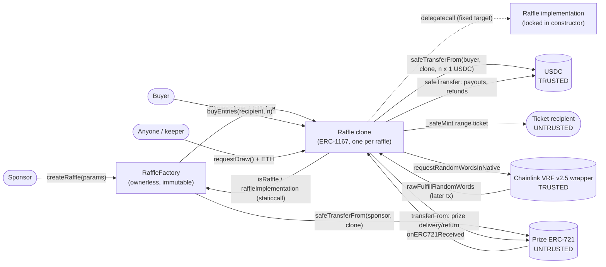
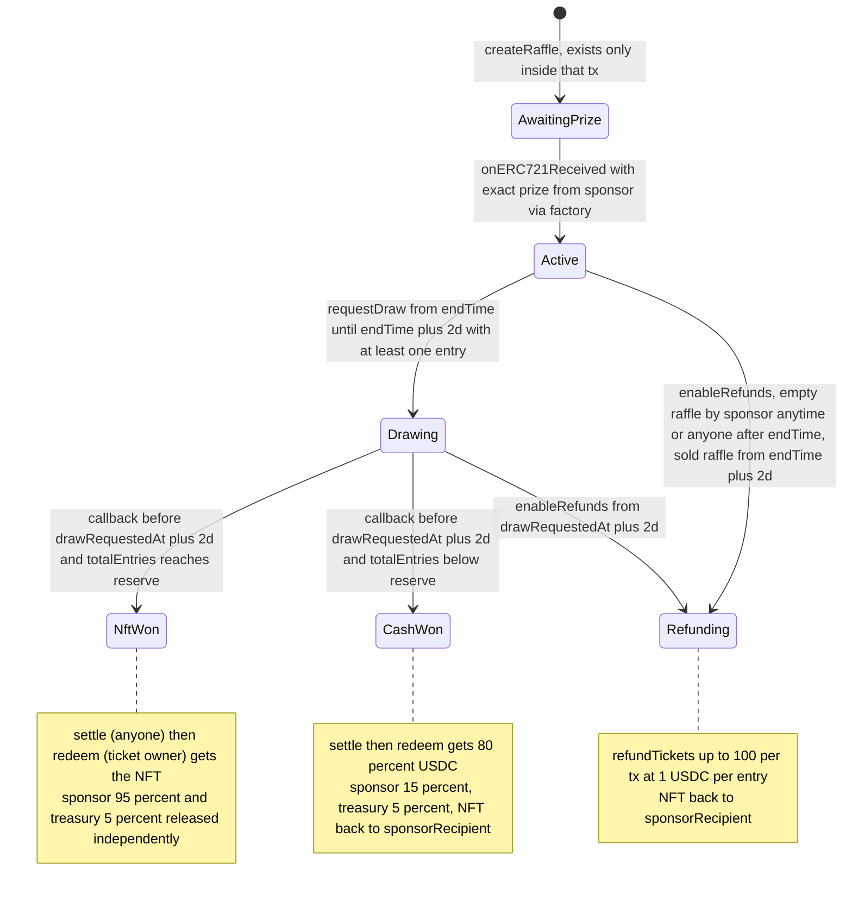
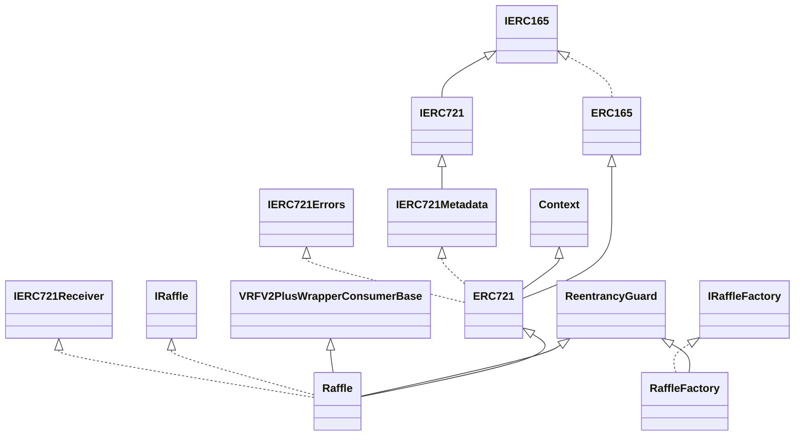

# Development Guidelines Analysis — raffle.fun Contracts

**Framework:** Trail of Bits *Building Secure Contracts — Development Guidelines* (guidelines-advisor)
**Project:** `@raffle-fun/contracts` v0.1.0 (contracts tagged `@custom:version 1.0.0`)
**Platform:** Solidity 0.8.36, EVM `cancun`, Ethereum (mainnet / Sepolia per `hardhat.config.ts`)
**Analysis date:** 2026-10-21
**Mode:** Non-interactive delegated run. No questions could be asked; open design questions are listed in §14.

---

## 0. Scope, Method, and Limitations

### 0.1 Authorized scope (five files)

| File | Lines | Role | SHA-256 |
|---|---:|---|---|
| `packages/contracts/src/Raffle.sol` | 614 | Per-raffle escrow, ERC-721 range tickets, VRF consumer, accounting | `6e4c977922c3e39fafaa8c4c4fb74a971f1817eca9b6552eb8a540969f968617` |
| `packages/contracts/src/RaffleFactory.sol` | 186 | Ownerless ERC-1167 factory and registry | `d0e62b34faa42513fd968f915262728fe66a15c4b9af13a3c66f496704142ace` |
| `packages/contracts/src/interfaces/IRaffle.sol` | 521 | Raffle types, events, errors, API | `a43ede9e8802d636a566fb225ed65bdf70f06d17f4734a1632a0a9f84aa5b2dd` |
| `packages/contracts/src/interfaces/IRaffleFactory.sol` | 150 | Factory types, events, errors, API | `747d238e4c7dc5b517f91c796dec87d9ddbfec9c626d1ff21467c60d780d03cf` |
| `packages/contracts/src/libraries/RaffleConstants.sol` | 43 | Fixed economics, timing, limits | `0893f1a70ac03ad557e0b4c8bdf6a2f73d317f8417d1b4a3c1a571b893ed54b6` |

Slither counts 710 SLOC across these five files.

**Context only (not assessed as findings):** `packages/contracts/node_modules` (31 vendored OpenZeppelin and Chainlink files), `foundry.toml`, `hardhat.config.ts`, `package.json`, `remappings.txt`, `pnpm-lock.yaml`, `dependency-hashes.json`. **Specification:** repository-root `DESIGN.md`.

### 0.2 What was done

1. Manual line-by-line review of all five in-scope files and of the inherited dependency code that affects behavior: `VRFV2PlusWrapperConsumerBase`, OZ `ERC721`, `ReentrancyGuard`, `Clones`, `SafeERC20`, `LowLevelCall`.
2. Dependency integrity: all 31 vendored files match `dependency-hashes.json` (SHA-256; re-checked at the end of the run, no mismatches).
3. Compilation of a scratch copy outside `packages/` with Foundry 1.7.1 and solc 0.8.36. It compiled cleanly with **zero compiler warnings**. Contract sizes, storage layout, and ABI were extracted.
4. Static analysis on the scratch copy: **Slither 0.11.6** (102 detectors, plus human-summary, inheritance, vars-and-auth, entry-points, and modifiers printers, plus a custom Slither-API entry-point, metrics, and complexity pass), **slither-check-upgradeability**, **Aderyn 0.6.8**, and **forge-lint**. Every result is triaged in Appendix A.
5. A NatSpec coverage check over the compiler AST: **217/217 documentable declarations documented, 0 missing `@param`/`@return` tags.**
6. **Scratch proof-of-concept tests** (10 total: 9 in `GuidelinesPoC`, 1 `GasProbe`) written and run *outside* `packages/` against mocks. They verify the claims below against code rather than relying on reading alone. All passed (Appendix B; source in Appendix D).
7. Mapping of every DESIGN.md clause to code (Appendix C).

**Nothing under `packages/` was modified.** This was verified at the end of the run: no new files, no build directories, unchanged hashes.

### 0.3 Limitations (recorded as limitations, not findings)

- **Tests, audit history, and CI were intentionally not provided.** Testing maturity, coverage, and CI security automation were therefore **not assessed**. §10 gives a project-specific property and test plan to check against the full repository.
- Files referenced by configuration but absent from this context: `test/foundry`, `test/hardhat`, `script/`, `scripts/check-coverage.mjs`, `scripts/write-deployment.ts`, `slither.config.json`, `ignition/modules/RaffleFun.ts`, `lib/forge-std`, and (per the `coverage` script) `src/mocks/`. The lockfile also shows `apps/web`, `packages/sdk`, `packages/subgraph`, and `packages/config`, which are out of scope. Recommendations that touch them are advisory.
- The PoCs used a mock USDC and a mock VRF wrapper. Real-wrapper pricing and overheads, USDC pause/blacklist, and real collection behaviors were not exercised. Fork testing is recommended (§10).
- The run was offline, so upstream security advisories for OZ 5.6.1, Chainlink 1.5.0, and solc 0.8.36 could not be checked.
- This is a **guidelines and best-practices review, not a full security audit.** Not finding something here does not mean it is absent.

---

## Executive Summary

The codebase is **small, deliberate, and unusually well engineered at the code level**:

- It is ownerless and immutable.
- Every user path is O(1) or bounded.
- It uses pull payments with claims that are independent of each other.
- The winner is proven ("verify, don't compute") rather than searched for on-chain.
- ERC-1167 clone storage pitfalls are handled correctly.
- The pragma is pinned exactly, NatSpec coverage is complete, and the build has zero compiler warnings.
- Slither and Aderyn reported **no true-positive High or Medium issues**; every reported item was triaged as accepted, benign, or a false positive.
- The scratch PoCs confirmed that the implemented economics and time windows match `DESIGN.md` exactly: 95/5, 80/15/5, 100% refunds, and the exclusive deadlines.

**No CRITICAL issues were identified.** The most important work before deployment is at the **system and trust-boundary level**, not in the code:

1. **GA-H1 — The NFT outcome has no fallback when prize delivery fails, while the sponsor's 95% is released independently.** A hostile prize contract passes every factory check without escrowing anything. An *honest* collection that pauses or restricts transfers after creation leaves the winner unable to redeem while the sponsor and treasury are paid. Both scenarios were demonstrated by PoC. This follows from the spec ("arbitrary prize contracts are untrusted" + "sponsor and treasury can claim independently"). It needs an explicit decision, disclosure, and off-chain mitigation.
2. **GA-H2 — `DESIGN.md` is a single paragraph** for a protocol that can never be patched. It needs a state machine, a trust and failure-mode catalog, invariants, and edge-case semantics. One wording conflict also needs resolving: `DESIGN.md` says prizes are "untrusted", while `IRaffle.sol:14-15` says "supported prizes are honest".
3. **GA-H3/H4 — Deployment verification and incident response must be written before deployment.** With no admin, a misconfiguration or a bug can only be addressed by deploying a successor factory.

Medium items cover user and market safety for transferable tickets: front-running of listings during `Drawing`, collections that look identical across raffles, liveness and keeper assumptions, and event ordering for the subgraph. Low items are hygiene and gas improvements: inline assembly → OZ `LowLevelCall`, transient storage, caching the implementation address, Slither suppression hygiene, and interface completeness.

**Overall assessment: code maturity HIGH; specification, operational, and user-risk documentation MODERATE.** Because the contracts are immutable, every recommendation here is cheap before deployment and impossible to apply after it.

---

## 1. Documentation & Specifications

### 1.1 Plain-English system description (generated)

**Purpose.** raffle.fun runs permissionless, ownerless NFT raffles on Ethereum, priced in canonical USDC.

**How it works.**

1. **Creation.** A sponsor holds an ERC-721 and calls `RaffleFactory.createRaffle`. The sponsor chooses a proceeds/prize-return recipient, a reserve (an entry-count threshold), and a sale end at most 30 days away. In one transaction the factory:
   - deploys an ERC-1167 clone of a single locked `Raffle` implementation;
   - initializes and registers it;
   - pulls the NFT into it.

   The clone accepts *only* that exact token, deposited by the factory, from the sponsor (`Raffle.sol:416-431`).
2. **Sales.** Until `endTime` (exclusive), anyone can buy any positive number of entries at exactly 1 USDC (1,000,000 raw units) each. Each purchase mints **one transferable ERC-721 "range ticket"** covering a contiguous, inclusive block of global entry numbers (`Raffle.sol:209-237`).
3. **Draw.** During `[endTime, endTime + 2 days)`, anyone may pay Chainlink VRF v2.5's native fee to request one random word, and any excess ETH is refunded (`Raffle.sol:240-273`). Only one request can ever be made.
4. **Resolution.** If the wrapper's callback arrives before `drawRequestedAt + 2 days`, the raffle records `winningEntry = word % totalEntries + 1` and the result (`Raffle.sol:509-524`):
   - **NftWon** if `totalEntries ≥ reserveEntries`;
   - **CashWon** otherwise.
5. **Settlement and redemption.**
   - Anyone may *settle* by naming the ticket whose range contains the winning entry. Settlement is storage-only and allocates the USDC liabilities (`Raffle.sol:533-558`).
   - The *current owner* of the winning ticket burns it to receive the NFT (NftWon) or 80% of the pot (CashWon). Any delivery failure reverts everything (`Raffle.sol:309-346`).
   - The sponsor recipient (95% in NftWon; 15% plus the NFT back in CashWon) and the treasury (5%) are released permissionlessly and independently (`Raffle.sol:375-407`).
6. **Refunds.** The raffle moves to **Refunding**, which pays 100% per entry and returns the NFT to the sponsor recipient, in three cases:
   - no draw is requested in time;
   - the callback is late or never arrives;
   - an empty raffle is closed (by the sponsor at any time, or by anyone after `endTime`).

   Ticket owners burn up to 100 tickets per transaction for 1 USDC per entry (`Raffle.sol:276-301`, `349-372`, `395-407`).

There is **no administrator, pause, upgrade, fee switch, or rescue path** anywhere.

### 1.2 Components

| Component | Role | Notes |
|---|---|---|
| `RaffleFactory` | Deploys the locked implementation in its constructor (`RaffleFactory.sol:89`). Clones, initializes, registers, and funds raffles atomically (`:97-148`). Registry (`isRaffle`, `raffleById`, `idByRaffle`). | Immutable `quoteToken`, `vrfWrapper`, `protocolTreasury`, `raffleImplementation` (`:33-42`). No owner. |
| `Raffle` implementation | Shared code for all clones. Locked in its constructor (`initialized = true`, `status = Refunding`, `Raffle.sol:164-165`). | Immutables `factory`, `quoteToken`, `i_vrfV2PlusWrapper`, `i_linkToken` are embedded in bytecode and shared by every clone (intended). |
| `Raffle` clone | One per raffle: escrow, ticket collection, VRF consumer, ledger. | Storage layout: 26 slots plus the ERC-7201 reentrancy slot. Runtime code 15,947 B (8,629 B under the EIP-170 limit). |
| `RaffleConstants` | Single source of truth for economics and timing (`RaffleConstants.sol:12-42`). | All `internal constant`, inlined at compile time. |
| `IRaffle` / `IRaffleFactory` | Public API, events, custom errors, full NatSpec. | Do not describe the inherited Chainlink/ERC-721 ABI (GA-L6). |
| USDC (external, **trusted**) | Quote asset. | Factory checks only code presence and `decimals() == 6` (`RaffleFactory.sol:66-78`). |
| Chainlink VRF v2.5 wrapper (external, **trusted**) | Randomness, native-fee direct funding. | Consumer base calls `link()` at construction (`VRFV2PlusWrapperConsumerBase.sol:45`). |
| Prize ERC-721 (external, **untrusted**) | Escrowed prize. | Can lie about custody and can block delivery (GA-H1). |
| Off-chain: web app, SDK, subgraph | Discovery, fee estimation, winning-ticket search, keepers. | "Advisory" per DESIGN.md. |

### 1.3 Actors and permissions

| Actor | Can do | Enforced at |
|---|---|---|
| Deployer | Deploy the factory once with USDC, wrapper, and treasury. **No residual powers.** | `RaffleFactory.sol:65-92` |
| Factory | `initialize` a clone, exactly once. | `Raffle.sol:177-179` |
| Sponsor (`createRaffle` caller, NFT owner) | Create a raffle. Close an **empty** raffle at any time. | `RaffleFactory.sol:112,128`; `Raffle.sol:280-284` |
| Sponsor recipient / treasury | Passive recipients (anyone may trigger releases). | `Raffle.sol:375-407` |
| Buyer | `buyEntries` (pays from `msg.sender`, ticket to any recipient). | `Raffle.sol:224` |
| Current ticket owner | `redeemWinningTicket`, `refundTickets`. Approved operators **cannot**. | `Raffle.sol:320-321, 359-360` |
| Anyone | `requestDraw` (pays the VRF fee), `enableRefunds` (after deadlines), `settleWinningTicket`, all `release*`. | — |
| VRF wrapper | `rawFulfillRandomWords`. | `VRFV2PlusWrapperConsumerBase.sol:101-107` |

### 1.4 Assumptions (explicit and inferred)

| # | Assumption | Source | Consequence if violated |
|---|---|---|---|
| A1 | USDC is the canonical 6-decimal token with standard, non-rebasing, fee-free transfers. | DESIGN.md; `IRaffle.sol:13-14`; `Raffle.sol:560-561` | Accounting drift. Only `decimals` is checked on-chain. |
| A2 | USDC is Circle-controlled: **pausable, blacklistable, upgradeable**. | *Inferred, undocumented* | A blacklisted **clone** freezes its USDC permanently. A pause only *delays* claims, because no claim has a deadline (positive). A blacklisted treasury or recipient affects only its own claim (positive). |
| A3 | The VRF wrapper is canonical, native-payment-enabled, and can be reconfigured or disabled by Chainlink. Oracles cannot bias outputs but can **withhold** them. | DESIGN.md (trusted); *withholding inferred* | Disabled or out-of-window → refunds after the deadline; the requester's fee is lost. Withholding lets an oracle choose "refund vs. result". |
| A4 | Prize contracts are arbitrary and untrusted, yet only "honest, standards-compliant ERC-721s" are *supported*. | DESIGN.md vs `IRaffle.sol:14-15` | GA-H1. |
| A5 | Ticket recipients are untrusted, but must accept ERC-721 if they are contracts (`_safeMint`). | `Raffle.sol:235` | The purchase reverts. Funds are safe. |
| A6 | Someone pays the VRF fee during the 2-day window. | *Implicit* | Otherwise everyone is refunded. Safe but poor UX (GA-M3). |
| A7 | Off-chain discovery is advisory; transactions must re-read chain state. | DESIGN.md | GA-L8 adds views that make this practical. |
| A8 | Ethereum PoS timestamps (12 s slots) are accurate at day scale. | Implicit | Negligible. |

### 1.5 Critical operations

`createRaffle` (escrow) · `buyEntries` (USDC in, ticket mint) · `requestDraw` (ETH fee, VRF request) · `fulfillRandomWords` (result) · `enableRefunds` (terminal branch) · `settleWinningTicket` (liability allocation) · `redeemWinningTicket` (asset out) · `refundTickets` (USDC out) · `releaseSponsorProceeds` / `releaseProtocolFees` / `releaseSponsorPrize` (assets out).

### 1.6 Architectural diagrams (generated)

**Contract interaction**



**Lifecycle state machine** (`IRaffle.Status`, `IRaffle.sol:21-34`)



Sub-state flags inside terminal states: `settlementComplete`, `winnerRedeemed`, `prizeClaimed` (`Raffle.sol:127-133`). All three terminal states are absorbing.

**Timeline**

```
 create              endTime                 endTime+2d
   |---- sales -------|---- draw request ------|---- (if still Active) enableRefunds() by anyone ---->
   | buyEntries()     | requestDraw() by anyone|
                      |   (pays VRF fee)       |
                      +-- drawRequestedAt ---------------------- drawRequestedAt+2d
                            | callback accepted (status Drawing)  | late callbacks ignored;
                                                                  | enableRefunds() by anyone ---->
 Empty raffle (0 entries): sponsor may enableRefunds() at any time; anyone from endTime.
 No claim (redeem, refund, release) ever expires.
```

**Inheritance** (Slither `inheritance` printer, verified)



### 1.7 Documentation assessment

**Code-level documentation is excellent.** All 217 documentable declarations (contracts, functions, events, errors, state variables, structs, and enum values) carry NatSpec, and none is missing `@param` or `@return` tags. State getters use `@inheritdoc`. The NatSpec was checked against the behavior and is **accurate**: deadlines, rounding, batch semantics, and ignored-callback cases all match the code. Contracts carry `@author` and `@custom:version 1.0.0`.

**System-level documentation is the gap.** `DESIGN.md` is one dense paragraph. The following are true in code but absent from or ambiguous in the spec (detailed in GA-H2):

| # | Gap | Where the behavior actually lives |
|---|---|---|
| D1 | No state machine or transition table | `Raffle.sol` (implicit across functions) |
| D2 | Empty-raffle semantics (sponsor closes any time; anyone after `endTime`) | `Raffle.sol:280-284`, `IRaffle.sol:322-324` |
| D3 | Who receives the rounding remainder (the sponsor, in both outcomes), and the fact that **with current constants no remainder can ever arise** (gross = n·10⁶; 5% = n·5·10⁴; 80% = n·8·10⁵ exactly) | `Raffle.sol:540-548` |
| D4 | Prize trust wording conflict ("untrusted" vs "supported prizes are honest") and what is *not* guaranteed for hostile prizes | DESIGN.md vs `IRaffle.sol:14-15` |
| D5 | Claims never expire; unredeemed NFT or cash stays forever | (absence of any deadline) |
| D6 | Stray assets are unrecoverable: USDC donations, forced ETH, unsolicited NFTs (only NFTs are documented) | `Raffle.sol:410-411` |
| D7 | Liveness and incentives: who pays the VRF fee, Chainlink disable or outage, oracle withholding | — |
| D8 | USDC pause, blacklist, and upgrade consequences | — |
| D9 | Secondary-market and MEV behavior of transferable tickets | — |
| D10 | Invariants (§10.1) | — |
| D11 | The implementation reports `status == Refunding` as its lock sentinel | `Raffle.sol:164-165` |
| D12 | Destination-screening rules and the code-less-address limitation | `Raffle.sol:587-605` (NatSpec partial) |
| D13 | The inherited ABI (`getBalance`, `getLinkToken`, `i_vrfV2PlusWrapper`, `rawFulfillRandomWords`) and empty `tokenURI` | OZ `ERC721.sol:76-89`; Chainlink base `:35, :101-117` |

---

## 2. On-Chain vs Off-Chain Computation

**Current split**

| On-chain | Off-chain (required) |
|---|---|
| Escrow, sales, ticket ranges, VRF request and callback, result, settlement proof, payouts, refunds, destination screening | Raffle discovery (subgraph); **locating the winning ticket** for `settleWinningTicket`; VRF fee estimation (`getVrfRequestPrice` uses `tx.gasprice`, so `eth_call` underquotes, as documented at `IRaffle.sol:360`); **keeper** to request the draw; refund batching (≤100 IDs/tx); deployment address verification |

**Assessment: exemplary.** The design applies the guideline's preferred pattern, *off-chain search with on-chain verification*:

- `_requireWinningTicket` (`Raffle.sol:579-585`) checks range containment in O(1).
- The callback does no search, loop, or transfer (`Raffle.sol:504-506`).
- Refunds are bounded per transaction (`RaffleConstants.sol:27`).
- There is no on-chain sorting or iteration over participants. Gas is flat in entry count: measured `buyEntries` ≈ 58k gas warm, and callback ≈ 23k gas with cold storage.

**Opportunities (view-only, no change to state-changing paths): GA-L8**

- `ticketOfEntry(uint128 entry) → ticketId`: a binary search over the sequential, contiguous `_ticketRanges`. It costs O(log n) SLOADs inside `eth_call`. Frontends could then find the winning ticket **from chain state alone**, which honors DESIGN.md's "transaction decisions must reread current chain state" without trusting the subgraph.
- `refundsAvailableAt()` and a time-aware `phase()`. `status` alone does not distinguish "Active, sale open" from "Active, draw window" from "Active, refunds enableable".

---

## 3. Upgradeability

**Verified absent:**

- No owner or role.
- No setters.
- No `delegatecall` in scope (grep and Slither).
- No `selfdestruct`.
- Clones target a fixed immutable implementation (`RaffleFactory.sol:42, 106`).

This matches DESIGN.md ("No administrator, mutable configuration or upgrade") and the guideline's preference for **migration over upgradeability**.

**What is missing is the migration procedure (GA-H4).** Write down before deployment:

- How a successor factory is deployed and verified.
- How the SDK, subgraph, and web app list multiple factories and stop surfacing new raffles on a deprecated one.
- That in-flight raffles complete autonomously on old code (no state migration is possible or needed).
- How users are told.

Consider exposing an on-chain `VERSION` constant. `@custom:version` exists only in metadata.

Cross-deployment note: a successor factory's screening will not recognize this factory's raffles. If "never move assets between raffle clones" is meant to hold *across* deployments, the successor must also reject predecessor raffles and tickets as prizes and destinations.

---

## 4. Delegatecall Proxy Pattern (ERC-1167 clones)

| Check | Result | Evidence |
|---|---|---|
| Storage layout compatibility | ✅ N/A by construction: clones share the implementation layout, with no upgrades | `forge inspect` layout (slots 0–25 plus the ERC-7201 guard slot) |
| Implementation initialized or locked | ✅ The constructor sets `initialized = true` | `Raffle.sol:164`; PoC `test_Implementation_is_locked_but_reports_Refunding` |
| Initialization front-running | ✅ Not possible: only `factory` may call, and it does so atomically in `createRaffle` | `Raffle.sol:177-179`; `RaffleFactory.sol:106-121` |
| Constructor-set storage invisible to clones | ✅ Handled: `name()`/`symbol()` are `pure` overrides (`Raffle.sol:479-487`); the OZ guard treats an unset slot (0) as "not entered" | PoC confirmed the clone guard slot = 0 and correct behavior |
| Immutables shared between implementation and clones | ✅ Intended: `factory`, `quoteToken`, wrapper, and LINK are embedded in code | `Raffle.sol:151-152` NatSpec |
| Function shadowing | ✅ N/A (ERC-1167 has no functions) | — |
| Direct implementation use | ⚠️ Safe, but by incidental emptiness. The implementation reports `Refunding`, so it **passes** the status gates of `refundTickets` and `releaseSponsorPrize`. They then fail only because no tickets exist and `prizeToken == address(0)`. | GA-L3; PoC |
| Implementation destruction | ✅ No `selfdestruct` (and EIP-6780 applies) | grep |
| Contract-existence checks | ✅ `Clones.clone` reverts on failed deployment. The factory checks code for USDC, wrapper, and prize. | `RaffleFactory.sol:66-67, 155, 183-185` |
| `slither-check-upgradeability` | `init-missing` (no OZ `Initializable`) and `initialize-target`, both informational. The custom one-shot init was reviewed manually and is sound. | Appendix A |

---

## 5. Function Composition

The code is organized into labelled sections (types, constants, state, errors, constructor, external, views, internal, private) with small, single-purpose helpers.

**Slither-measured complexity (top 8):**

| CC | LOC | Function | Comment |
|---:|---:|---|---|
| 10 | 38 | `Raffle.redeemWinningTicket` (`:309-346`) | Settle-or-verify, owner check, burn, NFT vs cash delivery. Candidate to split into `_deliverNftPrize` / `_deliverCashPrize`. |
| 8 | 34 | `Raffle.requestDraw` (`:240-273`) | Window checks, fee check, request, refund. Extract `_refundExcessNative`. |
| 8 | 26 | `RaffleFactory._validateCreateParams` (`:154-179`) | Fine; already isolated. |
| 7 | 31 | `Raffle.initialize` (`:176-206`) | Fine. |
| 7 | 28 | `RaffleFactory.constructor` (`:65-92`) | Fine. |
| 7 | 26 | `Raffle.enableRefunds` (`:276-301`) | Nested deadline logic. Extract a `_refundsDeadline()` view and expose it (GA-L8). |
| 5 | 52 | `RaffleFactory.createRaffle` (`:97-148`) | Long mostly because of the struct and event literals. Fine. |
| 5 | 29 | `Raffle.buyEntries` (`:209-237`) | Fine. |

Minor composition items (GA-L7):

- The magic number `1` (`numWords`) is repeated at `Raffle.sol:257, 437, 442, 511`. Use `RaffleConstants.VRF_NUM_WORDS`.
- The dead check `msg.sender == address(0)` in the constructor (`Raffle.sol:159`) can never be true.
- `redeemWinningTicket` ignores `_settleWinningTicket`'s return value (`:315`) and re-reads it from storage (`:339`). This is benign, but noted by Aderyn.

---

## 6. Inheritance

- `Raffle is IRaffle, ERC721, ReentrancyGuard, IERC721Receiver, VRFV2PlusWrapperConsumerBase` has 5 direct bases and 11 contracts in the linearization (`VRFV2PlusWrapperConsumerBase → IERC721Receiver → ReentrancyGuard → ERC721 → IERC721Errors → IERC721Metadata → IERC721 → ERC165 → IERC165 → Context → IRaffle`).
- `RaffleFactory is IRaffleFactory, ReentrancyGuard` has depth 1.
- **Assessment:** shallow and conventional, with no diamond ambiguity requiring explicit override lists. Overrides are limited to `name`, `symbol`, `_update`, and `fulfillRandomWords`.
- **Watch-outs:**
  - The inherited **public** surface goes beyond `IRaffle`: `i_vrfV2PlusWrapper()` duplicates `vrfWrapper()`, plus `getBalance()`, `getLinkToken()` (LINK is unused in native mode), and `rawFulfillRandomWords`. Document these in `IRaffle` or the SDK ABI notes (GA-L6).
  - The `_update` override (`Raffle.sol:497-502`) is the only hook into ERC-721 internals. It correctly skips screening for burns (`to == address(0)`).

---

## 7. Events

**Coverage:** every state-changing external entry point emits an event.

- `PrizeDeposited` (`:429`), `TicketPurchased` (`:236`), `DrawRequested` (`:272`), `VrfCallbackIgnored` and `RaffleResolved` (`:514, :523`), `RefundsEnabled` (`:300`), `WinningTicketSettled` (`:557`), `WinningTicketRedeemed` (`:345`), `TicketsRefunded` (`:371`), the three `*Released` events, and `RaffleCreated` (`RaffleFactory.sol:136-147`).
- ERC-721 `Transfer` and `Approval` events are also emitted.
- Naming is consistent, and actors and IDs are indexed.

**Improvements:**

| Item | Detail | Ref |
|---|---|---|
| Event ordering in `createRaffle` (GA-M4) | `PrizeDeposited` is emitted inside the prize's callback, **before** `RaffleCreated`. A hostile prize can also make the clone emit `TicketPurchased`/`Transfer` before `RaffleCreated`, because it controls execution during `safeTransferFrom` (`RaffleFactory.sol:128`). Subgraph data-source templates instantiated from `RaffleCreated` may miss these. | `RaffleFactory.sol:128-147` |
| `RaffleCreated` does not index `prizeToken` | Filtering or monitoring by collection, including scam-collection monitoring, needs it. | `IRaffleFactory.sol:41-52` |
| No clone-level config event | `initialize` sets reserve, endTime, and prize silently (Slither `events-maths`, Aderyn L-4). The factory's `RaffleCreated` covers this, but a self-describing clone event helps per-raffle indexers. | `Raffle.sol:176-206` |
| `TicketsRefunded` has no ticket IDs | Recoverable from ERC-721 `Transfer(owner, 0, id)`. Document this for the indexer. | `IRaffle.sol:153-159` |

**Monitoring to set up after deployment:**

1. `VrfCallbackIgnored` where `receivedRequestId == expectedRequestId` (a late or malformed callback for a live raffle).
2. `RefundsEnabled` from `Drawing` (a VRF failure).
3. `WinningTicketSettled` with no `WinningTicketRedeemed` after N days in `NftWon` (possible GA-H1 delivery failure).
4. Drift between `USDC.balanceOf(clone)` and `accountedQuoteBalance()`.
5. USDC `Blacklisted` events naming a clone, the treasury, or a sponsor recipient.
6. New raffles whose prize contract is a proxy or is unverified.

---

## 8. Common Pitfalls (systematic check)

| Pitfall | Status | Evidence / notes |
|---|---|---|
| Reentrancy (single, cross-function) | ✅ | Every value-moving entry point is `nonReentrant` (Slither entry-point pass). Effects precede untrusted calls (`redeem`: burn and flags before delivery, `:323-342`; `refund`: burns and liability before transfer, `:364-369`; `releaseSponsorPrize`: flag first, `:403`). Unguarded writers are `initialize` (one-shot), `onERC721Received` (AwaitingPrize only), `rawFulfillRandomWords` (wrapper-only), and ERC-721 transfer/approve (harmless). `buyEntries` pulls trusted USDC *before* effects (`:224` vs `:226-233`). Safe under the trust model and the guard, but CEI-first ordering would be more uniform. |
| Read-only reentrancy | ✅ (minor) | During `createRaffle`'s prize call, `isRaffle[clone] == true` before escrow is verified (`RaffleFactory.sol:125` vs `:129-134`). Negligible. |
| Access control | ✅ | Minimal privileged surface (§1.3). No `tx.origin`. |
| Initialization | ✅ | §4. |
| Arithmetic / overflow | ✅ | 0.8 checked math. Explicit `TotalEntriesOverflow` check (`:219-221`). Narrowing casts are bounded: `uint64(block.timestamp)` (`:253, :520`) and `uint128(word % total + 1) ≤ total` (`:518`). No `unchecked` blocks in scope. |
| Rounding / precision | ✅ | `Math.mulDiv` floors; remainder goes to the sponsor; no value is lost. With current constants, no rounding ever occurs (D3). |
| Bad randomness | ✅ | Chainlink VRF only (no `blockhash`/`prevrandao`). One request per raffle, so no re-roll. Modulo bias ≤ 2¹²⁸/2²⁵⁶ (negligible). `requestConfirmations = 30`. |
| VRF consumer best practices | ✅ | `fulfillRandomWords` never reverts and ignores in-flight, late, wrong-ID, duplicate, and wrong-length callbacks (`:510-516`). Callback does minimal work: measured ≈23k gas with cold storage, against a 300k limit (GA-L2e). |
| Oracle withholding | ⚠️ documented trust | A VRF operator could withhold an unfavorable output, forcing refunds. Inherent to VRF and bounded to "refund vs result". Document it (A3). |
| Timestamp dependence | ✅ accepted | Day-scale windows. Slither `timestamp` ×6 and forge-lint ×7 accepted. Boundaries are consistent and non-overlapping (PoC-verified). |
| Front-running / MEV | ⚠️ GA-M1 | The protocol state cannot be front-run profitably: no buys after `endTime`, the request is fixed before the outcome, and settlement is permissionless and idempotent. **Ticket secondary markets can be:** a pending VRF fulfillment reveals the result (the output is derivable from the proof in calldata) while tickets remain transferable. |
| DoS: unbounded loops | ✅ | The only loop is `refundTickets`, bounded at 100 (`:352-365`). Slither `calls-loop` is a false positive (no external call inside the loop; `_update` short-circuits on burn, `:498`). |
| DoS: external-call failure | ✅ | Pull pattern; each claimant's failure (blacklist, revert) is isolated. Winners and refunders can move tickets to a clean address. |
| Unchecked external returns | ✅ | `SafeERC20` for USDC. ERC-721 delivery verified with `ownerOf` after transfer (`:335, :405`). The native refund `success` is checked (`:269`). |
| Return-data bomb | ✅ | The refund call copies no return data (`:266-268`); the recipient is the caller anyway. |
| Forced ETH / stray assets | ✅ / INFO | `receive()` reverts (`:171-173`). No logic depends on `address(this).balance`. Forced ETH, USDC donations, and unsolicited NFTs are permanently stranded (GA-I2). |
| ERC-721 hooks / receivers | ✅ | Strict `onERC721Received` (`:421-426`). Tickets minted with `_safeMint`. Prize delivered with `transferFrom` (no callback into the winner; intentional, GA-I6). |
| Token integration: USDC | ✅ / ⚠️ A2 | Standard semantics assumed. Pause, blacklist, and upgrade are not documented (GA-H2). |
| Token integration: arbitrary ERC-721 prize | ⚠️ GA-H1 | Fake custody and blocked delivery both demonstrated. |
| Cross-raffle isolation ("never move assets between clones") | ✅ (edge: GA-I1) | `_update` and `_transferQuote` reject this raffle, the factory, the implementation, USDC, the wrapper, the prize, and registered raffles (`:593-605`). The factory rejects raffles and the implementation as prizes and recipients (`RaffleFactory.sol:157-169`). Code-less future clone addresses are not detected (PoC). |
| Approvals | ✅ | `buyEntries` always pulls from `msg.sender` (`:224`), so lingering per-clone USDC allowances cannot be spent by third parties. |
| Shadowing / naming | ✅ | No state shadowing (`prizeToken_` suffix used at `:593`). Slither `naming-convention` only for `ENTRY_PRICE()` (accepted). |
| Signature replay, `delegatecall`, `selfdestruct`, `tx.origin`, `ecrecover` | N/A | grep: none present. |

---

## 9. Dependencies

| Dependency | Pinned | Modules used | Assessment |
|---|---|---|---|
| `@openzeppelin/contracts` | **5.6.1 exact**; lockfile integrity `sha512-Ly6S…` | `ERC721` (file header v5.6.0), `ReentrancyGuard` (v5.5.0, ERC-7201 slot), `Clones` (v5.5.0), `SafeERC20` (v5.5.0), `Math` (v5.6.0), `IERC*` | ✅ Well-tested. No copied or reimplemented code. |
| `@chainlink/contracts` | **1.5.0 exact**; lockfile integrity `sha512-1fGJ…` | `vrf/dev/VRFV2PlusWrapperConsumerBase`, `vrf/dev/interfaces/IVRFV2PlusWrapper`, `vrf/dev/libraries/VRFV2PlusClient` | ✅ Official consumer path for VRF v2.5 direct funding. ⚠️ Heavy **build-time** transitive tree (GA-L5). |

Vendored files: 31/31 match `dependency-hashes.json`.

**Observations and recommendations:**

1. **Implicit remapping (GA-L5).** `remappings.txt` maps only `@openzeppelin/contracts/` and `forge-std/`. `@chainlink/` resolves only through Foundry's auto-detection (`forge remappings` prints `@chainlink/=node_modules/@chainlink/`). Make it explicit for reproducible builds and tooling (Slither, Echidna, Certora). `forge-std/` points to an absent `lib/forge-std` in this context.
2. **Supply-chain surface of the build environment (GA-L5).** `@chainlink/contracts@1.5.0` declares runtime dependencies on `@changesets/cli`, `@eslint/eslintrc`, `@arbitrum/nitro-contracts`, `@eth-optimism/contracts`, `@scroll-tech/contracts`, five OZ versions, and a **GitHub tarball** of `era-contracts` (`pnpm-lock.yaml:9705-9720`). None of these reach the deployed bytecode, but they run on build and CI machines. Options:
   - Vendor the three needed VRF files from a git-pinned commit.
   - Keep the hash manifest (already present) enforced in CI.
3. **`vrf/dev/` path.** This is the documented import path for VRF v2.5 consumers. Pin the deployed wrapper's version per chain in deployment docs and re-verify after any Chainlink package bump.
4. **Version monitoring.** Subscribe to OZ and Chainlink advisories. Record why these versions were chosen. Before deployment, confirm that no advisory affects `ERC721`, `Clones`, `SafeERC20`, `ReentrancyGuard`, or the VRF consumer base. This could not be checked offline.
5. **Optional OZ upgrades in place of custom code:** `LowLevelCall.callNoReturn` instead of inline assembly (GA-L1), and `ReentrancyGuardTransient` (GA-L2).

---

## 10. Testing & Verification

> **Limitation (not a finding):** Tests, coverage reports, audit history, and CI were intentionally excluded from this clean context, so testing maturity was **not assessed**. The configuration shows a mature intent: Foundry fuzz and invariant profiles `ci`, `audit`, `audit_strict`, `audit_release`, and `coverage`; Hardhat tests; a coverage gate; gas snapshots; solhint; and Slither. The plan below should be **checked against the full repository** before deployment.

The 10 scratch PoCs in Appendix B exist only to verify this report's claims. They are not a substitute for a test suite.

### 10.1 Properties the suite should contain (project-specific)

| ID | Property | Kind |
|---|---|---|
| P1 | **Solvency:** `USDC.balanceOf(raffle) ≥ accountedQuoteBalance()`, with equality absent donations | Invariant |
| P2 | Before settlement or refunds: `unsettledPot == grossSales() == totalEntries × ENTRY_PRICE` | Invariant |
| P3 | **Conservation after settlement:** winner + sponsor + protocol allocations (paid + unpaid) `== grossSales()`, exactly 95/5 or 80/15/5 | Invariant |
| P4 | In `Refunding`: `remainingRefundLiability == ENTRY_PRICE × Σ entries(unburned tickets)`; never underflows | Invariant |
| P5 | Ticket ranges partition `[1, totalEntries]` contiguously in ticket-ID order; `ticketRange(ticketCount).lastEntry == totalEntries` | Invariant |
| P6 | Status transitions only along the §1.6 DAG; `NftWon`, `CashWon`, and `Refunding` are absorbing; `AwaitingPrize` never persists past `createRaffle` | Invariant |
| P7 | The prize leaves at most once (`prizeClaimed`): to the ticket owner only in `NftWon`, to `sponsorRecipient` only in `CashWon`/`Refunding` | Invariant |
| P8 | No USDC, ticket, or prize transfer ever targets a protocol destination or any registered raffle | Invariant |
| P9 | At most one VRF request; `winningEntry ∈ [1, totalEntries]`; resolution only by a matching, in-window, single-word callback | Invariant / unit |
| P10 | Window boundaries: `buyEntries` at `endTime-1` ✓ and `endTime` ✗; `requestDraw` at `endTime` ✓ and `endTime+2d` ✗; `enableRefunds` at `endTime+2d-1` ✗ and `endTime+2d` ✓; callback at `drawRequestedAt+2d-1` ✓ and `+2d` ignored | Unit (boundary) |
| P11 | **Claim independence:** a reverting or blacklisted winner, sponsor recipient, or treasury never blocks the other claims | Unit with a blacklisting USDC mock |
| P12 | Redemption atomicity: any delivery failure (revert, silent no-op, wrong recipient) leaves the ticket unburned and every flag unchanged | Unit with hostile prize mocks |
| P13 | Every custom error and revert path is reached at least once | Coverage |

### 10.2 Techniques and configuration

- **Adversarial mocks:** fake/lying ERC-721 (Appendix D `FakePrize`); pausable or allowlisted collections; re-entrant ticket receivers; a USDC mock with pause and blacklist; a VRF mock that delivers duplicate, late, wrong-ID, wrong-length, and synchronous callbacks.
- **Fork tests** against the real Ethereum or Sepolia VRF v2.5 wrapper and real USDC. These validate `extraArgs` native mode, fee quoting under EIP-1559 `tx.gasprice`, actual callback gas plus wrapper overhead, and USDC pause and blacklist behavior.
- **Invariant runs** with bounded handlers, so `fail_on_revert = true` can be used in the main CI profile. Today only `audit_strict` and `audit_release` set it. Add at least one CI fuzz job with a random seed; the default seed `0x524146464c45` is fixed.
- **Echidna/Medusa** campaign on P1–P9 (Echidna is available in this environment).
- **Mutation testing** on comparison operators (`>=`/`<` boundaries at `Raffle.sol:216, 242, 245, 282, 287, 291, 512, 521, 582`), the most bug-prone spots in this code.
- **Slither in CI** with a triaged `slither.config.json` (referenced by `package.json` but absent here; see GA-L4).
- **Post-deployment verification script** (GA-H3).

---

## 11. Platform-Specific (Solidity)

| Item | Status |
|---|---|
| Compiler | `pragma solidity 0.8.36` pinned exactly in all five files. Foundry and Hardhat settings are identical: 0.8.36, optimizer 200 runs, `cancun`, no via-IR (`foundry.toml:7-11`, `hardhat.config.ts:14-37`) ✅. `profile.comparison` uses via-IR with 1,000 runs; make sure tests and audits target the deployment profile. Check the Solidity known-bugs list for 0.8.36 before deployment (not possible offline). |
| Warnings | **None** from solc 0.8.36 ✅ |
| Inline assembly | One block (`Raffle.sol:266-268`), correctly `memory-safe`. Replace it with OZ `LowLevelCall.callNoReturn(refundRecipient, excess, "")` (`LowLevelCall.sol:19-23`), which has identical semantics and is audited (GA-L1). |
| EVM target | `cancun` is supported on Ethereum mainnet and Sepolia. Re-check opcode support (PUSH0, MCOPY, TSTORE) for any future L2 target. |
| Transient storage | Available under `cancun` and 0.8.36. Verified: `bool private transient` compiles with this toolchain. Use it for `_requestInFlight` and the reentrancy guard (GA-L2). |
| Interfaces' pragma | An exact pin in `IRaffle`/`IRaffleFactory` forces SDK and integrator builds onto 0.8.36. Consider `^0.8.x` for interfaces only (GA-L6). |

---

## 12. Prioritized Recommendations

> IDs are referenced throughout. "Design" means the code matches DESIGN.md and the item asks for a decision or documentation. Effort estimates are rough. **Any change to `Raffle.sol` or `RaffleFactory.sol` requires re-review, because nothing can be patched after deployment.**

### CRITICAL (address immediately)

**None identified.** The review checked reentrancy, access control, initialization, arithmetic, randomness, VRF callback handling, accounting conservation, cross-raffle isolation, and every DESIGN.md economic and time clause. Conformance was confirmed by PoC (Appendix C).

### HIGH (address before deployment)

**GA-H1 — The NFT outcome has no fallback if prize delivery fails, while sponsor and treasury proceeds are released independently.** *(Design + documentation; buyers bear all prize-contract risk.)*

- **Where:** `RaffleFactory.sol:127-134` (escrow "verification" relies on the prize's own `ownerOf` and on the callback the prize itself makes); `Raffle.sol:416-431`; `:329-337` (delivery); `:375-392` (independent releases); `IRaffle.sol:14-15` vs DESIGN.md.
- **Evidence (PoC):**
  - `test_FakePrize_registers_and_sponsor_is_paid_while_winner_gets_nothing`: a contract that merely *claims* ERC-721 support creates a canonical (`isRaffle == true`), `Active` raffle without escrowing anything. At `NftWon` the sponsor withdraws 95% and the treasury 5%; the winner's redeem reverts forever.
  - `test_PausedHonestPrize_blocks_winner_but_not_sponsor`: the same result with an **honest** OZ ERC-721 whose third-party admin pauses transfers after creation. Pausable or upgradeable collections, and collections with transfer validators or allowlists, behave like this.
- **Why it matters:** factory registration looks like a trust signal but certifies nothing about the prize. Redemption has no deadline or alternative, so a failed delivery strands the winner permanently, while the protocol still collects its fee.
- **Recommendation (team decision):**
  - (A) Keep the current semantics, but disclose them explicitly in DESIGN.md, NatSpec (`releaseSponsorProceeds`, `RaffleCreated`, `isRaffle`), and the UI. Add **off-chain mitigations**: a curated or attested collection list; flagging proxies and pausable collections (EIP-1967 slot and code checks); and pre-flight simulation of `transferFrom(raffle → buyer)` with `eth_call` state overrides before showing a raffle.
  - (B) Gate `releaseSponsorProceeds` in `NftWon` on `prizeClaimed`, with a long fallback timeout. This changes DESIGN.md's "independently".
  - (C) Add a delivery-failure escape, for example converting to the `CashWon` split after a timeout. This needs funds that have not yet been released, so it implies (B).
- **Effort:** (A) 2–3 days; (B)/(C) 1–2 weeks including tests and re-review.

**GA-H2 — Expand the specification to match an immutable, ownerless protocol.** *(Documentation)*

- **Where:** `DESIGN.md` (one paragraph).
- **Add:**
  - the state machine and transition guards (§1.6);
  - the actor and permission matrix (§1.3);
  - the trust and failure-mode catalog (A1–A8): USDC pause, blacklist (including a blacklisted clone), and upgrade; VRF disable, outage, and withholding; prize classes (honest, pausable, upgradeable, transfer-restricted, rentable/delegated, hostile);
  - the invariants P1–P9;
  - edge semantics D2–D6 and D11–D13;
  - one resolved statement of what is and isn't guaranteed for untrusted prizes (D4).
- **Effort:** 3–5 days.

**GA-H3 — Deployment and post-deployment verification for irreversible configuration.** *(Process)*

- **Where:** `RaffleFactory.sol:58-92` (the NatSpec itself says tooling must verify canonical USDC); deployment scripts are absent from this context.
- **Recommendation:** a scripted, reviewed checklist that asserts:
  - `quoteToken` equals Circle's canonical USDC for the chain;
  - `vrfWrapper` equals Chainlink's published native-enabled v2.5 wrapper (and `link()` and `calculateRequestPriceNative` behave sanely);
  - the `protocolTreasury` custody model (multisig, recoverable, not USDC-blacklisted);
  - `raffleImplementation().initialized() == true`, with the expected sentinel status;
  - the constants (`callbackGasLimit`, `requestConfirmations`);
  - identical compiler settings and source verification on Etherscan;
  - a full lifecycle dry run on a mainnet fork with the real wrapper and USDC.
- **Effort:** 2–3 days.

**GA-H4 — Incident-response and migration runbook.** *(Process)*

- With no pause or admin, the only levers are off-chain: monitoring (§7), user communication, the SDK and web app de-listing new raffles on an affected factory, deploying a successor factory (§3), and guidance for raffles already in flight.
- Write and rehearse the runbook before launch.
- **Effort:** 1–2 days.

**GA-V1 (verification task, not a finding) — Confirm that the full repository's suite implements P1–P13 and the techniques in §10.2.** Tests were excluded from this context.

### MEDIUM (address for production quality)

**GA-M1 — Transferable tickets plus a publicly decodable VRF fulfillment allow front-running of ticket listings.**

- **Where:** `Raffle.sol:491-502` (transfers allowed in every state); `:509-524`.
- **Problem:** while `Drawing`, a pending fulfillment transaction reveals the output (it is derived from the proof's `gamma` in calldata). Searchers can buy the winning ticket's marketplace listing before the callback is mined. After resolution, stale listings of winning tickets, and sales of now-worthless losing tickets, carry the same risk.
- **Recommendation:**
  - Document this for users.
  - Have the SDK and web app warn against listing tickets in `Drawing` and display status prominently.
  - Optionally (a spec change) block transfers during `Drawing`, or expose an `isDecided()` view that marketplaces can read.
- **Effort:** 1–2 days (docs and UI); 3–5 days (spec change).

**GA-M2 — Ticket collections are indistinguishable across raffles.**

- **Where:** `Raffle.sol:479-487` (every raffle is "raffle.fun Ticket"/"RAFFLE"); OZ `ERC721.sol:76-89` (`tokenURI` returns `""`).
- **Problem:** combined with GA-H1, a scam raffle created through the canonical factory looks identical in wallets and marketplaces. Holders cannot see their range, the raffle, or its status.
- **Recommendation:** an on-chain `tokenURI` (or `contractURI`) encoding `raffleId`, prize collection and ID, entry range, and status; and/or include `raffleId` in `name()`/`symbol()`.
- **Effort:** 2–4 days.

**GA-M3 — Liveness depends on an unincentivized party paying the VRF fee.**

- **Where:** `Raffle.sol:240-273`.
- **Problem:** if nobody requests the draw within 2 days, every raffle reverts to refunds. That is safe, but sponsors and winners are surprised. Chainlink disablement, repricing, or an outage longer than 2 days has the same effect, and the requester loses the fee.
- **Recommendation:**
  - A keeper runbook (who runs it, and the fee budget).
  - SDK fee estimation via `estimateVrfRequestPrice(gasPrice)` plus a buffer.
  - Documentation that contract callers must accept the ETH refund, otherwise `NativeRefundFailed` at `:269`.
  - Alerts on raffles nearing `drawRequestDeadline()` without a request.
- **Effort:** 1–2 days.

**GA-M4 — Child events can precede `RaffleCreated`.**

- **Where:** `RaffleFactory.sol:128-147`.
- **Recommendation:** emit `RaffleCreated` before `safeTransferFrom` (atomicity preserved, because a revert discards the event), and update `IRaffleFactory.sol:30` accordingly. Alternatively, make the subgraph backfill clone state from contract calls instead of relying on `PrizeDeposited`.
- **Effort:** 0.5 day.

### LOW (nice to have / hygiene)

| ID | Recommendation | Where | Effort |
|---|---|---|---|
| GA-L1 | Replace inline assembly with `LowLevelCall.callNoReturn(refundRecipient, excess, "")`. | `Raffle.sol:262-270` | 1 h |
| GA-L2 | **Gas:** (a) store the implementation address as an immutable (`address(this)` in the constructor) to remove the external `raffleImplementation()` call from every mint, transfer, and payout (`:601`); (b) `ReentrancyGuardTransient` (each fresh clone's guard slot is 0, so the first `nonReentrant` call per clone pays a zero-to-nonzero SSTORE ≈20k gas; verified slot = 0); (c) `bool private transient _requestInFlight` (`:142`; compiles on 0.8.36); (d) avoid the second `calculateRequestPriceNative` call (`:249` and `VRFV2PlusWrapperConsumerBase.sol:82`) by calling the wrapper directly with `quotedFee`; (e) document the `callbackGasLimit = 300_000` rationale. Measured ≈23k gas with cold storage (≈26–30k with cold account access), and the requester pays for the full limit. Keep a margin for future repricing. | `Raffle.sol`, `RaffleConstants.sol:39` | 0.5–1 day |
| GA-L3 | Use a dedicated zero-value `Uninitialized` status and a distinct implementation lock instead of `AwaitingPrize = 0` plus a `Refunding` sentinel. Today the implementation passes the `Refunding` gates and is safe only because its state is empty. | `IRaffle.sol:21-34`; `Raffle.sol:164-165, 350, 397` | 2 h |
| GA-L4 | Fix the Slither suppression: `// slither-disable-next-line reentrancy-no-eth` (`RaffleFactory.sol:108`), while Slither reports `reentrancy-benign` for `raffleById`/`idByRaffle`. Add a triaged `slither.config.json` that records accepted detectors (timestamp, the calls-loop false positive). | `RaffleFactory.sol:107-108` | 1 h |
| GA-L5 | Make the `@chainlink/contracts/` remapping explicit; install and pin `forge-std`; reduce the Chainlink package's build-time dependency tree (§9). | `remappings.txt` | 2 h |
| GA-L6 | Document the inherited ABI in `IRaffle`/SDK (`getBalance`, `getLinkToken`, `i_vrfV2PlusWrapper`, `rawFulfillRandomWords`, ERC-721 surface). Deduplicate `ZeroAddress`/`UnsafeProtocolDestination` across interfaces: identical selectors bubble out of `createRaffle`, so it's ambiguous whether the factory or the clone rejected an input. Align the `quoteToken()` return type (`IERC20` vs `address`). Consider a floating pragma for interfaces. | `IRaffle.sol:191, 268, 424`; `IRaffleFactory.sol:57, 91, 110` | 2–4 h |
| GA-L7 | Composition clean-ups from §5: split `redeemWinningTicket`, extract `_refundExcessNative` and `_refundsDeadline`, add `VRF_NUM_WORDS`, remove the dead check at `:159`, use or drop the `_settleWinningTicket` return at `:315`. Optionally reorder `buyEntries` to effects-then-pull for uniform CEI. | `Raffle.sol` | 0.5 day |
| GA-L8 | View helpers: `ticketOfEntry(uint128)` (binary search), `refundsAvailableAt()`, time-aware `phase()`. | `Raffle.sol` (views only) | 0.5 day |
| GA-L9 | Events: index `prizeToken` in `RaffleCreated`; optionally add a clone-level configuration event; document that refunded IDs come from `Transfer` events. | `IRaffleFactory.sol:41-52`; `IRaffle.sol:153-159` | 1–2 h |

### INFORMATIONAL (document; no code change required)

| ID | Note | Evidence |
|---|---|---|
| GA-I1 | Screening skips code-less addresses, so a ticket can be sent to the **counterfactual address of the next clone** and becomes stranded once that clone exists. This is self-inflicted. NatSpec mentions it (`Raffle.sol:589-590`); add it to user docs. | PoC `test_Ticket_can_be_sent_to_codeless_future_clone_address` |
| GA-I2 | Stray assets (USDC donations, forced ETH, unsolicited NFTs) are unrecoverable, by design ("no rescue path"). | `Raffle.sol:171-173, 410-411` |
| GA-I3 | Bearer claims never expire. Unredeemed NFT or cash stays forever (by design). Monitor settled-but-unredeemed raffles. | Absence of deadlines |
| GA-I4 | The rounding clause is vacuous with current constants (D3). State this, and add a test or static assertion that would catch a constant change introducing remainders. | `RaffleConstants.sol:12-21` |
| GA-I5 | Positive: per-clone USDC allowances cannot be spent by third parties. Optional EIP-2612 `permit` purchases (USDC supports them) would remove the extra approval transaction. | `Raffle.sol:224` |
| GA-I6 | Contract recipients must implement `IERC721Receiver` to be *minted* tickets, but prize delivery uses `transferFrom`. A winner contract that cannot move ERC-721s strands the NFT. It is self-selected, since the winner calls `redeem`. Document. | `Raffle.sol:235, 334, 404` |

---

## 13. Strengths Worth Preserving

1. **Ownerless and immutable**, with a minimal privileged surface: factory-only one-shot init and sponsor-only empty-raffle close.
2. **O(1) hot paths:** range tickets, O(1) callback and settlement, bounded refunds, and the "prove the winner" pattern.
3. **Pull payments with independent claims:** a blacklist or revert for one party never blocks others, and claimants can re-route by moving tickets.
4. **Strict escrow intake and verified delivery:** exact-token receiver checks and `ownerOf` verification after transfer.
5. **Correct clone hygiene:** locked implementation, atomic init, `pure` metadata, guard semantics compatible with zeroed storage.
6. **Defensive VRF consumer:** a single request, no re-roll, a callback that never reverts and ignores late, wrong, duplicate, or in-flight callbacks, and an exact-window design with no overlap between "can request", "can refund", and "callback accepted".
7. **Cross-raffle isolation** enforced in three places: ticket `_update`, `_transferQuote`, and factory validation (including rejecting raffle tickets as prizes).
8. **Documentation discipline:** 100% NatSpec, contextual custom errors, a single constants library, exact compiler pin, zero warnings, and dependency hash manifests.

---

## 14. Open Questions for the Team (could not be asked in this run)

1. Is GA-H1 an accepted risk? If so, which off-chain prize curation and simulation will the web app enforce, and will `isRaffle` be described to users as non-certifying?
2. Should tickets be transferable during `Drawing` (GA-M1)?
3. Is permanent stranding of unredeemed prizes and cash intended, with no expiry or sweep (GA-I3)?
4. Who operates the draw keeper, and with what VRF fee budget (GA-M3)?
5. What is the treasury custody model, and has its USDC-blacklist exposure been considered?
6. Are chains beyond Ethereum mainnet and Sepolia planned? This affects `evm_version` and the canonical USDC and wrapper addresses.
7. Why `Refunding` as the implementation sentinel (GA-L3)?
8. What margin policy produced `callbackGasLimit = 300_000` (GA-L2e)?

---

## 15. Path to Production

1. **Week 1:** decide GA-H1 and document it. Complete GA-H2 (spec), GA-H3 (deployment verification), GA-H4 (runbook), and GA-M3 (keeper).
2. **Week 2:** apply any accepted code changes (GA-M2, GA-M4, GA-L1–L9). Each change resets the review baseline.
3. **Week 2–3:** confirm GA-V1 in the full repository (P1–P13, fork tests against the real wrapper and USDC, Echidna/Medusa, mutation testing, Slither in CI).
4. **Week 3–4:** external audit of the **final** bytecode-equivalent sources.
5. **Launch:** scripted deployment plus verification (GA-H3), published addresses, monitoring live (§7).

---

## Appendix A — Tool Output Triage

**solc 0.8.36:** 0 warnings. **forge-lint:** 7 × `block-timestamp` (`Raffle.sol:216, 242, 245, 282, 287, 291, 512`), accepted by design.

**Slither 0.11.6** (102 detectors; 12 results; 0 High, 0 Medium)

| Detector | # | Location | Triage |
|---|---:|---|---|
| `timestamp` | 6 | `enableRefunds`, `createRaffle`, `fulfillRandomWords`, `buyEntries`, `callbackDeadline`, `requestDraw` | Accepted: day-scale windows. |
| `calls-loop` | 2 | `_isProtocolDestination` via `refundTickets → _burn → _update` | **False positive:** `_update` short-circuits when `to == address(0)` (`Raffle.sol:498`). No external call occurs in the loop. |
| `reentrancy-benign` | 1 | `createRaffle` writes `raffleById`/`idByRaffle` after `initialize` | Benign: a fresh factory-owned clone under `nonReentrant`. The suppression at `:108` names a different detector (GA-L4). |
| `events-maths` | 1 | `initialize` | Covered by `RaffleCreated` (GA-L9). |
| `assembly` | 1 | `requestDraw` refund | GA-L1. |
| `naming-convention` | 1 | `IRaffle.ENTRY_PRICE()` | Accepted (constant getter). |

**slither-check-upgradeability:** `init-missing` (no OZ `Initializable`) and `initialize-target`. Informational; the custom init was reviewed (§4).

**Aderyn 0.6.8** (2 "High", 6 Low)

| Item | Triage |
|---|---|
| H-1 "Contract locks Ether" | **False positive:** `receive()` reverts (`Raffle.sol:171-173`) and `requestDraw` returns excess atomically. Only *forced* ETH can remain (GA-I2). |
| H-2 "State change after external call" (factory constructor `decimals()` try/catch; `createRaffle` after `initialize`) | **False positive / benign:** constructor-only immutables; a call into the factory's own fresh clone under `nonReentrant`. |
| L-1 SSTORE in loop / L-3 revert in loop | Inherent to the all-or-nothing batch burn, bounded at 100 and documented (`IRaffle.sol:341`). |
| L-2 large literals / L-6 uninitialized local | Style. |
| L-4 state change without event | Same as Slither `events-maths`. |
| L-5 unchecked return (`Raffle.sol:315`) | Benign; value re-read at `:339` (GA-L7). |

**Slither entry-point pass (custom):** every external function that moves value carries `nonReentrant`. The only unguarded state writers are `initialize`, `onERC721Received`, `rawFulfillRandomWords`, and the ERC-721 `approve`/`setApprovalForAll`/`transferFrom`/`safeTransferFrom`.

**Sizes:** `Raffle` runtime 15,947 B (margin 8,629 B), init 16,987 B. `RaffleFactory` runtime 3,949 B, init 21,870 B (margin 27,282 B under EIP-3860).

## Appendix B — Scratch PoC Results (run outside `packages/`, `forge test --offline`)

| Test | Verifies | Result |
|---|---|---|
| `test_NftWon_lifecycle_95_5_noResidual` | Permissionless settle; owner redeem; 95/5; zero residual USDC and liability; excess VRF fee refunded | PASS |
| `test_CashWon_lifecycle_80_15_5_prizeReturned` | Atomic settle-and-redeem; 80/15/5; prize return before settlement | PASS |
| `test_Refund_after_request_window_boundaries` | `enableRefunds` at `end+2d-1` ✗; `requestDraw` at `end+2d` ✗; 100% refunds; prize returned | PASS |
| `test_Callback_deadline_is_exclusive_and_late_callback_ignored` | A callback at the deadline is ignored without reverting; the raffle stays `Refunding` | PASS |
| `test_Implementation_is_locked_but_reports_Refunding` | Implementation lock; `Refunding` sentinel; `releaseSponsorPrize` passes the gate and fails on `address(0)`; `pure` name | PASS |
| `test_FakePrize_registers_and_sponsor_is_paid_while_winner_gets_nothing` | GA-H1 (hostile prize) | PASS |
| `test_PausedHonestPrize_blocks_winner_but_not_sponsor` | GA-H1 (honest but pausable prize) | PASS |
| `test_Ticket_can_be_sent_to_codeless_future_clone_address` | GA-I1, plus a positive control showing the same transfer is rejected once the clone exists | PASS |
| `test_Gas_ticket_transfer_screening` | Smoke test of the screened transfer paths (numbers confounded by warm/cold state; not cited) | PASS |
| `GasProbe.test_gas_probe` | `createRaffle` ≈ 373,450 gas; fresh-clone guard slot = 0; callback ≈ 23,390 gas with cold storage (`vm.cool`) against the 300,000 limit | PASS |

## Appendix C — DESIGN.md Conformance Matrix

| DESIGN.md clause | Implementation | Status |
|---|---|---|
| Immutable factory; ERC-1167 clones; immutable implementation | `RaffleFactory.sol:33-42, 89-91, 106` | ✅ |
| 1 entry = 1,000,000 units of 6-decimal USDC | `RaffleConstants.sol:21`; `Raffle.sol:223`; `RaffleFactory.sol:70-78` | ✅ (identity verified off-chain only; GA-H3) |
| One purchase mints one transferable ERC-721 for a contiguous inclusive range | `Raffle.sol:226-235` | ✅ |
| Exactly one ERC-721 prize escrowed atomically at creation | `RaffleFactory.sol:127-134`; `Raffle.sol:416-431` | ✅ for honest ERC-721s; ⚠️ unverifiable for hostile ones (GA-H1) |
| Reserve met: NFT to winner; 95% sponsor / 5% treasury | `Raffle.sol:521, 540-545` | ✅ PoC |
| Reserve missed: 80% winner, 15% sponsor, 5% treasury | `Raffle.sol:546-548` | ✅ PoC |
| Refund: 100% per entry, prize returned | `Raffle.sol:349-372, 395-407` | ✅ PoC |
| Floor on protocol fee; remainder allocated without loss | `Raffle.sol:540, 544, 547` | ✅ (no remainder arises with current constants, GA-I4) |
| No administrator, mutable configuration, or upgrade | Whole scope | ✅ |
| Request window `[end, end+2d)` | `Raffle.sol:242-247, 458-460` | ✅ PoC |
| Callback accepted strictly before `request+2d` | `Raffle.sol:512, 463-465` | ✅ PoC |
| Refunds open at the deadline | `Raffle.sol:276-301` | ✅ PoC (empty-raffle path is unspecified; D2) |
| Callback records result only | `Raffle.sol:509-524` | ✅ |
| Settlement permissionless and storage-only | `Raffle.sol:304-306, 533-558` | ✅ PoC |
| Redemption: current owner; atomic burn; full revert on delivery failure | `Raffle.sol:309-346` | ✅ PoC |
| Sponsor and treasury claim independently after settlement | `Raffle.sol:375-392` | ✅ (see GA-H1 consequence) |
| Never move assets between raffle clones | `Raffle.sol:497-502, 564-567, 593-605`; `RaffleFactory.sol:157-169` | ✅ (code-less edge, GA-I1) |
| USDC and Chainlink wrapper trusted; prizes and recipients untrusted | NatSpec; `nonReentrant`; verified delivery | ✅ with documentation gaps (A2, A3, D4) |
| Frontend advisory; decisions re-read chain state | Views exposed | ✅ (GA-L8 would make this easier) |

## Appendix D — Scratch PoC Source (reproducibility)

Place under `test/foundry/` in a scratch copy of `packages/contracts` (not in the repository) and run `forge test --offline --match-contract GuidelinesPoC -vv`. No forge-std is required: the file declares a minimal cheatcode interface.

<details>
<summary><code>GuidelinesPoC.t.sol</code> — mocks (USDC, VRF wrapper, pausable NFT, fake prize) and 9 tests</summary>

```solidity
// SPDX-License-Identifier: MIT
pragma solidity 0.8.36;

import { ERC721 } from "@openzeppelin/contracts/token/ERC721/ERC721.sol";
import { IERC721 } from "@openzeppelin/contracts/token/ERC721/IERC721.sol";
import { IERC721Receiver } from "@openzeppelin/contracts/token/ERC721/IERC721Receiver.sol";
import { IERC165 } from "@openzeppelin/contracts/utils/introspection/IERC165.sol";

import { Raffle } from "../../src/Raffle.sol";
import { RaffleFactory } from "../../src/RaffleFactory.sol";
import { IRaffle } from "../../src/interfaces/IRaffle.sol";
import { IRaffleFactory } from "../../src/interfaces/IRaffleFactory.sol";

interface Vm {
    function warp(uint256) external;
    function prank(address) external;
    function startPrank(address) external;
    function stopPrank() external;
    function deal(address, uint256) external;
    function expectRevert(bytes4) external;
    function expectRevert(bytes calldata) external;
    function expectRevert() external;
    function getNonce(address) external view returns (uint64);
    function computeCreateAddress(address, uint256) external pure returns (address);
    function toString(uint256) external pure returns (string memory);
}

contract MockUSDC {
    uint8 public constant decimals = 6;
    mapping(address => uint256) public balanceOf;
    mapping(address => mapping(address => uint256)) public allowance;

    function mint(address to, uint256 amount) external { balanceOf[to] += amount; }
    function approve(address spender, uint256 amount) external returns (bool) {
        allowance[msg.sender][spender] = amount;
        return true;
    }
    function transfer(address to, uint256 amount) external returns (bool) {
        balanceOf[msg.sender] -= amount;
        balanceOf[to] += amount;
        return true;
    }
    function transferFrom(address from, address to, uint256 amount) external returns (bool) {
        allowance[from][msg.sender] -= amount;
        balanceOf[from] -= amount;
        balanceOf[to] += amount;
        return true;
    }
}

contract MockVRFWrapper {
    uint256 public lastRequestId;
    uint256 public price = 0.01 ether;
    mapping(uint256 => address) public consumerOf;

    function link() external pure returns (address) { return address(0x1111); }
    function linkNativeFeed() external pure returns (address) { return address(0x2222); }
    function calculateRequestPriceNative(uint32, uint32) external view returns (uint256) { return price; }
    function estimateRequestPriceNative(uint32, uint32, uint256) external view returns (uint256) { return price; }
    function requestRandomWordsInNative(uint32, uint16, uint32, bytes calldata) external payable returns (uint256 id) {
        require(msg.value >= price, "fee");
        id = ++lastRequestId;
        consumerOf[id] = msg.sender;
    }
    function fulfill(uint256 id, uint256 word) external {
        uint256[] memory words = new uint256[](1);
        words[0] = word;
        (bool ok,) = consumerOf[id].call(abi.encodeWithSignature("rawFulfillRandomWords(uint256,uint256[])", id, words));
        require(ok, "callback reverted");
    }
}

/// Honest OZ ERC-721 whose third-party admin can freeze transfers (models pausable/upgradeable/allowlisted collections).
contract PausableNFT is ERC721 {
    bool public paused;
    address public immutable admin;
    constructor() ERC721("Mock", "MOCK") { admin = msg.sender; }
    function mint(address to, uint256 id) external { _mint(to, id); }
    function setPaused(bool p) external { require(msg.sender == admin, "admin"); paused = p; }
    function _update(address to, uint256 id, address auth) internal override returns (address) {
        require(!paused, "paused");
        return super._update(to, id, auth);
    }
}

/// Hostile "ERC-721": passes every factory check without ever holding or delivering a token.
contract FakePrize {
    address public reportedOwner;
    function supportsInterface(bytes4 id) external pure returns (bool) {
        return id == type(IERC721).interfaceId || id == type(IERC165).interfaceId;
    }
    function safeTransferFrom(address from, address to, uint256 tokenId) external {
        reportedOwner = to;
        require(IERC721Receiver(to).onERC721Received(msg.sender, from, tokenId, "") == IERC721Receiver.onERC721Received.selector);
    }
    function ownerOf(uint256) external view returns (address) { return reportedOwner; }
    function transferFrom(address, address, uint256) external pure { revert("never delivers"); }
}

contract GuidelinesPoC {
    event log_named_uint(string key, uint256 val);
    event log_named_address(string key, address val);

    Vm internal constant vm = Vm(address(uint160(uint256(keccak256("hevm cheat code")))));

    MockUSDC internal usdc;
    MockVRFWrapper internal wrapper;
    RaffleFactory internal factory;
    PausableNFT internal nft;

    address internal treasury = address(uint160(0x7000));
    address internal sponsor = address(uint160(0x5001));
    address internal sponsorRecipient = address(uint160(0x5002));
    address internal alice = address(uint160(0xA001));
    address internal bob = address(uint160(0xB001));
    address internal carol = address(uint160(0xC001));

    function setUp() public {
        usdc = new MockUSDC();
        wrapper = new MockVRFWrapper();
        factory = new RaffleFactory(address(usdc), address(wrapper), treasury);
        nft = new PausableNFT();
        nft.mint(sponsor, 1);
        nft.mint(sponsor, 2);
    }

    // ---------- helpers ----------
    function _eq(uint256 a, uint256 b, string memory m) internal pure {
        if (a != b) revert(string.concat(m, ": ", vm.toString(a), " != ", vm.toString(b)));
    }
    function _t(bool c, string memory m) internal pure { if (!c) revert(m); }

    function _create(address prize, uint256 tokenId, uint128 reserve) internal returns (Raffle r) {
        vm.startPrank(sponsor);
        if (prize == address(nft)) nft.approve(address(factory), tokenId);
        r = Raffle(payable(factory.createRaffle(IRaffleFactory.CreateRaffleParams({
            sponsorRecipient: sponsorRecipient,
            prizeToken: prize,
            prizeTokenId: tokenId,
            reserveEntries: reserve,
            endTime: uint64(block.timestamp + 7 days)
        }))));
        vm.stopPrank();
    }
    function _buy(Raffle r, address who, uint128 n) internal returns (uint256 id) {
        usdc.mint(who, uint256(n) * 1e6);
        vm.startPrank(who);
        usdc.approve(address(r), type(uint256).max);
        id = r.buyEntries(who, n);
        vm.stopPrank();
    }
    function _request(Raffle r) internal returns (uint256 reqId) {
        vm.deal(carol, 1 ether);
        vm.prank(carol);
        reqId = r.requestDraw{ value: 0.05 ether }();
        _eq(carol.balance, 1 ether - 0.01 ether, "excess VRF fee refunded to requester");
    }
    /// alice: ticket 1 = entries 1..6, bob: ticket 2 = entries 7..10; word 7 -> entry 8 -> bob's ticket 2.
    function _soldAndDrawn(uint128 reserve) internal returns (Raffle r) {
        r = _create(address(nft), 1, reserve);
        _eq(_buy(r, alice, 6), 1, "alice ticket");
        _eq(_buy(r, bob, 4), 2, "bob ticket");
        vm.warp(r.endTime());
        uint256 reqId = _request(r);
        wrapper.fulfill(reqId, 7);
        _eq(r.winningEntry(), 8, "winning entry");
    }

    // ---------- spec conformance ----------
    function test_NftWon_lifecycle_95_5_noResidual() public {
        Raffle r = _soldAndDrawn(10);
        _t(r.status() == IRaffle.Status.NftWon, "NftWon");
        vm.prank(carol);
        r.settleWinningTicket(2); // permissionless, storage-only
        vm.prank(bob);
        r.redeemWinningTicket(2);
        _t(nft.ownerOf(1) == bob, "winner holds prize");
        r.releaseSponsorProceeds();
        r.releaseProtocolFees();
        _eq(usdc.balanceOf(sponsorRecipient), 9_500_000, "sponsor 95%");
        _eq(usdc.balanceOf(treasury), 500_000, "treasury 5%");
        _eq(usdc.balanceOf(address(r)), 0, "no residual USDC");
        _eq(r.accountedQuoteBalance(), 0, "no residual liability");
    }

    function test_CashWon_lifecycle_80_15_5_prizeReturned() public {
        Raffle r = _soldAndDrawn(11);
        _t(r.status() == IRaffle.Status.CashWon, "CashWon");
        r.releaseSponsorPrize(); // permitted before settlement
        _t(nft.ownerOf(1) == sponsorRecipient, "prize returned");
        vm.prank(bob);
        r.redeemWinningTicket(2); // settles + redeems atomically
        r.releaseSponsorProceeds();
        r.releaseProtocolFees();
        _eq(usdc.balanceOf(bob), 8_000_000, "winner 80%");
        _eq(usdc.balanceOf(sponsorRecipient), 1_500_000, "sponsor 15%");
        _eq(usdc.balanceOf(treasury), 500_000, "treasury 5%");
        _eq(usdc.balanceOf(address(r)), 0, "no residual USDC");
    }

    function test_Refund_after_request_window_boundaries() public {
        Raffle r = _create(address(nft), 1, 10);
        _buy(r, alice, 6);
        _buy(r, bob, 4);
        uint256 end = r.endTime();
        vm.warp(end + 2 days - 1);
        vm.expectRevert(abi.encodeWithSelector(IRaffle.RefundsNotAvailable.selector, end + 2 days, end + 2 days - 1));
        r.enableRefunds();
        vm.warp(end + 2 days);
        vm.deal(carol, 1 ether);
        vm.prank(carol);
        vm.expectRevert(abi.encodeWithSelector(IRaffle.DrawRequestWindowExpired.selector, end + 2 days, end + 2 days));
        r.requestDraw{ value: 0.01 ether }();
        r.enableRefunds();
        uint256[] memory ids = new uint256[](1);
        ids[0] = 1;
        vm.prank(alice);
        r.refundTickets(ids);
        ids[0] = 2;
        vm.prank(bob);
        r.refundTickets(ids);
        r.releaseSponsorPrize();
        _eq(usdc.balanceOf(alice), 6_000_000, "alice refunded 100%");
        _eq(usdc.balanceOf(bob), 4_000_000, "bob refunded 100%");
        _t(nft.ownerOf(1) == sponsorRecipient, "prize returned");
        _eq(r.remainingRefundLiability(), 0, "liability cleared");
    }

    function test_Callback_deadline_is_exclusive_and_late_callback_ignored() public {
        Raffle r = _create(address(nft), 1, 10);
        _buy(r, alice, 6);
        vm.warp(r.endTime());
        uint256 reqId = _request(r);
        uint256 deadline = r.callbackDeadline();
        vm.warp(deadline);
        r.enableRefunds();
        wrapper.fulfill(reqId, 7); // emits VrfCallbackIgnored, does not revert
        _t(r.status() == IRaffle.Status.Refunding, "late callback cannot resolve");
    }

    // ---------- clone / implementation hygiene ----------
    function test_Implementation_is_locked_but_reports_Refunding() public {
        Raffle impl = Raffle(payable(factory.raffleImplementation()));
        _t(impl.initialized(), "impl initialized");
        _t(impl.status() == IRaffle.Status.Refunding, "impl sentinel status is Refunding");
        vm.prank(address(factory));
        vm.expectRevert(IRaffle.AlreadyInitialized.selector);
        impl.initialize(IRaffle.RaffleInitParams(sponsor, sponsorRecipient, treasury, address(nft), 1, 1, 1, uint64(block.timestamp + 1)));
        vm.expectRevert(); // passes the Refunding status gate, then fails on a call to prizeToken == address(0)
        impl.releaseSponsorPrize();
        _t(keccak256(bytes(impl.name())) == keccak256("raffle.fun Ticket"), "name is pure, not clone storage");
    }

    // ---------- trust-boundary probes ----------
    function test_FakePrize_registers_and_sponsor_is_paid_while_winner_gets_nothing() public {
        FakePrize fake = new FakePrize();
        Raffle r = _create(address(fake), 42, 10);
        _t(factory.isRaffle(address(r)), "fake-prize raffle is canonical");
        _t(r.status() == IRaffle.Status.Active, "fake-prize raffle is Active");
        _buy(r, alice, 6);
        _buy(r, bob, 4);
        vm.warp(r.endTime());
        wrapper.fulfill(_request(r), 7);
        _t(r.status() == IRaffle.Status.NftWon, "NftWon");
        r.settleWinningTicket(2);
        r.releaseSponsorProceeds();
        r.releaseProtocolFees();
        _eq(usdc.balanceOf(sponsorRecipient), 9_500_000, "sponsor paid 95%");
        vm.prank(bob);
        vm.expectRevert(bytes("never delivers"));
        r.redeemWinningTicket(2);
    }

    function test_PausedHonestPrize_blocks_winner_but_not_sponsor() public {
        Raffle r = _soldAndDrawn(10);
        nft.setPaused(true); // third-party collection admin action after creation
        r.settleWinningTicket(2);
        r.releaseSponsorProceeds();
        _eq(usdc.balanceOf(sponsorRecipient), 9_500_000, "sponsor paid while delivery is impossible");
        vm.prank(bob);
        vm.expectRevert(bytes("paused"));
        r.redeemWinningTicket(2);
        _t(r.status() == IRaffle.Status.NftWon && !r.winnerRedeemed(), "no fallback path exists");
    }

    function test_Ticket_can_be_sent_to_codeless_future_clone_address() public {
        Raffle a = _create(address(nft), 1, 10);
        uint256 t = _buy(a, alice, 1);
        address predicted = vm.computeCreateAddress(address(factory), vm.getNonce(address(factory)));
        vm.prank(alice);
        a.transferFrom(alice, predicted, t); // screening skips code-less addresses
        Raffle b = _create(address(nft), 2, 10);
        _t(address(b) == predicted, "prediction matches");
        _t(factory.isRaffle(address(b)) && a.ownerOf(t) == address(b), "ticket of raffle A now held by raffle B");
        // positive control: once B has code, the same transfer is rejected
        uint256 t2 = _buy(a, alice, 1);
        vm.prank(alice);
        vm.expectRevert(abi.encodeWithSelector(IRaffle.UnsafeProtocolDestination.selector, address(b)));
        a.transferFrom(alice, address(b), t2);
    }

    function test_Gas_ticket_transfer_screening() public {
        Raffle r = _create(address(nft), 1, 10);
        uint256 t = _buy(r, alice, 1);
        vm.prank(alice);
        uint256 g = gasleft();
        r.transferFrom(alice, bob, t);
        emit log_named_uint("transferFrom to EOA (incl. factory staticcall)", g - gasleft());
        address contractRecipient = address(new PausableNFT());
        vm.prank(bob);
        g = gasleft();
        r.transferFrom(bob, contractRecipient, t);
        emit log_named_uint("transferFrom to contract (2 factory staticcalls)", g - gasleft());
    }
}
```

</details>

<details>
<summary><code>GasProbe.t.sol</code> — createRaffle, guard-slot, and cold-storage callback gas</summary>

```solidity
// SPDX-License-Identifier: MIT
pragma solidity 0.8.36;

import { Raffle } from "../../src/Raffle.sol";
import { RaffleFactory } from "../../src/RaffleFactory.sol";
import { IRaffleFactory } from "../../src/interfaces/IRaffleFactory.sol";
import { MockUSDC, MockVRFWrapper, PausableNFT } from "./GuidelinesPoC.t.sol";

interface Vm2 {
    function warp(uint256) external;
    function prank(address) external;
    function startPrank(address) external;
    function stopPrank() external;
    function deal(address, uint256) external;
    function load(address, bytes32) external view returns (bytes32);
    function cool(address) external;
}

contract GasProbe {
    event log_named_uint(string key, uint256 val);
    Vm2 internal constant vm = Vm2(address(uint160(uint256(keccak256("hevm cheat code")))));

    function test_gas_probe() public {
        MockUSDC usdc = new MockUSDC();
        MockVRFWrapper wrapper = new MockVRFWrapper();
        RaffleFactory factory = new RaffleFactory(address(usdc), address(wrapper), address(0x7000));
        PausableNFT nft = new PausableNFT();
        address sponsor = address(0x5001);
        nft.mint(sponsor, 1);
        vm.startPrank(sponsor);
        nft.approve(address(factory), 1);
        uint256 g = gasleft();
        Raffle r = Raffle(payable(factory.createRaffle(IRaffleFactory.CreateRaffleParams(address(0x5002), address(nft), 1, 10, uint64(block.timestamp + 7 days)))));
        emit log_named_uint("createRaffle", g - gasleft());
        vm.stopPrank();

        bytes32 guardSlot = 0x9b779b17422d0df92223018b32b4d1fa46e071723d6817e2486d003becc55f00;
        emit log_named_uint("reentrancy guard slot on fresh clone", uint256(vm.load(address(r), guardSlot)));

        address a = address(0xA001);
        usdc.mint(a, 100e6);
        vm.startPrank(a);
        usdc.approve(address(r), type(uint256).max);
        g = gasleft();
        r.buyEntries(a, 5);
        emit log_named_uint("buyEntries #1 (guard slot 0->2->1)", g - gasleft());
        g = gasleft();
        r.buyEntries(a, 5);
        emit log_named_uint("buyEntries #2 (guard slot 1->2->1)", g - gasleft());
        vm.stopPrank();

        vm.warp(r.endTime());
        vm.deal(address(this), 1 ether);
        uint256 reqId = r.requestDraw{ value: 0.01 ether }();
        uint256[] memory words = new uint256[](1);
        words[0] = 7;
        vm.cool(address(r));
        vm.cool(factory.raffleImplementation());
        vm.prank(address(wrapper));
        g = gasleft();
        r.rawFulfillRandomWords(reqId, words);
        emit log_named_uint("rawFulfillRandomWords (callback gas, limit 300000)", g - gasleft());
    }
}
```

</details>

---

*Analysis completed using Trail of Bits Development Guidelines (guidelines-advisor). Tool runs and PoCs were executed on scratch copies outside `packages/`; nothing in the authorized scope was modified.*
