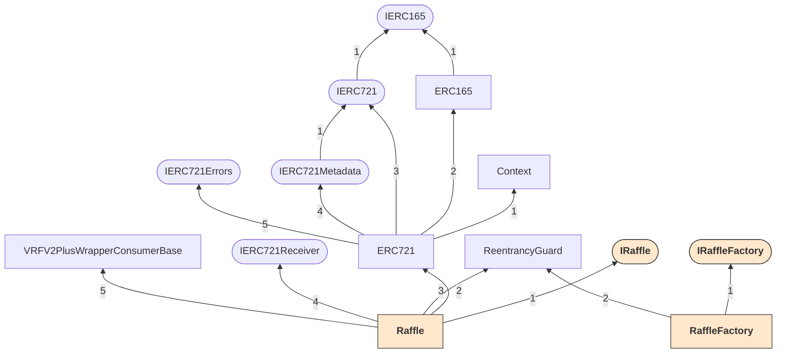
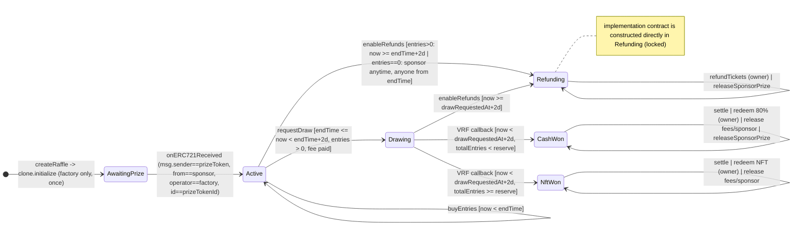
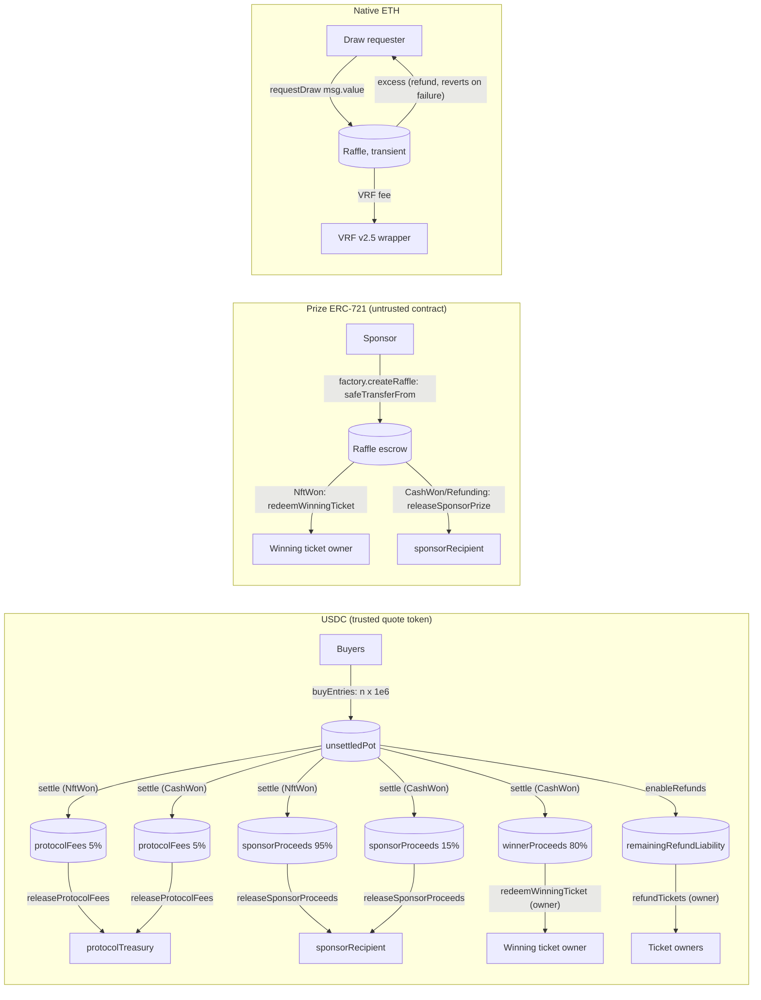

# Secure Development Workflow Report: raffle.fun contracts (TOB-S6)

Trail of Bits secure development workflow, all five steps, applied to `packages/contracts` (tool-assisted stage, non-interactive delegated run).

| Item | Value |
|---|---|
| Report date | 2026-10-21 |
| Specification | Repository-root `DESIGN.md` (sha256 `25b4248a…cbba1`); treated as the clean protocol specification |
| Authorized production scope | `packages/contracts/src/Raffle.sol`, `packages/contracts/src/RaffleFactory.sol`, `packages/contracts/src/interfaces/IRaffle.sol`, `packages/contracts/src/interfaces/IRaffleFactory.sol`, `packages/contracts/src/libraries/RaffleConstants.sol` (interfaces in scope) |
| Context-only dependencies | `packages/contracts/node_modules` (OpenZeppelin Contracts 5.6.1, Chainlink contracts 1.5.0); all 31 files match `dependency-hashes.json` |
| Compiler / settings | solc 0.8.36+commit.8a079791, optimizer on (200 runs), `evm_version = cancun`, `via_ir = false` (same as `foundry.toml` and `hardhat.config.ts`) |
| Tools used | Slither 0.11.6 (crytic-compile 0.4.2): detectors, printers, `slither-check-upgradeability`, `slither-check-erc`, Python API. Echidna 2.3.3. Foundry `forge` 1.7.1. |
| Tools not in this environment's toolset | Manticore, Medusa, Halmos, and graphviz `dot` are not on `PATH`, and there is no network to install them; forge-std is not installed. Each gap and its substitute is documented where it applies. |
| Constraint honored | No file under `packages/` was modified. SHA-256 of all 40 pre-existing files is identical before and after the work (Appendix A). |
| Artifacts | `tob-s6-artifacts/`: raw tool outputs, diagrams, custom Slither script, Echidna/Foundry harness, PoC tests, mutants. Everything the conclusions rely on is reproduced verbatim in the appendices. |

In-scope file fingerprints (SHA-256):

| File | Lines | SHA-256 |
|---|---:|---|
| `src/Raffle.sol` | 614 | `6e4c977922c3e39fafaa8c4c4fb74a971f1817eca9b6552eb8a540969f968617` |
| `src/RaffleFactory.sol` | 186 | `d0e62b34faa42513fd968f915262728fe66a15c4b9af13a3c66f496704142ace` |
| `src/interfaces/IRaffle.sol` | 521 | `a43ede9e8802d636a566fb225ed65bdf70f06d17f4734a1632a0a9f84aa5b2dd` |
| `src/interfaces/IRaffleFactory.sol` | 150 | `747d238e4c7dc5b517f91c796dec87d9ddbfec9c626d1ff21467c60d780d03cf` |
| `src/libraries/RaffleConstants.sol` | 43 | `0893f1a70ac03ad557e0b4c8bdf6a2f73d317f8417d1b4a3c1a571b893ed54b6` |

---

## Executive summary

The system is an ownerless `RaffleFactory` that deploys ERC‑1167 clones of a locked `Raffle` implementation. Each clone escrows one ERC‑721 prize, sells 1‑USDC entries as one ERC‑721 range ticket per purchase, draws a winner with Chainlink VRF v2.5 (native payment), and settles into pull-based liabilities.

**Overall result.**
- No critical or high-severity issue was found.
- The lifecycle state machine, timing windows, settlement arithmetic, refund accounting, reentrancy protection, clone initialization, and implementation locking all conform to `DESIGN.md`. This was checked by:
  - 15 triaged in-scope Slither results (none is a true positive);
  - ERC‑721/ERC‑165 conformance checks (all pass);
  - 7 custom Slither business-logic checks (6 pass, 1 flags a real gap);
  - 45 deterministic, fuzz, and probe tests, including exact boundary tests for every time window;
  - stateful fuzzing with a specification reference model under both Echidna and Foundry (no property violated; see Step 4 for call counts);
  - a mutation analysis: the specification suite killed 11 of 12 seeded mutants, and the 12th (M10) is observable only in the TOB‑S6‑1 scenario, whose PoC kills it (Step 4.5).
- Manual review found one design-level issue of medium severity (TOB‑S6‑3), two low-severity issues (TOB‑S6‑1, TOB‑S6‑2), and five informational items.

| ID | Title | Severity | Difficulty | Type |
|---|---|---|---|---|
| TOB‑S6‑1 | Protocol-destination screening is time-of-check and skips code-less addresses; prize-NFT outflows are never re-screened, so assets can move into another raffle clone | Low | High | Data Validation |
| TOB‑S6‑2 | Tickets remain transferable while the VRF result is pending, so the fulfillment can be front-run (sniping listed winning tickets) | Low | Medium | Timing |
| TOB‑S6‑3 | In the reserve-met (`NftWon`) outcome, sponsor and treasury payouts do not depend on the prize being deliverable; an untrusted or admin-controlled prize collection can pay the sponsor while denying the winner | Medium | High | Undefined Behavior (design) |
| TOB‑S6‑4 | Two empty-raffle paths are not in `DESIGN.md`: the sponsor can cancel at any time, and refunds open at `endTime` rather than at a deadline | Informational | Low | Access Controls / Specification |
| TOB‑S6‑5 | Immutable payout recipients have no recovery path from USDC blocklisting | Informational | High | Configuration |
| TOB‑S6‑6 | Value sent outside protocol flows (forced ETH, direct USDC, unsafe NFT transfers) is permanently stranded | Informational | Low | Data Validation |
| TOB‑S6‑7 | Security tooling that the package references (Slither config, tests, coverage script, deployment module) is absent | Informational | N/A | Testing |
| TOB‑S6‑8 | Storage-based `ReentrancyGuard` (deprecated in OpenZeppelin 5.5) on a Cancun target | Informational | N/A | Gas / Maintainability |

TOB‑S6‑1 through TOB‑S6‑6 are reproduced by passing tests in `tob-s6-artifacts/harness/test/`: `G_FindingsTest` G1–G6, `test_H5` (TOB‑S6‑3), and `test_D3` (TOB‑S6‑5). Probe `test_P1` in `tob-s6-artifacts/gas-probe/` covers the TOB‑S6‑1 deployment variant. Each asserts that the problematic behavior exists.

Workflow checklist (details at the end):

- [x] Step 1: Slither run; every in-scope result triaged with rationale (0 true positives).
- [x] Step 2: Applicable special-feature checks run (clone/initializer upgradeability checks, ERC‑721/ERC‑165 conformance, token-integration review); `slither-prop` shown not applicable.
- [x] Step 3: Inheritance, function-summary, and vars-and-auth printers run and reviewed. Diagrams rendered (SVG + Mermaid), plus a state-machine and asset-flow diagram.
- [x] Step 4: 32 security properties documented. Echidna and Foundry property harnesses built, validated (sanity tests, reachability canaries, mutation analysis), and run. Custom Slither checks written. Manticore unavailable; arithmetic properties proven by hand and fuzzed.
- [x] Step 5: Privacy, front-running, cryptography, and DeFi-interaction review completed, with PoCs.

### Process note: tool side effect (resolved)

My first Slither invocation passed solc arguments, but Slither's framework auto-detection gave `foundry.toml` priority (`Multiple frameworks detected … Using Foundry`) and ran `forge clean` and `forge build` inside `packages/contracts`. That created `out/` and `cache/`: 40 new build-artifact files. No pre-existing file was modified (verified by hash). Neither directory existed beforehand, so I moved them out of the tree to `tob-s6-artifacts/accidental-foundry-build/` and re-verified that the `packages/` tree is byte-identical to the pre-run snapshot: same 40 files, same SHA-256. The only residual trace is metadata: the modification time of the `packages/contracts` directory entry, updated when the two directories were created and moved out. Every later Slither-family run went through a wrapper (`tob-s6-artifacts/bin/sl.sh`) that forces `--compile-force-framework solc` and re-hashes `packages/` after each run. All other tools ran from directories outside `packages/`.

---

## Trust model and specification baseline (from `DESIGN.md`)

- **Trusted:** canonical six-decimal USDC (quote token) and the Chainlink VRF v2.5 native wrapper; the factory deployer, who supplies the immutable treasury, USDC, and wrapper addresses.
- **Untrusted:** arbitrary prize contracts, ticket recipients, every caller of the permissionless functions, and frontends ("discovery is advisory").
- **Normative properties used as the test oracle:**
  - 1,000,000 raw USDC per entry.
  - One ticket per purchase, covering a contiguous inclusive entry range.
  - Exactly one prize, escrowed atomically.
  - Outcome splits: reserve met → NFT to winner, 95% sponsor / 5% treasury; reserve missed → 80% winner / 15% sponsor / 5% treasury; refund → 100% per entry and the prize is returned. The protocol fee is floored on the aggregate pot and no remainder is lost.
  - No administrator, mutable configuration, or upgrade.
  - Request window `[endTime, endTime+2d)`; callback accepted strictly before `requestTime+2d`; refunds open at the deadline.
  - Settlement is permissionless and storage-only. Redemption requires the current ticket owner, burns the ticket atomically, and reverts everything on delivery failure.
  - Sponsor and treasury claim independently.
  - Assets never move between clones.

---

## Step 1: Known security issues (Slither)

### Commands

```bash
# canonical run: all 102 detectors, suppressed findings shown, solc mode (no writes under packages/)
tob-s6-artifacts/bin/sl.sh slither packages/contracts/src/RaffleFactory.sol --show-ignored-findings \
    --json tob-s6-artifacts/slither/detectors-all-show-ignored.json
# workflow-default variant
tob-s6-artifacts/bin/sl.sh slither packages/contracts/src/RaffleFactory.sol --exclude-dependencies \
    --json tob-s6-artifacts/slither/detectors-exclude-deps.json
```

`sl.sh` adds `--compile-force-framework solc --solc solc-0.8.36 --solc-remaps "@openzeppelin/contracts/=… @chainlink/contracts/=…" --solc-args "--optimize --optimize-runs 200 --evm-version cancun"`. `RaffleFactory.sol` transitively imports all five in-scope files; the `pragma` result lists all five, confirming coverage.

Two tool caveats affect how the output must be read:

- In solc mode, `--exclude-dependencies` does not classify `node_modules` as dependencies, so dependency results leak into the output.
- `--filter-paths node_modules` silently drops in-scope results that have *any* element in a dependency. It dropped the `reentrancy-benign` result for `Raffle.requestDraw`, because one of its elements lives in `VRFV2PlusWrapperConsumerBase`.

I therefore classified results myself: a result is in scope if any of its elements is in `packages/contracts/src/` (script: `tob-s6-artifacts/bin/slither_summary.py`).

### Result summary (raw counts from the JSON; full raw output in Appendix B)

| Detector | Impact | Confidence | Total | In scope |
|---|---|---|---:|---:|
| incorrect-exp | High | Medium | 1 | 0 |
| divide-before-multiply | Medium | Medium | 9 | 0 |
| reentrancy-no-eth (suppressed in source) | Medium | Medium | 1 | 1 |
| unused-return | Medium | Medium | 1 | 0 |
| calls-loop | Low | Medium | 2 | 2 |
| events-maths | Low | Medium | 1 | 1 |
| reentrancy-benign | Low | Medium | 2 | 2 |
| timestamp | Low | Medium | 6 | 6 |
| assembly | Informational | High | 54 | 1 |
| dead-code | Informational | Medium | 7 | 0 |
| naming-convention | Informational | High | 10 | 1 |
| pragma | Informational | High | 1 | 1 |
| solc-version | Informational | High | 7 | 0 |
| too-many-digits | Informational | Medium | 8 | 0 |
| **Total** | | | **110** | **15** |

### Triage of all 15 in-scope results

| ID | Detector (impact) | Location | Verdict | Rationale and evidence |
|---|---|---|---|---|
| S1‑01 | reentrancy-no-eth (Medium); suppressed in source by `slither-disable-next-line` at `RaffleFactory.sol:108` | `RaffleFactory.sol:109-125` (`isRaffle[raffle] = true` written after `initialize`) | False positive; suppression justified | The callee is a fresh clone of the trusted, locked implementation. `Raffle.initialize` makes only `STATICCALL`s to the factory's views (`raffleImplementation`, `isRaffle`), so no attacker code can run between the call and the write. `createRaffle` is also `nonReentrant`. The untrusted calls (`supportsInterface`, `safeTransferFrom`, `ownerOf` on the prize) come after every state write. The suppression is undocumented outside the source; record it in a triage database or `slither.config.json` (TOB‑S6‑7). |
| S1‑02, S1‑03 | calls-loop (Low) | `Raffle._isProtocolDestination` (`Raffle.sol:593-605`) reached from the `refundTickets` loop through `_burn → _update` | False positive | `_update` (`Raffle.sol:497-502`) evaluates `to != address(0) && _isProtocolDestination(...)`; burns pass `to == 0`, so the external factory calls never run inside the loop (the analysis is path-insensitive). The loop is capped at 100 tickets (`RaffleConstants.sol:27`), and the factory is trusted. The only external call in `refundTickets` is the single USDC transfer after the loop (custom check output, Appendix D). |
| S1‑04 | events-maths (Low) | `Raffle.initialize` (`Raffle.sol:176-206`) | Accepted | The same transaction emits `RaffleCreated` from the factory with `prizeTokenId`, `reserveEntries`, and `endTime` (`RaffleFactory.sol:136-147`). These values are write-once (custom check C5). |
| S1‑05 | reentrancy-benign (Low) | `RaffleFactory.createRaffle` (`raffleById`/`idByRaffle` written after `initialize`) | False positive | Same reasoning as S1‑01. |
| S1‑06 | reentrancy-benign (Low) | `Raffle.requestDraw` (`Raffle.sol:257-260`: `vrfRequestId`, `_requestInFlight` written after the wrapper call) | Accepted by design | The request ID exists only after the wrapper returns. `_requestInFlight` deliberately neutralizes a synchronous callback, verified by test `C1` with a wrapper mock that calls back during the request. The function is `nonReentrant`, and the wrapper is trusted by specification. |
| S1‑07 – S1‑11 | timestamp (Low) | `buyEntries`, `requestDraw`, `enableRefunds`, `fulfillRandomWords`, `createRaffle` | Accepted by design | The windows *are* the specification, at day granularity; post-Merge timestamps follow 12‑second slots. Every boundary was tested at `t-1` and `t` (tests A1–A4), and boundary mutants M01, M02, and M08 are killed. |
| S1‑12 | timestamp (Low) | `Raffle.callbackDeadline` (`Raffle.sol:464`, `drawRequestedAt != 0`) | False positive | A sentinel check, not a time comparison. |
| S1‑13 | assembly (Informational) | `Raffle.requestDraw` (`Raffle.sol:266-268`) | Accepted | A native refund through `call` with zero-length return-data copy, which avoids a return-data bomb. Success is checked; state is final before the call; the function is `nonReentrant`. Test C5 shows that a rejecting caller reverts the whole request. |
| S1‑14 | naming-convention (Informational) | `IRaffle.ENTRY_PRICE()` (`IRaffle.sol:396`) | Accepted | The getter of an UPPER_CASE constant. |
| S1‑15 | pragma (Informational) | all | Accepted | All in-scope files pin `pragma solidity 0.8.36`; floating ranges appear only in dependencies. |

**Dependency-only results (95, context only).**
- `incorrect-exp` and the 9 `divide-before-multiply` results are known false positives in OpenZeppelin `Math.mulDiv`: the XOR is an intentional Newton–Raphson seed.
- `unused-return` concerns `VRFV2PlusWrapperConsumerBase.requestRandomness`, the LINK-payment path, which `Raffle` never calls (it uses `requestRandomnessPayInNative`).
- The rest (`assembly`, `dead-code`, `naming-convention`, `solc-version`, `too-many-digits`) are informational.
- None affects in-scope behavior.

**Step 1 status: Slither report fully triaged (0 true positives).** Commit the triage (S1‑01 … S1‑15) as a Slither triage database or `slither.config.json` so CI can fail on *new* results (see TOB‑S6‑7).

---

## Step 2: Special features

Applicability was decided by searching the code (raw grep evidence in Appendix C), not by assumption:

| Feature | Applicable? | Evidence | Check run |
|---|---|---|---|
| Upgradeability / proxies | **Yes**, as initializer-based ERC‑1167 minimal proxies. Nothing is upgradeable. | `Clones.clone(raffleImplementation)` at `RaffleFactory.sol:106`; `initialize()` at `Raffle.sol:176` | `slither-check-upgradeability` + manual clone review |
| ERC token implementation | **Yes**: `Raffle` *is* an ERC‑721 (ticket) and ERC‑165 | `contract Raffle is IRaffle, ERC721, …` at `Raffle.sol:28` | `slither-check-erc` ERC721, ERC165 |
| ERC‑20 implementation (`slither-prop`) | **No**: USDC is only integrated, through `IERC20`, `SafeERC20`, and `IERC20Metadata`; no in-scope contract implements ERC‑20. The human-summary printer lists ERC‑20 only for the interfaces `LinkTokenInterface` and `IERC20Metadata`. | grep output, Appendix C | Not applicable (documented) |
| Third-party token integration | **Yes**: USDC (trusted) and arbitrary ERC‑721 prizes (untrusted) | `SafeERC20` at `Raffle.sol:224,566`; prize `safeTransferFrom` / `transferFrom` / `ownerOf` | Manual token-integration review below. Running the dedicated `token-integration-analyzer` skill on prize handling is also recommended. |

### 2.1 Upgradeability and ERC-1167 clones

`slither-check-upgradeability` ran on the implementation (raw output in Appendix C). There is no proxy *source*, since ERC‑1167 is fixed bytecode generated by `Clones`. 8 detectors ran with 2 informational results:
- `init-missing`: the OpenZeppelin `Initializable` contract is not used.
- `initialize-target`: `Raffle.initialize` must be called.

Both are expected; my manual checks follow.

| Clone/initializer risk | Status | Evidence |
|---|---|---|
| Front-running `initialize` on a fresh clone | Safe | The clone is created and initialized in the same transaction (`RaffleFactory.sol:106-121`). `initialize` reverts unless `msg.sender == factory` (an immutable) and `!initialized` (`Raffle.sol:177-179`). Test E2. |
| Implementation can be initialized or used | Safe | The constructor sets `initialized = true; status = Refunding` (`Raffle.sol:164-165`). Test E1 shows that `initialize`, `buyEntries`, `enableRefunds`, and `releaseSponsorPrize` all revert on the implementation. Global invariant I10 holds throughout fuzzing. |
| Constructor-only state invisible to clones | Safe | ERC‑721 `_name` and `_symbol` are unused because `name()` and `symbol()` are overridden as `pure` (`Raffle.sol:479-487`). `ReentrancyGuard` starts at slot value 0 in clones, and the guard compares against `ENTERED (2)`, so it works; reentrancy tests F1 and F2 run on clones. |
| Immutables shared by clones | Intended | `factory`, `quoteToken`, `i_vrfV2PlusWrapper`, and `i_linkToken` live in implementation bytecode and are therefore identical for every clone. |
| `delegatecall` / `selfdestruct` in the implementation | None | Custom Slither check C7. |
| Storage collisions | None | ERC‑1167 has no storage. The `ReentrancyGuard` slot is ERC‑7201 namespaced (`0x9b779b17…5f00`), and the linear layout runs from slot 0 to 25 (Appendix D). |
| Upgrade path or admin | None | `raffleImplementation` is immutable (`RaffleFactory.sol:42`). The factory's only state-changing entry point is `createRaffle` (custom check C6). |

### 2.2 ERC conformance

`slither-check-erc … Raffle --erc erc721` and `--erc erc165` pass every function, return-type, mutability, and event check (raw output in Appendix C). Manual notes:
- `_update` (`Raffle.sol:497-502`) rejects transfers *to* protocol addresses. ERC‑721 permits this restriction, and test E4 confirms it.
- `tokenURI` always returns `""`, and `name()`/`symbol()` are identical across all clones. Wallets and marketplaces therefore cannot tell raffles apart by metadata, so users must verify the collection address with `factory.isRaffle` ("discovery is advisory").
- `supportsInterface` does not advertise `IERC721Receiver`; this is not required.

### 2.3 Token integration

| Concern | USDC (trusted quote token) | Arbitrary ERC‑721 prize (untrusted) |
|---|---|---|
| Interface validation | `decimals() == 6` at factory construction (`RaffleFactory.sol:70-78`); token identity must come from deployment tooling | ERC‑165 `supportsInterface(IERC721)` and code presence (`RaffleFactory.sol:155,171-177`) |
| Transfer semantics | `SafeERC20` for every movement. Amounts are assumed exact (no fee-on-transfer or rebasing), as the natspec documents (`Raffle.sol:560-567`). | Escrow uses `safeTransferFrom` and `onERC721Received` with strict sender, operator, from, and id checks (`Raffle.sol:416-431`). Delivery uses `transferFrom` followed by an `ownerOf` check (`Raffle.sol:334-337, 404-405`). |
| Admin powers | Pause: only delays flows (refunds have no deadline; the draw needs no USDC). Blocklist: tickets are bearer claims and can route around it, but the immutable `sponsorRecipient` and `protocolTreasury` cannot (TOB‑S6‑5). Upgradeability: trusted by specification. | Pause, transfer validators (e.g., ERC721‑C), upgrades, and expiry (e.g., ENS) can freeze or lose the escrowed prize after creation (TOB‑S6‑3). A malicious contract can fake escrow, because `ownerOf` and the receiver hook are self-reported; buyers must vet the collection. |
| Reentrancy | Not expected (trusted) | Every raffle entry point is `nonReentrant`. Test F2 shows that a prize which re-enters five functions during delivery is blocked each time. |
| Cross-raffle isolation | `_transferQuote` re-screens destinations at payout time | **Not re-screened at delivery** (TOB‑S6‑1) |

---

## Step 3: Visual security inspection

Printers ran on an analysis entry file outside `packages/` (`tob-s6-artifacts/step3/Scope.sol`, which only imports the five in-scope files). This avoids the inheritance and call-graph printers writing `<target>.dot` next to the target, which would have been inside `packages/contracts/src`.

### 3.1 Inheritance graph

Command:

```bash
sl.sh slither tob-s6-artifacts/step3/with-interfaces/Scope.sol --print inheritance-graph --include-interfaces
```

Graphviz is unavailable, so the DOT output (Appendix D) was rendered with a stdlib-only renderer (`tob-s6-artifacts/bin/dot_inheritance_to_svg.py`) to `tob-s6-artifacts/diagrams/inheritance-graph.svg`, and to Mermaid below. Edge labels give declaration order.



C3 linearization (from the Slither API, most-derived first):
- `Raffle`: `Raffle → VRFV2PlusWrapperConsumerBase → IERC721Receiver → ReentrancyGuard → ERC721 → IERC721Errors → IERC721Metadata → IERC721 → ERC165 → IERC165 → Context → IRaffle`
- `RaffleFactory`: `RaffleFactory → ReentrancyGuard → IRaffleFactory`

Review:
- **No state-variable shadowing** (0 red entries) and **no C3 function collisions** (0 "collides in inherited contracts" labels). A targeted run of 29 detectors, including `shadowing-state`, `shadowing-abstract`, `shadowing-local`, `shadowing-builtin`, `variable-scope`, `missing-inheritance`, and `unimplemented-functions`, reports nothing beyond the suppressed S1‑01 (Appendix D.9).
- Every orange (overriding) function is an intentional `override`: 23 in `Raffle`, namely 18 `IRaffle` implementations, `name`/`symbol`/`_update` from ERC721, `onERC721Received`, and `fulfillRandomWords`. `RaffleFactory` has 1.
- **Inherited public surface worth knowing:**
  - `rawFulfillRandomWords`, gated to the wrapper (test C3);
  - `getBalance()` and `getLinkToken()` from the Chainlink base (harmless views; `getBalance` exposes force-sent ETH, TOB‑S6‑6);
  - the `i_vrfV2PlusWrapper()` getter, which duplicates `vrfWrapper()`;
  - the unguarded ERC‑721 entry points (`approve`, `setApprovalForAll`, `transferFrom`, `safeTransferFrom`). These are not `nonReentrant`, but they only reach the trusted factory views and the recipient hook. Ticket mobility during `Drawing` is the subject of TOB‑S6‑2.

### 3.2 Function summary

`--print entry-points` (raw output; the full `--print function-summary` rows are in Appendix D):

| Contract | Function | Modifiers | Inherited from |
|---|---|---|---|
| Raffle | `receive()` | payable (always reverts `DirectNativeTransfer`) | |
| Raffle | `initialize(RaffleInitParams)` | — (guarded by `msg.sender == factory`, once) | |
| Raffle | `buyEntries(address,uint128)` | nonReentrant | |
| Raffle | `requestDraw()` | nonReentrant, payable | |
| Raffle | `enableRefunds()` | nonReentrant | |
| Raffle | `settleWinningTicket(uint256)` | nonReentrant | |
| Raffle | `redeemWinningTicket(uint256)` | nonReentrant | |
| Raffle | `refundTickets(uint256[])` | nonReentrant | |
| Raffle | `releaseSponsorProceeds()` / `releaseProtocolFees()` / `releaseSponsorPrize()` | nonReentrant | |
| Raffle | `onERC721Received(...)` | — (strict prize/sponsor/factory/id checks) | |
| Raffle | `approve`, `setApprovalForAll`, `transferFrom`, `safeTransferFrom` ×2 | — | ERC721 |
| Raffle | `rawFulfillRandomWords(uint256,uint256[])` | — (wrapper only) | VRFV2PlusWrapperConsumerBase |
| RaffleFactory | `createRaffle(CreateRaffleParams)` | nonReentrant | |

Compact summary from the Slither Python API (state writes and external calls are *transitive*; full table in Appendix D):

| Entry point | Who may call | Effective authorization | State written (transitively) | External calls (transitively) | Risk notes |
|---|---|---|---|---|---|
| `createRaffle` | anyone | Pulls the prize from `msg.sender` only | `raffleCount`, `raffleById`, `idByRaffle`, `isRaffle` | prize `supportsInterface`, `safeTransferFrom`, `ownerOf`; clone `initialize`, `status` | Untrusted prize calls happen after all writes, under `nonReentrant` |
| `initialize` | factory | `msg.sender == factory && !initialized` | config, `status` | factory views | Write-once (C5) |
| `buyEntries` | anyone | pays from `msg.sender` | `totalEntries`, `ticketCount`, `_ticketRanges`, `unsettledPot`, ERC‑721 storage | USDC `transferFrom`; recipient `onERC721Received`; factory views | Recipient hook runs after all writes (CEI) |
| `requestDraw` | anyone | time window + fee | `status`, `drawRequestedAt`, `vrfRequestId`, `_requestInFlight` | wrapper price + request; native refund (assembly `call`) | Excess refunded; a failing refund reverts everything |
| `enableRefunds` | anyone (sponsor alone for an empty raffle before `endTime`) | deadlines | `status`, `remainingRefundLiability`, `unsettledPot` | — | TOB‑S6‑4 |
| `settleWinningTicket` | anyone | winning range proof | buckets, `settlementComplete`, `winningTicketId` | — | Storage-only, as specified |
| `redeemWinningTicket` | current ticket owner | `msg.sender == ownerOf(id)` | redemption flags, buckets, ERC‑721 burn | prize `transferFrom` + `ownerOf`, or USDC `transfer` | Prize path not re-screened (TOB‑S6‑1) |
| `refundTickets` | current ticket owners | `msg.sender == ownerOf` for each id; 1–100 ids | `remainingRefundLiability`, burns | USDC `transfer` | |
| `releaseSponsorProceeds` / `releaseProtocolFees` | anyone | fixed recipients | the bucket | USDC `transfer` | Immutable recipients (TOB‑S6‑5) |
| `releaseSponsorPrize` | anyone | `CashWon` or `Refunding`, `!prizeClaimed` | `prizeClaimed` | prize `transferFrom` + `ownerOf` | No runtime destination screen (TOB‑S6‑1) |
| `rawFulfillRandomWords` | wrapper | `msg.sender == wrapper` | `winningEntry`, `resolvedAt`, `status` | — | Never reverts for valid ABI (C2) |

### 3.3 Variables and authorization

`--print vars-and-auth` (raw rows in Appendix D) combined with the API map:

| Variable(s) | Writers | Authorization | Assessment |
|---|---|---|---|
| `sponsor`, `sponsorRecipient`, `protocolTreasury`, `prizeToken`, `prizeTokenId`, `raffleId`, `reserveEntries`, `endTime` | `initialize` only | factory, once | Write-once configuration (C5). Matches "no mutable configuration". |
| `factory`, `quoteToken`, `i_vrfV2PlusWrapper`, `i_linkToken` | constructor | n/a (immutable) | Shared by all clones by design |
| `status` | constructor, `initialize`, `onERC721Received`, `requestDraw`, `fulfillRandomWords` (through `rawFulfillRandomWords`), `enableRefunds` | per the state machine | Exactly the expected writer set (C4) |
| `totalEntries`, `ticketCount`, `_ticketRanges` | `buyEntries` | anyone who pays, while Active and before `endTime` | Monotonic |
| `unsettledPot` | `buyEntries` (+), `enableRefunds` / settlement (→ 0) | lifecycle-gated | Conserved (invariants I1, I3) |
| `remainingRefundLiability` | `enableRefunds`, `refundTickets` | ticket owner | Equals the value of unrefunded tickets (I7) |
| `winnerProceeds`, `sponsorProceeds`, `protocolFees`, `settlementComplete`, `winningTicketId` | settlement (`settleWinningTicket` or inline in `redeemWinningTicket`), the releases | permissionless; fixed recipients | Exact splits (B1, settlement checks) |
| `winnerRecipient`, `winnerRedeemed` | `redeemWinningTicket` | current ticket owner | |
| `prizeClaimed` | `redeemWinningTicket` (NftWon), `releaseSponsorPrize` | owner / permissionless | Set before the external transfer (CEI) |
| `vrfRequestId`, `drawRequestedAt`, `_requestInFlight` | `requestDraw` | permissionless | |
| `winningEntry`, `resolvedAt` | `rawFulfillRandomWords` | wrapper only | |
| `raffleCount`, `raffleById`, `idByRaffle`, `isRaffle` | `createRaffle` | permissionless | Registry consistency (I12) |

No variable can be written by a party the specification does not authorize. The authorization-relevant gaps are about *destinations*, not *writers* (TOB‑S6‑1, TOB‑S6‑5).

### 3.4 Additional diagrams: lifecycle state machine and asset flows

Derived from the code and confirmed by custom check C4 and by the fuzzing oracle:





Two things the diagrams show:
- The time windows are disjoint and fully partition time after `endTime`: request `[end, end+2d)` then refunds `[end+2d, ∞)`; callback `[req, req+2d)` then refunds `[req+2d, ∞)`.
- The only asset edges whose destination is not re-validated at transfer time are the two prize edges (TOB‑S6‑1).
