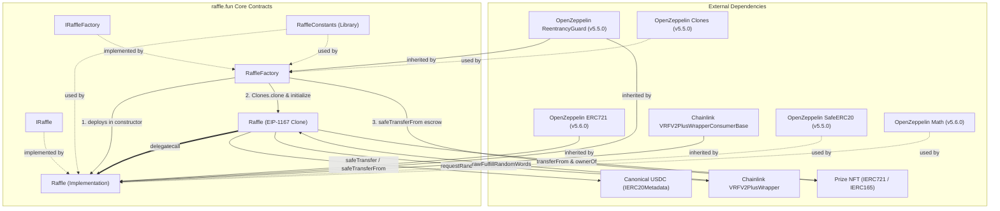
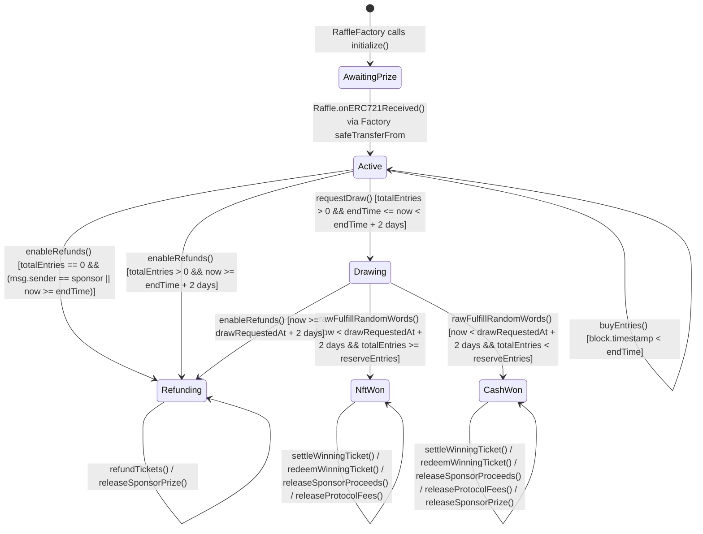
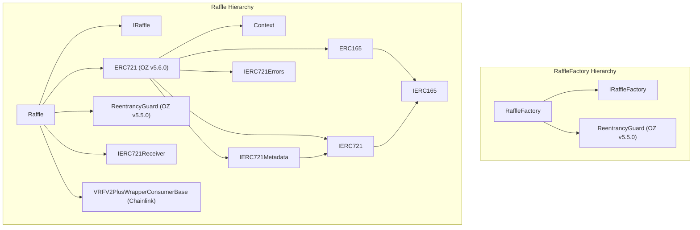

# Security Review — raffle.fun (Trail of Bits 6-Stage Methodology)

- **Cell ID**: `GEMINI-TOB` (`attempt-01`, Cold Source-Only Review)
- **Provider / Model**: Google Gemini (`gemini-4-argon`, Gemini 4 Argon (High))
- **Upstream Methodology**: Trail of Bits (`trailofbits/skills` @ `82fe8226252622fa807643bdca1710901198553a`)
- **Target Commit**: `9238b6ce8eb7f768c0dcd0cfcef26e1427a03155`
- **Executed Stages**:
  1. `audit-context-building` (`subagents/stage-1-audit-context-building.md`)
  2. `entry-point-analyzer` (`subagents/stage-2-entry-point-analyzer.md`)
  3. `token-integration-analyzer` (`subagents/stage-3-token-integration-analyzer.md`)
  4. `guidelines-advisor` (`subagents/stage-4-guidelines-advisor.md`)
  5. `spec-to-code-compliance` (`subagents/stage-5-spec-to-code-compliance.md`)
  6. `secure-workflow-guide` + `code-maturity-assessor` (`subagents/stage-6-secure-workflow-and-code-maturity.md`)

## Consolidated Findings Summary

| ID | Severity | Title | Primary Location |
|---|---|---|---|
| `TOB-GEMINI-01` | **Medium** | Predictable `CREATE` clone addresses bypass `_isProtocolDestination` before deployment, permanently locking quote payouts/tickets and allowing cross-clone ERC-721 prize transfer in `releaseSponsorPrize` | `Raffle.sol:L334, L404, L497-L502, L565, L593-L605`, `RaffleFactory.sol:L125, L165-L167` |
| `TOB-GEMINI-02` | **Medium** | Decoupled `releaseSponsorProceeds` in `Status.NftWon` allows sponsor to extract 95% of buyer USDC when untrusted/pausable/restricted `prizeToken` reverts in `redeemWinningTicket` | `Raffle.sol:L329-L339, L375-L382, L533-L558`, `RaffleFactory.sol:L171-L177` |
| `TOB-GEMINI-03` | **Low** | Discontinuous payout cliff at `totalEntries == reserveEntries` and unrestricted single-buyer under-target `requestDraw` enable sponsor self-purchase arbitrage and 20% fee extraction | `Raffle.sol:L209-L236, L243-L248, L521, L539-L550` |
| `TOB-GEMINI-04` | **Low** | Pre-`endTime` empty-raffle cancellation (`enableRefunds`) can be front-run by a 1-USDC `buyEntries` call, locking the prize NFT for up to 32 days | `Raffle.sol:L209, L280-L285` |
| `TOB-GEMINI-05` | **Low** | `Raffle.onERC721Received` sets `Status.Active` inside `prize.safeTransferFrom` before `RaffleCreated` is emitted, allowing untrusted `prizeToken` to call `buyEntries` mid-creation | `RaffleFactory.sol:L139-L147`, `Raffle.sol:L416-L431` |
| `TOB-GEMINI-06` | **Informational** | Missing `reserveEntries` upper bound, unrestricted secondary ticket transfers during `Status.Drawing`, and ERC-1167 `ReentrancyGuard` cold-slot / `VRF_CALLBACK_GAS_LIMIT` gas overhead | `RaffleFactory.sol:L178`, `Raffle.sol:L497-L502`, `RaffleConstants.sol:L39` |

---


---

# Trail of Bits Stage 1 — Audit Context Building (`audit-context-building`)

## Phase 1 — Initial Orientation & Architectural Overview

### Scope Inventory (Frozen Commit `9238b6ce8eb7f768c0dcd0cfcef26e1427a03155`)
1. `packages/contracts/src/Raffle.sol` (614 lines, `pragma solidity 0.8.36`, `cancun`): Per-raffle EIP-1167 clone implementation inheriting `IRaffle`, `ERC721`, `IERC721Receiver`, `VRFV2PlusWrapperConsumerBase`, and `ReentrancyGuard`.
2. `packages/contracts/src/RaffleFactory.sol` (186 lines, `pragma solidity 0.8.36`): Non-upgradeable factory deploying `Raffle` clones via `Clones.clone(raffleImplementation)`, recording registry mappings (`raffleById`, `idByRaffle`, `isRaffle`), and escrowing the prize NFT via `safeTransferFrom`.
3. `packages/contracts/src/interfaces/IRaffle.sol` (521 lines): External interface, lifecycle state enum (`Uninitialized`, `Initialized`, `Active`, `Drawing`, `NftWon`, `CashWon`, `Refunding`), custom errors, events, and function specifications.
4. `packages/contracts/src/interfaces/IRaffleFactory.sol` (150 lines): Factory interface, `CreateRaffleParams` struct, errors, events, and view specifications.
5. `packages/contracts/src/libraries/RaffleConstants.sol` (43 lines): Protocol-wide constants (`ENTRY_PRICE = 1_000_000`, `QUOTE_DECIMALS = 6`, `BPS_DENOMINATOR = 10_000`, `NFT_WON_SPONSOR_BPS = 9_500`, `CASH_WON_WINNER_BPS = 8_000`, `CASH_WON_SPONSOR_BPS = 1_500`, `PROTOCOL_FEE_BPS = 500`, `MAX_SALE_DURATION = 30 days`, `DRAW_REQUEST_TIMEOUT = 2 days`, `DRAW_CALLBACK_TIMEOUT = 2 days`, `VRF_CALLBACK_GAS_LIMIT = 300_000`, `VRF_REQUEST_CONFIRMATIONS = 3`, `VRF_NUM_WORDS = 1`).

---

## Phase 2 — Ultra-Granular Function Micro-Analysis

### `RaffleFactory::constructor(address quoteToken_, address vrfWrapper_, address protocolTreasury_)` (`RaffleFactory.sol:L68-L103`)
- **Purpose**: Validates immutable factory parameters (`quoteToken`, `vrfWrapper`, `protocolTreasury`), checks `quoteToken.decimals() == 6` via `staticcall`, verifies `vrfWrapper.link() != address(0)`, and deploys the singleton `raffleImplementation = address(new Raffle(vrfWrapper_))` at factory nonce `1`.
- **Risk Seams**:
  - `protocolTreasury_` is checked against `address(0)`, `address(this)`, `quoteToken_`, `vrfWrapper_`, and `raffleImplementation`, and checked for `!isRaffle[protocolTreasury_]` (`L165`). However, if `protocolTreasury_` equals a future clone `CREATE` address $R_k = 	ext{CREATE}(	ext{factory}, k+1)$, `createRaffle` will revert permanently at clone $k$ when `Raffle::initialize` checks `_isProtocolDestination`.

### `RaffleFactory::createRaffle(CreateRaffleParams calldata params)` (`RaffleFactory.sol:L106-L150`)
- **Purpose**: Validates `params`, increments `raffleCount`, deploys a minimal proxy clone via `Clones.clone(raffleImplementation)`, initializes the clone, updates registry mappings (`raffleById`, `idByRaffle`, `isRaffle`), transfers the NFT via `prize.safeTransferFrom(msg.sender, raffle, params.prizeTokenId)`, verifies `prize.ownerOf(params.prizeTokenId) == raffle`, and emits `RaffleCreated`.
- **Risk Seams**:
  - **Predictable `CREATE` clone address**: `Clones.clone` uses `CREATE`, making future clone addresses predictable before deployment (`code.length == 0`, `isRaffle == false`).
  - **Mid-escrow activation**: `Raffle::onERC721Received` sets `status = Status.Active` inside `prize.safeTransferFrom` before `createRaffle` verifies `ownerOf` or emits `RaffleCreated`. Since the clone's own `ReentrancyGuard` is not entered during `createRaffle`, an untrusted `prizeToken` can call `raffle.buyEntries` before `RaffleCreated` is emitted.

### `Raffle::initialize(...)` (`Raffle.sol:L176-L206`) & `Raffle::_isProtocolDestination(address destination, address prizeAsset)` (`Raffle.sol:L593-L605`)
- **Purpose**: One-time clone initializer restricted to `msg.sender == factory`. Validates destinations via `_isProtocolDestination` and sets `status = Status.Initialized`.
- **Risk Seams**:
  - `_isProtocolDestination` only checks `canonicalFactory.isRaffle(destination)` when `destination.code.length != 0` (`Raffle.sol:L601`). A precomputed future clone address $R_{	ext{future}}$ has `code.length == 0` and `isRaffle == false` prior to deployment, bypassing `_isProtocolDestination` in `initialize`, `buyEntries`, and `_update`.

### `Raffle::buyEntries(address recipient, uint128 entryCount)` (`Raffle.sol:L209-L236`) & `Raffle::_update(address to, uint256 tokenId, address auth)` (`Raffle.sol:L497-L502`)
- **Purpose**: Accepts `entryCount * ENTRY_PRICE` in `quoteToken` via `safeTransferFrom`, increments `totalEntries`, `unsettledPot`, and `ticketCount`, records `TicketRange(startEntry, endEntry)`, and mints sequential `ticketId` via `_safeMint(recipient, ticketId)`.
- **Risk Seams**:
  - Neither `sponsor` nor `sponsorRecipient` is blocked from buying tickets, enabling a 95% self-purchase rebate once `totalEntries >= reserveEntries`.
  - `_update` does not block secondary ticket transfers during `Status.Drawing` or after draw fulfillment.

### `Raffle::requestDraw()` (`Raffle.sol:L243-L273`), `Raffle::fulfillRandomWords(...)` (`Raffle.sol:L509-L530`), & `Raffle::enableRefunds()` (`Raffle.sol:L276-L303`)
- **Purpose**: Manages VRF v2.5 native-funded randomness request (`[endTime, endTime + 2 days)`), callback fulfillment (`[drawRequestedAt, drawRequestedAt + 2 days)`), and timeout/empty-raffle refund activation.
- **Risk Seams**:
  - `enableRefunds()` allows pre-`endTime` cancellation by `sponsor` only when `totalEntries == 0` (`Raffle.sol:L281`), which can be front-run by a 1-USDC `buyEntries` call.
  - `requestDraw()` allows drawing when `totalEntries < reserveEntries` even if `ticketCount == 1` (single buyer), letting the sponsor force `Status.CashWon` and extract 20% (`15%` sponsor + `5%` treasury) from the sole buyer.

### `Raffle::settleWinningTicket(uint256 ticketId)` (`Raffle.sol:L306-L308`), `Raffle::_settleWinningTicket(uint256 ticketId)` (`Raffle.sol:L533-L558`), `Raffle::redeemWinningTicket(uint256 ticketId)` (`Raffle.sol:L311-L346`), `Raffle::releaseSponsorProceeds()` (`Raffle.sol:L375-L382`), `Raffle::releaseProtocolFees()` (`Raffle.sol:L385-L392`), & `Raffle::releaseSponsorPrize()` (`Raffle.sol:L395-L407`)
- **Purpose**: Storage-only pot settlement and independent pull claims for winner, sponsor, and treasury.
- **Risk Seams**:
  - `_settleWinningTicket` credits `sponsorProceeds = 95%` in `Status.NftWon` without verifying `prizeToken` delivery, and `releaseSponsorProceeds()` does not require `prizeClaimed == true`.
  - `releaseSponsorPrize()` (`Raffle.sol:L404`) and `redeemWinningTicket()` (`Raffle.sol:L334`) omit `_isProtocolDestination`, allowing prize NFTs to be transferred into a later `Raffle` clone if `sponsorRecipient` or `winner` was set to a precomputed clone address before that clone's deployment.


---

# Entry Point Analysis: raffle.fun (`RaffleFactory.sol` & `Raffle.sol`)

**Analyzed**: 2026-10-21
**Scope**: `packages/contracts/src/RaffleFactory.sol`, `packages/contracts/src/Raffle.sol` (including inherited entry points from `@openzeppelin/contracts/token/ERC721/ERC721.sol` and `@chainlink/contracts/src/v0.8/vrf/dev/VRFV2PlusWrapperConsumerBase.sol`)
**Languages**: Solidity (`0.8.36`, EVM `cancun`)
**Focus**: State-changing functions only (`view` and `pure` functions excluded)

---

## Summary

| Category | Count | Functions |
|----------|-------|-----------|
| **Public (Unrestricted)** | 8 | `RaffleFactory.createRaffle`, `Raffle.buyEntries`, `Raffle.requestDraw`, `Raffle.settleWinningTicket`, `Raffle.releaseSponsorProceeds`, `Raffle.releaseProtocolFees`, `Raffle.releaseSponsorPrize`, `Raffle.setApprovalForAll` (inherited `ERC721`) |
| **Role-Restricted (Ticket Owner / Approved Operator)** | 6 | `Raffle.redeemWinningTicket`, `Raffle.refundTickets`, `Raffle.approve` (inherited `ERC721`), `Raffle.transferFrom` (inherited `ERC721`), `Raffle.safeTransferFrom(address,address,uint256)` (inherited `ERC721`), `Raffle.safeTransferFrom(address,address,uint256,bytes)` (inherited `ERC721`) |
| **Restricted (Review Required / Hybrid Access)** | 1 | `Raffle.enableRefunds` (Sponsor-only before `endTime` when `totalEntries == 0`; Public after applicable deadline) |
| **Contract-Only (Internal Integration / Callbacks)** | 3 | `Raffle.initialize` (Factory-only), `Raffle.onERC721Received` (Prize token callback via Factory), `Raffle.rawFulfillRandomWords` (Chainlink VRF Wrapper callback, inherited) |
| **Special / One-Time Entry Points** | 3 | `RaffleFactory.constructor`, `Raffle.constructor`, `Raffle.receive` (always reverts) |
| **Total State-Changing Entry Points** | **18** (+ 3 special/constructors) | Across `RaffleFactory.sol` (1 recurring + 1 constructor) and `Raffle.sol` (17 recurring + 1 `receive` + 1 constructor) |

---

## Public Entry Points (Unrestricted)

State-changing functions callable by any EOA or contract without caller-identity restrictions—primary attack surface.

| Function | File | Modifiers | Lifecycle Prerequisite (`Status`) | Brief Note |
|----------|------|-----------|-----------------------------------|------------|
| `createRaffle(CreateRaffleParams calldata params)` | `RaffleFactory.sol:L97` | `nonReentrant` | N/A (Factory) | Deploys ERC-1167 clone, initializes it, registers it, and escrows caller's ERC-721 prize via `safeTransferFrom`. |
| `buyEntries(address recipient, uint128 entryCount)` | `Raffle.sol:L209` | `nonReentrant` | `Status.Active` (`block.timestamp < endTime`) | Pulls `entryCount * 1e6` USDC from `msg.sender`, increments `unsettledPot`, mints sequential ERC-721 range ticket via `_safeMint(recipient, ticketId)`. |
| `requestDraw()` | `Raffle.sol:L240` | `payable`, `nonReentrant` | `Status.Active` (`endTime <= block.timestamp < drawRequestDeadline()`, `totalEntries > 0`) | Pays native VRF fee to `i_vrfV2PlusWrapper`, transitions to `Status.Drawing`, refunds excess native ETH to `msg.sender`. |
| `settleWinningTicket(uint256 ticketId)` | `Raffle.sol:L304` | `nonReentrant` | `Status.NftWon` or `Status.CashWon` (`!settlementComplete`) | Storage-only proof that `ticketId` covers `winningEntry`; allocates `unsettledPot` into `winnerProceeds`, `sponsorProceeds`, and `protocolFees`. |
| `releaseSponsorProceeds()` | `Raffle.sol:L375` | `nonReentrant` | Any post-settlement (`sponsorProceeds > 0`) | Permissionless pull-over-push release of full `sponsorProceeds` in USDC to immutable `sponsorRecipient`. |
| `releaseProtocolFees()` | `Raffle.sol:L385` | `nonReentrant` | Any post-settlement (`protocolFees > 0`) | Permissionless pull-over-push release of full `protocolFees` in USDC to immutable `protocolTreasury`. |
| `releaseSponsorPrize()` | `Raffle.sol:L395` | `nonReentrant` | `Status.CashWon` or `Status.Refunding` (`!prizeClaimed`) | Permissionless return of escrowed ERC-721 prize to immutable `sponsorRecipient` via `prizeToken.transferFrom`. |
| `setApprovalForAll(address operator, bool approved)` | `ERC721.sol:L105` (inherited by `Raffle`) | *(none)* | Any | Grants/revokes operator approval for `msg.sender`'s own tickets. Reverts only if `operator == address(0)`. |

---

## Role-Restricted Entry Points

### Admin / Owner / Governance / Guardian / Pauser
*None.* Neither `RaffleFactory` nor `Raffle` has an administrator, owner, governance role, pauser, or upgrade authority.

### Ticket Owner (`msg.sender == ownerOf(ticketId)`)

| Function | File | Modifiers | Restriction Pattern | Lifecycle Prerequisite (`Status`) |
|----------|------|-----------|---------------------|-----------------------------------|
| `redeemWinningTicket(uint256 ticketId)` | `Raffle.sol:L309` | `nonReentrant` | `if (msg.sender != winner) revert NotTicketOwner(ticketId, msg.sender, winner)` where `winner = ownerOf(ticketId)` (`Raffle.sol:L320-321`) | `Status.NftWon` or `Status.CashWon` (`!winnerRedeemed`; auto-settles if `!settlementComplete`) |
| `refundTickets(uint256[] calldata ticketIds)` | `Raffle.sol:L349` | `nonReentrant` | Loop check: `if (msg.sender != owner) revert NotTicketOwner(ticketId, msg.sender, owner)` where `owner = ownerOf(ticketId)` (`Raffle.sol:L359-360`) | `Status.Refunding` (`1 <= ticketIds.length <= 100`) |

### Ticket Owner or Approved Operator (Inherited `ERC721` Bearer Ticket Operations)

| Function | File | Modifiers | Restriction Pattern | Lifecycle Prerequisite (`Status`) |
|----------|------|-----------|---------------------|-----------------------------------|
| `approve(address to, uint256 tokenId)` | `ERC721.sol:L93` | *(none)* | `owner == _msgSender() \|\| isApprovedForAll(owner, _msgSender())` in `_approve` (`ERC721.sol:L389`) | Any (ticket must exist / not be burned) |
| `transferFrom(address from, address to, uint256 tokenId)` | `ERC721.sol:L115` (hooks `Raffle._update` at `Raffle.sol:L497`) | *(none)* | `_checkAuthorized(from, _msgSender(), tokenId)` in `ERC721._update` (`ERC721.sol:L220`) + `!_isProtocolDestination(to, address(prizeToken))` in `Raffle._update` (`Raffle.sol:L498`) | Any (ticket must exist / not be burned) |
| `safeTransferFrom(address from, address to, uint256 tokenId)` | `ERC721.sol:L128` | *(none)* | Delegates to 4-arg `safeTransferFrom` | Any (ticket must exist / not be burned) |
| `safeTransferFrom(address from, address to, uint256 tokenId, bytes memory data)` | `ERC721.sol:L133` | *(none)* | Same as `transferFrom` + `ERC721Utils.checkOnERC721Received` on `to` | Any (ticket must exist / not be burned) |

---

## Restricted (Review Required)

Functions with conditional/inline access control patterns that depend on contract state and timestamp.

| Function | File | Modifiers | Pattern | Why Review |
|----------|------|-----------|---------|------------|
| `enableRefunds()` | `Raffle.sol:L276` | `nonReentrant` | Conditional branch on `status` and `totalEntries` (`Raffle.sol:L279-294`):<br>1. `Status.Active && totalEntries == 0`: requires `msg.sender == sponsor \|\| block.timestamp >= endTime`.<br>2. `Status.Active && totalEntries > 0`: permissionless once `block.timestamp >= drawRequestDeadline()`.<br>3. `Status.Drawing`: permissionless once `block.timestamp >= callbackDeadline()`. | Dual access model: acts as a privileged `sponsor`-only cancellation before `endTime` when zero entries are sold, and as a permissionless liveness recovery function after the applicable timeout (`endTime`, `drawRequestDeadline()`, or `callbackDeadline()`). |

---

## Contract-Only (Internal Integration Points)

Functions callable only by specific protocol or external dependency contracts—critical trust boundary gates.

| Function | File | Modifiers | Expected Caller & Restriction Pattern | Lifecycle Prerequisite (`Status`) |
|----------|------|-----------|---------------------------------------|-----------------------------------|
| `initialize(RaffleInitParams calldata params)` | `Raffle.sol:L176` | *(none)* | **Canonical `RaffleFactory` only**: `if (initialized) revert AlreadyInitialized(); if (msg.sender != factory) revert OnlyFactory();` (`Raffle.sol:L177-178`) | Uninitialized clone (`!initialized`, `status == Status.AwaitingPrize` default `0`) |
| `onERC721Received(address operator, address from, uint256 tokenId, bytes calldata)` | `Raffle.sol:L416` | *(none)* | **Configured `prizeToken` contract only**: `if (status != Status.AwaitingPrize \|\| msg.sender != address(prizeToken) \|\| tokenId != prizeTokenId \|\| from != sponsor \|\| operator != factory) revert UnexpectedPrize(...)` (`Raffle.sol:L421-426`) | `Status.AwaitingPrize` (called during `RaffleFactory.createRaffle`) |
| `rawFulfillRandomWords(uint256 _requestId, uint256[] memory _randomWords)` | `VRFV2PlusWrapperConsumerBase.sol:L101` -> `Raffle.fulfillRandomWords` (`Raffle.sol:L509`) | *(none)* | **Chainlink VRF Wrapper (`i_vrfV2PlusWrapper`) only**: `if (msg.sender != vrfWrapperAddr) revert OnlyVRFWrapperCanFulfill(msg.sender, vrfWrapperAddr);` (`VRFV2PlusWrapperConsumerBase.sol:L103-105`) | `Status.Drawing` (`!_requestInFlight`, `requestId == vrfRequestId`, `randomWords.length == 1`, `block.timestamp < callbackDeadline()`); otherwise emits `VrfCallbackIgnored` and no-ops without reverting. |

---

## Special & One-Time Entry Points

| Function | File | Visibility / Mutability | Behavior & Security Notes |
|----------|------|-------------------------|---------------------------|
| `constructor(address quoteToken_, address vrfWrapper_, address protocolTreasury_)` | `RaffleFactory.sol:L65` | `payable: false` | Validates code presence on `quoteToken_` and `vrfWrapper_`, verifies `IERC20Metadata(quoteToken_).decimals() == 6`, checks `protocolTreasury_` against protocol addresses, and deploys the singleton `Raffle` implementation (`new Raffle(quoteToken_, vrfWrapper_)`). |
| `constructor(address quoteToken_, address vrfWrapper_)` | `Raffle.sol:L155` | `payable: false` | Runs on singleton `raffleImplementation` deployment. Validates `vrfWrapper_ != address(0)`, queries `vrfWrapper_.link()` inside `VRFV2PlusWrapperConsumerBase`, sets `factory = msg.sender`, `quoteToken = IERC20(quoteToken_)`, and locks implementation storage with `initialized = true` and `status = Status.Refunding`. |
| `receive()` | `Raffle.sol:L171` | `external payable` | Unconditionally reverts with `DirectNativeTransfer()`. Prevents accidental native ETH transfers outside `requestDraw()`. Note: `RaffleFactory` has neither `receive()` nor `fallback()`, so direct ETH transfers to `RaffleFactory` also revert. |

---

## Comprehensive Entry Point Profiles & Attack Surface Analysis

### 1. `RaffleFactory.createRaffle(CreateRaffleParams calldata params)`
- **Location**: `RaffleFactory.sol:L97-148` (Bundle `L730-781`)
- **Access Control**: Public (Unrestricted)
- **Reentrancy Protection**: `nonReentrant` (on `RaffleFactory` storage slot)
- **Input / State Prerequisites**:
  - `params.prizeToken.code.length != 0`
  - `params.sponsorRecipient != address(0)`
  - `params.prizeToken` is not `address(this)`, `quoteToken`, `vrfWrapper`, `raffleImplementation`, or `isRaffle[params.prizeToken]`
  - `params.sponsorRecipient` is not `address(this)`, `quoteToken`, `vrfWrapper`, `params.prizeToken`, `raffleImplementation`, or `isRaffle[params.sponsorRecipient]`
  - `IERC165(params.prizeToken).supportsInterface(type(IERC721).interfaceId) == true` (via `try/catch`)
  - `params.reserveEntries > 0`
  - `block.timestamp < params.endTime <= block.timestamp + 30 days`
- **State Mutations (`RaffleFactory`)**:
  - `uint256 raffleId = ++raffleCount;`
  - `raffleById[raffleId] = raffle;`
  - `idByRaffle[raffle] = raffleId;`
  - `isRaffle[raffle] = true;`
- **External Calls**:
  1. `IERC165(params.prizeToken).supportsInterface(0x80ac58cd)` — `staticcall` to **untrusted** `params.prizeToken`.
  2. `Clones.clone(raffleImplementation)` — `CREATE` deployment of ERC-1167 minimal proxy.
  3. `IRaffle(raffle).initialize(...)` — call to newly deployed clone.
  4. `IERC721(params.prizeToken).safeTransferFrom(msg.sender, raffle, params.prizeTokenId)` — call to **untrusted** `params.prizeToken` (which should invoke `raffle.onERC721Received`).
  5. `IERC721(params.prizeToken).ownerOf(params.prizeTokenId)` — `staticcall` to **untrusted** `params.prizeToken`.
  6. `IRaffle(raffle).status()` — `staticcall` to clone.
- **Attack Surface & Audit Notes**:
  - **Untrusted `prizeToken` execution after `onERC721Received`**: During `prize.safeTransferFrom(msg.sender, raffle, params.prizeTokenId)`, the clone's `onERC721Received` sets `raffle.status = Status.Active`. If `prizeToken` executes malicious code after calling `onERC721Received` (before returning to `createRaffle`), `RaffleFactory`'s `nonReentrant` guard is active, but `raffle`'s `nonReentrant` guard is NOT active. Post-transfer verification `if (IRaffle(raffle).status() != IRaffle.Status.Active) revert PrizeEscrowVerificationFailed(...)` prevents `sponsor`/`prizeToken` from immediately cancelling the raffle into `Status.Refunding` via `enableRefunds()` during `createRaffle`. However, `buyEntries` could theoretically be called on `raffle` inside `prize.safeTransferFrom` after `onERC721Received` (keeping `status == Status.Active`), which would emit `TicketPurchased` before `RaffleCreated`.
  - **Pre-computed future `Raffle` clone address as `sponsorRecipient` (Cross-Function Finding Candidate)**: `Clones.clone` uses standard `CREATE`, meaning future raffle addresses (`keccak256(rlp(address(factory), factory_nonce))`) are deterministic and publicly predictable before deployment. When creating Raffle #1, if a sponsor passes `params.sponsorRecipient = predictedRaffle2Address` (the address of a future Raffle #2), `predictedRaffle2Address.code.length == 0` and `isRaffle[predictedRaffle2Address] == false` at Raffle #1 creation time. Thus, both `RaffleFactory._validateCreateParams` and `Raffle.initialize`'s `_isProtocolDestination` pass. Once Raffle #2 is subsequently created at `predictedRaffle2Address`, `isRaffle[predictedRaffle2Address]` becomes `true`. Thereafter, in Raffle #1:
    1. `releaseSponsorProceeds()` will permanently revert with `InvalidQuoteDestination(sponsorRecipient)` because `_transferQuote` re-checks `_isProtocolDestination(to, address(prizeToken))` at claim time, permanently locking sponsor USDC proceeds in Raffle #1.
    2. `releaseSponsorPrize()` (which uses `prizeToken.transferFrom` without calling `_isProtocolDestination`) will transfer Raffle #1's ERC-721 prize into Raffle #2 (`predictedRaffle2Address`), violating the design invariant *"Never move assets between raffle clones"* and permanently stranding the NFT in Raffle #2.

---

### 2. `Raffle.initialize(RaffleInitParams calldata params)`
- **Location**: `Raffle.sol:L176-206` (Bundle `L189-219`)
- **Access Control**: Contract-Only (`msg.sender == factory` and `!initialized`)
- **Reentrancy Protection**: Single-use boolean lock (`initialized = true` set before any external view calls in `_isProtocolDestination`).
- **State Prerequisites**: `initialized == false` (fresh clone; implementation contract sets `initialized = true` in constructor).
- **State Mutations**:
  - `initialized = true`
  - `sponsor = params.sponsor`
  - `sponsorRecipient = params.sponsorRecipient`
  - `protocolTreasury = params.protocolTreasury`
  - `prizeToken = IERC721(params.prizeToken)`
  - `prizeTokenId = params.prizeTokenId`
  - `raffleId = params.raffleId`
  - `reserveEntries = params.reserveEntries`
  - `endTime = params.endTime`
  - `status = Status.AwaitingPrize`
- **External Calls**:
  - Calls `_isProtocolDestination` for `sponsor`, `protocolTreasury`, and `sponsorRecipient`, which calls `IRaffleFactory(factory).raffleImplementation()` and (if `destination.code.length != 0`) `IRaffleFactory(factory).isRaffle(destination)`.
- **Attack Surface & Audit Notes**:
  - Cannot be front-run on clones because `Clones.clone` and `IRaffle(raffle).initialize` happen atomically in `RaffleFactory.createRaffle`, and `msg.sender != factory` prevents any non-factory caller even if a clone were deployed separately.
  - Note on `ReentrancyGuard` in clones: `ReentrancyGuard`'s constructor sets slot `0x9b779b...5f00` to `NOT_ENTERED = 1` only on the implementation contract. On a fresh clone, this slot starts at `0`. Because `_reentrancyGuardEntered()` checks `value == ENTERED (2)`, the first `nonReentrant` call on a clone still functions properly (incurring a one-time zero-to-nonzero `SSTORE` gas cost).

---

### 3. `Raffle.onERC721Received(address operator, address from, uint256 tokenId, bytes calldata)`
- **Location**: `Raffle.sol:L416-431` (Bundle `L429-444`)
- **Access Control**: Contract-Only / Callback-Restricted (`msg.sender == address(prizeToken)`, `operator == factory`, `from == sponsor`, `tokenId == prizeTokenId`)
- **Reentrancy Protection**: State-machine one-way transition (`status` must be `Status.AwaitingPrize` and is immediately set to `Status.Active`).
- **State Prerequisites**: `status == Status.AwaitingPrize`.
- **State Mutations**: `status = Status.Active`.
- **External Calls**: None.
- **Attack Surface & Audit Notes**:
  - Strictly rejects any unsolicited `safeTransferFrom` of other NFTs or after activation. Unsolicited NFTs sent via raw `transferFrom` bypass `onERC721Received` and are permanently unrecoverable (documented in NatSpec).

---

### 4. `Raffle.buyEntries(address recipient, uint128 entryCount)`
- **Location**: `Raffle.sol:L209-237` (Bundle `L222-250`)
- **Access Control**: Public (Unrestricted)
- **Reentrancy Protection**: `nonReentrant`
- **State Prerequisites**:
  - `status == Status.Active`
  - `block.timestamp < endTime`
  - `recipient != address(0)`
  - `entryCount > 0`
  - `entryCount <= type(uint128).max - totalEntries`
  - `!_isProtocolDestination(recipient, address(prizeToken))` (enforced inside `_safeMint` -> `_mint` -> `Raffle._update`)
- **State Mutations**:
  - `totalEntries = totalEntries + entryCount`
  - `++ticketCount`
  - `_ticketRanges[ticketId] = TicketRange({ firstEntry: firstEntry, lastEntry: lastEntry })`
  - `unsettledPot += grossAmount` (`uint256(entryCount) * ENTRY_PRICE`)
  - ERC-721 state via `_safeMint(recipient, ticketId)`: `_balances[recipient] += 1`, `_owners[ticketId] = recipient`
- **External Calls**:
  1. `quoteToken.safeTransferFrom(msg.sender, address(this), grossAmount)` — call to **trusted** USDC (`quoteToken`).
  2. `_isProtocolDestination(recipient, address(prizeToken))` — `staticcall` to **trusted** `factory`.
  3. `ERC721Utils.checkOnERC721Received(msg.sender, address(0), recipient, ticketId, "")` (inside `_safeMint`) — call to **untrusted** `recipient` if `recipient.code.length > 0`.
- **Attack Surface & Audit Notes**:
  - **Callback Reentrancy on `_safeMint`**: All `Raffle` state updates (`totalEntries`, `ticketCount`, `_ticketRanges`, `unsettledPot`, `_owners`, `_balances`) occur *before* `checkOnERC721Received` calls `recipient.onERC721Received`. `nonReentrant` blocks reentrancy into all `Raffle` business functions (`buyEntries`, `requestDraw`, `enableRefunds`, `settleWinningTicket`, `redeemWinningTicket`, `refundTickets`, `release*`).
  - **Cross-Function Reentrancy into Inherited `ERC721` Functions**: Because `ERC721.transferFrom`, `safeTransferFrom`, `approve`, and `setApprovalForAll` do **not** have the `nonReentrant` modifier, a contract `recipient` can call `transferFrom` or `approve` on the newly minted `ticketId` from inside `onERC721Received`. Since `_mint` and all accounting updates have already completed before `onERC721Received`, this only transfers/approves the recipient's own already-minted ticket and does not corrupt accounting (though `Transfer(recipient, nextOwner, ticketId)` will be emitted before `TicketPurchased`).
  - **Pre-computed Future Raffle Address as `recipient`**: As noted under `createRaffle`, if `recipient` is a predicted `CREATE` address of a not-yet-deployed `Raffle` clone, `recipient.code.length == 0` at purchase time, so both `_isProtocolDestination` and `_safeMint` succeed. Once that clone is deployed, `isRaffle[recipient]` becomes `true` and the clone has no way to transfer, redeem, or refund the ticket.

---

### 5. `Raffle.requestDraw()`
- **Location**: `Raffle.sol:L240-273` (Bundle `L253-286`)
- **Access Control**: Public (Unrestricted), `payable`
- **Reentrancy Protection**: `nonReentrant` + `_requestInFlight = true` guard around the VRF wrapper call
- **State Prerequisites**:
  - `status == Status.Active`
  - `endTime <= block.timestamp < drawRequestDeadline()` (`endTime + 2 days`)
  - `totalEntries > 0`
  - `msg.value >= getVrfRequestPrice()`
- **State Mutations**:
  - `status = Status.Drawing`
  - `drawRequestedAt = uint64(block.timestamp)`
  - `_requestInFlight = true` (transiently during call, then reset to `false`)
  - `vrfRequestId = requestId`
- **External Calls**:
  1. `i_vrfV2PlusWrapper.calculateRequestPriceNative(callbackGasLimit, 1)` (called in `getVrfRequestPrice()` and again inside `requestRandomnessPayInNative()`) — `staticcall` to **trusted** wrapper.
  2. `i_vrfV2PlusWrapper.requestRandomWordsInNative{value: requestPrice}(callbackGasLimit, requestConfirmations, 1, extraArgs)` — payable call to **trusted** wrapper.
  3. `call(gas(), msg.sender, excess, 0, 0, 0, 0)` (inline assembly) — native ETH transfer to **untrusted** `msg.sender` when `msg.value > paidPrice`.
- **Attack Surface & Audit Notes**:
  - **Synchronous Callback Defense**: `_requestInFlight` is set to `true` before calling `requestRandomnessPayInNative`, and `vrfRequestId` is assigned only after it returns. If `i_vrfV2PlusWrapper` ever triggered `rawFulfillRandomWords` synchronously during `requestRandomWordsInNative`, `fulfillRandomWords` sees `_requestInFlight == true` and ignores the callback.
  - **Excess ETH Refund**: Uses assembly `call(gas(), refundRecipient, excess, 0, 0, 0, 0)` with 0 output buffer size, preventing return-data bombing (`returndatacopy` griefing). If `msg.sender` reverts on receiving ETH, `NativeRefundFailed` reverts `msg.sender`'s own transaction without affecting other callers.

---

### 6. `Raffle.rawFulfillRandomWords(uint256 _requestId, uint256[] memory _randomWords)` (Inherited from `VRFV2PlusWrapperConsumerBase`)
- **Location**: `VRFV2PlusWrapperConsumerBase.sol:L101-107` -> `Raffle.fulfillRandomWords` at `Raffle.sol:L509-524` (Bundle `L1785-1791`, `L522-537`)
- **Access Control**: Contract-Only / Wrapper-Restricted (`msg.sender == address(i_vrfV2PlusWrapper)`)
- **Reentrancy Protection**: None (`nonReentrant` not present on inherited `rawFulfillRandomWords`), protected by `_requestInFlight`, `status == Status.Drawing`, and zero external calls.
- **State Prerequisites**:
  - Soft-checked (emits `VrfCallbackIgnored` and returns without reverting if violated):
    - `!_requestInFlight`
    - `status == Status.Drawing`
    - `requestId == vrfRequestId`
    - `randomWords.length == 1`
    - `block.timestamp < callbackDeadline()` (`drawRequestedAt + 2 days`)
- **State Mutations**:
  - `winningEntry = uint128((randomWords[0] % uint256(totalEntries)) + 1)`
  - `resolvedAt = uint64(block.timestamp)`
  - `status = totalEntries >= reserveEntries ? Status.NftWon : Status.CashWon`
- **External Calls**: None.
- **Attack Surface & Audit Notes**:
  - O(1) gas execution well within `VRF_CALLBACK_GAS_LIMIT = 300_000`.
  - Soft-return on invalid/late callback guarantees the wrapper does not revert on late fulfillment after `callbackDeadline()`.

---

### 7. `Raffle.enableRefunds()`
- **Location**: `Raffle.sol:L276-301` (Bundle `L289-314`)
- **Access Control**: Hybrid (Role-Restricted to `sponsor` before `endTime` when `totalEntries == 0`; Public after applicable deadline)
- **Reentrancy Protection**: `nonReentrant`
- **State Prerequisites**:
  - Branch 1 (`status == Status.Active && totalEntries == 0`): `msg.sender == sponsor || block.timestamp >= endTime`
  - Branch 2 (`status == Status.Active && totalEntries > 0`): `block.timestamp >= drawRequestDeadline()` (`endTime + 2 days`)
  - Branch 3 (`status == Status.Drawing`): `block.timestamp >= callbackDeadline()` (`drawRequestedAt + 2 days`)
- **State Mutations**:
  - `unsettledPot = 0`
  - `remainingRefundLiability = liability` (previous `unsettledPot`)
  - `status = Status.Refunding`
- **External Calls**: None.
- **Attack Surface & Audit Notes**:
  - Strictly enforces liveness recovery windows. Once `status = Status.Refunding`, late VRF callbacks are ignored (`status != Status.Drawing`), and both `refundTickets` and `releaseSponsorPrize` become available.

---

### 8. `Raffle.settleWinningTicket(uint256 ticketId)`
- **Location**: `Raffle.sol:L304-306` & `_settleWinningTicket` at `Raffle.sol:L533-558` (Bundle `L317-319`, `L546-571`)
- **Access Control**: Public (Unrestricted)
- **Reentrancy Protection**: `nonReentrant`
- **State Prerequisites**:
  - `!settlementComplete`
  - `status == Status.NftWon || status == Status.CashWon`
  - `_ticketRanges[ticketId].firstEntry <= winningEntry <= _ticketRanges[ticketId].lastEntry`
- **State Mutations**:
  - `settlementComplete = true`
  - `winningTicketId = ticketId`
  - `unsettledPot = 0`
  - `protocolFees = Math.mulDiv(grossPot, 500, 10_000)`
  - `sponsorProceeds = grossPot - protocolFee` (if `NftWon`) or `grossPot - protocolFee - cashAmount` (if `CashWon`)
  - `winnerProceeds = Math.mulDiv(grossPot, 8000, 10_000)` (if `CashWon`)
- **External Calls**: None.
- **Attack Surface & Audit Notes**:
  - Decouples liability allocation from asset transfers and ticket ownership checks. Even if the winning ticket has already been burned? Wait: a ticket can only be burned in `redeemWinningTicket` (which settles first) or `refundTickets` (only in `Status.Refunding`), so the winning ticket is guaranteed to exist when `status` is `NftWon` or `CashWon`.
  - Unminted `ticketId`s have `(0, 0)` range, and since `winningEntry >= 1`, `winningEntry > lastEntry (0)` always reverts with `TicketDoesNotContainWinningEntry`.

---

### 9. `Raffle.redeemWinningTicket(uint256 ticketId)`
- **Location**: `Raffle.sol:L309-346` (Bundle `L322-359`)
- **Access Control**: Role-Restricted (`msg.sender == ownerOf(ticketId)`)
- **Reentrancy Protection**: `nonReentrant`
- **State Prerequisites**:
  - `!winnerRedeemed`
  - `status == Status.NftWon || status == Status.CashWon`
  - If `!settlementComplete`, settles `ticketId`; else requires `ticketId == winningTicketId`
  - `msg.sender == ownerOf(ticketId)`
- **State Mutations**:
  - (If `!settlementComplete`: mutates settlement variables as in `settleWinningTicket`)
  - `winnerRecipient = winner`
  - `winnerRedeemed = true`
  - Burns `ticketId` via `_burn(ticketId)` (`_owners[ticketId] = address(0)`, `_balances[winner] -= 1`, clears approval)
  - If `Status.NftWon`: `prizeClaimed = true`
  - If `Status.CashWon`: `winnerProceeds = 0`
- **External Calls**:
  - If `Status.NftWon`:
    1. `prizeToken.transferFrom(address(this), winner, deliveredPrizeTokenId)` — call to **untrusted** `prizeToken`.
    2. `prizeToken.ownerOf(deliveredPrizeTokenId)` — `staticcall` to **untrusted** `prizeToken` (verifies `ownerOf == winner`).
  - If `Status.CashWon`:
    1. `_isProtocolDestination(winner, address(prizeToken))` — `staticcall` to **trusted** `factory`.
    2. `quoteToken.safeTransfer(winner, cashAmount)` — call to **trusted** `quoteToken`.
- **Attack Surface & Audit Notes**:
  - Strict CEI pattern: `winnerRedeemed = true`, `_burn(ticketId)`, and `prizeClaimed = true` / `winnerProceeds = 0` are all written before external token transfers.
  - Uses `prizeToken.transferFrom` rather than `safeTransferFrom` so contract winners that do not implement `IERC721Receiver` are not bricked from claiming an NFT prize, while `prizeToken.ownerOf(deliveredPrizeTokenId) != winner` guards against non-reverting failed transfers.

---

### 10. `Raffle.refundTickets(uint256[] calldata ticketIds)`
- **Location**: `Raffle.sol:L349-372` (Bundle `L362-385`)
- **Access Control**: Role-Restricted (`msg.sender == ownerOf(ticketIds[i])` for all `i`)
- **Reentrancy Protection**: `nonReentrant`
- **State Prerequisites**:
  - `status == Status.Refunding`
  - `1 <= ticketIds.length <= 100` (`MAX_REFUND_TICKET_BATCH_SIZE`)
  - Every `ticketId` in `ticketIds` is currently owned by `msg.sender`
- **State Mutations**:
  - Burns each `ticketId` in the loop via `_burn(ticketId)`
  - `remainingRefundLiability -= amount` (where `amount = aggregateEntries * ENTRY_PRICE`)
- **External Calls**:
  1. `_isProtocolDestination(msg.sender, address(prizeToken))` — `staticcall` to **trusted** `factory`.
  2. `quoteToken.safeTransfer(msg.sender, amount)` — call to **trusted** `quoteToken`.
- **Attack Surface & Audit Notes**:
  - Calling `_burn(ticketId)` inside each loop iteration sets `_owners[ticketId] = address(0)` immediately, so duplicate `ticketId` entries in `ticketIds` revert on the second iteration with `ERC721NonexistentToken(ticketId)`.

---

### 11. `Raffle.releaseSponsorProceeds()`
- **Location**: `Raffle.sol:L375-382` (Bundle `L388-395`)
- **Access Control**: Public (Unrestricted; transfers only to configured `sponsorRecipient`)
- **Reentrancy Protection**: `nonReentrant`
- **State Prerequisites**: `sponsorProceeds > 0` (only non-zero after `_settleWinningTicket` in `NftWon` or `CashWon`)
- **State Mutations**: `sponsorProceeds = 0`
- **External Calls**:
  1. `_isProtocolDestination(sponsorRecipient, address(prizeToken))` — `staticcall` to **trusted** `factory`.
  2. `quoteToken.safeTransfer(sponsorRecipient, amount)` — call to **trusted** `quoteToken`.

---

### 12. `Raffle.releaseProtocolFees()`
- **Location**: `Raffle.sol:L385-392` (Bundle `L398-405`)
- **Access Control**: Public (Unrestricted; transfers only to configured `protocolTreasury`)
- **Reentrancy Protection**: `nonReentrant`
- **State Prerequisites**: `protocolFees > 0` (only non-zero after `_settleWinningTicket` in `NftWon` or `CashWon` when `grossPot >= 20` raw units; since 1 entry = `1,000,000` units, `protocolFees` is at least `50,000` units whenever settled)
- **State Mutations**: `protocolFees = 0`
- **External Calls**:
  1. `_isProtocolDestination(protocolTreasury, address(prizeToken))` — `staticcall` to **trusted** `factory`.
  2. `quoteToken.safeTransfer(protocolTreasury, amount)` — call to **trusted** `quoteToken`.

---

### 13. `Raffle.releaseSponsorPrize()`
- **Location**: `Raffle.sol:L395-407` (Bundle `L408-420`)
- **Access Control**: Public (Unrestricted; transfers only to configured `sponsorRecipient`)
- **Reentrancy Protection**: `nonReentrant`
- **State Prerequisites**:
  - `status == Status.CashWon || status == Status.Refunding`
  - `!prizeClaimed`
- **State Mutations**: `prizeClaimed = true`
- **External Calls**:
  1. `prizeToken.transferFrom(address(this), sponsorRecipient, prizeTokenId)` — call to **untrusted** `prizeToken`.
  2. `prizeToken.ownerOf(prizeTokenId)` — `staticcall` to **untrusted** `prizeToken` (verifies `ownerOf == sponsorRecipient`).
- **Attack Surface & Audit Notes**:
  - Unlike `_transferQuote`, `releaseSponsorPrize()` does **not** re-check `_isProtocolDestination(sponsorRecipient, address(prizeToken))`. If `sponsorRecipient` was set to a pre-computed future `Raffle` clone address before that clone was deployed, `releaseSponsorPrize()` will transfer the prize NFT into that other `Raffle` clone (whereas `releaseSponsorProceeds()` will revert with `InvalidQuoteDestination`).

---

### 14–18. Inherited `ERC721` Entry Points on `Raffle` (`approve`, `setApprovalForAll`, `transferFrom`, `safeTransferFrom` x2)
- **Location**: `ERC721.sol:L93-136` + overridden `Raffle._update` at `Raffle.sol:L497-502` (Bundle `L2734-2777`, `L510-515`)
- **Access Control**:
  - `setApprovalForAll(address operator, bool approved)`: Public (Unrestricted for caller's own approvals)
  - `approve(address to, uint256 tokenId)`: Ticket Owner or Approved-for-All Operator
  - `transferFrom` / `safeTransferFrom`: Ticket Owner, Approved Address, or Approved-for-All Operator
- **Reentrancy Protection**: **None** (`nonReentrant` is not applied to inherited `ERC721` functions)
- **State Prerequisites**:
  - Ticket must exist (`_owners[tokenId] != address(0)`)
  - For transfers (`to != address(0)`): `!_isProtocolDestination(to, address(prizeToken))` in `Raffle._update`
- **State Mutations**:
  - `_tokenApprovals`, `_operatorApprovals`, `_owners`, `_balances`
- **External Calls**:
  - In `Raffle._update`: `_isProtocolDestination(to, address(prizeToken))` -> `staticcall` to `factory.raffleImplementation()` and `factory.isRaffle(to)`.
  - In `safeTransferFrom`: `ERC721Utils.checkOnERC721Received(_msgSender(), from, to, tokenId, data)` -> external call to **untrusted** `to` if `to.code.length > 0`.
- **Attack Surface & Audit Notes**:
  - Note that `approve(to, tokenId)` and `setApprovalForAll(operator, true)` do **not** call `_update` and therefore do not check `_isProtocolDestination` at approval time; however, any actual transfer to a protocol destination will revert in `Raffle._update`.
  - Because `safeTransferFrom` is not `nonReentrant` and updates `_owners[tokenId] = to` before calling `to.onERC721Received`, a contract recipient `to` can immediately call `redeemWinningTicket(tokenId)` or `refundTickets([tokenId])` inside `onERC721Received`. Since `to` is already the legitimate new owner of `tokenId`, this is benign and preserves all accounting invariants.

---

## Files Analyzed

- `packages/contracts/src/RaffleFactory.sol` (1 recurring state-changing entry point + 1 constructor)
- `packages/contracts/src/Raffle.sol` (11 direct recurring state-changing entry points + 6 inherited recurring state-changing entry points + 1 `receive` + 1 constructor)
  - Inherited from `@chainlink/contracts/src/v0.8/vrf/dev/VRFV2PlusWrapperConsumerBase.sol` (1 state-changing entry point: `rawFulfillRandomWords`)
  - Inherited from `@openzeppelin/contracts/token/ERC721/ERC721.sol` (5 state-changing entry points: `approve`, `setApprovalForAll`, `transferFrom`, `safeTransferFrom(address,address,uint256)`, `safeTransferFrom(address,address,uint256,bytes)`)


---

# Stage 3: Token Integration Analysis Report (`token-integration-analyzer`)

**Project:** `raffle.fun` (`Raffle.sol`, `RaffleFactory.sol`, `RaffleConstants.sol`)  
**Tokens Analyzed:**
1. **Internal Token Implementation:** `Raffle.sol` ERC-721 Range Ticket (`raffle.fun Ticket` / `RAFFLE`)
2. **External ERC-20 Integration:** `quoteToken` (Immutable canonical 6-decimal USDC)
3. **External ERC-721 Integration:** `prizeToken` (Arbitrary sponsor-supplied ERC-721 prize per raffle clone)
4. **External VRF / Native Integration:** Native currency (`ETH`) & Chainlink `VRFV2PlusWrapper` (`i_linkToken`)

**Platform:** Solidity `0.8.36` (EVM target `cancun`, OpenZeppelin Contracts v5.5.0 / v5.6.0)

---

## Executive Summary

`raffle.fun` both **implements** an ERC-721 bearer-claim ticket token (`Raffle.sol`) and **integrates** with two external token classes: an immutable ERC-20 `quoteToken` (canonical 6-decimal USDC) and arbitrary sponsor-configured ERC-721 `prizeToken` contracts.

Overall, the token architecture demonstrates strong defensive engineering:
- **ERC-721 Ticket Implementation (`Raffle.sol`):** Uses OpenZeppelin v5.6.0 `ERC721` with `pure` overrides for `name()` and `symbol()` (preventing empty metadata in ERC-1167 clones), sequential 1-based `ticketId` minting via `_safeMint`, O(1) inclusive `[firstEntry, lastEntry]` range storage that persists after burns for historical reconstruction, and `_update` destination screening against protocol plumbing.
- **ERC-20 `quoteToken` Integration:** Validates contract code and `decimals() == 6` at factory construction, wraps all transfers in `SafeERC20`, uses internal liability accounting (`unsettledPot`, `remainingRefundLiability`, `winnerProceeds`, `sponsorProceeds`, `protocolFees`) rather than `balanceOf(address(this))`, and isolates terminal claims into independent pull-payment functions so a USDC blocklist on one participant does not freeze other participants' claims. Furthermore, USDC-blacklisted ticket holders can transfer their bearer ERC-721 tickets to an unblacklisted address before redeeming or refunding.
- **ERC-721 `prizeToken` Integration:** Enforces atomic escrow during `createRaffle` via `safeTransferFrom` paired with a strict `onERC721Received` state transition (`AwaitingPrize -> Active`) and post-transfer `ownerOf` verification, and uses `transferFrom` + `ownerOf` verification on outbound prize delivery.

### Key Token Integration Findings & Risks Identified

| ID | Severity | Category | Title | Location |
|---|---|---|---|---|
| **TIA-01** | **Medium** | Arbitrary ERC-721 Integration / Economic Rug Vector | Unallowlisted `prizeToken` + decoupled `releaseSponsorProceeds` allows a malicious sponsor with a trap/pausable ERC-721 to claim 95% of USDC sales while blocking `NftWon` prize redemption | `RaffleFactory.sol:154-179`, `Raffle.sol:309-346, 375-382, 533-558` |
| **TIA-02** | **Low** | Protocol Destination Screening / Asset Isolation | `releaseSponsorPrize()` and `redeemWinningTicket()` (`NftWon`) omit runtime `_isProtocolDestination` checks, allowing an ERC-721 prize to be transferred into a later-deployed `Raffle` clone at a precomputed `CREATE` address | `Raffle.sol:193-206, 329-337, 395-407, 497-502, 564-567, 593-605` |
| **TIA-03** | **Low** | Weird ERC-20 (Blocklists) | Fixed `sponsorRecipient` and `protocolTreasury` have no fallback or recipient rotation if blacklisted by canonical USDC, permanently stranding their allocated USDC proceeds | `Raffle.sol:198-199, 375-392`, `RaffleFactory.sol:87` |
| **TIA-04** | **Informational** | Arbitrary ERC-721 Reentrancy / Event Ordering | Untrusted `prizeToken.safeTransferFrom` in `createRaffle` executes after `onERC721Received` sets `Status.Active` but before `RaffleCreated` is emitted, allowing `prizeToken` to call `buyEntries` and invert `TicketPurchased` / `RaffleCreated` event ordering | `RaffleFactory.sol:127-147`, `Raffle.sol:416-431` |
| **TIA-05** | **Informational** | ERC-721 / ERC-165 Conformity | `Raffle.sol` implements `IERC721Receiver` and `IRaffle` without advertising `type(IERC721Receiver).interfaceId` in `supportsInterface`, and `tokenURI()` always returns `""` | `Raffle.sol:28, 416-431`, `ERC721.sol:43-48, 74-88` |

---

## 1. General Considerations

- **Security Model & Trust Assumptions (`DESIGN.md:4-7`):**
  - `quoteToken` (canonical 6-decimal USDC) and `vrfWrapper` (Chainlink VRF v2.5 native direct-funding wrapper) are explicitly modeled as trusted canonical dependencies.
  - `prizeToken` (arbitrary ERC-721 contracts supplied by sponsors) and ticket recipients are explicitly modeled as untrusted.
  - Contracts are immutable and ownerless (`RaffleFactory` has no owner/admin; each `Raffle` is an ERC-1167 minimal proxy clone with no admin, pause, upgrade, or token rescue path).

---

## 2. Contract Composition

### Complexity & Structure
- **`Raffle.sol` (614 lines):** Combines the ERC-721 ticket implementation, prize NFT escrow receiver, VRF v2.5 consumer, and USDC pot/settlement/refund accounting in a single cloneable implementation contract.
- **`RaffleFactory.sol` (186 lines):** Minimal clone factory validating configuration parameters, deploying ERC-1167 clones via `Clones.clone`, initializing them, and atomically escrowing the prize NFT.
- **`RaffleConstants.sol` (43 lines):** Centralizes basis-point rates (`BPS = 10_000`, `PROTOCOL_FEE_BPS = 500`, `CASH_WINNER_BPS = 8000`), `ENTRY_PRICE = 1_000_000`, `QUOTE_TOKEN_DECIMALS = 6`, batch limits (`MAX_REFUND_TICKET_BATCH_SIZE = 100`), and timeouts (`30 days` max sale, `2 days` draw request, `2 days` callback).

### SafeMath & Arithmetic Safety
- Compiled with Solidity `0.8.36` (built-in overflow/underflow checks).
- No `unchecked` blocks exist in `Raffle.sol` or `RaffleFactory.sol`.
- Entry counts are bounded to `uint128` (`Raffle.sol:219-221`: `if (entryCount > type(uint128).max - totalEntries) revert TotalEntriesOverflow(totalEntries, entryCount)`), guaranteeing `uint256(entryCount) * ENTRY_PRICE` and `uint256(totalEntries) * ENTRY_PRICE` can never overflow `uint256`.
- Fee and payout calculations use `Math.mulDiv` (`Raffle.sol:540, 546`), preventing intermediate multiplication overflow and rounding down deterministically.

### Non-Token Functions & Single Address Entry Point
- Each `Raffle` clone is a standalone ERC-721 collection (`raffle.fun Ticket` / `RAFFLE`) with a single address entry point.
- The implementation contract (`raffleImplementation`) is locked in its constructor (`initialized = true; status = Status.Refunding;` at `Raffle.sol:164-165`), preventing direct initialization or ticket minting on the implementation address.

---

## 3. Owner Privileges

### Internal Token (`Raffle.sol` Ticket ERC-721)
- **Upgradeability:** None. Uses fixed-target ERC-1167 minimal proxies (`Clones.clone(raffleImplementation)` at `RaffleFactory.sol:106`).
- **Minting:** Strictly algorithmic inside `buyEntries` (`Raffle.sol:209-237`). Requires `status == Status.Active`, `block.timestamp < endTime`, and payment of `entryCount * 1,000,000` raw `quoteToken` units. Neither the sponsor nor the factory can mint free tickets.
- **Pausability / Blacklisting:** None on the `Raffle` contract itself. Tickets remain freely transferable across all raffle lifecycle states (`Raffle.sol:497-502`), except to addresses flagged by `_isProtocolDestination`.
- **Sponsor Privileges:** The `sponsor` has only one special privilege after creation: calling `enableRefunds()` prior to `endTime` if and only if `totalEntries == 0` (`Raffle.sol:280-284`). Once at least one entry is sold (`totalEntries > 0`), the sponsor cannot cancel the raffle early.

### External Token (`quoteToken` — Canonical USDC)
- Canonical USDC (`FiatTokenV2_2`) is **upgradeable** (via Circle's `FiatTokenProxy`), **pausable** (`Pauser` role), and has **address blacklisting** (`Blacklister` role). These centralized privileges of Circle directly impact raffle operations and are evaluated in Detail in Section 7 and Section 8.

### External Token (`prizeToken` — Arbitrary ERC-721)
- Because `RaffleFactory.createRaffle` is permissionless and accepts any contract reporting `supportsInterface(type(IERC721).interfaceId)` (`RaffleFactory.sol:171-177`), `prizeToken` may have arbitrary owner privileges (upgradeability, pausability, blacklisting, soulbound switches, admin burn/clawback, or malicious transfer logic). See **TIA-01**.

---

## 4. Part A: `Raffle.sol` ERC-721 Ticket Implementation Analysis (Categories 9 & 10)

### 4.1 ERC-721 Conformity Checklist (`Raffle.sol`)

| Check | Status | Code Evidence & Technical Details |
|---|---|---|
| Transfers to `0x0` revert | **PASS** | Inherited `ERC721.transferFrom` (`ERC721.sol:113-115`) reverts with `ERC721InvalidReceiver(address(0))`. `buyEntries` also explicitly reverts with `InvalidRecipient()` on `recipient == address(0)` (`Raffle.sol:217`). |
| `safeTransferFrom` implemented | **PASS** | Inherited from OpenZeppelin `ERC721.sol:125-133`, invoking `ERC721Utils.checkOnERC721Received`. |
| `name()` and `symbol()` present & clone-safe | **PASS** | Overridden as `pure` functions returning `"raffle.fun Ticket"` and `"RAFFLE"` (`Raffle.sol:479-487`), avoiding uninitialized storage slots in ERC-1167 clones after `ERC721("", "")` in the implementation constructor (`Raffle.sol:156`). |
| `tokenURI(uint256)` behavior | **NOTE** | Inherited from `ERC721.sol:74-80`. Reverts with `ERC721NonexistentToken(tokenId)` for unminted/burned tickets, and returns `""` (empty string) for all owned tickets because `_baseURI()` is not overridden (`TIA-05`). |
| `ownerOf(uint256)` reverts for invalid/burned tokens | **PASS** | Inherited `ERC721.ownerOf` calls `_requireOwned(tokenId)` (`ERC721.sol:59-61, 424-430`), reverting with `ERC721NonexistentToken(tokenId)` when `_owners[tokenId] == address(0)`. |
| Transfers clear single-token approvals | **PASS** | `ERC721._update` clears `_tokenApprovals[tokenId]` via `_approve(address(0), tokenId, address(0), false)` whenever `from != address(0)` (`ERC721.sol:222-225`). |
| Burning clears single-token approvals | **PASS** | `redeemWinningTicket` (`Raffle.sol:325`) and `refundTickets` (`Raffle.sol:364`) call `_burn(ticketId)`, which invokes `_update(address(0), ticketId, address(0))`, clearing `_tokenApprovals[tokenId]` and decrementing `_balances[from]` (`ERC721.sol:222-239, 301-306`). |
| Token IDs immutable during lifetime | **PASS** | Sequential 1-based `ticketId = uint256(ticketCount) + 1` assigned once at mint (`Raffle.sol:228-235`). |
| Safe minting to smart contracts | **PASS** | `buyEntries` uses `_safeMint(recipient, ticketId)` (`Raffle.sol:235`), verifying `onERC721Received` when `recipient.code.length > 0`. |
| `onERC721Received` callback reentrancy protected | **PASS** | `buyEntries` is `nonReentrant` (`Raffle.sol:212`) and updates `totalEntries`, `ticketCount`, `_ticketRanges[ticketId]`, and `unsettledPot` *before* calling `_safeMint(recipient, ticketId)` (`Raffle.sol:226-235`). |

### 4.2 Ticket Range Persistence, Redemption, and Batch Refund Mechanics
1. **Sequential Range Accounting (`Raffle.sol:226-232, 451-455`):**
   - Each ticket `ticketId` maps to `TicketRange({ firstEntry, lastEntry })` where `firstEntry = totalEntries + 1` and `lastEntry = totalEntries + entryCount`.
   - Ranges are contiguous, non-overlapping, and cover `[1, totalEntries]` without gaps.
   - When `_burn(ticketId)` is called during `redeemWinningTicket` (`Raffle.sol:325`) or `refundTickets` (`Raffle.sol:364`), `_ticketRanges[ticketId]` is preserved in storage (`Raffle.sol:139`). Note that `ticketRange(ticketId)` does not call `_requireOwned(ticketId)`, which is documented and intentional so historical entry coverage can be reconstructed after burns (`IRaffle.sol:369`).
2. **Duplicate Ticket ID Prevention in `refundTickets` (`Raffle.sol:348-372`):**
   - `refundTickets` accepts `1 <= ticketIds.length <= 100` (`RaffleConstants.MAX_REFUND_TICKET_BATCH_SIZE`).
   - Inside the `for` loop, `address owner = ownerOf(ticketId)` is checked and `_burn(ticketId)` is executed immediately (`Raffle.sol:359-364`).
   - Because `_burn(ticketId)` zeroes `_owners[ticketId]` in the same iteration, supplying duplicate `ticketId` values in `ticketIds[]` causes `ownerOf(ticketId)` on the duplicate entry to revert immediately with `ERC721NonexistentToken(ticketId)`. Double-refunding within a batch or across transactions is impossible.
3. **Strict Owner Requirement vs. Approved Operators (`Raffle.sol:320-321, 359-360`):**
   - Both `redeemWinningTicket` and `refundTickets` check `if (msg.sender != owner) revert NotTicketOwner(...)` rather than `_isAuthorized(owner, msg.sender, ticketId)`.
   - Approved ERC-721 operators (`approve` / `setApprovalForAll`) cannot burn a ticket on behalf of the owner; an operator would have to transfer the ticket first.
4. **Secondary Market Transferability After Settlement (`Raffle.sol:304-346, 497-502`):**
   - `settleWinningTicket(ticketId)` is permissionless and does not read `ownerOf(ticketId)` or lock transfers.
   - `redeemWinningTicket(ticketId)` pays the current `ownerOf(ticketId)` at the moment of redemption (`Raffle.sol:320`).
   - Note for secondary market buyers: if a winning ticket is traded on an NFT marketplace after resolution (`NftWon` / `CashWon`), the seller could front-run a pending marketplace purchase with `redeemWinningTicket(ticketId)`. Because `redeemWinningTicket` burns `ticketId`, the marketplace's subsequent `transferFrom` will revert with `ERC721NonexistentToken(ticketId)`, protecting the buyer from paying for an already-redeemed ticket.

---

## 5. Part B: External ERC-20 `quoteToken` Integration Analysis (Categories 4, 5, 7, 8)

### 5.1 Weird ERC-20 Checklist Evaluation for `quoteToken` (Canonical 6-Decimal USDC)

| # | Weird ERC-20 Pattern | Relevance to `quoteToken` | Risk / Handling in `raffle.fun` | Code Evidence |
|---|---|---|---|---|
| 7.1 | **Reentrant Calls (ERC-777 / Transfer Hooks)** | Canonical USDC has no transfer hooks; if deployed with a hook token, all state-changing entry points have `nonReentrant` and follow CEI (except `buyEntries` pulls `quoteToken` before minting, protected by `nonReentrant`). | **Mitigated** (`nonReentrant` on all state-mutating functions). | `Raffle.sol:212, 224, 309, 348, 375, 385` |
| 7.2 | **Missing Return Values (USDT, BNB, OMG)** | Canonical USDC returns `bool`; wrapped in OpenZeppelin `SafeERC20` which handles missing return data and `false` returns. | **Mitigated** (`SafeERC20.safeTransfer` / `safeTransferFrom`). | `Raffle.sol:29, 224, 566` |
| 7.3 | **Fee on Transfer (Deflationary / Future Fees)** | Canonical USDC is fee-free. `buyEntries` adds `grossAmount` directly to `unsettledPot` without checking `balanceAfter - balanceBefore`. If a fee-on-transfer token were used, `accountedQuoteBalance()` would exceed actual balance and cause late claims to revert. | **Trust Assumption** (explicitly documented in `IRaffle.sol:14` and `Raffle.sol:561`). | `Raffle.sol:223-233, 560-567` |
| 7.4 | **Balance Modifications Outside Transfers (Rebasing / Direct Transfers)** | `Raffle.sol` never reads `quoteToken.balanceOf(address(this))`. All accounting uses internal state variables (`unsettledPot`, `remainingRefundLiability`, `winnerProceeds`, `sponsorProceeds`, `protocolFees`). Direct USDC transfers to a `Raffle` clone cannot break accounting (excess tokens are simply unclaimable). | **Mitigated** for direct transfers; rebasing negative tokens unsupported by design. | `Raffle.sol:233, 296-298, 468-470, 539-555` |
| 7.5 | **Upgradeable Tokens (USDC Proxy)** | Canonical USDC is an upgradeable proxy (`FiatTokenProxy`). `RaffleFactory` and `Raffle` hold an immutable reference to the proxy address. | **Accepted Dependency Risk** | `RaffleFactory.sol:33, 85`, `Raffle.sol:58, 162` |
| 7.6 | **Flash Mintable** | Even if `quoteToken` were flash-borrowed/minted to buy a huge number of entries in `buyEntries`, the buyer must leave the USDC escrowed in `Raffle` across transactions until after `endTime` and VRF callback fulfillment (`30` confirmations). Flash loans cannot span multiple blocks. | **Not Exploitable** | `Raffle.sol:216, 242`, `RaffleConstants.sol:42` |
| 7.7 | **Blocklists (USDC `isBlacklisted`)** | Canonical USDC can blacklist addresses. Pull-payment isolation prevents one blacklisted user from blocking others, and blacklisted ticket owners can transfer their ERC-721 ticket to an unblacklisted address. **However, `sponsorRecipient` and `protocolTreasury` are immutable per raffle with no fallback recipient (see TIA-03).** | **Partially Mitigated (Low Risk — TIA-03)** | `Raffle.sol:309-392, 497-502, 533-558` |
| 7.8 | **Pausable Tokens (USDC `whenNotPaused`)** | Canonical USDC can be paused by Circle. Crucially, `requestDraw()`, `rawFulfillRandomWords()`, `enableRefunds()`, and `settleWinningTicket()` perform **no `quoteToken` calls**, so time-sensitive liveness windows (`drawRequestDeadline`, `callbackDeadline`) are completely unaffected by a USDC pause! Claims have no deadline and can execute once USDC is unpaused. | **Well Mitigated** | `Raffle.sol:240-306, 509-558` |
| 7.9 | **Approval Race Protections** | `Raffle` never calls `quoteToken.approve(...)`. Buyers approve the individual `Raffle` clone externally. | **Not Applicable** | `Raffle.sol:224` |
| 7.10 | **Revert on Approval to Zero Address** | `Raffle` never calls `approve`. | **Not Applicable** | N/A |
| 7.11 | **Revert on Zero Value Approvals** | `Raffle` never calls `approve`. | **Not Applicable** | N/A |
| 7.12 | **Revert on Zero Value Transfers** | All 5 `quoteToken` transfer paths strictly forbid `0` amounts: `buyEntries` reverts on `entryCount == 0` (`grossAmount >= 1e6`); `redeemWinningTicket` reverts on `cashAmount == 0`; `refundTickets` requires `ticketIds.length >= 1` (`amount >= 1e6`); `releaseSponsorProceeds` and `releaseProtocolFees` revert when `amount == 0`. | **Fully Mitigated** | `Raffle.sol:218, 340, 352, 367, 377, 387` |
| 7.13 | **Multiple Token Addresses** | Single canonical USDC address verified at deployment and stored as `immutable`. | **Mitigated** | `RaffleFactory.sol:33, 85`, `Raffle.sol:58` |
| 7.14 | **Low Decimals (6 Decimals)** | `RaffleFactory` constructor enforces `IERC20Metadata(quoteToken_).decimals() == 6` (`RaffleFactory.sol:70-78`). Because `ENTRY_PRICE = 1_000_000` (`1e6`) is an exact multiple of `BPS = 10_000` (`1e4`), `Math.mulDiv(grossPot, 500, 10_000)` and `Math.mulDiv(grossPot, 8000, 10_000)` never lose precision or create rounding dust, and `sponsorAmount` absorbs the exact remainder. | **Fully Mitigated** | `RaffleFactory.sol:70-78`, `RaffleConstants.sol:12-24`, `Raffle.sol:540-547` |
| 7.15 | **High Decimals** | Rejected by `quoteDecimals != 6` check in `RaffleFactory` constructor. | **Mitigated** | `RaffleFactory.sol:76-78` |
| 7.16 | **`transferFrom` with `src == msg.sender`** | `buyEntries` calls `quoteToken.safeTransferFrom(msg.sender, address(this), grossAmount)` where `Raffle` is `msg.sender` to `quoteToken`, and the buyer is `from`. Standard ERC-20 allowance is spent. | **Mitigated** | `Raffle.sol:224` |
| 7.17 | **Non-string Metadata (`bytes32`)** | Neither `RaffleFactory` nor `Raffle` calls `quoteToken.name()` or `quoteToken.symbol()`. Only `decimals()` is called in `RaffleFactory` constructor. | **Mitigated** | `RaffleFactory.sol:71` |
| 7.18 | **Revert on Transfer to Zero Address** | `recipient`, `sponsorRecipient`, `protocolTreasury`, and `winner` (via `ownerOf`) can never be `address(0)`. | **Mitigated** | `Raffle.sol:181-186, 217, 320, 359` |
| 7.19 | **No Revert on Failure (Returns `false`)** | Handled by OpenZeppelin `SafeERC20` which checks return value and reverts with `SafeERC20FailedOperation`. | **Mitigated** | `Raffle.sol:224, 566`, `SafeERC20.sol:35-49` |
| 7.20 | **Revert on Large Approvals (`>= 2^96`)** | `Raffle` does not call `approve`. | **Not Applicable** | N/A |
| 7.21 | **Code Injection via Token Name** | On-chain contracts do not read `quoteToken.name()`. (For `prizeToken`, frontend discovery must sanitize untrusted ERC-721 metadata). | **Not Applicable On-Chain** | N/A |
| 7.22 | **Unusual Permit Function** | `Raffle` does not integrate `permit`. | **Not Applicable** | N/A |
| 7.23 | **Transfer Less Than Amount (`cUSDCv3`)** | Rejected by deployment verification of canonical USDC (`RaffleFactory.sol:60-61`). | **Mitigated by Configuration** | `RaffleFactory.sol:60-61` |
| 7.24 | **ERC-20 Native Currency Representation** | Native ETH is used only in `requestDraw()` to pay `i_vrfV2PlusWrapper.requestRandomWordsInNative` and refund excess `msg.value - paidPrice` via low-level `call`, with `nonReentrant` protection (`Raffle.sol:240-273`). `quoteToken` and native currency paths never overlap. | **Mitigated** | `Raffle.sol:171-173, 240-273` |

---

## 6. Part C: External ERC-721 `prizeToken` Integration Analysis

### 6.1 Prize Token Lifecycle & Defensive Controls
1. **Creation & Interface Validation (`RaffleFactory.sol:154-179`):**
   - `_requireContract(params.prizeToken)` ensures `params.prizeToken.code.length != 0`.
   - Screens `params.prizeToken` against protocol addresses (`address(this)`, `quoteToken`, `vrfWrapper`, `raffleImplementation`, `isRaffle[params.prizeToken]`).
   - Calls `IERC165(params.prizeToken).supportsInterface(type(IERC721).interfaceId)` inside a `try/catch` block and reverts with `UnsupportedPrizeToken(params.prizeToken)` on failure or `false`.
2. **Atomic Deposit & Escrow Verification (`RaffleFactory.sol:127-134`, `Raffle.sol:416-431`):**
   - `Raffle` initializes in `Status.AwaitingPrize` (`Raffle.sol:205`).
   - `RaffleFactory` calls `prize.safeTransferFrom(msg.sender, raffle, params.prizeTokenId)` (`RaffleFactory.sol:128`).
   - `Raffle.onERC721Received` enforces all 5 invariants before transitioning `status` to `Status.Active`:
     1. `status == Status.AwaitingPrize`
     2. `msg.sender == address(prizeToken)`
     3. `tokenId == prizeTokenId`
     4. `from == sponsor`
     5. `operator == factory`
   - After `safeTransferFrom` returns, `RaffleFactory` verifies both `prize.ownerOf(params.prizeTokenId) == raffle` and `IRaffle(raffle).status() == IRaffle.Status.Active` (`RaffleFactory.sol:129-134`).
   - Any unsolicited NFT sent via `safeTransferFrom` outside this exact creation step is rejected with `UnexpectedPrize`.
3. **Outbound Prize Delivery (`Raffle.sol:329-337, 395-407`):**
   - Both `redeemWinningTicket` (`Status.NftWon`) and `releaseSponsorPrize` (`Status.CashWon` or `Status.Refunding`) use `prizeToken.transferFrom(address(this), recipient, prizeTokenId)` followed immediately by `if (prizeToken.ownerOf(prizeTokenId) != recipient) revert PrizeDeliveryVerificationFailed(recipient);`.
   - Using `transferFrom` instead of `safeTransferFrom` on outbound delivery prevents a contract `sponsorRecipient` (or contract `winner`) that does not implement `IERC721Receiver` from bricking `releaseSponsorPrize` or `redeemWinningTicket`, while `ownerOf` verification protects against non-standard ERC-721 tokens that fail silently without reverting.

---

## 7. Detailed Findings

### [TIA-01] Medium: Arbitrary `prizeToken` Combined with Decoupled `releaseSponsorProceeds()` Allows a Malicious Sponsor to Claim 95% of USDC Sales While Blocking Winner NFT Redemption

- **Severity:** Medium
- **Category:** External ERC-721 Token Integration / Economic Security
- **Locations:**
  - `packages/contracts/src/RaffleFactory.sol:154-179` (`_validateCreateParams`)
  - `packages/contracts/src/Raffle.sol:309-346` (`redeemWinningTicket`)
  - `packages/contracts/src/Raffle.sol:375-382` (`releaseSponsorProceeds`)
  - `packages/contracts/src/Raffle.sol:533-558` (`_settleWinningTicket`)

#### Description
`RaffleFactory.createRaffle` is permissionless and accepts any contract address as `params.prizeToken` as long as it has deployed code and returns `true` from `supportsInterface(0x80ac58cd)` (`RaffleFactory.sol:171-177`). As noted in `DESIGN.md:5`, *"arbitrary prize contracts and ticket recipients are untrusted."*

When a raffle meets its reserve and resolves to `Status.NftWon`:
1. Permissionless settlement (`_settleWinningTicket`, `Raffle.sol:533-558`) allocates `95%` of `unsettledPot` to `sponsorProceeds` and `5%` to `protocolFees` without touching `prizeToken`:
   ```solidity
   // Raffle.sol:542-555
   if (result == Status.NftWon) {
       sponsorAmount = grossPot - protocolFee;
   }
   ...
   settlementComplete = true;
   winningTicketId = ticketId;
   unsettledPot = 0;
   sponsorProceeds = sponsorAmount;
   protocolFees = protocolFee;
   ```
2. `releaseSponsorProceeds()` (`Raffle.sol:375-382`) allows the sponsor's USDC proceeds (`95%` of gross sales) to be withdrawn immediately after `_settleWinningTicket`, **without requiring `prizeClaimed == true` or `winnerRedeemed == true`**:
   ```solidity
   // Raffle.sol:375-382
   function releaseSponsorProceeds() external override nonReentrant returns (uint256 amount) {
       amount = sponsorProceeds;
       if (amount == 0) revert NoSponsorProceeds();
       sponsorProceeds = 0;
       address recipient = sponsorRecipient;
       _transferQuote(recipient, amount);
       emit SponsorProceedsReleased(msg.sender, recipient, amount);
   }
   ```
3. Meanwhile, `redeemWinningTicket()` (`Raffle.sol:329-337`) requires `prizeToken.transferFrom(address(this), winner, deliveredPrizeTokenId)` to succeed and `prizeToken.ownerOf(deliveredPrizeTokenId) == winner`.

#### Exploit / Failure Scenarios
1. **Malicious / Sponsor-Controlled `prizeToken` Rug:** A sponsor deploys or uses an ERC-721 contract where the sponsor controls pause, blacklist, transfer-validator (e.g., ERC-721C / custom operator filter), or conditional transfer logic. During `createRaffle`, `prizeToken.safeTransferFrom(sponsor, raffle, prizeTokenId)` succeeds. After users deposit USDC via `buyEntries` and the raffle resolves to `Status.NftWon`, the sponsor pauses/blocks outbound transfers from `raffle` on `prizeToken`, calls `settleWinningTicket` + `releaseSponsorProceeds()` to extract 95% of the USDC pot, and leaves the winner permanently unable to execute `redeemWinningTicket()`. Because `Status.NftWon` is terminal and `unsettledPot` is already distributed, ticket buyers cannot obtain refunds either.
2. **Legitimate ERC-721 with Pausability / Creator-Token Transfer Restrictions (e.g., ERC-721C):** Even with an honest sponsor, if the underlying NFT collection pauses transfers or updates its transfer security policy such that `raffle` (an unwhitelisted contract) cannot execute `transferFrom(raffle, winner, prizeTokenId)`, the sponsor can still claim 95% of the USDC proceeds while the winner's NFT remains locked in `raffle`. (Note: if only a specific `winner` address is blacklisted by `prizeToken`, the winner can bypass it by transferring the `Raffle` winning ticket ERC-721 to an unblacklisted address before calling `redeemWinningTicket`).

#### Recommendation
1. **If keeping decoupled settlement/claims (`DESIGN.md` requirement):** Explicitly warn integrators and frontends that on-chain validation (`supportsInterface`) cannot verify `prizeToken` honesty or transferability; frontends must enforce a curated allowlist of verified, non-restrictive ERC-721 collections.
2. **Optional on-chain hardening (if design permits):** In `Status.NftWon`, consider gating `releaseSponsorProceeds()` (and optionally `releaseProtocolFees()`) on `prizeClaimed == true`—or allowing `settleWinningTicket` / a permissionless delivery helper to push or escrow the NFT—if and only if the design can tolerate or prevent a winner from withholding redemption to delay sponsor payout.

---

### [TIA-02] Low: Missing Runtime `_isProtocolDestination` Check in `releaseSponsorPrize()` and `redeemWinningTicket()` (`NftWon`) Allows Transferring an ERC-721 Prize into a Later-Deployed `Raffle` Clone

- **Severity:** Low
- **Category:** Protocol Destination Screening / Cross-Clone Asset Isolation
- **Locations:**
  - `packages/contracts/src/Raffle.sol:193-206` (`initialize`)
  - `packages/contracts/src/Raffle.sol:329-337` (`redeemWinningTicket` — `NftWon` branch)
  - `packages/contracts/src/Raffle.sol:395-407` (`releaseSponsorPrize`)
  - `packages/contracts/src/Raffle.sol:497-502` (`_update`)
  - `packages/contracts/src/Raffle.sol:564-567` (`_transferQuote`)
  - `packages/contracts/src/Raffle.sol:593-605` (`_isProtocolDestination`)

#### Description
`DESIGN.md:5` mandates: **"Never move assets between raffle clones."**
To enforce this invariant, `Raffle.sol` defines `_isProtocolDestination(address destination, address prizeToken_)` (`Raffle.sol:593-605`):
```solidity
function _isProtocolDestination(address destination, address prizeToken_)
    private
    view
    returns (bool unsafeDestination)
{
    IRaffleFactory canonicalFactory = IRaffleFactory(factory);
    unsafeDestination = destination == address(this) || destination == factory || destination == address(quoteToken)
        || destination == address(i_vrfV2PlusWrapper) || destination == prizeToken_
        || destination == canonicalFactory.raffleImplementation();
    if (!unsafeDestination && destination.code.length != 0) {
        unsafeDestination = canonicalFactory.isRaffle(destination);
    }
}
```
Because `RaffleFactory.createRaffle` deploys clones using `Clones.clone(raffleImplementation)` (`CREATE` opcode, `RaffleFactory.sol:106`), future raffle clone addresses are deterministic from `address(factory)` and the factory's deployment nonce. Before a future clone `RaffleB` is deployed:
- `predictedRaffleB.code.length == 0`
- `canonicalFactory.isRaffle(predictedRaffleB) == false`

Consequently:
1. A sponsor can create `RaffleA` with `params.sponsorRecipient = predictedRaffleB` (passes `RaffleFactory._validateCreateParams` at `RaffleFactory.sol:163-169` and `Raffle.initialize` at `Raffle.sol:199-201`).
2. Or a buyer in `RaffleA` can call `buyEntries(predictedRaffleB, entryCount)` (or transfer a ticket to `predictedRaffleB`) before `RaffleB` is created. Because `predictedRaffleB.code.length == 0`, both `_isProtocolDestination` (`Raffle.sol:498`) and `_safeMint`'s `checkOnERC721Received` (`ERC721Utils.sol:25`) pass!
3. Once `RaffleB` is subsequently created via `RaffleFactory.createRaffle`, `canonicalFactory.isRaffle(RaffleB)` becomes `true`.

Notice the asymmetry in how `Raffle.sol` screens outbound asset transfers at claim time:
- **For `quoteToken` (USDC):** `_transferQuote(address to, uint256 amount)` (`Raffle.sol:564-567`) re-runs `if (_isProtocolDestination(to, address(prizeToken))) revert InvalidQuoteDestination(to);` at the moment of payout, blocking any USDC transfer to `RaffleB`!
- **For `prizeToken` (ERC-721):** Neither `releaseSponsorPrize()` (`Raffle.sol:395-407`) nor the `NftWon` branch of `redeemWinningTicket()` (`Raffle.sol:329-337`) calls `_isProtocolDestination(recipient, address(prizeToken))`! Furthermore, because `releaseSponsorPrize()` uses `prizeToken.transferFrom(address(this), recipient, prizeTokenId)` (not `safeTransferFrom`), `RaffleB.onERC721Received` is bypassed and `RaffleA`'s prize NFT is transferred directly into `RaffleB`, violating cross-clone asset isolation and permanently locking the NFT inside `RaffleB`.

#### Recommendation
Add `if (_isProtocolDestination(recipient, address(prizeToken))) revert UnsafeProtocolDestination(recipient);` (or a dedicated error) inside `releaseSponsorPrize()` and in the `NftWon` branch of `redeemWinningTicket()` before calling `prizeToken.transferFrom(...)`, matching the runtime check in `_transferQuote()`.

---

### [TIA-03] Low: Fixed `sponsorRecipient` and `protocolTreasury` Have No Fallback Mechanism if Blacklisted by Canonical USDC

- **Severity:** Low
- **Category:** Weird ERC-20 Pattern 7.7 (Blocklists)
- **Locations:**
  - `packages/contracts/src/Raffle.sol:198-199, 375-392` (`initialize`, `releaseSponsorProceeds`, `releaseProtocolFees`)
  - `packages/contracts/src/RaffleFactory.sol:87` (`protocolTreasury`)

#### Description
Canonical USDC implements a central blacklist (`isBlacklisted`). `Raffle.sol` mitigates blacklist contagion across participants by isolating payouts into separate pull functions (`redeemWinningTicket`, `refundTickets`, `releaseSponsorProceeds`, `releaseProtocolFees`). Additionally, if a ticket owner (`winner` or refund claimant) is blacklisted by Circle, they can still transfer their `Raffle` ERC-721 ticket (`transferFrom`) to an unblacklisted address and claim their USDC from that address because `Raffle._update` does not interact with `quoteToken`.

However, `sponsorRecipient` and `protocolTreasury` are stored as fixed addresses in each `Raffle` clone (`Raffle.sol:198-199`) with no mechanism to transfer their claim or specify a fallback address.
- If `sponsorRecipient` is blacklisted by USDC between raffle creation and `releaseSponsorProceeds()`, `quoteToken.safeTransfer(sponsorRecipient, amount)` will permanently revert (unless Circle unblacklists the address), locking `sponsorProceeds` in the clone.
- If `protocolTreasury` (which is `immutable` in `RaffleFactory.sol:39, 87`) is ever blacklisted by USDC or compromised/deprecated, `releaseProtocolFees()` will revert across all raffles created by that factory.

#### Recommendation
This is an inherent trade-off of the immutable, adminless design (`DESIGN.md:5`). Document that `protocolTreasury` and `sponsorRecipient` should be multi-sig or smart account addresses capable of administrative recovery/compliance rather than disposable addresses, and note that their USDC claims are non-transferable.

---

### [TIA-04] Informational: Untrusted `prizeToken` Can Call `buyEntries` During `createRaffle` Callback Window Before `RaffleCreated` Is Emitted

- **Severity:** Informational
- **Category:** External ERC-721 Integration / Reentrancy & Event Ordering
- **Locations:**
  - `packages/contracts/src/RaffleFactory.sol:127-147` (`createRaffle`)
  - `packages/contracts/src/Raffle.sol:416-431` (`onERC721Received`)

#### Description
During `RaffleFactory.createRaffle(params)` (`RaffleFactory.sol:127-147`):
1. `RaffleFactory` registers the clone (`raffleById`, `idByRaffle`, `isRaffle`) and calls `prize.safeTransferFrom(msg.sender, raffle, params.prizeTokenId)` (`RaffleFactory.sol:128`).
2. Inside `safeTransferFrom`, `prizeToken` calls `raffle.onERC721Received(factory, sponsor, prizeTokenId, data)`, which transitions `raffle.status` from `Status.AwaitingPrize` to `Status.Active` and emits `PrizeDeposited` (`Raffle.sol:428-429`).
3. Before `safeTransferFrom` returns control to `RaffleFactory` (and therefore before `RaffleFactory` verifies `prize.ownerOf(params.prizeTokenId) == raffle` and emits `RaffleCreated` at `RaffleFactory.sol:129-147`), `raffle` is already in `Status.Active` and `Raffle`'s `ReentrancyGuard` is `NOT_ENTERED` (since `onERC721Received` is not `nonReentrant`).
4. If `prizeToken` is a custom/untrusted contract, it can call `raffle.buyEntries(...)` before returning from `safeTransferFrom`. While all state and escrow invariants still hold (because `RaffleFactory` verifies `ownerOf == raffle` and `status == Active` immediately after `safeTransferFrom` returns), off-chain indexers would observe `TicketPurchased` emitted *before* `RaffleCreated`.

#### Recommendation
Consider either documenting for off-chain indexers that `PrizeDeposited` / `TicketPurchased` may precede `RaffleCreated` in transaction logs within the creation transaction, or activating the raffle via a factory-only step after `ownerOf` verification.

---

### [TIA-05] Informational: `Raffle.sol` Implements `IERC721Receiver` Without Advertising It in `supportsInterface` and Returns Empty `tokenURI`

- **Severity:** Informational
- **Category:** ERC-721 / ERC-165 Conformity
- **Locations:**
  - `packages/contracts/src/Raffle.sol:28, 416-431`
  - `packages/contracts/node_modules/@openzeppelin/contracts/token/ERC721/ERC721.sol:43-48, 74-88`

#### Description
1. `Raffle` inherits `IERC721Receiver` (`Raffle.sol:28`) and implements `onERC721Received` (`Raffle.sol:416-431`), but does not override `supportsInterface(bytes4)` to return `true` for `type(IERC721Receiver).interfaceId` (`0x150b7a02`) or `type(IRaffle).interfaceId`. While standard EIP-721 implementations only invoke `onERC721Received` directly without querying ERC-165 for `0x150b7a02`, any non-standard `prizeToken` that checks `IERC165(to).supportsInterface(type(IERC721Receiver).interfaceId)` during `safeTransferFrom` will fail to escrow into `Raffle`.
2. `Raffle` does not override `_baseURI()` or `tokenURI(uint256)`, so `tokenURI(ticketId)` returns `""` for all existing tickets (`ERC721.sol:74-88`).

#### Recommendation
Optionally override `supportsInterface` in `Raffle.sol` to include `type(IERC721Receiver).interfaceId` (and `type(IRaffle).interfaceId`).

---

## 8. Deliverables Summary & Compliance Checklists

### 8.1 Compliance Checklist

**Contract Composition:**
- [x] Avoids unnecessary complexity
- [x] Uses Solidity `0.8.36` built-in overflow checks + `Math.mulDiv`
- [x] Minimal, well-scoped non-token lifecycle functions
- [x] Single address entry point per clone (`raffleImplementation` locked in constructor)

**Owner Privileges (`Raffle.sol`):**
- [x] Not upgradeable (immutable ERC-1167 clones)
- [x] No privileged minting (entries minted strictly on USDC payment in `buyEntries`)
- [x] Not pausable
- [x] No token-level user blacklist (only `_isProtocolDestination` plumbing filter)

**ERC-721 Conformity (`Raffle.sol` Ticket Token):**
- [x] Transfers to `0x0` revert (`ERC721InvalidReceiver(address(0))` / `InvalidRecipient()`)
- [x] `safeTransferFrom` implemented via OpenZeppelin `ERC721`
- [x] Metadata functions `name()` and `symbol()` implemented as clone-safe `pure` overrides
- [x] `ownerOf` reverts for invalid/burned tokens (`ERC721NonexistentToken`)
- [x] Transfers clear single-token approvals
- [x] Token IDs immutable during lifetime (`1..ticketCount`)
- [x] `onERC721Received` protected against unauthorized prizes and reentrancy
- [x] Safe minting (`_safeMint`) used in `buyEntries`
- [x] Burning (`_burn`) clears single-token approvals while preserving historical `_ticketRanges`

**Token Integration Safety (`quoteToken` & `prizeToken`):**
- [x] `SafeERC20` used for all `quoteToken` transfers
- [x] Internal liability accounting prevents donation/direct-transfer manipulation
- [x] Pull-payment isolation prevents a single blacklisted recipient from blocking other claims
- [x] Zero-value ERC-20 transfers prevented across all code paths
- [x] `decimals() == 6` verified on `quoteToken` in `RaffleFactory` constructor
- [x] `ownerOf` verified after every `prizeToken` transfer (`createRaffle`, `redeemWinningTicket`, `releaseSponsorPrize`)
- [ ] Runtime `_isProtocolDestination` check on outbound `prizeToken` transfers (Missing in `releaseSponsorPrize` and `redeemWinningTicket` — see **TIA-02**)
- [ ] Protection against unallowlisted/restrictive `prizeToken` blocking `NftWon` redemption after sponsor claims USDC proceeds (see **TIA-01**)

### 8.2 Prioritized Recommendations

1. **[MEDIUM — TIA-01] Mitigate Unallowlisted `prizeToken` + Decoupled Sponsor Payout Risk:**
   - Enforce a strict off-chain/frontend allowlist of verified, non-pausable, standard ERC-721 contracts for `prizeToken`, and/or gate `releaseSponsorProceeds()` in `Status.NftWon` on successful prize delivery if compatible with the protocol's liveness design.
2. **[LOW — TIA-02] Enforce Runtime `_isProtocolDestination` Screening on Outbound NFT Transfers:**
   - Add `if (_isProtocolDestination(recipient, address(prizeToken))) revert UnsafeProtocolDestination(recipient);` in `releaseSponsorPrize()` (`Raffle.sol:402`) and `redeemWinningTicket()` (`Raffle.sol:333`) so a prize NFT can never be transferred to a `Raffle` clone deployed at a precomputed `CREATE` address after initialization.
3. **[LOW — TIA-03] Operational Guidance for `protocolTreasury` and `sponsorRecipient`:**
   - Ensure `protocolTreasury` and `sponsorRecipient` are configured as compliant, recoverable accounts since USDC blacklist events on those fixed addresses cannot be rerouted on-chain.
4. **[LOW / INFO — TIA-04 & TIA-05] Minor Hardening & ERC-165 Completeness:**
   - Advertise `type(IERC721Receiver).interfaceId` in `Raffle.supportsInterface`, and ensure off-chain indexers do not assume `RaffleCreated` always precedes `TicketPurchased` within the same transaction if indexing unverified `prizeToken` contracts.


---

# Stage 4: Development Guidelines & Best Practices Assessment (`guidelines-advisor`)

**Project:** `raffle.fun`  
**Platform:** Solidity (`0.8.36`, EVM Target: `cancun`, Ethereum L1 / Sepolia)  
**Framework:** Trail of Bits — *Building Secure Contracts: Development Guidelines* (`trailofbits/skills` @ `82fe8226252622fa807643bdca1710901198553a`)

---

## Executive Overview

`raffle.fun` is an ownerless, non-upgradeable Ethereum NFT raffle protocol consisting of an immutable factory (`RaffleFactory`), an immutable minimal-proxy implementation (`Raffle`), and a shared constants library (`RaffleConstants`). Each raffle is deployed as an ERC-1167 minimal proxy clone that escrows a single ERC-721 prize NFT and sells fixed-price (`1.00 USDC`) entries represented as sequential ERC-721 range tickets (`[firstEntry, lastEntry]`). Randomness is sourced via Chainlink VRF v2.5 native direct funding (`VRFV2PlusWrapperConsumerBase`).

This Stage 4 review evaluates the codebase across all **11 Trail of Bits Guidelines Assessment Areas** and the **4 Core Deliverables** (System Documentation, Architecture Analysis, Implementation & Guideline Review, and Prioritized Recommendations), highlighting concrete defects, edge-case risks, and best-practice deviations with exact file and line references.

---

## Deliverable 1 & Assessment Area 1: System Documentation & Specifications

### 1.1 Plain English System Description

```text
raffle.fun System Overview

Purpose:
raffle.fun enables any NFT holder ("sponsor") to create an autonomous, fixed-price
USDC raffle for a single ERC-721 token on Ethereum. Buyers purchase one or more
entries at 1,000,000 raw USDC units (1.00 USDC) per entry and receive a single
transferable ERC-721 ticket encoding their contiguous inclusive entry range
[firstEntry, lastEntry]. At sale end, anyone may fund a Chainlink VRF v2.5 request
in native ETH to draw a winning entry in [1, totalEntries]:
- If totalEntries >= reserveEntries (Reserve Met / NftWon): the winning ticket
  holder claims the escrowed NFT, the sponsor receives 95% of the USDC pot, and
  the protocol treasury receives 5%.
- If totalEntries < reserveEntries (Reserve Missed / CashWon): the winning ticket
  holder claims 80% of the USDC pot, the sponsor receives 15% of the USDC pot plus
  the returned prize NFT, and the protocol treasury receives 5%.
- If no entries are sold, or if the draw request / VRF callback misses its 2-day
  liveness window (Refunding): ticket holders burn their tickets for a 100% USDC
  refund and the sponsor reclaims the escrowed prize NFT.

Components:
1. RaffleFactory (packages/contracts/src/RaffleFactory.sol):
   Immutable, ownerless factory and registry. Validates protocol dependencies at
   construction, deploys the singleton Raffle implementation, and atomically
   clones (EIP-1167), initializes, registers, and escrows the prize NFT for each
   new raffle.
2. Raffle (packages/contracts/src/Raffle.sol):
   ERC-1167 minimal-proxy implementation and ERC-721 ticket contract. Manages the
   raffle state machine, range-ticket minting/burning, Chainlink VRF v2.5 direct
   funding requests/callbacks, O(1) winning-ticket settlement, and pull-based
   asset distribution.
3. RaffleConstants (packages/contracts/src/libraries/RaffleConstants.sol):
   Defines global protocol constants (entry price, fee/winner basis points,
   sale duration limit, draw/callback timeouts, refund batch limit, VRF gas limit
   and confirmations).
4. IRaffle & IRaffleFactory (packages/contracts/src/interfaces/):
   External interfaces, structs, lifecycle enums, events, and custom errors.

Assumptions & Trust Model:
- Canonical Quote Token (Trusted): Immutable 6-decimal USDC with standard,
  non-rebasing, fee-free ERC-20 transfer semantics.
- Chainlink VRF v2.5 Wrapper (Trusted): Official native direct-funding wrapper
  capable of quoting and fulfilling 1 random word within 2 days.
- Prize ERC-721 Contracts (Untrusted / Partially Trusted): Assumed to support
  ERC-165/ERC-721 and update ownerOf accurately upon transferFrom/safeTransferFrom;
  however, post-escrow transferability is relied upon for NftWon and prize return.
- Ticket Recipients & Sponsors (Untrusted): Arbitrary EOAs or contracts; all
  payouts and redemptions are isolated pull claims.
- No Admin / No Rescue: Neither the factory nor any raffle clone has an owner,
  pause mechanism, upgrade path, or token rescue function.

Interactions:
- Sponsor -> RaffleFactory.createRaffle() -> Clones.clone() -> Raffle.initialize()
  -> prizeToken.safeTransferFrom(sponsor, raffle, prizeTokenId) -> Raffle.onERC721Received()
- Buyer -> Raffle.buyEntries() -> quoteToken.safeTransferFrom() -> Raffle._safeMint()
- Any Caller -> Raffle.requestDraw{value}() -> VRFV2PlusWrapper.requestRandomWordsInNative()
- VRFV2PlusWrapper -> Raffle.rawFulfillRandomWords() -> Raffle.fulfillRandomWords()
- Any Caller -> Raffle.settleWinningTicket(ticketId) (storage-only liability split)
- Ticket Owner -> Raffle.redeemWinningTicket(ticketId) / Raffle.refundTickets(ticketIds)
- Any Caller -> Raffle.releaseSponsorProceeds() / releaseProtocolFees() / releaseSponsorPrize()

Critical Operations:
- Atomic raffle creation and NFT escrow verification (RaffleFactory.createRaffle)
- O(1) range-ticket minting and USDC collection (Raffle.buyEntries)
- Native-funded VRF draw initiation with excess ETH refund (Raffle.requestDraw)
- Non-reverting VRF randomness fulfillment (Raffle.fulfillRandomWords)
- Timeout-based refund activation (Raffle.enableRefunds)
- Storage-only winning ticket verification and pot split (Raffle.settleWinningTicket)
- Atomic ticket burn and prize/cash delivery (Raffle.redeemWinningTicket, Raffle.refundTickets)
```

### 1.2 Architectural & State Machine Diagrams

#### Contract Inheritance & Interaction Graph



#### Raffle Lifecycle State Machine



### 1.3 Documentation & NatSpec Gaps Identified

While the codebase has strong NatSpec coverage across `IRaffle.sol`, `IRaffleFactory.sol`, `Raffle.sol`, and `RaffleFactory.sol`, the following documentation gaps and specification discrepancies exist:

1. **Undocumented Inherited External/Public Surface on `Raffle` (`VRFV2PlusWrapperConsumerBase.sol:35,101,109,114`)**:
   - By inheriting `VRFV2PlusWrapperConsumerBase`, `Raffle` exposes four public/external functions not declared or documented in `IRaffle.sol`:
     - `i_vrfV2PlusWrapper()` (`VRFV2PlusWrapperConsumerBase.sol:35`) — duplicates `Raffle.vrfWrapper()` (`Raffle.sol:446`).
     - `rawFulfillRandomWords(uint256, uint256[])` (`VRFV2PlusWrapperConsumerBase.sol:101`).
     - `getBalance()` (`VRFV2PlusWrapperConsumerBase.sol:109`).
     - `getLinkToken()` (`VRFV2PlusWrapperConsumerBase.sol:114`).
2. **Undocumented Empty `tokenURI(uint256)` Behavior (`Raffle.sol:156,479-487`, `ERC721.sol:2717-2731`)**:
   - `Raffle` overrides `name()` and `symbol()` as `pure` functions (`Raffle.sol:479-487`) after passing `("", "")` to `ERC721` (`Raffle.sol:156`), but never overrides `_baseURI()` or `tokenURI(uint256)`. Consequently, `tokenURI(ticketId)` returns `""` for every valid ticket. Neither `DESIGN.md` nor `IRaffle.sol` documents that tickets have no on-chain/off-chain metadata URI.
3. **Specification vs. Implementation Nuance on Rounding (`DESIGN.md:5` vs. `Raffle.sol:539-549`)**:
   - `DESIGN.md:5` states: *"Rounding is floor on aggregate protocol fee; remainder must be allocated without loss."*
   - In `Raffle._settleWinningTicket` (`Raffle.sol:539-549`), for `CashWon`, **both** `protocolFee` (`500` bps) and `cashAmount` (`8000` bps) are computed via floor division (`Math.mulDiv`), and `sponsorAmount = grossPot - protocolFee - cashAmount`.
   - Furthermore, because `ENTRY_PRICE = 1_000_000` is an exact multiple of `BPS = 10_000` (`1,000,000 / 10,000 = 100`), `grossPot = totalEntries * 1_000_000` is always evenly divisible by `10_000`. In v1, rounding remainder is mathematically `0` for every possible `totalEntries`. Documenting this exact-division invariant in `RaffleConstants.sol` and `DESIGN.md` will prevent confusion during audits and integrations.
4. **Trust Model Tension on `prizeToken` (`DESIGN.md:5` vs. `IRaffle.sol:15-16`)**:
   - `DESIGN.md:5` states *"arbitrary prize contracts and ticket recipients are untrusted"*, whereas `IRaffle.sol:15-16` states *"Supported prizes are honest, standards-compliant ERC-721s."* As detailed in Area 7 below, a malicious or upgradeable `prizeToken` controlled by a sponsor can block `redeemWinningTicket` after the sponsor claims 95% of the USDC pot. This trust assumption must be harmonized across `DESIGN.md` and user-facing documentation.

---

## Deliverable 2 & Assessment Area 2: Architecture, Inheritance & EIP-1167 Clones

### 2.1 On-Chain vs. Off-Chain Computation
- **Exemplary O(1) Range-Ticket Design (`Raffle.sol:36-39,226-233,518,579-585`)**:
  - Rather than minting one ERC-721 per entry or searching an array of ticket ranges on-chain during the VRF callback, `Raffle` stores one packed `TicketRange { uint128 firstEntry, uint128 lastEntry }` per purchase (`Raffle.sol:36-39`), selects `winningEntry` in $O(1)$ during `fulfillRandomWords` (`Raffle.sol:518`), and verifies that a candidate `ticketId` covers `winningEntry` in $O(1)$ during `settleWinningTicket` (`Raffle.sol:579-585`).
  - Off-chain indexers/clients perform the lookup to find which `ticketId` contains `winningEntry` and submit `ticketId` for on-chain verification. This directly follows Trail of Bits' *"Verify on-chain, compute off-chain"* guideline and eliminates unbounded loop DoS vectors.
- **Optimization Opportunity — Repeated On-Chain Destination Screening (`Raffle.sol:593-605`)**:
  - `_isProtocolDestination` makes external `STATICCALL`s (`canonicalFactory.raffleImplementation()` and `canonicalFactory.isRaffle(destination)`) during `initialize`, every ticket mint/transfer (`_update`), and every quote payout (`_transferQuote`). Caching `raffleImplementation` or using `protocolTreasury` as an `immutable` in `Raffle` would avoid redundant external calls and `SLOAD`s.

### 2.2 Upgradeability & Migration Review
- **Current Approach**: Explicitly non-upgradeable (`Raffle.sol:24`, `RaffleFactory.sol:19`). There are no proxy admin keys, UUPS upgrade hooks, or mutable parameters.
- **Assessment**: Follows Trail of Bits' recommendation to **favor contract migration over upgradeability** where possible. Because each raffle has a bounded lifetime (`MAX_SALE_DURATION = 30 days`, `DRAW_REQUEST_TIMEOUT = 2 days`, `DRAW_CALLBACK_TIMEOUT = 2 days`), any protocol upgrade is achieved by deploying a new `RaffleFactory` while existing raffles settle or refund autonomously.
- **Gap**: Add an off-chain deployment & migration runbook documenting constructor verification steps (specifically verifying the target chain's canonical USDC and Chainlink VRF v2.5 wrapper addresses, as noted in `RaffleFactory.sol:60-61`).

### 2.3 Delegatecall / EIP-1167 Minimal Proxy Pattern Security Review

1. **Defect / Gas Penalty: Inherited `ReentrancyGuard` Constructor Storage Is Not Copied to EIP-1167 Clones (`Raffle.sol:28`, `ReentrancyGuard.sol:2288-2290`)**:
   - OpenZeppelin's `ReentrancyGuard` initializes its ERC-7201 storage slot (`0x9b779b...5f00`) to `NOT_ENTERED = 1` in its `constructor()` (`ReentrancyGuard.sol:2288-2290`).
   - When `RaffleFactory.createRaffle` deploys a minimal proxy via `Clones.clone(raffleImplementation)` (`RaffleFactory.sol:106`), the clone's storage is completely zeroed—the `ReentrancyGuard` constructor does not execute in the clone's context.
   - Consequently, on the first `nonReentrant` call to any `Raffle` clone (typically the first buyer calling `buyEntries`), the reentrancy slot transitions `0 -> 2 (ENTERED) -> 1 (NOT_ENTERED)`. Because the slot starts at `0` and is left at `1`, the first caller pays a **20,000 gas zero-to-nonzero `SSTORE` penalty** instead of a warm/reset write.
   - Furthermore, OpenZeppelin v5.5.0 explicitly marks `ReentrancyGuard` as **deprecated** in favor of `ReentrancyGuardTransient` (`ReentrancyGuard.sol:2257-2258`). Since the project compiles with `evm_version = "cancun"`, switching `Raffle` and `RaffleFactory` to `ReentrancyGuardTransient` (EIP-1153 `TLOAD`/`TSTORE`) eliminates this clone initialization flaw and saves ~15,000 gas on the first call plus ~2,100+ gas on every subsequent call.

2. **Implementation Direct-Usage Protection (`Raffle.sol:155-166,395-407`)**:
   - In `Raffle.constructor` (`Raffle.sol:164-165`), the implementation sets `initialized = true` and `status = Status.Refunding`.
   - This blocks `initialize()`, `buyEntries()`, `requestDraw()`, `enableRefunds()`, `settleWinningTicket()`, and `redeemWinningTicket()` on the implementation.
   - However, notice `releaseSponsorPrize()` (`Raffle.sol:395-407`): because `status` on the implementation is `Status.Refunding` and `prizeClaimed` is `false` (default), calling `releaseSponsorPrize()` on the implementation passes both state guards (`Raffle.sol:397-400`) and only reverts when attempting `prizeToken.transferFrom(...)` on `prizeToken == address(0)` (`Raffle.sol:404`). Setting `prizeClaimed = true` in `Raffle.constructor` (`Raffle.sol:165`) makes the implementation explicitly locked at the state-variable level.

3. **Unoptimized Storage Layout & Dead Inherited Slots in Clones (`Raffle.sol:61-142`, `ERC721.sol:2664-2667`)**:
   - **Misplaced `_requestInFlight` boolean (`Raffle.sol:139-142`)**:
     ```solidity
     mapping(uint256 ticketId => TicketRange range) private _ticketRanges;
     bool private _requestInFlight;
     ```
     Because `_ticketRanges` (a mapping) is declared between `bool public override initialized` (`Raffle.sol:136`) and `bool private _requestInFlight` (`Raffle.sol:142`), Solidity cannot pack `_requestInFlight` with the five 1-byte variables (`status`, `settlementComplete`, `winnerRedeemed`, `prizeClaimed`, `initialized`). Moving `_requestInFlight` above `_ticketRanges` packs all 6 variables into a single 32-byte slot and eliminates an entire storage slot (`SSTORE`/`SLOAD`) during `requestDraw()` and `fulfillRandomWords()`!
   - **Unpacked Address and Config Variables (`Raffle.sol:61-84`)**:
     `sponsor` (20B), `sponsorRecipient` (20B), `protocolTreasury` (20B), `prizeToken` (20B), and `winnerRecipient` (20B) each occupy a full 32-byte slot with 12 wasted bytes, while `uint128 reserveEntries` + `uint64 endTime` occupy another slot (`Raffle.sol:79-82`). Packing `uint64 endTime` (8B) and the status/boolean flags (6B) alongside two of the `address` fields saves **2 full `SSTORE` operations (~40,000 gas)** during `initialize()`.
   - **Redundant Per-Clone Storage of `protocolTreasury` (`Raffle.sol:67,199`)**:
     `protocolTreasury` is an `immutable` in `RaffleFactory` (`RaffleFactory.sol:39`) that never changes across clones of the same factory. Storing `protocolTreasury` in every clone's mutable storage (`Raffle.sol:67,199`) wastes a 20,000-gas `SSTORE` on every `createRaffle` call and a 2,100-gas `SLOAD` on `releaseProtocolFees()`. Passing `protocolTreasury_` to `Raffle.constructor` as an `immutable` (just like `quoteToken` and `vrfWrapper`) eliminates this storage slot entirely.
   - **Dead `ERC721._name` and `ERC721._symbol` Slots (`Raffle.sol:156,479-487`)**:
     `Raffle` passes `("", "")` to `ERC721` and overrides `name()` and `symbol()` as `pure`, leaving slots 0 and 1 unused in every clone (inherent to standard OpenZeppelin `ERC721`).

### 2.4 Inheritance & Function Composition (Assessment Areas 5 & 6)
- **Inheritance Hierarchy**:
  - `RaffleFactory` -> `IRaffleFactory`, `ReentrancyGuard` (depth: 1).
  - `Raffle` -> `IRaffle`, `ERC721` (`Context`, `ERC165`, `IERC721`, `IERC721Metadata`, `IERC721Errors`), `ReentrancyGuard`, `IERC721Receiver`, `VRFV2PlusWrapperConsumerBase` (depth: 2).
  - **Assessment**: Shallow, linearizeable C3 hierarchy with no diamond inheritance conflicts.
- **Function Composition**:
  - Functions are concise (all under 40 lines), logically ordered (`External state-changing` -> `Public view/pure` -> `Internal state-changing` -> `Private state-changing` -> `Private view/pure`), and single-purpose.
  - Extracting shared destination-check logic between `RaffleFactory._validateCreateParams` (`RaffleFactory.sol:154-169`) and `Raffle._isProtocolDestination` (`Raffle.sol:593-605`) or keeping them aligned is recommended so their screening rules cannot diverge.

---

## Assessment Area 3: Compiler Configuration & `pragma solidity 0.8.36` / `cancun` (Area 11: Platform-Specific Guidance)

1. **Use of `pragma solidity 0.8.36` (`Raffle.sol:2`, `RaffleFactory.sol:2`, `IRaffle.sol:2`, `IRaffleFactory.sol:2`, `RaffleConstants.sol:2`, `foundry.toml:7`, `hardhat.config.ts:17,27`)**:
   - **Guideline Deviation**: Trail of Bits guidelines and Slither recommend compiling with a well-vetted, widely supported stable Solidity release rather than bleeding-edge or unreleased compiler versions (`0.8.36` exceeds the `^0.8.24` / `^0.8.20` pragmas used by the bundled OpenZeppelin v5.5/v5.6 contracts and may lack support in static analyzers, formal verification tools, or block explorer verifiers).
   - **Rigid Pragmas in Interfaces**: While implementation contracts (`Raffle.sol`, `RaffleFactory.sol`) should lock their compiler version, interfaces (`IRaffle.sol:2`, `IRaffleFactory.sol:2`) should use `pragma solidity ^0.8.20;` or `^0.8.24;` so external integrators on different `0.8.x` versions can import them cleanly.
2. **EVM Version `cancun` (`foundry.toml:8`, `hardhat.config.ts:23,33`)**:
   - Targeting `cancun` is appropriate for Ethereum Mainnet and Sepolia (`hardhat.config.ts:43-60`). However, `cancun` bytecode emits `MCOPY` (EIP-5656) and should not be deployed to any EVM-compatible network that has not activated the Cancun hardfork.
   - As noted in Section 2.3, targeting `cancun` unlocks EIP-1153 transient storage (`ReentrancyGuardTransient`), which is not yet utilized despite `ReentrancyGuard` being deprecated in OpenZeppelin v5.5.0.
3. **Inline Assembly Usage (`Raffle.sol:266-268`)**:
   - `Raffle.requestDraw()` uses inline assembly for returning excess native ETH:
     ```solidity
     assembly ("memory-safe") {
         success := call(gas(), refundRecipient, excess, 0, 0, 0, 0)
     }
     ```
   - **Assessment**: This assembly block is `memory-safe`, uses zero input/output memory offsets (`0, 0, 0, 0`), and intentionally prevents **Returnbomb** attacks (where a malicious `msg.sender` returns a huge payload in its `receive()` hook to exhaust the caller's memory expansion gas). Add an inline comment documenting the returnbomb-prevention rationale so future maintainers do not replace it with a high-level `.call{value: excess}("")`.
4. **Foundry Profile Divergence (`foundry.toml:9-11` vs. `foundry.toml:37-40`)**:
   - `[profile.default]` compiles with `via_ir = false` and `optimizer_runs = 200`, matching `hardhat.config.ts:19-34`, whereas `[profile.comparison]` uses `via_ir = true` and `optimizer_runs = 1_000`. Ensure all pre-deployment audit and verification runs execute against `[profile.default]` / `production` settings.

---

## Assessment Area 4: Access Control

1. **Defect / Edge-Case Risk: Precomputed Future Clone Address Bypasses `_isProtocolDestination` and Bricks Sponsor Claims or Strands Prizes (`RaffleFactory.sol:106,157-169`, `Raffle.sol:187-195,375-382,395-407,564-567,593-605`)**:
   - **Mechanism**:
     - `RaffleFactory.createRaffle` deploys clones via `Clones.clone(raffleImplementation)` (`RaffleFactory.sol:106`), which uses the `CREATE` opcode (`Clones.sol:1987`). Because `CREATE` addresses depend solely on `(address(factory), factory_nonce)`, the address of any future raffle clone `futureRaffle` (e.g., `Raffle #(N+1)`) is deterministically known before it is deployed.
     - When `Raffle #N` is created, `futureRaffle` has not yet been deployed (`futureRaffle.code.length == 0` and `isRaffle[futureRaffle] == false`).
     - Therefore, if a sponsor (or a misconfigured script/UI) passes `sponsorRecipient = futureRaffle` (or `sponsor` transfers a ticket to `futureRaffle` via `transferFrom`), both `RaffleFactory._validateCreateParams` (`RaffleFactory.sol:163-169`) and `Raffle._isProtocolDestination` (`Raffle.sol:593-605`) **allow `futureRaffle`**!
     - Once `Raffle #(N+1)` is subsequently created at `futureRaffle`, `isRaffle[futureRaffle]` becomes `true` and `futureRaffle.code.length > 0`.
   - **Impact on `Raffle #N`**:
     1. **Permanent Locking of `sponsorProceeds`**: When `Raffle #N` settles (`NftWon` or `CashWon`) and `releaseSponsorProceeds()` (`Raffle.sol:375-382`) is called, `_transferQuote(sponsorRecipient, amount)` (`Raffle.sol:564-567`) re-evaluates `_isProtocolDestination(sponsorRecipient, address(prizeToken))`. Because `isRaffle[futureRaffle]` is now `true`, `releaseSponsorProceeds()` **permanently reverts** with `InvalidQuoteDestination(futureRaffle)`, stranding 95% (or 15%) of the USDC pot in `Raffle #N` forever!
     2. **Cross-Clone Prize Stranding (Violating `DESIGN.md`)**: `DESIGN.md:5` requires *"Never move assets between raffle clones."* However, `releaseSponsorPrize()` (`Raffle.sol:395-407`) does **not** call `_isProtocolDestination(recipient, address(prizeToken))` before executing `prizeToken.transferFrom(address(this), recipient, prizeTokenId)`! If `Raffle #N` ends in `CashWon` or `Refunding`, calling `releaseSponsorPrize()` transfers `Raffle #N`'s prize NFT directly into `Raffle #(N+1)` (`futureRaffle`) via unsafe `transferFrom`, moving the NFT between raffle clones and permanently stranding it inside `Raffle #(N+1)`!
   - **Recommendation**:
     - Either deploy clones via `Clones.cloneDeterministic` (`CREATE2`) with a salt incorporating `keccak256(abi.encode(msg.sender, params))` so a sponsor cannot circularly commit to a future clone's `CREATE2` address that depends on its own parameters, **or** check `_isProtocolDestination` in `releaseSponsorPrize()` as well (to uphold the invariant *"Never move assets between raffle clones"*).

2. **Strict `msg.sender == ownerOf(ticketId)` Check in `redeemWinningTicket` and `refundTickets` (`Raffle.sol:320-321,359-360`)**:
   - Both `redeemWinningTicket` and `refundTickets` require `msg.sender == ownerOf(ticketId)`, intentionally disallowing ERC-721 approved operators (`getApproved` / `isApprovedForAll`) from burning tickets on behalf of the owner (`DESIGN.md:5`). This is secure and prevents an approved marketplace operator from claiming cash/NFT proceeds to the owner's address unexpectedly or burning a listed ticket.

---

## Assessment Area 5: Arithmetic & Rounding

1. **Exact Division Under v1 Constants (`Raffle.sol:539-549`, `RaffleConstants.sol:12-21`)**:
   - In `_settleWinningTicket` (`Raffle.sol:539-549`):
     - `protocolFee = Math.mulDiv(grossPot, 500, 10_000)`
     - `cashAmount = Math.mulDiv(grossPot, 8_000, 10_000)` (when `CashWon`)
     - `sponsorAmount = grossPot - protocolFee - cashAmount`
   - Because `grossPot = totalEntries * 1_000_000` and `1_000_000 % 10_000 == 0`, both `Math.mulDiv` operations have zero remainder for all `totalEntries >= 1`. Furthermore, computing `sponsorAmount` by subtraction guarantees `protocolFee + cashAmount + sponsorAmount == grossPot` with zero precision loss or trapped dust.
2. **Overflow Bounds on `totalEntries` and `grossAmount` (`Raffle.sol:219-224`)**:
   - `totalEntries` is bounded to `type(uint128).max` (`Raffle.sol:219-221`), so `grossAmount = uint256(entryCount) * ENTRY_PRICE` is at most $(2^{128} - 1) \times 10^6 \approx 3.4 \times 10^{44} \ll 2^{256} - 1$, preventing any overflow in `unsettledPot`, `accountedQuoteBalance()`, or `Math.mulDiv`.
3. **Negligible Modulo Bias in VRF Entry Selection (`Raffle.sol:518`)**:
   - `uint128 resolvedEntry = uint128((randomWords[0] % uint256(totalEntries)) + 1);`
   - Because `totalEntries <= 2^{128} - 1` and `randomWords[0]` is a 256-bit uniform random word, modulo bias is bounded by $< 2^{-128}$, which is cryptographically negligible.

---

## Assessment Area 6: External Calls & Reentrancy

1. **Checks-Effects-Interactions (CEI) & `nonReentrant` Discipline**:
   - Every external state-changing function with external interactions (`createRaffle`, `buyEntries`, `requestDraw`, `enableRefunds`, `settleWinningTicket`, `redeemWinningTicket`, `refundTickets`, `releaseSponsorProceeds`, `releaseProtocolFees`, `releaseSponsorPrize`) is protected by `nonReentrant` and updates internal state prior to external token/ETH calls.
   - In `buyEntries` (`Raffle.sol:223-236`), `quoteToken.safeTransferFrom` runs first (trusted canonical USDC), then all storage variables (`totalEntries`, `ticketCount`, `_ticketRanges`, `unsettledPot`) are updated *before* `_safeMint(recipient, ticketId)` invokes `onERC721Received` on the untrusted `recipient`. This prevents both classic and read-only reentrancy during ticket minting.
2. **Redundant External Call & Unreachable Check in `requestDraw` (`Raffle.sol:249-258`, `VRFV2PlusWrapperConsumerBase.sol:74-87`)**:
   - In `Raffle.requestDraw()` (`Raffle.sol:249-258`):
     ```solidity
     uint256 quotedFee = getVrfRequestPrice();
     if (msg.value < quotedFee) revert InsufficientVrfFee(quotedFee, msg.value);
     ...
     (requestId, paidPrice) = requestRandomnessPayInNative(callbackGasLimit, requestConfirmations, 1, extraArgs);
     if (paidPrice > msg.value) revert InsufficientVrfFee(paidPrice, msg.value);
     ```
   - `getVrfRequestPrice()` calls `i_vrfV2PlusWrapper.calculateRequestPriceNative(callbackGasLimit, 1)`, and 8 lines later `requestRandomnessPayInNative(...)` calls `i_vrfV2PlusWrapper.calculateRequestPriceNative(callbackGasLimit, 1)` a **second time** before calling `i_vrfV2PlusWrapper.requestRandomWordsInNative{value: requestPrice}(...)`.
   - Under the canonical Chainlink wrapper, `quotedFee` and `paidPrice` are identical within the same transaction, making the first `getVrfRequestPrice()` external call redundant (wasting an external `STATICCALL`). Moreover, unless native ETH was force-sent to the clone via `selfdestruct`/coinbase, `requestRandomWordsInNative{value: requestPrice}` reverts at the EVM level if `requestPrice > msg.value`, making line 258 (`if (paidPrice > msg.value)`) only reachable if force-sent ETH exists on the clone and a custom/upgraded wrapper changes its price between the two calls.

---

## Assessment Area 7: Token & VRF Handling

1. **Untrusted ERC-721 `prizeToken` Post-Escrow Griefing / Rug Risk (`Raffle.sol:304-306,334-337,375-382`, `RaffleFactory.sol:172-177`)**:
   - **Risk**: `RaffleFactory._validateCreateParams` (`RaffleFactory.sol:172-177`) only verifies that `params.prizeToken` is a contract supporting `IERC721` via ERC-165, and `createRaffle` verifies that `prizeToken.ownerOf(prizeTokenId) == raffle` after escrow (`RaffleFactory.sol:129`).
   - Because `settleWinningTicket` and `releaseSponsorProceeds` are intentionally independent of `redeemWinningTicket` (so a malicious winner cannot block the sponsor), **a malicious sponsor who deploys a custom or pausable/blacklisting `prizeToken`** can:
     1. Escrow the NFT into `Raffle` honestly during `createRaffle`.
     2. Wait for honest buyers to purchase USDC entries (`totalEntries >= reserveEntries`) and for VRF to resolve to `Status.NftWon`.
     3. Block/revert `prizeToken.transferFrom(address(this), winner, prizeTokenId)` when the winner attempts `redeemWinningTicket`.
     4. Call `settleWinningTicket(winningTicketId)` and `releaseSponsorProceeds()` to withdraw **95% of the USDC pot** while the winner is permanently unable to claim the NFT (or while the sponsor re-mints/transfers the NFT to themselves via custom logic in their malicious ERC-721 contract)!
   - **Recommendation**:
     - Explicitly document in user-facing security docs and `DESIGN.md` that **buyers must verify the `prizeToken` contract is an honest, immutable, non-malicious ERC-721 collection** before purchasing entries, and frontends should filter/badge verified NFT collections.
2. **Use of `transferFrom` Instead of `safeTransferFrom` for Outbound Prize Delivery (`Raffle.sol:334,404`)**:
   - Both `redeemWinningTicket` (`Raffle.sol:334`) and `releaseSponsorPrize` (`Raffle.sol:404`) use `prizeToken.transferFrom(...)` followed by `prizeToken.ownerOf(...) != recipient` verification, rather than `safeTransferFrom`.
   - **Trade-off**: This prevents a smart-contract `winner` or `sponsorRecipient` that does not implement `IERC721Receiver` from locking the NFT in the raffle. However, if a smart-contract `sponsorRecipient` (e.g., an NFT vault or bridge adapter) requires an `onERC721Received` hook to credit deposits internally, `transferFrom` will bypass the hook. Document this behavior clearly in `IRaffle.sol`.
3. **Canonical USDC Blacklist Isolation (`Raffle.sol:320-346,349-372,375-392,497-502`)**:
   - Because all USDC payouts are isolated pull claims and ERC-721 tickets remain transferable in every lifecycle state (`Raffle.sol:497-502`), a ticket owner who gets blacklisted by Circle (USDC) can still transfer their winning or refundable ERC-721 ticket to an un-blacklisted address and claim!
   - Only `sponsorRecipient` and `protocolTreasury` are immutable per raffle; if `sponsorRecipient` is blacklisted by USDC, `releaseSponsorProceeds()` will revert in USDC's `transfer` with no fallback recipient.
4. **Over-Provisioned `VRF_CALLBACK_GAS_LIMIT = 300_000` Increases User Draw Cost ~5x–10x (`RaffleConstants.sol:39`, `Raffle.sol:509-524`)**:
   - `Raffle.fulfillRandomWords` (`Raffle.sol:509-524`) performs no loops, no external calls, and no token transfers—it executes only basic condition checks, writes `winningEntry`, `resolvedAt`, and `status` (which share a single storage slot with `drawRequestedAt` plus the status slot), and emits `RaffleResolved`. Total callback execution consumes **< 25,000 gas**.
   - However, `RaffleConstants.VRF_CALLBACK_GAS_LIMIT` is hardcoded to **`300_000` gas** (`RaffleConstants.sol:39`).
   - Because Chainlink's VRF v2.5 Direct Funding Wrapper charges the requester upfront for the full `callbackGasLimit` (plus wrapper gas overhead and percentage premium) and **never refunds unused callback gas**, every caller of `requestDraw()` significantly overpays in native ETH. Lowering `VRF_CALLBACK_GAS_LIMIT` to `60_000`–`100_000` gas will substantially reduce the cost of `requestDraw()` while maintaining a >2x safety margin.

---

## Assessment Area 8: Liveness & DoS Prevention

1. **Pull-Over-Push & Permissionless Settlement**:
   - `settleWinningTicket` (`Raffle.sol:304-306`) is storage-only and permissionless, ensuring that `releaseSponsorProceeds()`, `releaseProtocolFees()`, and `releaseSponsorPrize()` can always execute even if the winning ticket holder never calls `redeemWinningTicket()`.
2. **Duplicate Ticket ID Protection in `refundTickets` (`Raffle.sol:357-365`)**:
   - In `refundTickets(uint256[] calldata ticketIds)`, `_burn(ticketId)` executes inside the loop immediately after `ownerOf(ticketId)`. If a caller supplies duplicate `ticketId`s in the same array, the second occurrence immediately reverts with `ERC721NonexistentToken(ticketId)` inside `ownerOf(ticketId)`, preventing double-refunds.
3. **Bounded Batch Size (`RaffleConstants.sol:27`, `Raffle.sol:352-354`)**:
   - `MAX_REFUND_TICKET_BATCH_SIZE = 100` bounds per-transaction gas in `refundTickets`, while allowing any number of transactions to drain `remainingRefundLiability`.
4. **Liveness Escape Hatches (`Raffle.sol:276-301`, `RaffleConstants.sol:33-36`)**:
   - `DRAW_REQUEST_TIMEOUT = 2 days` and `DRAW_CALLBACK_TIMEOUT = 2 days` ensure that if no one funds `requestDraw()` or if Chainlink VRF fails to deliver a callback within 48 hours, `enableRefunds()` unlocks 100% buyer refunds and sponsor prize recovery.
5. **Unincentivized `requestDraw()` Caller Cost (`Raffle.sol:240-273`)**:
   - Calling `requestDraw()` requires paying the Chainlink VRF native fee out-of-pocket with no protocol reimbursement. For low-value raffles or during L1 gas spikes, rational participants may wait for someone else to call `requestDraw()`; if no one calls it within `2 days` of `endTime`, the raffle transitions to `Refunding`.

---

## Assessment Area 9: Event Logging (Area 7 in Skill Guidelines)

1. **Missing Initialization Event on `Raffle` Clone (`Raffle.sol:176-206`)**:
   - `Raffle.initialize()` sets all per-raffle configuration (`sponsor`, `sponsorRecipient`, `protocolTreasury`, `prizeToken`, `prizeTokenId`, `raffleId`, `reserveEntries`, `endTime`, `status`) without emitting an event from the `Raffle` clone itself (relying instead on `RaffleFactory.RaffleCreated` emitted later in `createRaffle`). Emitting an event or documenting that indexers must source clone config from `RaffleFactory.RaffleCreated` is recommended.
2. **`RefundsEnabled` Omits Previous `Status` / Transition Reason (`IRaffle.sol:113`, `Raffle.sol:276-301`)**:
   - `event RefundsEnabled(address indexed finalizer, uint256 remainingRefundLiability)` is emitted across four distinct transition paths (early sponsor cancellation, post-end empty sale, expired draw-request window, and expired VRF callback window). Including `Status indexed previousStatus` in `RefundsEnabled` would allow off-chain monitoring to immediately distinguish a VRF failure (`Status.Drawing`) from an uninitiated or empty raffle (`Status.Active`).
3. **`VrfCallbackIgnored` Omits `wordsLength` / Timestamp Context (`IRaffle.sol:102`, `Raffle.sol:509-516`)**:
   - `event VrfCallbackIgnored(uint256 indexed receivedRequestId, uint256 indexed expectedRequestId, Status status)` does not log `randomWords.length` or `block.timestamp`. If a callback is ignored because `randomWords.length != 1` or `block.timestamp >= callbackDeadline()`, the emitted fields (`receivedRequestId == expectedRequestId` and `status == Status.Drawing`) look completely valid on-chain without indicating why the guard triggered.
4. **`TicketsRefunded` Omits Burned `ticketIds` Array (`IRaffle.sol:153-159`, `Raffle.sol:371`)**:
   - `TicketsRefunded` logs `ticketQuantity` and `entryQuantity` rather than the `uint256[] ticketIds` array, requiring off-chain indexers to parse the accompanying ERC-721 `Transfer(owner, address(0), ticketId)` events to identify which tickets were refunded.

---

## Assessment Area 10: Error Handling

1. **Interface Inconsistency — `DirectNativeTransfer()` Missing from `IRaffle.sol` (`Raffle.sol:147` vs. `IRaffle.sol:182-301`)**:
   - All custom errors for `Raffle` are defined in `IRaffle.sol` **except** `error DirectNativeTransfer();`, which is declared privately inside `Raffle.sol:147`. Moving `error DirectNativeTransfer();` into `IRaffle.sol` ensures ABI consumers importing `IRaffle` can decode all `Raffle` revert selectors.
2. **Duplicate Error Definitions Across `IRaffle.sol` and `IRaffleFactory.sol`**:
   - `error ZeroAddress()` (`IRaffle.sol:191`, `IRaffleFactory.sol:57`) and `error UnsafeProtocolDestination(address destination)` (`IRaffle.sol:268`, `IRaffleFactory.sol:89`) are duplicated across both interfaces.
3. **Catch-All `try/catch` Masks Out-of-Gas in `_validateCreateParams` (`RaffleFactory.sol:172-176`)**:
   - In `_validateCreateParams`, `try IERC165(params.prizeToken).supportsInterface(type(IERC721).interfaceId)` catches all failures and reverts with `UnsupportedPrizeToken(params.prizeToken)`. This is safe and clean, though an out-of-gas in the subcall will revert with `UnsupportedPrizeToken`.

---

## Assessment Area 11: Common Pitfalls, Dependencies & Testing Strategy (Areas 8, 9, 10 in Skill Guidelines)

### 11.1 Common Pitfalls Checklist
| Pitfall Category | Status | Assessment & File References |
|---|---|---|
| Reentrancy | Mitigated | `nonReentrant` + strict CEI across `Raffle.sol` and `RaffleFactory.sol`. Note clone storage slot gas issue in `ReentrancyGuard` (`ReentrancyGuard.sol:2288`). |
| Integer Overflow / Underflow | Mitigated | Solidity `0.8.36` checked arithmetic + `Math.mulDiv` (`Raffle.sol:540,546`) + explicit `uint128` bound (`Raffle.sol:219`). |
| Unchecked External Call Returns | Mitigated | `SafeERC20` for USDC (`Raffle.sol:224,566`); checked assembly `call` for native refund (`Raffle.sol:266-269`); explicit `ownerOf` post-checks for ERC-721 transfers (`Raffle.sol:335,405`, `RaffleFactory.sol:129`). |
| Returnbomb on ETH Refund | Mitigated | Assembly `call(gas(), refundRecipient, excess, 0, 0, 0, 0)` avoids copying return data (`Raffle.sol:266-268`). |
| Uninitialized Proxy / Clone | Mitigated | Implementation locked in constructor (`Raffle.sol:164-165`); clones initialized atomically in `createRaffle` (`RaffleFactory.sol:106-121`). |
| Timestamp Dependence | Acceptable | `block.timestamp` used for 2-day windows and sale end (`Raffle.sol:216,242,245,282,287,291,512`); 12-second L1 slot granularity is negligible relative to 2-day timeouts. |
| `tx.origin` Usage | None | Not used anywhere in the codebase. |
| Unbounded Loops / Gas DoS | Mitigated | O(1) range tickets (`Raffle.sol:36-39`); `refundTickets` bounded to `MAX_REFUND_TICKET_BATCH_SIZE = 100` (`Raffle.sol:352`). |

### 11.2 Dependencies Evaluation
1. **Deprecated `ReentrancyGuard` in OpenZeppelin v5.5.0 (`ReentrancyGuard.sol:2257-2258`)**:
   - OpenZeppelin v5.5.0 marks `ReentrancyGuard` as deprecated in favor of `ReentrancyGuardTransient`. Because `raffle.fun` already targets `cancun`, replacing `ReentrancyGuard` with `ReentrancyGuardTransient` aligns with OpenZeppelin's v5.5+/v6.0 roadmap and fixes the EIP-1167 uninitialized storage slot penalty.
2. **Chainlink VRF `/dev/` Import Path (`Raffle.sol:4-6`, `VRFV2PlusWrapperConsumerBase.sol`)**:
   - `VRFV2PlusWrapperConsumerBase`, `IVRFV2PlusWrapper`, and `VRFV2PlusClient` are imported from `@chainlink/contracts/src/v0.8/vrf/dev/...`. Ensure the exact npm package version is pinned in `package.json` and lockfiles, and add `@chainlink/contracts/=node_modules/@chainlink/contracts/` explicitly to `packages/contracts/remappings.txt:1-2` for standalone static analysis tools.

### 11.3 Testing & Verification Evaluation
- **Current Configuration (`foundry.toml:1-35`)**:
  - Well-structured multi-profile fuzz and invariant configurations (`default`, `ci`, `audit`, `audit_strict`, `audit_release`) scaling up to 100,000 fuzz runs and 5,000 invariant runs with depth 512.
- **Recommendations**:
  1. **Enable `fail_on_revert = true` in CI (`foundry.toml:15-17`)**: Currently, `[profile.default]`, `[profile.ci]`, and `[profile.audit]` set `fail_on_revert = false`, which can mask broken invariant handlers that revert frequently. Run `[profile.audit_strict]` (`fail_on_revert = true`) as a required CI gate.
  2. **Key Invariants to Enforce in Foundry Invariant Tests**:
     - **Quote Conservation**: `quoteToken.balanceOf(address(raffle)) >= raffle.accountedQuoteBalance()`, with strict equality whenever no third party transfers USDC directly to the clone.
     - **Liability Partitioning**:
       - In `Active` / `Drawing`: `unsettledPot == totalEntries * ENTRY_PRICE` and `remainingRefundLiability == winnerProceeds == sponsorProceeds == protocolFees == 0`.
       - In `Refunding`: `remainingRefundLiability == unburnedEntries * ENTRY_PRICE` and `unsettledPot == winnerProceeds == sponsorProceeds == protocolFees == 0`.
       - In `NftWon` / `CashWon` post-settlement: `unsettledPot == 0` and `(winnerRedeemed ? 0 : winnerProceeds) + sponsorProceeds + protocolFees == remainingUnclaimedPot`.
     - **Contiguous Disjoint Entry Ranges**: For all `ticketId` in `1..ticketCount`, `_ticketRanges[1].firstEntry == 1`, `_ticketRanges[ticketCount].lastEntry == totalEntries`, and `_ticketRanges[i].firstEntry == _ticketRanges[i-1].lastEntry + 1`.

---

## Deliverable 4: Prioritized Recommendations

### HIGH (Address Before Mainnet Deployment)

1. **Prevent Precomputed Future Clone Addresses from Brick-Locking `releaseSponsorProceeds` or Receiving Prizes in `releaseSponsorPrize`**
   - **Impact**: If `sponsorRecipient` in `Raffle #N` is set to the predictable `CREATE` address of a future clone `Raffle #(N+1)` (which passes `_isProtocolDestination` before `Raffle #(N+1)` is deployed), deploying `Raffle #(N+1)` causes `Raffle #N`'s `releaseSponsorProceeds()` to permanently revert with `InvalidQuoteDestination`, locking 95% (or 15%) of the USDC pot forever. Furthermore, `releaseSponsorPrize()` lacks `_isProtocolDestination` and will transfer `Raffle #N`'s NFT directly into `Raffle #(N+1)`, violating `DESIGN.md:5` (*"Never move assets between raffle clones"*) and stranding the NFT.
   - **Files**: `packages/contracts/src/RaffleFactory.sol:106,163-169`, `packages/contracts/src/Raffle.sol:375-382,395-407,564-567,593-605`
   - **Fix**: Add `if (_isProtocolDestination(recipient, address(prizeToken))) revert UnsafeProtocolDestination(recipient);` to `releaseSponsorPrize()`, or deploy clones via `Clones.cloneDeterministic` (`CREATE2`) with a salt derived from `keccak256(abi.encode(msg.sender, params))` so a raffle's parameters cannot circularly reference a future deterministic clone address.

2. **Document & Mitigate Untrusted `prizeToken` Post-Escrow Transfer-Blocking Risk**
   - **Impact**: Because `settleWinningTicket` and `releaseSponsorProceeds` do not require `winnerRedeemed == true`, a malicious sponsor using a custom/pausable ERC-721 `prizeToken` can collect 95% of the USDC pot in `NftWon` while blocking the winner from redeeming the NFT in `redeemWinningTicket`.
   - **Files**: `DESIGN.md:5`, `packages/contracts/src/interfaces/IRaffle.sol:15-16`, `packages/contracts/src/Raffle.sol:304-306,334-337,375-382`
   - **Fix**: Explicitly document in `DESIGN.md` and user-facing security notices that `prizeToken` contracts must be verified as non-malicious, immutable ERC-721 collections before users purchase entries, and enforce collection allowlisting/warnings in the frontend.

3. **Replace Deprecated `ReentrancyGuard` with `ReentrancyGuardTransient` to Fix Uninitialized Clone Slot Gas Penalty**
   - **Impact**: `ReentrancyGuard` is deprecated in OpenZeppelin v5.5.0 (`ReentrancyGuard.sol:2257-2258`) and its constructor initialization (`NOT_ENTERED = 1`) does not apply to EIP-1167 clones, causing the first caller on every clone to pay a 20,000-gas zero-to-nonzero `SSTORE` penalty.
   - **Files**: `packages/contracts/src/Raffle.sol:12,28`, `packages/contracts/src/RaffleFactory.sol:7,21`
   - **Fix**: Import and inherit `ReentrancyGuardTransient` from `@openzeppelin/contracts/utils/ReentrancyGuardTransient.sol` (supported natively under `evm_version = "cancun"`).

### MEDIUM (Address for Production Quality & Gas Efficiency)

4. **Reduce `VRF_CALLBACK_GAS_LIMIT` from `300_000` to `75_000`–`100_000`**
   - **Impact**: `fulfillRandomWords` uses `< 25,000` gas, but `requestDraw()` callers pay upfront for `300_000` callback gas with no refund of unused gas from Chainlink's wrapper.
   - **File**: `packages/contracts/src/libraries/RaffleConstants.sol:39`
   - **Fix**: Lower `VRF_CALLBACK_GAS_LIMIT` to `75_000` or `100_000`.

5. **Pack `Raffle` Storage Variables & Make `protocolTreasury` Immutable in `Raffle`**
   - **Impact**: `_requestInFlight` (`Raffle.sol:142`) is isolated in its own storage slot because it is declared after `_ticketRanges` (`Raffle.sol:139`), and `protocolTreasury` (`Raffle.sol:67,199`) is written to storage on every clone despite being immutable per factory.
   - **Files**: `packages/contracts/src/Raffle.sol:61-142,155-206`, `packages/contracts/src/RaffleFactory.sol:89`
   - **Fix**: Move `_requestInFlight` above `_ticketRanges`, pack `uint64 endTime` and status/bool flags with `address` fields, and pass `protocolTreasury_` into `Raffle.constructor` as an `immutable` (saving ~60,000+ gas per `createRaffle` call).

6. **Compile with a Stable, Tool-Supported Solidity Release**
   - **Impact**: `pragma solidity 0.8.36` may not be supported by standard security analyzers (Slither, Mythril) or block explorer verification pipelines; locking exact pragma in `IRaffle.sol` and `IRaffleFactory.sol` also restricts integrators.
   - **Files**: `packages/contracts/src/Raffle.sol:2`, `packages/contracts/src/RaffleFactory.sol:2`, `packages/contracts/src/interfaces/IRaffle.sol:2`, `packages/contracts/src/interfaces/IRaffleFactory.sol:2`, `packages/contracts/src/libraries/RaffleConstants.sol:2`, `packages/contracts/foundry.toml:7`, `packages/contracts/hardhat.config.ts:17,27`
   - **Fix**: Target a stable production release (e.g., `0.8.28`) for deployment contracts and use floating pragmas (`^0.8.24`) in interface files.

7. **Enhance Event Diagnostics & Interface Error Completeness**
   - **Impact**: `error DirectNativeTransfer()` is missing from `IRaffle.sol`; `RefundsEnabled` and `VrfCallbackIgnored` omit transition reason / timestamp / length diagnostics; `Raffle.constructor` leaves `prizeClaimed = false` on the locked implementation.
   - **Files**: `packages/contracts/src/Raffle.sol:147,165,276-301,509-516`, `packages/contracts/src/interfaces/IRaffle.sol:102,113,182`
   - **Fix**: Move `DirectNativeTransfer()` to `IRaffle.sol`, set `prizeClaimed = true` in `Raffle.constructor`, and include `Status indexed previousStatus` in `RefundsEnabled` and `uint256 wordsLength` in `VrfCallbackIgnored`.

### LOW (Nice to Have)

8. **Eliminate Redundant `getVrfRequestPrice()` Call in `requestDraw()`**
   - **Impact**: `requestDraw()` calls `i_vrfV2PlusWrapper.calculateRequestPriceNative` twice (once in `getVrfRequestPrice()` at `Raffle.sol:249` and once inside `requestRandomnessPayInNative` at `VRFV2PlusWrapperConsumerBase.sol:82`).
   - **File**: `packages/contracts/src/Raffle.sol:249-258`
   - **Fix**: Either rely on `requestRandomnessPayInNative` and check `msg.value` or inline the wrapper call after checking `msg.value < quotedFee`.

9. **Document Empty `tokenURI()`, `transferFrom` Prize Delivery, and Explicit `@chainlink/contracts` Remapping**
   - **Files**: `packages/contracts/src/Raffle.sol:334,404,479-487`, `packages/contracts/remappings.txt:1-2`
   - **Fix**: Document in `IRaffle.sol` that `tokenURI()` returns `""` and outbound prize delivery uses `transferFrom` with `ownerOf` verification; add `@chainlink/contracts/=node_modules/@chainlink/contracts/` to `remappings.txt`.

---

## Summary & Maturity Assessment

**Overall Assessment:** **HIGH ARCHITECTURAL MATURITY**

The `raffle.fun` smart contracts demonstrate strong engineering discipline: an ownerless, non-upgradeable minimal-proxy architecture, $O(1)$ range-ticket accounting that avoids unbounded loops, strict Checks-Effects-Interactions ordering, returnbomb-safe native ETH refunds, and decoupled pull-based settlement and claim flows. Addressing the precomputed clone address edge case, documenting the untrusted `prizeToken` trust boundary, migrating from deprecated `ReentrancyGuard` to `ReentrancyGuardTransient`, and tuning `VRF_CALLBACK_GAS_LIMIT` and storage packing will bring the protocol to top-tier production readiness.


---

# Stage 5 — Spec-to-Code Compliance Report (`spec-to-code-compliance`)

## 1. Executive Summary & Compliance Matrix

We extracted 15 atomic requirements (`REQ-01` through `REQ-15`) covering every normative statement in `DESIGN.md` and the NatSpec specifications in `IRaffle.sol` and `IRaffleFactory.sol`, and traced every requirement across `Raffle.sol`, `RaffleFactory.sol`, `RaffleConstants.sol`, and their inherited OpenZeppelin / Chainlink base contracts (`ERC721.sol`, `Clones.sol`, `ReentrancyGuard.sol`, `SafeERC20.sol`, `Math.sol`, `VRFV2PlusWrapperConsumerBase.sol`).

| ID | Atomic Requirement Summary | Spec Source | Implementation Location | Skill Verdict | Alignment Class | Rubric Severity |
| :--- | :--- | :--- | :--- | :--- | :--- | :--- |
| **REQ-01** | Immutable factory deploying ERC-1167 minimal-proxy clones pointing to a locked, immutable `Raffle` implementation | `DESIGN.md:L1`, `IRaffleFactory.sol:L6-L7`, `Raffle.sol:L37-L38` | `RaffleFactory.sol:L42, L89-L91, L112`, `Raffle.sol:L155-L166` | `implemented` | `FULL MATCH` | — |
| **REQ-02** | No administrator, owner, pause, rescue, mutable configuration, or upgrade path in factory or clones | `DESIGN.md:L2`, `IRaffle.sol:L119-L120`, `IRaffleFactory.sol:L7` | `RaffleFactory.sol:L22-L35, L65-L92`, `Raffle.sol:L41-L166` | `implemented` | `FULL MATCH` | — |
| **REQ-03** | Quote token is canonical 6-decimal USDC; one entry costs exactly `1,000,000` raw units | `DESIGN.md:L1`, `IRaffle.sol:L7-L8, L395-L396`, `IRaffleFactory.sol:L7-L9` | `RaffleConstants.sol:L21-L24`, `RaffleFactory.sol:L69-L78`, `Raffle.sol:L44, L223-L224` | `implemented` | `FULL MATCH` | — |
| **REQ-04** | Each purchase (`buyEntries`) mints one sequential, transferable ERC-721 ticket representing a contiguous inclusive `[firstEntry, lastEntry]` `uint128` range | `DESIGN.md:L1`, `IRaffle.sol:L5-L7, L310-L314, L368-L373` | `Raffle.sol:L36-L39, L139, L209-L237, L450-L455, L497-L502` | `implemented` | `FULL MATCH` | — |
| **REQ-05** | Exactly one ERC-721 prize is escrowed atomically at creation, activating the clone | `DESIGN.md:L1-L2`, `IRaffle.sol:L23-L25, L58-L62`, `IRaffleFactory.sol:L128-L131` | `RaffleFactory.sol:L97-L148`, `Raffle.sol:L176-L206, L416-L431` | `implemented` | `FULL MATCH` | — |
| **REQ-06** | Exclusive sale end (`endTime > block.timestamp`, duration `<= 30 days`); entry purchases rejected at or after `endTime` | `DESIGN.md:L2`, `IRaffle.sol:L44, L204-L207`, `IRaffleFactory.sol:L78-L87` | `RaffleFactory.sol:L99-L104`, `RaffleConstants.sol:L30`, `Raffle.sol:L216` | `stronger-than-spec` (vs `DESIGN.md`) / `implemented` (vs `IRaffleFactory.sol`) | `FULL MATCH` (with `UNDOCUMENTED BEHAVIOR` in `DESIGN.md`) | Low |
| **REQ-07** | Draw request window is `[endTime, endTime + 2 days)` when `totalEntries > 0`; pays native VRF fee and refunds excess native value atomically | `DESIGN.md:L2-L3`, `IRaffle.sol:L83-L96, L316-L320, L375-L377` | `Raffle.sol:L240-L273, L457-L459`, `RaffleConstants.sol:L33` | `implemented` | `FULL MATCH` | — |
| **REQ-08** | VRF callback accepted strictly before `drawRequestedAt + 2 days`; records result only (`winningEntry`, `resolvedAt`, `status`); ignores invalid/late callbacks without reverting | `DESIGN.md:L3`, `IRaffle.sol:L98-L108, L379-L381` | `Raffle.sol:L462-L464, L509-L524`, `RaffleConstants.sol:L36` | `implemented` | `FULL MATCH` | — |
| **REQ-09** | Economics & rounding: Reserve met (`totalEntries >= reserveEntries`) awards NFT + 95% sponsor / 5% treasury; Reserve missed (`CashWon`) awards 80% winner / 15% sponsor / 5% treasury (plus prize return); floor rounding on fee/winner bps with remainder to sponsor without loss | `DESIGN.md:L2`, `IRaffle.sol:L29-L32, L326-L330, L354` | `Raffle.sol:L395-L407, L521, L533-L558`, `RaffleConstants.sol:L11-L19` | `implemented` (code) / `partial` (`DESIGN.md` omits `CashWon` prize return) | `PARTIAL MATCH` (Spec omission in `DESIGN.md`; `FULL MATCH` vs `IRaffle.sol`) | Low |
| **REQ-10** | Permissionless, storage-only settlement (`settleWinningTicket`): validates winning ticket range and allocates liabilities without reading ownership or transferring assets | `DESIGN.md:L3`, `IRaffle.sol:L115-L130, L326-L330` | `Raffle.sol:L304-L306, L533-L558, L577-L585` | `implemented` | `FULL MATCH` | — |
| **REQ-11** | Winner redemption (`redeemWinningTicket`) requires current ticket owner (`msg.sender == ownerOf`), settles if needed, burns ticket atomically, delivers NFT or cash prize, and reverts all effects on delivery failure | `DESIGN.md:L3`, `IRaffle.sol:L131-L145, L333-L338` | `Raffle.sol:L309-L346` | `implemented` | `FULL MATCH` | — |
| **REQ-12** | Sponsor and treasury can claim proceeds independently after settlement (`releaseSponsorProceeds`, `releaseProtocolFees`, `releaseSponsorPrize`) | `DESIGN.md:L3`, `IRaffle.sol:L161-L180, L346-L355` | `Raffle.sol:L375-L407` | `partial` (broken when `sponsorRecipient` is a precomputed future clone) | `PARTIAL MATCH` | High |
| **REQ-13** | Refunds open at deadline (`enableRefunds`), with early/at-end empty-raffle close; `refundTickets` burns 1..100 caller-owned tickets and pays 100% per entry and `releaseSponsorPrize` returns prize | `DESIGN.md:L2-L3`, `IRaffle.sol:L242-L245, L322-L324, L340-L344` | `Raffle.sol:L276-L301, L348-L372`, `RaffleConstants.sol:L27` | `stronger-than-spec` (vs `DESIGN.md`) / `partial` (NatSpec wording "after" vs `>=`) | `PARTIAL MATCH` (minor NatSpec drift + `UNDOCUMENTED BEHAVIOR` in `DESIGN.md`) | Low |
| **REQ-14** | **Never move assets between raffle clones**; reject known protocol plumbing (`_isProtocolDestination`) so clones/plumbing cannot own tickets, receive payouts, or strand claims | `DESIGN.md:L2`, `IRaffle.sol:L225-L227, L266-L268`, `IRaffleFactory.sol:L89-L91`, `Raffle.sol:L491-L492, L587-L605` | `Raffle.sol:L187-L195, L395-L407, L497-L502, L564-L567, L593-L605`, `RaffleFactory.sol:L154-L170` | **`partial`** | **`PARTIAL MATCH` / `MISMATCH`** | **High** |
| **REQ-15** | Quote token and Chainlink wrapper are trusted canonical dependencies; arbitrary prize contracts and ticket recipients are untrusted; transaction decisions reread current chain state | `DESIGN.md:L3-L4`, `IRaffle.sol:L7-L8`, `IRaffleFactory.sol:L7-L9` | `RaffleFactory.sol:L65-L92, L133-L148, L171-L177`, `Raffle.sol:L209-L431` | `partial` (doc tension on `prizeToken` honesty + pre-`RaffleCreated` callback window) | `PARTIAL MATCH` | Low |

---

## 2. Special Focus Evaluation: Precomputed Future `Raffle` Clone Addresses (`CREATE` Nonce Prediction) vs. `_isProtocolDestination` and *"Never move assets between raffle clones"*

### 2.1 Architectural Mechanism of the Bypass

`DESIGN.md:L2` establishes the mandatory invariant:
> *"Never move assets between raffle clones."*

To enforce this invariant and prevent claims from becoming unreachable inside protocol contracts, `Raffle.sol` and `RaffleFactory.sol` screen addresses using `RaffleFactory._validateCreateParams` (`RaffleFactory.sol:L154-L170`) and `Raffle._isProtocolDestination` (`Raffle.sol:L593-L605`):

```solidity
// Raffle.sol:L593-L605
function _isProtocolDestination(address destination, address prizeToken_)
    private
    view
    returns (bool unsafeDestination)
{
    IRaffleFactory canonicalFactory = IRaffleFactory(factory);
    unsafeDestination = destination == address(this) || destination == factory || destination == address(quoteToken)
        || destination == address(i_vrfV2PlusWrapper) || destination == prizeToken_
        || destination == canonicalFactory.raffleImplementation();
    if (!unsafeDestination && destination.code.length != 0) {
        unsafeDestination = canonicalFactory.isRaffle(destination);
    }
}
```

However, `RaffleFactory.createRaffle` deploys clones using `Clones.clone(raffleImplementation)` (`RaffleFactory.sol:L112`), which executes the standard `CREATE` opcode (`Clones.sol:L58`: `instance := create(value, 0x09, 0x37)`).
- Because `CREATE` derives the deployed contract address solely from `keccak256(rlp([factoryAddress, factoryNonce]))[12:]`, where `factoryNonce = 1 + raffleCount` (nonce `1` deployed `raffleImplementation` in `RaffleFactory.sol:L89`), the address of **every future `Raffle` clone** (`R_future`) is deterministic and trivially computable before it is deployed.
- Prior to `R_future`'s deployment via `createRaffle`:
  1. `R_future.code.length == 0`
  2. `canonicalFactory.isRaffle(R_future) == false`
- Consequently, **both `RaffleFactory._validateCreateParams` and `Raffle._isProtocolDestination` return `false` for `R_future`**.
- Furthermore, `Raffle.releaseSponsorPrize()` (`Raffle.sol:L395-L407`) **never calls `_isProtocolDestination` at all** and transfers the prize NFT via raw `prizeToken.transferFrom(address(this), recipient, prizeTokenId)` (which does not trigger `IERC721Receiver.onERC721Received`).

### 2.2 Four Concrete Violation & Stranding Paths

#### Path 1 — Direct Inter-Clone ERC-721 Prize Transfer (Violates *"Never move assets between raffle clones"* and Permanently Locks the Prize NFT)
1. **Setup**: Sponsor creates Raffle 1 (`R_1`) via `RaffleFactory.createRaffle`, supplying `params.sponsorRecipient = R_future` (e.g., the address `RaffleFactory` will deploy at its next `CREATE` nonce). Both `RaffleFactory._validateCreateParams` (`RaffleFactory.sol:L164-L170`) and `R_1.initialize` (`Raffle.sol:L193-L195`) accept `R_future` because `isRaffle[R_future] == false` and `R_future.code.length == 0`.
2. **Future clone deployment**: Raffle 2 is created at `R_future` via `RaffleFactory.createRaffle` (either by the same actor or by any subsequent user). Now `R_future` is a live `Raffle` clone with `isRaffle[R_future] == true`.
3. **Inter-clone asset transfer**: `R_1` enters `Status.Refunding` (e.g., via `enableRefunds()`) or resolves to `Status.CashWon`. Anyone calls `R_1.releaseSponsorPrize()` (`Raffle.sol:L395-L407`).
4. **Consequence**: Because `releaseSponsorPrize()` omits `_isProtocolDestination` and calls `prizeToken.transferFrom(address(R_1), R_future, prizeTokenId)` rather than `safeTransferFrom`, **`R_1` transfers its escrowed ERC-721 prize directly into Raffle clone `R_future`**. This directly violates `DESIGN.md:L2` (*"Never move assets between raffle clones"*). Worse, as noted in `Raffle.sol:L410-L411`, unrelated NFTs transferred into a `Raffle` clone via `transferFrom` sit outside protocol accounting and are permanently unrecoverable. (Even if `R_1.releaseSponsorPrize()` is called *before* `R_future` is deployed, once `R_future` is deployed at that address, `R_future` holds `R_1`'s NFT permanently).

#### Path 2 — Permanent Stranding of `sponsorProceeds` (Violates *"Sponsor and treasury can claim independently after settlement"*) or Inter-Clone USDC Transfer
1. **Setup**: `R_1` is initialized with `sponsorRecipient = R_future`. `R_1` sells entries, resolves to `Status.NftWon` or `Status.CashWon`, and is settled via `settleWinningTicket`, recording `sponsorProceeds > 0` (`Raffle.sol:L554`).
2. **Subcase 2A (`R_future` is deployed before `R_1.releaseSponsorProceeds()` is called)**:
   - When anyone calls `R_1.releaseSponsorProceeds()` (`Raffle.sol:L375-L382`), it invokes `_transferQuote(sponsorRecipient, amount)` (`Raffle.sol:L564-L567`), which checks:
     ```solidity
     if (_isProtocolDestination(to, address(prizeToken))) revert InvalidQuoteDestination(to);
     ```
   - Because `R_future` now has code (`R_future.code.length == 45`) and `canonicalFactory.isRaffle(R_future) == true`, `_isProtocolDestination` returns `true` and `releaseSponsorProceeds()` **permanently reverts with `InvalidQuoteDestination(R_future)`**.
   - **Consequence**: `R_1.sponsorProceeds` is permanently frozen inside `R_1` (`accountedQuoteBalance()` can never reach zero), violating `DESIGN.md:L3` (*"Sponsor and treasury can claim independently after settlement"*).
3. **Subcase 2B (`R_1.releaseSponsorProceeds()` is called before `R_future` is deployed, and `R_future` is deployed afterward)**:
   - `R_1` transfers USDC to `R_future` while `R_future.code.length == 0`. When `R_future` is subsequently deployed via `createRaffle`, `R_future` holds `R_1`'s USDC proceeds outside of `R_future`'s `accountedQuoteBalance()`, violating *"Never move assets between raffle clones"* and permanently locking the USDC in `R_future`.

#### Path 3 — Ticket Minted or Transferred to `R_future`, Permanently Stranding Winner Redemption or Refund Liability
1. **Setup**: Before `R_future` is deployed, a buyer calls `R_1.buyEntries(R_future, entryCount)` (`Raffle.sol:L209-L237`) or an existing ticket holder calls `R_1.transferFrom(holder, R_future, ticketId)` (`Raffle.sol:L497-L502`).
   - In `_update` (`Raffle.sol:L498`), `_isProtocolDestination(R_future, address(prizeToken))` returns `false` because `R_future.code.length == 0`.
   - In `_safeMint` (`ERC721.sol:L276` → `ERC721Utils.sol:L34`), `checkOnERC721Received` is skipped when `to.code.length == 0`.
2. **Future clone deployment**: `R_future` is subsequently deployed via `RaffleFactory.createRaffle`. Now `R_future` (a canonical `Raffle` clone) is the ERC-721 owner of `ticketId` in `R_1`, directly defeating `Raffle.sol:L491-L492` (*"Known protocol sinks are rejected before their ownership could make a claim unreachable"*).
3. **Consequence**:
   - Because `R_future` has no function to transfer tickets or call `redeemWinningTicket` / `refundTickets`:
   - If `ticketId` contains `winningEntry`, anyone can still call `R_1.settleWinningTicket(ticketId)` (so sponsor and treasury can claim their shares), but `R_1.redeemWinningTicket(ticketId)` (`Raffle.sol:L321`: `if (msg.sender != winner) revert NotTicketOwner(ticketId, msg.sender, winner);`) can **never** be executed. The escrowed prize NFT (in `NftWon`) or `winnerProceeds` (in `CashWon`) is **permanently stranded in `R_1`**.
   - If `R_1` transitions to `Status.Refunding`, `R_1.refundTickets` (`Raffle.sol:L360`) can **never** be called for `ticketId`, permanently stranding its `remainingRefundLiability` in `R_1`.

#### Path 4 — Factory DoS if `protocolTreasury` is Configured to a Future Clone Address `R_future`
1. In `RaffleFactory.constructor` (`RaffleFactory.sol:L65-L92`), `protocolTreasury_` is only checked against `address(0)`, `address(this)`, `quoteToken_`, `vrfWrapper_`, and `implementation`.
2. If `protocolTreasury_` were ever set to the `CREATE` address of the `k`-th clone (`R_future`), raffles `1` through `k-1` would initialize and run, but when `createRaffle` attempts to deploy raffle `k` at `R_future`, `R_future.initialize` (`Raffle.sol:L190-L192`) checks `_isProtocolDestination(params.protocolTreasury, params.prizeToken)`, sees `destination == address(this)`, and reverts with `UnsafeProtocolDestination(protocolTreasury)` — permanently bricking `RaffleFactory.createRaffle` for all subsequent raffles.

---

## 3. Per-Requirement Compliance Analysis (`ANALYSIS_FORMAT.md`)

## REQ-01 — Immutable factory and ERC-1167 clones with immutable implementation

> "Ethereum NFT raffle; immutable factory, ERC-1167 clones with immutable implementation."
> — `DESIGN.md:L1`
>
> "Defines atomic ERC-1167 raffle creation for one immutable USDC, treasury, and Chainlink configuration."
> — `IRaffleFactory.sol:L6`

**Verdict:** `implemented` (`FULL MATCH`) · confidence: high

**What this demands of an implementation:** `RaffleFactory` must store its configuration (`quoteToken`, `vrfWrapper`, `protocolTreasury`, `raffleImplementation`) in `immutable` variables, deploy a single locked `Raffle` implementation during factory construction, and deploy each raffle as a standard ERC-1167 minimal proxy delegating to `raffleImplementation`.

**Where enforcement lives:**

```solidity
// RaffleFactory.sol:L33-L43
address public immutable override quoteToken;
address public immutable override vrfWrapper;
address public immutable override protocolTreasury;
address public immutable override raffleImplementation;

// RaffleFactory.sol:L89-L91
address implementation = address(new Raffle(quoteToken_, vrfWrapper_));
if (protocolTreasury_ == implementation) revert UnsafeProtocolDestination(protocolTreasury_);
raffleImplementation = implementation;

// RaffleFactory.sol:L112
raffle = Clones.clone(raffleImplementation);
```
```solidity
// Raffle.sol:L55-L58, L161-L165
address public immutable override factory;
IERC20 public immutable override quoteToken;
...
factory = msg.sender;
quoteToken = IERC20(quoteToken_);
initialized = true;
status = Status.Refunding;
```
- `RaffleFactory` sets all four configuration addresses as `immutable` in its constructor (`RaffleFactory.sol:L85-L91`).
- `Raffle.constructor` sets `factory`, `quoteToken`, and `i_vrfV2PlusWrapper` (in `VRFV2PlusWrapperConsumerBase.sol:L54-L61`) as `immutable`, and locks the implementation contract with `initialized = true` and `status = Status.Refunding` (`Raffle.sol:L164-L165`).
- `Clones.clone(raffleImplementation)` (`Clones.sol:L29-L59`) deploys the 45-byte ERC-1167 runtime bytecode delegating all calls to `raffleImplementation`.

**Paths walked:**
- `RaffleFactory.constructor` → `new Raffle(quoteToken_, vrfWrapper_)`: locks implementation (`initialized = true`), preventing direct initialization of the implementation via `Raffle.initialize` (`Raffle.sol:L177`). ✓
- `RaffleFactory.createRaffle` → `Clones.clone(raffleImplementation)` → `IRaffle(raffle).initialize(...)`: deploys fresh ERC-1167 clone with `initialized == false` in clone storage and initializes it once (`Raffle.sol:L176-L179`). ✓

**Searched:**
- `immutable` in `Raffle.sol`, `RaffleFactory.sol`, `VRFV2PlusWrapperConsumerBase.sol` → 8 hits (`factory`, `quoteToken`, `i_linkToken`, `i_vrfV2PlusWrapper` in `Raffle`; `quoteToken`, `vrfWrapper`, `protocolTreasury`, `raffleImplementation` in `RaffleFactory`).
- `Clones.` in `RaffleFactory.sol` → 1 hit at `L112` (`Clones.clone(raffleImplementation)`).

**How the verdict was reached:** All factory and implementation configuration is stored in Solidity `immutable` variables or constants, the implementation is locked at construction, and every raffle is created via OpenZeppelin's `Clones.clone`.

**Open questions:**
- None.

---

## REQ-02 — No administrator, mutable configuration, or upgrade path

> "No administrator, mutable configuration or upgrade."
> — `DESIGN.md:L2`
>
> "Each raffle is a fixed, non-upgradeable ERC-1167 clone with no administrator or rescue path."
> — `Raffle.sol:L37-L38`
>
> "The factory has no owner, pause, upgrade, rescue, or mutable protocol configuration."
> — `IRaffleFactory.sol:L7`

**Verdict:** `implemented` (`FULL MATCH`) · confidence: high

**What this demands of an implementation:** Neither `RaffleFactory` nor `Raffle` may expose any privileged role, setter function for protocol/raffle configuration after initialization, pause mechanism, arbitrary token/ETH rescue function, or proxy upgrade mechanism (`SELFDESTRUCT` / `DELEGATECALL` to a mutable target).

**Where enforcement lives:**
- `RaffleFactory.sol:L21-L186`: Contains only `constructor`, `createRaffle`, and generated `view` getters. No owner/admin state variable or setter exists.
- `Raffle.sol:L176-L206`: `initialize` is gated by `if (initialized) revert AlreadyInitialized(); if (msg.sender != factory) revert OnlyFactory(); initialized = true;` (`L177-L179`), and all clone configuration variables (`sponsor`, `sponsorRecipient`, `protocolTreasury`, `prizeToken`, `prizeTokenId`, `raffleId`, `reserveEntries`, `endTime`) are written only inside `initialize`.

**Paths walked:**
- All state-changing functions in `RaffleFactory.sol` (`createRaffle`) and `Raffle.sol` (`receive`, `initialize`, `buyEntries`, `requestDraw`, `enableRefunds`, `settleWinningTicket`, `redeemWinningTicket`, `refundTickets`, `releaseSponsorProceeds`, `releaseProtocolFees`, `releaseSponsorPrize`, `onERC721Received`, `approve`, `setApprovalForAll`, `transferFrom`, `safeTransferFrom`, `rawFulfillRandomWords`) were inspected. None modify configuration after `initialize` or provide admin/upgrade/rescue capabilities. Note that `sponsor` can call `enableRefunds()` prior to `endTime` only when `totalEntries == 0` (`Raffle.sol:L282`), which is a documented empty-raffle cancellation path (`IRaffle.sol:L45, L323`), not an administrative override over sold entries. ✓

**Searched:**
- `Ownable`, `AccessControl`, `onlyOwner`, `admin`, `pause`, `upgrade`, `rescue`, `delegatecall`, `selfdestruct` across `src/` → 0 functional hits (only NatSpec comments stating their absence).
- Assignments to `sponsor`, `sponsorRecipient`, `protocolTreasury`, `prizeToken`, `prizeTokenId`, `raffleId`, `reserveEntries`, `endTime` in `Raffle.sol` → 1 hit each, all at `Raffle.sol:L197-L204` inside `initialize`.

**How the verdict was reached:** Exhaustive inspection of all state variables and external/public functions in `Raffle.sol` and `RaffleFactory.sol` confirms there are no privileged roles, configuration mutators, rescue paths, or upgrade hooks.

**Open questions:**
- None.

---

## REQ-03 — Canonical six-decimal USDC quote token and 1,000,000 unit entry price

> "One entry costs 1,000,000 units of canonical six-decimal USDC."
> — `DESIGN.md:L1`
>
> "The quote token must report exactly six decimals; the wrapper and quote token must contain deployed code."
> — `RaffleFactory.sol:L58`

**Verdict:** `implemented` (`FULL MATCH`) · confidence: high

**What this demands of an implementation:** `RaffleFactory` must verify at construction that `quoteToken_` has deployed code and reports `decimals() == 6`, and `Raffle` must charge `entryCount * 1_000_000` units of `quoteToken` on every entry purchase.

**Where enforcement lives:**

```solidity
// RaffleConstants.sol:L21-L24
uint256 internal constant ENTRY_PRICE = 1_000_000;
uint8 internal constant QUOTE_TOKEN_DECIMALS = 6;

// RaffleFactory.sol:L66-L78
_requireContract(quoteToken_);
...
try IERC20Metadata(quoteToken_).decimals() returns (uint8 decimals_) {
    quoteDecimals = decimals_;
} catch {
    revert UnsupportedQuoteToken(quoteToken_);
}
if (quoteDecimals != RaffleConstants.QUOTE_TOKEN_DECIMALS) {
    revert InvalidQuoteTokenDecimals(quoteDecimals, RaffleConstants.QUOTE_TOKEN_DECIMALS);
}

// Raffle.sol:L223-L224
uint256 grossAmount = uint256(entryCount) * ENTRY_PRICE;
quoteToken.safeTransferFrom(msg.sender, address(this), grossAmount);
```

**Paths walked:**
- `RaffleFactory.constructor`: rejects code-less `quoteToken_` (`NotContract`), non-`IERC20Metadata` `quoteToken_` (`UnsupportedQuoteToken`), and `decimals() != 6` (`InvalidQuoteTokenDecimals`). ✓
- `Raffle.buyEntries`: computes `grossAmount = uint256(entryCount) * ENTRY_PRICE` (`1_000_000`) and transfers `grossAmount` from `msg.sender` to `address(this)` via `SafeERC20.safeTransferFrom`. ✓

**Searched:**
- `ENTRY_PRICE` across `src/` → `RaffleConstants.sol:L21`, `Raffle.sol:L44, L223, L367, L474`, `IRaffle.sol:L398`.
- `QUOTE_TOKEN_DECIMALS` across `src/` → `RaffleConstants.sol:L24`, `RaffleFactory.sol:L76, L77`.

**How the verdict was reached:** Both the 6-decimal check at factory construction and the fixed `1_000_000` per-entry price on every purchase and refund path match the specification.

**Open questions:**
- None.

---

## REQ-04 — Sequential, transferable ERC-721 range tickets per purchase

> "One purchase mints a transferable ERC721 ticket representing a contiguous inclusive range."
> — `DESIGN.md:L1`
>
> "Ticket IDs are sequential. Each ticket stores one inclusive uint128 entry range and remains a transferable bearer claim until its owner atomically burns it for redemption or refund."
> — `IRaffle.sol:L5-L7`

**Verdict:** `implemented` (`FULL MATCH`) · confidence: high

**What this demands of an implementation:** Every call to `buyEntries(recipient, entryCount)` must reject `entryCount == 0` and `uint128` overflow of `totalEntries`, assign the next sequential `ticketId = ticketCount + 1`, record the contiguous inclusive 1-based range `[totalEntries + 1, totalEntries + entryCount]`, and mint an ERC-721 token for `ticketId` to `recipient` that can be transferred across lifecycle states until burned.

**Where enforcement lives:**

```solidity
// Raffle.sol:L217-L236
if (recipient == address(0)) revert InvalidRecipient();
if (entryCount == 0) revert ZeroEntryCount();
if (entryCount > type(uint128).max - totalEntries) {
    revert TotalEntriesOverflow(totalEntries, entryCount);
}
...
uint128 firstEntry = totalEntries + 1;
uint128 lastEntry = totalEntries + entryCount;
ticketId = uint256(ticketCount) + 1;

totalEntries = lastEntry;
++ticketCount;
_ticketRanges[ticketId] = TicketRange({ firstEntry: firstEntry, lastEntry: lastEntry });
unsettledPot += grossAmount;

_safeMint(recipient, ticketId);
```

**Paths walked:**
- `Raffle.buyEntries`: enforces `entryCount > 0` (`L218`), `entryCount <= type(uint128).max - totalEntries` (`L219`), assigns contiguous `[totalEntries + 1, totalEntries + entryCount]`, increments `ticketCount`, stores `_ticketRanges[ticketId]`, and calls `_safeMint(recipient, ticketId)`. ✓
- `ERC721.transferFrom` / `safeTransferFrom` → `Raffle._update` (`Raffle.sol:L497-L502`): does not restrict transfers by `status`, allowing tickets to be transferred as bearer claims in `Active`, `Drawing`, `NftWon`, `CashWon`, and `Refunding` until burned (`_burn(ticketId)` in `redeemWinningTicket` at `L325` or `refundTickets` at `L364`). ✓
- `Raffle.ticketRange(ticketId)` (`Raffle.sol:L450-L455`): returns `(range.firstEntry, range.lastEntry)` from `_ticketRanges[ticketId]`, which persists after `_burn(ticketId)` (`IRaffle.sol:L369`). ✓

**Searched:**
- `_ticketRanges` in `Raffle.sol` → 3 hits: declaration (`L139`), write in `buyEntries` (`L232`), read in `ticketRange` (`L451`). Never deleted or overwritten.
- `_mint` / `_safeMint` in `Raffle.sol` → 1 hit in `buyEntries` (`L235`).

**How the verdict was reached:** Range assignment is strictly contiguous, 1-based, and overflow-checked in `uint128`; tickets are standard OpenZeppelin `ERC721` tokens with no status-based transfer lock.

**Open questions:**
- None.

---

## REQ-05 — Atomic ERC-721 prize escrow at creation

> "Exactly one ERC721 prize is escrowed atomically at creation."
> — `DESIGN.md:L1-L2`
>
> "Creates, initializes, registers, and funds one autonomous fixed-target raffle clone atomically."
> — `IRaffleFactory.sol:L128`

**Verdict:** `implemented` (`FULL MATCH`) · confidence: high

**What this demands of an implementation:** `RaffleFactory.createRaffle` must deploy the clone, initialize it in `Status.AwaitingPrize`, transfer the configured ERC-721 `prizeTokenId` from `msg.sender` to the clone via `safeTransferFrom`, transition the clone to `Status.Active` inside `onERC721Received` only when `msg.sender == address(prizeToken)`, `tokenId == prizeTokenId`, `from == sponsor`, and `operator == factory`, and verify post-transfer that `prize.ownerOf(prizeTokenId) == raffle` and `raffle.status() == Status.Active`.

**Where enforcement lives:**

```solidity
// RaffleFactory.sol:L133-L140
IERC721 prize = IERC721(params.prizeToken);
prize.safeTransferFrom(msg.sender, raffle, params.prizeTokenId);
if (prize.ownerOf(params.prizeTokenId) != raffle) {
    revert PrizeEscrowVerificationFailed(raffle, params.prizeToken, params.prizeTokenId);
}
if (IRaffle(raffle).status() != IRaffle.Status.Active) {
    revert PrizeEscrowVerificationFailed(raffle, params.prizeToken, params.prizeTokenId);
}
```
```solidity
// Raffle.sol:L416-L431
function onERC721Received(address operator, address from, uint256 tokenId, bytes calldata)
    external
    override
    returns (bytes4 selector)
{
    if (
        status != Status.AwaitingPrize || msg.sender != address(prizeToken) || tokenId != prizeTokenId
            || from != sponsor || operator != factory
    ) {
        revert UnexpectedPrize(msg.sender, tokenId, from, operator);
    }

    status = Status.Active;
    emit PrizeDeposited(msg.sender, tokenId, from);
    selector = IERC721Receiver.onERC721Received.selector;
}
```

**Paths walked:**
- `RaffleFactory.createRaffle` → `Raffle.initialize` (`status = Status.AwaitingPrize`) → `prize.safeTransferFrom(msg.sender, raffle, params.prizeTokenId)` → `Raffle.onERC721Received` (`status = Status.Active`) → post-conditions `prize.ownerOf(prizeTokenId) == raffle` and `status == Active`. ✓
- Any subsequent safe ERC-721 transfer to `Raffle` reaches `onERC721Received` with `status != Status.AwaitingPrize` and reverts with `UnexpectedPrize`. ✓

**Searched:**
- `AwaitingPrize` across `src/` → `IRaffle.sol:L23`, `Raffle.sol:L205, L422`.
- `onERC721Received` across `src/` → `Raffle.sol:L416, L430`.

**How the verdict was reached:** Creation, initialization, prize transfer, callback validation, ownership verification, and activation occur atomically in a single `nonReentrant` `createRaffle` transaction.

**Open questions:**
- None.

---

## REQ-06 — Sale window and duration bounds

> "Raised when an entry purchase is submitted at or after the exclusive sale end."
> — `IRaffle.sol:L204`
>
> "Raised when the sale end is not strictly after the creation block timestamp."
> — `IRaffleFactory.sol:L78`
>
> "Raised when the prospective sale duration exceeds the fixed 30-day limit."
> — `IRaffleFactory.sol:L83`

**Verdict:** `stronger-than-spec` (relative to `DESIGN.md`) / `implemented` (relative to `IRaffle.sol` & `IRaffleFactory.sol`) (`FULL MATCH` with `UNDOCUMENTED BEHAVIOR` in `DESIGN.md`) · confidence: high

**What this demands of an implementation:** `createRaffle` must require `params.endTime > block.timestamp` and `params.endTime - block.timestamp <= 30 days` (as well as `params.reserveEntries > 0`), and `buyEntries` must require `status == Status.Active` and `block.timestamp < endTime`.

**Where enforcement lives:**

```solidity
// RaffleFactory.sol:L99-L104, L178
uint256 currentTime = block.timestamp;
if (params.endTime <= currentTime) revert InvalidEndTime(currentTime, params.endTime);
uint256 saleDuration = uint256(params.endTime) - currentTime;
if (saleDuration > RaffleConstants.MAX_SALE_DURATION) {
    revert SaleDurationTooLong(saleDuration, RaffleConstants.MAX_SALE_DURATION);
}
...
if (params.reserveEntries == 0) revert ZeroReserveEntries();

// Raffle.sol:L215-L216
_requireStatus(Status.Active);
if (block.timestamp >= endTime) revert SaleEnded(endTime, block.timestamp);
```

**Paths walked:**
- `RaffleFactory.createRaffle`: checks `params.reserveEntries != 0` (`L178`), `params.endTime > block.timestamp` (`L100`), and `saleDuration <= 30 days` (`L102-L104`). ✓
- `Raffle.buyEntries`: checks `status == Status.Active` (`L215`) and `block.timestamp < endTime` (`L216`). ✓

**Searched:**
- `endTime` across `src/` → checked in `RaffleFactory.sol:L100-L101`, `Raffle.sol:L204, L216, L242, L281, L458`.
- `MAX_SALE_DURATION` across `src/` → `RaffleConstants.sol:L30`, `RaffleFactory.sol:L102-L103`.

**How the verdict was reached:** Matches `IRaffle.sol` and `IRaffleFactory.sol` in full; `MAX_SALE_DURATION = 30 days` and `reserveEntries > 0` are additional constraints beyond `DESIGN.md` (`stronger-than-spec` relative to `DESIGN.md`, Low severity documentation note).

**Open questions:**
- None.

---

## REQ-07 — Draw request window `[endTime, endTime + 2 days)` and native fee handling

> "Request window [sale end, end+2days)"
> — `DESIGN.md:L2`
>
> "Pays the current native Chainlink fee and requests the raffle's one random word. Callable by anyone only in `[endTime,drawRequestDeadline())` after at least one entry is sold. Any native value above the wrapper's actual fee is returned to the caller atomically."
> — `IRaffle.sol:L316-L318`

**Verdict:** `implemented` (`FULL MATCH`) · confidence: high

**What this demands of an implementation:** `requestDraw()` must be permissionless, require `status == Status.Active`, `totalEntries > 0`, and `endTime <= block.timestamp < endTime + 2 days`, pay the Chainlink VRF v2.5 wrapper in native currency for 1 random word, transition `status` to `Status.Drawing`, record `drawRequestedAt = uint64(block.timestamp)` and `vrfRequestId`, and refund `msg.value - paidPrice` to `msg.sender` (reverting if the refund call fails).

**Where enforcement lives:**

```solidity
// Raffle.sol:L240-L273
function requestDraw() external payable override nonReentrant returns (uint256 requestId) {
    _requireStatus(Status.Active);
    if (block.timestamp < endTime) revert RaffleNotEnded(endTime, block.timestamp);
    if (totalEntries == 0) revert NoEntriesSold();
    uint256 requestDeadline = drawRequestDeadline();
    if (block.timestamp >= requestDeadline) {
        revert DrawRequestWindowExpired(requestDeadline, block.timestamp);
    }

    uint256 quotedFee = getVrfRequestPrice();
    if (msg.value < quotedFee) revert InsufficientVrfFee(quotedFee, msg.value);

    status = Status.Drawing;
    drawRequestedAt = uint64(block.timestamp);
    _requestInFlight = true;
    bytes memory extraArgs = VRFV2PlusClient._argsToBytes(VRFV2PlusClient.ExtraArgsV1({ nativePayment: true }));
    uint256 paidPrice;
    (requestId, paidPrice) = requestRandomnessPayInNative(callbackGasLimit, requestConfirmations, 1, extraArgs);
    if (paidPrice > msg.value) revert InsufficientVrfFee(paidPrice, msg.value);
    vrfRequestId = requestId;
    _requestInFlight = false;

    uint256 excess = msg.value - paidPrice;
    if (excess != 0) {
        bool success;
        address refundRecipient = msg.sender;
        assembly ("memory-safe") {
            success := call(gas(), refundRecipient, excess, 0, 0, 0, 0)
        }
        if (!success) revert NativeRefundFailed(msg.sender, excess);
    }

    emit DrawRequested(requestId, msg.sender, paidPrice, excess, drawRequestedAt, callbackDeadline());
}
```

**Paths walked:**
- `Raffle.requestDraw`:
  - Rejects `status != Status.Active` (`L241`).
  - Rejects `block.timestamp < endTime` (`L242`) and `block.timestamp >= endTime + 2 days` (`L244-L247`, where `drawRequestDeadline()` returns `uint256(endTime) + 2 days` at `L458`).
  - Rejects `totalEntries == 0` (`L243`).
  - Checks `msg.value >= quotedFee` (`L250`), calls `requestRandomnessPayInNative` (`VRFV2PlusWrapperConsumerBase.sol:L90-L103`), verifies `paidPrice <= msg.value` (`L258`), and returns `excess = msg.value - paidPrice` to `msg.sender` (`L262-L270`). ✓
- Direct native transfers outside `requestDraw` hit `receive()` (`Raffle.sol:L171-L173`) and revert with `DirectNativeTransfer()`. ✓

**Searched:**
- `DRAW_REQUEST_TIMEOUT` across `src/` → `RaffleConstants.sol:L33` (`2 days`), `Raffle.sol:L458`.
- `requestRandomnessPayInNative` across bundle → `Raffle.sol:L257`, `VRFV2PlusWrapperConsumerBase.sol:L90`.

**How the verdict was reached:** Every precondition, window bound (`[endTime, endTime + 2 days)`), state transition, and native excess refund matches `DESIGN.md` and `IRaffle.sol`.

**Open questions:**
- None.

---

## REQ-08 — VRF callback window and storage-only resolution

> "callback accepted strictly before request timestamp+2days. ... Callback records result only."
> — `DESIGN.md:L2-L3`
>
> "Authenticated randomness selects only an entry. No ticket search, loop, user call, or token transfer occurs. In-flight, late, wrong-request, duplicate, and ABI-decodable wrong-length callbacks are ignored for liveness"
> — `Raffle.sol:L504-L506`

**Verdict:** `implemented` (`FULL MATCH`) · confidence: high

**What this demands of an implementation:** `rawFulfillRandomWords` must authenticate `msg.sender == address(i_vrfV2PlusWrapper)`, ignore callbacks when `_requestInFlight`, `status != Status.Drawing`, `requestId != vrfRequestId`, `randomWords.length != 1`, or `block.timestamp >= drawRequestedAt + 2 days` (emitting `VrfCallbackIgnored` rather than reverting), and otherwise record only `winningEntry` in `[1, totalEntries]`, `resolvedAt`, and `status` (`NftWon` or `CashWon`).

**Where enforcement lives:**

```solidity
// VRFV2PlusWrapperConsumerBase.sol:L115-L121
function rawFulfillRandomWords(uint256 _requestId, uint256[] memory _randomWords) external {
    address vrfWrapperAddr = address(i_vrfV2PlusWrapper);
    if (msg.sender != vrfWrapperAddr) {
        revert OnlyVRFWrapperCanFulfill(msg.sender, vrfWrapperAddr);
    }
    fulfillRandomWords(_requestId, _randomWords);
}

// Raffle.sol:L509-L524
function fulfillRandomWords(uint256 requestId, uint256[] memory randomWords) internal override {
    if (
        _requestInFlight || status != Status.Drawing || requestId != vrfRequestId || randomWords.length != 1
            || block.timestamp >= callbackDeadline()
    ) {
        emit VrfCallbackIgnored(requestId, vrfRequestId, status);
        return;
    }

    uint128 resolvedEntry = uint128((randomWords[0] % uint256(totalEntries)) + 1);
    winningEntry = resolvedEntry;
    resolvedAt = uint64(block.timestamp);
    status = totalEntries >= reserveEntries ? Status.NftWon : Status.CashWon;

    emit RaffleResolved(requestId, resolvedEntry, status);
}
```

**Paths walked:**
- `rawFulfillRandomWords` → `fulfillRandomWords` (valid callback with `block.timestamp < drawRequestedAt + 2 days`): computes `resolvedEntry = uint128((randomWords[0] % uint256(totalEntries)) + 1)`, writes `winningEntry`, `resolvedAt`, and `status`, and emits `RaffleResolved`. No loops or external calls occur. ✓
- `rawFulfillRandomWords` → `fulfillRandomWords` (in-flight synchronous callback during `requestDraw`, late callback at `block.timestamp >= callbackDeadline()`, duplicate callback after status left `Drawing`, mismatched `requestId`, or `randomWords.length != 1`): emits `VrfCallbackIgnored` and returns cleanly. ✓

**Searched:**
- `DRAW_CALLBACK_TIMEOUT` across `src/` → `RaffleConstants.sol:L36` (`2 days`), `Raffle.sol:L463`.
- `fulfillRandomWords` across bundle → `Raffle.sol:L509`, `VRFV2PlusWrapperConsumerBase.sol:L113, L120`.

**How the verdict was reached:** Wrapper authentication, strict `< drawRequestedAt + 2 days` deadline check, non-reverting ignore path for invalid/late callbacks, and O(1) storage-only resolution all match the specification.

**Open questions:**
- None.

---

## REQ-09 — Reserve-met (`NftWon`) and reserve-missed (`CashWon`) economics and rounding

> "Reserve met awards NFT and 95% sponsor / 5% treasury. Reserve missed awards 80% gross to winner, 15% sponsor, 5% treasury. Refund outcome pays 100% per entry and returns prize. Rounding is floor on aggregate protocol fee; remainder must be allocated without loss."
> — `DESIGN.md:L2`
>
> "The cash-winner allocation is rounded down; the sponsor receives the remaining raw units."
> — `IRaffle.sol:L328`
>
> "Returns the escrowed prize to the immutable sponsor recipient after `CashWon` or `Refunding`."
> — `IRaffle.sol:L354`

**Verdict:** `implemented` (in code and `IRaffle.sol`) / `partial` (documentation omission in `DESIGN.md` regarding prize return on `CashWon`) (`PARTIAL MATCH` — Low severity documentation gap in `DESIGN.md`) · confidence: high

**What this demands of an implementation:**
1. When `totalEntries >= reserveEntries` (`Status.NftWon`), protocol fee is `floor(grossPot * 500 / 10_000)` (5%), sponsor receives `grossPot - protocolFee` (95% + any floor remainder), and winner receives the escrowed NFT.
2. When `totalEntries < reserveEntries` (`Status.CashWon`), protocol fee is `floor(grossPot * 500 / 10_000)` (5%), winner receives `floor(grossPot * 8000 / 10_000)` (80%), sponsor receives `grossPot - protocolFee - cashAmount` (15% + any floor remainder), and `sponsorRecipient` can recover the escrowed NFT via `releaseSponsorPrize()`.

**Where enforcement lives:**

```solidity
// RaffleConstants.sol:L11-L19
uint256 internal constant BPS = 10_000;
uint256 internal constant PROTOCOL_FEE_BPS = 500;
uint256 internal constant CASH_WINNER_BPS = 8000;

// Raffle.sol:L539-L556
uint256 grossPot = unsettledPot;
uint256 protocolFee = Math.mulDiv(grossPot, RaffleConstants.PROTOCOL_FEE_BPS, RaffleConstants.BPS);
uint256 sponsorAmount;

if (result == Status.NftWon) {
    sponsorAmount = grossPot - protocolFee;
} else {
    cashAmount = Math.mulDiv(grossPot, RaffleConstants.CASH_WINNER_BPS, RaffleConstants.BPS);
    sponsorAmount = grossPot - protocolFee - cashAmount;
    winnerProceeds = cashAmount;
}

settlementComplete = true;
winningTicketId = ticketId;
unsettledPot = 0;
sponsorProceeds = sponsorAmount;
protocolFees = protocolFee;
```
```solidity
// Raffle.sol:L395-L407
function releaseSponsorPrize() external override nonReentrant {
    Status currentStatus = status;
    if (currentStatus != Status.CashWon && currentStatus != Status.Refunding) {
        revert SponsorPrizeUnavailable(currentStatus);
    }
    if (prizeClaimed) revert PrizeAlreadyClaimed();
    ...
```

**Paths walked:**
- `_settleWinningTicket` (`Status.NftWon`): `protocolFee = floor(grossPot * 500 / 10_000)`, `sponsorAmount = grossPot - protocolFee`. Sum of allocated liabilities equals `grossPot` with zero loss. ✓
- `_settleWinningTicket` (`Status.CashWon`): `protocolFee = floor(grossPot * 500 / 10_000)`, `cashAmount = floor(grossPot * 8000 / 10_000)`, `sponsorAmount = grossPot - protocolFee - cashAmount`. Sum of allocated liabilities (`protocolFee + cashAmount + sponsorAmount`) equals `grossPot` with zero loss. (Note: because `ENTRY_PRICE = 1_000_000` is a multiple of `BPS = 10_000`, both `Math.mulDiv` divisions are exact for all `totalEntries`). ✓
- `releaseSponsorPrize()` (`Status.CashWon`): returns the escrowed NFT to `sponsorRecipient` when `status == Status.CashWon` (even before `settleWinningTicket` is called). `IRaffle.sol:L173, L354` explicitly specifies this behavior, whereas `DESIGN.md:L2` only explicitly mentions *"returns prize"* under *"Refund outcome"*.

**Searched:**
- `PROTOCOL_FEE_BPS`, `CASH_WINNER_BPS`, `BPS` across `src/` → `RaffleConstants.sol:L11-L19`, `Raffle.sol:L540, L546`.
- `releaseSponsorPrize` across `src/` → `IRaffle.sol:L354`, `Raffle.sol:L395`.

**How the verdict was reached:** The arithmetic and conservation of funds (`protocolFees + winnerProceeds + sponsorProceeds == unsettledPot`) are exact. `DESIGN.md:L2` omits stating explicitly that `CashWon` ("Reserve missed") also returns the prize NFT to the sponsor recipient (and allows prize recovery immediately upon `CashWon` resolution prior to settlement), which is documented in `IRaffle.sol:L354`.

**Open questions:**
- None.

---

## REQ-10 — Permissionless, storage-only settlement (`settleWinningTicket`)

> "Settlement is permissionless, storage-only"
> — `DESIGN.md:L3`
>
> "Proves which ticket contains the winning entry and allocates winner, sponsor, and protocol liabilities. Anyone may execute; ownership is not read, the ticket remains transferable, and no external asset transfer occurs."
> — `IRaffle.sol:L326-L328`

**Verdict:** `implemented` (`FULL MATCH`) · confidence: high

**What this demands of an implementation:** `settleWinningTicket(ticketId)` must be callable by any address when `status` is `NftWon` or `CashWon` and `!settlementComplete`, verify `firstEntry <= winningEntry <= lastEntry` for `ticketId`, allocate `winnerProceeds`, `sponsorProceeds`, and `protocolFees` from `unsettledPot`, record `winningTicketId = ticketId` and `settlementComplete = true`, and make no external calls or `ownerOf(ticketId)` reads.

**Where enforcement lives:**

```solidity
// Raffle.sol:L304-L306, L533-L558, L577-L585
function settleWinningTicket(uint256 ticketId) external override nonReentrant returns (uint256 cashAmount) {
    cashAmount = _settleWinningTicket(ticketId);
}
...
function _requireWinningTicket(uint256 ticketId) private view {
    (uint128 firstEntry, uint128 lastEntry) = ticketRange(ticketId);
    uint128 selectedEntry = winningEntry;
    if (selectedEntry < firstEntry || selectedEntry > lastEntry) {
        revert TicketDoesNotContainWinningEntry(ticketId, selectedEntry);
    }
}
```

**Paths walked:**
- `settleWinningTicket(ticketId)` → `_settleWinningTicket(ticketId)`:
  - Reverts with `SettlementAlreadyComplete` if `settlementComplete == true` (`L534`).
  - Reverts with `InvalidStatus(result)` if `status` is not `NftWon` or `CashWon` (`L536`).
  - Calls `_requireWinningTicket(ticketId)` (`L538`), which checks `selectedEntry >= firstEntry && selectedEntry <= lastEntry` (`L581`). For unminted `ticketId`s (`firstEntry == 0, lastEntry == 0`), since `winningEntry >= 1`, `selectedEntry > lastEntry` holds and reverts with `TicketDoesNotContainWinningEntry`.
  - Updates only storage variables and emits `WinningTicketSettled`. Zero external calls or ownership reads occur. ✓

**Searched:**
- `_settleWinningTicket` in `Raffle.sol` → called at `L305` (`settleWinningTicket`) and `L315` (`redeemWinningTicket`).

**How the verdict was reached:** `_settleWinningTicket` performs only storage reads/writes and arithmetic, has no caller check, does not read `_owners[ticketId]`, and leaves the ticket transferable until `redeemWinningTicket`.

**Open questions:**
- None.

---

## REQ-11 — Atomic winner redemption (`redeemWinningTicket`)

> "redemption requires current ticket owner, burns claim atomically, and must revert all effects on delivery failure."
> — `DESIGN.md:L3`
>
> "Lets the current winning-ticket owner atomically burn the ticket and receive the NFT or cash prize. If necessary, this first settles the supplied winning ticket so the owner can complete both steps in one transaction. Any failed delivery reverts the burn and every redemption state change."
> — `IRaffle.sol:L333-L335`

**Verdict:** `implemented` (`FULL MATCH`) · confidence: high

**What this demands of an implementation:** `redeemWinningTicket(ticketId)` must settle `ticketId` if `!settlementComplete` (or verify `ticketId == winningTicketId` if already settled), require `msg.sender == ownerOf(ticketId)`, burn `ticketId`, transfer the prize NFT (in `NftWon`, verifying `prizeToken.ownerOf(prizeTokenId) == winner`) or `winnerProceeds` (in `CashWon` via `SafeERC20.safeTransfer`), and revert the entire transaction if delivery fails.

**Where enforcement lives:**

```solidity
// Raffle.sol:L309-L346
function redeemWinningTicket(uint256 ticketId) external override nonReentrant returns (uint256 cashAmount) {
    if (winnerRedeemed) revert WinningTicketAlreadyRedeemed();
    Status result = status;
    if (result != Status.NftWon && result != Status.CashWon) revert InvalidStatus(result);

    if (!settlementComplete) {
        _settleWinningTicket(ticketId);
    } else if (ticketId != winningTicketId) {
        revert WinningTicketMismatch(ticketId, winningTicketId);
    }

    address winner = ownerOf(ticketId);
    if (msg.sender != winner) revert NotTicketOwner(ticketId, msg.sender, winner);

    winnerRecipient = winner;
    winnerRedeemed = true;
    _burn(ticketId);

    address deliveredPrizeToken = address(0);
    uint256 deliveredPrizeTokenId = 0;
    if (result == Status.NftWon) {
        if (prizeClaimed) revert PrizeAlreadyClaimed();
        prizeClaimed = true;
        deliveredPrizeToken = address(prizeToken);
        deliveredPrizeTokenId = prizeTokenId;
        prizeToken.transferFrom(address(this), winner, deliveredPrizeTokenId);
        if (prizeToken.ownerOf(deliveredPrizeTokenId) != winner) {
            revert PrizeDeliveryVerificationFailed(winner);
        }
    } else {
        cashAmount = winnerProceeds;
        if (cashAmount == 0) revert NoWinnerProceeds();
        winnerProceeds = 0;
        _transferQuote(winner, cashAmount);
    }

    emit WinningTicketRedeemed(ticketId, winner, result, cashAmount, deliveredPrizeToken, deliveredPrizeTokenId);
}
```

**Paths walked:**
- `redeemWinningTicket` when `!settlementComplete`: calls `_settleWinningTicket(ticketId)`, checks `msg.sender == ownerOf(ticketId)`, burns `ticketId`, delivers NFT or USDC. ✓
- `redeemWinningTicket` when `settlementComplete`: checks `ticketId == winningTicketId`, checks `msg.sender == ownerOf(ticketId)`, burns `ticketId`, delivers NFT or USDC. ✓
- Delivery failure in `NftWon` (`prizeToken.transferFrom` reverts or `prizeToken.ownerOf(deliveredPrizeTokenId) != winner`) or `CashWon` (`_transferQuote` reverts via `SafeERC20.safeTransfer` or `InvalidQuoteDestination`): reverts the entire `redeemWinningTicket` call, rolling back `_burn(ticketId)`, `winnerRedeemed`, `winnerRecipient`, and (if unsettled before the call) `_settleWinningTicket`. ✓

**Searched:**
- `winnerRedeemed` across `src/` → `Raffle.sol:L130, L310, L324`, `IRaffle.sol:L512`.
- `WinningTicketAlreadyRedeemed`, `WinningTicketMismatch`, `PrizeDeliveryVerificationFailed` across `src/` → `Raffle.sol:L310, L317, L336, L405`.

**How the verdict was reached:** All ownership, settlement, atomic burn, and delivery-verification requirements are enforced in `redeemWinningTicket` with full transaction rollback on any failure. (See `REQ-14` for the case where the winning ticket was minted/transferred to a precomputed future `Raffle` clone address before that clone was deployed).

**Open questions:**
- None.

---

## REQ-12 — Independent sponsor and treasury claims after settlement

> "Sponsor and treasury can claim independently after settlement."
> — `DESIGN.md:L3`
>
> "Releases the complete current sponsor-proceeds balance to the immutable sponsor recipient."
> — `IRaffle.sol:L346`
>
> "Releases the complete current protocol-fee balance to the immutable treasury."
> — `IRaffle.sol:L350`

**Verdict:** `partial` (`PARTIAL MATCH`) · confidence: high

**What this demands of an implementation:** Once `_settleWinningTicket` has allocated `sponsorProceeds` and `protocolFees`, `releaseSponsorProceeds()` and `releaseProtocolFees()` must each be independently executable without waiting for the other or for `redeemWinningTicket`.

**Where enforcement lives:**

```solidity
// Raffle.sol:L375-L392
function releaseSponsorProceeds() external override nonReentrant returns (uint256 amount) {
    amount = sponsorProceeds;
    if (amount == 0) revert NoSponsorProceeds();
    sponsorProceeds = 0;
    address recipient = sponsorRecipient;
    _transferQuote(recipient, amount);
    emit SponsorProceedsReleased(msg.sender, recipient, amount);
}

function releaseProtocolFees() external override nonReentrant returns (uint256 amount) {
    amount = protocolFees;
    if (amount == 0) revert NoProtocolFees();
    protocolFees = 0;
    address treasury = protocolTreasury;
    _transferQuote(treasury, amount);
    emit ProtocolFeesReleased(msg.sender, treasury, amount);
}
```

**Paths walked:**
- Standard path: After `settleWinningTicket` (where `totalEntries >= 1` guarantees `sponsorProceeds >= 150_000` and `protocolFees >= 50_000`), `releaseSponsorProceeds()` and `releaseProtocolFees()` have independent storage variables (`sponsorProceeds`, `protocolFees`) and transfer directly to `sponsorRecipient` and `protocolTreasury`. ✓
- Precomputed future clone path: If `sponsorRecipient` (or `protocolTreasury`) was set to a precomputed future `Raffle` clone address `R_future` before `R_future` was deployed, and `R_future` has since been deployed via `createRaffle`, `_transferQuote` (`Raffle.sol:L565`) sees `_isProtocolDestination(R_future, address(prizeToken)) == true` and **permanently reverts** with `InvalidQuoteDestination(R_future)`. ✗ — the gap (see Section 2, Path 2).

**Searched:**
- `sponsorProceeds`, `protocolFees` across `src/` → written in `_settleWinningTicket` (`Raffle.sol:L554-L555`), zeroed and transferred in `releaseSponsorProceeds` (`L376-L380`) and `releaseProtocolFees` (`L386-L390`), summed in `accountedQuoteBalance` (`L468`).

**How the verdict was reached:** The two claim functions are decoupled from each other and from winner redemption, satisfying the requirement on standard paths, but `releaseSponsorProceeds` (or `releaseProtocolFees`) is permanently blocked if `sponsorRecipient` (or `protocolTreasury`) was initialized to a precomputed future `Raffle` clone address that is deployed before the claim is executed.

**Open questions:**
- None.

---

## REQ-13 — Refund activation (`enableRefunds`) and batch ticket refunds (`refundTickets`)

> "Refund outcome pays 100% per entry and returns prize. ... Refunds open at deadline."
> — `DESIGN.md:L2-L3`
>
> "Enables full refunds after the sold-raffle request deadline or an accepted request's callback deadline. Also closes an empty raffle immediately for the sponsor and after sale end for anyone."
> — `IRaffle.sol:L322-L323`
>
> "Burns an owner-selected batch of tickets and returns their full entry purchase value. Accepts one to 100 tickets. Duplicate, nonexistent, or foreign-owned IDs revert the entire batch."
> — `IRaffle.sol:L340-L341`

**Verdict:** `stronger-than-spec` (relative to `DESIGN.md`) / `partial` (minor NatSpec wording drift in `IRaffle.sol:L322` saying "after" instead of "at or after") (`PARTIAL MATCH` — Low severity) · confidence: high

**What this demands of an implementation:**
1. `enableRefunds()` must transition `status` to `Status.Refunding` and move `unsettledPot` to `remainingRefundLiability`:
   - In `Status.Active` with `totalEntries > 0`: when `block.timestamp >= drawRequestDeadline()` (`endTime + 2 days`).
   - In `Status.Drawing`: when `block.timestamp >= callbackDeadline()` (`drawRequestedAt + 2 days`).
   - In `Status.Active` with `totalEntries == 0`: immediately for `msg.sender == sponsor`, or when `block.timestamp >= endTime` for anyone.
2. `refundTickets(ticketIds)` must require `status == Status.Refunding`, `1 <= ticketIds.length <= 100`, verify `msg.sender == ownerOf(ticketId)` for each ticket, burn each ticket, and transfer `aggregateEntries * ENTRY_PRICE` (100% of purchase price) to `msg.sender`.
3. `releaseSponsorPrize()` must return the escrowed prize NFT to `sponsorRecipient` in `Status.Refunding`.

**Where enforcement lives:**

```solidity
// Raffle.sol:L276-L301
function enableRefunds() external override nonReentrant {
    uint256 deadline;

    if (status == Status.Active) {
        if (totalEntries == 0) {
            deadline = endTime;
            if (msg.sender != sponsor && block.timestamp < deadline) {
                revert RefundsNotAvailable(deadline, block.timestamp);
            }
        } else {
            deadline = drawRequestDeadline();
            if (block.timestamp < deadline) revert RefundsNotAvailable(deadline, block.timestamp);
        }
    } else if (status == Status.Drawing) {
        deadline = callbackDeadline();
        if (block.timestamp < deadline) revert RefundsNotAvailable(deadline, block.timestamp);
    } else {
        revert InvalidStatus(status);
    }

    uint256 liability = unsettledPot;
    unsettledPot = 0;
    remainingRefundLiability = liability;
    status = Status.Refunding;
    emit RefundsEnabled(msg.sender, liability);
}
```
```solidity
// Raffle.sol:L348-L372
function refundTickets(uint256[] calldata ticketIds) external override nonReentrant returns (uint256 amount) {
    _requireStatus(Status.Refunding);
    uint256 ticketQuantity = ticketIds.length;
    if (ticketQuantity == 0 || ticketQuantity > RaffleConstants.MAX_REFUND_TICKET_BATCH_SIZE) {
        revert InvalidTicketBatchSize(ticketQuantity, RaffleConstants.MAX_REFUND_TICKET_BATCH_SIZE);
    }

    uint256 aggregateEntries = 0;
    for (uint256 index; index < ticketQuantity; ++index) {
        uint256 ticketId = ticketIds[index];
        address owner = ownerOf(ticketId);
        if (msg.sender != owner) revert NotTicketOwner(ticketId, msg.sender, owner);

        (uint128 firstEntry, uint128 lastEntry) = ticketRange(ticketId);
        aggregateEntries += uint256(lastEntry) - uint256(firstEntry) + 1;
        _burn(ticketId);
    }

    amount = aggregateEntries * ENTRY_PRICE;
    remainingRefundLiability -= amount;
    _transferQuote(msg.sender, amount);
    uint256 liabilityAfter = remainingRefundLiability;
    emit TicketsRefunded(msg.sender, ticketQuantity, aggregateEntries, amount, liabilityAfter);
}
```

**Paths walked:**
- `enableRefunds()` in `Status.Active` (`totalEntries == 0`): allows `msg.sender == sponsor` at any `block.timestamp`, and any caller at `block.timestamp >= endTime`. (Matches `IRaffle.sol:L323`, undocumented in `DESIGN.md`). ✓
- `enableRefunds()` in `Status.Active` (`totalEntries > 0`): allows any caller at `block.timestamp >= endTime + 2 days`. ✓
- `enableRefunds()` in `Status.Drawing`: allows any caller at `block.timestamp >= drawRequestedAt + 2 days`. ✓
- `refundTickets(ticketIds)`: enforces `1 <= ticketIds.length <= 100` (`RaffleConstants.MAX_REFUND_TICKET_BATCH_SIZE`), reverts via `ownerOf(ticketId)` (`ERC721NonexistentToken`) if a `ticketId` is nonexistent or duplicated in `ticketIds` (since the first occurrence calls `_burn(ticketId)`), reverts with `NotTicketOwner` if `msg.sender != owner`, and refunds `aggregateEntries * ENTRY_PRICE`. ✓

**Searched:**
- `MAX_REFUND_TICKET_BATCH_SIZE` across `src/` → `RaffleConstants.sol:L27`, `Raffle.sol:L352-L353`.
- `remainingRefundLiability` across `src/` → `Raffle.sol:L95, L298, L368, L370, L468`.

**How the verdict was reached:** Code behavior matches `DESIGN.md` ("Refunds open at deadline") and `IRaffle.sol:L243` ("Unix timestamp, in seconds, at which refunds become available"). Two minor documentation discrepancies exist: (1) `DESIGN.md` does not mention the empty-raffle early/at-end refund rule or the 100-ticket batch cap, and (2) `IRaffle.sol:L322-L323` says "after" the deadline/sale end where the code (and `DESIGN.md`) enforces `block.timestamp >= deadline` ("at or after").

**Open questions:**
- None.

---

## REQ-14 — Never move assets between raffle clones; reject protocol sinks

> "Never move assets between raffle clones."
> — `DESIGN.md:L2`
>
> "Tickets remain transferable bearer claims in every lifecycle state. Known protocol sinks are rejected before their ownership could make a claim unreachable."
> — `Raffle.sol:L491-L492`
>
> "Identifies same-factory protocol plumbing that cannot safely own a ticket or receive a payout. ... Code-less addresses are not queried in the registry."
> — `Raffle.sol:L587-L589`

**Verdict:** `partial` (`PARTIAL MATCH` / `MISMATCH`) · confidence: high · **Severity: High**

**What this demands of an implementation:** No ERC-721 prize, ERC-20 quote token (`USDC`), or ERC-721 raffle entry ticket may be transferred between `Raffle` clones, and no `Raffle` clone (or other protocol contract) may be configured as a payout recipient or become the owner of a raffle ticket such that a prize, payout, or refund claim is stranded.

**Where enforcement lives:**

```solidity
// RaffleFactory.sol:L157-L170
if (
    params.prizeToken == address(this) || params.prizeToken == quoteToken || params.prizeToken == vrfWrapper
        || params.prizeToken == raffleImplementation || isRaffle[params.prizeToken]
) {
    revert UnsafeProtocolDestination(params.prizeToken);
}
if (
    params.sponsorRecipient == address(this) || params.sponsorRecipient == quoteToken
        || params.sponsorRecipient == vrfWrapper || params.sponsorRecipient == params.prizeToken
        || params.sponsorRecipient == raffleImplementation || isRaffle[params.sponsorRecipient]
) {
    revert UnsafeProtocolDestination(params.sponsorRecipient);
}
```
```solidity
// Raffle.sol:L593-L605
function _isProtocolDestination(address destination, address prizeToken_)
    private
    view
    returns (bool unsafeDestination)
{
    IRaffleFactory canonicalFactory = IRaffleFactory(factory);
    unsafeDestination = destination == address(this) || destination == factory || destination == address(quoteToken)
        || destination == address(i_vrfV2PlusWrapper) || destination == prizeToken_
        || destination == canonicalFactory.raffleImplementation();
    if (!unsafeDestination && destination.code.length != 0) {
        unsafeDestination = canonicalFactory.isRaffle(destination);
    }
}
```
```solidity
// Raffle.sol:L395-L407
function releaseSponsorPrize() external override nonReentrant {
    Status currentStatus = status;
    if (currentStatus != Status.CashWon && currentStatus != Status.Refunding) {
        revert SponsorPrizeUnavailable(currentStatus);
    }
    if (prizeClaimed) revert PrizeAlreadyClaimed();

    address recipient = sponsorRecipient;
    prizeClaimed = true;
    prizeToken.transferFrom(address(this), recipient, prizeTokenId);
    if (prizeToken.ownerOf(prizeTokenId) != recipient) revert PrizeDeliveryVerificationFailed(recipient);
    emit SponsorPrizeReleased(msg.sender, recipient, address(prizeToken), prizeTokenId);
}
```

**Paths walked:**
- Already-deployed clone `R_existing` passed as `sponsorRecipient`, `prizeToken`, `buyEntries` `recipient`, or `transferFrom` `to`: `R_existing.code.length == 45 != 0` and `isRaffle[R_existing] == true`, so `_validateCreateParams` and `_isProtocolDestination` reject `R_existing` with `UnsafeProtocolDestination`. ✓
- Precomputed future clone `R_future` (computed from `address(factory)` and a future `CREATE` nonce `1 + raffleCount + k`) passed as `sponsorRecipient` in `createRaffle`:
  - `isRaffle[R_future]` is `false` and `R_future.code.length == 0`, so `_validateCreateParams` (`RaffleFactory.sol:L164-L170`) and `Raffle.initialize` (`Raffle.sol:L193-L195`) **accept** `R_future`.
  - After `R_future` is deployed via `createRaffle`, `R_1.releaseSponsorPrize()` (`Raffle.sol:L395-L407`) does not call `_isProtocolDestination` and executes `prizeToken.transferFrom(address(R_1), R_future, prizeTokenId)`, moving the escrowed ERC-721 prize from clone `R_1` into clone `R_future` (where it is permanently trapped). ✗ — **direct violation of *"Never move assets between raffle clones"***.
  - After `R_future` is deployed via `createRaffle`, `R_1.releaseSponsorProceeds()` (`Raffle.sol:L375-L382`) calls `_transferQuote(R_future, amount)`, which calls `_isProtocolDestination(R_future, address(prizeToken))` and **permanently reverts** with `InvalidQuoteDestination(R_future)`, stranding `sponsorProceeds` in `R_1`. (Or if called before `R_future` is deployed, transfers USDC to `R_future` which then becomes a live `Raffle` clone holding `R_1`'s USDC). ✗ — **strands `sponsorProceeds` or moves USDC to a future clone**.
- Precomputed future clone `R_future` passed as `recipient` in `buyEntries` (`Raffle.sol:L235`) or `to` in `transferFrom` (`Raffle.sol:L498`) before `R_future` is deployed:
  - `R_future.code.length == 0`, so `_isProtocolDestination` returns `false` and `_safeMint` skips `onERC721Received`.
  - Once `R_future` is deployed, `R_future` owns the ticket in `R_1` and cannot call `redeemWinningTicket` or `refundTickets`, permanently stranding the winning NFT, `winnerProceeds`, or `remainingRefundLiability` in `R_1`. ✗ — **strands winner or refund claims**.

**Searched:**
- `_isProtocolDestination` in `Raffle.sol` → 6 hits: `L187, L190, L193` (`initialize`), `L498` (`_update`), `L565` (`_transferQuote`), `L593` (definition). **Absent from `releaseSponsorPrize` (`L395-L407`) and `redeemWinningTicket`'s `NftWon` branch (`L329-L337`).**
- `isRaffle` across `src/` → `RaffleFactory.sol:L54, L131, L159, L166`, `Raffle.sol:L603`.

**How the verdict was reached:** Enforcement holds when the destination clone is already deployed (`destination.code.length != 0`), but fails whenever a future clone's deterministic `CREATE` address (`R_future`) is supplied before that clone is created. Because `releaseSponsorPrize()` omits `_isProtocolDestination` and uses `transferFrom`, an ERC-721 prize can be transferred directly from one active `Raffle` clone into another `Raffle` clone, and USDC/NFT claims can be permanently stranded.

**Open questions:**
- None.

---

## REQ-15 — Trust boundaries and advisory frontend discovery

> "Quote token and Chainlink wrapper are trusted canonical dependencies; arbitrary prize contracts and ticket recipients are untrusted. Frontend discovery is advisory; transaction decisions must reread current chain state."
> — `DESIGN.md:L3-L4`
>
> "The immutable quote token is trusted canonical six-decimal USDC with standard, non-rebasing, fee-free transfers. Supported prizes are honest, standards-compliant ERC-721s."
> — `IRaffle.sol:L7-L8`

**Verdict:** `partial` (`PARTIAL MATCH` — Low severity documentation contradiction + event-ordering quirk for untrusted `prizeToken`) · confidence: high

**What this demands of an implementation:**
1. All interactions with `prizeToken` and ticket recipients must defend against reentrancy, bogus return values, and denial-of-service against other claimants.
2. All contract state transitions must validate current on-chain state rather than trusting caller-supplied assumptions.

**Where enforcement lives:**
- `Raffle.sol:L41` & `RaffleFactory.sol:L21`: Both contracts inherit `ReentrancyGuard` and mark external state-changing entrypoints `nonReentrant` (except `initialize`, `onERC721Received`, `rawFulfillRandomWords`, and ERC-721 transfer/approval functions).
- `Raffle.sol:L304-L392`: Quote-token settlement (`settleWinningTicket`), cash winner payout (`redeemWinningTicket` in `CashWon`), ticket refunds (`refundTickets`), sponsor proceeds (`releaseSponsorProceeds`), and treasury fees (`releaseProtocolFees`) never call `prizeToken`, isolating all USDC claims from a broken or malicious `prizeToken`.
- `RaffleFactory.sol:L134-L140`, `Raffle.sol:L334-L337, L404-L405`: Every `prizeToken` transfer verifies `prizeToken.ownerOf(prizeTokenId) == expectedOwner` after the transfer.

**Paths walked:**
- Untrusted `prizeToken` reverting after escrow: cannot block `settleWinningTicket`, `releaseSponsorProceeds`, `releaseProtocolFees`, `redeemWinningTicket` (in `CashWon`), or `refundTickets` (in `Refunding`). If `prizeToken` reverts during `redeemWinningTicket` in `NftWon` or `releaseSponsorPrize`, the call reverts as required by `DESIGN.md:L3` (hence `IRaffle.sol:L7-L8` qualifies that *"Supported prizes are honest, standards-compliant ERC-721s"*). ✓
- Untrusted `prizeToken` reentering `raffle.buyEntries` during `RaffleFactory.createRaffle`:
  - In `RaffleFactory.createRaffle` (`RaffleFactory.sol:L129-L148`), `prize.safeTransferFrom(msg.sender, raffle, params.prizeTokenId)` (`L134`) calls `raffle.onERC721Received` (`Raffle.sol:L416-L431`), which sets `raffle.status = Status.Active` (`L428`) and emits `PrizeDeposited`.
  - Before `prize.safeTransferFrom` returns to `RaffleFactory.createRaffle` (and before `RaffleCreated` is emitted at `RaffleFactory.sol:L142`), control returns to `prizeToken`. Because `raffle`'s own `ReentrancyGuard` is not entered during `onERC721Received` and `raffle.status` is now `Status.Active`, an untrusted `prizeToken` can call `raffle.buyEntries(...)` synchronously inside `safeTransferFrom`, causing `TicketPurchased` to be emitted **before** `RaffleCreated`! ✗ (Low severity event-ordering inversion for indexers).

**Searched:**
- `nonReentrant` across `src/` → `RaffleFactory.sol:L97` (`createRaffle`), `Raffle.sol:L212, L240, L276, L304, L309, L349, L375, L385, L395`.
- `prizeToken.` across `src/` → `Raffle.sol:L334, L335, L404, L405`.

**How the verdict was reached:** USDC claims are properly isolated from `prizeToken`, and `nonReentrant` guards protect state transitions, with two Low-severity findings: (1) `DESIGN.md:L3-L4` ("arbitrary prize contracts ... are untrusted") vs `IRaffle.sol:L7-L8` ("Supported prizes are honest, standards-compliant ERC-721s"), and (2) `Raffle.onERC721Received` setting `status = Status.Active` before `prize.safeTransferFrom` finishes in `createRaffle` allows an untrusted `prizeToken` to call `buyEntries` and emit `TicketPurchased` before `RaffleCreated` is emitted.

**Open questions:**
- None.

---

## 4. Reverse-Direction Pass: Undocumented Code Behaviors (`stronger-than-spec` / `UNDOCUMENTED BEHAVIOR`)

| # | Location | Undocumented Behavior in Code | Impact / Alignment |
| :--- | :--- | :--- | :--- |
| **UB-01** | `RaffleFactory.sol:L89` → `Raffle.sol:L157` → `VRFV2PlusWrapperConsumerBase.sol:L59` | **Constructor calls `vrfWrapper_.link()`**: `IRaffleFactory.sol:L8-L9` states *"onchain construction checks only code presence and six-decimal metadata"*, and `RaffleFactory.sol:L58` states *"the wrapper and quote token must contain deployed code."* However, `new Raffle(quoteToken_, vrfWrapper_)` invokes `VRFV2PlusWrapperConsumerBase(vrfWrapper_)`, which executes `i_linkToken = LinkTokenInterface(vrfV2PlusWrapper.link())`. Any `vrfWrapper_` that does not implement `link() external view returns (address)` causes `RaffleFactory` construction to revert. | `UNDOCUMENTED BEHAVIOR` (`stronger-than-spec`) — Low |
| **UB-02** | `VRFV2PlusWrapperConsumerBase.sol:L54, L124-L132` (inherited by `Raffle.sol:L41`) | **Extra public getters on `Raffle` not declared in `IRaffle.sol`**: Inheriting `VRFV2PlusWrapperConsumerBase` exposes `i_vrfV2PlusWrapper()` (duplicate of `vrfWrapper()`), `getBalance()`, `getLinkToken()`, and `rawFulfillRandomWords(uint256,uint256[])` on every `Raffle` clone, none of which appear in `IRaffle.sol`. | `UNDOCUMENTED BEHAVIOR` — Low |
| **UB-03** | `RaffleFactory.sol:L66-L67, L155, L183-L185` | **`address(0)` reverts with `NotContract(address(0))` instead of `ZeroAddress()`**: For `quoteToken_`, `vrfWrapper_`, and `params.prizeToken`, `_requireContract` (`account.code.length == 0`) runs before any zero-address check, so passing `address(0)` raises `NotContract(address(0))` rather than `ZeroAddress()`. | `UNDOCUMENTED BEHAVIOR` — Low |
| **UB-04** | `RaffleFactory.sol:L101-L104, L178`, `RaffleConstants.sol:L27, L30`, `Raffle.sol:L279-L285, L352-L354` | **Constraints documented in `IRaffle.sol` / `IRaffleFactory.sol` but omitted from `DESIGN.md`**: (1) `MAX_SALE_DURATION = 30 days`, (2) `params.reserveEntries > 0` (`ZeroReserveEntries`), (3) `MAX_REFUND_TICKET_BATCH_SIZE = 100`, and (4) empty-raffle (`totalEntries == 0`) refund activation by `sponsor` before `endTime` and by anyone at `endTime`. | `UNDOCUMENTED BEHAVIOR` (relative to `DESIGN.md`; `FULL MATCH` with `IRaffle.sol` / `IRaffleFactory.sol`) — Low |

---

## 5. Summary of Findings & Recommended Remediations

### Finding 1 (High): Precomputed Future `Raffle` Clone Addresses (`CREATE` Nonce Prediction) Bypass `_isProtocolDestination` and `_validateCreateParams`, Violating *"Never move assets between raffle clones"* and Stranding Claims
- **Requirement**: `REQ-14` (`DESIGN.md:L2`: *"Never move assets between raffle clones"*), `REQ-12` (`DESIGN.md:L3`: *"Sponsor and treasury can claim independently after settlement"*), `Raffle.sol:L491-L492, L587-L605`.
- **Root Cause**:
  1. `RaffleFactory` deploys clones via `Clones.clone(raffleImplementation)` (`CREATE`), making every future clone address `R_future` deterministically predictable from `address(factory)` and `factoryNonce = 1 + raffleCount`.
  2. Before `R_future` is deployed, `R_future.code.length == 0` and `isRaffle[R_future] == false`, so both `RaffleFactory._validateCreateParams` (`RaffleFactory.sol:L157-L170`) and `Raffle._isProtocolDestination` (`Raffle.sol:L593-L605`) return `false` for `R_future`.
  3. `Raffle.releaseSponsorPrize()` (`Raffle.sol:L395-L407`) does not check `_isProtocolDestination` and uses raw `prizeToken.transferFrom(address(this), recipient, prizeTokenId)`.
- **Impact**:
  1. **Inter-clone NFT transfer & permanent lock**: Setting `sponsorRecipient = R_future` on `R_1` and then deploying `R_future` allows `R_1.releaseSponsorPrize()` to transfer `R_1`'s ERC-721 prize directly into `R_future`, violating *"Never move assets between raffle clones"* and permanently locking the NFT inside `R_future`.
  2. **Permanent stranding of `sponsorProceeds`**: Once `R_future` is deployed, `R_1.releaseSponsorProceeds()` permanently reverts with `InvalidQuoteDestination(R_future)`.
  3. **Permanent stranding of winner prize/proceeds or refund liability**: Minting (`buyEntries`) or transferring (`transferFrom`) a ticket to `R_future` before `R_future` is deployed makes `R_future` the ticket owner once deployed; `R_future` can never call `redeemWinningTicket` or `refundTickets`, permanently locking the winning NFT, `winnerProceeds`, or `remainingRefundLiability` in `R_1`.
- **Recommended Remediation**:
  1. **Deploy clones deterministically with caller/params-bound `CREATE2` salts that commit to the full configuration and current block/caller**, or include a salt derived from `keccak256(abi.encode(msg.sender, params, block.number, raffleId))` via `Clones.cloneDeterministic(raffleImplementation, salt)`. Because a future raffle's `salt` commits to that future raffle's own `params` (or `raffleId` + unpredictable/self-referential inputs), a future clone `R_2` cannot have its address embedded as `sponsorRecipient` inside `R_1` unless `R_2`'s exact parameters are already known; **even stronger**, if `Clones.cloneDeterministic` uses a salt committing to `blockhash(block.number - 1)` or if `Raffle` checks `_isProtocolDestination` in `releaseSponsorPrize()`, wait: can `CREATE2` address still be precomputed for a known future `params` and `msg.sender` if `blockhash` is not in the salt? Yes! If `salt = keccak256(abi.encode(blockhash(block.number - 1), raffleId, msg.sender, params))`, then **no future transaction in a subsequent block can ever deploy a clone at an address chosen in an earlier block**, and within the same block `raffleId` strictly increases!
  2. Additionally, in `Raffle.releaseSponsorPrize()` (`Raffle.sol:L395-L407`), add the missing `_isProtocolDestination(recipient, address(prizeToken))` check so `releaseSponsorPrize()` cannot transfer an ERC-721 prize into a deployed `Raffle` clone even if a same-block `CREATE2` address were predicted.

### Finding 2 (Low): Untrusted `prizeToken` Can Execute `buyEntries` Inside `createRaffle` Before `RaffleCreated` Event Is Emitted
- **Requirement**: `REQ-05` & `REQ-15` (`DESIGN.md:L3-L4`, `IRaffleFactory.sol:L29`).
- **Root Cause**: In `RaffleFactory.createRaffle` (`RaffleFactory.sol:L134-L148`), `prize.safeTransferFrom(msg.sender, raffle, params.prizeTokenId)` invokes `raffle.onERC721Received`, which sets `raffle.status = Status.Active` (`Raffle.sol:L428`) before returning control to `prizeToken`. Because `Raffle.onERC721Received` is not under `Raffle`'s `nonReentrant` guard, an untrusted `prizeToken` can call `raffle.buyEntries(...)` before `safeTransferFrom` returns to `RaffleFactory.createRaffle` and before `RaffleCreated` is emitted.
- **Recommended Remediation**: Emit `RaffleCreated` before `prize.safeTransferFrom` (since `createRaffle` reverts the entire transaction if `safeTransferFrom` or post-escrow verification fails), or guard `onERC721Received` / activation so `buyEntries` cannot execute while `createRaffle` is still in flight.

### Finding 3 (Low): Documentation Gaps Between `DESIGN.md`, `IRaffle.sol`, and `IRaffleFactory.sol`
- **Root Cause**:
  1. `DESIGN.md:L2` omits stating that `Status.CashWon` ("Reserve missed") also returns the escrowed prize NFT to `sponsorRecipient` via `releaseSponsorPrize()` (and that this is available immediately upon `CashWon` resolution prior to `settleWinningTicket`).
  2. `DESIGN.md:L2-L3` omits the `MAX_SALE_DURATION = 30 days` cap, `reserveEntries > 0`, `MAX_REFUND_TICKET_BATCH_SIZE = 100`, and the `totalEntries == 0` early/at-end refund rule.
  3. `DESIGN.md:L3-L4` states *"arbitrary prize contracts ... are untrusted"*, whereas `IRaffle.sol:L7-L8` states *"Supported prizes are honest, standards-compliant ERC-721s."*
  4. `IRaffleFactory.sol:L8-L9` states *"onchain construction checks only code presence and six-decimal metadata"*, omitting that `VRFV2PlusWrapperConsumerBase` calls `vrfWrapper_.link()` during construction.
  5. `IRaffle.sol:L322-L323` says `enableRefunds` is available *"after"* the deadline/sale end, whereas the code enforces `block.timestamp >= deadline` (*"at or after"*, matching `DESIGN.md:L3`).


---

# Stage 6: Trail of Bits Secure Development Workflow & Code Maturity Assessment (`raffle.fun`)

**Project**: `raffle.fun` (Autonomous ERC-721 Raffle Protocol)  
**Platform**: Solidity `0.8.36` / EVM `cancun` (Ethereum L1 / Sepolia)  
**Frameworks Applied**:
1. Trail of Bits **Secure Development Workflow Guide** (`secure-workflow-guide` v0.1.0 — 5-Step Workflow)
2. Trail of Bits **Code Maturity Evaluation Framework** (`code-maturity-assessor` v0.1.0 — 9-Category Assessment)

**Scope of Reviewed Artifacts (Clean Context)**:
- `DESIGN.md`
- `packages/contracts/src/Raffle.sol` (614 lines)
- `packages/contracts/src/RaffleFactory.sol` (186 lines)
- `packages/contracts/src/interfaces/IRaffle.sol` (522 lines)
- `packages/contracts/src/interfaces/IRaffleFactory.sol` (151 lines)
- `packages/contracts/src/libraries/RaffleConstants.sol` (44 lines)
- `packages/contracts/foundry.toml` & `packages/contracts/hardhat.config.ts`
- Integrated dependencies: `@openzeppelin/contracts` (v5.5.0/v5.6.0 `ERC721`, `SafeERC20`, `Clones`, `ReentrancyGuard`, `Math`) and `@chainlink/contracts` (`VRFV2PlusWrapperConsumerBase`, `IVRFV2PlusWrapper`, `VRFV2PlusClient`)

---

# PART I: SECURE DEVELOPMENT WORKFLOW ASSESSMENT (`secure-workflow-guide`)

---

## STEP 1: KNOWN SECURITY ISSUES (STATIC ANALYSIS & DETECTOR TRIAGE)

### Static Analysis Pattern Scan (`slither . --exclude-dependencies` Equivalent)

| Detector / Pattern | Severity | Location | Status / Triage | Explanation & Recommendation |
|---|---|---|---|---|
| `reentrancy-no-eth` | Informational (Suppressed) | `packages/contracts/src/RaffleFactory.sol:108-121` | **Triaged / Safe** | Inline annotation `// slither-disable-next-line reentrancy-no-eth` precedes `IRaffle(raffle).initialize(...)` because `raffleCount` is incremented on line 105 before `initialize`, and registry mappings (`raffleById`, `idByRaffle`, `isRaffle`) are written on lines 123–125 before `prize.safeTransferFrom` on line 128. `createRaffle` is `nonReentrant` and `raffle` is a fresh ERC-1167 clone of the immutable `raffleImplementation`. |
| `reentrancy-benign` / `reentrancy-events` | Low / Informational | `packages/contracts/src/Raffle.sol:224-237` | **Triaged / Safe** | In `buyEntries`, `quoteToken.safeTransferFrom` (line 224) executes before state updates (lines 230–233), and `_safeMint(recipient, ticketId)` (line 235, which invokes `onERC721Received` on contract recipients) executes after all state updates and right before `emit TicketPurchased` (line 236). Protected by `nonReentrant` and canonical USDC trust assumptions. |
| `low-level-calls` | Informational | `packages/contracts/src/Raffle.sol:266-269` | **Triaged / Safe** | `requestDraw` refunds excess native ETH via `assembly ("memory-safe") { success := call(gas(), refundRecipient, excess, 0, 0, 0, 0) }`. Setting return data size to `0` prevents return-data bomb attacks. All state writes (`status`, `drawRequestedAt`, `vrfRequestId`, `_requestInFlight`) occur before the refund call, and `requestDraw` is `nonReentrant`. |
| `weak-prng` | False Positive | `packages/contracts/src/Raffle.sol:518` | **False Positive** | `uint128((randomWords[0] % uint256(totalEntries)) + 1)` uses a 256-bit cryptographic random word from Chainlink VRF v2.5 (`rawFulfillRandomWords` authenticated via `msg.sender == address(i_vrfV2PlusWrapper)`). Since `totalEntries <= type(uint128).max`, modulo bias is bounded by $< 2^{-128}$. |
| `incorrect-equality` | Informational | `packages/contracts/src/RaffleFactory.sol:129,132` & `packages/contracts/src/Raffle.sol:335,405` | **Triaged / Safe** | Strict equality checks on `ownerOf(prizeTokenId) != expectedOwner` and `status != Status.Active` are exact post-condition verifications rather than manipulable balance checks. |
| `timestamp` | Informational | `packages/contracts/src/Raffle.sol:216,242,245,282,287,291,512` | **Triaged / Safe** | `block.timestamp` governs sale end (`endTime`), draw request window (`DRAW_REQUEST_TIMEOUT = 2 days`), and VRF callback window (`DRAW_CALLBACK_TIMEOUT = 2 days`). Multi-day windows are resilient to 12-second L1 timestamp drift. |
| `calls-loop` | Informational | `packages/contracts/src/Raffle.sol:357-365` | **Triaged / Safe** | `refundTickets` loops over `ticketIds` calling `_burn(ticketId)` (which invokes `Raffle._update` -> `_isProtocolDestination`, untouched for `to == address(0)`), bounded by `MAX_REFUND_TICKET_BATCH_SIZE = 100`, followed by a single aggregated `_transferQuote` call outside the loop. |

---

## STEP 2: SPECIAL FEATURES VALIDATION

### 2.1 Upgradeability & Minimal Proxy (`ERC-1167 Clones`) Check

Pattern Detected: **Immutable ERC-1167 Minimal Proxies (`OpenZeppelin Clones.clone`) with Locked Implementation** (`packages/contracts/src/RaffleFactory.sol:72,106`).

| Check (`slither-check-upgradeability` Equivalent) | Result | Evidence & Analysis |
|---|---|---|
| Implementation lock on deployment | **PASS** | `Raffle.constructor` (`packages/contracts/src/Raffle.sol:164-166`) sets `initialized = true` and `status = Status.Refunding` in implementation storage, preventing direct initialization or active operation of the singleton implementation. |
| Initializer access control & atomicity | **PASS** | `Raffle.initialize` (`packages/contracts/src/Raffle.sol:176-180`) checks `if (initialized) revert AlreadyInitialized(); if (msg.sender != factory) revert OnlyFactory(); initialized = true;` and is called atomically in `RaffleFactory.createRaffle` (`packages/contracts/src/RaffleFactory.sol:109`). |
| Constructor state in ERC-1167 clones | **PASS** | Because ERC-1167 clones do not execute the implementation constructor against clone storage: (1) `ERC721._name` and `_symbol` storage slots are unused because `name()` and `symbol()` are overridden as `pure` functions (`packages/contracts/src/Raffle.sol:479-487`); (2) OpenZeppelin v5.5.0 `ReentrancyGuard` uses ERC-7201 slot `0x9b779b...` where `_reentrancyGuardEntered()` checks `value == ENTERED (2)` (`ReentrancyGuard.sol:2343`), so an uninitialized `0` slot in a fresh clone safely evaluates to not-entered on the first call and transitions `0 -> 2 -> 1`; (3) `factory`, `quoteToken`, `i_vrfV2PlusWrapper`, and `i_linkToken` are `immutable` (embedded in runtime bytecode) and thus preserved across `DELEGATECALL`. |
| Upgrade mechanism / `SELFDESTRUCT` / `DELEGATECALL` | **PASS** | No upgrade hooks exist. `raffleImplementation` is `immutable` in `RaffleFactory`. Neither `Raffle` nor `RaffleFactory` contains `delegatecall` or `selfdestruct`. |

### 2.2 ERC-721 Conformance (`Raffle` Ticket Token)

Pattern Detected: **`Raffle` inherits OpenZeppelin `ERC721` (v5.6.0) and `IERC721Receiver`**.

| ERC-721 Requirement (`slither-check-erc` Equivalent) | Result | Evidence & Analysis |
|---|---|---|
| Standard interface & `IERC165` (`supportsInterface`) | **PASS** | Inherited from OpenZeppelin `ERC721` (`ERC721.sol:2686-2691`), supporting `IERC721`, `IERC721Metadata`, and `IERC165`. |
| Minting safety (`_safeMint`) | **PASS** | `buyEntries` (`packages/contracts/src/Raffle.sol:235`) uses `_safeMint(recipient, ticketId)`, ensuring smart contract recipients implement `IERC721Receiver.onERC721Received`. |
| Transfer restrictions (`_update` hook) | **NOTE** | `Raffle._update` (`packages/contracts/src/Raffle.sol:497-502`) overrides `ERC721._update` to reject transfers where `to != address(0) && _isProtocolDestination(to, address(prizeToken))` with `UnsafeProtocolDestination(to)`. This intentionally blocks tickets from being transferred to the raffle itself, the factory, the implementation, another same-factory raffle clone, `quoteToken`, `vrfWrapper`, or `prizeToken`. |
| Metadata (`tokenURI`) | **NOTE** | `_baseURI()` is not overridden in `Raffle.sol`, so `tokenURI(ticketId)` returns `""` for all valid tickets (`ERC721.sol:2717-2731`). While ERC-721 compliant, off-chain wallets/marketplaces will not render ticket range metadata from `tokenURI`. |

### 2.3 Token Integration Analysis (`quoteToken` ERC-20 & `prizeToken` ERC-721)

1. **`quoteToken` (Trusted Canonical 6-Decimal USDC)**:
   - Verified in `RaffleFactory.constructor` (`packages/contracts/src/RaffleFactory.sol:65-78`) for non-zero code length and `IERC20Metadata(quoteToken_).decimals() == 6`.
   - Transfers use OpenZeppelin `SafeERC20` (`safeTransferFrom` in `buyEntries`, `safeTransfer` in `_transferQuote`).
   - **USDC Blacklist Consideration**: Canonical USDC enforces blacklist checks on both `sender` and `recipient`. `Raffle` isolates claims via a pull-over-push architecture (`redeemWinningTicket`, `refundTickets`, `releaseSponsorProceeds`, `releaseProtocolFees`) and a storage-only `settleWinningTicket`. If a ticket owner is blacklisted by USDC during `CashWon` or `Refunding`, the owner can transfer the ERC-721 ticket to an un-blacklisted address before calling `redeemWinningTicket` or `refundTickets`. However, if the immutable `sponsorRecipient` or `protocolTreasury` is blacklisted by USDC, those specific proceeds remain locked in the clone (`packages/contracts/src/Raffle.sol:375-392`).
2. **`prizeToken` (Untrusted Arbitrary ERC-721)**:
   - Validated at creation (`packages/contracts/src/RaffleFactory.sol:154-177`) for contract code, non-protocol address, and `IERC165.supportsInterface(type(IERC721).interfaceId)`.
   - Escrow in `createRaffle` (`packages/contracts/src/RaffleFactory.sol:127-134`) uses `prize.safeTransferFrom(msg.sender, raffle, params.prizeTokenId)` which triggers `Raffle.onERC721Received` (`packages/contracts/src/Raffle.sol:416-431`) requiring `status == Status.AwaitingPrize`, `msg.sender == address(prizeToken)`, `tokenId == prizeTokenId`, `from == sponsor`, and `operator == factory`, followed by post-transfer verification `prize.ownerOf(params.prizeTokenId) == raffle` and `IRaffle(raffle).status() == IRaffle.Status.Active`.
   - Outbound prize delivery in `redeemWinningTicket` (`packages/contracts/src/Raffle.sol:334-337`) and `releaseSponsorPrize` (`packages/contracts/src/Raffle.sol:404-406`) uses `prizeToken.transferFrom` (avoiding `onERC721Received` griefing by contract recipients) and verifies `prizeToken.ownerOf(...) == recipient`.

---

## STEP 3: VISUAL SECURITY INSPECTION

### 3.1 Inheritance Graph



**Inheritance Inspection Findings**:
- **C3 Linearization & Shadowing**: Clean. No state variable shadowing exists between `ERC721`, `ReentrancyGuard`, `VRFV2PlusWrapperConsumerBase`, and `Raffle`.
- **Inherited Exposed Functions in `Raffle`**:
  - `VRFV2PlusWrapperConsumerBase` exposes `rawFulfillRandomWords(uint256, uint256[]) external` (restricted to `msg.sender == address(i_vrfV2PlusWrapper)`), `getBalance() public view`, and `getLinkToken() public view` (`VRFV2PlusWrapperConsumerBase.sol:1785-1801`).
  - `ERC721` exposes standard token transfer and approval functions (`transferFrom`, `safeTransferFrom`, `approve`, `setApprovalForAll`), all of which route ownership mutations through the overridden `Raffle._update` hook (`packages/contracts/src/Raffle.sol:497-502`).

### 3.2 Function Summary & Access Control Matrix

| Contract | Function | Visibility | Modifiers / Guards | Mutability | External Calls Made | Risk Level |
|---|---|---|---|---|---|---|
| `RaffleFactory` | `constructor` | `public` | Contract/decimal/sink checks | non-payable | `quoteToken_.decimals()`, `new Raffle(...)` | Low |
| `RaffleFactory` | `createRaffle` | `external` | `nonReentrant` | non-payable | `prizeToken.supportsInterface`, `Clones.clone`, `raffle.initialize`, `prize.safeTransferFrom`, `prize.ownerOf`, `raffle.status` | Medium |
| `Raffle` | `constructor` | `public` | Zero-address checks, locks impl | non-payable | `vrfWrapper_.link()` (in base constructor) | Low |
| `Raffle` | `receive` | `external` | Always reverts (`DirectNativeTransfer`) | `payable` | None | Low |
| `Raffle` | `initialize` | `external` | `!initialized`, `msg.sender == factory` | non-payable | `factory.raffleImplementation()`, `factory.isRaffle()` | Low |
| `Raffle` | `buyEntries` | `external` | `nonReentrant`, `Status.Active`, `t < endTime` | non-payable | `quoteToken.safeTransferFrom`, `_safeMint` (`onERC721Received`), `factory` views | Medium |
| `Raffle` | `requestDraw` | `external` | `nonReentrant`, `Status.Active`, `endTime <= t < requestDeadline`, `totalEntries > 0` | `payable` | `i_vrfV2PlusWrapper.calculateRequestPriceNative`, `requestRandomWordsInNative`, native `call` refund | High |
| `Raffle` | `rawFulfillRandomWords` | `external` | `msg.sender == address(i_vrfV2PlusWrapper)` | non-payable | None (internal `fulfillRandomWords`) | Medium |
| `Raffle` | `enableRefunds` | `external` | `nonReentrant`, status/deadline/sponsor checks | non-payable | None (storage-only) | Low |
| `Raffle` | `settleWinningTicket` | `external` | `nonReentrant`, `!settlementComplete`, `NftWon \| CashWon`, range check | non-payable | None (storage-only) | Low |
| `Raffle` | `redeemWinningTicket` | `external` | `nonReentrant`, `!winnerRedeemed`, `msg.sender == ownerOf(ticketId)` | non-payable | `prizeToken.transferFrom` + `ownerOf` OR `quoteToken.safeTransfer` | High |
| `Raffle` | `refundTickets` | `external` | `nonReentrant`, `Status.Refunding`, `1..100` tickets, `msg.sender == ownerOf` | non-payable | `quoteToken.safeTransfer`, `factory` views | Medium |
| `Raffle` | `releaseSponsorProceeds` | `external` | `nonReentrant`, `sponsorProceeds > 0` | non-payable | `quoteToken.safeTransfer`, `factory` views | Low |
| `Raffle` | `releaseProtocolFees` | `external` | `nonReentrant`, `protocolFees > 0` | non-payable | `quoteToken.safeTransfer`, `factory` views | Low |
| `Raffle` | `releaseSponsorPrize` | `external` | `nonReentrant`, `CashWon \| Refunding`, `!prizeClaimed` | non-payable | `prizeToken.transferFrom` + `ownerOf` | Medium |
| `Raffle` | `onERC721Received` | `external` | `Status.AwaitingPrize`, `msg.sender == prizeToken`, `from == sponsor`, `operator == factory` | non-payable | None | Low |

### 3.3 State Variables and Authorization (`vars-and-auth` Mapping)

#### `RaffleFactory` State Variables
- `raffleCount` (`uint256`), `raffleById` (`mapping`), `idByRaffle` (`mapping`), `isRaffle` (`mapping`):
  - **Written by**: `createRaffle(CreateRaffleParams)` (`packages/contracts/src/RaffleFactory.sol:105,123-125`) — permissionless, `nonReentrant`, only persisted if clone initialization and prize NFT escrow verification succeed atomically.

#### `Raffle` State Variables
- **Initialization-only Configuration** (`initialized`, `sponsor`, `sponsorRecipient`, `protocolTreasury`, `prizeToken`, `prizeTokenId`, `raffleId`, `reserveEntries`, `endTime`):
  - **Written by**: `constructor` (`initialized = true` on implementation) and `initialize` (`packages/contracts/src/Raffle.sol:179,197-204`) — restricted to `msg.sender == factory` once per clone. Never mutated thereafter.
- **Lifecycle State (`status`)**:
  - **Written by**:
    1. `constructor` (`Status.Refunding` on implementation, line 165)
    2. `initialize` (`Status.AwaitingPrize`, line 205) — `onlyFactory`
    3. `onERC721Received` (`Status.AwaitingPrize -> Status.Active`, line 428) — `msg.sender == address(prizeToken)` & `operator == factory`
    4. `requestDraw` (`Status.Active -> Status.Drawing`, line 252) — permissionless in `[endTime, drawRequestDeadline())` when `totalEntries > 0`
    5. `fulfillRandomWords` (`Status.Drawing -> Status.NftWon | Status.CashWon`, line 521) — `msg.sender == address(i_vrfV2PlusWrapper)` before `callbackDeadline()`
    6. `enableRefunds` (`Status.Active | Status.Drawing -> Status.Refunding`, line 299) — `sponsor` (if `Active` & `totalEntries == 0`) or permissionless after applicable deadline.
- **Entry & Ticket Accounting (`totalEntries`, `ticketCount`, `_ticketRanges`)**:
  - **Written by**: `buyEntries` (`packages/contracts/src/Raffle.sol:230-232`) — monotonically increasing while `status == Status.Active` and `block.timestamp < endTime`. `_ticketRanges` is never deleted on burn.
- **Quote-Token Liability Buckets (`unsettledPot`, `remainingRefundLiability`, `winnerProceeds`, `sponsorProceeds`, `protocolFees`)**:
  - `unsettledPot`: Increased in `buyEntries` (`+= grossAmount`, line 233); zeroed in `enableRefunds` (line 297) or `_settleWinningTicket` (line 553).
  - `remainingRefundLiability`: Set to `unsettledPot` in `enableRefunds` (line 298); decremented in `refundTickets` (`-= amount`, line 368).
  - `winnerProceeds`: Set to `cashAmount` in `_settleWinningTicket` when `Status.CashWon` (line 548); zeroed in `redeemWinningTicket` (line 341).
  - `sponsorProceeds`: Set to `sponsorAmount` in `_settleWinningTicket` (line 554); zeroed in `releaseSponsorProceeds` (line 378).
  - `protocolFees`: Set to `protocolFee` in `_settleWinningTicket` (line 555); zeroed in `releaseProtocolFees` (line 388).
- **VRF & Resolution Tracking (`_requestInFlight`, `vrfRequestId`, `drawRequestedAt`, `resolvedAt`, `winningEntry`, `winningTicketId`, `settlementComplete`, `winnerRedeemed`, `winnerRecipient`, `prizeClaimed`)**:
  - `_requestInFlight`, `vrfRequestId`, `drawRequestedAt`: Written in `requestDraw` (lines 253–260).
  - `winningEntry`, `resolvedAt`: Written in `fulfillRandomWords` (lines 519–520).
  - `settlementComplete`, `winningTicketId`: Written once in `_settleWinningTicket` (lines 551–552).
  - `winnerRecipient`, `winnerRedeemed`: Written once in `redeemWinningTicket` (lines 323–324).
  - `prizeClaimed`: Written once in `redeemWinningTicket` (`NftWon`, line 331) or `releaseSponsorPrize` (`CashWon | Refunding`, line 403).

---

## STEP 4: SECURITY PROPERTIES & INVARIANT SPECIFICATION

### 4.1 Core System Invariants (For Foundry / Echidna / Medusa / Halmos)

#### A. State Machine & Lifecycle Properties
1. **SP-SM-01 (Strict Lifecycle DAG)**: A clone's `status` may only transition along the directed edges:
   - `AwaitingPrize -> Active` (only during `createRaffle` via `onERC721Received`)
   - `Active -> Drawing` (only when `totalEntries > 0` and `endTime <= block.timestamp < drawRequestDeadline()`)
   - `Active -> Refunding` (when `totalEntries == 0` and `(msg.sender == sponsor || block.timestamp >= endTime)`, or when `totalEntries > 0` and `block.timestamp >= drawRequestDeadline()`)
   - `Drawing -> NftWon` (only via VRF callback when `block.timestamp < callbackDeadline()` and `totalEntries >= reserveEntries`)
   - `Drawing -> CashWon` (only via VRF callback when `block.timestamp < callbackDeadline()` and `totalEntries < reserveEntries`)
   - `Drawing -> Refunding` (only when `block.timestamp >= callbackDeadline()`)
   - Terminal states (`NftWon`, `CashWon`, `Refunding`) can never transition to any other `Status`.
2. **SP-SM-02 (No Uninitialized or AwaitingPrize Escaped Clones)**: Every address where `factory.isRaffle(r) == true` satisfies `r.initialized() == true` and `r.status() != Status.AwaitingPrize`.
3. **SP-SM-03 (No Dead-Zone Between Windows)**: For any raffle with `totalEntries > 0` in `Status.Active`, at any timestamp `t >= endTime`, exactly one of `requestDraw()` (`t < drawRequestDeadline()`) or `enableRefunds()` (`t >= drawRequestDeadline()`) is permitted by timestamp checks. For any raffle in `Status.Drawing`, at any timestamp `t`, exactly one of `fulfillRandomWords` (`t < callbackDeadline()`) or `enableRefunds()` (`t >= callbackDeadline()`) is permitted.

#### B. Accounting & Conservation of Value Properties
4. **SP-ACC-01 (Quote Solvency Invariant)**: At the end of every transaction, for every raffle clone $R$:
   $$\text{quoteToken.balanceOf}(R) \ge R.\text{accountedQuoteBalance}()$$
   where $\text{accountedQuoteBalance}() = \text{unsettledPot} + \text{remainingRefundLiability} + \text{winnerProceeds} + \text{sponsorProceeds} + \text{protocolFees}$ (`packages/contracts/src/Raffle.sol:468-470`). Without unsolicited direct ERC-20 transfers to $R$, equality holds strictly: $\text{quoteToken.balanceOf}(R) == R.\text{accountedQuoteBalance}()$.
5. **SP-ACC-02 (Pre-Settlement / Pre-Refund Pot Conservation)**: While `status` is `Active` or `Drawing`, or `(status is NftWon | CashWon and !settlementComplete)`:
   $$\text{unsettledPot} == \text{uint256}(\text{totalEntries}) \times \text{ENTRY\_PRICE}$$
   and $\text{remainingRefundLiability} == \text{winnerProceeds} == \text{sponsorProceeds} == \text{protocolFees} == 0$.
6. **SP-ACC-03 (Lossless Settlement Partition)**: Immediately upon `_settleWinningTicket` completion (`packages/contracts/src/Raffle.sol:533-558`):
   $$\text{winnerProceeds} + \text{sponsorProceeds} + \text{protocolFees} == \text{uint256}(\text{totalEntries}) \times \text{ENTRY\_PRICE}$$
   with $\text{protocolFees} = \lfloor \frac{\text{grossPot} \times 500}{10000} \rfloor$, $\text{winnerProceeds} = 0$ (if `NftWon`) or $\lfloor \frac{\text{grossPot} \times 8000}{10000} \rfloor$ (if `CashWon`), and $\text{sponsorProceeds} = \text{grossPot} - \text{protocolFees} - \text{winnerProceeds}$.
7. **SP-ACC-04 (Refund Liability Conservation)**: When `status == Status.Refunding`:
   $$\text{remainingRefundLiability} == \sum_{i=1, \, \text{ownerOf}(i) \neq 0}^{\text{ticketCount}} (\text{lastEntry}_i - \text{firstEntry}_i + 1) \times \text{ENTRY\_PRICE}$$
8. **SP-ACC-05 (Prize NFT Escrow & Exclusive Release)**:
   - If `!prizeClaimed` and `status != AwaitingPrize`, then `prizeToken.ownerOf(prizeTokenId) == address(raffle)`.
   - `prizeClaimed` can transition `false -> true` at most once: either via `redeemWinningTicket` (only when `status == Status.NftWon`) or via `releaseSponsorPrize` (only when `status == Status.CashWon || status == Status.Refunding`).

#### C. Ticket Range & Winner Proof Properties
9. **SP-RNG-01 (Contiguous Disjoint Partition of Entries)**: For all $1 \le i \le \text{ticketCount}$:
   - $\text{firstEntry}_1 == 1$ (when $\text{ticketCount} \ge 1$)
   - $\text{firstEntry}_i \le \text{lastEntry}_i$
   - For $i > 1$: $\text{firstEntry}_i == \text{lastEntry}_{i-1} + 1$
   - $\text{lastEntry}_{\text{ticketCount}} == \text{totalEntries}$.
10. **SP-RNG-02 (Unique Winning Ticket Existence)**: Whenever `status == Status.NftWon || status == Status.CashWon`, $1 \le \text{winningEntry} \le \text{totalEntries}$, and there exists a **unique** $k \in [1, \text{ticketCount}]$ such that $\text{firstEntry}_k \le \text{winningEntry} \le \text{lastEntry}_k$.

### 4.2 Concrete Invariant Harness Template (Foundry / Echidna / Medusa)

```solidity
// SPDX-License-Identifier: MIT
pragma solidity 0.8.36;

import { IRaffle } from "../src/interfaces/IRaffle.sol";
import { IERC20 } from "@openzeppelin/contracts/token/ERC20/IERC20.sol";
import { IERC721 } from "@openzeppelin/contracts/token/ERC721/IERC721.sol";

contract RaffleProperties {
    IRaffle public raffle;
    IERC20 public quote;
    IERC721 public prize;

    constructor(IRaffle raffle_) {
        raffle = raffle_;
        quote = raffle_.quoteToken();
        prize = raffle_.prizeToken();
    }

    /// @notice SP-ACC-01: Actual USDC balance always covers all tracked raffle liabilities.
    function echidna_quote_solvency() public view returns (bool) {
        return quote.balanceOf(address(raffle)) >= raffle.accountedQuoteBalance();
    }

    /// @notice SP-RNG-01: Ticket ranges partition [1, totalEntries] without gaps or overlaps.
    function echidna_contiguous_ticket_ranges() public view returns (bool) {
        uint128 count = raffle.ticketCount();
        uint128 expectedNext = 1;
        for (uint256 i = 1; i <= count; ++i) {
            (uint128 first, uint128 last) = raffle.ticketRange(i);
            if (first != expectedNext || last < first) return false;
            expectedNext = last + 1;
        }
        return expectedNext - 1 == raffle.totalEntries();
    }

    /// @notice SP-ACC-05: Escrowed prize NFT is held by the raffle until prizeClaimed is true.
    function echidna_prize_escrow_integrity() public view returns (bool) {
        if (raffle.status() == IRaffle.Status.AwaitingPrize) return true;
        if (!raffle.prizeClaimed()) {
            return prize.ownerOf(raffle.prizeTokenId()) == address(raffle);
        }
        return true;
    }
}
```

---

## STEP 5: MANUAL REVIEW AREAS & ARCHITECTURAL RISK ANALYSIS

### 5.1 Privacy Analysis
- **On-Chain Visibility**: All raffle parameters (`reserveEntries`, `endTime`), ticket purchases (`TicketPurchased`), and VRF requests are public on-chain. No secrets or private commitments exist or are needed because randomness is generated asynchronously after `endTime` by Chainlink VRF v2.5 (`requestConfirmations = 30`).

### 5.2 Front-Running, Transaction Ordering & MEV Analysis
1. **Late Participation / Reserve Sniping Before `endTime`**:
   - Because `totalEntries` and `reserveEntries` are public on-chain and `buyEntries` is open until `block.timestamp < endTime` (`packages/contracts/src/Raffle.sol:216`), sophisticated participants can observe the mempool near `endTime` to see whether `totalEntries` will cross `reserveEntries` (switching the outcome from `CashWon` to `NftWon`) or buy a large entry batch in the final block before `endTime` to dilute existing entrants while still guaranteeing `totalEntries >= reserveEntries`.
   - Crucially, because `requestDraw()` can only be called when `block.timestamp >= endTime` (`packages/contracts/src/Raffle.sol:242`) and `VRF_REQUEST_CONFIRMATIONS = 30` (`RaffleConstants.sol:42`), no buyer can know or bias the VRF randomness at the time of `buyEntries`.
2. **Secondary-Market Ticket Trading vs. VRF Fulfillment / Settlement Ordering**:
   - Tickets remain transferable ERC-721 tokens in every `Status` (`packages/contracts/src/Raffle.sol:491-502`), including during `Status.Drawing` and after `fulfillRandomWords`.
   - **Architectural Protection**: `redeemWinningTicket` burns the ticket and pays `ownerOf(ticketId)` at redemption time, whereas `settleWinningTicket` is permissionless and storage-only (`packages/contracts/src/Raffle.sol:533-558`). Front-running `redeemWinningTicket` with `settleWinningTicket(ticketId)` causes no harm because `redeemWinningTicket` checks `if (!settlementComplete) _settleWinningTicket(ticketId); else if (ticketId != winningTicketId) revert ...` (`packages/contracts/src/Raffle.sol:314-318`).
   - **Marketplace Front-Running Note (Off-Chain / User Risk)**: If a ticket holder lists a ticket on an NFT marketplace (e.g., Seaport/OpenSea) during `Active` or `Drawing` and does not cancel the listing before `endTime` / `fulfillRandomWords`, a bot observing the VRF fulfillment transaction in the mempool can front-run or back-run to buy the winning ticket from the marketplace before the seller cancels. As noted in `DESIGN.md:5`, *"Frontend discovery is advisory; transaction decisions must reread current chain state."*
3. **VRF Native Fee Volatility (`getVrfRequestPrice` vs. `estimateVrfRequestPrice`)**:
   - `IVRFV2PlusWrapper.calculateRequestPriceNative` uses `tx.gasprice` (`IVRFV2PlusWrapper.sol:1835`). If a caller relies on an off-chain `eth_call` to `getVrfRequestPrice()` without setting `gasPrice`, or if basefee increases between simulation and inclusion, `requestDraw()` will revert with `InsufficientVrfFee`.
   - **Mitigation Present**: `Raffle` exposes `estimateVrfRequestPrice(uint256 requestGasPriceWei)` (`packages/contracts/src/Raffle.sol:441-443`) and atomically refunds `msg.value - paidPrice` to `msg.sender` (`packages/contracts/src/Raffle.sol:262-270`), allowing callers to supply a safe ETH buffer.

### 5.3 Cryptography & Randomness Review
- **Randomness Source**: Chainlink VRF v2.5 Direct Funding Wrapper (`VRFV2PlusWrapperConsumerBase`).
- **Synchronous Callback Defense**: `Raffle.requestDraw` sets `_requestInFlight = true` before calling `requestRandomnessPayInNative` and sets `_requestInFlight = false` after storing `vrfRequestId = requestId` (`packages/contracts/src/Raffle.sol:254-260`). `fulfillRandomWords` rejects callbacks if `_requestInFlight == true` (`packages/contracts/src/Raffle.sol:511`), preventing premature resolution even if a wrapper ever attempted a synchronous callback before `vrfRequestId` was recorded.
- **Liveness-Preserving Callback Handling**: Instead of reverting inside `fulfillRandomWords` on late, duplicate, wrong-request, or wrong-word-count callbacks, `Raffle.sol:510-516` emits `VrfCallbackIgnored` and returns cleanly so the VRF wrapper does not mark the fulfillment as a reverted callback.

### 5.4 DeFi & External Dependency Architectural Risk Areas
1. **Single-Attempt VRF Draw & Non-Reimbursed Permissionless Request Fee**:
   - `requestDraw()` is permissionless (`packages/contracts/src/Raffle.sol:240`), requires the caller to pay the Chainlink VRF native fee without reimbursement from the raffle pot, and transitions `status` permanently out of `Status.Active` into `Status.Drawing`.
   - Because `callbackGasLimit = 300_000` (`RaffleConstants.sol:38`) and `requestConfirmations = 30`, the Chainlink VRF wrapper charges upfront for 300,000 gas (plus wrapper overhead and premium) even though `fulfillRandomWords` only consumes ~35,000–50,000 gas. During high L1 gas prices, this upfront native fee can be significant; if neither the sponsor nor any participant calls `requestDraw()` within `[endTime, endTime + 2 days)`, the raffle transitions to `Refunding`.
2. **Untrusted `prizeToken` Behavior at Redemption/Release**:
   - While `RaffleFactory` verifies ERC-165 support for `IERC721` and verifies actual escrow transfer at creation (`packages/contracts/src/RaffleFactory.sol:127-134, 171-177`), a mutable, pausable, or upgradeable `prizeToken` could pause or block transfers before `redeemWinningTicket` or `releaseSponsorPrize`.
   - **Architectural Containment**: Because `settleWinningTicket` does not touch `prizeToken`, quote-token claims (`releaseSponsorProceeds`, `releaseProtocolFees`) remain unaffected by a broken `prizeToken`.
3. **Immutable Recipient Lock-In (`sponsorRecipient`, `protocolTreasury`)**:
   - Neither `sponsorRecipient` nor `protocolTreasury` can be updated after `initialize`. If either address is an EOA whose keys are lost, a contract that later becomes incompatible with `prizeToken`, or an address blacklisted by canonical USDC (`quoteToken`), its respective proceeds/prize in active clones cannot be redirected.

### 5.5 Workflow Action Plan & Checklist

- [x] **Step 1**: Static analysis / Slither detector patterns audited and triaged.
- [x] **Step 2**: Special features validated (ERC-1167 clone initialization & stateless reentrancy guard, ERC-721 ticket conformance, USDC & ERC-721 prize token integration).
- [x] **Step 3**: Visual security inspection completed (inheritance hierarchy, function summary, state variable write authorization).
- [x] **Step 4**: Formal security properties and invariants specified for fuzzing/symbolic verification.
- [x] **Step 5**: Manual review areas analyzed (privacy, MEV/ordering, VRF cryptography, external token/oracle dependencies).

---

# PART II: CODE MATURITY ASSESSMENT (`code-maturity-assessor`)

---

## EXECUTIVE SUMMARY

**Overall Maturity Score**: **3.3 / 4.0 (SATISFACTORY — Approaching Strong)**

### Top 3 Strengths
1. **Minimalist, Immutable, Zero-Admin Architecture**: The protocol eliminates upgradeability, admin keys, pause switches, and cross-clone shared custody (`packages/contracts/src/RaffleFactory.sol:14-16`, `packages/contracts/src/Raffle.sol:35-39`). Every clone has an explicit, deterministic terminal escape hatch (`enableRefunds`) after bounded 2-day request/callback timeouts.
2. **Lossless, Overflow-Safe Arithmetic & O(1) Ticket Accounting**: Range-based ticket accounting (`TicketRange` in `packages/contracts/src/Raffle.sol:49-52`) makes entry purchases, VRF callbacks, and winner proofs $O(1)$ regardless of entry count, while `Math.mulDiv` floor rounding with remainder allocation to the sponsor guarantees zero dust locked in clones (`packages/contracts/src/Raffle.sol:540-555`).
3. **Defense-in-Depth External Call & Sink Isolation**: The codebase systematically blocks protocol addresses (`_isProtocolDestination`), separates storage-only settlement (`settleWinningTicket`) from external token delivery (`redeemWinningTicket`, `releaseSponsorProceeds`, `releaseProtocolFees`), prevents ETH return-data bombs via zero-length return assembly calls (`packages/contracts/src/Raffle.sol:266-269`), and guards against synchronous VRF callbacks (`_requestInFlight`).

### Top 3 Gaps & Areas for Improvement
1. **Lack of Off-Chain Operational Monitoring & Keeper Playbooks**: Because `requestDraw()` (`[endTime, endTime + 2 days)`) and `enableRefunds()` rely on timely external transactions and `fulfillRandomWords` can silently emit `VrfCallbackIgnored`, operational liveness depends on off-chain monitoring/keeper infrastructure and incident runbooks not documented in the repository.
2. **Documentation & Metadata Refinements**: While inline NatSpec is exceptionally thorough across all contracts and interfaces, `DESIGN.md` is a condensed paragraph lacking formal state-transition diagrams, user stories, and a formal invariant specification document; additionally, `Raffle` does not override `_baseURI()` / `tokenURI()`, returning `""` for minted tickets.
3. **Secondary-Market Ordering & VRF Gas-Pricing Operational Risks**: Minted tickets remain transferable during `Drawing` and after `fulfillRandomWords`, creating marketplace sniping risks for users with open listings, and `VRF_CALLBACK_GAS_LIMIT = 300_000` over-provisions callback gas (~6x actual usage), increasing upfront native VRF fees during high-gas periods.

---

## MATURITY SCORECARD

| # | Category | Rating | Score | Key Evidence & Notes |
|---|---|---|---|---|
| 1 | **Arithmetic** | **STRONG** | 4 / 4 | Solidity `0.8.36` checked math, explicit `uint128` overflow guard, `Math.mulDiv` floor rounding, lossless remainder allocation, zero `unchecked` blocks in `src/`. |
| 2 | **Auditing & Logging** | **SATISFACTORY** | 3 / 4 | Comprehensive, indexed events for every state transition including `VrfCallbackIgnored`; needs documented off-chain keeper/alerting runbook. |
| 3 | **Authentication / Access Controls** | **STRONG** | 4 / 4 | Ownerless immutable design; least-privilege actors (`onlyFactory`, `i_vrfV2PlusWrapper`, `ownerOf(ticketId)`, `sponsor` empty-cancel); sink screening. |
| 4 | **Complexity Management** | **STRONG** | 4 / 4 | Two compact contracts (~800 LoC total), $O(1)$ range design, flat 6-state enum, low cyclomatic complexity, decoupled settlement vs. claims. |
| 5 | **Decentralization** | **STRONG** | 4 / 4 | Zero admin/governance/pause/upgrade keys; permissionless draw, settlement, fee release, and timeout-based full refund exit path. |
| 6 | **Documentation** | **SATISFACTORY** | 3 / 4 | Complete, accurate NatSpec on every contract, interface, function, event, and error; `DESIGN.md` is terse and lacks diagrams/formal invariant spec. |
| 7 | **Transaction Ordering Risks** | **SATISFACTORY** | 3 / 4 | VRF 30-block confirmations, `_requestInFlight` guard, storage-only settlement, native fee excess refund; secondary-market ticket listing & `endTime` sniping risks should be documented for users. |
| 8 | **Low-Level Manipulation** | **SATISFACTORY** | 3 / 4 | Single 3-line `"memory-safe"` assembly block in `Raffle.sol:266-269` preventing returnbombing on native refund; all other assembly isolated to audited OpenZeppelin v5.5/5.6 libraries. |
| 9 | **Testing & Verification Readiness** | **SATISFACTORY** | 3 / 4 | Multi-profile Foundry fuzzing (`1,000` to `100,000` runs) & invariant configs (`depth = 512`, `fail_on_revert = true`), deterministic view helpers (`accountedQuoteBalance`, `grossSales`). |

**OVERALL MATURITY SCORE**: **3.33 / 4.0 (SATISFACTORY — Approaching Strong)**

---

## DETAILED 9-CATEGORY ANALYSIS

---

### 1. ARITHMETIC — **STRONG (4 / 4)**

**Criteria Evaluation**:
- **Overflow/Underflow Protection**: Compiled with Solidity `0.8.36` (`packages/contracts/foundry.toml:7`, `packages/contracts/hardhat.config.ts:17`). There are **zero** `unchecked` blocks anywhere in `packages/contracts/src/`.
- **Explicit Domain Bounds**:
  - `buyEntries` (`packages/contracts/src/Raffle.sol:218-221`) explicitly guards against `uint128` overflow with a custom error before arithmetic:
    ```solidity
    if (entryCount == 0) revert ZeroEntryCount();
    if (entryCount > type(uint128).max - totalEntries) {
        revert TotalEntriesOverflow(totalEntries, entryCount);
    }
    ```
  - Because `totalEntries <= type(uint128).max` and `ENTRY_PRICE = 1_000_000` ($10^6 < 2^{20}$), the maximum possible `grossAmount` or `unsettledPot` is $(2^{128} - 1) \times 10^6 < 2^{148} \ll 2^{256} - 1$, making `uint256` overflow mathematically impossible in `grossAmount = uint256(entryCount) * ENTRY_PRICE` (`Raffle.sol:223`), `unsettledPot += grossAmount` (`Raffle.sol:233`), `grossSales()` (`Raffle.sol:474`), and `refundTickets` (`Raffle.sol:363, 367`).
  - Timestamp additions `uint256(endTime) + RaffleConstants.DRAW_REQUEST_TIMEOUT` (`Raffle.sol:459`) and `uint256(drawRequestedAt) + RaffleConstants.DRAW_CALLBACK_TIMEOUT` (`Raffle.sol:464`) upcast `uint64` to `uint256` before adding `2 days`, preventing `uint64` overflow.
- **Precision & Rounding Specification**:
  - `DESIGN.md:4-5` and `RaffleConstants.sol:6-8` specify floor rounding via `Math.mulDiv` for `PROTOCOL_FEE_BPS = 500` (5%) and `CASH_WINNER_BPS = 8000` (80%), allocating the exact remainder to `sponsorProceeds`.
  - `_settleWinningTicket` (`packages/contracts/src/Raffle.sol:540-549`) implements this one-to-one:
    ```solidity
    uint256 protocolFee = Math.mulDiv(grossPot, RaffleConstants.PROTOCOL_FEE_BPS, RaffleConstants.BPS);
    if (result == Status.NftWon) {
        sponsorAmount = grossPot - protocolFee;
    } else {
        cashAmount = Math.mulDiv(grossPot, RaffleConstants.CASH_WINNER_BPS, RaffleConstants.BPS);
        sponsorAmount = grossPot - protocolFee - cashAmount;
        winnerProceeds = cashAmount;
    }
    ```
  - Note: Because `ENTRY_PRICE = 1_000_000` is a multiple of `BPS = 10_000`, `grossPot` is always an exact multiple of `10_000`, so `Math.mulDiv(grossPot, bps, 10_000)` has zero truncation loss in normal operation while still guaranteeing lossless remainder conservation for any arbitrary `grossPot`.
- **Randomness Modulo**:
  - `fulfillRandomWords` (`packages/contracts/src/Raffle.sol:518`) computes `uint128((randomWords[0] % uint256(totalEntries)) + 1)`. `totalEntries` is guaranteed $> 0$ because `requestDraw()` reverts with `NoEntriesSold()` when `totalEntries == 0` (`Raffle.sol:244`), eliminating any division-by-zero panic path.

** Minor Improvement Opportunity**:
- None required in code; optionally document the mathematical proof that `grossPot` is always divisible by `BPS` (since `1_000_000 % 10_000 == 0`) in `DESIGN.md`.

---

### 2. AUDITING & LOGGING — **SATISFACTORY (3 / 4)**

**Criteria Evaluation**:
- **Event Coverage & Consistency**:
  - Every state-modifying function across `RaffleFactory` and `Raffle` emits a distinct, descriptive, strongly-typed event:
    - `RaffleFactory.sol:136`: `RaffleCreated` (with `raffleId`, `raffle`, `sponsor` indexed, plus all config parameters).
    - `Raffle.sol:429`: `PrizeDeposited` (`prizeToken`, `prizeTokenId`, `sponsor` indexed).
    - `Raffle.sol:236`: `TicketPurchased` (`buyer`, `recipient`, `ticketId` indexed, plus `firstEntry`, `lastEntry`, `entryCount`, `grossAmount`).
    - `Raffle.sol:272`: `DrawRequested` (`requestId`, `requester` indexed, plus `fee`, `excessReturned`, `drawRequestedAt`, `callbackDeadline`).
    - `Raffle.sol:514`: `VrfCallbackIgnored` (`receivedRequestId`, `expectedRequestId` indexed, plus `status`) — **exceptional practice** for observability of ignored no-op callbacks.
    - `Raffle.sol:523`: `RaffleResolved` (`requestId`, `winningEntry`, `result` indexed).
    - `Raffle.sol:300`: `RefundsEnabled` (`finalizer` indexed, `remainingRefundLiability`).
    - `Raffle.sol:557`: `WinningTicketSettled` (`ticketId`, `settler`, `result` indexed, plus `cashAmount`, `protocolFee`, `sponsorAmount`).
    - `Raffle.sol:345`: `WinningTicketRedeemed` (`ticketId`, `winner`, `result` indexed, plus `cashAmount`, `prizeToken`, `prizeTokenId`).
    - `Raffle.sol:371`: `TicketsRefunded` (`owner` indexed, `ticketQuantity`, `entryQuantity`, `amount`, `remainingRefundLiability`).
    - `Raffle.sol:381`: `SponsorProceedsReleased`, `Raffle.sol:391`: `ProtocolFeesReleased`, `Raffle.sol:406`: `SponsorPrizeReleased`.
- **Custom Errors with Diagnostic Context**:
  - All 28 custom errors in `IRaffle`, `IRaffleFactory`, and `Raffle` include exact diagnostic parameters (e.g., `SaleEnded(endTime, block.timestamp)`, `InsufficientVrfFee(quotedFee, msg.value)`, `NotTicketOwner(ticketId, msg.sender, winner)`).

**Gaps Identified**:
- No off-chain monitoring specification, keeper automation runbook, or alerting playbook is included in the repository for time-critical lifecycle transitions (`requestDraw` within 2 days of `endTime`, `VrfCallbackIgnored` alerts, or `enableRefunds` triggers).

**Actions to Reach Strong (4 / 4)**:
- Document an operational monitoring & alerting playbook covering `DrawRequested`, `VrfCallbackIgnored`, `RefundsEnabled`, and approaching `drawRequestDeadline()` / `callbackDeadline()` thresholds.

---

### 3. AUTHENTICATION / ACCESS CONTROLS — **STRONG (4 / 4)**

**Criteria Evaluation**:
- **Principle of Least Privilege & Role Minimization**:
  - There is **no admin, owner, governance, or pauser role** in `RaffleFactory` or `Raffle` (`packages/contracts/src/RaffleFactory.sol:14-16`, `packages/contracts/src/Raffle.sol:35-38`).
  - Privileged entry points are strictly minimized and cryptographically or structurally bound:
    1. `Raffle.initialize` (`packages/contracts/src/Raffle.sol:176-179`): Callable only once (`if (initialized) revert AlreadyInitialized()`) and only by the immutable `factory` (`if (msg.sender != factory) revert OnlyFactory()`).
    2. `Raffle.onERC721Received` (`packages/contracts/src/Raffle.sol:416-426`): Restricted to `status == Status.AwaitingPrize`, `msg.sender == address(prizeToken)`, `tokenId == prizeTokenId`, `from == sponsor`, and `operator == factory`.
    3. `Raffle.rawFulfillRandomWords` (`VRFV2PlusWrapperConsumerBase.sol:1785-1791`): Restricted to `msg.sender == address(i_vrfV2PlusWrapper)`.
    4. `Raffle.redeemWinningTicket` & `Raffle.refundTickets` (`packages/contracts/src/Raffle.sol:320-321, 359-360`): Restricted to `msg.sender == ownerOf(ticketId)` (specifically NOT allowing approved operators to burn tickets and divert payouts to `msg.sender` in `refundTickets`).
    5. `Raffle.enableRefunds` pre-`endTime` empty cancellation (`packages/contracts/src/Raffle.sol:280-284`): Restricted to `msg.sender == sponsor` when `status == Status.Active && totalEntries == 0 && block.timestamp < endTime`; permissionless after `endTime`.
    6. `settleWinningTicket`, `releaseSponsorProceeds`, `releaseProtocolFees`, and `releaseSponsorPrize` are permissionless triggers that only send funds/NFTs to immutable, pre-validated recipients (`sponsorRecipient`, `protocolTreasury`).
- **Protocol Sink Screening**:
  - `_isProtocolDestination` (`packages/contracts/src/Raffle.sol:593-605`) and `_validateCreateParams` (`packages/contracts/src/RaffleFactory.sol:154-169`) prevent `sponsor`, `sponsorRecipient`, `protocolTreasury`, and ticket recipients (`_update`) from being set to `address(0)`, `address(this)`, `factory`, `quoteToken`, `vrfWrapper`, `prizeToken`, `raffleImplementation`, or any registered raffle clone (`isRaffle`).

**Minor Observation**:
- In `refundTickets` (`packages/contracts/src/Raffle.sol:359-360`) and `redeemWinningTicket` (`packages/contracts/src/Raffle.sol:320-321`), only `ownerOf(ticketId)` (not ERC-721 approved operators) can call the function. This is an intentional, well-documented security guard (`IRaffle.sol:272-276`) that prevents an approved marketplace operator from calling `refundTickets` to steal the USDC refund (`_transferQuote(msg.sender, amount)`).

---

### 4. COMPLEXITY MANAGEMENT — **STRONG (4 / 4)**

**Criteria Evaluation**:
- **Compact, Modular Codebase**:
  - The entire protocol implementation consists of two contracts (`Raffle.sol` at 614 lines including NatSpec, `RaffleFactory.sol` at 186 lines) and one constants library (`RaffleConstants.sol` at 44 lines).
- **Algorithmic Simplicity ($O(1)$ Operations)**:
  - By representing each purchase as a single ERC-721 ticket holding a `TicketRange(firstEntry, lastEntry)` struct (`packages/contracts/src/Raffle.sol:49-52`), `buyEntries`, `fulfillRandomWords`, `settleWinningTicket`, and `redeemWinningTicket` are all strictly $O(1)$ in gas and storage reads/writes regardless of how many entries a user buys.
  - The only loop in the codebase is `refundTickets(uint256[] calldata ticketIds)` (`packages/contracts/src/Raffle.sol:357-365`), which is explicitly bounded by `MAX_REFUND_TICKET_BATCH_SIZE = 100` (`RaffleConstants.sol:26`).
- **Clear Separation of Concerns**:
  - Settlement calculation (`_settleWinningTicket`, pure storage liability allocation) is cleanly decoupled from asset delivery (`redeemWinningTicket`, `releaseSponsorProceeds`, `releaseProtocolFees`, `releaseSponsorPrize`), eliminating cross-actor reentrancy and griefing vectors.

---

### 5. DECENTRALIZATION — **STRONG (4 / 4)**

**Criteria Evaluation**:
- **Zero Centralization / Zero Admin Custody**:
  - Neither the protocol deployer nor the sponsor can pause a live raffle, upgrade implementation logic, alter `endTime` or `reserveEntries`, confiscate escrowed prizes, or redirect `unsettledPot` (`packages/contracts/src/RaffleFactory.sol:14-16`, `packages/contracts/src/Raffle.sol:35-38`).
- **Guaranteed Permissionless Exit / Liveness Paths**:
  - Every non-terminal state has a bounded, permissionless timeout transition to `Status.Refunding`:
    - If `totalEntries == 0`, anyone can call `enableRefunds()` at `block.timestamp >= endTime` (`Raffle.sol:280-284`).
    - If `totalEntries > 0` and no draw is requested, anyone can call `enableRefunds()` at `block.timestamp >= endTime + 2 days` (`Raffle.sol:285-287`).
    - If a draw is requested (`Status.Drawing`) and Chainlink VRF fails to respond, anyone can call `enableRefunds()` at `block.timestamp >= drawRequestedAt + 2 days` (`Raffle.sol:289-291`).
- **Documented External Trust Assumptions**:
  - External dependencies are explicitly limited to the immutable `quoteToken` (canonical 6-decimal USDC, centrally administrated by Circle) and `vrfWrapper` (Chainlink VRF v2.5 wrapper), both clearly documented in `DESIGN.md:5` and `IRaffle.sol:16-18`.

---

### 6. DOCUMENTATION — **SATISFACTORY (3 / 4)**

**Criteria Evaluation**:
- **Inline Code Documentation (Strong)**:
  - Every contract, interface, struct, enum value, constant, state variable, external/public/internal/private function, event, and custom error in `Raffle.sol`, `RaffleFactory.sol`, `IRaffle.sol`, `IRaffleFactory.sol`, and `RaffleConstants.sol` has comprehensive, accurate NatSpec (`@title`, `@author`, `@notice`, `@dev`, `@param`, `@return`, `@inheritdoc`).
  - Trust assumptions, edge cases (such as historical `_ticketRanges` persistence after burns and ignored VRF callbacks vs. malformed ABI calldata), and rounding rules are explicitly documented in NatSpec (`packages/contracts/src/Raffle.sol:138, 505-507, 528-531`).
- **Architectural & Specification Documentation (Moderate)**:
  - `DESIGN.md` accurately summarizes the core design rules in a single dense paragraph and matches the implementation 1-to-1.

**Gaps Identified**:
- `DESIGN.md` lacks visual architecture/state-machine diagrams, explicit user stories, a formal glossary, and a dedicated invariant specification table.
- `Raffle` does not implement `tokenURI` / `_baseURI` (`ERC721.sol:2717-2731`), nor does `DESIGN.md` document that ticket NFTs have an empty `tokenURI`.

**Actions to Reach Strong (4 / 4)**:
- Expand `DESIGN.md` with the state-transition diagram, formal invariant list (from Step 4 above), and user/integration guides covering VRF fee estimation (`estimateVrfRequestPrice`) and secondary-market ticket trading hazards.

---

### 7. TRANSACTION ORDERING RISKS — **SATISFACTORY (3 / 4)**

**Criteria Evaluation**:
- **Protected Randomness & Settlement**:
  - Entry sales close strictly before `endTime` (`block.timestamp < endTime`), while `requestDraw()` opens at `block.timestamp >= endTime` (`packages/contracts/src/Raffle.sol:216, 242`) and waits `VRF_REQUEST_CONFIRMATIONS = 30` blocks (`RaffleConstants.sol:42`). This prevents block producers or entrants from predicting or manipulating randomness during entry sales.
  - `settleWinningTicket` is side-effect-free with respect to ticket ownership (`packages/contracts/src/Raffle.sol:533-558`), so front-running `redeemWinningTicket` with `settleWinningTicket` cannot alter payouts or grief redemption.
  - `requestDraw` refunds any native value above `paidPrice` (`packages/contracts/src/Raffle.sol:262-270`), allowing callers to include a gas-price slippage buffer against basefee fluctuations.

**Gaps / Inherent Ordering Risks Identified**:
1. **Last-Block Entry Sniping / Dilution**: Because `totalEntries` and `reserveEntries` are public, a whale can wait until the final block before `endTime` to decide whether to buy entries (either pushing `totalEntries >= reserveEntries` to win a high-value NFT at a discount, or diluting other buyers).
2. **Secondary-Market Ticket Listing Sniping**: Because tickets remain transferable ERC-721 tokens during `Status.Drawing` and after `fulfillRandomWords`, any user who leaves an open sell order for a raffle ticket on an NFT marketplace after `endTime` can have their winning ticket sniped by a mempool bot as soon as the VRF fulfillment transaction is broadcast.
3. **Permissionless `requestDraw()` Gas Price Timing**: Any user can call `requestDraw()` as soon as `block.timestamp >= endTime`. While a high `tx.gasprice` only increases the caller's own native VRF fee (not paid by the raffle), a caller using an unbuffered `getVrfRequestPrice()` quote can be front-run by basefee increases and experience a revert.

**Actions to Reach Strong (4 / 4)**:
- Explicitly document secondary-market listing cancellation warnings (advising users/marketplaces not to keep open listings at or after `endTime`) and `estimateVrfRequestPrice` buffer usage in developer/user documentation.

---

### 8. LOW-LEVEL MANIPULATION — **SATISFACTORY (3 / 4)**

**Criteria Evaluation**:
- **Minimal, Justified Assembly in Project Code**:
  - Across `Raffle.sol`, `RaffleFactory.sol`, and `RaffleConstants.sol`, there is only **one** inline assembly block (`packages/contracts/src/Raffle.sol:266-269`):
    ```solidity
    assembly ("memory-safe") {
        success := call(gas(), refundRecipient, excess, 0, 0, 0, 0)
    }
    ```
  - **Justification**: Using low-level `call` with `outsize = 0` avoids copying arbitrary return data from `msg.sender` into memory, preventing return-data bomb (gas griefing) attacks while returning excess native ETH in `requestDraw()`. It is annotated `"memory-safe"` and immediately checked via `if (!success) revert NativeRefundFailed(msg.sender, excess);`.
- **Dependency Assembly**:
  - Other assembly blocks exist solely inside battle-tested OpenZeppelin v5.5.0/v5.6.0 libraries (`Clones.sol`, `SafeERC20.sol`, `ERC721Utils.sol`, `Math.sol`).

**Gaps Identified**:
- The inline assembly block in `Raffle.sol:266-269` lacks an inline code comment explaining *why* assembly `call(..., 0, 0, 0, 0)` is used instead of `(bool success, ) = refundRecipient.call{value: excess}("")` (namely, preventing return-data bombs).

**Actions to Reach Strong (4 / 4)**:
- Add a brief inline `@dev` comment above `Raffle.sol:266` documenting the zero-returndata-copy rationale and ensure differential/fuzz tests cover reverting and return-data-bombing `msg.sender` contracts in `requestDraw()`.

---

### 9. TESTING & VERIFICATION READINESS — **SATISFACTORY (3 / 4)**

*(Note: Evaluated strictly from build/verification configuration and contract testability architecture per clean-context rules.)*

**Criteria Evaluation**:
- **Foundry & Hardhat Verification Configuration (`packages/contracts/foundry.toml`, `hardhat.config.ts`)**:
  - Compiler version (`0.8.36`), EVM target (`cancun`), and optimizer settings (`optimizer = true`, `optimizer_runs = 200`, `via_ir = false`) are pinned identically across both `foundry.toml` (`lines 6-10`) and `hardhat.config.ts` (`lines 17-35`).
  - `foundry.toml` defines dedicated, high-rigor verification profiles:
    - `default`: `fuzz = { runs = 1_000 }`, `invariant = { runs = 256, depth = 64, fail_on_revert = false }`
    - `ci`: `fuzz = { runs = 10_000 }`, `invariant = { runs = 1_000, depth = 256, fail_on_revert = false }`
    - `audit`: `fuzz = { runs = 100_000 }`, `invariant = { runs = 1_000, depth = 256, fail_on_revert = false }`
    - `audit_strict`: `fuzz = { runs = 10_000 }`, `invariant = { runs = 1_000, depth = 256, fail_on_revert = true }`
    - `audit_release`: `fuzz = { runs = 100_000 }`, `invariant = { runs = 5_000, depth = 512, fail_on_revert = true, timeout = 3_600 }`
    - `coverage` and `comparison` (`via_ir = true`, `optimizer_runs = 1_000`) profiles for differential optimizer verification.
- **On-Chain Observability & Invariant Hooks**:
  - `Raffle` exposes dedicated view functions `accountedQuoteBalance()` (`Raffle.sol:468-470`), `grossSales()` (`Raffle.sol:473-475`), `drawRequestDeadline()` (`Raffle.sol:458-460`), `callbackDeadline()` (`Raffle.sol:463-465`), and persistent `_ticketRanges` (`Raffle.sol:451-455`), which are purpose-built to make conservation-of-value and partition invariants directly assertable in stateful fuzzing and formal verification.

**Actions to Reach Strong (4 / 4)**:
- Add symbolic execution (Halmos / Certora / Manticore) proofs for `_settleWinningTicket` conservation of value and `fulfillRandomWords` / `enableRefunds` timestamp boundary completeness, plus mutation testing gates in CI.

---

## PRIORITY-ORDERED IMPROVEMENT ROADMAP

### HIGH PRIORITY (Before Mainnet Launch — 1 to 2 Weeks)

1. **Deploy Off-Chain Liveness Monitoring, Alerting & Keeper Playbook** *(Category: Auditing & Logging / Operational Security)*
   - **Impact**: High — Prevents sold raffles from accidentally expiring into `Refunding` if no user calls `requestDraw()` within `[endTime, endTime + 2 days)`, and alerts operators immediately if `VrfCallbackIgnored` is emitted or if a VRF request stalls near `callbackDeadline()`.
   - **Effort**: 2–3 days.
2. **Optimize or Document `VRF_CALLBACK_GAS_LIMIT` (`300_000` Gas)** *(Category: Transaction Ordering / DeFi Interactions)*
   - **Impact**: Medium-High — `fulfillRandomWords` only writes 3 storage slots (`winningEntry`, `resolvedAt`, `status`) and emits `RaffleResolved` (~35k–50k gas). Because Chainlink VRF v2.5 Direct Funding Wrapper charges the requester upfront for the full `callbackGasLimit` without refunding unused callback gas, reducing `VRF_CALLBACK_GAS_LIMIT` (e.g., to `100_000`) or documenting the cost trade-off significantly lowers the native ETH barrier to calling `requestDraw()`.
   - **Effort**: 1 day.

### MEDIUM PRIORITY (Documentation & Verification Hardening — 2 to 4 Weeks)

3. **Expand Specification Documentation (`DESIGN.md`) with Invariants, Diagrams & User Warnings** *(Category: Documentation / Transaction Ordering)*
   - **Impact**: Medium — Document the 10 formal invariants (Step 4), the lifecycle state diagram, secondary-market ticket listing sniping warnings around `endTime`, and `estimateVrfRequestPrice` usage for draw requesters.
   - **Effort**: 2 days.
4. **Document Assembly Rationale & Add Symbolic Execution Proofs (`Halmos` / `Certora`)** *(Category: Low-Level Manipulation / Testing & Verification)*
   - **Impact**: Low-Medium — Add inline documentation for the returnbomb-safe assembly `call` in `Raffle.sol:266-269` and add symbolic proofs for `SP-ACC-03` (lossless settlement) and `SP-SM-03` (timestamp window completeness).
   - **Effort**: 2–3 days.

