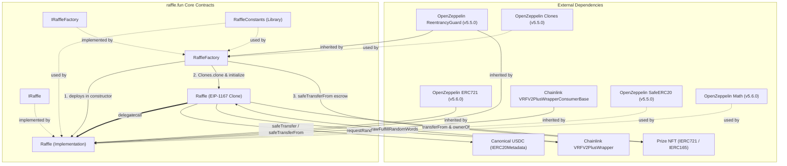
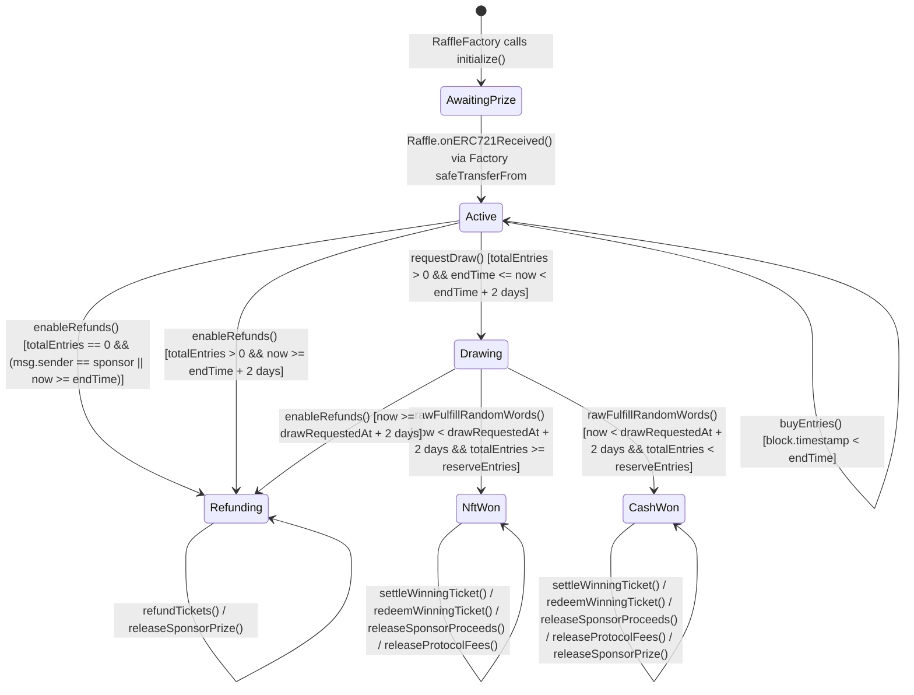

# Stage 4: Development Guidelines & Best Practices Assessment (`guidelines-advisor`)

**Project:** `raffle.fun`  
**Platform:** Solidity (`0.8.36`, EVM Target: `cancun`, Ethereum L1 / Sepolia)  
**Framework:** Trail of Bits — *Building Secure Contracts: Development Guidelines* (`trailofbits/skills` @ `82fe8226252622fa807643bdca1710901198553a`)

---

## Executive Overview

`raffle.fun` is an ownerless, non-upgradeable Ethereum NFT raffle protocol consisting of an immutable factory (`RaffleFactory`), an immutable minimal-proxy implementation (`Raffle`), and a shared constants library (`RaffleConstants`). Each raffle is deployed as an ERC-1167 minimal proxy clone that escrows a single ERC-721 prize NFT and sells fixed-price (`1.00 USDC`) entries represented as sequential ERC-721 range tickets (`[firstEntry, lastEntry]`). Randomness is sourced via Chainlink VRF v2.5 native direct funding (`VRFV2PlusWrapperConsumerBase`).

This Stage 4 review evaluates the codebase across all **11 Trail of Bits Guidelines Assessment Areas** and the **4 Core Deliverables** (System Documentation, Architecture Analysis, Implementation & Guideline Review, and Prioritized Recommendations), highlighting concrete defects, edge-case risks, and best-practice deviations with exact file and line references.

---

## Deliverable 1 & Assessment Area 1: System Documentation & Specifications

### 1.1 Plain English System Description

```text
raffle.fun System Overview

Purpose:
raffle.fun enables any NFT holder ("sponsor") to create an autonomous, fixed-price
USDC raffle for a single ERC-721 token on Ethereum. Buyers purchase one or more
entries at 1,000,000 raw USDC units (1.00 USDC) per entry and receive a single
transferable ERC-721 ticket encoding their contiguous inclusive entry range
[firstEntry, lastEntry]. At sale end, anyone may fund a Chainlink VRF v2.5 request
in native ETH to draw a winning entry in [1, totalEntries]:
- If totalEntries >= reserveEntries (Reserve Met / NftWon): the winning ticket
  holder claims the escrowed NFT, the sponsor receives 95% of the USDC pot, and
  the protocol treasury receives 5%.
- If totalEntries < reserveEntries (Reserve Missed / CashWon): the winning ticket
  holder claims 80% of the USDC pot, the sponsor receives 15% of the USDC pot plus
  the returned prize NFT, and the protocol treasury receives 5%.
- If no entries are sold, or if the draw request / VRF callback misses its 2-day
  liveness window (Refunding): ticket holders burn their tickets for a 100% USDC
  refund and the sponsor reclaims the escrowed prize NFT.

Components:
1. RaffleFactory (packages/contracts/src/RaffleFactory.sol):
   Immutable, ownerless factory and registry. Validates protocol dependencies at
   construction, deploys the singleton Raffle implementation, and atomically
   clones (EIP-1167), initializes, registers, and escrows the prize NFT for each
   new raffle.
2. Raffle (packages/contracts/src/Raffle.sol):
   ERC-1167 minimal-proxy implementation and ERC-721 ticket contract. Manages the
   raffle state machine, range-ticket minting/burning, Chainlink VRF v2.5 direct
   funding requests/callbacks, O(1) winning-ticket settlement, and pull-based
   asset distribution.
3. RaffleConstants (packages/contracts/src/libraries/RaffleConstants.sol):
   Defines global protocol constants (entry price, fee/winner basis points,
   sale duration limit, draw/callback timeouts, refund batch limit, VRF gas limit
   and confirmations).
4. IRaffle & IRaffleFactory (packages/contracts/src/interfaces/):
   External interfaces, structs, lifecycle enums, events, and custom errors.

Assumptions & Trust Model:
- Canonical Quote Token (Trusted): Immutable 6-decimal USDC with standard,
  non-rebasing, fee-free ERC-20 transfer semantics.
- Chainlink VRF v2.5 Wrapper (Trusted): Official native direct-funding wrapper
  capable of quoting and fulfilling 1 random word within 2 days.
- Prize ERC-721 Contracts (Untrusted / Partially Trusted): Assumed to support
  ERC-165/ERC-721 and update ownerOf accurately upon transferFrom/safeTransferFrom;
  however, post-escrow transferability is relied upon for NftWon and prize return.
- Ticket Recipients & Sponsors (Untrusted): Arbitrary EOAs or contracts; all
  payouts and redemptions are isolated pull claims.
- No Admin / No Rescue: Neither the factory nor any raffle clone has an owner,
  pause mechanism, upgrade path, or token rescue function.

Interactions:
- Sponsor -> RaffleFactory.createRaffle() -> Clones.clone() -> Raffle.initialize()
  -> prizeToken.safeTransferFrom(sponsor, raffle, prizeTokenId) -> Raffle.onERC721Received()
- Buyer -> Raffle.buyEntries() -> quoteToken.safeTransferFrom() -> Raffle._safeMint()
- Any Caller -> Raffle.requestDraw{value}() -> VRFV2PlusWrapper.requestRandomWordsInNative()
- VRFV2PlusWrapper -> Raffle.rawFulfillRandomWords() -> Raffle.fulfillRandomWords()
- Any Caller -> Raffle.settleWinningTicket(ticketId) (storage-only liability split)
- Ticket Owner -> Raffle.redeemWinningTicket(ticketId) / Raffle.refundTickets(ticketIds)
- Any Caller -> Raffle.releaseSponsorProceeds() / releaseProtocolFees() / releaseSponsorPrize()

Critical Operations:
- Atomic raffle creation and NFT escrow verification (RaffleFactory.createRaffle)
- O(1) range-ticket minting and USDC collection (Raffle.buyEntries)
- Native-funded VRF draw initiation with excess ETH refund (Raffle.requestDraw)
- Non-reverting VRF randomness fulfillment (Raffle.fulfillRandomWords)
- Timeout-based refund activation (Raffle.enableRefunds)
- Storage-only winning ticket verification and pot split (Raffle.settleWinningTicket)
- Atomic ticket burn and prize/cash delivery (Raffle.redeemWinningTicket, Raffle.refundTickets)
```

### 1.2 Architectural & State Machine Diagrams

#### Contract Inheritance & Interaction Graph



#### Raffle Lifecycle State Machine



### 1.3 Documentation & NatSpec Gaps Identified

While the codebase has strong NatSpec coverage across `IRaffle.sol`, `IRaffleFactory.sol`, `Raffle.sol`, and `RaffleFactory.sol`, the following documentation gaps and specification discrepancies exist:

1. **Undocumented Inherited External/Public Surface on `Raffle` (`VRFV2PlusWrapperConsumerBase.sol:35,101,109,114`)**:
   - By inheriting `VRFV2PlusWrapperConsumerBase`, `Raffle` exposes four public/external functions not declared or documented in `IRaffle.sol`:
     - `i_vrfV2PlusWrapper()` (`VRFV2PlusWrapperConsumerBase.sol:35`) — duplicates `Raffle.vrfWrapper()` (`Raffle.sol:446`).
     - `rawFulfillRandomWords(uint256, uint256[])` (`VRFV2PlusWrapperConsumerBase.sol:101`).
     - `getBalance()` (`VRFV2PlusWrapperConsumerBase.sol:109`).
     - `getLinkToken()` (`VRFV2PlusWrapperConsumerBase.sol:114`).
2. **Undocumented Empty `tokenURI(uint256)` Behavior (`Raffle.sol:156,479-487`, `ERC721.sol:2717-2731`)**:
   - `Raffle` overrides `name()` and `symbol()` as `pure` functions (`Raffle.sol:479-487`) after passing `("", "")` to `ERC721` (`Raffle.sol:156`), but never overrides `_baseURI()` or `tokenURI(uint256)`. Consequently, `tokenURI(ticketId)` returns `""` for every valid ticket. Neither `DESIGN.md` nor `IRaffle.sol` documents that tickets have no on-chain/off-chain metadata URI.
3. **Specification vs. Implementation Nuance on Rounding (`DESIGN.md:5` vs. `Raffle.sol:539-549`)**:
   - `DESIGN.md:5` states: *"Rounding is floor on aggregate protocol fee; remainder must be allocated without loss."*
   - In `Raffle._settleWinningTicket` (`Raffle.sol:539-549`), for `CashWon`, **both** `protocolFee` (`500` bps) and `cashAmount` (`8000` bps) are computed via floor division (`Math.mulDiv`), and `sponsorAmount = grossPot - protocolFee - cashAmount`.
   - Furthermore, because `ENTRY_PRICE = 1_000_000` is an exact multiple of `BPS = 10_000` (`1,000,000 / 10,000 = 100`), `grossPot = totalEntries * 1_000_000` is always evenly divisible by `10_000`. In v1, rounding remainder is mathematically `0` for every possible `totalEntries`. Documenting this exact-division invariant in `RaffleConstants.sol` and `DESIGN.md` will prevent confusion during audits and integrations.
4. **Trust Model Tension on `prizeToken` (`DESIGN.md:5` vs. `IRaffle.sol:15-16`)**:
   - `DESIGN.md:5` states *"arbitrary prize contracts and ticket recipients are untrusted"*, whereas `IRaffle.sol:15-16` states *"Supported prizes are honest, standards-compliant ERC-721s."* As detailed in Area 7 below, a malicious or upgradeable `prizeToken` controlled by a sponsor can block `redeemWinningTicket` after the sponsor claims 95% of the USDC pot. This trust assumption must be harmonized across `DESIGN.md` and user-facing documentation.

---

## Deliverable 2 & Assessment Area 2: Architecture, Inheritance & EIP-1167 Clones

### 2.1 On-Chain vs. Off-Chain Computation
- **Exemplary O(1) Range-Ticket Design (`Raffle.sol:36-39,226-233,518,579-585`)**:
  - Rather than minting one ERC-721 per entry or searching an array of ticket ranges on-chain during the VRF callback, `Raffle` stores one packed `TicketRange { uint128 firstEntry, uint128 lastEntry }` per purchase (`Raffle.sol:36-39`), selects `winningEntry` in $O(1)$ during `fulfillRandomWords` (`Raffle.sol:518`), and verifies that a candidate `ticketId` covers `winningEntry` in $O(1)$ during `settleWinningTicket` (`Raffle.sol:579-585`).
  - Off-chain indexers/clients perform the lookup to find which `ticketId` contains `winningEntry` and submit `ticketId` for on-chain verification. This directly follows Trail of Bits' *"Verify on-chain, compute off-chain"* guideline and eliminates unbounded loop DoS vectors.
- **Optimization Opportunity — Repeated On-Chain Destination Screening (`Raffle.sol:593-605`)**:
  - `_isProtocolDestination` makes external `STATICCALL`s (`canonicalFactory.raffleImplementation()` and `canonicalFactory.isRaffle(destination)`) during `initialize`, every ticket mint/transfer (`_update`), and every quote payout (`_transferQuote`). Caching `raffleImplementation` or using `protocolTreasury` as an `immutable` in `Raffle` would avoid redundant external calls and `SLOAD`s.

### 2.2 Upgradeability & Migration Review
- **Current Approach**: Explicitly non-upgradeable (`Raffle.sol:24`, `RaffleFactory.sol:19`). There are no proxy admin keys, UUPS upgrade hooks, or mutable parameters.
- **Assessment**: Follows Trail of Bits' recommendation to **favor contract migration over upgradeability** where possible. Because each raffle has a bounded lifetime (`MAX_SALE_DURATION = 30 days`, `DRAW_REQUEST_TIMEOUT = 2 days`, `DRAW_CALLBACK_TIMEOUT = 2 days`), any protocol upgrade is achieved by deploying a new `RaffleFactory` while existing raffles settle or refund autonomously.
- **Gap**: Add an off-chain deployment & migration runbook documenting constructor verification steps (specifically verifying the target chain's canonical USDC and Chainlink VRF v2.5 wrapper addresses, as noted in `RaffleFactory.sol:60-61`).

### 2.3 Delegatecall / EIP-1167 Minimal Proxy Pattern Security Review

1. **Defect / Gas Penalty: Inherited `ReentrancyGuard` Constructor Storage Is Not Copied to EIP-1167 Clones (`Raffle.sol:28`, `ReentrancyGuard.sol:2288-2290`)**:
   - OpenZeppelin's `ReentrancyGuard` initializes its ERC-7201 storage slot (`0x9b779b...5f00`) to `NOT_ENTERED = 1` in its `constructor()` (`ReentrancyGuard.sol:2288-2290`).
   - When `RaffleFactory.createRaffle` deploys a minimal proxy via `Clones.clone(raffleImplementation)` (`RaffleFactory.sol:106`), the clone's storage is completely zeroed—the `ReentrancyGuard` constructor does not execute in the clone's context.
   - Consequently, on the first `nonReentrant` call to any `Raffle` clone (typically the first buyer calling `buyEntries`), the reentrancy slot transitions `0 -> 2 (ENTERED) -> 1 (NOT_ENTERED)`. Because the slot starts at `0` and is left at `1`, the first caller pays a **20,000 gas zero-to-nonzero `SSTORE` penalty** instead of a warm/reset write.
   - Furthermore, OpenZeppelin v5.5.0 explicitly marks `ReentrancyGuard` as **deprecated** in favor of `ReentrancyGuardTransient` (`ReentrancyGuard.sol:2257-2258`). Since the project compiles with `evm_version = "cancun"`, switching `Raffle` and `RaffleFactory` to `ReentrancyGuardTransient` (EIP-1153 `TLOAD`/`TSTORE`) eliminates this clone initialization flaw and saves ~15,000 gas on the first call plus ~2,100+ gas on every subsequent call.

2. **Implementation Direct-Usage Protection (`Raffle.sol:155-166,395-407`)**:
   - In `Raffle.constructor` (`Raffle.sol:164-165`), the implementation sets `initialized = true` and `status = Status.Refunding`.
   - This blocks `initialize()`, `buyEntries()`, `requestDraw()`, `enableRefunds()`, `settleWinningTicket()`, and `redeemWinningTicket()` on the implementation.
   - However, notice `releaseSponsorPrize()` (`Raffle.sol:395-407`): because `status` on the implementation is `Status.Refunding` and `prizeClaimed` is `false` (default), calling `releaseSponsorPrize()` on the implementation passes both state guards (`Raffle.sol:397-400`) and only reverts when attempting `prizeToken.transferFrom(...)` on `prizeToken == address(0)` (`Raffle.sol:404`). Setting `prizeClaimed = true` in `Raffle.constructor` (`Raffle.sol:165`) makes the implementation explicitly locked at the state-variable level.

3. **Unoptimized Storage Layout & Dead Inherited Slots in Clones (`Raffle.sol:61-142`, `ERC721.sol:2664-2667`)**:
   - **Misplaced `_requestInFlight` boolean (`Raffle.sol:139-142`)**:
     ```solidity
     mapping(uint256 ticketId => TicketRange range) private _ticketRanges;
     bool private _requestInFlight;
     ```
     Because `_ticketRanges` (a mapping) is declared between `bool public override initialized` (`Raffle.sol:136`) and `bool private _requestInFlight` (`Raffle.sol:142`), Solidity cannot pack `_requestInFlight` with the five 1-byte variables (`status`, `settlementComplete`, `winnerRedeemed`, `prizeClaimed`, `initialized`). Moving `_requestInFlight` above `_ticketRanges` packs all 6 variables into a single 32-byte slot and eliminates an entire storage slot (`SSTORE`/`SLOAD`) during `requestDraw()` and `fulfillRandomWords()`!
   - **Unpacked Address and Config Variables (`Raffle.sol:61-84`)**:
     `sponsor` (20B), `sponsorRecipient` (20B), `protocolTreasury` (20B), `prizeToken` (20B), and `winnerRecipient` (20B) each occupy a full 32-byte slot with 12 wasted bytes, while `uint128 reserveEntries` + `uint64 endTime` occupy another slot (`Raffle.sol:79-82`). Packing `uint64 endTime` (8B) and the status/boolean flags (6B) alongside two of the `address` fields saves **2 full `SSTORE` operations (~40,000 gas)** during `initialize()`.
   - **Redundant Per-Clone Storage of `protocolTreasury` (`Raffle.sol:67,199`)**:
     `protocolTreasury` is an `immutable` in `RaffleFactory` (`RaffleFactory.sol:39`) that never changes across clones of the same factory. Storing `protocolTreasury` in every clone's mutable storage (`Raffle.sol:67,199`) wastes a 20,000-gas `SSTORE` on every `createRaffle` call and a 2,100-gas `SLOAD` on `releaseProtocolFees()`. Passing `protocolTreasury_` to `Raffle.constructor` as an `immutable` (just like `quoteToken` and `vrfWrapper`) eliminates this storage slot entirely.
   - **Dead `ERC721._name` and `ERC721._symbol` Slots (`Raffle.sol:156,479-487`)**:
     `Raffle` passes `("", "")` to `ERC721` and overrides `name()` and `symbol()` as `pure`, leaving slots 0 and 1 unused in every clone (inherent to standard OpenZeppelin `ERC721`).

### 2.4 Inheritance & Function Composition (Assessment Areas 5 & 6)
- **Inheritance Hierarchy**:
  - `RaffleFactory` -> `IRaffleFactory`, `ReentrancyGuard` (depth: 1).
  - `Raffle` -> `IRaffle`, `ERC721` (`Context`, `ERC165`, `IERC721`, `IERC721Metadata`, `IERC721Errors`), `ReentrancyGuard`, `IERC721Receiver`, `VRFV2PlusWrapperConsumerBase` (depth: 2).
  - **Assessment**: Shallow, linearizeable C3 hierarchy with no diamond inheritance conflicts.
- **Function Composition**:
  - Functions are concise (all under 40 lines), logically ordered (`External state-changing` -> `Public view/pure` -> `Internal state-changing` -> `Private state-changing` -> `Private view/pure`), and single-purpose.
  - Extracting shared destination-check logic between `RaffleFactory._validateCreateParams` (`RaffleFactory.sol:154-169`) and `Raffle._isProtocolDestination` (`Raffle.sol:593-605`) or keeping them aligned is recommended so their screening rules cannot diverge.

---

## Assessment Area 3: Compiler Configuration & `pragma solidity 0.8.36` / `cancun` (Area 11: Platform-Specific Guidance)

1. **Use of `pragma solidity 0.8.36` (`Raffle.sol:2`, `RaffleFactory.sol:2`, `IRaffle.sol:2`, `IRaffleFactory.sol:2`, `RaffleConstants.sol:2`, `foundry.toml:7`, `hardhat.config.ts:17,27`)**:
   - **Guideline Deviation**: Trail of Bits guidelines and Slither recommend compiling with a well-vetted, widely supported stable Solidity release rather than bleeding-edge or unreleased compiler versions (`0.8.36` exceeds the `^0.8.24` / `^0.8.20` pragmas used by the bundled OpenZeppelin v5.5/v5.6 contracts and may lack support in static analyzers, formal verification tools, or block explorer verifiers).
   - **Rigid Pragmas in Interfaces**: While implementation contracts (`Raffle.sol`, `RaffleFactory.sol`) should lock their compiler version, interfaces (`IRaffle.sol:2`, `IRaffleFactory.sol:2`) should use `pragma solidity ^0.8.20;` or `^0.8.24;` so external integrators on different `0.8.x` versions can import them cleanly.
2. **EVM Version `cancun` (`foundry.toml:8`, `hardhat.config.ts:23,33`)**:
   - Targeting `cancun` is appropriate for Ethereum Mainnet and Sepolia (`hardhat.config.ts:43-60`). However, `cancun` bytecode emits `MCOPY` (EIP-5656) and should not be deployed to any EVM-compatible network that has not activated the Cancun hardfork.
   - As noted in Section 2.3, targeting `cancun` unlocks EIP-1153 transient storage (`ReentrancyGuardTransient`), which is not yet utilized despite `ReentrancyGuard` being deprecated in OpenZeppelin v5.5.0.
3. **Inline Assembly Usage (`Raffle.sol:266-268`)**:
   - `Raffle.requestDraw()` uses inline assembly for returning excess native ETH:
     ```solidity
     assembly ("memory-safe") {
         success := call(gas(), refundRecipient, excess, 0, 0, 0, 0)
     }
     ```
   - **Assessment**: This assembly block is `memory-safe`, uses zero input/output memory offsets (`0, 0, 0, 0`), and intentionally prevents **Returnbomb** attacks (where a malicious `msg.sender` returns a huge payload in its `receive()` hook to exhaust the caller's memory expansion gas). Add an inline comment documenting the returnbomb-prevention rationale so future maintainers do not replace it with a high-level `.call{value: excess}("")`.
4. **Foundry Profile Divergence (`foundry.toml:9-11` vs. `foundry.toml:37-40`)**:
   - `[profile.default]` compiles with `via_ir = false` and `optimizer_runs = 200`, matching `hardhat.config.ts:19-34`, whereas `[profile.comparison]` uses `via_ir = true` and `optimizer_runs = 1_000`. Ensure all pre-deployment audit and verification runs execute against `[profile.default]` / `production` settings.

---

## Assessment Area 4: Access Control

1. **Defect / Edge-Case Risk: Precomputed Future Clone Address Bypasses `_isProtocolDestination` and Bricks Sponsor Claims or Strands Prizes (`RaffleFactory.sol:106,157-169`, `Raffle.sol:187-195,375-382,395-407,564-567,593-605`)**:
   - **Mechanism**:
     - `RaffleFactory.createRaffle` deploys clones via `Clones.clone(raffleImplementation)` (`RaffleFactory.sol:106`), which uses the `CREATE` opcode (`Clones.sol:1987`). Because `CREATE` addresses depend solely on `(address(factory), factory_nonce)`, the address of any future raffle clone `futureRaffle` (e.g., `Raffle #(N+1)`) is deterministically known before it is deployed.
     - When `Raffle #N` is created, `futureRaffle` has not yet been deployed (`futureRaffle.code.length == 0` and `isRaffle[futureRaffle] == false`).
     - Therefore, if a sponsor (or a misconfigured script/UI) passes `sponsorRecipient = futureRaffle` (or `sponsor` transfers a ticket to `futureRaffle` via `transferFrom`), both `RaffleFactory._validateCreateParams` (`RaffleFactory.sol:163-169`) and `Raffle._isProtocolDestination` (`Raffle.sol:593-605`) **allow `futureRaffle`**!
     - Once `Raffle #(N+1)` is subsequently created at `futureRaffle`, `isRaffle[futureRaffle]` becomes `true` and `futureRaffle.code.length > 0`.
   - **Impact on `Raffle #N`**:
     1. **Permanent Locking of `sponsorProceeds`**: When `Raffle #N` settles (`NftWon` or `CashWon`) and `releaseSponsorProceeds()` (`Raffle.sol:375-382`) is called, `_transferQuote(sponsorRecipient, amount)` (`Raffle.sol:564-567`) re-evaluates `_isProtocolDestination(sponsorRecipient, address(prizeToken))`. Because `isRaffle[futureRaffle]` is now `true`, `releaseSponsorProceeds()` **permanently reverts** with `InvalidQuoteDestination(futureRaffle)`, stranding 95% (or 15%) of the USDC pot in `Raffle #N` forever!
     2. **Cross-Clone Prize Stranding (Violating `DESIGN.md`)**: `DESIGN.md:5` requires *"Never move assets between raffle clones."* However, `releaseSponsorPrize()` (`Raffle.sol:395-407`) does **not** call `_isProtocolDestination(recipient, address(prizeToken))` before executing `prizeToken.transferFrom(address(this), recipient, prizeTokenId)`! If `Raffle #N` ends in `CashWon` or `Refunding`, calling `releaseSponsorPrize()` transfers `Raffle #N`'s prize NFT directly into `Raffle #(N+1)` (`futureRaffle`) via unsafe `transferFrom`, moving the NFT between raffle clones and permanently stranding it inside `Raffle #(N+1)`!
   - **Recommendation**:
     - Either deploy clones via `Clones.cloneDeterministic` (`CREATE2`) with a salt incorporating `keccak256(abi.encode(msg.sender, params))` so a sponsor cannot circularly commit to a future clone's `CREATE2` address that depends on its own parameters, **or** check `_isProtocolDestination` in `releaseSponsorPrize()` as well (to uphold the invariant *"Never move assets between raffle clones"*).

2. **Strict `msg.sender == ownerOf(ticketId)` Check in `redeemWinningTicket` and `refundTickets` (`Raffle.sol:320-321,359-360`)**:
   - Both `redeemWinningTicket` and `refundTickets` require `msg.sender == ownerOf(ticketId)`, intentionally disallowing ERC-721 approved operators (`getApproved` / `isApprovedForAll`) from burning tickets on behalf of the owner (`DESIGN.md:5`). This is secure and prevents an approved marketplace operator from claiming cash/NFT proceeds to the owner's address unexpectedly or burning a listed ticket.

---

## Assessment Area 5: Arithmetic & Rounding

1. **Exact Division Under v1 Constants (`Raffle.sol:539-549`, `RaffleConstants.sol:12-21`)**:
   - In `_settleWinningTicket` (`Raffle.sol:539-549`):
     - `protocolFee = Math.mulDiv(grossPot, 500, 10_000)`
     - `cashAmount = Math.mulDiv(grossPot, 8_000, 10_000)` (when `CashWon`)
     - `sponsorAmount = grossPot - protocolFee - cashAmount`
   - Because `grossPot = totalEntries * 1_000_000` and `1_000_000 % 10_000 == 0`, both `Math.mulDiv` operations have zero remainder for all `totalEntries >= 1`. Furthermore, computing `sponsorAmount` by subtraction guarantees `protocolFee + cashAmount + sponsorAmount == grossPot` with zero precision loss or trapped dust.
2. **Overflow Bounds on `totalEntries` and `grossAmount` (`Raffle.sol:219-224`)**:
   - `totalEntries` is bounded to `type(uint128).max` (`Raffle.sol:219-221`), so `grossAmount = uint256(entryCount) * ENTRY_PRICE` is at most $(2^{128} - 1) \times 10^6 \approx 3.4 \times 10^{44} \ll 2^{256} - 1$, preventing any overflow in `unsettledPot`, `accountedQuoteBalance()`, or `Math.mulDiv`.
3. **Negligible Modulo Bias in VRF Entry Selection (`Raffle.sol:518`)**:
   - `uint128 resolvedEntry = uint128((randomWords[0] % uint256(totalEntries)) + 1);`
   - Because `totalEntries <= 2^{128} - 1` and `randomWords[0]` is a 256-bit uniform random word, modulo bias is bounded by $< 2^{-128}$, which is cryptographically negligible.

---

## Assessment Area 6: External Calls & Reentrancy

1. **Checks-Effects-Interactions (CEI) & `nonReentrant` Discipline**:
   - Every external state-changing function with external interactions (`createRaffle`, `buyEntries`, `requestDraw`, `enableRefunds`, `settleWinningTicket`, `redeemWinningTicket`, `refundTickets`, `releaseSponsorProceeds`, `releaseProtocolFees`, `releaseSponsorPrize`) is protected by `nonReentrant` and updates internal state prior to external token/ETH calls.
   - In `buyEntries` (`Raffle.sol:223-236`), `quoteToken.safeTransferFrom` runs first (trusted canonical USDC), then all storage variables (`totalEntries`, `ticketCount`, `_ticketRanges`, `unsettledPot`) are updated *before* `_safeMint(recipient, ticketId)` invokes `onERC721Received` on the untrusted `recipient`. This prevents both classic and read-only reentrancy during ticket minting.
2. **Redundant External Call & Unreachable Check in `requestDraw` (`Raffle.sol:249-258`, `VRFV2PlusWrapperConsumerBase.sol:74-87`)**:
   - In `Raffle.requestDraw()` (`Raffle.sol:249-258`):
     ```solidity
     uint256 quotedFee = getVrfRequestPrice();
     if (msg.value < quotedFee) revert InsufficientVrfFee(quotedFee, msg.value);
     ...
     (requestId, paidPrice) = requestRandomnessPayInNative(callbackGasLimit, requestConfirmations, 1, extraArgs);
     if (paidPrice > msg.value) revert InsufficientVrfFee(paidPrice, msg.value);
     ```
   - `getVrfRequestPrice()` calls `i_vrfV2PlusWrapper.calculateRequestPriceNative(callbackGasLimit, 1)`, and 8 lines later `requestRandomnessPayInNative(...)` calls `i_vrfV2PlusWrapper.calculateRequestPriceNative(callbackGasLimit, 1)` a **second time** before calling `i_vrfV2PlusWrapper.requestRandomWordsInNative{value: requestPrice}(...)`.
   - Under the canonical Chainlink wrapper, `quotedFee` and `paidPrice` are identical within the same transaction, making the first `getVrfRequestPrice()` external call redundant (wasting an external `STATICCALL`). Moreover, unless native ETH was force-sent to the clone via `selfdestruct`/coinbase, `requestRandomWordsInNative{value: requestPrice}` reverts at the EVM level if `requestPrice > msg.value`, making line 258 (`if (paidPrice > msg.value)`) only reachable if force-sent ETH exists on the clone and a custom/upgraded wrapper changes its price between the two calls.

---

## Assessment Area 7: Token & VRF Handling

1. **Untrusted ERC-721 `prizeToken` Post-Escrow Griefing / Rug Risk (`Raffle.sol:304-306,334-337,375-382`, `RaffleFactory.sol:172-177`)**:
   - **Risk**: `RaffleFactory._validateCreateParams` (`RaffleFactory.sol:172-177`) only verifies that `params.prizeToken` is a contract supporting `IERC721` via ERC-165, and `createRaffle` verifies that `prizeToken.ownerOf(prizeTokenId) == raffle` after escrow (`RaffleFactory.sol:129`).
   - Because `settleWinningTicket` and `releaseSponsorProceeds` are intentionally independent of `redeemWinningTicket` (so a malicious winner cannot block the sponsor), **a malicious sponsor who deploys a custom or pausable/blacklisting `prizeToken`** can:
     1. Escrow the NFT into `Raffle` honestly during `createRaffle`.
     2. Wait for honest buyers to purchase USDC entries (`totalEntries >= reserveEntries`) and for VRF to resolve to `Status.NftWon`.
     3. Block/revert `prizeToken.transferFrom(address(this), winner, prizeTokenId)` when the winner attempts `redeemWinningTicket`.
     4. Call `settleWinningTicket(winningTicketId)` and `releaseSponsorProceeds()` to withdraw **95% of the USDC pot** while the winner is permanently unable to claim the NFT (or while the sponsor re-mints/transfers the NFT to themselves via custom logic in their malicious ERC-721 contract)!
   - **Recommendation**:
     - Explicitly document in user-facing security docs and `DESIGN.md` that **buyers must verify the `prizeToken` contract is an honest, immutable, non-malicious ERC-721 collection** before purchasing entries, and frontends should filter/badge verified NFT collections.
2. **Use of `transferFrom` Instead of `safeTransferFrom` for Outbound Prize Delivery (`Raffle.sol:334,404`)**:
   - Both `redeemWinningTicket` (`Raffle.sol:334`) and `releaseSponsorPrize` (`Raffle.sol:404`) use `prizeToken.transferFrom(...)` followed by `prizeToken.ownerOf(...) != recipient` verification, rather than `safeTransferFrom`.
   - **Trade-off**: This prevents a smart-contract `winner` or `sponsorRecipient` that does not implement `IERC721Receiver` from locking the NFT in the raffle. However, if a smart-contract `sponsorRecipient` (e.g., an NFT vault or bridge adapter) requires an `onERC721Received` hook to credit deposits internally, `transferFrom` will bypass the hook. Document this behavior clearly in `IRaffle.sol`.
3. **Canonical USDC Blacklist Isolation (`Raffle.sol:320-346,349-372,375-392,497-502`)**:
   - Because all USDC payouts are isolated pull claims and ERC-721 tickets remain transferable in every lifecycle state (`Raffle.sol:497-502`), a ticket owner who gets blacklisted by Circle (USDC) can still transfer their winning or refundable ERC-721 ticket to an un-blacklisted address and claim!
   - Only `sponsorRecipient` and `protocolTreasury` are immutable per raffle; if `sponsorRecipient` is blacklisted by USDC, `releaseSponsorProceeds()` will revert in USDC's `transfer` with no fallback recipient.
4. **Over-Provisioned `VRF_CALLBACK_GAS_LIMIT = 300_000` Increases User Draw Cost ~5x–10x (`RaffleConstants.sol:39`, `Raffle.sol:509-524`)**:
   - `Raffle.fulfillRandomWords` (`Raffle.sol:509-524`) performs no loops, no external calls, and no token transfers—it executes only basic condition checks, writes `winningEntry`, `resolvedAt`, and `status` (which share a single storage slot with `drawRequestedAt` plus the status slot), and emits `RaffleResolved`. Total callback execution consumes **< 25,000 gas**.
   - However, `RaffleConstants.VRF_CALLBACK_GAS_LIMIT` is hardcoded to **`300_000` gas** (`RaffleConstants.sol:39`).
   - Because Chainlink's VRF v2.5 Direct Funding Wrapper charges the requester upfront for the full `callbackGasLimit` (plus wrapper gas overhead and percentage premium) and **never refunds unused callback gas**, every caller of `requestDraw()` significantly overpays in native ETH. Lowering `VRF_CALLBACK_GAS_LIMIT` to `60_000`–`100_000` gas will substantially reduce the cost of `requestDraw()` while maintaining a >2x safety margin.

---

## Assessment Area 8: Liveness & DoS Prevention

1. **Pull-Over-Push & Permissionless Settlement**:
   - `settleWinningTicket` (`Raffle.sol:304-306`) is storage-only and permissionless, ensuring that `releaseSponsorProceeds()`, `releaseProtocolFees()`, and `releaseSponsorPrize()` can always execute even if the winning ticket holder never calls `redeemWinningTicket()`.
2. **Duplicate Ticket ID Protection in `refundTickets` (`Raffle.sol:357-365`)**:
   - In `refundTickets(uint256[] calldata ticketIds)`, `_burn(ticketId)` executes inside the loop immediately after `ownerOf(ticketId)`. If a caller supplies duplicate `ticketId`s in the same array, the second occurrence immediately reverts with `ERC721NonexistentToken(ticketId)` inside `ownerOf(ticketId)`, preventing double-refunds.
3. **Bounded Batch Size (`RaffleConstants.sol:27`, `Raffle.sol:352-354`)**:
   - `MAX_REFUND_TICKET_BATCH_SIZE = 100` bounds per-transaction gas in `refundTickets`, while allowing any number of transactions to drain `remainingRefundLiability`.
4. **Liveness Escape Hatches (`Raffle.sol:276-301`, `RaffleConstants.sol:33-36`)**:
   - `DRAW_REQUEST_TIMEOUT = 2 days` and `DRAW_CALLBACK_TIMEOUT = 2 days` ensure that if no one funds `requestDraw()` or if Chainlink VRF fails to deliver a callback within 48 hours, `enableRefunds()` unlocks 100% buyer refunds and sponsor prize recovery.
5. **Unincentivized `requestDraw()` Caller Cost (`Raffle.sol:240-273`)**:
   - Calling `requestDraw()` requires paying the Chainlink VRF native fee out-of-pocket with no protocol reimbursement. For low-value raffles or during L1 gas spikes, rational participants may wait for someone else to call `requestDraw()`; if no one calls it within `2 days` of `endTime`, the raffle transitions to `Refunding`.

---

## Assessment Area 9: Event Logging (Area 7 in Skill Guidelines)

1. **Missing Initialization Event on `Raffle` Clone (`Raffle.sol:176-206`)**:
   - `Raffle.initialize()` sets all per-raffle configuration (`sponsor`, `sponsorRecipient`, `protocolTreasury`, `prizeToken`, `prizeTokenId`, `raffleId`, `reserveEntries`, `endTime`, `status`) without emitting an event from the `Raffle` clone itself (relying instead on `RaffleFactory.RaffleCreated` emitted later in `createRaffle`). Emitting an event or documenting that indexers must source clone config from `RaffleFactory.RaffleCreated` is recommended.
2. **`RefundsEnabled` Omits Previous `Status` / Transition Reason (`IRaffle.sol:113`, `Raffle.sol:276-301`)**:
   - `event RefundsEnabled(address indexed finalizer, uint256 remainingRefundLiability)` is emitted across four distinct transition paths (early sponsor cancellation, post-end empty sale, expired draw-request window, and expired VRF callback window). Including `Status indexed previousStatus` in `RefundsEnabled` would allow off-chain monitoring to immediately distinguish a VRF failure (`Status.Drawing`) from an uninitiated or empty raffle (`Status.Active`).
3. **`VrfCallbackIgnored` Omits `wordsLength` / Timestamp Context (`IRaffle.sol:102`, `Raffle.sol:509-516`)**:
   - `event VrfCallbackIgnored(uint256 indexed receivedRequestId, uint256 indexed expectedRequestId, Status status)` does not log `randomWords.length` or `block.timestamp`. If a callback is ignored because `randomWords.length != 1` or `block.timestamp >= callbackDeadline()`, the emitted fields (`receivedRequestId == expectedRequestId` and `status == Status.Drawing`) look completely valid on-chain without indicating why the guard triggered.
4. **`TicketsRefunded` Omits Burned `ticketIds` Array (`IRaffle.sol:153-159`, `Raffle.sol:371`)**:
   - `TicketsRefunded` logs `ticketQuantity` and `entryQuantity` rather than the `uint256[] ticketIds` array, requiring off-chain indexers to parse the accompanying ERC-721 `Transfer(owner, address(0), ticketId)` events to identify which tickets were refunded.

---

## Assessment Area 10: Error Handling

1. **Interface Inconsistency — `DirectNativeTransfer()` Missing from `IRaffle.sol` (`Raffle.sol:147` vs. `IRaffle.sol:182-301`)**:
   - All custom errors for `Raffle` are defined in `IRaffle.sol` **except** `error DirectNativeTransfer();`, which is declared privately inside `Raffle.sol:147`. Moving `error DirectNativeTransfer();` into `IRaffle.sol` ensures ABI consumers importing `IRaffle` can decode all `Raffle` revert selectors.
2. **Duplicate Error Definitions Across `IRaffle.sol` and `IRaffleFactory.sol`**:
   - `error ZeroAddress()` (`IRaffle.sol:191`, `IRaffleFactory.sol:57`) and `error UnsafeProtocolDestination(address destination)` (`IRaffle.sol:268`, `IRaffleFactory.sol:89`) are duplicated across both interfaces.
3. **Catch-All `try/catch` Masks Out-of-Gas in `_validateCreateParams` (`RaffleFactory.sol:172-176`)**:
   - In `_validateCreateParams`, `try IERC165(params.prizeToken).supportsInterface(type(IERC721).interfaceId)` catches all failures and reverts with `UnsupportedPrizeToken(params.prizeToken)`. This is safe and clean, though an out-of-gas in the subcall will revert with `UnsupportedPrizeToken`.

---

## Assessment Area 11: Common Pitfalls, Dependencies & Testing Strategy (Areas 8, 9, 10 in Skill Guidelines)

### 11.1 Common Pitfalls Checklist
| Pitfall Category | Status | Assessment & File References |
|---|---|---|
| Reentrancy | Mitigated | `nonReentrant` + strict CEI across `Raffle.sol` and `RaffleFactory.sol`. Note clone storage slot gas issue in `ReentrancyGuard` (`ReentrancyGuard.sol:2288`). |
| Integer Overflow / Underflow | Mitigated | Solidity `0.8.36` checked arithmetic + `Math.mulDiv` (`Raffle.sol:540,546`) + explicit `uint128` bound (`Raffle.sol:219`). |
| Unchecked External Call Returns | Mitigated | `SafeERC20` for USDC (`Raffle.sol:224,566`); checked assembly `call` for native refund (`Raffle.sol:266-269`); explicit `ownerOf` post-checks for ERC-721 transfers (`Raffle.sol:335,405`, `RaffleFactory.sol:129`). |
| Returnbomb on ETH Refund | Mitigated | Assembly `call(gas(), refundRecipient, excess, 0, 0, 0, 0)` avoids copying return data (`Raffle.sol:266-268`). |
| Uninitialized Proxy / Clone | Mitigated | Implementation locked in constructor (`Raffle.sol:164-165`); clones initialized atomically in `createRaffle` (`RaffleFactory.sol:106-121`). |
| Timestamp Dependence | Acceptable | `block.timestamp` used for 2-day windows and sale end (`Raffle.sol:216,242,245,282,287,291,512`); 12-second L1 slot granularity is negligible relative to 2-day timeouts. |
| `tx.origin` Usage | None | Not used anywhere in the codebase. |
| Unbounded Loops / Gas DoS | Mitigated | O(1) range tickets (`Raffle.sol:36-39`); `refundTickets` bounded to `MAX_REFUND_TICKET_BATCH_SIZE = 100` (`Raffle.sol:352`). |

### 11.2 Dependencies Evaluation
1. **Deprecated `ReentrancyGuard` in OpenZeppelin v5.5.0 (`ReentrancyGuard.sol:2257-2258`)**:
   - OpenZeppelin v5.5.0 marks `ReentrancyGuard` as deprecated in favor of `ReentrancyGuardTransient`. Because `raffle.fun` already targets `cancun`, replacing `ReentrancyGuard` with `ReentrancyGuardTransient` aligns with OpenZeppelin's v5.5+/v6.0 roadmap and fixes the EIP-1167 uninitialized storage slot penalty.
2. **Chainlink VRF `/dev/` Import Path (`Raffle.sol:4-6`, `VRFV2PlusWrapperConsumerBase.sol`)**:
   - `VRFV2PlusWrapperConsumerBase`, `IVRFV2PlusWrapper`, and `VRFV2PlusClient` are imported from `@chainlink/contracts/src/v0.8/vrf/dev/...`. Ensure the exact npm package version is pinned in `package.json` and lockfiles, and add `@chainlink/contracts/=node_modules/@chainlink/contracts/` explicitly to `packages/contracts/remappings.txt:1-2` for standalone static analysis tools.

### 11.3 Testing & Verification Evaluation
- **Current Configuration (`foundry.toml:1-35`)**:
  - Well-structured multi-profile fuzz and invariant configurations (`default`, `ci`, `audit`, `audit_strict`, `audit_release`) scaling up to 100,000 fuzz runs and 5,000 invariant runs with depth 512.
- **Recommendations**:
  1. **Enable `fail_on_revert = true` in CI (`foundry.toml:15-17`)**: Currently, `[profile.default]`, `[profile.ci]`, and `[profile.audit]` set `fail_on_revert = false`, which can mask broken invariant handlers that revert frequently. Run `[profile.audit_strict]` (`fail_on_revert = true`) as a required CI gate.
  2. **Key Invariants to Enforce in Foundry Invariant Tests**:
     - **Quote Conservation**: `quoteToken.balanceOf(address(raffle)) >= raffle.accountedQuoteBalance()`, with strict equality whenever no third party transfers USDC directly to the clone.
     - **Liability Partitioning**:
       - In `Active` / `Drawing`: `unsettledPot == totalEntries * ENTRY_PRICE` and `remainingRefundLiability == winnerProceeds == sponsorProceeds == protocolFees == 0`.
       - In `Refunding`: `remainingRefundLiability == unburnedEntries * ENTRY_PRICE` and `unsettledPot == winnerProceeds == sponsorProceeds == protocolFees == 0`.
       - In `NftWon` / `CashWon` post-settlement: `unsettledPot == 0` and `(winnerRedeemed ? 0 : winnerProceeds) + sponsorProceeds + protocolFees == remainingUnclaimedPot`.
     - **Contiguous Disjoint Entry Ranges**: For all `ticketId` in `1..ticketCount`, `_ticketRanges[1].firstEntry == 1`, `_ticketRanges[ticketCount].lastEntry == totalEntries`, and `_ticketRanges[i].firstEntry == _ticketRanges[i-1].lastEntry + 1`.

---

## Deliverable 4: Prioritized Recommendations

### HIGH (Address Before Mainnet Deployment)

1. **Prevent Precomputed Future Clone Addresses from Brick-Locking `releaseSponsorProceeds` or Receiving Prizes in `releaseSponsorPrize`**
   - **Impact**: If `sponsorRecipient` in `Raffle #N` is set to the predictable `CREATE` address of a future clone `Raffle #(N+1)` (which passes `_isProtocolDestination` before `Raffle #(N+1)` is deployed), deploying `Raffle #(N+1)` causes `Raffle #N`'s `releaseSponsorProceeds()` to permanently revert with `InvalidQuoteDestination`, locking 95% (or 15%) of the USDC pot forever. Furthermore, `releaseSponsorPrize()` lacks `_isProtocolDestination` and will transfer `Raffle #N`'s NFT directly into `Raffle #(N+1)`, violating `DESIGN.md:5` (*"Never move assets between raffle clones"*) and stranding the NFT.
   - **Files**: `packages/contracts/src/RaffleFactory.sol:106,163-169`, `packages/contracts/src/Raffle.sol:375-382,395-407,564-567,593-605`
   - **Fix**: Add `if (_isProtocolDestination(recipient, address(prizeToken))) revert UnsafeProtocolDestination(recipient);` to `releaseSponsorPrize()`, or deploy clones via `Clones.cloneDeterministic` (`CREATE2`) with a salt derived from `keccak256(abi.encode(msg.sender, params))` so a raffle's parameters cannot circularly reference a future deterministic clone address.

2. **Document & Mitigate Untrusted `prizeToken` Post-Escrow Transfer-Blocking Risk**
   - **Impact**: Because `settleWinningTicket` and `releaseSponsorProceeds` do not require `winnerRedeemed == true`, a malicious sponsor using a custom/pausable ERC-721 `prizeToken` can collect 95% of the USDC pot in `NftWon` while blocking the winner from redeeming the NFT in `redeemWinningTicket`.
   - **Files**: `DESIGN.md:5`, `packages/contracts/src/interfaces/IRaffle.sol:15-16`, `packages/contracts/src/Raffle.sol:304-306,334-337,375-382`
   - **Fix**: Explicitly document in `DESIGN.md` and user-facing security notices that `prizeToken` contracts must be verified as non-malicious, immutable ERC-721 collections before users purchase entries, and enforce collection allowlisting/warnings in the frontend.

3. **Replace Deprecated `ReentrancyGuard` with `ReentrancyGuardTransient` to Fix Uninitialized Clone Slot Gas Penalty**
   - **Impact**: `ReentrancyGuard` is deprecated in OpenZeppelin v5.5.0 (`ReentrancyGuard.sol:2257-2258`) and its constructor initialization (`NOT_ENTERED = 1`) does not apply to EIP-1167 clones, causing the first caller on every clone to pay a 20,000-gas zero-to-nonzero `SSTORE` penalty.
   - **Files**: `packages/contracts/src/Raffle.sol:12,28`, `packages/contracts/src/RaffleFactory.sol:7,21`
   - **Fix**: Import and inherit `ReentrancyGuardTransient` from `@openzeppelin/contracts/utils/ReentrancyGuardTransient.sol` (supported natively under `evm_version = "cancun"`).

### MEDIUM (Address for Production Quality & Gas Efficiency)

4. **Reduce `VRF_CALLBACK_GAS_LIMIT` from `300_000` to `75_000`–`100_000`**
   - **Impact**: `fulfillRandomWords` uses `< 25,000` gas, but `requestDraw()` callers pay upfront for `300_000` callback gas with no refund of unused gas from Chainlink's wrapper.
   - **File**: `packages/contracts/src/libraries/RaffleConstants.sol:39`
   - **Fix**: Lower `VRF_CALLBACK_GAS_LIMIT` to `75_000` or `100_000`.

5. **Pack `Raffle` Storage Variables & Make `protocolTreasury` Immutable in `Raffle`**
   - **Impact**: `_requestInFlight` (`Raffle.sol:142`) is isolated in its own storage slot because it is declared after `_ticketRanges` (`Raffle.sol:139`), and `protocolTreasury` (`Raffle.sol:67,199`) is written to storage on every clone despite being immutable per factory.
   - **Files**: `packages/contracts/src/Raffle.sol:61-142,155-206`, `packages/contracts/src/RaffleFactory.sol:89`
   - **Fix**: Move `_requestInFlight` above `_ticketRanges`, pack `uint64 endTime` and status/bool flags with `address` fields, and pass `protocolTreasury_` into `Raffle.constructor` as an `immutable` (saving ~60,000+ gas per `createRaffle` call).

6. **Compile with a Stable, Tool-Supported Solidity Release**
   - **Impact**: `pragma solidity 0.8.36` may not be supported by standard security analyzers (Slither, Mythril) or block explorer verification pipelines; locking exact pragma in `IRaffle.sol` and `IRaffleFactory.sol` also restricts integrators.
   - **Files**: `packages/contracts/src/Raffle.sol:2`, `packages/contracts/src/RaffleFactory.sol:2`, `packages/contracts/src/interfaces/IRaffle.sol:2`, `packages/contracts/src/interfaces/IRaffleFactory.sol:2`, `packages/contracts/src/libraries/RaffleConstants.sol:2`, `packages/contracts/foundry.toml:7`, `packages/contracts/hardhat.config.ts:17,27`
   - **Fix**: Target a stable production release (e.g., `0.8.28`) for deployment contracts and use floating pragmas (`^0.8.24`) in interface files.

7. **Enhance Event Diagnostics & Interface Error Completeness**
   - **Impact**: `error DirectNativeTransfer()` is missing from `IRaffle.sol`; `RefundsEnabled` and `VrfCallbackIgnored` omit transition reason / timestamp / length diagnostics; `Raffle.constructor` leaves `prizeClaimed = false` on the locked implementation.
   - **Files**: `packages/contracts/src/Raffle.sol:147,165,276-301,509-516`, `packages/contracts/src/interfaces/IRaffle.sol:102,113,182`
   - **Fix**: Move `DirectNativeTransfer()` to `IRaffle.sol`, set `prizeClaimed = true` in `Raffle.constructor`, and include `Status indexed previousStatus` in `RefundsEnabled` and `uint256 wordsLength` in `VrfCallbackIgnored`.

### LOW (Nice to Have)

8. **Eliminate Redundant `getVrfRequestPrice()` Call in `requestDraw()`**
   - **Impact**: `requestDraw()` calls `i_vrfV2PlusWrapper.calculateRequestPriceNative` twice (once in `getVrfRequestPrice()` at `Raffle.sol:249` and once inside `requestRandomnessPayInNative` at `VRFV2PlusWrapperConsumerBase.sol:82`).
   - **File**: `packages/contracts/src/Raffle.sol:249-258`
   - **Fix**: Either rely on `requestRandomnessPayInNative` and check `msg.value` or inline the wrapper call after checking `msg.value < quotedFee`.

9. **Document Empty `tokenURI()`, `transferFrom` Prize Delivery, and Explicit `@chainlink/contracts` Remapping**
   - **Files**: `packages/contracts/src/Raffle.sol:334,404,479-487`, `packages/contracts/remappings.txt:1-2`
   - **Fix**: Document in `IRaffle.sol` that `tokenURI()` returns `""` and outbound prize delivery uses `transferFrom` with `ownerOf` verification; add `@chainlink/contracts/=node_modules/@chainlink/contracts/` to `remappings.txt`.

---

## Summary & Maturity Assessment

**Overall Assessment:** **HIGH ARCHITECTURAL MATURITY**

The `raffle.fun` smart contracts demonstrate strong engineering discipline: an ownerless, non-upgradeable minimal-proxy architecture, $O(1)$ range-ticket accounting that avoids unbounded loops, strict Checks-Effects-Interactions ordering, returnbomb-safe native ETH refunds, and decoupled pull-based settlement and claim flows. Addressing the precomputed clone address edge case, documenting the untrusted `prizeToken` trust boundary, migrating from deprecated `ReentrancyGuard` to `ReentrancyGuardTransient`, and tuning `VRF_CALLBACK_GAS_LIMIT` and storage packing will bring the protocol to top-tier production readiness.

