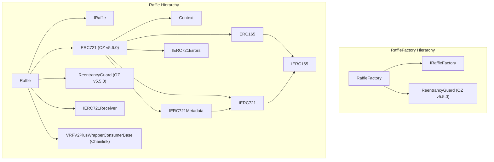

# Stage 6: Trail of Bits Secure Development Workflow & Code Maturity Assessment (`raffle.fun`)

**Project**: `raffle.fun` (Autonomous ERC-721 Raffle Protocol)  
**Platform**: Solidity `0.8.36` / EVM `cancun` (Ethereum L1 / Sepolia)  
**Frameworks Applied**:
1. Trail of Bits **Secure Development Workflow Guide** (`secure-workflow-guide` v0.1.0 — 5-Step Workflow)
2. Trail of Bits **Code Maturity Evaluation Framework** (`code-maturity-assessor` v0.1.0 — 9-Category Assessment)

**Scope of Reviewed Artifacts (Clean Context)**:
- `DESIGN.md`
- `packages/contracts/src/Raffle.sol` (614 lines)
- `packages/contracts/src/RaffleFactory.sol` (186 lines)
- `packages/contracts/src/interfaces/IRaffle.sol` (522 lines)
- `packages/contracts/src/interfaces/IRaffleFactory.sol` (151 lines)
- `packages/contracts/src/libraries/RaffleConstants.sol` (44 lines)
- `packages/contracts/foundry.toml` & `packages/contracts/hardhat.config.ts`
- Integrated dependencies: `@openzeppelin/contracts` (v5.5.0/v5.6.0 `ERC721`, `SafeERC20`, `Clones`, `ReentrancyGuard`, `Math`) and `@chainlink/contracts` (`VRFV2PlusWrapperConsumerBase`, `IVRFV2PlusWrapper`, `VRFV2PlusClient`)

---

# PART I: SECURE DEVELOPMENT WORKFLOW ASSESSMENT (`secure-workflow-guide`)

---

## STEP 1: KNOWN SECURITY ISSUES (STATIC ANALYSIS & DETECTOR TRIAGE)

### Static Analysis Pattern Scan (`slither . --exclude-dependencies` Equivalent)

| Detector / Pattern | Severity | Location | Status / Triage | Explanation & Recommendation |
|---|---|---|---|---|
| `reentrancy-no-eth` | Informational (Suppressed) | `packages/contracts/src/RaffleFactory.sol:108-121` | **Triaged / Safe** | Inline annotation `// slither-disable-next-line reentrancy-no-eth` precedes `IRaffle(raffle).initialize(...)` because `raffleCount` is incremented on line 105 before `initialize`, and registry mappings (`raffleById`, `idByRaffle`, `isRaffle`) are written on lines 123–125 before `prize.safeTransferFrom` on line 128. `createRaffle` is `nonReentrant` and `raffle` is a fresh ERC-1167 clone of the immutable `raffleImplementation`. |
| `reentrancy-benign` / `reentrancy-events` | Low / Informational | `packages/contracts/src/Raffle.sol:224-237` | **Triaged / Safe** | In `buyEntries`, `quoteToken.safeTransferFrom` (line 224) executes before state updates (lines 230–233), and `_safeMint(recipient, ticketId)` (line 235, which invokes `onERC721Received` on contract recipients) executes after all state updates and right before `emit TicketPurchased` (line 236). Protected by `nonReentrant` and canonical USDC trust assumptions. |
| `low-level-calls` | Informational | `packages/contracts/src/Raffle.sol:266-269` | **Triaged / Safe** | `requestDraw` refunds excess native ETH via `assembly ("memory-safe") { success := call(gas(), refundRecipient, excess, 0, 0, 0, 0) }`. Setting return data size to `0` prevents return-data bomb attacks. All state writes (`status`, `drawRequestedAt`, `vrfRequestId`, `_requestInFlight`) occur before the refund call, and `requestDraw` is `nonReentrant`. |
| `weak-prng` | False Positive | `packages/contracts/src/Raffle.sol:518` | **False Positive** | `uint128((randomWords[0] % uint256(totalEntries)) + 1)` uses a 256-bit cryptographic random word from Chainlink VRF v2.5 (`rawFulfillRandomWords` authenticated via `msg.sender == address(i_vrfV2PlusWrapper)`). Since `totalEntries <= type(uint128).max`, modulo bias is bounded by $< 2^{-128}$. |
| `incorrect-equality` | Informational | `packages/contracts/src/RaffleFactory.sol:129,132` & `packages/contracts/src/Raffle.sol:335,405` | **Triaged / Safe** | Strict equality checks on `ownerOf(prizeTokenId) != expectedOwner` and `status != Status.Active` are exact post-condition verifications rather than manipulable balance checks. |
| `timestamp` | Informational | `packages/contracts/src/Raffle.sol:216,242,245,282,287,291,512` | **Triaged / Safe** | `block.timestamp` governs sale end (`endTime`), draw request window (`DRAW_REQUEST_TIMEOUT = 2 days`), and VRF callback window (`DRAW_CALLBACK_TIMEOUT = 2 days`). Multi-day windows are resilient to 12-second L1 timestamp drift. |
| `calls-loop` | Informational | `packages/contracts/src/Raffle.sol:357-365` | **Triaged / Safe** | `refundTickets` loops over `ticketIds` calling `_burn(ticketId)` (which invokes `Raffle._update` -> `_isProtocolDestination`, untouched for `to == address(0)`), bounded by `MAX_REFUND_TICKET_BATCH_SIZE = 100`, followed by a single aggregated `_transferQuote` call outside the loop. |

---

## STEP 2: SPECIAL FEATURES VALIDATION

### 2.1 Upgradeability & Minimal Proxy (`ERC-1167 Clones`) Check

Pattern Detected: **Immutable ERC-1167 Minimal Proxies (`OpenZeppelin Clones.clone`) with Locked Implementation** (`packages/contracts/src/RaffleFactory.sol:72,106`).

| Check (`slither-check-upgradeability` Equivalent) | Result | Evidence & Analysis |
|---|---|---|
| Implementation lock on deployment | **PASS** | `Raffle.constructor` (`packages/contracts/src/Raffle.sol:164-166`) sets `initialized = true` and `status = Status.Refunding` in implementation storage, preventing direct initialization or active operation of the singleton implementation. |
| Initializer access control & atomicity | **PASS** | `Raffle.initialize` (`packages/contracts/src/Raffle.sol:176-180`) checks `if (initialized) revert AlreadyInitialized(); if (msg.sender != factory) revert OnlyFactory(); initialized = true;` and is called atomically in `RaffleFactory.createRaffle` (`packages/contracts/src/RaffleFactory.sol:109`). |
| Constructor state in ERC-1167 clones | **PASS** | Because ERC-1167 clones do not execute the implementation constructor against clone storage: (1) `ERC721._name` and `_symbol` storage slots are unused because `name()` and `symbol()` are overridden as `pure` functions (`packages/contracts/src/Raffle.sol:479-487`); (2) OpenZeppelin v5.5.0 `ReentrancyGuard` uses ERC-7201 slot `0x9b779b...` where `_reentrancyGuardEntered()` checks `value == ENTERED (2)` (`ReentrancyGuard.sol:2343`), so an uninitialized `0` slot in a fresh clone safely evaluates to not-entered on the first call and transitions `0 -> 2 -> 1`; (3) `factory`, `quoteToken`, `i_vrfV2PlusWrapper`, and `i_linkToken` are `immutable` (embedded in runtime bytecode) and thus preserved across `DELEGATECALL`. |
| Upgrade mechanism / `SELFDESTRUCT` / `DELEGATECALL` | **PASS** | No upgrade hooks exist. `raffleImplementation` is `immutable` in `RaffleFactory`. Neither `Raffle` nor `RaffleFactory` contains `delegatecall` or `selfdestruct`. |

### 2.2 ERC-721 Conformance (`Raffle` Ticket Token)

Pattern Detected: **`Raffle` inherits OpenZeppelin `ERC721` (v5.6.0) and `IERC721Receiver`**.

| ERC-721 Requirement (`slither-check-erc` Equivalent) | Result | Evidence & Analysis |
|---|---|---|
| Standard interface & `IERC165` (`supportsInterface`) | **PASS** | Inherited from OpenZeppelin `ERC721` (`ERC721.sol:2686-2691`), supporting `IERC721`, `IERC721Metadata`, and `IERC165`. |
| Minting safety (`_safeMint`) | **PASS** | `buyEntries` (`packages/contracts/src/Raffle.sol:235`) uses `_safeMint(recipient, ticketId)`, ensuring smart contract recipients implement `IERC721Receiver.onERC721Received`. |
| Transfer restrictions (`_update` hook) | **NOTE** | `Raffle._update` (`packages/contracts/src/Raffle.sol:497-502`) overrides `ERC721._update` to reject transfers where `to != address(0) && _isProtocolDestination(to, address(prizeToken))` with `UnsafeProtocolDestination(to)`. This intentionally blocks tickets from being transferred to the raffle itself, the factory, the implementation, another same-factory raffle clone, `quoteToken`, `vrfWrapper`, or `prizeToken`. |
| Metadata (`tokenURI`) | **NOTE** | `_baseURI()` is not overridden in `Raffle.sol`, so `tokenURI(ticketId)` returns `""` for all valid tickets (`ERC721.sol:2717-2731`). While ERC-721 compliant, off-chain wallets/marketplaces will not render ticket range metadata from `tokenURI`. |

### 2.3 Token Integration Analysis (`quoteToken` ERC-20 & `prizeToken` ERC-721)

1. **`quoteToken` (Trusted Canonical 6-Decimal USDC)**:
   - Verified in `RaffleFactory.constructor` (`packages/contracts/src/RaffleFactory.sol:65-78`) for non-zero code length and `IERC20Metadata(quoteToken_).decimals() == 6`.
   - Transfers use OpenZeppelin `SafeERC20` (`safeTransferFrom` in `buyEntries`, `safeTransfer` in `_transferQuote`).
   - **USDC Blacklist Consideration**: Canonical USDC enforces blacklist checks on both `sender` and `recipient`. `Raffle` isolates claims via a pull-over-push architecture (`redeemWinningTicket`, `refundTickets`, `releaseSponsorProceeds`, `releaseProtocolFees`) and a storage-only `settleWinningTicket`. If a ticket owner is blacklisted by USDC during `CashWon` or `Refunding`, the owner can transfer the ERC-721 ticket to an un-blacklisted address before calling `redeemWinningTicket` or `refundTickets`. However, if the immutable `sponsorRecipient` or `protocolTreasury` is blacklisted by USDC, those specific proceeds remain locked in the clone (`packages/contracts/src/Raffle.sol:375-392`).
2. **`prizeToken` (Untrusted Arbitrary ERC-721)**:
   - Validated at creation (`packages/contracts/src/RaffleFactory.sol:154-177`) for contract code, non-protocol address, and `IERC165.supportsInterface(type(IERC721).interfaceId)`.
   - Escrow in `createRaffle` (`packages/contracts/src/RaffleFactory.sol:127-134`) uses `prize.safeTransferFrom(msg.sender, raffle, params.prizeTokenId)` which triggers `Raffle.onERC721Received` (`packages/contracts/src/Raffle.sol:416-431`) requiring `status == Status.AwaitingPrize`, `msg.sender == address(prizeToken)`, `tokenId == prizeTokenId`, `from == sponsor`, and `operator == factory`, followed by post-transfer verification `prize.ownerOf(params.prizeTokenId) == raffle` and `IRaffle(raffle).status() == IRaffle.Status.Active`.
   - Outbound prize delivery in `redeemWinningTicket` (`packages/contracts/src/Raffle.sol:334-337`) and `releaseSponsorPrize` (`packages/contracts/src/Raffle.sol:404-406`) uses `prizeToken.transferFrom` (avoiding `onERC721Received` griefing by contract recipients) and verifies `prizeToken.ownerOf(...) == recipient`.

---

## STEP 3: VISUAL SECURITY INSPECTION

### 3.1 Inheritance Graph



**Inheritance Inspection Findings**:
- **C3 Linearization & Shadowing**: Clean. No state variable shadowing exists between `ERC721`, `ReentrancyGuard`, `VRFV2PlusWrapperConsumerBase`, and `Raffle`.
- **Inherited Exposed Functions in `Raffle`**:
  - `VRFV2PlusWrapperConsumerBase` exposes `rawFulfillRandomWords(uint256, uint256[]) external` (restricted to `msg.sender == address(i_vrfV2PlusWrapper)`), `getBalance() public view`, and `getLinkToken() public view` (`VRFV2PlusWrapperConsumerBase.sol:1785-1801`).
  - `ERC721` exposes standard token transfer and approval functions (`transferFrom`, `safeTransferFrom`, `approve`, `setApprovalForAll`), all of which route ownership mutations through the overridden `Raffle._update` hook (`packages/contracts/src/Raffle.sol:497-502`).

### 3.2 Function Summary & Access Control Matrix

| Contract | Function | Visibility | Modifiers / Guards | Mutability | External Calls Made | Risk Level |
|---|---|---|---|---|---|---|
| `RaffleFactory` | `constructor` | `public` | Contract/decimal/sink checks | non-payable | `quoteToken_.decimals()`, `new Raffle(...)` | Low |
| `RaffleFactory` | `createRaffle` | `external` | `nonReentrant` | non-payable | `prizeToken.supportsInterface`, `Clones.clone`, `raffle.initialize`, `prize.safeTransferFrom`, `prize.ownerOf`, `raffle.status` | Medium |
| `Raffle` | `constructor` | `public` | Zero-address checks, locks impl | non-payable | `vrfWrapper_.link()` (in base constructor) | Low |
| `Raffle` | `receive` | `external` | Always reverts (`DirectNativeTransfer`) | `payable` | None | Low |
| `Raffle` | `initialize` | `external` | `!initialized`, `msg.sender == factory` | non-payable | `factory.raffleImplementation()`, `factory.isRaffle()` | Low |
| `Raffle` | `buyEntries` | `external` | `nonReentrant`, `Status.Active`, `t < endTime` | non-payable | `quoteToken.safeTransferFrom`, `_safeMint` (`onERC721Received`), `factory` views | Medium |
| `Raffle` | `requestDraw` | `external` | `nonReentrant`, `Status.Active`, `endTime <= t < requestDeadline`, `totalEntries > 0` | `payable` | `i_vrfV2PlusWrapper.calculateRequestPriceNative`, `requestRandomWordsInNative`, native `call` refund | High |
| `Raffle` | `rawFulfillRandomWords` | `external` | `msg.sender == address(i_vrfV2PlusWrapper)` | non-payable | None (internal `fulfillRandomWords`) | Medium |
| `Raffle` | `enableRefunds` | `external` | `nonReentrant`, status/deadline/sponsor checks | non-payable | None (storage-only) | Low |
| `Raffle` | `settleWinningTicket` | `external` | `nonReentrant`, `!settlementComplete`, `NftWon \| CashWon`, range check | non-payable | None (storage-only) | Low |
| `Raffle` | `redeemWinningTicket` | `external` | `nonReentrant`, `!winnerRedeemed`, `msg.sender == ownerOf(ticketId)` | non-payable | `prizeToken.transferFrom` + `ownerOf` OR `quoteToken.safeTransfer` | High |
| `Raffle` | `refundTickets` | `external` | `nonReentrant`, `Status.Refunding`, `1..100` tickets, `msg.sender == ownerOf` | non-payable | `quoteToken.safeTransfer`, `factory` views | Medium |
| `Raffle` | `releaseSponsorProceeds` | `external` | `nonReentrant`, `sponsorProceeds > 0` | non-payable | `quoteToken.safeTransfer`, `factory` views | Low |
| `Raffle` | `releaseProtocolFees` | `external` | `nonReentrant`, `protocolFees > 0` | non-payable | `quoteToken.safeTransfer`, `factory` views | Low |
| `Raffle` | `releaseSponsorPrize` | `external` | `nonReentrant`, `CashWon \| Refunding`, `!prizeClaimed` | non-payable | `prizeToken.transferFrom` + `ownerOf` | Medium |
| `Raffle` | `onERC721Received` | `external` | `Status.AwaitingPrize`, `msg.sender == prizeToken`, `from == sponsor`, `operator == factory` | non-payable | None | Low |

### 3.3 State Variables and Authorization (`vars-and-auth` Mapping)

#### `RaffleFactory` State Variables
- `raffleCount` (`uint256`), `raffleById` (`mapping`), `idByRaffle` (`mapping`), `isRaffle` (`mapping`):
  - **Written by**: `createRaffle(CreateRaffleParams)` (`packages/contracts/src/RaffleFactory.sol:105,123-125`) — permissionless, `nonReentrant`, only persisted if clone initialization and prize NFT escrow verification succeed atomically.

#### `Raffle` State Variables
- **Initialization-only Configuration** (`initialized`, `sponsor`, `sponsorRecipient`, `protocolTreasury`, `prizeToken`, `prizeTokenId`, `raffleId`, `reserveEntries`, `endTime`):
  - **Written by**: `constructor` (`initialized = true` on implementation) and `initialize` (`packages/contracts/src/Raffle.sol:179,197-204`) — restricted to `msg.sender == factory` once per clone. Never mutated thereafter.
- **Lifecycle State (`status`)**:
  - **Written by**:
    1. `constructor` (`Status.Refunding` on implementation, line 165)
    2. `initialize` (`Status.AwaitingPrize`, line 205) — `onlyFactory`
    3. `onERC721Received` (`Status.AwaitingPrize -> Status.Active`, line 428) — `msg.sender == address(prizeToken)` & `operator == factory`
    4. `requestDraw` (`Status.Active -> Status.Drawing`, line 252) — permissionless in `[endTime, drawRequestDeadline())` when `totalEntries > 0`
    5. `fulfillRandomWords` (`Status.Drawing -> Status.NftWon | Status.CashWon`, line 521) — `msg.sender == address(i_vrfV2PlusWrapper)` before `callbackDeadline()`
    6. `enableRefunds` (`Status.Active | Status.Drawing -> Status.Refunding`, line 299) — `sponsor` (if `Active` & `totalEntries == 0`) or permissionless after applicable deadline.
- **Entry & Ticket Accounting (`totalEntries`, `ticketCount`, `_ticketRanges`)**:
  - **Written by**: `buyEntries` (`packages/contracts/src/Raffle.sol:230-232`) — monotonically increasing while `status == Status.Active` and `block.timestamp < endTime`. `_ticketRanges` is never deleted on burn.
- **Quote-Token Liability Buckets (`unsettledPot`, `remainingRefundLiability`, `winnerProceeds`, `sponsorProceeds`, `protocolFees`)**:
  - `unsettledPot`: Increased in `buyEntries` (`+= grossAmount`, line 233); zeroed in `enableRefunds` (line 297) or `_settleWinningTicket` (line 553).
  - `remainingRefundLiability`: Set to `unsettledPot` in `enableRefunds` (line 298); decremented in `refundTickets` (`-= amount`, line 368).
  - `winnerProceeds`: Set to `cashAmount` in `_settleWinningTicket` when `Status.CashWon` (line 548); zeroed in `redeemWinningTicket` (line 341).
  - `sponsorProceeds`: Set to `sponsorAmount` in `_settleWinningTicket` (line 554); zeroed in `releaseSponsorProceeds` (line 378).
  - `protocolFees`: Set to `protocolFee` in `_settleWinningTicket` (line 555); zeroed in `releaseProtocolFees` (line 388).
- **VRF & Resolution Tracking (`_requestInFlight`, `vrfRequestId`, `drawRequestedAt`, `resolvedAt`, `winningEntry`, `winningTicketId`, `settlementComplete`, `winnerRedeemed`, `winnerRecipient`, `prizeClaimed`)**:
  - `_requestInFlight`, `vrfRequestId`, `drawRequestedAt`: Written in `requestDraw` (lines 253–260).
  - `winningEntry`, `resolvedAt`: Written in `fulfillRandomWords` (lines 519–520).
  - `settlementComplete`, `winningTicketId`: Written once in `_settleWinningTicket` (lines 551–552).
  - `winnerRecipient`, `winnerRedeemed`: Written once in `redeemWinningTicket` (lines 323–324).
  - `prizeClaimed`: Written once in `redeemWinningTicket` (`NftWon`, line 331) or `releaseSponsorPrize` (`CashWon | Refunding`, line 403).

---

## STEP 4: SECURITY PROPERTIES & INVARIANT SPECIFICATION

### 4.1 Core System Invariants (For Foundry / Echidna / Medusa / Halmos)

#### A. State Machine & Lifecycle Properties
1. **SP-SM-01 (Strict Lifecycle DAG)**: A clone's `status` may only transition along the directed edges:
   - `AwaitingPrize -> Active` (only during `createRaffle` via `onERC721Received`)
   - `Active -> Drawing` (only when `totalEntries > 0` and `endTime <= block.timestamp < drawRequestDeadline()`)
   - `Active -> Refunding` (when `totalEntries == 0` and `(msg.sender == sponsor || block.timestamp >= endTime)`, or when `totalEntries > 0` and `block.timestamp >= drawRequestDeadline()`)
   - `Drawing -> NftWon` (only via VRF callback when `block.timestamp < callbackDeadline()` and `totalEntries >= reserveEntries`)
   - `Drawing -> CashWon` (only via VRF callback when `block.timestamp < callbackDeadline()` and `totalEntries < reserveEntries`)
   - `Drawing -> Refunding` (only when `block.timestamp >= callbackDeadline()`)
   - Terminal states (`NftWon`, `CashWon`, `Refunding`) can never transition to any other `Status`.
2. **SP-SM-02 (No Uninitialized or AwaitingPrize Escaped Clones)**: Every address where `factory.isRaffle(r) == true` satisfies `r.initialized() == true` and `r.status() != Status.AwaitingPrize`.
3. **SP-SM-03 (No Dead-Zone Between Windows)**: For any raffle with `totalEntries > 0` in `Status.Active`, at any timestamp `t >= endTime`, exactly one of `requestDraw()` (`t < drawRequestDeadline()`) or `enableRefunds()` (`t >= drawRequestDeadline()`) is permitted by timestamp checks. For any raffle in `Status.Drawing`, at any timestamp `t`, exactly one of `fulfillRandomWords` (`t < callbackDeadline()`) or `enableRefunds()` (`t >= callbackDeadline()`) is permitted.

#### B. Accounting & Conservation of Value Properties
4. **SP-ACC-01 (Quote Solvency Invariant)**: At the end of every transaction, for every raffle clone $R$:
   $$\text{quoteToken.balanceOf}(R) \ge R.\text{accountedQuoteBalance}()$$
   where $\text{accountedQuoteBalance}() = \text{unsettledPot} + \text{remainingRefundLiability} + \text{winnerProceeds} + \text{sponsorProceeds} + \text{protocolFees}$ (`packages/contracts/src/Raffle.sol:468-470`). Without unsolicited direct ERC-20 transfers to $R$, equality holds strictly: $\text{quoteToken.balanceOf}(R) == R.\text{accountedQuoteBalance}()$.
5. **SP-ACC-02 (Pre-Settlement / Pre-Refund Pot Conservation)**: While `status` is `Active` or `Drawing`, or `(status is NftWon | CashWon and !settlementComplete)`:
   $$\text{unsettledPot} == \text{uint256}(\text{totalEntries}) \times \text{ENTRY\_PRICE}$$
   and $\text{remainingRefundLiability} == \text{winnerProceeds} == \text{sponsorProceeds} == \text{protocolFees} == 0$.
6. **SP-ACC-03 (Lossless Settlement Partition)**: Immediately upon `_settleWinningTicket` completion (`packages/contracts/src/Raffle.sol:533-558`):
   $$\text{winnerProceeds} + \text{sponsorProceeds} + \text{protocolFees} == \text{uint256}(\text{totalEntries}) \times \text{ENTRY\_PRICE}$$
   with $\text{protocolFees} = \lfloor \frac{\text{grossPot} \times 500}{10000} \rfloor$, $\text{winnerProceeds} = 0$ (if `NftWon`) or $\lfloor \frac{\text{grossPot} \times 8000}{10000} \rfloor$ (if `CashWon`), and $\text{sponsorProceeds} = \text{grossPot} - \text{protocolFees} - \text{winnerProceeds}$.
7. **SP-ACC-04 (Refund Liability Conservation)**: When `status == Status.Refunding`:
   $$\text{remainingRefundLiability} == \sum_{i=1, \, \text{ownerOf}(i) \neq 0}^{\text{ticketCount}} (\text{lastEntry}_i - \text{firstEntry}_i + 1) \times \text{ENTRY\_PRICE}$$
8. **SP-ACC-05 (Prize NFT Escrow & Exclusive Release)**:
   - If `!prizeClaimed` and `status != AwaitingPrize`, then `prizeToken.ownerOf(prizeTokenId) == address(raffle)`.
   - `prizeClaimed` can transition `false -> true` at most once: either via `redeemWinningTicket` (only when `status == Status.NftWon`) or via `releaseSponsorPrize` (only when `status == Status.CashWon || status == Status.Refunding`).

#### C. Ticket Range & Winner Proof Properties
9. **SP-RNG-01 (Contiguous Disjoint Partition of Entries)**: For all $1 \le i \le \text{ticketCount}$:
   - $\text{firstEntry}_1 == 1$ (when $\text{ticketCount} \ge 1$)
   - $\text{firstEntry}_i \le \text{lastEntry}_i$
   - For $i > 1$: $\text{firstEntry}_i == \text{lastEntry}_{i-1} + 1$
   - $\text{lastEntry}_{\text{ticketCount}} == \text{totalEntries}$.
10. **SP-RNG-02 (Unique Winning Ticket Existence)**: Whenever `status == Status.NftWon || status == Status.CashWon`, $1 \le \text{winningEntry} \le \text{totalEntries}$, and there exists a **unique** $k \in [1, \text{ticketCount}]$ such that $\text{firstEntry}_k \le \text{winningEntry} \le \text{lastEntry}_k$.

### 4.2 Concrete Invariant Harness Template (Foundry / Echidna / Medusa)

```solidity
// SPDX-License-Identifier: MIT
pragma solidity 0.8.36;

import { IRaffle } from "../src/interfaces/IRaffle.sol";
import { IERC20 } from "@openzeppelin/contracts/token/ERC20/IERC20.sol";
import { IERC721 } from "@openzeppelin/contracts/token/ERC721/IERC721.sol";

contract RaffleProperties {
    IRaffle public raffle;
    IERC20 public quote;
    IERC721 public prize;

    constructor(IRaffle raffle_) {
        raffle = raffle_;
        quote = raffle_.quoteToken();
        prize = raffle_.prizeToken();
    }

    /// @notice SP-ACC-01: Actual USDC balance always covers all tracked raffle liabilities.
    function echidna_quote_solvency() public view returns (bool) {
        return quote.balanceOf(address(raffle)) >= raffle.accountedQuoteBalance();
    }

    /// @notice SP-RNG-01: Ticket ranges partition [1, totalEntries] without gaps or overlaps.
    function echidna_contiguous_ticket_ranges() public view returns (bool) {
        uint128 count = raffle.ticketCount();
        uint128 expectedNext = 1;
        for (uint256 i = 1; i <= count; ++i) {
            (uint128 first, uint128 last) = raffle.ticketRange(i);
            if (first != expectedNext || last < first) return false;
            expectedNext = last + 1;
        }
        return expectedNext - 1 == raffle.totalEntries();
    }

    /// @notice SP-ACC-05: Escrowed prize NFT is held by the raffle until prizeClaimed is true.
    function echidna_prize_escrow_integrity() public view returns (bool) {
        if (raffle.status() == IRaffle.Status.AwaitingPrize) return true;
        if (!raffle.prizeClaimed()) {
            return prize.ownerOf(raffle.prizeTokenId()) == address(raffle);
        }
        return true;
    }
}
```

---

## STEP 5: MANUAL REVIEW AREAS & ARCHITECTURAL RISK ANALYSIS

### 5.1 Privacy Analysis
- **On-Chain Visibility**: All raffle parameters (`reserveEntries`, `endTime`), ticket purchases (`TicketPurchased`), and VRF requests are public on-chain. No secrets or private commitments exist or are needed because randomness is generated asynchronously after `endTime` by Chainlink VRF v2.5 (`requestConfirmations = 30`).

### 5.2 Front-Running, Transaction Ordering & MEV Analysis
1. **Late Participation / Reserve Sniping Before `endTime`**:
   - Because `totalEntries` and `reserveEntries` are public on-chain and `buyEntries` is open until `block.timestamp < endTime` (`packages/contracts/src/Raffle.sol:216`), sophisticated participants can observe the mempool near `endTime` to see whether `totalEntries` will cross `reserveEntries` (switching the outcome from `CashWon` to `NftWon`) or buy a large entry batch in the final block before `endTime` to dilute existing entrants while still guaranteeing `totalEntries >= reserveEntries`.
   - Crucially, because `requestDraw()` can only be called when `block.timestamp >= endTime` (`packages/contracts/src/Raffle.sol:242`) and `VRF_REQUEST_CONFIRMATIONS = 30` (`RaffleConstants.sol:42`), no buyer can know or bias the VRF randomness at the time of `buyEntries`.
2. **Secondary-Market Ticket Trading vs. VRF Fulfillment / Settlement Ordering**:
   - Tickets remain transferable ERC-721 tokens in every `Status` (`packages/contracts/src/Raffle.sol:491-502`), including during `Status.Drawing` and after `fulfillRandomWords`.
   - **Architectural Protection**: `redeemWinningTicket` burns the ticket and pays `ownerOf(ticketId)` at redemption time, whereas `settleWinningTicket` is permissionless and storage-only (`packages/contracts/src/Raffle.sol:533-558`). Front-running `redeemWinningTicket` with `settleWinningTicket(ticketId)` causes no harm because `redeemWinningTicket` checks `if (!settlementComplete) _settleWinningTicket(ticketId); else if (ticketId != winningTicketId) revert ...` (`packages/contracts/src/Raffle.sol:314-318`).
   - **Marketplace Front-Running Note (Off-Chain / User Risk)**: If a ticket holder lists a ticket on an NFT marketplace (e.g., Seaport/OpenSea) during `Active` or `Drawing` and does not cancel the listing before `endTime` / `fulfillRandomWords`, a bot observing the VRF fulfillment transaction in the mempool can front-run or back-run to buy the winning ticket from the marketplace before the seller cancels. As noted in `DESIGN.md:5`, *"Frontend discovery is advisory; transaction decisions must reread current chain state."*
3. **VRF Native Fee Volatility (`getVrfRequestPrice` vs. `estimateVrfRequestPrice`)**:
   - `IVRFV2PlusWrapper.calculateRequestPriceNative` uses `tx.gasprice` (`IVRFV2PlusWrapper.sol:1835`). If a caller relies on an off-chain `eth_call` to `getVrfRequestPrice()` without setting `gasPrice`, or if basefee increases between simulation and inclusion, `requestDraw()` will revert with `InsufficientVrfFee`.
   - **Mitigation Present**: `Raffle` exposes `estimateVrfRequestPrice(uint256 requestGasPriceWei)` (`packages/contracts/src/Raffle.sol:441-443`) and atomically refunds `msg.value - paidPrice` to `msg.sender` (`packages/contracts/src/Raffle.sol:262-270`), allowing callers to supply a safe ETH buffer.

### 5.3 Cryptography & Randomness Review
- **Randomness Source**: Chainlink VRF v2.5 Direct Funding Wrapper (`VRFV2PlusWrapperConsumerBase`).
- **Synchronous Callback Defense**: `Raffle.requestDraw` sets `_requestInFlight = true` before calling `requestRandomnessPayInNative` and sets `_requestInFlight = false` after storing `vrfRequestId = requestId` (`packages/contracts/src/Raffle.sol:254-260`). `fulfillRandomWords` rejects callbacks if `_requestInFlight == true` (`packages/contracts/src/Raffle.sol:511`), preventing premature resolution even if a wrapper ever attempted a synchronous callback before `vrfRequestId` was recorded.
- **Liveness-Preserving Callback Handling**: Instead of reverting inside `fulfillRandomWords` on late, duplicate, wrong-request, or wrong-word-count callbacks, `Raffle.sol:510-516` emits `VrfCallbackIgnored` and returns cleanly so the VRF wrapper does not mark the fulfillment as a reverted callback.

### 5.4 DeFi & External Dependency Architectural Risk Areas
1. **Single-Attempt VRF Draw & Non-Reimbursed Permissionless Request Fee**:
   - `requestDraw()` is permissionless (`packages/contracts/src/Raffle.sol:240`), requires the caller to pay the Chainlink VRF native fee without reimbursement from the raffle pot, and transitions `status` permanently out of `Status.Active` into `Status.Drawing`.
   - Because `callbackGasLimit = 300_000` (`RaffleConstants.sol:38`) and `requestConfirmations = 30`, the Chainlink VRF wrapper charges upfront for 300,000 gas (plus wrapper overhead and premium) even though `fulfillRandomWords` only consumes ~35,000–50,000 gas. During high L1 gas prices, this upfront native fee can be significant; if neither the sponsor nor any participant calls `requestDraw()` within `[endTime, endTime + 2 days)`, the raffle transitions to `Refunding`.
2. **Untrusted `prizeToken` Behavior at Redemption/Release**:
   - While `RaffleFactory` verifies ERC-165 support for `IERC721` and verifies actual escrow transfer at creation (`packages/contracts/src/RaffleFactory.sol:127-134, 171-177`), a mutable, pausable, or upgradeable `prizeToken` could pause or block transfers before `redeemWinningTicket` or `releaseSponsorPrize`.
   - **Architectural Containment**: Because `settleWinningTicket` does not touch `prizeToken`, quote-token claims (`releaseSponsorProceeds`, `releaseProtocolFees`) remain unaffected by a broken `prizeToken`.
3. **Immutable Recipient Lock-In (`sponsorRecipient`, `protocolTreasury`)**:
   - Neither `sponsorRecipient` nor `protocolTreasury` can be updated after `initialize`. If either address is an EOA whose keys are lost, a contract that later becomes incompatible with `prizeToken`, or an address blacklisted by canonical USDC (`quoteToken`), its respective proceeds/prize in active clones cannot be redirected.

### 5.5 Workflow Action Plan & Checklist

- [x] **Step 1**: Static analysis / Slither detector patterns audited and triaged.
- [x] **Step 2**: Special features validated (ERC-1167 clone initialization & stateless reentrancy guard, ERC-721 ticket conformance, USDC & ERC-721 prize token integration).
- [x] **Step 3**: Visual security inspection completed (inheritance hierarchy, function summary, state variable write authorization).
- [x] **Step 4**: Formal security properties and invariants specified for fuzzing/symbolic verification.
- [x] **Step 5**: Manual review areas analyzed (privacy, MEV/ordering, VRF cryptography, external token/oracle dependencies).

---

# PART II: CODE MATURITY ASSESSMENT (`code-maturity-assessor`)

---

## EXECUTIVE SUMMARY

**Overall Maturity Score**: **3.3 / 4.0 (SATISFACTORY — Approaching Strong)**

### Top 3 Strengths
1. **Minimalist, Immutable, Zero-Admin Architecture**: The protocol eliminates upgradeability, admin keys, pause switches, and cross-clone shared custody (`packages/contracts/src/RaffleFactory.sol:14-16`, `packages/contracts/src/Raffle.sol:35-39`). Every clone has an explicit, deterministic terminal escape hatch (`enableRefunds`) after bounded 2-day request/callback timeouts.
2. **Lossless, Overflow-Safe Arithmetic & O(1) Ticket Accounting**: Range-based ticket accounting (`TicketRange` in `packages/contracts/src/Raffle.sol:49-52`) makes entry purchases, VRF callbacks, and winner proofs $O(1)$ regardless of entry count, while `Math.mulDiv` floor rounding with remainder allocation to the sponsor guarantees zero dust locked in clones (`packages/contracts/src/Raffle.sol:540-555`).
3. **Defense-in-Depth External Call & Sink Isolation**: The codebase systematically blocks protocol addresses (`_isProtocolDestination`), separates storage-only settlement (`settleWinningTicket`) from external token delivery (`redeemWinningTicket`, `releaseSponsorProceeds`, `releaseProtocolFees`), prevents ETH return-data bombs via zero-length return assembly calls (`packages/contracts/src/Raffle.sol:266-269`), and guards against synchronous VRF callbacks (`_requestInFlight`).

### Top 3 Gaps & Areas for Improvement
1. **Lack of Off-Chain Operational Monitoring & Keeper Playbooks**: Because `requestDraw()` (`[endTime, endTime + 2 days)`) and `enableRefunds()` rely on timely external transactions and `fulfillRandomWords` can silently emit `VrfCallbackIgnored`, operational liveness depends on off-chain monitoring/keeper infrastructure and incident runbooks not documented in the repository.
2. **Documentation & Metadata Refinements**: While inline NatSpec is exceptionally thorough across all contracts and interfaces, `DESIGN.md` is a condensed paragraph lacking formal state-transition diagrams, user stories, and a formal invariant specification document; additionally, `Raffle` does not override `_baseURI()` / `tokenURI()`, returning `""` for minted tickets.
3. **Secondary-Market Ordering & VRF Gas-Pricing Operational Risks**: Minted tickets remain transferable during `Drawing` and after `fulfillRandomWords`, creating marketplace sniping risks for users with open listings, and `VRF_CALLBACK_GAS_LIMIT = 300_000` over-provisions callback gas (~6x actual usage), increasing upfront native VRF fees during high-gas periods.

---

## MATURITY SCORECARD

| # | Category | Rating | Score | Key Evidence & Notes |
|---|---|---|---|---|
| 1 | **Arithmetic** | **STRONG** | 4 / 4 | Solidity `0.8.36` checked math, explicit `uint128` overflow guard, `Math.mulDiv` floor rounding, lossless remainder allocation, zero `unchecked` blocks in `src/`. |
| 2 | **Auditing & Logging** | **SATISFACTORY** | 3 / 4 | Comprehensive, indexed events for every state transition including `VrfCallbackIgnored`; needs documented off-chain keeper/alerting runbook. |
| 3 | **Authentication / Access Controls** | **STRONG** | 4 / 4 | Ownerless immutable design; least-privilege actors (`onlyFactory`, `i_vrfV2PlusWrapper`, `ownerOf(ticketId)`, `sponsor` empty-cancel); sink screening. |
| 4 | **Complexity Management** | **STRONG** | 4 / 4 | Two compact contracts (~800 LoC total), $O(1)$ range design, flat 6-state enum, low cyclomatic complexity, decoupled settlement vs. claims. |
| 5 | **Decentralization** | **STRONG** | 4 / 4 | Zero admin/governance/pause/upgrade keys; permissionless draw, settlement, fee release, and timeout-based full refund exit path. |
| 6 | **Documentation** | **SATISFACTORY** | 3 / 4 | Complete, accurate NatSpec on every contract, interface, function, event, and error; `DESIGN.md` is terse and lacks diagrams/formal invariant spec. |
| 7 | **Transaction Ordering Risks** | **SATISFACTORY** | 3 / 4 | VRF 30-block confirmations, `_requestInFlight` guard, storage-only settlement, native fee excess refund; secondary-market ticket listing & `endTime` sniping risks should be documented for users. |
| 8 | **Low-Level Manipulation** | **SATISFACTORY** | 3 / 4 | Single 3-line `"memory-safe"` assembly block in `Raffle.sol:266-269` preventing returnbombing on native refund; all other assembly isolated to audited OpenZeppelin v5.5/5.6 libraries. |
| 9 | **Testing & Verification Readiness** | **SATISFACTORY** | 3 / 4 | Multi-profile Foundry fuzzing (`1,000` to `100,000` runs) & invariant configs (`depth = 512`, `fail_on_revert = true`), deterministic view helpers (`accountedQuoteBalance`, `grossSales`). |

**OVERALL MATURITY SCORE**: **3.33 / 4.0 (SATISFACTORY — Approaching Strong)**

---

## DETAILED 9-CATEGORY ANALYSIS

---

### 1. ARITHMETIC — **STRONG (4 / 4)**

**Criteria Evaluation**:
- **Overflow/Underflow Protection**: Compiled with Solidity `0.8.36` (`packages/contracts/foundry.toml:7`, `packages/contracts/hardhat.config.ts:17`). There are **zero** `unchecked` blocks anywhere in `packages/contracts/src/`.
- **Explicit Domain Bounds**:
  - `buyEntries` (`packages/contracts/src/Raffle.sol:218-221`) explicitly guards against `uint128` overflow with a custom error before arithmetic:
    ```solidity
    if (entryCount == 0) revert ZeroEntryCount();
    if (entryCount > type(uint128).max - totalEntries) {
        revert TotalEntriesOverflow(totalEntries, entryCount);
    }
    ```
  - Because `totalEntries <= type(uint128).max` and `ENTRY_PRICE = 1_000_000` ($10^6 < 2^{20}$), the maximum possible `grossAmount` or `unsettledPot` is $(2^{128} - 1) \times 10^6 < 2^{148} \ll 2^{256} - 1$, making `uint256` overflow mathematically impossible in `grossAmount = uint256(entryCount) * ENTRY_PRICE` (`Raffle.sol:223`), `unsettledPot += grossAmount` (`Raffle.sol:233`), `grossSales()` (`Raffle.sol:474`), and `refundTickets` (`Raffle.sol:363, 367`).
  - Timestamp additions `uint256(endTime) + RaffleConstants.DRAW_REQUEST_TIMEOUT` (`Raffle.sol:459`) and `uint256(drawRequestedAt) + RaffleConstants.DRAW_CALLBACK_TIMEOUT` (`Raffle.sol:464`) upcast `uint64` to `uint256` before adding `2 days`, preventing `uint64` overflow.
- **Precision & Rounding Specification**:
  - `DESIGN.md:4-5` and `RaffleConstants.sol:6-8` specify floor rounding via `Math.mulDiv` for `PROTOCOL_FEE_BPS = 500` (5%) and `CASH_WINNER_BPS = 8000` (80%), allocating the exact remainder to `sponsorProceeds`.
  - `_settleWinningTicket` (`packages/contracts/src/Raffle.sol:540-549`) implements this one-to-one:
    ```solidity
    uint256 protocolFee = Math.mulDiv(grossPot, RaffleConstants.PROTOCOL_FEE_BPS, RaffleConstants.BPS);
    if (result == Status.NftWon) {
        sponsorAmount = grossPot - protocolFee;
    } else {
        cashAmount = Math.mulDiv(grossPot, RaffleConstants.CASH_WINNER_BPS, RaffleConstants.BPS);
        sponsorAmount = grossPot - protocolFee - cashAmount;
        winnerProceeds = cashAmount;
    }
    ```
  - Note: Because `ENTRY_PRICE = 1_000_000` is a multiple of `BPS = 10_000`, `grossPot` is always an exact multiple of `10_000`, so `Math.mulDiv(grossPot, bps, 10_000)` has zero truncation loss in normal operation while still guaranteeing lossless remainder conservation for any arbitrary `grossPot`.
- **Randomness Modulo**:
  - `fulfillRandomWords` (`packages/contracts/src/Raffle.sol:518`) computes `uint128((randomWords[0] % uint256(totalEntries)) + 1)`. `totalEntries` is guaranteed $> 0$ because `requestDraw()` reverts with `NoEntriesSold()` when `totalEntries == 0` (`Raffle.sol:244`), eliminating any division-by-zero panic path.

** Minor Improvement Opportunity**:
- None required in code; optionally document the mathematical proof that `grossPot` is always divisible by `BPS` (since `1_000_000 % 10_000 == 0`) in `DESIGN.md`.

---

### 2. AUDITING & LOGGING — **SATISFACTORY (3 / 4)**

**Criteria Evaluation**:
- **Event Coverage & Consistency**:
  - Every state-modifying function across `RaffleFactory` and `Raffle` emits a distinct, descriptive, strongly-typed event:
    - `RaffleFactory.sol:136`: `RaffleCreated` (with `raffleId`, `raffle`, `sponsor` indexed, plus all config parameters).
    - `Raffle.sol:429`: `PrizeDeposited` (`prizeToken`, `prizeTokenId`, `sponsor` indexed).
    - `Raffle.sol:236`: `TicketPurchased` (`buyer`, `recipient`, `ticketId` indexed, plus `firstEntry`, `lastEntry`, `entryCount`, `grossAmount`).
    - `Raffle.sol:272`: `DrawRequested` (`requestId`, `requester` indexed, plus `fee`, `excessReturned`, `drawRequestedAt`, `callbackDeadline`).
    - `Raffle.sol:514`: `VrfCallbackIgnored` (`receivedRequestId`, `expectedRequestId` indexed, plus `status`) — **exceptional practice** for observability of ignored no-op callbacks.
    - `Raffle.sol:523`: `RaffleResolved` (`requestId`, `winningEntry`, `result` indexed).
    - `Raffle.sol:300`: `RefundsEnabled` (`finalizer` indexed, `remainingRefundLiability`).
    - `Raffle.sol:557`: `WinningTicketSettled` (`ticketId`, `settler`, `result` indexed, plus `cashAmount`, `protocolFee`, `sponsorAmount`).
    - `Raffle.sol:345`: `WinningTicketRedeemed` (`ticketId`, `winner`, `result` indexed, plus `cashAmount`, `prizeToken`, `prizeTokenId`).
    - `Raffle.sol:371`: `TicketsRefunded` (`owner` indexed, `ticketQuantity`, `entryQuantity`, `amount`, `remainingRefundLiability`).
    - `Raffle.sol:381`: `SponsorProceedsReleased`, `Raffle.sol:391`: `ProtocolFeesReleased`, `Raffle.sol:406`: `SponsorPrizeReleased`.
- **Custom Errors with Diagnostic Context**:
  - All 28 custom errors in `IRaffle`, `IRaffleFactory`, and `Raffle` include exact diagnostic parameters (e.g., `SaleEnded(endTime, block.timestamp)`, `InsufficientVrfFee(quotedFee, msg.value)`, `NotTicketOwner(ticketId, msg.sender, winner)`).

**Gaps Identified**:
- No off-chain monitoring specification, keeper automation runbook, or alerting playbook is included in the repository for time-critical lifecycle transitions (`requestDraw` within 2 days of `endTime`, `VrfCallbackIgnored` alerts, or `enableRefunds` triggers).

**Actions to Reach Strong (4 / 4)**:
- Document an operational monitoring & alerting playbook covering `DrawRequested`, `VrfCallbackIgnored`, `RefundsEnabled`, and approaching `drawRequestDeadline()` / `callbackDeadline()` thresholds.

---

### 3. AUTHENTICATION / ACCESS CONTROLS — **STRONG (4 / 4)**

**Criteria Evaluation**:
- **Principle of Least Privilege & Role Minimization**:
  - There is **no admin, owner, governance, or pauser role** in `RaffleFactory` or `Raffle` (`packages/contracts/src/RaffleFactory.sol:14-16`, `packages/contracts/src/Raffle.sol:35-38`).
  - Privileged entry points are strictly minimized and cryptographically or structurally bound:
    1. `Raffle.initialize` (`packages/contracts/src/Raffle.sol:176-179`): Callable only once (`if (initialized) revert AlreadyInitialized()`) and only by the immutable `factory` (`if (msg.sender != factory) revert OnlyFactory()`).
    2. `Raffle.onERC721Received` (`packages/contracts/src/Raffle.sol:416-426`): Restricted to `status == Status.AwaitingPrize`, `msg.sender == address(prizeToken)`, `tokenId == prizeTokenId`, `from == sponsor`, and `operator == factory`.
    3. `Raffle.rawFulfillRandomWords` (`VRFV2PlusWrapperConsumerBase.sol:1785-1791`): Restricted to `msg.sender == address(i_vrfV2PlusWrapper)`.
    4. `Raffle.redeemWinningTicket` & `Raffle.refundTickets` (`packages/contracts/src/Raffle.sol:320-321, 359-360`): Restricted to `msg.sender == ownerOf(ticketId)` (specifically NOT allowing approved operators to burn tickets and divert payouts to `msg.sender` in `refundTickets`).
    5. `Raffle.enableRefunds` pre-`endTime` empty cancellation (`packages/contracts/src/Raffle.sol:280-284`): Restricted to `msg.sender == sponsor` when `status == Status.Active && totalEntries == 0 && block.timestamp < endTime`; permissionless after `endTime`.
    6. `settleWinningTicket`, `releaseSponsorProceeds`, `releaseProtocolFees`, and `releaseSponsorPrize` are permissionless triggers that only send funds/NFTs to immutable, pre-validated recipients (`sponsorRecipient`, `protocolTreasury`).
- **Protocol Sink Screening**:
  - `_isProtocolDestination` (`packages/contracts/src/Raffle.sol:593-605`) and `_validateCreateParams` (`packages/contracts/src/RaffleFactory.sol:154-169`) prevent `sponsor`, `sponsorRecipient`, `protocolTreasury`, and ticket recipients (`_update`) from being set to `address(0)`, `address(this)`, `factory`, `quoteToken`, `vrfWrapper`, `prizeToken`, `raffleImplementation`, or any registered raffle clone (`isRaffle`).

**Minor Observation**:
- In `refundTickets` (`packages/contracts/src/Raffle.sol:359-360`) and `redeemWinningTicket` (`packages/contracts/src/Raffle.sol:320-321`), only `ownerOf(ticketId)` (not ERC-721 approved operators) can call the function. This is an intentional, well-documented security guard (`IRaffle.sol:272-276`) that prevents an approved marketplace operator from calling `refundTickets` to steal the USDC refund (`_transferQuote(msg.sender, amount)`).

---

### 4. COMPLEXITY MANAGEMENT — **STRONG (4 / 4)**

**Criteria Evaluation**:
- **Compact, Modular Codebase**:
  - The entire protocol implementation consists of two contracts (`Raffle.sol` at 614 lines including NatSpec, `RaffleFactory.sol` at 186 lines) and one constants library (`RaffleConstants.sol` at 44 lines).
- **Algorithmic Simplicity ($O(1)$ Operations)**:
  - By representing each purchase as a single ERC-721 ticket holding a `TicketRange(firstEntry, lastEntry)` struct (`packages/contracts/src/Raffle.sol:49-52`), `buyEntries`, `fulfillRandomWords`, `settleWinningTicket`, and `redeemWinningTicket` are all strictly $O(1)$ in gas and storage reads/writes regardless of how many entries a user buys.
  - The only loop in the codebase is `refundTickets(uint256[] calldata ticketIds)` (`packages/contracts/src/Raffle.sol:357-365`), which is explicitly bounded by `MAX_REFUND_TICKET_BATCH_SIZE = 100` (`RaffleConstants.sol:26`).
- **Clear Separation of Concerns**:
  - Settlement calculation (`_settleWinningTicket`, pure storage liability allocation) is cleanly decoupled from asset delivery (`redeemWinningTicket`, `releaseSponsorProceeds`, `releaseProtocolFees`, `releaseSponsorPrize`), eliminating cross-actor reentrancy and griefing vectors.

---

### 5. DECENTRALIZATION — **STRONG (4 / 4)**

**Criteria Evaluation**:
- **Zero Centralization / Zero Admin Custody**:
  - Neither the protocol deployer nor the sponsor can pause a live raffle, upgrade implementation logic, alter `endTime` or `reserveEntries`, confiscate escrowed prizes, or redirect `unsettledPot` (`packages/contracts/src/RaffleFactory.sol:14-16`, `packages/contracts/src/Raffle.sol:35-38`).
- **Guaranteed Permissionless Exit / Liveness Paths**:
  - Every non-terminal state has a bounded, permissionless timeout transition to `Status.Refunding`:
    - If `totalEntries == 0`, anyone can call `enableRefunds()` at `block.timestamp >= endTime` (`Raffle.sol:280-284`).
    - If `totalEntries > 0` and no draw is requested, anyone can call `enableRefunds()` at `block.timestamp >= endTime + 2 days` (`Raffle.sol:285-287`).
    - If a draw is requested (`Status.Drawing`) and Chainlink VRF fails to respond, anyone can call `enableRefunds()` at `block.timestamp >= drawRequestedAt + 2 days` (`Raffle.sol:289-291`).
- **Documented External Trust Assumptions**:
  - External dependencies are explicitly limited to the immutable `quoteToken` (canonical 6-decimal USDC, centrally administrated by Circle) and `vrfWrapper` (Chainlink VRF v2.5 wrapper), both clearly documented in `DESIGN.md:5` and `IRaffle.sol:16-18`.

---

### 6. DOCUMENTATION — **SATISFACTORY (3 / 4)**

**Criteria Evaluation**:
- **Inline Code Documentation (Strong)**:
  - Every contract, interface, struct, enum value, constant, state variable, external/public/internal/private function, event, and custom error in `Raffle.sol`, `RaffleFactory.sol`, `IRaffle.sol`, `IRaffleFactory.sol`, and `RaffleConstants.sol` has comprehensive, accurate NatSpec (`@title`, `@author`, `@notice`, `@dev`, `@param`, `@return`, `@inheritdoc`).
  - Trust assumptions, edge cases (such as historical `_ticketRanges` persistence after burns and ignored VRF callbacks vs. malformed ABI calldata), and rounding rules are explicitly documented in NatSpec (`packages/contracts/src/Raffle.sol:138, 505-507, 528-531`).
- **Architectural & Specification Documentation (Moderate)**:
  - `DESIGN.md` accurately summarizes the core design rules in a single dense paragraph and matches the implementation 1-to-1.

**Gaps Identified**:
- `DESIGN.md` lacks visual architecture/state-machine diagrams, explicit user stories, a formal glossary, and a dedicated invariant specification table.
- `Raffle` does not implement `tokenURI` / `_baseURI` (`ERC721.sol:2717-2731`), nor does `DESIGN.md` document that ticket NFTs have an empty `tokenURI`.

**Actions to Reach Strong (4 / 4)**:
- Expand `DESIGN.md` with the state-transition diagram, formal invariant list (from Step 4 above), and user/integration guides covering VRF fee estimation (`estimateVrfRequestPrice`) and secondary-market ticket trading hazards.

---

### 7. TRANSACTION ORDERING RISKS — **SATISFACTORY (3 / 4)**

**Criteria Evaluation**:
- **Protected Randomness & Settlement**:
  - Entry sales close strictly before `endTime` (`block.timestamp < endTime`), while `requestDraw()` opens at `block.timestamp >= endTime` (`packages/contracts/src/Raffle.sol:216, 242`) and waits `VRF_REQUEST_CONFIRMATIONS = 30` blocks (`RaffleConstants.sol:42`). This prevents block producers or entrants from predicting or manipulating randomness during entry sales.
  - `settleWinningTicket` is side-effect-free with respect to ticket ownership (`packages/contracts/src/Raffle.sol:533-558`), so front-running `redeemWinningTicket` with `settleWinningTicket` cannot alter payouts or grief redemption.
  - `requestDraw` refunds any native value above `paidPrice` (`packages/contracts/src/Raffle.sol:262-270`), allowing callers to include a gas-price slippage buffer against basefee fluctuations.

**Gaps / Inherent Ordering Risks Identified**:
1. **Last-Block Entry Sniping / Dilution**: Because `totalEntries` and `reserveEntries` are public, a whale can wait until the final block before `endTime` to decide whether to buy entries (either pushing `totalEntries >= reserveEntries` to win a high-value NFT at a discount, or diluting other buyers).
2. **Secondary-Market Ticket Listing Sniping**: Because tickets remain transferable ERC-721 tokens during `Status.Drawing` and after `fulfillRandomWords`, any user who leaves an open sell order for a raffle ticket on an NFT marketplace after `endTime` can have their winning ticket sniped by a mempool bot as soon as the VRF fulfillment transaction is broadcast.
3. **Permissionless `requestDraw()` Gas Price Timing**: Any user can call `requestDraw()` as soon as `block.timestamp >= endTime`. While a high `tx.gasprice` only increases the caller's own native VRF fee (not paid by the raffle), a caller using an unbuffered `getVrfRequestPrice()` quote can be front-run by basefee increases and experience a revert.

**Actions to Reach Strong (4 / 4)**:
- Explicitly document secondary-market listing cancellation warnings (advising users/marketplaces not to keep open listings at or after `endTime`) and `estimateVrfRequestPrice` buffer usage in developer/user documentation.

---

### 8. LOW-LEVEL MANIPULATION — **SATISFACTORY (3 / 4)**

**Criteria Evaluation**:
- **Minimal, Justified Assembly in Project Code**:
  - Across `Raffle.sol`, `RaffleFactory.sol`, and `RaffleConstants.sol`, there is only **one** inline assembly block (`packages/contracts/src/Raffle.sol:266-269`):
    ```solidity
    assembly ("memory-safe") {
        success := call(gas(), refundRecipient, excess, 0, 0, 0, 0)
    }
    ```
  - **Justification**: Using low-level `call` with `outsize = 0` avoids copying arbitrary return data from `msg.sender` into memory, preventing return-data bomb (gas griefing) attacks while returning excess native ETH in `requestDraw()`. It is annotated `"memory-safe"` and immediately checked via `if (!success) revert NativeRefundFailed(msg.sender, excess);`.
- **Dependency Assembly**:
  - Other assembly blocks exist solely inside battle-tested OpenZeppelin v5.5.0/v5.6.0 libraries (`Clones.sol`, `SafeERC20.sol`, `ERC721Utils.sol`, `Math.sol`).

**Gaps Identified**:
- The inline assembly block in `Raffle.sol:266-269` lacks an inline code comment explaining *why* assembly `call(..., 0, 0, 0, 0)` is used instead of `(bool success, ) = refundRecipient.call{value: excess}("")` (namely, preventing return-data bombs).

**Actions to Reach Strong (4 / 4)**:
- Add a brief inline `@dev` comment above `Raffle.sol:266` documenting the zero-returndata-copy rationale and ensure differential/fuzz tests cover reverting and return-data-bombing `msg.sender` contracts in `requestDraw()`.

---

### 9. TESTING & VERIFICATION READINESS — **SATISFACTORY (3 / 4)**

*(Note: Evaluated strictly from build/verification configuration and contract testability architecture per clean-context rules.)*

**Criteria Evaluation**:
- **Foundry & Hardhat Verification Configuration (`packages/contracts/foundry.toml`, `hardhat.config.ts`)**:
  - Compiler version (`0.8.36`), EVM target (`cancun`), and optimizer settings (`optimizer = true`, `optimizer_runs = 200`, `via_ir = false`) are pinned identically across both `foundry.toml` (`lines 6-10`) and `hardhat.config.ts` (`lines 17-35`).
  - `foundry.toml` defines dedicated, high-rigor verification profiles:
    - `default`: `fuzz = { runs = 1_000 }`, `invariant = { runs = 256, depth = 64, fail_on_revert = false }`
    - `ci`: `fuzz = { runs = 10_000 }`, `invariant = { runs = 1_000, depth = 256, fail_on_revert = false }`
    - `audit`: `fuzz = { runs = 100_000 }`, `invariant = { runs = 1_000, depth = 256, fail_on_revert = false }`
    - `audit_strict`: `fuzz = { runs = 10_000 }`, `invariant = { runs = 1_000, depth = 256, fail_on_revert = true }`
    - `audit_release`: `fuzz = { runs = 100_000 }`, `invariant = { runs = 5_000, depth = 512, fail_on_revert = true, timeout = 3_600 }`
    - `coverage` and `comparison` (`via_ir = true`, `optimizer_runs = 1_000`) profiles for differential optimizer verification.
- **On-Chain Observability & Invariant Hooks**:
  - `Raffle` exposes dedicated view functions `accountedQuoteBalance()` (`Raffle.sol:468-470`), `grossSales()` (`Raffle.sol:473-475`), `drawRequestDeadline()` (`Raffle.sol:458-460`), `callbackDeadline()` (`Raffle.sol:463-465`), and persistent `_ticketRanges` (`Raffle.sol:451-455`), which are purpose-built to make conservation-of-value and partition invariants directly assertable in stateful fuzzing and formal verification.

**Actions to Reach Strong (4 / 4)**:
- Add symbolic execution (Halmos / Certora / Manticore) proofs for `_settleWinningTicket` conservation of value and `fulfillRandomWords` / `enableRefunds` timestamp boundary completeness, plus mutation testing gates in CI.

---

## PRIORITY-ORDERED IMPROVEMENT ROADMAP

### HIGH PRIORITY (Before Mainnet Launch — 1 to 2 Weeks)

1. **Deploy Off-Chain Liveness Monitoring, Alerting & Keeper Playbook** *(Category: Auditing & Logging / Operational Security)*
   - **Impact**: High — Prevents sold raffles from accidentally expiring into `Refunding` if no user calls `requestDraw()` within `[endTime, endTime + 2 days)`, and alerts operators immediately if `VrfCallbackIgnored` is emitted or if a VRF request stalls near `callbackDeadline()`.
   - **Effort**: 2–3 days.
2. **Optimize or Document `VRF_CALLBACK_GAS_LIMIT` (`300_000` Gas)** *(Category: Transaction Ordering / DeFi Interactions)*
   - **Impact**: Medium-High — `fulfillRandomWords` only writes 3 storage slots (`winningEntry`, `resolvedAt`, `status`) and emits `RaffleResolved` (~35k–50k gas). Because Chainlink VRF v2.5 Direct Funding Wrapper charges the requester upfront for the full `callbackGasLimit` without refunding unused callback gas, reducing `VRF_CALLBACK_GAS_LIMIT` (e.g., to `100_000`) or documenting the cost trade-off significantly lowers the native ETH barrier to calling `requestDraw()`.
   - **Effort**: 1 day.

### MEDIUM PRIORITY (Documentation & Verification Hardening — 2 to 4 Weeks)

3. **Expand Specification Documentation (`DESIGN.md`) with Invariants, Diagrams & User Warnings** *(Category: Documentation / Transaction Ordering)*
   - **Impact**: Medium — Document the 10 formal invariants (Step 4), the lifecycle state diagram, secondary-market ticket listing sniping warnings around `endTime`, and `estimateVrfRequestPrice` usage for draw requesters.
   - **Effort**: 2 days.
4. **Document Assembly Rationale & Add Symbolic Execution Proofs (`Halmos` / `Certora`)** *(Category: Low-Level Manipulation / Testing & Verification)*
   - **Impact**: Low-Medium — Add inline documentation for the returnbomb-safe assembly `call` in `Raffle.sol:266-269` and add symbolic proofs for `SP-ACC-03` (lossless settlement) and `SP-SM-03` (timestamp window completeness).
   - **Effort**: 2–3 days.

