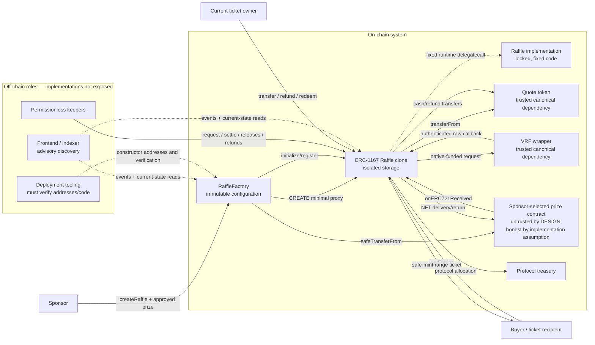
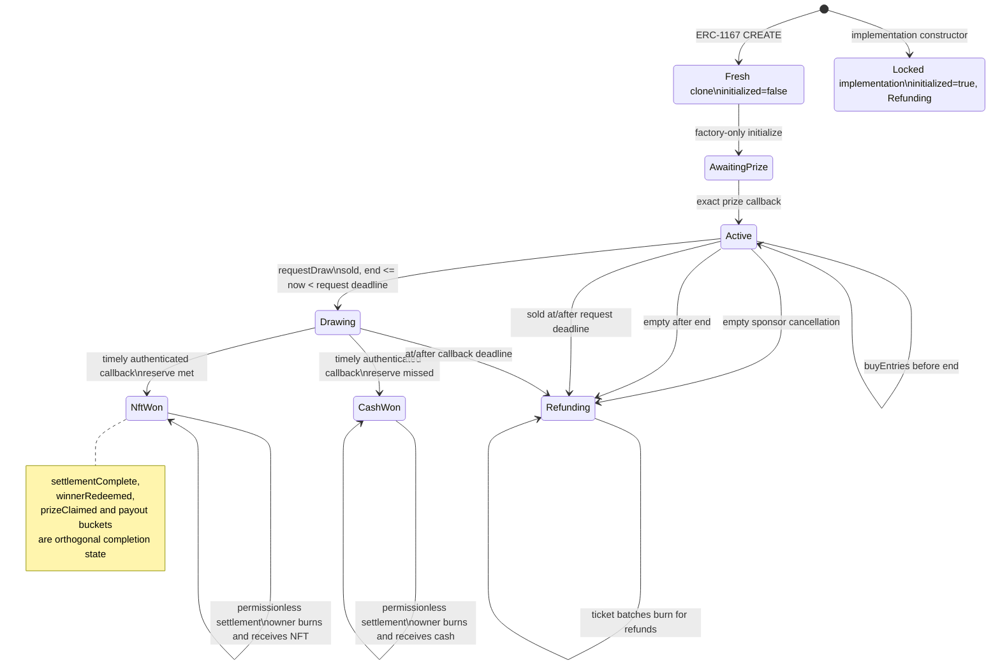

# DAYBREAK-TOB Native S4 — Trail of Bits Guidelines Advisor Report

## Audit identity and exposure

| Field | Value |
|---|---|
| Stage | Native S4, pinned Trail of Bits `guidelines-advisor` method |
| Analysis date | 2026-10-21, America/Los_Angeles |
| Frozen target SHA | `9238b6ce8eb7f768c0dcd0cfcef26e1427a03155` |
| Target root | `/Users/hishamel-husseini/.codex/visualizations/2026/10/21/01a15d64-4430-7440-b259-192acf9762b5/raffle-audit-r001/cells/DAYBREAK-TOB-continuation/target` |
| Local route tuple | `(requested_model=gpt-daybreak-blue-latest, access_program=daybreak_blue, reasoning_effort=ultra, fallback=false)` |
| Provider-returned model | `unknown`; no provider model value was exposed in JSON events |
| Provider identity | `unknown`; no provider identity value was exposed in JSON events |
| Source exposure | Five first-party production files, all 31 dependencies in `dependency-hashes.json`, source-visible build/dependency configuration, clean `DESIGN.md`, and the inherited dossier |
| Tests | No test files are present in the authorized snapshot. Actual test existence, quality, coverage, and results are **not exposed / not evaluated** |
| Scanner/audit corpus | Not exposed. No Slither, security scanner, scanner result, printer, or native visual output was run or read |
| Peer history | Attempt-02 and peer-stage reports were not read |
| Collaboration | No multi-agent operation was used |
| Mutation | The target and inherited artifacts were not modified |

The snapshot contains 43 files: five production Solidity files, 31 manifest-listed Solidity dependencies, and seven documentation/configuration files. The target contains no Git metadata, so the commit object could not be independently recomputed; the frozen SHA above is the authoritative controller/dossier identity. All 31 dependency files were independently SHA-256 checked against `target/dependency-hashes.json`; every hash matched.

A compiler-only, offline Forge build was performed with outputs and cache redirected outside the target. It compiled exactly 36 Solidity files with Solidity 0.8.36 and succeeded. No tests or scanners were run. The target remained free of build outputs.

## Executive assessment

The source has strong implementation hygiene: immutable configuration, a fixed ERC-1167 implementation, bounded or O(1) critical paths, extensive NatSpec, full custom-event coverage, checked accounting, current-ticket-owner redemption, and consistent use of reentrancy guards and checks-effects-interactions.

One high-severity security defect exists relative to the supplied design: the design declares arbitrary prize contracts untrusted, but successful escrow and delivery depend on the sponsor-selected contract honestly implementing ERC-165/ERC-721 semantics. A malicious or subsequently modified prize contract can fake escrow, allow real USDC sales, and leave sponsor proceeds releasable without delivering a real prize.

A lower-severity counterfactual-address edge also weakens the “never move assets between clones” property and can create an irrecoverable destination or factory-liveness problem.

| Classification | Count |
|---|---:|
| Critical security defects | 0 |
| High security defects | 1 |
| Low security/invariant defects | 1 |
| Operational, documentation, or assurance recommendations | Several, separately identified below |

Production readiness cannot be concluded from this S4 source-only pass because deployment identities, external dependency implementations, test evidence, coverage, CI execution, and deferred scanner results are not exposed.

---

# Phase 1 — Discovery and context

## Production-file coverage

| File | Lines reviewed | Role and coverage |
|---|---:|---|
| `target/packages/contracts/src/Raffle.sol` | 1–614 | Complete lifecycle, ticket ledger, draw coordination, settlement, refunds, payout paths, destination screening, inherited overrides, callbacks, accounting, and external calls |
| `target/packages/contracts/src/RaffleFactory.sol` | 1–186 | Constructor configuration, implementation deployment, clone creation, registry, parameter validation, prize escrow, and post-transfer verification |
| `target/packages/contracts/src/interfaces/IRaffle.sol` | 1–521 | Complete project-specific types, events, errors, state-changing ABI, views, generated getters, and documented dependency assumptions |
| `target/packages/contracts/src/interfaces/IRaffleFactory.sol` | 1–150 | Creation/registry ABI, events, errors, immutable configuration, and deployment-tooling responsibility |
| `target/packages/contracts/src/libraries/RaffleConstants.sol` | 1–43 | Economics, entry price, duration bounds, refund batch bound, and VRF parameters |

## Configuration and specification coverage

| File | Review |
|---|---|
| `target/DESIGN.md:L1-L4` | Full clean design specification and its explicit no-test/no-history/no-scanner exposure statement |
| `target/dependency-hashes.json:L1-L33` | All 31 paths and hashes; every hash verified |
| `target/packages/contracts/package.json:L1-L44` | Exact direct dependency and development-tool versions, Node engine, build/test/coverage/lint/deploy scripts |
| `target/packages/contracts/foundry.toml:L1-L48` | Solidity/EVM/compiler settings, fuzz and invariant profiles, coverage/comparison profiles, formatting |
| `target/packages/contracts/hardhat.config.ts:L1-L59` | Source/test paths, matching compiler settings, and declared networks |
| `target/packages/contracts/remappings.txt:L1-L2` | OpenZeppelin and Forge remappings |
| `target/pnpm-lock.yaml` | Contract importer and relevant direct package resolutions/integrities reviewed; unrelated workspace dependency behavior was outside the contract scope |

The contract package pins Chainlink 1.5.0 and OpenZeppelin 5.6.1 exactly (`package.json:L27-L30`). The lockfile resolves those exact versions (`pnpm-lock.yaml:L141-L148`, `L415-L422`, `L2280-L2287`).

## Generated system description

### Purpose

The system creates autonomous NFT raffles. A sponsor deposits one ERC-721 prize through an immutable factory. Buyers pay a fixed one-USDC entry price; each purchase creates one transferable ERC-721 ticket representing a contiguous inclusive range of global entry numbers. Chainlink VRF selects one winning entry. The reserve determines whether the winning ticket receives the NFT or 80% of gross sales in USDC. Timeout paths refund all ticket holders and return the prize.

### Components

- `RaffleFactory` fixes the quote token, VRF wrapper, protocol treasury, and one `Raffle` implementation at construction. It deploys fixed-target ERC-1167 clones, initializes and registers them, transfers the selected prize, checks reported custody and activation, and emits `RaffleCreated` (`RaffleFactory.sol:L58-L92`, `L97-L148`).
- `Raffle` holds clone-specific state, quote-token liabilities, historical entry ranges, and the prize. It is also the ERC-721 ticket contract (`Raffle.sol:L19-L28`, `L52-L142`).
- `IRaffle` and `IRaffleFactory` document the project-specific ABI, lifecycle, errors, events, and trust assumptions.
- `RaffleConstants` fixes the one-USDC price, 5% protocol fee, 80% cash-winner share, 30-day maximum sale, two-day request/callback windows, 100-ticket refund batch, and VRF request parameters (`RaffleConstants.sol:L10-L42`).
- OpenZeppelin supplies clone creation, ERC-721 behavior, safe ERC-20 calls, reentrancy protection, and full-precision arithmetic.
- Chainlink supplies the wrapper interface, request encoding, payment helper, and authenticated callback gateway.

### Critical operations

1. Sponsor creates a raffle; the factory validates configuration, creates and initializes a clone, registers it, transfers the prize, verifies reported custody and `Active` status, and emits creation (`RaffleFactory.sol:L97-L148`).
2. A buyer transfers quote tokens and receives a ticket whose range extends the exact global entry partition (`Raffle.sol:L209-L237`).
3. Any funded caller requests one random word during the request window (`Raffle.sol:L240-L273`).
4. Only the immutable wrapper can reach `fulfillRandomWords`; the application additionally checks request continuity, word count, status, in-flight state, and deadline (`VRFV2PlusWrapperConsumerBase.sol:L101-L107`; `Raffle.sol:L509-L523`).
5. Anyone proves the winning ticket range and allocates liabilities; the current ticket owner later burns and redeems (`Raffle.sol:L304-L345`, `L533-L558`).
6. Timeout paths convert the unsettled pot into refund liability; owners burn bounded batches for full value (`Raffle.sol:L276-L300`, `L349-L372`).
7. Sponsor proceeds, protocol fees, and the sponsor’s returned prize are independently released to fixed destinations (`Raffle.sol:L374-L407`).

### Accounting properties

Under the documented exact-transfer quote-token assumption:

- `grossSales = totalEntries × 1_000_000` (`Raffle.sol:L473-L475`).
- Every successful purchase increases `unsettledPot` by the same amount requested from the buyer (`Raffle.sol:L223-L233`).
- NFT result: protocol receives `floor(gross × 5%)`; sponsor receives the remainder (`Raffle.sol:L539-L545`).
- Cash result: winner receives `floor(gross × 80%)`, protocol receives `floor(gross × 5%)`, and sponsor receives the remainder (`Raffle.sol:L539-L555`).
- Refund result: the entire unsettled pot becomes refund liability (`Raffle.sol:L296-L300`).
- Outstanding accounting is the sum of the five disjoint liability buckets (`Raffle.sol:L468-L470`).

Because normal gross sales are integer multiples of 1,000,000 raw units, the configured 5% and 80% divisions have no per-entry dust; the remainder rule is still correct for defensive accounting.

## Architecture and trust-boundary diagram



### Trust boundaries

| Boundary | Source-enforced checks | External assumptions or gaps |
|---|---|---|
| Deployment → factory | Quote and wrapper must contain code; quote reports six decimals; treasury is nonzero and excludes several known sinks (`RaffleFactory.sol:L65-L90`) | Official token/wrapper identity, deployed bytecode, governance, and treasury ownership are not proved on-chain |
| Sponsor → factory | Recipient/reserve/time bounds, current protocol-sink checks, ERC-165 response (`RaffleFactory.sol:L97-L104`, `L152-L179`) | ERC-165 and ERC-721 behavior can be forged by sponsor-selected code |
| Prize → clone/factory | Exact callback tuple; post-transfer `ownerOf` and `Active` checks (`Raffle.sol:L416-L430`; `RaffleFactory.sol:L127-L134`) | Persistent custody and honest ownership/transfer semantics cannot be established from self-reported calls |
| Buyer → quote token → clone | Positive count, overflow bound, active sale, guarded safe transfer (`Raffle.sol:L209-L235`) | Exact, fee-free, non-rebasing transfer and continued token availability |
| Clone → VRF wrapper | Fixed wrapper address, fixed request parameters, authenticated caller and application filters (`Raffle.sol:L240-L272`, `L509-L523`) | Price correctness, request acceptance/ID binding, randomness, retry behavior, and wrapper authority |
| Ticket ledger → claim | Current owner required; winning range proved; ticket burned atomically (`Raffle.sol:L309-L345`, `L349-L369`) | Contract owners must retain the ability to call; unsafe prize transfer does not establish receiver compatibility |
| Time environment → lifecycle | Exact exclusive/inclusive boundary checks | Validators can influence timestamps modestly; deployment-chain timestamp bounds are external |

---

# Phase 2 — Area 1: Documentation and specifications

## Design conformance

| Design property | Assessment |
|---|---|
| Immutable factory and fixed ERC-1167 implementation | Conforms. No setter or upgrade route exists; factory deploys one implementation and ordinary fixed clones (`RaffleFactory.sol:L85-L106`) |
| One-USDC range tickets | Conforms under quote-token semantics (`RaffleConstants.sol:L20-L24`; `Raffle.sol:L223-L235`) |
| Atomic prize creation | Transaction atomicity conforms, but meaningful custody relies on an honest prize implementation |
| 95/5 NFT result and 80/15/5 cash result | Conforms; sponsor receives the arithmetic remainder (`Raffle.sol:L539-L555`) |
| No administrator, pause, rescue, or mutable configuration | Conforms (`RaffleFactory.sol:L15-L20`; `Raffle.sol:L19-L26`) |
| Request/callback time windows | Conforms (`Raffle.sol:L240-L247`, `L458-L465`, `L509-L523`) |
| Callback records result only | Conforms; callback performs no user lookup or asset transfer (`Raffle.sol:L504-L523`) |
| Permissionless storage-only settlement | Conforms (`Raffle.sol:L304-L306`, `L533-L558`) |
| Owner redemption burns atomically and reverts on failed delivery | Conforms at EVM transaction level (`Raffle.sol:L320-L345`) |
| Independent sponsor and treasury claims | Conforms (`Raffle.sol:L374-L392`) |
| Arbitrary prize contracts are untrusted | Does **not** conform. Source explicitly assumes honest ERC-721 prizes (`IRaffle.sol:L12-L15`) and trusts token-controlled ERC-165, callbacks, transfers, and `ownerOf` |
| Never move assets between clones | Enforced for currently known destinations in ticket/quote flows, but counterfactual future-clone addresses and sponsor-prize release leave an edge case; see S4-SEC-02 |
| Frontend discovery is advisory | Supported by permissionless execution and state getters, but no frontend/indexer source is exposed |

## NatSpec and code documentation

First-party NatSpec quality is high:

- Every project contract and interface has a purpose statement.
- Every first-party public/external project-specific function is directly documented or uses `@inheritdoc`.
- Custom events, errors, structs, constants, and generated getters are documented.
- Important range, rounding, callback, transfer, and clone assumptions are recorded.

Documentation gaps remain:

1. `DESIGN.md` and `IRaffle` disagree about prize trust: untrusted versus honest (`DESIGN.md:L2`; `IRaffle.sol:L12-L15`).
2. No deployment verification runbook is exposed for official quote-token/wrapper identity, bytecode, network, or constructor-argument attestation, although source assigns that task to deployment tooling (`RaffleFactory.sol:L58-L64`; `IRaffleFactory.sol:L6-L9`).
3. No migration/runoff procedure is documented for replacing the immutable factory while old raffles retain liabilities.
4. The full deployed ABI also includes inherited ERC-721 operations and Chainlink base endpoints such as `rawFulfillRandomWords`, `getBalance`, `getLinkToken`, and the public wrapper getter; these are not enumerated in `IRaffle`.
5. Creation-time event ordering is not documented: `PrizeDeposited` precedes `RaffleCreated`, and malicious prize code can execute between them.
6. Forced ETH, unrelated NFTs, excess quote tokens, and other unsupported assets have no recovery path. Only the unrelated-NFT case is explicitly documented (`Raffle.sol:L409-L411`).
7. `VrfCallbackIgnored` does not document or emit the specific rejection reason.
8. Contract-winner semantics are incomplete: NFT redemption uses unsafe `transferFrom`, so receiver support is not required (`Raffle.sol:L329-L337`; `IERC721.sol:L75-L91`).
9. Actual test, coverage, formal-verification, CI, deployment, and monitoring evidence is not exposed.

## Lifecycle diagram



---

# Phase 3 — Architecture analysis

## Area 2: On-chain versus off-chain computation

### Current distribution

The source keeps security-critical work on-chain:

- clone creation and registry;
- prize deposit checks;
- quote-token custody and liability accounting;
- entry-range allocation;
- transferable ticket ownership;
- draw request and authenticated callback filtering;
- result and refund transitions;
- winning-range verification;
- settlement and redemption.

Appropriate work is left to off-chain actors:

- raffle discovery and event indexing;
- finding which historical ticket range contains `winningEntry`;
- monitoring deadlines and submitting permissionless keeper calls;
- estimating VRF fees before submission;
- verifying canonical deployment addresses and bytecode;
- presenting prize collection risk and current state.

No actual frontend, indexer, keeper, or deployment implementation is exposed, so its existence and quality are not evaluated.

### Assessment

The partition is efficient:

- Purchases are O(1) in entry count because a range is stored rather than one record per entry (`Raffle.sol:L226-L235`).
- Randomness resolution is O(1) and performs no user-controlled external call (`Raffle.sol:L509-L523`).
- Winning-ticket lookup is off-chain while the supplied result receives an O(1) range proof (`Raffle.sol:L451-L455`, `L579-L584`).
- Refund execution is bounded to 100 tickets (`Raffle.sol:L349-L371`; `RaffleConstants.sol:L26-L27`).
- No on-chain sorting or enumeration path exists.

No defensible gas-saving percentage can be stated without gas results. The configured `gas` script exists, but results are not exposed/evaluated (`package.json:L16-L17`).

### Guidance

- Keep discovery and winning-range search off-chain.
- Require every transaction builder to reread status, owner, deadline, request price, and liability values immediately before submission.
- Publish a deterministic event-to-state indexing specification, including reorg handling and the fact that a safe-mint receiver may transfer a ticket before `TicketPurchased` is emitted.
- Benchmark the maximum 100-ticket refund batch on each intended chain; gas results are not exposed here.

## Area 3: Upgradeability

### Verified applicability search

A first-party search for `upgrade`, `upgradeTo`, `upgradeAndCall`, `UUPS`, `beacon`, `transparent`, `ProxyAdmin`, `initializer`, `reinitializer`, and mutable implementation assignments found no upgrade mechanism. The only first-party occurrences describe the system as fixed or non-upgradeable (`Raffle.sol:L24-L25`; `RaffleFactory.sol:L18-L20`; `IRaffleFactory.sol:L6-L9`).

### Assessment

Dynamic upgradeability is **not applicable** to existing factory clones:

- `raffleImplementation` is immutable (`RaffleFactory.sol:L41-L42`).
- The factory deploys it once in its constructor (`RaffleFactory.sol:L89-L91`).
- `createRaffle` always uses that immutable target (`RaffleFactory.sol:L105-L106`).
- There is no owner, setter, proxy administrator, beacon, upgrade slot, or arbitrary execution path.
- No first-party `selfdestruct` exists.

This is aligned with the Trail of Bits preference for migration over mutable delegatecall upgrades. The tradeoff is operational irreversibility: defects cannot be paused or patched and existing liabilities cannot be redirected.

### Missing migration procedure

A replacement requires deploying a new factory and implementation. Existing clones must remain discoverable and serviced until their raffles and all claims complete. No source-visible procedure defines:

- how a canonical frontend/indexer selects old versus new factories;
- how old factory registries remain indexed;
- how constructor addresses and bytecode are verified;
- how live raffles are allowed to run off;
- how incident communication occurs without an on-chain administrator.

## Area 4: Delegatecall and proxy pattern

Delegatecall review is applicable because the clones are ERC-1167 proxies even though they are not upgradeable.

### Verified delegatecall search

- No first-party Solidity function executes arbitrary `delegatecall`.
- OpenZeppelin `Clones` explicitly describes a minimal proxy that delegates to a known fixed address (`Clones.sol:L9-L18`).
- The selected `clone` path embeds that fixed target in proxy bytecode and deploys it with `CREATE` (`Clones.sol:L47-L61`).
- `LowLevelCall.sol` contains generic delegatecall helpers (`L73-L92`), but first-party code does not import or invoke them; they are transitively present through unused `Create2` branches.
- No upgrade/admin dispatch function or selector-shadowing surface exists in the minimal proxy.

### Storage and immutable review

- Each clone has isolated storage; immutable values are embedded in implementation code and shared intentionally: factory, quote token, VRF wrapper, and wrapper-reported LINK token (`Raffle.sol:L54-L59`, `L155-L165`; `VRFV2PlusWrapperConsumerBase.sol:L34-L47`).
- ERC-721 state occupies ordinary clone storage (`ERC721.sol:L22-L34`).
- `ReentrancyGuard` uses a namespaced storage slot rather than an inheritance-order slot (`ReentrancyGuard.sol:L32-L37`, `L116-L118`), reducing collision risk.
- Clone constructors do not run. The guard’s clone slot therefore begins at zero, but the reviewed guard rejects only the `ENTERED` value of two and accepts zero on the first call before setting/resetting it (`ReentrancyGuard.sol:L88-L105`). The current pinned version is clone-compatible.
- The implementation’s constructor locks its own storage with `initialized=true` and `Refunding`, while clones start uninitialized (`Raffle.sol:L151-L166`).
- ERC-721 constructor name/symbol storage exists only on the implementation, but `Raffle` overrides `name` and `symbol` with pure fixed values, avoiding empty clone metadata (`Raffle.sol:L477-L487`).

### Initialization and direct-use review

- The clone is created and initialized in one factory transaction, with no external call between those operations (`RaffleFactory.sol:L105-L121`).
- Only the immutable factory may initialize, and `initialized` prevents repeats (`Raffle.sol:L176-L205`).
- The direct implementation is locked.
- Factory prize interaction occurs only after initialization and registry writes; any later revert unwinds clone creation, registry state, and token interaction atomically.

### Function shadowing and implementation existence

- The minimal proxy exposes no admin ABI and therefore has no proxy/implementation selector shadowing.
- `name`, `symbol`, `_update`, and `fulfillRandomWords` are intentional Solidity overrides.
- The implementation is created directly by the factory before its immutable is stored; source exposes no path to destroy or replace it (`RaffleFactory.sol:L89-L91`).
- OpenZeppelin’s general warning that `Clones.clone` does not check implementation code is not exploitable through this source path because the target is the freshly deployed immutable implementation (`Clones.sol:L23-L31`).

### Deferred checks

Slither inheritance/storage printers and `slither-check-upgradeability` were intentionally not run. Native visual and scanner validation is deferred to S6.

---

# Phase 4 — Implementation review

## Area 5: Function composition

### Factory

- The constructor is cohesive: validate immutable dependencies, check quote decimals, reject obvious treasury sinks, deploy the implementation, and record immutables (`RaffleFactory.sol:L65-L92`).
- `createRaffle` is the most cross-boundary function. It validates time, creates and initializes a clone, registers it, invokes sponsor-selected token code, verifies reported state, and emits creation (`RaffleFactory.sol:L97-L148`). Atomicity requires much of this sequencing, but the ordering and reentrant external-code window deserve explicit documentation.
- `_validateCreateParams` centralizes recipient, prize, reserve, and ERC-165 checks (`RaffleFactory.sol:L152-L179`).

### Raffle

- `buyEntries` cleanly validates, collects payment, records a range/accounting, then safe-mints (`Raffle.sol:L209-L237`). The reentrancy guard protects the quote-token and receiver calls.
- `requestDraw` is necessarily coordination-heavy but follows a clear sequence: validate, quote, enter `Drawing`, mark in-flight, request, persist ID, clear in-flight, refund excess, emit (`Raffle.sol:L240-L273`).
- `enableRefunds` encodes all three timeout/cancellation branches in one readable function (`Raffle.sol:L276-L300`).
- `_settleWinningTicket` isolates pure liability allocation from asset movement (`Raffle.sol:L528-L558`).
- `redeemWinningTicket` combines optional settlement, ownership, burn, and delivery so all state rolls back on transfer failure (`Raffle.sol:L309-L345`). Extraction into private NFT/cash delivery helpers could improve readability without changing atomicity.
- Refunds use a bounded loop and one aggregate transfer (`Raffle.sol:L349-L371`).
- Claim functions clear their bucket or flag before external interaction, relying on transaction rollback and the shared guard (`Raffle.sol:L374-L406`).
- `_isProtocolDestination` appropriately centralizes current same-factory sink classification (`Raffle.sol:L587-L605`).

No function is unmanageably large. The principal complexity is external-call ordering, not raw line count.

## Area 6: Inheritance

```text
Raffle
├── IRaffle
├── ERC721
│   ├── Context
│   ├── ERC165
│   │   └── IERC165
│   ├── IERC721
│   ├── IERC721Metadata
│   └── IERC721Errors
├── ReentrancyGuard
│   └── StorageSlot
├── IERC721Receiver
└── VRFV2PlusWrapperConsumerBase
    ├── IVRFV2PlusWrapper
    └── LinkTokenInterface

RaffleFactory
├── IRaffleFactory
└── ReentrancyGuard
    └── StorageSlot
```

Assessment:

- The hierarchy is moderately wide but shallow.
- There is no conflicting state-bearing diamond.
- Interfaces contribute no storage.
- `ReentrancyGuard` uses namespaced storage.
- VRF base state is immutable.
- The only behaviorally important overrides are `name`, `symbol`, `_update`, and `fulfillRandomWords`.
- ERC-721 transfer authorization remains inherited and standard (`ERC721.sol:L92-L135`, `L164-L187`, `L216-L245`).
- `_update` adds destination screening before the inherited authorization and ledger mutation (`Raffle.sol:L491-L502`).

No inheritance simplification is necessary. The hierarchy and clone constructor implications should be included in architecture documentation.

## Area 7: Events

The project declares 13 project-specific events: 12 raffle events and `RaffleCreated`. Inherited ERC-721 `Transfer`, `Approval`, and `ApprovalForAll` events cover ticket ledger changes.

Critical-operation coverage is strong:

| Operation | Events |
|---|---|
| Creation and prize activation | `PrizeDeposited`, `RaffleCreated` |
| Purchase and ticket issuance | ERC-721 `Transfer`, `TicketPurchased` |
| Draw initiation | `DrawRequested` |
| Rejected/accepted callback | `VrfCallbackIgnored`, `RaffleResolved` |
| Refund activation and claims | `RefundsEnabled`, ERC-721 burn `Transfer`, `TicketsRefunded` |
| Settlement and winner redemption | `WinningTicketSettled`, ERC-721 burn `Transfer`, `WinningTicketRedeemed` |
| Sponsor/protocol releases | `SponsorProceedsReleased`, `ProtocolFeesReleased`, `SponsorPrizeReleased` |

Indexed fields are generally well selected. Creation uses the maximum three indexed fields, while draw/result/ticket identifiers and payout destinations are filterable (`IRaffle.sol:L56-L180`; `IRaffleFactory.sol:L28-L52`).

Improvements:

- Add a reason code or predicate flags to `VrfCallbackIgnored`; the current event reports request IDs and status but cannot distinguish in-flight, wrong ID, wrong word count, or deadline (`IRaffle.sol:L98-L102`; `Raffle.sol:L509-L515`).
- Document that `PrizeDeposited` occurs before `RaffleCreated`.
- Document that `TicketPurchased` can be emitted after a contract recipient has reentrantly transferred the newly minted ticket; ERC-721 events remain authoritative.
- Consider a clone-initialization event only if downstream systems need to observe the intermediate `AwaitingPrize` state. It is not needed for accounting security.

## Area 8: Common pitfalls and security findings

### S4-SEC-01 — High — Sponsor-selected prize code can fake escrow and defeat winner delivery

**Classification:** Security defect against the clean design’s “arbitrary prize contracts are untrusted” requirement.

**Evidence**

1. The sponsor selects `prizeToken`; the factory checks only that it has code and returns `true` for the ERC-721 interface ID (`RaffleFactory.sol:L152-L177`).
2. The token itself controls whether and how it invokes `onERC721Received`. The clone accepts the callback based on token address and supplied tuple (`Raffle.sol:L416-L430`).
3. The same token controls the `ownerOf` result used as the post-transfer custody proof (`RaffleFactory.sol:L127-L134`).
4. The project interface acknowledges the hidden requirement that prizes be honest and standards-compliant (`IRaffle.sol:L12-L15`), contradicting `DESIGN.md:L2`.
5. After an NFT result is settled, sponsor proceeds and protocol fees can be released independently of successful winner redemption (`Raffle.sol:L374-L392`, `L539-L557`).
6. NFT redemption trusts `transferFrom` and a second token-controlled `ownerOf` response (`Raffle.sol:L329-L337`).

**Attack/result**

A malicious or subsequently modified prize contract can report ERC-721 support, invoke the expected callback without meaningful transfer, report the clone as owner, and allow the raffle to sell entries for real USDC. Once the reserve is met, settlement allocates 95% of sales to the sponsor and 5% to the protocol. Those funds can be released even if the prize refuses winner delivery. A fully malicious token can also make the final calls appear successful while not providing durable ERC-721 semantics.

**Impact**

Entrants can lose their payments while the sponsor receives the NFT-result proceeds. Local callback and `ownerOf` checks cannot prove honest semantics of arbitrary external code.

**Recommendations**

- Align the product model with one enforceable choice:
  - accept only an immutable allowlist of reviewed prize collections/code hashes; or
  - explicitly define prize honesty as a user-visible trust assumption and remove the claim that arbitrary prizes are untrusted.
- For the NFT branch, gate sponsor/protocol release on successful winner redemption and add a bounded fallback to refunds if delivery remains impossible. This mitigates honest-but-paused or reverting tokens, although it cannot defeat a token that lies successfully.
- Display and index the exact prize contract, its upgrade controls, and verification status.
- Include adversarial prize implementations in the verification suite.

### S4-SEC-02 — Low — Counterfactual future-clone destinations bypass current sink screening

**Classification:** Low-severity security/invariant edge case with deliberate-address preconditions.

**Evidence**

- Recipient checks reject only current known protocol addresses and currently registered raffles (`RaffleFactory.sol:L157-L168`; `Raffle.sol:L593-L604`).
- Clone addresses are generated sequentially with `CREATE` and are predictable from the factory nonce (`RaffleFactory.sol:L105-L106`; `Clones.sol:L23-L33`, `L47-L61`).
- Sponsor prize release does not reapply destination screening and uses unsafe `transferFrom` (`Raffle.sol:L395-L406`).
- Quote payouts do re-check the destination and would instead revert (`Raffle.sol:L560-L566`).

**Consequences**

- A sponsor can deliberately configure its recipient as a future clone address. Once that clone is created, quote claims become unreleasable, while any caller can move the old raffle’s prize into the new clone where it is unaccounted and lacks a rescue route.
- If the immutable protocol treasury is deliberately chosen as a future clone address, creation at that nonce reverts during initialization because the treasury equals the new clone itself. Transaction rollback preserves the same factory nonce, potentially preventing all subsequent creation.

Accidental address collision is cryptographically negligible; the case is feasible only through counterfactual address selection or deployment misconfiguration.

**Recommendations**

- Re-screen `sponsorRecipient` in `releaseSponsorPrize` to prevent cross-clone transfer.
- Decide whether a narrowly scoped, evented recipient-rotation mechanism is acceptable when an immutable recipient becomes a known protocol sink.
- Have deployment tooling check the treasury against predicted factory-created addresses and include this property in deployment verification.
- Document that counterfactual factory-clone addresses are invalid destinations.

### Reentrancy

The principal asset-moving and lifecycle entrypoints are guarded. Factory creation is guarded across sponsor-selected token calls (`RaffleFactory.sol:L97-L148`). Raffle purchase, draw, refund, settlement, redemption, and releases share one guard (`Raffle.sol:L209-L406`).

State is cleared or committed before payout calls, and failure reverts atomically. The unguarded prize receiver changes only `AwaitingPrize` to `Active` after an exact tuple check. Nevertheless, malicious prize code can execute after that callback and before `RaffleCreated`, so creation-time state/event ordering must not be treated as a zero-entry snapshot.

No unguarded first-party arbitrary call or delegatecall exists.

### Arithmetic and accounting

- Solidity 0.8.36 supplies checked arithmetic.
- `totalEntries` is explicitly bounded before range addition (`Raffle.sol:L218-L227`).
- One ticket represents at least one entry, so `ticketCount ≤ totalEntries`; ticket-count increment cannot overflow before the total-entry guard stops further sales.
- `Math.mulDiv` supplies full-precision floor division (`Math.sol:L199-L276`).
- Refund subtraction is checked (`Raffle.sol:L367-L369`).
- The explicit `uint64(block.timestamp)` casts at `Raffle.sol:L253` and `L520` do not use `SafeCast`. Overflow requires timestamps beyond the practical Ethereum horizon, but explicit checked casts would better express the invariant.

### Access control

No owner, administrator, role system, pause, or governance entrypoint exists. Verified authority boundaries are:

- factory-only one-time initialization;
- sponsor-only early cancellation of an empty raffle;
- wrapper-only callback gateway;
- current ticket owner only for refunds and redemption;
- permissionless settlement and fixed-destination releases.

Approved ERC-721 operators may transfer tickets but cannot redeem or refund on behalf of the owner because those functions require `msg.sender == owner` (`Raffle.sol:L320-L322`, `L359-L360`).

### Front-running and ordering

- Purchase ordering determines entry ranges but not price.
- Draw randomness is not chosen by the caller.
- Settlement cannot redirect value because the supplied range must contain the already selected entry.
- The empty-raffle sponsor-cancellation versus first-purchase race is transaction-order dependent but internally consistent.
- Ticket redemption follows standard transferable-bearer-claim race semantics.
- No commit/reveal secret or user-controlled on-chain oracle is present.

### Timestamp dependence

Timestamp use is confined to sale and liveness boundaries. Forge surfaced seven timestamp-comparison diagnostics at `Raffle.sol:L216`, `L242`, `L245`, `L282`, `L287`, `L291`, and `L512`. `RaffleFactory` also derives sale duration from `block.timestamp` (`RaffleFactory.sol:L99-L103`).

Validators can modestly influence boundary inclusion, but timestamps do not determine randomness or token pricing. The exact equality behavior is internally consistent: requests/callbacks close at their deadline and refunds open at that same timestamp.

### Denial of service and external failures

- Entry purchase, callback, and settlement are O(1).
- Refunds are bounded.
- A draw requester that cannot accept an excess-native refund can only cause its own request transaction to revert; another caller may submit the request.
- Quote-token freezing/blacklisting or wrapper failure can interrupt operation because those dependencies are trusted and immutable.
- Prize transfer failure can block prize redemption/return; S4-SEC-01 makes sponsor payout independence security-relevant.
- Forced ETH, unrelated NFTs, or excess tokens can remain trapped because the system deliberately has no rescue path.

### Other verified pitfall searches

Across the five first-party files:

- `tx.origin`: nothing found.
- `selfdestruct`/`suicide`: nothing found.
- `callcode`: nothing found.
- `blockhash`, `block.prevrandao`, and `ecrecover`: nothing found.
- first-party `unchecked`: nothing found.
- arbitrary first-party delegatecall: nothing found.
- fallback function: nothing found.
- first-party inline assembly: only the checked excess-native refund call at `Raffle.sol:L266-L269`.
- price-feed/oracle consumption: nothing found; `linkNativeFeed` exists only in the external wrapper interface and is unused.
- mutable admin/upgrade/pause functionality: nothing found.

## Area 9: Dependencies and version management

### Assessment

- Established OpenZeppelin and Chainlink libraries are used instead of copied implementations.
- Direct versions are exact, not ranges.
- The pnpm lockfile records exact resolutions and integrity values.
- The audit snapshot adds per-file SHA-256 pins for the complete 31-file Solidity closure.
- First-party pragmas and both build systems pin Solidity 0.8.36.
- The imported dependency pragmas are compatible with 0.8.36.
- Dependency freshness and current security-advisory status were not evaluated from the source-only snapshot.
- Chainlink wrapper APIs are under a `vrf/dev` path; exact pinning is therefore particularly important when updating.
- The OpenZeppelin `ReentrancyGuard` source marks the storage-based form deprecated for a future major version (`ReentrancyGuard.sol:L27-L30`). Any dependency update must revalidate clone initialization/default-slot behavior.
- The lockfile is workspace-wide and brings a much broader install-time supply chain than the 31-file compiled Solidity closure.
- No package-manager version is pinned in the contract `package.json`; only Node `>=22.13 <23` is constrained (`package.json:L6-L8`).

### Per-dependency coverage

All paths below are under `target/packages/contracts/node_modules/`. Each file was reviewed in full and its manifest hash matched.

| # | Dependency file | Lines | Project relevance |
|---:|---|---:|---|
| 1 | `@chainlink/contracts/src/v0.8/shared/interfaces/LinkTokenInterface.sol` | 31 | Typed LINK address used by inherited base; LINK-funded request path is unused |
| 2 | `@chainlink/contracts/src/v0.8/vrf/dev/VRFV2PlusWrapperConsumerBase.sol` | 118 | Direct base; wrapper/link immutables, native request helper, authenticated callback gateway, inherited public views |
| 3 | `@chainlink/contracts/src/v0.8/vrf/dev/interfaces/IVRFV2PlusWrapper.sol` | 83 | Price, estimate, native request, request-ID and wrapper dependency interface |
| 4 | `@chainlink/contracts/src/v0.8/vrf/dev/libraries/VRFV2PlusClient.sol` | 27 | Encodes `nativePayment=true` extra arguments |
| 5 | `@openzeppelin/contracts/proxy/Clones.sol` | 294 | Direct fixed ERC-1167 clone creation; deterministic/immutable-argument branches unused |
| 6 | `@openzeppelin/contracts/token/ERC20/IERC20.sol` | 79 | Quote-token ABI |
| 7 | `@openzeppelin/contracts/token/ERC20/extensions/IERC20Metadata.sol` | 26 | Factory’s six-decimal check |
| 8 | `@openzeppelin/contracts/token/ERC20/utils/SafeERC20.sol` | 280 | Quote-token transfer/transferFrom wrappers and return-data handling |
| 9 | `@openzeppelin/contracts/token/ERC721/ERC721.sol` | 433 | Ticket ownership, approvals, transfers, safe minting, burning, and metadata behavior |
| 10 | `@openzeppelin/contracts/token/ERC721/IERC721.sol` | 135 | Prize-token ABI and standard ticket interface |
| 11 | `@openzeppelin/contracts/token/ERC721/IERC721Receiver.sol` | 28 | Prize callback and ticket safe-receiver ABI |
| 12 | `@openzeppelin/contracts/token/ERC721/extensions/IERC721Metadata.sol` | 27 | ERC-721 metadata interface inherited by ticket implementation |
| 13 | `@openzeppelin/contracts/token/ERC721/utils/ERC721Utils.sol` | 50 | Safe-mint/safe-transfer receiver callback enforcement |
| 14 | `@openzeppelin/contracts/utils/ReentrancyGuard.sol` | 119 | Direct shared guard for factory and each clone |
| 15 | `@openzeppelin/contracts/utils/StorageSlot.sol` | 143 | Namespaced guard storage |
| 16 | `@openzeppelin/contracts/utils/math/Math.sol` | 763 | Direct `mulDiv` accounting; other utilities transitive |
| 17 | `@openzeppelin/contracts/utils/math/SafeCast.sol` | 1,162 | Math/Strings internals; first-party timestamp casts do not use it |
| 18 | `@openzeppelin/contracts/utils/math/SignedMath.sol` | 68 | Strings transitive dependency |
| 19 | `@openzeppelin/contracts/utils/Panic.sol` | 57 | Math panic support |
| 20 | `@openzeppelin/contracts/utils/Strings.sol` | 532 | ERC-721 token URI support; base URI is empty in this implementation |
| 21 | `@openzeppelin/contracts/utils/Bytes.sol` | 332 | Strings transitive support |
| 22 | `@openzeppelin/contracts/utils/Context.sol` | 28 | ERC-721 sender/data abstraction |
| 23 | `@openzeppelin/contracts/utils/introspection/ERC165.sol` | 25 | Ticket ERC-165 implementation |
| 24 | `@openzeppelin/contracts/utils/introspection/IERC165.sol` | 25 | Prize support query and ERC-721 interface ancestry |
| 25 | `@openzeppelin/contracts/interfaces/IERC1363.sol` | 86 | SafeERC20 transitive functionality; ERC-1363 paths unused |
| 26 | `@openzeppelin/contracts/interfaces/IERC165.sol` | 6 | IERC1363 re-export dependency |
| 27 | `@openzeppelin/contracts/interfaces/IERC20.sol` | 6 | IERC1363 re-export dependency |
| 28 | `@openzeppelin/contracts/interfaces/draft-IERC6093.sol` | 162 | Standard ERC-721 custom errors |
| 29 | `@openzeppelin/contracts/utils/Errors.sol` | 34 | Clone/Create2 shared errors |
| 30 | `@openzeppelin/contracts/utils/Create2.sol` | 91 | Imported by Clones; deterministic deployment branches unused by factory |
| 31 | `@openzeppelin/contracts/utils/LowLevelCall.sol` | 127 | Create2 error bubbling; its generic delegatecall functions are unused |

### Version-management recommendations

- Preserve exact direct pins and refresh `dependency-hashes.json` on every dependency change.
- Pin the pnpm version or package-manager identity in build provenance.
- Maintain a software bill of materials separating the 31-file compiled Solidity closure from install-time tooling dependencies.
- Run advisory/license/provenance checks in CI, but do not infer their current existence from this snapshot.
- Require explicit review of clone compatibility, storage behavior, and bytecode changes on any OpenZeppelin or Chainlink update.
- Record reproducible artifact hashes from both configured compilers.

## Area 10: Testing and verification

### Source-visible configuration

The configuration declares:

- Foundry and Hardhat test commands (`package.json:L12-L15`);
- Forge coverage and a coverage-check script (`package.json:L15`);
- gas snapshots (`package.json:L16-L17`);
- lint, typecheck, and Slither scripts (`package.json:L18-L22`);
- Foundry fuzz profiles ranging from 1,000 to 100,000 runs (`foundry.toml:L12-L30`);
- invariant profiles with bounded depth and strict variants where `fail_on_revert=true` (`foundry.toml:L13-L30`);
- Hardhat test path `./test/hardhat` (`hardhat.config.ts:L6-L13`).

No test files, coverage-check script, Slither configuration, CI workflow, coverage report, gas snapshot, formal proof, or execution result is exposed in the authorized snapshot. Therefore:

- actual test existence: **not exposed / not evaluated**;
- test quality and edge-case coverage: **not exposed / not evaluated**;
- line/branch coverage: **not exposed / not evaluated**;
- fuzz/invariant results: **not exposed / not evaluated**;
- CI enforcement: **not exposed / not evaluated**;
- scanner/formal-verification results: **not exposed / not evaluated**.

The ordinary `audit` profile retains `fail_on_revert=false`; the `audit_strict` and `audit_release` profiles enable it (`foundry.toml:L20-L30`). CI should explicitly use a strict profile for invariants whose unexpected reverts are failures.

### Source-derived properties to establish or confirm

1. Registry bijection:
   - `raffleById[id] == raffle`;
   - `idByRaffle[raffle] == id`;
   - `isRaffle[raffle] == true`;
   - failed creation leaves no count, code, or registry residue.

2. Ticket partition:
   - every purchase range is positive;
   - ranges are sequential and disjoint;
   - their union is exactly `1..totalEntries`;
   - `ticketCount ≤ totalEntries`.

3. Quote conservation:
   - under exact-transfer token semantics, actual quote balance is at least `accountedQuoteBalance`;
   - each terminal allocation sums to the prior unsettled pot;
   - burns consume exactly their corresponding liability once.

4. Lifecycle:
   - only documented transitions are reachable;
   - sales freeze at `endTime`;
   - draw and callback exact-deadline behavior matches the design;
   - late/duplicate/wrong-ID/wrong-length callbacks cannot resolve;
   - callback cannot resolve while `_requestInFlight`.

5. Claims:
   - only the current owner redeems/refunds;
   - burns and asset delivery are atomic;
   - one ticket/prize/liability cannot be claimed twice;
   - transfers preserve historical ranges.

6. External-adversary testing:
   - false/no-return/reentrant/fee-on-transfer quote tokens;
   - lying, reverting, reentrant, upgradeable, or nonstandard prize contracts;
   - synchronous/malformed/wrong-ID VRF callbacks;
   - reverting native-refund recipients;
   - ticket receiver callbacks that immediately transfer the new ticket.

7. Clone-specific properties:
   - implementation remains locked;
   - only the factory initializes a clone;
   - zero-default guard storage works;
   - immutables read identically through every clone;
   - counterfactual future-clone destinations are handled according to policy.

8. Differential build verification:
   - compare Forge and Hardhat production bytecode;
   - confirm Cancun compatibility on each intended deployment chain;
   - record compiler and dependency hashes.

## Area 11: Solidity-specific guidance

### Compiler and EVM configuration

- Every first-party file pins exactly `pragma solidity 0.8.36`.
- Foundry and Hardhat both configure Solidity 0.8.36, optimizer enabled with 200 runs, and Cancun EVM (`foundry.toml:L7-L11`; `hardhat.config.ts:L14-L35`).
- Forge compilation succeeded for all 36 scoped Solidity files.
- Hardhat was not executed. The local runner’s Node version did not satisfy the package’s declared `>=22.13 <23` engine.
- Dependency source uses `mcopy` in `Bytes.sol`, making Cancun compatibility material (`Bytes.sol:L86-L95`, `L117-L126`). The configured networks are source declarations, not evidence of an actual deployment.

### Solidity risks and guidance

- Solidity 0.8 checked arithmetic and explicit overflow bounds are used appropriately.
- Replace the two direct timestamp downcasts with `SafeCast.toUint64` or explicit assertions for self-documenting safety (`Raffle.sol:L253`, `L520`).
- The only first-party assembly is a straightforward checked native-value call (`Raffle.sol:L266-L269`). A high-level `call{value: excess}("")` would be easier to review and preserve equivalent behavior.
- Dependency assembly is confined to established pinned libraries.
- No compiler/version-range ambiguity exists in first-party code.
- No latest-compiler or dependency-freshness conclusion is made from this source-only pass.
- Consider recording metadata/bytecode reproducibility settings and cross-tool bytecode equality because two build systems are configured.

---

# Phase 5 — Prioritized recommendations

## Critical

None identified in the authorized source.

## High

1. **[Security defect] Resolve the prize trust-model mismatch.**

   Restrict prizes to reviewed collections/code or explicitly narrow the protocol guarantee to honest prize contracts. Add NFT-delivery-dependent payout sequencing and a timeout/refund fallback as defense in depth. Evidence: S4-SEC-01.

2. **[Deployment assurance] Produce and enforce immutable deployment attestations.**

   Record chain ID, factory bytecode, compiler settings, constructor arguments, official quote-token and VRF-wrapper addresses/code hashes, treasury, implementation address, and transaction hashes. Source checks only code presence and token decimals (`RaffleFactory.sol:L58-L78`).

3. **[Verification assurance] Expose or establish evidence for the source-derived properties above.**

   This recommendation does not assert that tests are absent from the wider project; test existence and results were not exposed/evaluated. Require strict invariant, adversarial external-contract, lifecycle-boundary, and clone-initialization evidence before deployment.

4. **[Operational safety] Publish an immutable-system migration and runoff procedure.**

   Define how new factories supersede old ones without abandoning live raffles or claims, and how indexers retain all historical registries.

## Medium

5. **[Security hardening] Address counterfactual future-clone destinations.**

   Re-screen sponsor-prize recipients at release, validate treasury configuration against predicted clone addresses, and define recovery or rotation policy. Evidence: S4-SEC-02.

6. **[Documentation] Reconcile `DESIGN.md` with `IRaffle` and document every external dependency guarantee.**

   Explicitly state token exact-transfer behavior, wrapper request/callback guarantees, prize mutability requirements, blacklist/pause assumptions, and contract-recipient behavior.

7. **[Monitoring] Make ignored VRF callbacks diagnosable.**

   Emit a reason code for in-flight, status, request-ID, word-count, and deadline failures. Monitor request deadline, callback deadline, unresolved terminal state, outstanding liabilities, and failed releases.

8. **[Build assurance] Make the dual-toolchain build reproducible.**

   Pin pnpm, run with the declared Node version, compare Forge/Hardhat production bytecode, retain artifact hashes, and verify Cancun support.

9. **[Dependency management] Establish a controlled dependency-update process.**

   Check advisories and provenance, regenerate the 31-file hash manifest, inspect diffs, and specifically revalidate clone guard initialization and Chainlink `dev` API behavior.

10. **[Documentation/operations] Document unrecoverable assets and event ordering.**

    Cover forced ETH, unrelated NFTs, excess tokens, unsafe NFT delivery to contracts, `PrizeDeposited` before `RaffleCreated`, and receiver-driven ticket movement before `TicketPurchased`.

## Low

11. **[Maintainability] Split delivery and native-refund helpers where it improves reviewability.**

    Preserve transaction atomicity but isolate the NFT/cash branches of redemption and replace the small assembly call with readable Solidity.

12. **[Defensive coding] Use checked timestamp casts.**

    This is not a practical present-day exploit, but it removes two unenforced representation assumptions.

13. **[API documentation] Publish the complete inherited ABI.**

    Include standard ERC-721 functions and inherited Chainlink base getters/gateway, even if integrations normally use separate interfaces.

14. **[Gas assurance] Benchmark the maximum refund batch and callback gas limit.**

    Gas results were not exposed/evaluated; no source-only numerical estimate is asserted.

---

# Assessment-area depth and residual gaps

| Area | Depth achieved | Residual depth/property gaps |
|---|---|---|
| 1. Documentation & specifications | Full five-file and design review; generated overview and diagrams; NatSpec assessment | Deployment/runbook, off-chain architecture, monitoring, test evidence, and trust-model reconciliation not exposed |
| 2. On-chain/off-chain computation | Complete source flow and complexity review | Actual frontend, indexer, keeper, and gas measurements not exposed |
| 3. Upgradeability | Explicit upgrade/admin/selfdestruct search and manual migration analysis | Deployment governance and real migration procedure not exposed |
| 4. Delegatecall proxy | Manual ERC-1167, initialization, immutable, guard-slot, direct-use, and shadowing review | Runtime bytecode/storage printer and Slither upgradeability checks deferred to S6 |
| 5. Function composition | All first-party functions and relevant inherited paths reviewed | No dynamic traces, gas profiles, or test evidence |
| 6. Inheritance | Complete manual source-derived hierarchy and override review | Slither/compiler inheritance printer deferred |
| 7. Events | All project and relevant inherited events mapped to operations | Actual indexer/monitoring implementation and reorg behavior not exposed |
| 8. Common pitfalls | Manual dataflow plus explicit searches for reentrancy, arithmetic, access, timestamps, delegatecall, dangerous opcodes, and oracles | Scanner output and adversarial execution deferred/not exposed |
| 9. Dependencies | All 31 files read, hashes verified, imports traced, package/lock versions reviewed | Current advisory status, upstream provenance signatures, and deployed dependency bytecode not evaluated |
| 10. Testing & verification | Source-visible scripts/profiles assessed; source-derived property plan produced | Actual tests, quality, coverage, CI, fuzzing, formal proofs, and results not exposed/evaluated |
| 11. Solidity guidance | Exact compiler/config review and successful isolated Forge compilation | Hardhat execution, cross-tool artifact equality, latest-version comparison, and S6 tooling not evaluated |

---

# Unresolved leads

1. The actual deployed quote-token address, bytecode, proxy/upgrade controls, blacklist behavior, and exact fee-free/non-rebasing transfer semantics.
2. The actual VRF-wrapper address, implementation, upgrade authority, pricing behavior, request-ID guarantees, callback binding, retry semantics, and gas forwarding.
3. Every concrete sponsor-selected prize implementation, including upgradeability, pausing, ownership truthfulness, transfer ordering, receiver-callback fidelity, and later delivery behavior.
4. Whether product policy intends arbitrary untrusted prizes or only honest/allowlisted prizes.
5. Whether NFT-result sponsor/protocol payouts are intentionally independent of successful winner delivery.
6. Actual target chain, factory address, constructor arguments, implementation address, treasury, and deployment verification artifacts.
7. Off-chain frontend/indexer behavior, including current-state rereads, reorg handling, prize risk display, and winning-ticket lookup.
8. Whether `RaffleCreated` is intended to imply zero entries or no intervening creation-time mutations.
9. Contract-winner policy for unsafe prize `transferFrom` delivery.
10. Counterfactual recipient/treasury-address policy.
11. Actual migration and incident-response procedure for an immutable, unpausable system.
12. Actual tests, coverage, fuzz/invariant results, formal properties, CI, gas results, and security tooling: **not exposed / not evaluated**.
13. S6 scanner/printer confirmation of inheritance, storage layout, call graphs, and additional static leads.
14. Practical confirmation that the configured callback gas limit remains sufficient against the intended deployed wrapper version.
15. Long-horizon `uint64` timestamp representability; source contains no explicit bounds assertion.

---

# Method and resource provenance

This report executed all five phases and all eleven assessment areas from the pinned Trail of Bits Building Secure Contracts `guidelines-advisor` resources:

- `/Users/hishamel-husseini/.codex/visualizations/2026/10/21/01a15d64-4430-7440-b259-192acf9762b5/raffle-audit-r001/upstreams/trailofbits/plugins/building-secure-contracts/skills/guidelines-advisor/SKILL.md` — read in full
- `/Users/hishamel-husseini/.codex/visualizations/2026/10/21/01a15d64-4430-7440-b259-192acf9762b5/raffle-audit-r001/upstreams/trailofbits/plugins/building-secure-contracts/skills/guidelines-advisor/resources/ASSESSMENT_AREAS.md` — read in full
- `/Users/hishamel-husseini/.codex/visualizations/2026/10/21/01a15d64-4430-7440-b259-192acf9762b5/raffle-audit-r001/upstreams/trailofbits/plugins/building-secure-contracts/skills/guidelines-advisor/resources/EXAMPLE_REPORT.md` — read in full
- `/Users/hishamel-husseini/.codex/visualizations/2026/10/21/01a15d64-4430-7440-b259-192acf9762b5/raffle-audit-r001/upstreams/trailofbits/plugins/building-secure-contracts/skills/guidelines-advisor/resources/DELIVERABLES.md` — read in full
- `/Users/hishamel-husseini/Documents/projects/raffle-fun/audits/2026-10-21-r001/runs/DAYBREAK-TOB/attempt-03/artifacts/stages/01-audit-context/inherited/DOSSIER.md` — read in full

Controller adaptations were applied explicitly: testing was configuration-only; actual test facts are not exposed/evaluated; scanner and printer work was deferred; diagrams were generated manually from source; no earlier-attempt or peer-stage report was read; and every N/A conclusion was preceded by explicit source search.

**Skill used:** pinned Trail of Bits `guidelines-advisor`, which determined the five-phase structure, eleven-area coverage, source-derived documentation and diagrams, proxy applicability checks, and prioritized deliverables.