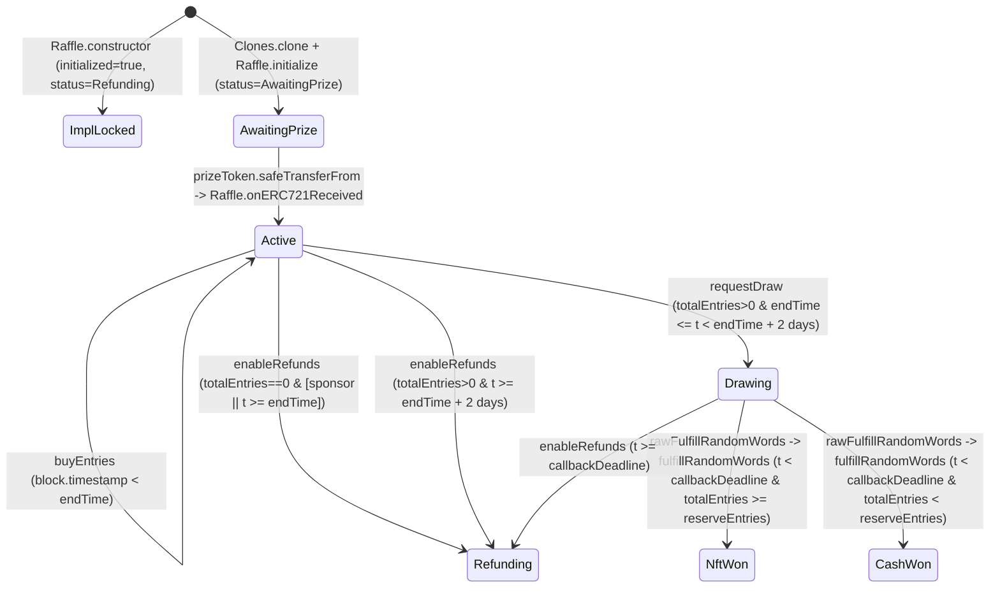
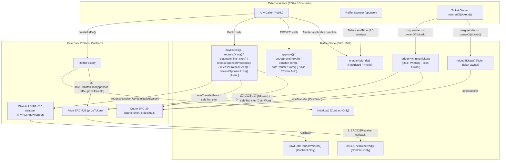
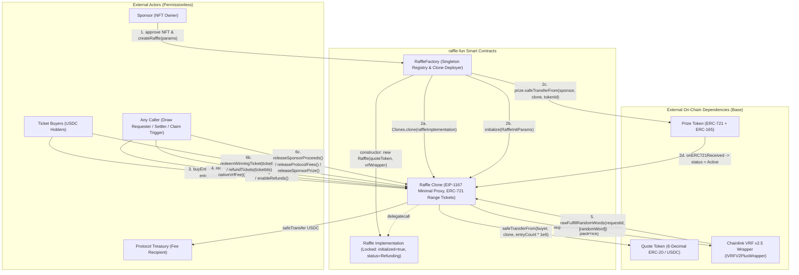
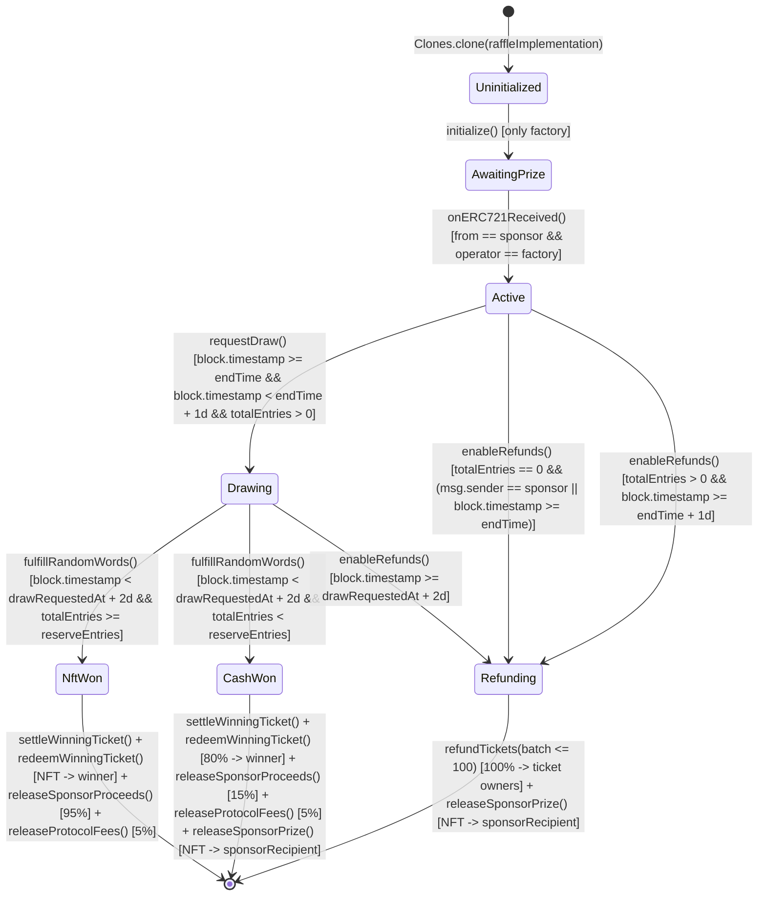
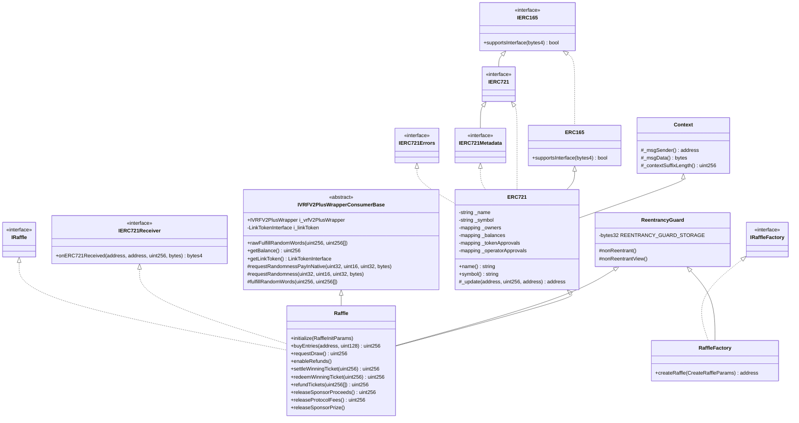
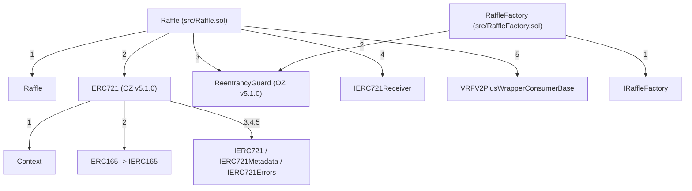

# Gemini Trail of Bits six-skill aggregate — preserved first pass

Frozen target: `9238b6ce8eb7f768c0dcd0cfcef26e1427a03155`. Qualified workflow completion; original transport errors remain unchanged.

## Method and coverage qualifications
- Six declared skills only; not the full Trail of Bits catalog.
- S1 exact native default context workflow analyzed12 selected functions and listed9 not analyzed; complete declared workflow does not imply equal function depth.
- S5 exact native default selected10 of219 extracted requirements:9holds,1divergence,0failedchecks;209 not checked.
- S1/S5 use exact pinned JavaScript bodies on a disclosed workflow-primitive host adapter. Their replay reuses hash-bound successful calls and runs only typed misses; original failed attempts remain unchanged.
- S2/S3/S4/S6 completed reports and tool artifacts in original same-UUID conversations. The CLI retains a byte-identical historical network ERROR despite fresh terminal DONE agent responses. Original strict transport-failed receipts are retained; completion here is a separately qualified method assessment, never a relabeled native transport SUCCESS.
- All six contexts supplied all43 frozen inputs including five production files and31 reachable dependencies. No unverified delegated model is adopted.
- Official agy1.4.4 explicitly selects gemini-4-argon-high/high; client initialization corroborates selection. Provider-internal revision and server-applied effort remain unknown.
- Native tools are part of these skills: this aggregate is tool-assisted, not a strictly source-only review. Optional on-chain analysis lacks a supplied deployment; optional Manticore was unavailable, and slither-prop coverage failures remain explicit. These are not successful proofs.
- Clean context intentionally excludes repository tests/deployment artifacts. S4 statements that excluded files are missing from the repository are unsupported and must not be adopted as repository-wide findings.
- This capture preserves native conclusions and IDs without endorsing severity, proof quality, recommendations or actual owner risk acceptance. Reconciliation is subsequent and must preserve disagreements.


---

# S1 — audit-context-building

Native report SHA-256: `8b35303d847f6a496a414c3c4e9f9c081145b25e78ea7bbcee52241e38c5f9c8`. Original report follows unchanged.

# System Context Dossier — `packages/contracts` (`raffle.fun`)

## 1. System Overview & Module Inventory

`packages/contracts` implements an ownerless, non-upgradeable single-NFT raffle protocol on Ethereum using fixed-price six-decimal USDC entries, transferable ERC-721 range tickets, and Chainlink VRF v2.5 native direct-funding randomness.

| Module | Path | Role |
| --- | --- | --- |
| `RaffleFactory` | `packages/contracts/src/RaffleFactory.sol` (`L21-L186`) | Ownerless factory and canonical registry. Validates and stores immutable `quoteToken`, `vrfWrapper`, and `protocolTreasury` addresses, deploys the locked `Raffle` implementation in its constructor (`L65-L92`), and atomically clones, initializes, registers, and escrows prizes into ERC-1167 `Raffle` instances in `createRaffle` (`L97-L148`). |
| `Raffle` | `packages/contracts/src/Raffle.sol` (`L28-L614`) | ERC-1167 clone implementation inheriting `IRaffle`, OpenZeppelin `ERC721` and `ReentrancyGuard`, `IERC721Receiver`, and Chainlink `VRFV2PlusWrapperConsumerBase`. Escrows one ERC-721 prize (`onERC721Received` at `L416-L431`), sells contiguous 1-based entry ranges as sequential ERC-721 tickets (`buyEntries` at `L209-L237`), requests and receives Chainlink VRF v2.5 randomness (`requestDraw` at `L240-L273`, `fulfillRandomWords` at `L509-L524`), allocates terminal quote-token liabilities (`settleWinningTicket` at `L304-L306`, `_settleWinningTicket` at `L533-L558`), and processes pull-based redemptions, batched refunds, and sponsor/protocol claims (`L309-L407`). |
| `RaffleConstants` | `packages/contracts/src/libraries/RaffleConstants.sol` (`L10-L43`) | Internal constants library defining `BPS = 10_000` (`L12`), `PROTOCOL_FEE_BPS = 500` (`L15`), `CASH_WINNER_BPS = 8000` (`L18`), `ENTRY_PRICE = 1_000_000` (`L21`), `QUOTE_TOKEN_DECIMALS = 6` (`L24`), `MAX_REFUND_TICKET_BATCH_SIZE = 100` (`L27`), `MAX_SALE_DURATION = 30 days` (`L30`), `DRAW_REQUEST_TIMEOUT = 2 days` (`L33`), `DRAW_CALLBACK_TIMEOUT = 2 days` (`L36`), `VRF_CALLBACK_GAS_LIMIT = 300_000` (`L39`), and `VRF_REQUEST_CONFIRMATIONS = 30` (`L42`). |
| `IRaffle` | `packages/contracts/src/interfaces/IRaffle.sol` (`L17-L521`) | Interface for `Raffle` declaring the `Status` enum (`L21-L34`), `RaffleInitParams` struct (`L45-L54`), events (`L62-L180`), custom errors (`L185-L301`), and external function signatures (`L308-L520`). |
| `IRaffleFactory` | `packages/contracts/src/interfaces/IRaffleFactory.sol` (`L11-L150`) | Interface for `RaffleFactory` declaring `CreateRaffleParams` (`L20-L26`), `RaffleCreated` (`L41-L52`), custom errors (`L57-L97`), and external function signatures (`L104-L149`). |

---

## 2. State Inventory, Read/Write Access, and Implied Invariants

### 2.1 `RaffleFactory` State (`packages/contracts/src/RaffleFactory.sol`)

| State Variable | Declaration | Written By | Read By | Implied Invariant |
| --- | --- | --- | --- | --- |
| `quoteToken`, `vrfWrapper`, `protocolTreasury`, `raffleImplementation` | Immutables (`L33, L36, L39, L42`) | `RaffleFactory.constructor` (`L85-L91`) | `createRaffle` (`L106, L114, L143, L144`), `_validateCreateParams` (`L158-L159, L164-L166`), `Raffle._isProtocolDestination` via `raffleImplementation()` (`Raffle.sol:L601`), public getters | All four addresses are non-zero (`L66-L68, L89`), `quoteToken` and `vrfWrapper` had `code.length > 0` at factory deployment (`L66-L67, L184`), `quoteToken.decimals()` returned `6` (`L70-L78`), and `protocolTreasury` is distinct from `address(factory)`, `quoteToken`, `vrfWrapper`, and `raffleImplementation` (`L80-L83, L90`). |
| `raffleCount` | `uint256` (`L45`) | `createRaffle` (`++raffleCount` at `L105`) | `createRaffle` (`L105`), public getter | Monotonically increments by `1` per successful `createRaffle` call starting from `0`; `raffleId` values are sequential 1-based integers `1..raffleCount`. |
| `raffleById` | `mapping(uint256 => address)` (`L48`) | `createRaffle` (`L123`) | Public getter (`L48`) | For every `id` in `1..raffleCount`, `raffleById[id]` holds the unique ERC-1167 clone address deployed at that `raffleCount`; for `id == 0` or `id > raffleCount`, `raffleById[id] == address(0)`. |
| `idByRaffle` | `mapping(address => uint256)` (`L51`) | `createRaffle` (`L124`) | Public getter (`L51`) | Forms a 1-to-1 inverse of `raffleById` over `1..raffleCount`: `idByRaffle[raffleById[id]] == id`, and `idByRaffle[addr] == 0` for unregistered addresses. |
| `isRaffle` | `mapping(address => bool)` (`L54`) | `createRaffle` (`L125`) | `_validateCreateParams` (`L159, L166`), `Raffle._isProtocolDestination` via `isRaffle(destination)` (`Raffle.sol:L603`), public getter | Monotonically growing set of canonical clones: `isRaffle[addr] == true` if and only if `idByRaffle[addr] in 1..raffleCount`. Written at `RaffleFactory.sol:L125` *after* `Raffle.initialize` (`L109-L121`) and *before* `prize.safeTransferFrom` (`L128`). Every address with `isRaffle[addr] == true` has `addr.code.length == 45` (`Clones.sol:L54-L57`). |

### 2.2 `Raffle` Implementation & Clone State (`packages/contracts/src/Raffle.sol` & Inherited Contracts)

| State Variable | Declaration | Written By | Read By | Implied Invariant |
| --- | --- | --- | --- | --- |
| `factory`, `quoteToken` | Immutables (`Raffle.sol:L55, L58`) | `Raffle.constructor` (`L161-L162`) | `initialize` (`L178`), `buyEntries` (`L224`), `onERC721Received` (`L423`), `_transferQuote` (`L566`), `_isProtocolDestination` (`L598-L599`) | Shared across the implementation and all ERC-1167 clones (`Clones.sol:L54-L57`); `factory` is the deploying `RaffleFactory` (`L161`) and `quoteToken` matches `RaffleFactory.quoteToken` (`RaffleFactory.sol:L89`). |
| `i_vrfV2PlusWrapper`, `i_linkToken` | Immutables (`VRFV2PlusWrapperConsumerBase.sol:L34-L35`) | `VRFV2PlusWrapperConsumerBase.constructor` (`L45-L46`, via `Raffle.constructor` at `Raffle.sol:L157, L610-L613`) | `requestRandomnessPayInNative` (`VRFV2PlusWrapperConsumerBase.sol:L82, L84`), `rawFulfillRandomWords` (`L102`), `getVrfRequestPrice` (`Raffle.sol:L437`), `estimateVrfRequestPrice` (`L442`), `vrfWrapper` (`L447`), `_isProtocolDestination` (`L600`), `getLinkToken` (`VRFV2PlusWrapperConsumerBase.sol:L116`) | `i_vrfV2PlusWrapper` is non-zero (`Raffle.sol:L611`) and matches `RaffleFactory.vrfWrapper` (`RaffleFactory.sol:L89`). Note: `i_linkToken` is read from `vrfV2PlusWrapper.link()` at construction (`VRFV2PlusWrapperConsumerBase.sol:L45`), is never used by `Raffle` (which uses native payment), and is not checked in `_isProtocolDestination` (`Raffle.sol:L599-L601`). |
| `initialized` | `bool` (`Raffle.sol:L136`) | `Raffle.constructor` (`L164`), `Raffle.initialize` (`L179`) | `Raffle.initialize` (`L177`), public getter | `true` permanently on the shared implementation from deployment (`L164`) and on every clone after `initialize` (`L177-L179`), ensuring `initialize` executes at most once per clone and never on `raffleImplementation`. |
| `sponsor`, `sponsorRecipient`, `protocolTreasury`, `prizeToken`, `prizeTokenId`, `raffleId`, `reserveEntries`, `endTime` | Clone config (`Raffle.sol:L61-L82`) | `Raffle.initialize` (`L197-L204`) | `buyEntries` (`L216`), `requestDraw` (`L242`), `enableRefunds` (`L281-L282`), `redeemWinningTicket` (`L332-L335`), `releaseSponsorProceeds` (`L379`), `releaseProtocolFees` (`L389`), `releaseSponsorPrize` (`L402-L406`), `onERC721Received` (`L422-L423`), `drawRequestDeadline` (`L459`), `_update` (`L498`), `fulfillRandomWords` (`L521`), `_transferQuote` (`L565`) | Write-once per clone (`L177-L179, L197-L204`). For every initialized clone, `sponsor`, `sponsorRecipient`, `protocolTreasury`, and `address(prizeToken)` are non-zero (`L181-L186`) and passed `_isProtocolDestination` at initialization (`L187-L195`); `reserveEntries >= 1` (`RaffleFactory.sol:L178`); and `creationTime < endTime <= creationTime + 30 days` (`RaffleFactory.sol:L99-L104`). On `raffleImplementation`, all eight fields remain zero/default. |
| `status` | `IRaffle.Status` (`Raffle.sol:L124`) | `Raffle.constructor` (`L165`), `initialize` (`L205`), `onERC721Received` (`L428`), `requestDraw` (`L252`), `enableRefunds` (`L299`), `fulfillRandomWords` (`L521`) | `buyEntries` (`L215`), `requestDraw` (`L241`), `enableRefunds` (`L279, L289, L293`), `redeemWinningTicket` (`L311`), `refundTickets` (`L350`), `releaseSponsorPrize` (`L396`), `onERC721Received` (`L422`), `fulfillRandomWords` (`L511, L514, L523`), `_settleWinningTicket` (`L535`), `_requireStatus` (`L574`), `RaffleFactory.createRaffle` (`RaffleFactory.sol:L132`) | Follows a strict directed acyclic graph on every clone: `AwaitingPrize` (`L205`) -> `Active` (`L428`) -> either `Refunding` (`L299`) or `Drawing` (`L252`) -> `NftWon` (`L521`), `CashWon` (`L521`), or `Refunding` (`L299`). `NftWon`, `CashWon`, and `Refunding` are terminal states with no outgoing transitions. On `raffleImplementation`, `status` is locked at `Status.Refunding` (`L165`). |
| `totalEntries` | `uint128` (`Raffle.sol:L85`) | `buyEntries` (`L230`) | `buyEntries` (`L219, L226-L227`), `requestDraw` (`L243`), `enableRefunds` (`L280`), `grossSales` (`L474`), `fulfillRandomWords` (`L518, L521`) | Monotonically increases during `Status.Active` prior to `endTime` (`L215-L216, L218-L221, L230`) and is immutable once `status != Status.Active` or `block.timestamp >= endTime`. Bounded by `totalEntries <= type(uint128).max`. |
| `ticketCount` | `uint128` (`Raffle.sol:L88`) | `buyEntries` (`L231`) | `buyEntries` (`L228`), public getter | Increments by `1` per `buyEntries` call (`L231`). Because each call requires `entryCount >= 1` (`L218`), `0 <= ticketCount <= totalEntries <= type(uint128).max` always holds. Not decremented when tickets are burned (`L325, L364`). |
| `_ticketRanges` | `mapping(uint256 => TicketRange)` (`Raffle.sol:L139`) | `buyEntries` (`L232`) | `ticketRange` (`L452-L454`), which is called by `refundTickets` (`L362`) and `_requireWinningTicket` (`L580`) | Write-once per `ticketId` in `1..ticketCount` (`L228, L231-L232`), never deleted on burn (`L138`). `_ticketRanges[1..ticketCount]` partitions `[1, totalEntries]` into contiguous, disjoint inclusive intervals `[firstEntry, lastEntry]` with `firstEntry_1 == 1`, `firstEntry_k == lastEntry_{k-1} + 1`, and `lastEntry_{ticketCount} == totalEntries`. For `ticketId == 0` or `ticketId > ticketCount`, `_ticketRanges[ticketId] == (0, 0)`. |
| `unsettledPot` | `uint256` (`Raffle.sol:L91`) | `buyEntries` (`L233`), `enableRefunds` (`L297`), `_settleWinningTicket` (`L553`) | `enableRefunds` (`L296`), `accountedQuoteBalance` (`L469`), `_settleWinningTicket` (`L539`) | Equals `uint256(totalEntries) * ENTRY_PRICE == grossSales()` while `status` is `AwaitingPrize`, `Active`, or `Drawing`, and while in `NftWon` or `CashWon` with `settlementComplete == false`. Zeroed permanently when `enableRefunds` transitions to `Status.Refunding` (`L297`) or when `_settleWinningTicket` sets `settlementComplete = true` (`L551-L553`). |
| `remainingRefundLiability` | `uint256` (`Raffle.sol:L94`) | `enableRefunds` (`L298`), `refundTickets` (`L368`) | `refundTickets` (`L368, L370`), `accountedQuoteBalance` (`L469`) | Zero in all statuses other than `Status.Refunding`. Set once to `unsettledPot` (`totalEntries * ENTRY_PRICE`) in `enableRefunds` (`L296-L298`), and reduced by `sum(lastEntry - firstEntry + 1) * ENTRY_PRICE` for each batch of distinct tickets burned in `refundTickets` (`L362-L368`). Always equals the sum of `(lastEntry - firstEntry + 1) * ENTRY_PRICE` over all currently unburned tickets when `status == Status.Refunding`. |
| `vrfRequestId` | `uint256` (`Raffle.sol:L109`) | `requestDraw` (`L259`) | `fulfillRandomWords` (`L511, L514`), public getter | Written at most once per clone (`requestDraw` requires `status == Status.Active` at `L241` and sets `status = Status.Drawing` at `L252`). Holds `0` before `L259` and the wrapper-returned `requestId` thereafter. |
| `drawRequestedAt` | `uint64` (`Raffle.sol:L112`) | `requestDraw` (`L253`) | `requestDraw` (`L272`), `callbackDeadline` (`L464`, called by `requestDraw` at `L272`, `enableRefunds` at `L290`, and `fulfillRandomWords` at `L512`) | Zero before `requestDraw`; set once to `uint64(block.timestamp)` when `status` transitions to `Status.Drawing` (`L252-L253`). Assuming `block.timestamp <= type(uint64).max`, `drawRequestedAt >= endTime >= 1` whenever `status` is `Drawing`, `NftWon`, `CashWon`, or `Refunding` (reached from `Drawing`). |
| `_requestInFlight` | `bool` (`Raffle.sol:L142`) | `requestDraw` (`L254, L260`) | `fulfillRandomWords` (`L511`) | `true` only during the external call `requestRandomnessPayInNative` (`L254-L260`), and `false` at the start and end of every transaction. Blocks `fulfillRandomWords` (`L511`) from resolving the raffle during a synchronous callback before `vrfRequestId` is written at `L259`. |
| `winningEntry` | `uint128` (`Raffle.sol:L118`) | `fulfillRandomWords` (`L519`) | `_requireWinningTicket` (`L581`), public getter | Zero unless `status` is `Status.NftWon` or `Status.CashWon`, in which case `1 <= winningEntry <= totalEntries` (`L518-L521`). |
| `resolvedAt` | `uint64` (`Raffle.sol:L115`) | `fulfillRandomWords` (`L520`) | Public getter (`L115`) | Zero unless `status` is `Status.NftWon` or `Status.CashWon`, in which case it holds `uint64(block.timestamp)` at resolution (`L520`). Not read by any internal function. |
| `settlementComplete` | `bool` (`Raffle.sol:L127`) | `_settleWinningTicket` (`L551`) | `redeemWinningTicket` (`L314`), `_settleWinningTicket` (`L534`), public getter | `false` until `_settleWinningTicket` executes in `Status.NftWon` or `Status.CashWon`, and `true` permanently thereafter (`L534, L551`). |
| `winningTicketId` | `uint256` (`Raffle.sol:L121`) | `_settleWinningTicket` (`L552`) | `redeemWinningTicket` (`L316-L317`), public getter | Zero while `!settlementComplete`; when `settlementComplete == true`, holds the unique `ticketId` in `1..ticketCount` whose `_ticketRanges[ticketId]` covers `winningEntry` (`L538, L552, L579-L585`). |
| `winnerProceeds` | `uint256` (`Raffle.sol:L100`) | `_settleWinningTicket` (`L548`), `redeemWinningTicket` (`L341`) | `redeemWinningTicket` (`L339`), `accountedQuoteBalance` (`L469`), public getter | Always `0` in `Status.NftWon`. In `Status.CashWon`, set once to `Math.mulDiv(grossPot, 8000, 10_000)` (`>= 800_000`) when `_settleWinningTicket` runs (`L546-L548`), and zeroed when `redeemWinningTicket` executes (`L341`). |
| `sponsorProceeds` | `uint256` (`Raffle.sol:L103`) | `_settleWinningTicket` (`L554`), `releaseSponsorProceeds` (`L378`) | `releaseSponsorProceeds` (`L376`), `accountedQuoteBalance` (`L469`), public getter | Set once in `_settleWinningTicket` (`L544, L547, L554`) to `grossPot - protocolFee` (`NftWon`) or `grossPot - protocolFee - cashAmount` (`CashWon`), and zeroed by `releaseSponsorProceeds` (`L378`). |
| `protocolFees` | `uint256` (`Raffle.sol:L106`) | `_settleWinningTicket` (`L555`), `releaseProtocolFees` (`L388`) | `releaseProtocolFees` (`L386`), `accountedQuoteBalance` (`L469`), public getter | Set once in `_settleWinningTicket` (`L540, L555`) to `Math.mulDiv(grossPot, 500, 10_000)` (`floor(grossPot / 20)`), and zeroed by `releaseProtocolFees` (`L388`). |
| `winnerRecipient`, `winnerRedeemed` | `address` (`L97`), `bool` (`L130`) | `redeemWinningTicket` (`L323-L324`) | `redeemWinningTicket` (`L310`), public getters | `winnerRedeemed` transitions `false -> true` at most once (`L310, L324`) in `Status.NftWon` or `Status.CashWon`, recording the redeeming ticket owner in `winnerRecipient` (`L320, L323`). |
| `prizeClaimed` | `bool` (`Raffle.sol:L133`) | `redeemWinningTicket` (`L331`), `releaseSponsorPrize` (`L403`) | `redeemWinningTicket` (`L330`), `releaseSponsorPrize` (`L400`), public getter | Transitions `false -> true` at most once per clone: either via `redeemWinningTicket` in `Status.NftWon` (`L329-L331`) or via `releaseSponsorPrize` in `Status.CashWon` or `Status.Refunding` (`L397-L403`). |
| `_owners`, `_balances`, `_tokenApprovals`, `_operatorApprovals` | `ERC721.sol:L28-L34` | `ERC721._update` (`L230, L236, L240`), `ERC721._approve` (`L398`), `ERC721._setApprovalForAll` (`L416`) via `Raffle._update` (`Raffle.sol:L497-L502`), `buyEntries` (`L235`), `redeemWinningTicket` (`L325`), `refundTickets` (`L364`), `transferFrom` / `safeTransferFrom` / `approve` / `setApprovalForAll` (`ERC721.sol:L93-L136`) | `ownerOf` (`ERC721.sol:L61`), `balanceOf` (`L53`), `getApproved` (`L98`), `isApprovedForAll` (`L110`), `redeemWinningTicket` (`Raffle.sol:L320`), `refundTickets` (`L359`) | For every `ticketId` with `_owners[ticketId] != address(0)`, `1 <= ticketId <= ticketCount`, `_owners[ticketId]` passed `_isProtocolDestination` at the time of mint or transfer (`Raffle.sol:L498-L500`), and `_balances[owner]` equals the count of unburned tickets owned by `owner`. |
| `REENTRANCY_GUARD_STORAGE` | ERC-7201 slot `0x9b779b17422d0df92223018b32b4d1fa46e071723d6817e2486d003becc55f00` (`ReentrancyGuard.sol:L36-L37`) | `ReentrancyGuard.constructor` (`L59`), `_nonReentrantBefore` (`L99`), `_nonReentrantAfter` (`L105`) | `_reentrancyGuardEntered` (`L113`) | Initialized to `NOT_ENTERED` (`1`) on `RaffleFactory` and `raffleImplementation`, and `0` on fresh ERC-1167 clones (`0 != ENTERED (2)`). Set to `ENTERED` (`2`) during `RaffleFactory.createRaffle` and during the 9 `nonReentrant` external functions on `Raffle`, and reset to `NOT_ENTERED` (`1`) on exit. |

---

## 3. End-to-End Flows and State Progression



### Flow 1: Factory Deployment & Implementation Locking (`RaffleFactory.constructor` & `Raffle.constructor`)
1. `RaffleFactory.constructor(quoteToken_, vrfWrapper_, protocolTreasury_)` (`RaffleFactory.sol:L65-L92`) verifies `quoteToken_.code.length > 0` (`L66, L184`), `vrfWrapper_.code.length > 0` (`L67, L184`), `protocolTreasury_ != address(0)` (`L68`), and `IERC20Metadata(quoteToken_).decimals() == 6` (`L70-L78`).
2. It rejects `protocolTreasury_` if equal to `address(this)`, `quoteToken_`, or `vrfWrapper_` (`L80-L83`), assigns the immutables `quoteToken`, `vrfWrapper`, and `protocolTreasury` (`L85-L87`), and deploys `new Raffle(quoteToken_, vrfWrapper_)` (`L89`).
3. `Raffle.constructor` (`Raffle.sol:L155-L166`) validates `vrfWrapper_ != address(0)` (`L157, L610-L613`), calls `VRFV2PlusWrapperConsumerBase(vrfWrapper_)` which calls `vrfV2PlusWrapper.link()` (`VRFV2PlusWrapperConsumerBase.sol:L45`), sets `factory = msg.sender` and `quoteToken = IERC20(quoteToken_)` (`Raffle.sol:L161-L162`), and permanently locks the implementation by setting `initialized = true` and `status = Status.Refunding` (`L164-L165`).
4. `RaffleFactory.constructor` verifies `protocolTreasury_ != implementation` (`RaffleFactory.sol:L90`) and stores `raffleImplementation = implementation` (`L91`).

### Flow 2: Atomic Raffle Creation, Initialization, Registration, and Prize Escrow (`createRaffle` -> `_validateCreateParams` -> `initialize` -> `onERC721Received`)
1. Any caller invokes `RaffleFactory.createRaffle(params)` (`RaffleFactory.sol:L97-L148`, `nonReentrant`).
2. `_validateCreateParams(params)` (`L98, L154-L179`) verifies `params.prizeToken.code.length > 0` (`L155, L184`), `params.sponsorRecipient != address(0)` (`L156`), neither `prizeToken` nor `sponsorRecipient` is in `{address(this), quoteToken, vrfWrapper, raffleImplementation}` or currently in `isRaffle`, `sponsorRecipient != prizeToken` (`L157-L169`), `IERC165(params.prizeToken).supportsInterface(type(IERC721).interfaceId) == true` (`L171-L177`), and `params.reserveEntries > 0` (`L178`).
3. `createRaffle` checks `block.timestamp < params.endTime <= block.timestamp + 30 days` (`L99-L104`), increments `raffleId = ++raffleCount` (`L105`), and deploys an ERC-1167 proxy via `Clones.clone(raffleImplementation)` (`L106`, `Clones.sol:L32-L62`).
4. `IRaffle(raffle).initialize(...)` (`RaffleFactory.sol:L109-L121` -> `Raffle.sol:L176-L206`) verifies `!initialized` (`L177`) and `msg.sender == factory` (`L178`), sets `initialized = true` (`L179`), checks non-zero addresses (`L181-L186`), screens `sponsor` (`msg.sender`), `protocolTreasury`, and `sponsorRecipient` via `_isProtocolDestination(..., params.prizeToken)` (`L187-L195, L593-L605`), writes the 8 clone config fields (`L197-L204`), and sets `status = Status.AwaitingPrize` (`L205`).
5. `createRaffle` writes `raffleById[raffleId] = raffle`, `idByRaffle[raffle] = raffleId`, and `isRaffle[raffle] = true` (`RaffleFactory.sol:L123-L125`).
6. `createRaffle` calls `prize.safeTransferFrom(msg.sender, raffle, params.prizeTokenId)` (`L128`). During the transfer, `prizeToken` invokes `raffle.onERC721Received(operator, from, tokenId, data)` (`Raffle.sol:L416-L431`), which requires `status == Status.AwaitingPrize`, `msg.sender == address(prizeToken)`, `tokenId == prizeTokenId`, `from == sponsor`, and `operator == factory` (`L421-L426`), sets `status = Status.Active` (`L428`), emits `PrizeDeposited` (`L429`), and returns `IERC721Receiver.onERC721Received.selector` (`L430`).
7. After `safeTransferFrom` returns, `createRaffle` verifies `prize.ownerOf(params.prizeTokenId) == raffle` (`RaffleFactory.sol:L129-L131`) and `IRaffle(raffle).status() == IRaffle.Status.Active` (`L132-L134`), then emits `RaffleCreated` (`L136-L147`).

### Flow 3: Active Entry Sales (`buyEntries` -> `_safeMint` -> `_update` -> `_isProtocolDestination`)
1. While `status == Status.Active` (`Raffle.sol:L215`) and `block.timestamp < endTime` (`L216`), any caller invokes `buyEntries(recipient, entryCount)` (`L209-L237`, `nonReentrant`).
2. `buyEntries` checks `recipient != address(0)` (`L217`), `entryCount > 0` (`L218`), and `entryCount <= type(uint128).max - totalEntries` (`L219-L221`).
3. It pulls `grossAmount = uint256(entryCount) * ENTRY_PRICE` from `msg.sender` via `quoteToken.safeTransferFrom(msg.sender, address(this), grossAmount)` (`L223-L224`).
4. It computes `[firstEntry, lastEntry] = [totalEntries + 1, totalEntries + entryCount]` and `ticketId = uint256(ticketCount) + 1`, updates `totalEntries = lastEntry`, `++ticketCount`, `_ticketRanges[ticketId] = TicketRange(firstEntry, lastEntry)`, and `unsettledPot += grossAmount` (`L226-L233`).
5. It calls `_safeMint(recipient, ticketId)` (`L235`), which routes through `Raffle._update` (`L497-L502`) to reject `_isProtocolDestination(recipient, address(prizeToken))` (`L498-L500`), writes `_balances[recipient] += 1` and `_owners[ticketId] = recipient` (`ERC721.sol:L236, L240`), and if `recipient.code.length > 0`, calls `IERC721Receiver(recipient).onERC721Received(msg.sender, address(0), ticketId, "")` (`ERC721Utils.sol:L32-L48`). Finally, `buyEntries` emits `TicketPurchased` (`Raffle.sol:L236`).

### Flow 4: VRF Draw Request & Callback Resolution (`requestDraw` -> `rawFulfillRandomWords` -> `fulfillRandomWords`)
1. During `endTime <= block.timestamp < drawRequestDeadline()` (`endTime + 2 days`) while `status == Status.Active` and `totalEntries > 0` (`Raffle.sol:L241-L247`), any caller invokes `requestDraw()` (`L240-L273`, `payable`, `nonReentrant`).
2. `requestDraw` checks `msg.value >= getVrfRequestPrice()` (`L249-L250`), sets `status = Status.Drawing` (`L252`), `drawRequestedAt = uint64(block.timestamp)` (`L253`), and `_requestInFlight = true` (`L254`), then calls `requestRandomnessPayInNative(callbackGasLimit, requestConfirmations, 1, extraArgs)` (`L255-L257`, `VRFV2PlusWrapperConsumerBase.sol:L76-L89`).
3. When `requestRandomnessPayInNative` returns `(requestId, paidPrice)`, `requestDraw` verifies `paidPrice <= msg.value` (`Raffle.sol:L258`), stores `vrfRequestId = requestId` (`L259`), resets `_requestInFlight = false` (`L260`), refunds any `excess = msg.value - paidPrice` to `msg.sender` via assembly `call(gas(), refundRecipient, excess, 0, 0, 0, 0)` (`L262-L270`), and emits `DrawRequested` (`L272`).
4. When `i_vrfV2PlusWrapper` calls `rawFulfillRandomWords(requestId, randomWords)` (`VRFV2PlusWrapperConsumerBase.sol:L101-L107`), `fulfillRandomWords` (`Raffle.sol:L509-L524`) checks `_requestInFlight || status != Status.Drawing || requestId != vrfRequestId || randomWords.length != 1 || block.timestamp >= callbackDeadline()` (`L510-L513`). If any condition holds, it emits `VrfCallbackIgnored` and returns without modifying storage (`L514-L515`).
5. Otherwise, `fulfillRandomWords` computes `resolvedEntry = uint128((randomWords[0] % uint256(totalEntries)) + 1)`, writes `winningEntry = resolvedEntry` (`L518-L519`), `resolvedAt = uint64(block.timestamp)` (`L520`), and `status = totalEntries >= reserveEntries ? Status.NftWon : Status.CashWon` (`L521`), and emits `RaffleResolved` (`L523`).

### Flow 5: Winning Ticket Settlement, Winner Redemption, and Independent Proceeds/Prize Releases
1. Once `status` is `Status.NftWon` or `Status.CashWon`, any caller can call `settleWinningTicket(ticketId)` (`Raffle.sol:L304-L306`, `nonReentrant`) — or the winning ticket owner can call `redeemWinningTicket(ticketId)` (`L309-L346`, `nonReentrant`), which calls `_settleWinningTicket(ticketId)` lazily if `!settlementComplete` (`L314-L315`).
2. `_settleWinningTicket(ticketId)` (`L533-L558`) verifies `!settlementComplete` (`L534`), `status` in `{NftWon, CashWon}` (`L535-L536`), and `_requireWinningTicket(ticketId)` (`firstEntry <= winningEntry <= lastEntry` at `L538, L579-L585`). It computes `protocolFee = Math.mulDiv(grossPot, 500, 10_000)` (`L540`). For `NftWon`, `sponsorAmount = grossPot - protocolFee` and `winnerProceeds` remains `0` (`L543-L544`). For `CashWon`, `cashAmount = Math.mulDiv(grossPot, 8000, 10_000)`, `sponsorAmount = grossPot - protocolFee - cashAmount`, and `winnerProceeds = cashAmount` (`L545-L549`). It sets `settlementComplete = true`, `winningTicketId = ticketId`, `unsettledPot = 0`, `sponsorProceeds = sponsorAmount`, and `protocolFees = protocolFee` (`L551-L555`).
3. In `redeemWinningTicket(ticketId)` (`L309-L346`), after settlement (or verifying `ticketId == winningTicketId` at `L316-L318`), the contract checks `msg.sender == ownerOf(ticketId)` (`L320-L321`), sets `winnerRecipient = winner` and `winnerRedeemed = true` (`L323-L324`), and calls `_burn(ticketId)` (`L325`).
   - If `status == Status.NftWon` (`L329-L337`): checks `!prizeClaimed`, sets `prizeClaimed = true`, calls `prizeToken.transferFrom(address(this), winner, prizeTokenId)` (`L334`), and verifies `prizeToken.ownerOf(prizeTokenId) == winner` (`L335-L337`).
   - If `status == Status.CashWon` (`L338-L343`): reads `cashAmount = winnerProceeds` (reverting if `0`), sets `winnerProceeds = 0` (`L341`), and calls `_transferQuote(winner, cashAmount)` (`L342, L564-L567`), which re-checks `!_isProtocolDestination(winner, address(prizeToken))` (`L565`) before calling `quoteToken.safeTransfer(winner, cashAmount)` (`L566`).
4. Independently of winner redemption, any caller can invoke:
   - `releaseSponsorProceeds()` (`L375-L382`, `nonReentrant`): zeroes `sponsorProceeds` and calls `_transferQuote(sponsorRecipient, amount)`.
   - `releaseProtocolFees()` (`L385-L392`, `nonReentrant`): zeroes `protocolFees` and calls `_transferQuote(protocolTreasury, amount)`.
   - `releaseSponsorPrize()` (`L395-L407`, `nonReentrant`): when `status` is `Status.CashWon` or `Status.Refunding` and `!prizeClaimed`, sets `prizeClaimed = true`, calls `prizeToken.transferFrom(address(this), sponsorRecipient, prizeTokenId)` (`L404`), and verifies `prizeToken.ownerOf(prizeTokenId) == sponsorRecipient` (`L405`).

### Flow 6: Refund Activation & Batched Ticket Refunds (`enableRefunds` -> `refundTickets` & `releaseSponsorPrize`)
1. `enableRefunds()` (`Raffle.sol:L276-L301`, `nonReentrant`) transitions the raffle to `Status.Refunding` from:
   - `Status.Active` with `totalEntries == 0` when `msg.sender == sponsor || block.timestamp >= endTime` (`L279-L284`);
   - `Status.Active` with `totalEntries != 0` when `block.timestamp >= drawRequestDeadline()` (`endTime + 2 days`, `L285-L288`);
   - `Status.Drawing` when `block.timestamp >= callbackDeadline()` (`drawRequestedAt + 2 days`, `L289-L291`).
2. `enableRefunds` moves `liability = unsettledPot` into `remainingRefundLiability`, sets `unsettledPot = 0` and `status = Status.Refunding` (`L296-L299`), and emits `RefundsEnabled` (`L300`).
3. In `Status.Refunding`, any ticket owner calls `refundTickets(ticketIds)` (`L349-L372`, `nonReentrant`) with `1 <= ticketIds.length <= 100` (`L351-L354`). For each `ticketId`, it checks `msg.sender == ownerOf(ticketId)` (`L359-L360`), adds `uint256(lastEntry) - uint256(firstEntry) + 1` to `aggregateEntries` (`L362-L363`), and calls `_burn(ticketId)` (`L364`, setting `_owners[ticketId] = address(0)` immediately so duplicate IDs in the same array revert on the next `ownerOf` call). After the loop, it computes `amount = aggregateEntries * ENTRY_PRICE`, subtracts `amount` from `remainingRefundLiability` (`L367-L368`), and calls `_transferQuote(msg.sender, amount)` (`L369`).
4. Concurrently in `Status.Refunding`, any caller can invoke `releaseSponsorPrize()` (`L395-L407`) to return `prizeTokenId` to `sponsorRecipient`.

---

## 4. Cross-Function Invariants & Inter-Record Comparisons

### 4.1 Cross-Function Invariants
1. **Quote-Token Liability Conservation (`accountedQuoteBalance()`):**
   Across all lifecycle states of an initialized clone, `accountedQuoteBalance() = unsettledPot + remainingRefundLiability + winnerProceeds + sponsorProceeds + protocolFees` (`Raffle.sol:L468-L470`) equals total historical deposits `uint256(totalEntries) * ENTRY_PRICE` (`buyEntries` at `L223, L230, L233`) minus total historical quote-token payouts (`redeemWinningTicket` at `L339-L342`, `refundTickets` at `L367-L369`, `releaseSponsorProceeds` at `L376-L380`, and `releaseProtocolFees` at `L386-L390`). Neither `enableRefunds` (`L296-L298`) nor `_settleWinningTicket` (`L539-L555`) changes `accountedQuoteBalance()`: `enableRefunds` moves `unsettledPot` 1-for-1 into `remainingRefundLiability`, and `_settleWinningTicket` partitions `unsettledPot` into `protocolFees + sponsorProceeds + winnerProceeds == grossPot`.
2. **Strict Mutual Exclusion of Post-Sale and Callback Windows:**
   - For a sold raffle (`totalEntries > 0`) in `Status.Active`: `buyEntries` requires `block.timestamp < endTime` (`L216`), `requestDraw` requires `endTime <= block.timestamp < drawRequestDeadline()` (`L242, L245`), and `enableRefunds` requires `block.timestamp >= drawRequestDeadline()` (`L286-L287`).
   - For a raffle in `Status.Drawing`: `fulfillRandomWords` resolves only when `block.timestamp < callbackDeadline()` (`L512`), whereas `enableRefunds` requires `block.timestamp >= callbackDeadline()` (`L290-L291`). Once either transitions `status` out of `Status.Drawing` (`L521` or `L299`), the other cannot transition `status`.
3. **Existence and Uniqueness of the Winning Ticket:**
   `buyEntries` (`L218, L226-L232`) partitions `[1, totalEntries]` into contiguous, disjoint, non-empty intervals `_ticketRanges[1..ticketCount]`, while unminted IDs have `_ticketRanges[id] == (0, 0)`. `requestDraw` (`L243, L252`) requires `totalEntries > 0` to enter `Status.Drawing`, and `fulfillRandomWords` (`L518-L519`) computes `winningEntry = uint128((randomWords[0] % uint256(totalEntries)) + 1)` in `[1, totalEntries]`. Consequently, in `Status.NftWon` and `Status.CashWon`, there exists a unique `ticketId` in `1..ticketCount` satisfying `_requireWinningTicket` (`firstEntry <= winningEntry <= lastEntry` at `L580-L584`), and unminted `(0, 0)` tickets are rejected because `winningEntry >= 1 > 0`.
4. **Single Prize Custody & Disjoint Release Paths:**
   A registered clone transitions to `Status.Active` only after `onERC721Received` (`L421-L428`) and `prize.ownerOf(prizeTokenId) == raffle` (`RaffleFactory.sol:L129-L134`). Thereafter, `prizeToken.transferFrom(address(this), ...)` is reachable only in `redeemWinningTicket` when `status == Status.NftWon` (`Raffle.sol:L329-L337`) or in `releaseSponsorPrize` when `status == Status.CashWon || status == Status.Refunding` (`L396-L405`). Both paths check and set `prizeClaimed = true` (`L330-L331, L400-L403`), and `NftWon` is mutually exclusive with `{CashWon, Refunding}`.
5. **Split Creation Validation Between `RaffleFactory` and `Raffle.initialize`:**
   Neither `RaffleFactory._validateCreateParams` (`RaffleFactory.sol:L154-L179`) nor `Raffle.initialize` (`Raffle.sol:L176-L206`) validates all creation invariants alone:
   - `_validateCreateParams` checks `prizeToken.code.length > 0`, `IERC165(prizeToken).supportsInterface(IERC721)`, `prizeToken` against protocol sinks, and `reserveEntries > 0`, while `createRaffle` checks `block.timestamp < endTime <= block.timestamp + 30 days` (`RaffleFactory.sol:L99-L104`). `Raffle.initialize` does not re-check any of these.
   - Conversely, `_validateCreateParams` does not check `msg.sender` (`sponsor`), does not check `prizeToken == protocolTreasury`, and cannot check `sponsorRecipient == raffle` (because `raffle` is not cloned until `RaffleFactory.sol:L106` or registered in `isRaffle` until `L125`). Those checks are performed only inside `Raffle.initialize` via `_isProtocolDestination` (`Raffle.sol:L187-L195, L599-L600`).

### 4.2 Where Per-Function Records Differ in Framing
- **`uint64(block.timestamp)` Cast Bounds (`drawRequestedAt` at `Raffle.sol:L253` vs. `resolvedAt` at `Raffle.sol:L520`):**
  - `05-requestDraw.md` and `07-enableRefunds.md` record the assumption that `block.timestamp` fits in `uint64` at `drawRequestedAt = uint64(block.timestamp)` (`Raffle.sol:L253`) as `establishedBy: "nothing found"`, noting that `block.timestamp < uint256(endTime) + 2 days` (`L244-L247`) can exceed `type(uint64).max` by up to `2 days` if `endTime > type(uint64).max - 2 days`.
  - `06-fulfillRandomWords.md` records the assumption that `block.timestamp` fits in `uint64` at `resolvedAt = uint64(block.timestamp)` (`Raffle.sol:L520`) as `establishedBy: "RaffleFactory.createRaffle at packages/contracts/src/RaffleFactory.sol:L100-L104 (params.endTime is uint64 > block.timestamp) and Raffle.requestDraw / Raffle.fulfillRandomWords at packages/contracts/src/Raffle.sol:L245,L459,L464,L512 (bounding resolution before uint256(endTime) + 4 days; no explicit check that uint256(endTime) + 4 days <= type(uint64).max)"`.
- **`quoteToken` Balance Sufficiency and Fee-Free Transfer Semantics:**
  - `02-buyEntries.md`, `04-redeemWinningTicket.md`, and `07-enableRefunds.md` record `quoteToken`'s exact balance crediting and fee-free, non-rebasing, non-blacklisting transfer behavior under `establishedBy: "nothing found"` (noting `RaffleFactory.constructor` at `RaffleFactory.sol:L66-L78` checks only `code.length > 0` and `decimals() == 6`).
  - `03-_settleWinningTicket.md` and `08-refundTickets.md` cite `Raffle.buyEntries` (`Raffle.sol:L223-L224, L233`) and `RaffleFactory.constructor` (`RaffleFactory.sol:L65-L85`) as establishing accounted liability and 6-decimal contract configuration while noting that fee-free canonical USDC behavior is an external trust assumption (`nothing found` onchain for token identity beyond decimals and code length).
- **`prizeToken` Escrow and Transfer Compliance:**
  - `01-createRaffle.md`, `09-_validateCreateParams.md`, `10-initialize.md`, and `11-onERC721Received.md` record ongoing ERC-721 custody and transfer compliance of `prizeToken` as `establishedBy: "nothing found"`.
  - `04-redeemWinningTicket.md` cites `RaffleFactory.createRaffle` (`L128-L131`) and `Raffle.onERC721Received` (`L421-L430`) as establishing initial escrow while recording ongoing custody/non-reverting `transferFrom` and truthfulness of `prizeToken.ownerOf(deliveredPrizeTokenId) == winner` (`L335-L337`) as `nothing found` on-chain.

---

## 5. Trust Boundaries, Actors, and Entrypoint Reachability

| Actor (Trust) | Entrypoint | Reachability Conditions & Downstream Execution |
| --- | --- | --- |
| **Factory Deployer** (`trusted`) | `RaffleFactory.constructor` (`RaffleFactory.sol:L65-L92`) | Called once at factory deployment. Calls `_requireContract(quoteToken_)`, `_requireContract(vrfWrapper_)`, `IERC20Metadata(quoteToken_).decimals()`, and deploys `new Raffle(quoteToken_, vrfWrapper_)` (`Raffle.constructor` at `Raffle.sol:L155-L166` -> `VRFV2PlusWrapperConsumerBase.constructor` at `L40-L47`, which calls `vrfWrapper_.link()`). |
| **Sponsor** (`untrusted`) | `RaffleFactory.createRaffle` (`RaffleFactory.sol:L97-L148`) | Any external caller supplying `CreateRaffleParams`. Reaches `_validateCreateParams` (`STATICCALL` to `prizeToken.supportsInterface`), `Clones.clone`, `Raffle.initialize` (`STATICCALL`s to `factory.raffleImplementation()` and `factory.isRaffle(...)`), `prizeToken.safeTransferFrom(msg.sender, raffle, prizeTokenId)` -> `Raffle.onERC721Received`, `prizeToken.ownerOf(prizeTokenId)`, and `Raffle.status()`. |
| **Sponsor** (`untrusted`) | `Raffle.enableRefunds` (`Raffle.sol:L276-L301`) | Before `endTime` when `status == Status.Active` and `totalEntries == 0` (`L280-L284`), only `msg.sender == sponsor` can transition `status` to `Status.Refunding`. |
| **RaffleFactory Contract** (`trusted`) | `Raffle.initialize` (`Raffle.sol:L176-L206`) | Restricted to `msg.sender == factory` and `!initialized` (`L177-L178`). Reaches `_isProtocolDestination` (`L593-L605`), writes clone configuration, and sets `status = Status.AwaitingPrize`. |
| **Prize ERC-721 Contract** (`untrusted`) | `Raffle.onERC721Received` (`Raffle.sol:L416-L431`) | Restricted to `status == Status.AwaitingPrize`, `msg.sender == address(prizeToken)`, `tokenId == prizeTokenId`, `from == sponsor`, and `operator == factory` (`L421-L426`). Transitions `status` to `Status.Active`. |
| **Entry Buyer / Ticket Recipient** (`untrusted`) | `Raffle.buyEntries` (`Raffle.sol:L209-L237`) | Any caller while `status == Status.Active` and `block.timestamp < endTime`. Calls `quoteToken.safeTransferFrom(msg.sender, address(this), grossAmount)`, updates `totalEntries`, `ticketCount`, `_ticketRanges[ticketId]`, and `unsettledPot`, and calls `_safeMint(recipient, ticketId)` -> `Raffle._update` -> `_isProtocolDestination` -> `ERC721Utils.checkOnERC721Received` (external call `recipient.onERC721Received` if `recipient.code.length > 0`). |
| **Permissionless Caller (Draw Requester)** (`untrusted`) | `Raffle.requestDraw` (`Raffle.sol:L240-L273`) | Any caller during `[endTime, drawRequestDeadline())` while `status == Status.Active` and `totalEntries > 0`. Calls `getVrfRequestPrice()`, transitions `status` to `Status.Drawing`, sets `_requestInFlight = true`, calls `i_vrfV2PlusWrapper.calculateRequestPriceNative` and `i_vrfV2PlusWrapper.requestRandomWordsInNative{value: requestPrice}`, sets `vrfRequestId` and `_requestInFlight = false`, and sends `excess = msg.value - paidPrice` to `msg.sender` via assembly `call`. |
| **Chainlink VRF v2.5 Wrapper** (`trusted`) | `VRFV2PlusWrapperConsumerBase.rawFulfillRandomWords` (`VRFV2PlusWrapperConsumerBase.sol:L101-L107`) | Restricted to `msg.sender == address(i_vrfV2PlusWrapper)` (`L103-L105`). Calls `Raffle.fulfillRandomWords` (`Raffle.sol:L509-L524`), which either returns early (`VrfCallbackIgnored`) or writes `winningEntry`, `resolvedAt`, and `status = Status.NftWon` / `Status.CashWon`. |
| **Permissionless Caller (Refund Enabler)** (`untrusted`) | `Raffle.enableRefunds` (`Raffle.sol:L276-L301`) | Any caller at/after `endTime` (`Status.Active`, `totalEntries == 0`), at/after `drawRequestDeadline()` (`Status.Active`, `totalEntries != 0`), or at/after `callbackDeadline()` (`Status.Drawing`). Moves `unsettledPot` to `remainingRefundLiability` and sets `status = Status.Refunding`. |
| **Permissionless Caller (Settler)** (`untrusted`) | `Raffle.settleWinningTicket` (`Raffle.sol:L304-L306`) | Any caller when `status` is `NftWon` or `CashWon` and `!settlementComplete`. Calls `_settleWinningTicket(ticketId)` (`L533-L558`), which verifies `_requireWinningTicket(ticketId)` and partitions `unsettledPot` into `protocolFees`, `sponsorProceeds`, and `winnerProceeds` with no external calls. |
| **Ticket Owner** (`untrusted`) | `Raffle.redeemWinningTicket` (`Raffle.sol:L309-L346`) | Restricted to `msg.sender == ownerOf(ticketId)` when `status` is `NftWon` or `CashWon` and `!winnerRedeemed`. Lazily calls `_settleWinningTicket(ticketId)` if `!settlementComplete`, burns `ticketId`, and either calls `prizeToken.transferFrom(address(this), winner, prizeTokenId)` + `prizeToken.ownerOf(prizeTokenId)` (`NftWon`) or calls `_transferQuote(winner, cashAmount)` -> `quoteToken.safeTransfer(winner, cashAmount)` (`CashWon`). |
| **Ticket Owner** (`untrusted`) | `Raffle.refundTickets` (`Raffle.sol:L349-L372`) | Restricted to `msg.sender == ownerOf(ticketId)` for all `1..100` `ticketIds` when `status == Status.Refunding`. Burns each ticket, decrements `remainingRefundLiability`, and calls `_transferQuote(msg.sender, amount)` -> `quoteToken.safeTransfer(msg.sender, amount)`. |
| **Permissionless Caller (Claim Releaser)** (`untrusted`) | `releaseSponsorProceeds` (`L375-L382`), `releaseProtocolFees` (`L385-L392`), `releaseSponsorPrize` (`L395-L407`) | Any caller: `releaseSponsorProceeds` zeroes `sponsorProceeds > 0` and calls `_transferQuote(sponsorRecipient, amount)`; `releaseProtocolFees` zeroes `protocolFees > 0` and calls `_transferQuote(protocolTreasury, amount)`; `releaseSponsorPrize` (in `CashWon` or `Refunding` when `!prizeClaimed`) sets `prizeClaimed = true` and calls `prizeToken.transferFrom(address(this), sponsorRecipient, prizeTokenId)` + `prizeToken.ownerOf(prizeTokenId)`. |
| **Ticket Owner / Approved Operator** (`untrusted`) | `ERC721.transferFrom`, `safeTransferFrom`, `approve`, `setApprovalForAll` (`ERC721.sol:L93-L136`) | Callable in any lifecycle status (not `nonReentrant`) by the ticket owner or approved operator. Transfers route through `Raffle._update` (`Raffle.sol:L497-L502`), which screens `to != address(0)` via `_isProtocolDestination(to, address(prizeToken))`, and `safeTransferFrom` invokes `IERC721Receiver(to).onERC721Received` when `to.code.length > 0`. |
| **Any Caller** (`untrusted`) | `Raffle.receive` (`Raffle.sol:L171-L173`) | Always reverts with `DirectNativeTransfer()`. |

---

## 6. Fragility Clusters (Where Complexity Concentrates)

1. **Dynamic Protocol-Destination Screening Across Time (`Raffle._isProtocolDestination` at `Raffle.sol:L593-L605` & `RaffleFactory.isRaffle` at `RaffleFactory.sol:L54, L125`):**
   `_isProtocolDestination(destination, prizeToken_)` is called at three distinct lifecycle stages: (a) clone initialization (`Raffle.sol:L187-L195`), (b) ERC-721 ticket minting and transfers (`Raffle._update` at `L498`), and (c) quote-token payouts (`Raffle._transferQuote` at `L565`). However, it is *not* called when delivering the ERC-721 prize in `redeemWinningTicket` (`L334`) or `releaseSponsorPrize` (`L404`). Furthermore, `_isProtocolDestination` skips `canonicalFactory.isRaffle(destination)` when `destination.code.length == 0` (`L602`), and `RaffleFactory.isRaffle` grows over time as new clones are deployed via `CREATE` (`Clones.clone` at `RaffleFactory.sol:L106, L125`). Thus, a precomputed future `CREATE` address of `RaffleFactory` has `code.length == 0` and `isRaffle == false` before that clone is created, and `code.length == 45` and `isRaffle == true` afterward—changing the return value of `_isProtocolDestination` between initialization/ticket acquisition and later `_transferQuote` claim release.
2. **Untrusted `prizeToken` Callbacks During Atomic Creation and Terminal Delivery (`RaffleFactory.sol:L128-L134`, `Raffle.sol:L334-L337, L404-L405, L416-L431`):**
   `params.prizeToken` is an arbitrary sponsor-supplied contract screened only for `code.length > 0` (`RaffleFactory.sol:L155`) and `IERC165.supportsInterface(type(IERC721).interfaceId)` (`L172`). During `createRaffle`, `prize.safeTransferFrom(msg.sender, raffle, params.prizeTokenId)` (`L128`) hands execution control to `prizeToken` *after* the clone is initialized (`L109`) and registered (`L123-L125`). Once `prizeToken` calls `raffle.onERC721Received` (`Raffle.sol:L428`), `raffle.status` is `Status.Active`, allowing external calls into `raffle` (such as `buyEntries`) before `createRaffle` finishes and emits `RaffleCreated` (`RaffleFactory.sol:L136`). Later, `redeemWinningTicket` (`Raffle.sol:L334-L337`) and `releaseSponsorPrize` (`L404-L405`) rely on `prizeToken.transferFrom` and `prizeToken.ownerOf` not reverting or misreporting ownership. Note also that `Raffle` inherits `ERC721` without overriding `supportsInterface` to include `type(IERC721Receiver).interfaceId` (`ERC721.sol:L45-L50`).
3. **VRF Request In-Flight Guard, Dual Fee Quoting, and Deadline Partitioning (`Raffle.sol:L240-L273, L276-L301, L458-L465, L509-L524`):**
   `requestDraw` interacts with `i_vrfV2PlusWrapper` twice (first via `getVrfRequestPrice()` at `L249`, then via `requestRandomnessPayInNative` at `L257`, checking `msg.value` at both `L250` and `L258`), uses `_requestInFlight` (`L254, L260, L511`) to block synchronous `rawFulfillRandomWords` callbacks while `vrfRequestId` is not yet written (`L259`), and refunds excess ETH to `msg.sender` via assembly `call` (`L266-L269`) after `_requestInFlight` is cleared. Meanwhile, `enableRefunds` (`L289-L291`) and `fulfillRandomWords` (`L512`) rely on `callbackDeadline()` (`L463-L465`), which conditionally returns `0` if `drawRequestedAt == 0` and uses `uint64(block.timestamp)` casts at `L253` and `L520`.
4. **Decoupled Settlement vs. Redemption and Un-Guarded ERC-721 Transfers (`Raffle.sol:L235, L304-L346, L497-L502, L533-L558`):**
   Terminal liability allocation (`_settleWinningTicket`) is intentionally separated from asset transfer (`redeemWinningTicket`, `releaseSponsorProceeds`, `releaseProtocolFees`) so that reverts in `prizeToken` or `quoteToken` for one party do not block settlement or claims for others. At the same time, inherited `ERC721` functions (`transferFrom`, `safeTransferFrom`, `approve`, `setApprovalForAll` in `ERC721.sol:L93-L136`) do not carry `nonReentrant` and remain callable in all statuses and during external callbacks (`_safeMint` in `buyEntries` at `Raffle.sol:L235`, native refund in `requestDraw` at `L267`, or token transfers).

---

## 7. Unenforced Assumptions (`establishedBy: "nothing found"`)

The following assumptions were recorded across the per-function analyses as established by nothing on-chain (carried forward verbatim):

- createRaffle: params.prizeToken is an honest, standards-compliant ERC-721 contract that maintains exclusive custody of params.prizeTokenId in raffle after ownerOf(params.prizeTokenId) == raffle succeeds at creation and permits later transferFrom in redeemWinningTicket or releaseSponsorPrize
- createRaffle: params.sponsorRecipient can receive quoteToken via SafeERC20.safeTransfer and params.prizeToken via IERC721.transferFrom without token-level blacklisting or revert
- createRaffle: params.prizeToken does not invoke raffle.buyEntries during safeTransferFrom after calling raffle.onERC721Received before RaffleCreated is emitted
- buyEntries: quoteToken.safeTransferFrom(msg.sender, address(this), grossAmount) increases quoteToken.balanceOf(address(this)) by the exact grossAmount without fee-on-transfer deduction, rebasing, or untrusted callback hooks.
- buyEntries: A future Raffle clone address that has not yet been deployed via Clones.clone (and thus currently has code.length == 0 and isRaffle == false) is not supplied as recipient before its creation.
- redeemWinningTicket: In Status.NftWon, address(this) still holds prizeTokenId on prizeToken at redemption time and prizeToken.transferFrom(address(this), winner, prizeTokenId) transfers ownership to winner without reverting or pausing.
- redeemWinningTicket: In Status.NftWon, prizeToken.ownerOf(deliveredPrizeTokenId) == winner truthfully reflects durable ownership of prizeTokenId by winner after prizeToken.transferFrom returns.
- redeemWinningTicket: In Status.CashWon, quoteToken holds at least cashAmount for address(this) and executes transfer(winner, cashAmount) without fee-on-transfer, rebasing, or blacklisting reverts.
- requestDraw: block.timestamp fits within uint64 without high-bit truncation when cast via drawRequestedAt = uint64(block.timestamp) at Raffle.sol:L253.
- requestDraw: i_vrfV2PlusWrapper implements calculateRequestPriceNative and requestRandomWordsInNative without reverting for callbackGasLimit = 300_000, requestConfirmations = 30, and numWords = 1, accepts requestPrice wei matching calculateRequestPriceNative, and returns the requestId it will later pass to rawFulfillRandomWords.
- fulfillRandomWords: The external i_vrfV2PlusWrapper supplies unbiased, unpredictable randomness in randomWords[0] and delivers valid ABI-encoded (uint256, uint256[]) calldata with sufficient gas to complete rawFulfillRandomWords.
- enableRefunds: When requestDraw sets drawRequestedAt = uint64(block.timestamp), block.timestamp fits in uint64 so the cast does not wrap to 0 or a truncated timestamp used by callbackDeadline() at L290.
- enableRefunds: quoteToken.balanceOf(address(this)) is at least unsettledPot when enableRefunds moves unsettledPot into remainingRefundLiability (no fee-on-transfer or negative rebasing on quoteToken).
- refundTickets: quoteToken is canonical 6-decimal USDC that holds at least remainingRefundLiability for address(this) and executes transfer(msg.sender, amount) without fees, rebasing, or reentrant callbacks into Raffle.
- _validateCreateParams: params.prizeToken is a standards-compliant, non-malicious ERC-721 contract beyond having non-empty bytecode (L155, L184) and returning true from IERC165.supportsInterface(type(IERC721).interfaceId) (L172-L177).
- _validateCreateParams: params.sponsorRecipient is not an undeployed address that will later be deployed and registered as a Raffle clone by this RaffleFactory (which would cause isRaffle[sponsorRecipient] to become true at RaffleFactory.sol:L125 and make Raffle._isProtocolDestination return true during Raffle._transferQuote at Raffle.sol:L565, L602-L603).
- _validateCreateParams: params.reserveEntries requires no upper bound below type(uint128).max (only params.reserveEntries != 0 is checked at L178).
- initialize: params.prizeToken is a standards-compliant, non-malicious ERC-721 contract whose transferFrom and ownerOf behave according to EIP-721 at future redemption or release time.
- initialize: Neither params.sponsorRecipient nor params.protocolTreasury is an undeployed address (code.length == 0 at initialization time) that will later be deployed and registered as a Raffle clone in RaffleFactory.isRaffle before quote-token claims are released via _transferQuote.
- onERC721Received: Calling contract msg.sender (prizeToken) only invokes onERC721Received(factory, sponsor, prizeTokenId, ...) during a genuine transfer that vests ownership of prizeTokenId in the Raffle clone.
- onERC721Received: prizeToken.safeTransferFrom invokes IERC721Receiver.onERC721Received directly without requiring IERC165.supportsInterface(type(IERC721Receiver).interfaceId) to return true on the Raffle clone (ERC721.supportsInterface at packages/contracts/node_modules/@openzeppelin/contracts/token/ERC721/ERC721.sol:L45-L50 does not include IERC721Receiver).
- _isProtocolDestination: An address for which _isProtocolDestination(destination, prizeToken_) returns false during Raffle.initialize (L187-L195) or Raffle._update (L498) will continue to have _isProtocolDestination return false at later claim/payout times (Raffle._transferQuote at L565, Raffle.redeemWinningTicket at L334, or Raffle.releaseSponsorPrize at L404) and across later Raffle.initialize calls (L190).

---

## 8. Open Questions Carried Forward

- `requestDraw` (`audit-context/functions/05-requestDraw.md`): unclear; need to inspect the deployed target-chain `i_vrfV2PlusWrapper` contract and VRF coordinator configuration to verify that `VRF_CALLBACK_GAS_LIMIT = 300_000` (`RaffleConstants.sol:L39`) and `VRF_REQUEST_CONFIRMATIONS = 30` (`RaffleConstants.sol:L42`) are within the wrapper's permitted gas and confirmation bounds.

---

## 9. Per-Function Analysis Index

1. [`createRaffle` (`RaffleFactory.sol:L97-L148`)](functions/01-createRaffle.md)
2. [`buyEntries` (`Raffle.sol:L209-L237`)](functions/02-buyEntries.md)
3. [`_settleWinningTicket` (`Raffle.sol:L533-L558`)](functions/03-_settleWinningTicket.md)
4. [`redeemWinningTicket` (`Raffle.sol:L309-L346`)](functions/04-redeemWinningTicket.md)
5. [`requestDraw` (`Raffle.sol:L240-L273`)](functions/05-requestDraw.md)
6. [`fulfillRandomWords` (`Raffle.sol:L509-L524`)](functions/06-fulfillRandomWords.md)
7. [`enableRefunds` (`Raffle.sol:L276-L301`)](functions/07-enableRefunds.md)
8. [`refundTickets` (`Raffle.sol:L349-L372`)](functions/08-refundTickets.md)
9. [`_validateCreateParams` (`RaffleFactory.sol:L154-L179`)](functions/09-_validateCreateParams.md)
10. [`initialize` (`Raffle.sol:L176-L206`)](functions/10-initialize.md)
11. [`onERC721Received` (`Raffle.sol:L416-L431`)](functions/11-onERC721Received.md)
12. [`_isProtocolDestination` (`Raffle.sol:L593-L605`)](functions/12-_isProtocolDestination.md)


---

# S2 — entry-point-analyzer

Native report SHA-256: `97d0a313cb9993dc0fb5865b436e7967f7182573d8a9e6ef5b0c18d1f6e40628`. Original report follows unchanged.

# Stage S2 Report — Trail of Bits `entry-point-analyzer` (`raffle-fun`)

- **Stage**: S2 (`entry-point-analyzer`)
- **Target Project**: `raffle-fun` (`packages/contracts` and `DESIGN.md`)
- **Timestamp**: `2026-10-21T14:08:23-07:00`
- **Execution Mode**: Single-session native execution (no subagents, no external model calls, no modifications to protected source/build/skill inputs)
- **Companion Deliverable**: [scratch/entry-point-analysis.md](file:///Users/hishamel-husseini/.codex/visualizations/2026/10/21/01a15d64-4430-7440-b259-192acf9762b5/raffle-audit-r001/runtime/gemini-native-repairs/TOB/attempt-04/S2/work/scratch/entry-point-analysis.md)
- **Raw Tooling Outputs**:
  - [scratch/slither-entry-points.txt](file:///Users/hishamel-husseini/.codex/visualizations/2026/10/21/01a15d64-4430-7440-b259-192acf9762b5/raffle-audit-r001/runtime/gemini-native-repairs/TOB/attempt-04/S2/work/scratch/slither-entry-points.txt)
  - [scratch/slither-entry-points-clean.txt](file:///Users/hishamel-husseini/.codex/visualizations/2026/10/21/01a15d64-4430-7440-b259-192acf9762b5/raffle-audit-r001/runtime/gemini-native-repairs/TOB/attempt-04/S2/work/scratch/slither-entry-points-clean.txt)
  - [scratch/slither-entry-points.json](file:///Users/hishamel-husseini/.codex/visualizations/2026/10/21/01a15d64-4430-7440-b259-192acf9762b5/raffle-audit-r001/runtime/gemini-native-repairs/TOB/attempt-04/S2/work/scratch/slither-entry-points.json)
  - [scratch/slither-supplementary-printers.txt](file:///Users/hishamel-husseini/.codex/visualizations/2026/10/21/01a15d64-4430-7440-b259-192acf9762b5/raffle-audit-r001/runtime/gemini-native-repairs/TOB/attempt-04/S2/work/scratch/slither-supplementary-printers.txt)

---

# Part 1: Structured Entry Point Analysis Report

# Entry Point Analysis: raffle-fun (`packages/contracts`)

**Analyzed**: 2026-10-21T14:08:23-07:00
**Scope**: Full codebase (`packages/contracts/src/` — 5 owned Solidity files; `packages/contracts/node_modules/` — 31 local dependency Solidity files; 36 Solidity files / 43 pristine workspace inputs total; cross-referenced with [DESIGN.md](file:///Users/hishamel-husseini/.codex/visualizations/2026/10/21/01a15d64-4430-7440-b259-192acf9762b5/raffle-audit-r001/runtime/gemini-native-repairs/TOB/attempt-04/S2/work/DESIGN.md))
**Languages**: Solidity (`0.8.36` for owned contracts; `^0.8.0` / `^0.8.4` / `^0.8.19` / `^0.8.20` / `^0.8.24` across local Chainlink v1.5.0 and OpenZeppelin v5.6.1 dependencies)
**Focus**: State-changing functions only (`view` and `pure` functions excluded)

## Summary

The `raffle-fun` protocol deploys two concrete contracts ([`RaffleFactory`](file:///Users/hishamel-husseini/.codex/visualizations/2026/10/21/01a15d64-4430-7440-b259-192acf9762b5/raffle-audit-r001/runtime/gemini-native-repairs/TOB/attempt-04/S2/work/packages/contracts/src/RaffleFactory.sol#L21-L186) and the [`Raffle`](file:///Users/hishamel-husseini/.codex/visualizations/2026/10/21/01a15d64-4430-7440-b259-192acf9762b5/raffle-audit-r001/runtime/gemini-native-repairs/TOB/attempt-04/S2/work/packages/contracts/src/Raffle.sol#L28-L614) implementation + ERC-1167 minimal proxy clones). Across `Raffle` and `RaffleFactory`, there are **18 recurring state-changing entry points** (plus **1 special `receive()` entry point** that unconditionally reverts to reject unrequested native ETH transfers, and **2 one-time `constructor` initializers**, totaling the **21 rows** reported by `slither . --print entry-points`).

By explicit protocol design ([DESIGN.md](file:///Users/hishamel-husseini/.codex/visualizations/2026/10/21/01a15d64-4430-7440-b259-192acf9762b5/raffle-audit-r001/runtime/gemini-native-repairs/TOB/attempt-04/S2/work/DESIGN.md#L16-L18)), there are **zero** `Admin / Owner`, `Governance`, or `Guardian / Pauser` functions (`0` mutable protocol configuration or upgrade entry points).

| Category | Count |
|----------|-------|
| Public (Unrestricted) | 12 |
| Role-Restricted | 2 |
| Restricted (Review Required) | 1 |
| Contract-Only | 3 |
| **Total** | **18** |

> **Note on Counting Conventions (18 vs. 19 vs. 21)**:
> 1. **Primary Audit Classification (18 recurring state-changing entry points — shown in the Summary table above)**:
>    - **Public (Unrestricted) = 12**: 7 core permissionless protocol functions (`RaffleFactory.createRaffle`, `Raffle.buyEntries`, `Raffle.requestDraw`, `Raffle.settleWinningTicket`, `Raffle.releaseSponsorProceeds`, `Raffle.releaseProtocolFees`, `Raffle.releaseSponsorPrize`) + 5 inherited `ERC721` ticket transfer/approval functions (`setApprovalForAll`, `approve`, `transferFrom`, `safeTransferFrom(address,address,uint256)`, `safeTransferFrom(address,address,uint256,bytes)`), grouped per the `references/solidity.md` checklist (*"All token transfers and approvals (often public)"*).
>    - **Role-Restricted = 2**: `Other Roles (Ticket Owner)` — `Raffle.redeemWinningTicket` and `Raffle.refundTickets`, which enforce strict `msg.sender == ownerOf(ticketId)` checks.
>    - **Restricted (Review Required) = 1**: `Raffle.enableRefunds`, which enforces a hybrid time-conditional check (`msg.sender == sponsor` required before `endTime` when `totalEntries == 0`, permissionless after the applicable deadline).
>    - **Contract-Only = 3**: `Raffle.initialize` (`onlyFactory`), `Raffle.onERC721Received` (`prizeToken` callback during `factory` escrow), and `Raffle.rawFulfillRandomWords` (inherited from `VRFV2PlusWrapperConsumerBase`, restricted to `i_vrfV2PlusWrapper`).
> 2. **Strict Caller-Authorization View (18 recurring state-changing entry points)**:
>    - If the 4 token-specific `ERC721` functions (`approve`, `transferFrom`, `safeTransferFrom(3)`, `safeTransferFrom(4)`) that verify `_isAuthorized(owner, _msgSender(), tokenId)` / owner-or-operator status are moved from **Public** into **Restricted (Review Required)** (or **Role-Restricted: Ticket Owner / Approved Operator**), then **Public = 8** (`7 core` + `setApprovalForAll`), **Role-Restricted = 2** (`redeemWinningTicket`, `refundTickets`), **Restricted (Review Required) = 5** (`enableRefunds` + 4 `ERC721` functions), and **Contract-Only = 3** (**Total = 18**).
> 3. **Including Special `receive()` Entry Point (19 entry points)**:
>    - Adding `Raffle.receive() external payable` ([Raffle.sol:L171-L173](file:///Users/hishamel-husseini/.codex/visualizations/2026/10/21/01a15d64-4430-7440-b259-192acf9762b5/raffle-audit-r001/runtime/gemini-native-repairs/TOB/attempt-04/S2/work/packages/contracts/src/Raffle.sol#L171-L173), which unconditionally reverts with `DirectNativeTransfer()`) brings the post-deployment entry point count to **19**.
> 4. **Full Slither `--print entry-points` Row Count (21 rows)**:
>    - Adding the 2 one-time deployment constructors (`Raffle.constructor` at [Raffle.sol:L155-L166](file:///Users/hishamel-husseini/.codex/visualizations/2026/10/21/01a15d64-4430-7440-b259-192acf9762b5/raffle-audit-r001/runtime/gemini-native-repairs/TOB/attempt-04/S2/work/packages/contracts/src/Raffle.sol#L155-L166) and `RaffleFactory.constructor` at [RaffleFactory.sol:L65-L92](file:///Users/hishamel-husseini/.codex/visualizations/2026/10/21/01a15d64-4430-7440-b259-192acf9762b5/raffle-audit-r001/runtime/gemini-native-repairs/TOB/attempt-04/S2/work/packages/contracts/src/RaffleFactory.sol#L65-L92)) equals the exact **21 rows** output by `slither . --print entry-points` (19 in `Raffle`, 2 in `RaffleFactory`).

---

## Public Entry Points (Unrestricted)

State-changing functions callable by anyone—prioritize for attack surface analysis.

| Function | File | Notes |
|----------|------|-------|
| `createRaffle(IRaffleFactory.CreateRaffleParams calldata params)` | [packages/contracts/src/RaffleFactory.sol:L97-L148](file:///Users/hishamel-husseini/.codex/visualizations/2026/10/21/01a15d64-4430-7440-b259-192acf9762b5/raffle-audit-r001/runtime/gemini-native-repairs/TOB/attempt-04/S2/work/packages/contracts/src/RaffleFactory.sol#L97-L148) | `external nonReentrant returns (address raffle)`. Clones `raffleImplementation` via ERC-1167 (`Clones.clone`), registers `raffleId` (`++raffleCount`), calls `Raffle.initialize` with `sponsor = msg.sender`, and escrows `params.prizeTokenId` via `prize.safeTransferFrom(msg.sender, raffle, params.prizeTokenId)`, verifying `status == Status.Active` and `prize.ownerOf(prizeTokenId) == raffle`. |
| `buyEntries(address recipient, uint128 entryCount)` | [packages/contracts/src/Raffle.sol:L209-L237](file:///Users/hishamel-husseini/.codex/visualizations/2026/10/21/01a15d64-4430-7440-b259-192acf9762b5/raffle-audit-r001/runtime/gemini-native-repairs/TOB/attempt-04/S2/work/packages/contracts/src/Raffle.sol#L209-L237) | `external nonReentrant returns (uint256 ticketId)`. Callable while `status == Status.Active` and `block.timestamp < endTime`. Pulls `entryCount * ENTRY_PRICE` (`1e6` per entry) of `quoteToken` from `msg.sender`, updates `ticketCount`, `totalEntries`, `unsettledPot`, and `_ticketRanges[ticketId]`, and `_safeMint`s ERC-721 ticket `ticketId` to `recipient` (screened against `_isProtocolDestination` in `_update`). |
| `requestDraw()` | [packages/contracts/src/Raffle.sol:L240-L273](file:///Users/hishamel-husseini/.codex/visualizations/2026/10/21/01a15d64-4430-7440-b259-192acf9762b5/raffle-audit-r001/runtime/gemini-native-repairs/TOB/attempt-04/S2/work/packages/contracts/src/Raffle.sol#L240-L273) | `external payable nonReentrant returns (uint256 requestId)`. Callable while `status == Status.Active`, `totalEntries > 0`, and `block.timestamp` in `[endTime, drawRequestDeadline())`. Transitions `status` to `Status.Drawing`, sets `_requestInFlight = true`, requests 1 random word from Chainlink VRF v2.5 wrapper in native ETH (`requestRandomnessPayInNative`), clears `_requestInFlight`, and refunds excess `msg.value` to `msg.sender`. |
| `settleWinningTicket(uint256 ticketId)` | [packages/contracts/src/Raffle.sol:L304-L306](file:///Users/hishamel-husseini/.codex/visualizations/2026/10/21/01a15d64-4430-7440-b259-192acf9762b5/raffle-audit-r001/runtime/gemini-native-repairs/TOB/attempt-04/S2/work/packages/contracts/src/Raffle.sol#L304-L306) | `external nonReentrant returns (uint256 cashAmount)`. Calls `_settleWinningTicket(ticketId)` ([Raffle.sol:L533-L558](file:///Users/hishamel-husseini/.codex/visualizations/2026/10/21/01a15d64-4430-7440-b259-192acf9762b5/raffle-audit-r001/runtime/gemini-native-repairs/TOB/attempt-04/S2/work/packages/contracts/src/Raffle.sol#L533-L558)). Permissionless storage-only settlement when `status` is `NftWon` or `CashWon` and `!settlementComplete`, provided `ticketId` contains `winningEntry`. Allocates `protocolFees` (1%), `sponsorProceeds` (99% or 49%), and `winnerProceeds` (0% or 50%). |
| `releaseSponsorProceeds()` | [packages/contracts/src/Raffle.sol:L375-L382](file:///Users/hishamel-husseini/.codex/visualizations/2026/10/21/01a15d64-4430-7440-b259-192acf9762b5/raffle-audit-r001/runtime/gemini-native-repairs/TOB/attempt-04/S2/work/packages/contracts/src/Raffle.sol#L375-L382) | `external nonReentrant returns (uint256 amount)`. Permissionless payout trigger: transfers full `sponsorProceeds` in `quoteToken` to `sponsorRecipient` via `_transferQuote`. |
| `releaseProtocolFees()` | [packages/contracts/src/Raffle.sol:L385-L392](file:///Users/hishamel-husseini/.codex/visualizations/2026/10/21/01a15d64-4430-7440-b259-192acf9762b5/raffle-audit-r001/runtime/gemini-native-repairs/TOB/attempt-04/S2/work/packages/contracts/src/Raffle.sol#L385-L392) | `external nonReentrant returns (uint256 amount)`. Permissionless fee sweep: transfers full `protocolFees` in `quoteToken` to `protocolTreasury` via `_transferQuote`. |
| `releaseSponsorPrize()` | [packages/contracts/src/Raffle.sol:L395-L407](file:///Users/hishamel-husseini/.codex/visualizations/2026/10/21/01a15d64-4430-7440-b259-192acf9762b5/raffle-audit-r001/runtime/gemini-native-repairs/TOB/attempt-04/S2/work/packages/contracts/src/Raffle.sol#L395-L407) | `external nonReentrant`. Permissionless prize return when `status` is `CashWon` or `Refunding` and `!prizeClaimed`. Sets `prizeClaimed = true`, transfers `prizeTokenId` to `sponsorRecipient` via `prizeToken.transferFrom`, and verifies `prizeToken.ownerOf(prizeTokenId) == sponsorRecipient`. |
| `setApprovalForAll(address operator, bool approved)` | [packages/contracts/node_modules/@openzeppelin/contracts/token/ERC721/ERC721.sol:L105-L107](file:///Users/hishamel-husseini/.codex/visualizations/2026/10/21/01a15d64-4430-7440-b259-192acf9762b5/raffle-audit-r001/runtime/gemini-native-repairs/TOB/attempt-04/S2/work/packages/contracts/node_modules/@openzeppelin/contracts/token/ERC721/ERC721.sol#L105-L107) | `public virtual` (inherited by `Raffle`). Sets `_operatorApprovals[_msgSender()][operator] = approved`. Callable by any address to manage operators for its own raffle tickets. |
| `approve(address to, uint256 tokenId)` | [packages/contracts/node_modules/@openzeppelin/contracts/token/ERC721/ERC721.sol:L93-L95](file:///Users/hishamel-husseini/.codex/visualizations/2026/10/21/01a15d64-4430-7440-b259-192acf9762b5/raffle-audit-r001/runtime/gemini-native-repairs/TOB/attempt-04/S2/work/packages/contracts/node_modules/@openzeppelin/contracts/token/ERC721/ERC721.sol#L93-L95) | `public virtual` (inherited by `Raffle`). Standard ERC-721 single-ticket approval; internally checks `_msgSender() == owner || isApprovedForAll(owner, _msgSender())` ([ERC721.sol:L388-L390](file:///Users/hishamel-husseini/.codex/visualizations/2026/10/21/01a15d64-4430-7440-b259-192acf9762b5/raffle-audit-r001/runtime/gemini-native-repairs/TOB/attempt-04/S2/work/packages/contracts/node_modules/@openzeppelin/contracts/token/ERC721/ERC721.sol#L388-L390)). |
| `transferFrom(address from, address to, uint256 tokenId)` | [packages/contracts/node_modules/@openzeppelin/contracts/token/ERC721/ERC721.sol:L115-L125](file:///Users/hishamel-husseini/.codex/visualizations/2026/10/21/01a15d64-4430-7440-b259-192acf9762b5/raffle-audit-r001/runtime/gemini-native-repairs/TOB/attempt-04/S2/work/packages/contracts/node_modules/@openzeppelin/contracts/token/ERC721/ERC721.sol#L115-L125) | `public virtual` (inherited by `Raffle`). Transfers ticket `tokenId` via overridden `Raffle._update` ([Raffle.sol:L497-L502](file:///Users/hishamel-husseini/.codex/visualizations/2026/10/21/01a15d64-4430-7440-b259-192acf9762b5/raffle-audit-r001/runtime/gemini-native-repairs/TOB/attempt-04/S2/work/packages/contracts/src/Raffle.sol#L497-L502)), enforcing `_checkAuthorized` and rejecting `_isProtocolDestination(to, address(prizeToken))`. |
| `safeTransferFrom(address from, address to, uint256 tokenId)` | [packages/contracts/node_modules/@openzeppelin/contracts/token/ERC721/ERC721.sol:L128-L130](file:///Users/hishamel-husseini/.codex/visualizations/2026/10/21/01a15d64-4430-7440-b259-192acf9762b5/raffle-audit-r001/runtime/gemini-native-repairs/TOB/attempt-04/S2/work/packages/contracts/node_modules/@openzeppelin/contracts/token/ERC721/ERC721.sol#L128-L130) | `public` (inherited by `Raffle`). Delegates to `safeTransferFrom(from, to, tokenId, "")`. |
| `safeTransferFrom(address from, address to, uint256 tokenId, bytes memory data)` | [packages/contracts/node_modules/@openzeppelin/contracts/token/ERC721/ERC721.sol:L133-L136](file:///Users/hishamel-husseini/.codex/visualizations/2026/10/21/01a15d64-4430-7440-b259-192acf9762b5/raffle-audit-r001/runtime/gemini-native-repairs/TOB/attempt-04/S2/work/packages/contracts/node_modules/@openzeppelin/contracts/token/ERC721/ERC721.sol#L133-L136) | `public virtual` (inherited by `Raffle`). Calls `transferFrom(from, to, tokenId)` (enforcing `Raffle._update` protocol-destination guard) and `ERC721Utils.checkOnERC721Received`. |

### Special Native-Value & One-Time Deployment Entry Points (Reported by Slither `--print entry-points`)

| Function | File | Notes |
|----------|------|-------|
| `receive() external payable` | [packages/contracts/src/Raffle.sol:L171-L173](file:///Users/hishamel-husseini/.codex/visualizations/2026/10/21/01a15d64-4430-7440-b259-192acf9762b5/raffle-audit-r001/runtime/gemini-native-repairs/TOB/attempt-04/S2/work/packages/contracts/src/Raffle.sol#L171-L173) | Special native ETH receiver on `Raffle`. Always reverts with `DirectNativeTransfer()` ([Raffle.sol:L172](file:///Users/hishamel-husseini/.codex/visualizations/2026/10/21/01a15d64-4430-7440-b259-192acf9762b5/raffle-audit-r001/runtime/gemini-native-repairs/TOB/attempt-04/S2/work/packages/contracts/src/Raffle.sol#L172)) to block direct ETH sends outside `requestDraw()`. |
| `constructor(address quoteToken_, address vrfWrapper_)` | [packages/contracts/src/Raffle.sol:L155-L166](file:///Users/hishamel-husseini/.codex/visualizations/2026/10/21/01a15d64-4430-7440-b259-192acf9762b5/raffle-audit-r001/runtime/gemini-native-repairs/TOB/attempt-04/S2/work/packages/contracts/src/Raffle.sol#L155-L166) | One-time deployment constructor for the singleton `Raffle` implementation (called by `RaffleFactory.constructor` at [RaffleFactory.sol:L79](file:///Users/hishamel-husseini/.codex/visualizations/2026/10/21/01a15d64-4430-7440-b259-192acf9762b5/raffle-audit-r001/runtime/gemini-native-repairs/TOB/attempt-04/S2/work/packages/contracts/src/RaffleFactory.sol#L79)). Sets immutables `factory = msg.sender`, `quoteToken`, `i_vrfV2PlusWrapper`, `i_linkToken`, and locks the implementation with `initialized = true` and `status = Status.Refunding`. |
| `constructor(address quoteToken_, address vrfWrapper_, address protocolTreasury_)` | [packages/contracts/src/RaffleFactory.sol:L65-L92](file:///Users/hishamel-husseini/.codex/visualizations/2026/10/21/01a15d64-4430-7440-b259-192acf9762b5/raffle-audit-r001/runtime/gemini-native-repairs/TOB/attempt-04/S2/work/packages/contracts/src/RaffleFactory.sol#L65-L92) | One-time deployment constructor for `RaffleFactory`. Validates `quoteToken_` (`decimals() == 6`), `vrfWrapper_`, and `protocolTreasury_`, and deploys `raffleImplementation`. |

---

## Role-Restricted Entry Points

### Admin / Owner
| Function | File | Restriction |
|----------|------|-------------|
| *None (0 functions)* | — | Protocol has no admin, owner, or upgrade authority ([DESIGN.md:L16-L18](file:///Users/hishamel-husseini/.codex/visualizations/2026/10/21/01a15d64-4430-7440-b259-192acf9762b5/raffle-audit-r001/runtime/gemini-native-repairs/TOB/attempt-04/S2/work/DESIGN.md#L16-L18)) |

### Governance
| Function | File | Restriction |
|----------|------|-------------|
| *None (0 functions)* | — | No governance role or parameter setter exists |

### Guardian / Pauser
| Function | File | Restriction |
|----------|------|-------------|
| *None (0 functions)* | — | No pause mechanism or guardian role exists |

### Other Roles
| Function | File | Restriction | Role |
|----------|------|-------------|------|
| `redeemWinningTicket(uint256 ticketId)` | [packages/contracts/src/Raffle.sol:L309-L346](file:///Users/hishamel-husseini/.codex/visualizations/2026/10/21/01a15d64-4430-7440-b259-192acf9762b5/raffle-audit-r001/runtime/gemini-native-repairs/TOB/attempt-04/S2/work/packages/contracts/src/Raffle.sol#L309-L346) | `address winner = ownerOf(ticketId); if (msg.sender != winner) revert NotTicketOwner(ticketId, msg.sender, winner);` ([Raffle.sol:L320-L321](file:///Users/hishamel-husseini/.codex/visualizations/2026/10/21/01a15d64-4430-7440-b259-192acf9762b5/raffle-audit-r001/runtime/gemini-native-repairs/TOB/attempt-04/S2/work/packages/contracts/src/Raffle.sol#L320-L321)) + `nonReentrant` | **Winning Ticket Owner** (`ownerOf(ticketId)`). Strictly requires `msg.sender == ownerOf(ticketId)` (ERC-721 approved operators cannot call). Lazily settles if `!settlementComplete`, verifies `ticketId == winningTicketId` and `!winnerRedeemed`, burns `ticketId`, and delivers either `prizeTokenId` (`NftWon`) or `winnerProceeds` in `quoteToken` (`CashWon`) to `winner`. |
| `refundTickets(uint256[] calldata ticketIds)` | [packages/contracts/src/Raffle.sol:L349-L372](file:///Users/hishamel-husseini/.codex/visualizations/2026/10/21/01a15d64-4430-7440-b259-192acf9762b5/raffle-audit-r001/runtime/gemini-native-repairs/TOB/attempt-04/S2/work/packages/contracts/src/Raffle.sol#L349-L372) | `address owner = ownerOf(ticketId); if (msg.sender != owner) revert NotTicketOwner(ticketId, msg.sender, owner);` ([Raffle.sol:L359-L360](file:///Users/hishamel-husseini/.codex/visualizations/2026/10/21/01a15d64-4430-7440-b259-192acf9762b5/raffle-audit-r001/runtime/gemini-native-repairs/TOB/attempt-04/S2/work/packages/contracts/src/Raffle.sol#L359-L360)) + `nonReentrant` | **Ticket Owner** (`ownerOf(ticketId)` for each ticket in batch). Strictly requires `msg.sender == ownerOf(ticketId)` (ERC-721 approved operators cannot call), `status == Status.Refunding`, and `1 <= ticketIds.length <= 100`. Burns each ticket, decrements `remainingRefundLiability`, and transfers total refund `amount` in `quoteToken` to `msg.sender`. |

---

## Restricted (Review Required)

Functions with access control patterns that need manual verification.

| Function | File | Pattern | Why Review |
|----------|------|---------|------------|
| `enableRefunds()` | [packages/contracts/src/Raffle.sol:L276-L301](file:///Users/hishamel-husseini/.codex/visualizations/2026/10/21/01a15d64-4430-7440-b259-192acf9762b5/raffle-audit-r001/runtime/gemini-native-repairs/TOB/attempt-04/S2/work/packages/contracts/src/Raffle.sol#L276-L301) | `if (msg.sender != sponsor && block.timestamp < deadline) revert RefundsNotAvailable(deadline, block.timestamp);` ([Raffle.sol:L282-L284](file:///Users/hishamel-husseini/.codex/visualizations/2026/10/21/01a15d64-4430-7440-b259-192acf9762b5/raffle-audit-r001/runtime/gemini-native-repairs/TOB/attempt-04/S2/work/packages/contracts/src/Raffle.sol#L282-L284)) + `nonReentrant` | **Hybrid Sponsor / Permissionless Time-Gated Access**: In `Status.Active` when `totalEntries == 0`, only `sponsor` may call `enableRefunds()` prior to `endTime` (early cancellation of a zero-entry raffle), whereas anyone may call it at or after `endTime`. In `Status.Active` with `totalEntries > 0` (at/after `drawRequestDeadline()`) and in `Status.Drawing` (at/after `callbackDeadline()`), it is permissionless (even `sponsor` cannot call before the deadline). |
| `redeemWinningTicket(uint256 ticketId)` *(cross-listed from Role-Restricted)* | [packages/contracts/src/Raffle.sol:L309-L346](file:///Users/hishamel-husseini/.codex/visualizations/2026/10/21/01a15d64-4430-7440-b259-192acf9762b5/raffle-audit-r001/runtime/gemini-native-repairs/TOB/attempt-04/S2/work/packages/contracts/src/Raffle.sol#L309-L346) | `if (msg.sender != winner) revert NotTicketOwner(ticketId, msg.sender, winner);` ([Raffle.sol:L320-L321](file:///Users/hishamel-husseini/.codex/visualizations/2026/10/21/01a15d64-4430-7440-b259-192acf9762b5/raffle-audit-r001/runtime/gemini-native-repairs/TOB/attempt-04/S2/work/packages/contracts/src/Raffle.sol#L320-L321)) | **Dynamic ERC-721 Bearer Role**: The `winner` role is dynamically determined by current ERC-721 ownership of `ticketId` at redemption time (tickets remain transferable via `transferFrom`/`safeTransferFrom` after VRF draw resolution until burned in `redeemWinningTicket`). |
| `refundTickets(uint256[] calldata ticketIds)` *(cross-listed from Role-Restricted)* | [packages/contracts/src/Raffle.sol:L349-L372](file:///Users/hishamel-husseini/.codex/visualizations/2026/10/21/01a15d64-4430-7440-b259-192acf9762b5/raffle-audit-r001/runtime/gemini-native-repairs/TOB/attempt-04/S2/work/packages/contracts/src/Raffle.sol#L349-L372) | `if (msg.sender != owner) revert NotTicketOwner(ticketId, msg.sender, owner);` ([Raffle.sol:L359-L360](file:///Users/hishamel-husseini/.codex/visualizations/2026/10/21/01a15d64-4430-7440-b259-192acf9762b5/raffle-audit-r001/runtime/gemini-native-repairs/TOB/attempt-04/S2/work/packages/contracts/src/Raffle.sol#L359-L360)) | **Dynamic ERC-721 Bearer Role in Batch Loop**: Ticket refund right travels with ERC-721 ownership of each `ticketId` until burned in `refundTickets`. |
| `approve` / `transferFrom` / `safeTransferFrom(3)` / `safeTransferFrom(4)` *(cross-listed from Public)* | [packages/contracts/node_modules/@openzeppelin/contracts/token/ERC721/ERC721.sol:L93-L136](file:///Users/hishamel-husseini/.codex/visualizations/2026/10/21/01a15d64-4430-7440-b259-192acf9762b5/raffle-audit-r001/runtime/gemini-native-repairs/TOB/attempt-04/S2/work/packages/contracts/node_modules/@openzeppelin/contracts/token/ERC721/ERC721.sol#L93-L136) + [packages/contracts/src/Raffle.sol:L497-L502](file:///Users/hishamel-husseini/.codex/visualizations/2026/10/21/01a15d64-4430-7440-b259-192acf9762b5/raffle-audit-r001/runtime/gemini-native-repairs/TOB/attempt-04/S2/work/packages/contracts/src/Raffle.sol#L497-L502) | `_checkAuthorized(owner, _msgSender(), tokenId)` + `if (to != address(0) && _isProtocolDestination(to, address(prizeToken))) revert UnsafeProtocolDestination(to);` | **Token-Level Authorization & Protocol Destination Filter**: Requires `_msgSender()` to be the token owner or approved address/operator, and `Raffle._update` blocks transfers to protocol contracts (`this`, `factory`, `raffleImplementation`, `quoteToken`, `vrfWrapper`, `prizeToken`, or any factory-registered `Raffle` clone). |

---

## Contract-Only (Internal Integration Points)

Functions only callable by other contracts—useful for understanding trust boundaries.

| Function | File | Expected Caller |
|----------|------|-----------------|
| `initialize(IRaffle.RaffleInitParams calldata params)` | [packages/contracts/src/Raffle.sol:L176-L206](file:///Users/hishamel-husseini/.codex/visualizations/2026/10/21/01a15d64-4430-7440-b259-192acf9762b5/raffle-audit-r001/runtime/gemini-native-repairs/TOB/attempt-04/S2/work/packages/contracts/src/Raffle.sol#L176-L206) | **`RaffleFactory` (`factory`)**. Enforced via `if (initialized) revert AlreadyInitialized(); if (msg.sender != factory) revert OnlyFactory();` ([Raffle.sol:L177-L178](file:///Users/hishamel-husseini/.codex/visualizations/2026/10/21/01a15d64-4430-7440-b259-192acf9762b5/raffle-audit-r001/runtime/gemini-native-repairs/TOB/attempt-04/S2/work/packages/contracts/src/Raffle.sol#L177-L178)). Called atomically during `RaffleFactory.createRaffle` ([RaffleFactory.sol:L122-L133](file:///Users/hishamel-husseini/.codex/visualizations/2026/10/21/01a15d64-4430-7440-b259-192acf9762b5/raffle-audit-r001/runtime/gemini-native-repairs/TOB/attempt-04/S2/work/packages/contracts/src/RaffleFactory.sol#L122-L133)) on newly deployed ERC-1167 clones. |
| `onERC721Received(address operator, address from, uint256 tokenId, bytes calldata)` | [packages/contracts/src/Raffle.sol:L416-L431](file:///Users/hishamel-husseini/.codex/visualizations/2026/10/21/01a15d64-4430-7440-b259-192acf9762b5/raffle-audit-r001/runtime/gemini-native-repairs/TOB/attempt-04/S2/work/packages/contracts/src/Raffle.sol#L416-L431) | **`prizeToken` ERC-721 contract (when invoked by `RaffleFactory.createRaffle`)**. Enforced via `if (status != Status.AwaitingPrize || msg.sender != address(prizeToken) || tokenId != prizeTokenId || from != sponsor || operator != factory) revert UnexpectedPrize(msg.sender, tokenId, from, operator);` ([Raffle.sol:L421-L428](file:///Users/hishamel-husseini/.codex/visualizations/2026/10/21/01a15d64-4430-7440-b259-192acf9762b5/raffle-audit-r001/runtime/gemini-native-repairs/TOB/attempt-04/S2/work/packages/contracts/src/Raffle.sol#L421-L428)). Transitions `status` from `AwaitingPrize` to `Active`. |
| `rawFulfillRandomWords(uint256 _requestId, uint256[] memory _randomWords)` | [packages/contracts/node_modules/@chainlink/contracts/src/v0.8/vrf/dev/VRFV2PlusWrapperConsumerBase.sol:L101-L107](file:///Users/hishamel-husseini/.codex/visualizations/2026/10/21/01a15d64-4430-7440-b259-192acf9762b5/raffle-audit-r001/runtime/gemini-native-repairs/TOB/attempt-04/S2/work/packages/contracts/node_modules/@chainlink/contracts/src/v0.8/vrf/dev/VRFV2PlusWrapperConsumerBase.sol#L101-L107) (dispatches to `Raffle.fulfillRandomWords` at [packages/contracts/src/Raffle.sol:L509-L524](file:///Users/hishamel-husseini/.codex/visualizations/2026/10/21/01a15d64-4430-7440-b259-192acf9762b5/raffle-audit-r001/runtime/gemini-native-repairs/TOB/attempt-04/S2/work/packages/contracts/src/Raffle.sol#L509-L524)) | **Chainlink VRF v2.5 Wrapper (`i_vrfV2PlusWrapper`)**. Enforced via `if (msg.sender != vrfWrapperAddr) revert OnlyVRFWrapperCanFulfill(msg.sender, vrfWrapperAddr);` ([VRFV2PlusWrapperConsumerBase.sol:L103-L105](file:///Users/hishamel-husseini/.codex/visualizations/2026/10/21/01a15d64-4430-7440-b259-192acf9762b5/raffle-audit-r001/runtime/gemini-native-repairs/TOB/attempt-04/S2/work/packages/contracts/node_modules/@chainlink/contracts/src/v0.8/vrf/dev/VRFV2PlusWrapperConsumerBase.sol#L103-L105)). `Raffle.fulfillRandomWords` validates `!_requestInFlight && status == Status.Drawing && requestId == vrfRequestId && randomWords.length == 1 && block.timestamp < callbackDeadline()`, returning early with `VrfCallbackIgnored` if invalid, or resolving `winningEntry` and transitioning `status` to `NftWon` or `CashWon`. |

---

## Files Analyzed

- [packages/contracts/src/Raffle.sol](file:///Users/hishamel-husseini/.codex/visualizations/2026/10/21/01a15d64-4430-7440-b259-192acf9762b5/raffle-audit-r001/runtime/gemini-native-repairs/TOB/attempt-04/S2/work/packages/contracts/src/Raffle.sol) (**17 recurring state-changing entry points** [11 defined in `Raffle.sol`, 5 inherited from `ERC721.sol`, 1 inherited from `VRFV2PlusWrapperConsumerBase.sol`] + **1 `receive()` payable entry point** + **1 `constructor`** = **19 Slither entry-point rows**)
- [packages/contracts/src/RaffleFactory.sol](file:///Users/hishamel-husseini/.codex/visualizations/2026/10/21/01a15d64-4430-7440-b259-192acf9762b5/raffle-audit-r001/runtime/gemini-native-repairs/TOB/attempt-04/S2/work/packages/contracts/src/RaffleFactory.sol) (**1 recurring state-changing entry point** [`createRaffle`] + **1 `constructor`** = **2 Slither entry-point rows**)
- [packages/contracts/src/interfaces/IRaffle.sol](file:///Users/hishamel-husseini/.codex/visualizations/2026/10/21/01a15d64-4430-7440-b259-192acf9762b5/raffle-audit-r001/runtime/gemini-native-repairs/TOB/attempt-04/S2/work/packages/contracts/src/interfaces/IRaffle.sol) (**0 concrete state-changing entry points**; interface declaring 10 `external` state-changing function signatures implemented by `Raffle` and 38 `external view` signatures)
- [packages/contracts/src/interfaces/IRaffleFactory.sol](file:///Users/hishamel-husseini/.codex/visualizations/2026/10/21/01a15d64-4430-7440-b259-192acf9762b5/raffle-audit-r001/runtime/gemini-native-repairs/TOB/attempt-04/S2/work/packages/contracts/src/interfaces/IRaffleFactory.sol) (**0 concrete state-changing entry points**; interface declaring 1 `external` state-changing function signature [`createRaffle`] implemented by `RaffleFactory` and 10 `external view` signatures)
- [packages/contracts/src/libraries/RaffleConstants.sol](file:///Users/hishamel-husseini/.codex/visualizations/2026/10/21/01a15d64-4430-7440-b259-192acf9762b5/raffle-audit-r001/runtime/gemini-native-repairs/TOB/attempt-04/S2/work/packages/contracts/src/libraries/RaffleConstants.sol) (**0 state-changing entry points**; library defining 11 `internal constant` values)
- [packages/contracts/node_modules/@chainlink/contracts/src/v0.8/vrf/dev/VRFV2PlusWrapperConsumerBase.sol](file:///Users/hishamel-husseini/.codex/visualizations/2026/10/21/01a15d64-4430-7440-b259-192acf9762b5/raffle-audit-r001/runtime/gemini-native-repairs/TOB/attempt-04/S2/work/packages/contracts/node_modules/@chainlink/contracts/src/v0.8/vrf/dev/VRFV2PlusWrapperConsumerBase.sol) (**1 `external` state-changing entry point** [`rawFulfillRandomWords`] inherited by `Raffle`)
- [packages/contracts/node_modules/@chainlink/contracts/src/v0.8/vrf/dev/interfaces/IVRFV2PlusWrapper.sol](file:///Users/hishamel-husseini/.codex/visualizations/2026/10/21/01a15d64-4430-7440-b259-192acf9762b5/raffle-audit-r001/runtime/gemini-native-repairs/TOB/attempt-04/S2/work/packages/contracts/node_modules/@chainlink/contracts/src/v0.8/vrf/dev/interfaces/IVRFV2PlusWrapper.sol) (**0 concrete state-changing entry points**; interface with 1 `external payable` state-changing declaration `requestRandomWordsInNative` and 7 `external view` declarations)
- [packages/contracts/node_modules/@chainlink/contracts/src/v0.8/vrf/dev/libraries/VRFV2PlusClient.sol](file:///Users/hishamel-husseini/.codex/visualizations/2026/10/21/01a15d64-4430-7440-b259-192acf9762b5/raffle-audit-r001/runtime/gemini-native-repairs/TOB/attempt-04/S2/work/packages/contracts/node_modules/@chainlink/contracts/src/v0.8/vrf/dev/libraries/VRFV2PlusClient.sol) (**0 state-changing entry points**; library with 1 `internal pure` function)
- [packages/contracts/node_modules/@chainlink/contracts/src/v0.8/shared/interfaces/LinkTokenInterface.sol](file:///Users/hishamel-husseini/.codex/visualizations/2026/10/21/01a15d64-4430-7440-b259-192acf9762b5/raffle-audit-r001/runtime/gemini-native-repairs/TOB/attempt-04/S2/work/packages/contracts/node_modules/@chainlink/contracts/src/v0.8/shared/interfaces/LinkTokenInterface.sol) (**0 concrete state-changing entry points**; interface with 6 `external` state-changing declarations and 6 `external view` declarations)
- [packages/contracts/node_modules/@openzeppelin/contracts/token/ERC721/ERC721.sol](file:///Users/hishamel-husseini/.codex/visualizations/2026/10/21/01a15d64-4430-7440-b259-192acf9762b5/raffle-audit-r001/runtime/gemini-native-repairs/TOB/attempt-04/S2/work/packages/contracts/node_modules/@openzeppelin/contracts/token/ERC721/ERC721.sol) (**5 `public` state-changing entry points** [`approve`, `setApprovalForAll`, `transferFrom`, `safeTransferFrom(3)`, `safeTransferFrom(4)`] inherited by `Raffle`)
- [packages/contracts/node_modules/@openzeppelin/contracts/token/ERC721/IERC721.sol](file:///Users/hishamel-husseini/.codex/visualizations/2026/10/21/01a15d64-4430-7440-b259-192acf9762b5/raffle-audit-r001/runtime/gemini-native-repairs/TOB/attempt-04/S2/work/packages/contracts/node_modules/@openzeppelin/contracts/token/ERC721/IERC721.sol) (**0 concrete state-changing entry points**; interface with 5 `external` state-changing declarations and 4 `external view` declarations)
- [packages/contracts/node_modules/@openzeppelin/contracts/token/ERC721/IERC721Receiver.sol](file:///Users/hishamel-husseini/.codex/visualizations/2026/10/21/01a15d64-4430-7440-b259-192acf9762b5/raffle-audit-r001/runtime/gemini-native-repairs/TOB/attempt-04/S2/work/packages/contracts/node_modules/@openzeppelin/contracts/token/ERC721/IERC721Receiver.sol) (**0 concrete state-changing entry points**; interface with 1 `external` state-changing declaration `onERC721Received`)
- [packages/contracts/node_modules/@openzeppelin/contracts/token/ERC721/extensions/IERC721Metadata.sol](file:///Users/hishamel-husseini/.codex/visualizations/2026/10/21/01a15d64-4430-7440-b259-192acf9762b5/raffle-audit-r001/runtime/gemini-native-repairs/TOB/attempt-04/S2/work/packages/contracts/node_modules/@openzeppelin/contracts/token/ERC721/extensions/IERC721Metadata.sol) (**0 state-changing entry points**; interface with 3 `external view` declarations)
- [packages/contracts/node_modules/@openzeppelin/contracts/token/ERC721/utils/ERC721Utils.sol](file:///Users/hishamel-husseini/.codex/visualizations/2026/10/21/01a15d64-4430-7440-b259-192acf9762b5/raffle-audit-r001/runtime/gemini-native-repairs/TOB/attempt-04/S2/work/packages/contracts/node_modules/@openzeppelin/contracts/token/ERC721/utils/ERC721Utils.sol) (**0 externally callable entry points**; library with 1 `internal` state-changing helper `checkOnERC721Received`)
- [packages/contracts/node_modules/@openzeppelin/contracts/token/ERC20/IERC20.sol](file:///Users/hishamel-husseini/.codex/visualizations/2026/10/21/01a15d64-4430-7440-b259-192acf9762b5/raffle-audit-r001/runtime/gemini-native-repairs/TOB/attempt-04/S2/work/packages/contracts/node_modules/@openzeppelin/contracts/token/ERC20/IERC20.sol) (**0 concrete state-changing entry points**; interface with 3 `external` state-changing declarations and 3 `external view` declarations)
- [packages/contracts/node_modules/@openzeppelin/contracts/token/ERC20/extensions/IERC20Metadata.sol](file:///Users/hishamel-husseini/.codex/visualizations/2026/10/21/01a15d64-4430-7440-b259-192acf9762b5/raffle-audit-r001/runtime/gemini-native-repairs/TOB/attempt-04/S2/work/packages/contracts/node_modules/@openzeppelin/contracts/token/ERC20/extensions/IERC20Metadata.sol) (**0 state-changing entry points**; interface with 3 `external view` declarations)
- [packages/contracts/node_modules/@openzeppelin/contracts/token/ERC20/utils/SafeERC20.sol](file:///Users/hishamel-husseini/.codex/visualizations/2026/10/21/01a15d64-4430-7440-b259-192acf9762b5/raffle-audit-r001/runtime/gemini-native-repairs/TOB/attempt-04/S2/work/packages/contracts/node_modules/@openzeppelin/contracts/token/ERC20/utils/SafeERC20.sol) (**0 externally callable entry points**; library with 10 `internal` and 3 `private` state-changing helpers)
- [packages/contracts/node_modules/@openzeppelin/contracts/proxy/Clones.sol](file:///Users/hishamel-husseini/.codex/visualizations/2026/10/21/01a15d64-4430-7440-b259-192acf9762b5/raffle-audit-r001/runtime/gemini-native-repairs/TOB/attempt-04/S2/work/packages/contracts/node_modules/@openzeppelin/contracts/proxy/Clones.sol) (**0 externally callable entry points**; library with 8 `internal` state-changing clone helpers and 6 `internal`/`private` `view`/`pure` helpers)
- [packages/contracts/node_modules/@openzeppelin/contracts/utils/ReentrancyGuard.sol](file:///Users/hishamel-husseini/.codex/visualizations/2026/10/21/01a15d64-4430-7440-b259-192acf9762b5/raffle-audit-r001/runtime/gemini-native-repairs/TOB/attempt-04/S2/work/packages/contracts/node_modules/@openzeppelin/contracts/utils/ReentrancyGuard.sol) (**0 externally callable entry points**; abstract contract providing `nonReentrant` and `nonReentrantView` modifiers)
- [packages/contracts/node_modules/@openzeppelin/contracts/utils/Context.sol](file:///Users/hishamel-husseini/.codex/visualizations/2026/10/21/01a15d64-4430-7440-b259-192acf9762b5/raffle-audit-r001/runtime/gemini-native-repairs/TOB/attempt-04/S2/work/packages/contracts/node_modules/@openzeppelin/contracts/utils/Context.sol) (**0 state-changing entry points**; abstract contract with 3 `internal view`/`pure` helpers)
- [packages/contracts/node_modules/@openzeppelin/contracts/utils/introspection/ERC165.sol](file:///Users/hishamel-husseini/.codex/visualizations/2026/10/21/01a15d64-4430-7440-b259-192acf9762b5/raffle-audit-r001/runtime/gemini-native-repairs/TOB/attempt-04/S2/work/packages/contracts/node_modules/@openzeppelin/contracts/utils/introspection/ERC165.sol) (**0 state-changing entry points**; abstract contract with 1 `public view` function)
- [packages/contracts/node_modules/@openzeppelin/contracts/utils/introspection/IERC165.sol](file:///Users/hishamel-husseini/.codex/visualizations/2026/10/21/01a15d64-4430-7440-b259-192acf9762b5/raffle-audit-r001/runtime/gemini-native-repairs/TOB/attempt-04/S2/work/packages/contracts/node_modules/@openzeppelin/contracts/utils/introspection/IERC165.sol) (**0 state-changing entry points**; interface with 1 `external view` function)
- [packages/contracts/node_modules/@openzeppelin/contracts/interfaces/draft-IERC6093.sol](file:///Users/hishamel-husseini/.codex/visualizations/2026/10/21/01a15d64-4430-7440-b259-192acf9762b5/raffle-audit-r001/runtime/gemini-native-repairs/TOB/attempt-04/S2/work/packages/contracts/node_modules/@openzeppelin/contracts/interfaces/draft-IERC6093.sol) (**0 state-changing entry points**; custom error interfaces)
- [packages/contracts/node_modules/@openzeppelin/contracts/interfaces/IERC1363.sol](file:///Users/hishamel-husseini/.codex/visualizations/2026/10/21/01a15d64-4430-7440-b259-192acf9762b5/raffle-audit-r001/runtime/gemini-native-repairs/TOB/attempt-04/S2/work/packages/contracts/node_modules/@openzeppelin/contracts/interfaces/IERC1363.sol) (**0 concrete state-changing entry points**; interface with 6 `external` state-changing declarations)
- [packages/contracts/node_modules/@openzeppelin/contracts/interfaces/IERC165.sol](file:///Users/hishamel-husseini/.codex/visualizations/2026/10/21/01a15d64-4430-7440-b259-192acf9762b5/raffle-audit-r001/runtime/gemini-native-repairs/TOB/attempt-04/S2/work/packages/contracts/node_modules/@openzeppelin/contracts/interfaces/IERC165.sol) (**0 state-changing entry points**; re-export file)
- [packages/contracts/node_modules/@openzeppelin/contracts/interfaces/IERC20.sol](file:///Users/hishamel-husseini/.codex/visualizations/2026/10/21/01a15d64-4430-7440-b259-192acf9762b5/raffle-audit-r001/runtime/gemini-native-repairs/TOB/attempt-04/S2/work/packages/contracts/node_modules/@openzeppelin/contracts/interfaces/IERC20.sol) (**0 state-changing entry points**; re-export file)
- [packages/contracts/node_modules/@openzeppelin/contracts/utils/Bytes.sol](file:///Users/hishamel-husseini/.codex/visualizations/2026/10/21/01a15d64-4430-7440-b259-192acf9762b5/raffle-audit-r001/runtime/gemini-native-repairs/TOB/attempt-04/S2/work/packages/contracts/node_modules/@openzeppelin/contracts/utils/Bytes.sol) (**0 state-changing entry points**; library with `internal`/`private` helpers)
- [packages/contracts/node_modules/@openzeppelin/contracts/utils/Create2.sol](file:///Users/hishamel-husseini/.codex/visualizations/2026/10/21/01a15d64-4430-7440-b259-192acf9762b5/raffle-audit-r001/runtime/gemini-native-repairs/TOB/attempt-04/S2/work/packages/contracts/node_modules/@openzeppelin/contracts/utils/Create2.sol) (**0 externally callable entry points**; library with 1 `internal` deployment helper and 2 `internal view`/`pure` helpers)
- [packages/contracts/node_modules/@openzeppelin/contracts/utils/Errors.sol](file:///Users/hishamel-husseini/.codex/visualizations/2026/10/21/01a15d64-4430-7440-b259-192acf9762b5/raffle-audit-r001/runtime/gemini-native-repairs/TOB/attempt-04/S2/work/packages/contracts/node_modules/@openzeppelin/contracts/utils/Errors.sol) (**0 state-changing entry points**; custom error library)
- [packages/contracts/node_modules/@openzeppelin/contracts/utils/LowLevelCall.sol](file:///Users/hishamel-husseini/.codex/visualizations/2026/10/21/01a15d64-4430-7440-b259-192acf9762b5/raffle-audit-r001/runtime/gemini-native-repairs/TOB/attempt-04/S2/work/packages/contracts/node_modules/@openzeppelin/contracts/utils/LowLevelCall.sol) (**0 externally callable entry points**; library with `internal` low-level call helpers)
- [packages/contracts/node_modules/@openzeppelin/contracts/utils/Panic.sol](file:///Users/hishamel-husseini/.codex/visualizations/2026/10/21/01a15d64-4430-7440-b259-192acf9762b5/raffle-audit-r001/runtime/gemini-native-repairs/TOB/attempt-04/S2/work/packages/contracts/node_modules/@openzeppelin/contracts/utils/Panic.sol) (**0 state-changing entry points**; library with 1 `internal pure` helper)
- [packages/contracts/node_modules/@openzeppelin/contracts/utils/StorageSlot.sol](file:///Users/hishamel-husseini/.codex/visualizations/2026/10/21/01a15d64-4430-7440-b259-192acf9762b5/raffle-audit-r001/runtime/gemini-native-repairs/TOB/attempt-04/S2/work/packages/contracts/node_modules/@openzeppelin/contracts/utils/StorageSlot.sol) (**0 state-changing entry points**; library with 9 `internal pure` slot helpers)
- [packages/contracts/node_modules/@openzeppelin/contracts/utils/Strings.sol](file:///Users/hishamel-husseini/.codex/visualizations/2026/10/21/01a15d64-4430-7440-b259-192acf9762b5/raffle-audit-r001/runtime/gemini-native-repairs/TOB/attempt-04/S2/work/packages/contracts/node_modules/@openzeppelin/contracts/utils/Strings.sol) (**0 state-changing entry points**; library with 31 `internal`/`private pure` helpers)
- [packages/contracts/node_modules/@openzeppelin/contracts/utils/math/Math.sol](file:///Users/hishamel-husseini/.codex/visualizations/2026/10/21/01a15d64-4430-7440-b259-192acf9762b5/raffle-audit-r001/runtime/gemini-native-repairs/TOB/attempt-04/S2/work/packages/contracts/node_modules/@openzeppelin/contracts/utils/math/Math.sol) (**0 state-changing entry points**; library with 36 `internal`/`private` `view`/`pure` helpers)
- [packages/contracts/node_modules/@openzeppelin/contracts/utils/math/SafeCast.sol](file:///Users/hishamel-husseini/.codex/visualizations/2026/10/21/01a15d64-4430-7440-b259-192acf9762b5/raffle-audit-r001/runtime/gemini-native-repairs/TOB/attempt-04/S2/work/packages/contracts/node_modules/@openzeppelin/contracts/utils/math/SafeCast.sol) (**0 state-changing entry points**; library with 65 `internal pure` helpers)
- [packages/contracts/node_modules/@openzeppelin/contracts/utils/math/SignedMath.sol](file:///Users/hishamel-husseini/.codex/visualizations/2026/10/21/01a15d64-4430-7440-b259-192acf9762b5/raffle-audit-r001/runtime/gemini-native-repairs/TOB/attempt-04/S2/work/packages/contracts/node_modules/@openzeppelin/contracts/utils/math/SignedMath.sol) (**0 state-changing entry points**; library with 5 `internal pure` helpers)

---

# Part 2: Native Skill Procedure & Executable Tooling Evidence

## 2.1 Skill Resource Tree Verification

Every file in the pinned `.agents/skills/entry-point-analyzer` skill tree was inspected and loaded prior to analysis:

| Skill Resource Path | Status | Purpose in Procedure |
|---------------------|--------|----------------------|
| [.agents/skills/entry-point-analyzer/SKILL.md](file:///Users/hishamel-husseini/.codex/visualizations/2026/10/21/01a15d64-4430-7440-b259-192acf9762b5/raffle-audit-r001/runtime/gemini-native-repairs/TOB/attempt-04/S2/work/.agents/skills/entry-point-analyzer/SKILL.md) | Read in full (237 lines) | Master workflow: language detection, Slither `--print entry-points` integration, access classification taxonomy, output format, and analysis guidelines |
| [.agents/skills/entry-point-analyzer/references/solidity.md](file:///Users/hishamel-husseini/.codex/visualizations/2026/10/21/01a15d64-4430-7440-b259-192acf9762b5/raffle-audit-r001/runtime/gemini-native-repairs/TOB/attempt-04/S2/work/.agents/skills/entry-point-analyzer/references/solidity.md) | Read in full (144 lines) | Solidity entry-point identification (`external`/`public` non-`view`/`pure`, `receive`, `fallback`, `constructor`), modifier & inline access control patterns, contract-only callbacks, inheritance, common misses, and quality checklist |
| [.agents/skills/entry-point-analyzer/references/vyper.md](file:///Users/hishamel-husseini/.codex/visualizations/2026/10/21/01a15d64-4430-7440-b259-192acf9762b5/raffle-audit-r001/runtime/gemini-native-repairs/TOB/attempt-04/S2/work/.agents/skills/entry-point-analyzer/references/vyper.md) | Read in full (123 lines) | Vyper reference (0 `.vy` files in workspace) |
| [.agents/skills/entry-point-analyzer/references/solana.md](file:///Users/hishamel-husseini/.codex/visualizations/2026/10/21/01a15d64-4430-7440-b259-192acf9762b5/raffle-audit-r001/runtime/gemini-native-repairs/TOB/attempt-04/S2/work/.agents/skills/entry-point-analyzer/references/solana.md) | Read in full (165 lines) | Solana reference (0 `.rs`/`Cargo.toml` files in workspace) |
| [.agents/skills/entry-point-analyzer/references/move-sui.md](file:///Users/hishamel-husseini/.codex/visualizations/2026/10/21/01a15d64-4430-7440-b259-192acf9762b5/raffle-audit-r001/runtime/gemini-native-repairs/TOB/attempt-04/S2/work/.agents/skills/entry-point-analyzer/references/move-sui.md) | Read in full (158 lines) | Sui Move reference (0 `.move` files in workspace) |
| [.agents/skills/entry-point-analyzer/references/move-aptos.md](file:///Users/hishamel-husseini/.codex/visualizations/2026/10/21/01a15d64-4430-7440-b259-192acf9762b5/raffle-audit-r001/runtime/gemini-native-repairs/TOB/attempt-04/S2/work/.agents/skills/entry-point-analyzer/references/move-aptos.md) | Read in full (161 lines) | Aptos Move reference (0 `.move` files in workspace) |
| [.agents/skills/entry-point-analyzer/references/ton.md](file:///Users/hishamel-husseini/.codex/visualizations/2026/10/21/01a15d64-4430-7440-b259-192acf9762b5/raffle-audit-r001/runtime/gemini-native-repairs/TOB/attempt-04/S2/work/.agents/skills/entry-point-analyzer/references/ton.md) | Read in full (183 lines) | TON FunC/Tact reference (0 `.fc`/`.func`/`.tact` files in workspace) |
| [.agents/skills/entry-point-analyzer/references/cosmwasm.md](file:///Users/hishamel-husseini/.codex/visualizations/2026/10/21/01a15d64-4430-7440-b259-192acf9762b5/raffle-audit-r001/runtime/gemini-native-repairs/TOB/attempt-04/S2/work/.agents/skills/entry-point-analyzer/references/cosmwasm.md) | Read in full (176 lines) | CosmWasm reference (0 `.rs`/`Cargo.toml` files in workspace) |
| [.agents/skills/entry-point-analyzer/agents/openai.yaml](file:///Users/hishamel-husseini/.codex/visualizations/2026/10/21/01a15d64-4430-7440-b259-192acf9762b5/raffle-audit-r001/runtime/gemini-native-repairs/TOB/attempt-04/S2/work/.agents/skills/entry-point-analyzer/agents/openai.yaml) | Read in full (6 lines) | Skill agent metadata |
| [.agents/skills/entry-point-analyzer/assets/trail-of-bits-mark.svg](file:///Users/hishamel-husseini/.codex/visualizations/2026/10/21/01a15d64-4430-7440-b259-192acf9762b5/raffle-audit-r001/runtime/gemini-native-repairs/TOB/attempt-04/S2/work/.agents/skills/entry-point-analyzer/assets/trail-of-bits-mark.svg) | Read in full (29 lines) | Skill brand asset |

## 2.2 Slither Availability & Isolated Execution

Following Steps 1–3 of `SKILL.md` (`Slither Integration (Solidity)`):

### Step 1: Tool Detection & Version Check
```text
$ which slither && slither --version
/opt/homebrew/bin/slither
0.11.6

$ which forge && forge --version
/Users/hishamel-husseini/.foundry/bin/forge
forge Version: 1.7.1-stable
Commit SHA: 35d9364ca3fd8fb4acfe8bd1a8efcfcffb79a1e3
Build Timestamp: 2026-07-07T07:22:30.696480000Z (1783408950)
Build Profile: maxperf

$ which solc && solc --version
/opt/homebrew/Cellar/slither-analyzer/0.11.6/libexec/bin/solc
solc, the solidity compiler commandline interface
Version: 0.8.36+commit.8a079791.Darwin.appleclang
```

### Step 2: Isolated Scratch Workspace Setup & `slither . --print entry-points` Execution
To preserve the protected `packages/contracts/` directory untouched (preventing `forge build` / `slither` from writing `out/`, `cache/`, or `build-info` inside `packages/contracts/`), an exact copy was created at `scratch/contracts-unmodified`:

```bash
mkdir -p scratch
cp -R packages/contracts scratch/contracts-unmodified
cd scratch/contracts-unmodified && slither . --print entry-points > ../slither-entry-points.txt 2>&1
```

Because `solc 0.8.36+commit.8a079791.Darwin.appleclang` matches `pragma solidity 0.8.36;` in the owned contracts and `solc = "0.8.36"` in `foundry.toml`, `slither . --print entry-points` compiled and analyzed all **36 contracts** cleanly on the **unmodified** source tree without requiring any pragma or compiler compatibility patch.

### Step 3: Verbatim Raw Output of `slither . --print entry-points`
From [scratch/slither-entry-points-clean.txt](file:///Users/hishamel-husseini/.codex/visualizations/2026/10/21/01a15d64-4430-7440-b259-192acf9762b5/raffle-audit-r001/runtime/gemini-native-repairs/TOB/attempt-04/S2/work/scratch/slither-entry-points-clean.txt) (ANSI-stripped from [scratch/slither-entry-points.txt](file:///Users/hishamel-husseini/.codex/visualizations/2026/10/21/01a15d64-4430-7440-b259-192acf9762b5/raffle-audit-r001/runtime/gemini-native-repairs/TOB/attempt-04/S2/work/scratch/slither-entry-points.txt)):

```text
Contract Raffle is VRFV2PlusWrapperConsumerBase is ReentrancyGuard is ERC721 is ERC165 is Context (src/Raffle.sol#28-614)
+--------------------------+----------------------------------------------+----------------+
| Variables                | Types                                        | Inherited From |
+--------------------------+----------------------------------------------+----------------+
| _name                    | string                                       | ERC721         |
| _symbol                  | string                                       | ERC721         |
| _owners                  | mapping(uint256 => address)                  | ERC721         |
| _balances                | mapping(address => uint256)                  | ERC721         |
| _tokenApprovals          | mapping(uint256 => address)                  | ERC721         |
| _operatorApprovals       | mapping(address => mapping(address => bool)) | ERC721         |
| sponsor                  | address                                      |                |
| sponsorRecipient         | address                                      |                |
| protocolTreasury         | address                                      |                |
| prizeToken               | IERC721                                      |                |
| prizeTokenId             | uint256                                      |                |
| raffleId                 | uint256                                      |                |
| reserveEntries           | uint128                                      |                |
| endTime                  | uint64                                       |                |
| totalEntries             | uint128                                      |                |
| ticketCount              | uint128                                      |                |
| unsettledPot             | uint256                                      |                |
| remainingRefundLiability | uint256                                      |                |
| winnerRecipient          | address                                      |                |
| winnerProceeds           | uint256                                      |                |
| sponsorProceeds          | uint256                                      |                |
| protocolFees             | uint256                                      |                |
| vrfRequestId             | uint256                                      |                |
| drawRequestedAt          | uint64                                       |                |
| resolvedAt               | uint64                                       |                |
| winningEntry             | uint128                                      |                |
| winningTicketId          | uint256                                      |                |
| status                   | IRaffle.Status                               |                |
| settlementComplete       | bool                                         |                |
| winnerRedeemed           | bool                                         |                |
| prizeClaimed             | bool                                         |                |
| initialized              | bool                                         |                |
| _ticketRanges            | mapping(uint256 => Raffle.TicketRange)       |                |
| _requestInFlight         | bool                                         |                |
+--------------------------+----------------------------------------------+----------------+
+-------------------------------------------------+-----------------------+------------------------------+
| Functions                                       | Modifiers             | Inherited From               |
+-------------------------------------------------+-----------------------+------------------------------+
| constructor(address,address)                    |                       |                              |
| receive()                                       | payable               |                              |
| initialize(IRaffle.RaffleInitParams)            |                       |                              |
| buyEntries(address,uint128)                     | nonReentrant          |                              |
| requestDraw()                                   | nonReentrant, payable |                              |
| enableRefunds()                                 | nonReentrant          |                              |
| settleWinningTicket(uint256)                    | nonReentrant          |                              |
| redeemWinningTicket(uint256)                    | nonReentrant          |                              |
| refundTickets(uint256[])                        | nonReentrant          |                              |
| releaseSponsorProceeds()                        | nonReentrant          |                              |
| releaseProtocolFees()                           | nonReentrant          |                              |
| releaseSponsorPrize()                           | nonReentrant          |                              |
| onERC721Received(address,address,uint256,bytes) |                       |                              |
| approve(address,uint256)                        |                       | ERC721                       |
| setApprovalForAll(address,bool)                 |                       | ERC721                       |
| transferFrom(address,address,uint256)           |                       | ERC721                       |
| safeTransferFrom(address,address,uint256)       |                       | ERC721                       |
| safeTransferFrom(address,address,uint256,bytes) |                       | ERC721                       |
| rawFulfillRandomWords(uint256,uint256[])        |                       | VRFV2PlusWrapperConsumerBase |
+-------------------------------------------------+-----------------------+------------------------------+


Contract RaffleFactory is ReentrancyGuard (src/RaffleFactory.sol#21-186)
+-------------+-----------------------------+----------------+
| Variables   | Types                       | Inherited From |
+-------------+-----------------------------+----------------+
| raffleCount | uint256                     |                |
| raffleById  | mapping(uint256 => address) |                |
| idByRaffle  | mapping(address => uint256) |                |
| isRaffle    | mapping(address => bool)    |                |
+-------------+-----------------------------+----------------+
+-------------------------------------------------+--------------+----------------+
| Functions                                       | Modifiers    | Inherited From |
+-------------------------------------------------+--------------+----------------+
| constructor(address,address,address)            |              |                |
| createRaffle(IRaffleFactory.CreateRaffleParams) | nonReentrant |                |
+-------------------------------------------------+--------------+----------------+
. analyzed (36 contracts)
Multiple frameworks detected: Foundry, Hardhat. Using Foundry (highest priority). Use --compile-force-framework to override.
'forge clean' running (wd: /Users/hishamel-husseini/.codex/visualizations/2026/10/21/01a15d64-4430-7440-b259-192acf9762b5/raffle-audit-r001/runtime/gemini-native-repairs/TOB/attempt-04/S2/work/scratch/contracts-unmodified)
'forge config --json' running
'forge build --build-info --deny never --skip ./test/foundry/** ./script/** --force' running (wd: /Users/hishamel-husseini/.codex/visualizations/2026/10/21/01a15d64-4430-7440-b259-192acf9762b5/raffle-audit-r001/runtime/gemini-native-repairs/TOB/attempt-04/S2/work/scratch/contracts-unmodified)
```

### Step 4: What Slither `--print entry-points` Captures vs. What Manual Inspection Supplements
As noted in `SKILL.md` (`Slither may miss some patterns (callbacks, dynamic access control)—supplement with manual review`):
1. **Inline `msg.sender` Access Control Not Shown in `Modifiers` Column**:
   - In `Raffle` and `RaffleFactory`, the only Solidity `modifier` used on entry points is `nonReentrant` (from OpenZeppelin `ReentrancyGuard`). All caller-identity checks are implemented as inline `if (...) revert ...` statements inside function bodies:
     - `initialize`: `if (msg.sender != factory) revert OnlyFactory();` ([Raffle.sol:L178](file:///Users/hishamel-husseini/.codex/visualizations/2026/10/21/01a15d64-4430-7440-b259-192acf9762b5/raffle-audit-r001/runtime/gemini-native-repairs/TOB/attempt-04/S2/work/packages/contracts/src/Raffle.sol#L178))
     - `enableRefunds`: `if (msg.sender != sponsor && block.timestamp < deadline) revert RefundsNotAvailable(deadline, block.timestamp);` ([Raffle.sol:L282-L284](file:///Users/hishamel-husseini/.codex/visualizations/2026/10/21/01a15d64-4430-7440-b259-192acf9762b5/raffle-audit-r001/runtime/gemini-native-repairs/TOB/attempt-04/S2/work/packages/contracts/src/Raffle.sol#L282-L284))
     - `redeemWinningTicket`: `address winner = ownerOf(ticketId); if (msg.sender != winner) revert NotTicketOwner(ticketId, msg.sender, winner);` ([Raffle.sol:L320-L321](file:///Users/hishamel-husseini/.codex/visualizations/2026/10/21/01a15d64-4430-7440-b259-192acf9762b5/raffle-audit-r001/runtime/gemini-native-repairs/TOB/attempt-04/S2/work/packages/contracts/src/Raffle.sol#L320-L321))
     - `refundTickets`: `address owner = ownerOf(ticketId); if (msg.sender != owner) revert NotTicketOwner(ticketId, msg.sender, owner);` ([Raffle.sol:L359-L360](file:///Users/hishamel-husseini/.codex/visualizations/2026/10/21/01a15d64-4430-7440-b259-192acf9762b5/raffle-audit-r001/runtime/gemini-native-repairs/TOB/attempt-04/S2/work/packages/contracts/src/Raffle.sol#L359-L360))
     - `onERC721Received`: `if (status != Status.AwaitingPrize || msg.sender != address(prizeToken) || tokenId != prizeTokenId || from != sponsor || operator != factory) revert UnexpectedPrize(msg.sender, tokenId, from, operator);` ([Raffle.sol:L421-L428](file:///Users/hishamel-husseini/.codex/visualizations/2026/10/21/01a15d64-4430-7440-b259-192acf9762b5/raffle-audit-r001/runtime/gemini-native-repairs/TOB/attempt-04/S2/work/packages/contracts/src/Raffle.sol#L421-L428))
     - `rawFulfillRandomWords`: `address vrfWrapperAddr = address(i_vrfV2PlusWrapper); if (msg.sender != vrfWrapperAddr) revert OnlyVRFWrapperCanFulfill(msg.sender, vrfWrapperAddr);` ([VRFV2PlusWrapperConsumerBase.sol:L102-L105](file:///Users/hishamel-husseini/.codex/visualizations/2026/10/21/01a15d64-4430-7440-b259-192acf9762b5/raffle-audit-r001/runtime/gemini-native-repairs/TOB/attempt-04/S2/work/packages/contracts/node_modules/@chainlink/contracts/src/v0.8/vrf/dev/VRFV2PlusWrapperConsumerBase.sol#L102-L105))
2. **Supplementary Slither `vars-and-auth` Printer Confirmation**:
   - Running `slither . --print vars-and-auth` ([scratch/slither-supplementary-printers.txt:L4608-L4694](file:///Users/hishamel-husseini/.codex/visualizations/2026/10/21/01a15d64-4430-7440-b259-192acf9762b5/raffle-audit-r001/runtime/gemini-native-repairs/TOB/attempt-04/S2/work/scratch/slither-supplementary-printers.txt#L4608-L4694)) automatically extracted the exact `Conditions on msg.sender` for `Raffle` (`initialize`, `enableRefunds`, `redeemWinningTicket`, `refundTickets`, `onERC721Received`, `rawFulfillRandomWords`, and `constructor`).
3. **Internal Hook Overrides (`Raffle._update`)**:
   - Inherited `ERC721` entry points (`transferFrom`, `safeTransferFrom(3)`, `safeTransferFrom(4)`) invoke `Raffle._update(address to, uint256 ticketId, address auth)` ([Raffle.sol:L497-L502](file:///Users/hishamel-husseini/.codex/visualizations/2026/10/21/01a15d64-4430-7440-b259-192acf9762b5/raffle-audit-r001/runtime/gemini-native-repairs/TOB/attempt-04/S2/work/packages/contracts/src/Raffle.sol#L497-L502)), which injects a custom protocol-destination restriction (`if (to != address(0) && _isProtocolDestination(to, address(prizeToken))) revert UnsafeProtocolDestination(to);`) before delegating to `super._update(to, ticketId, auth)`.

---

# Part 3: Detailed Function-by-Function Analysis of All Concrete Entry Points

## 3.1 `RaffleFactory` Entry Points ([packages/contracts/src/RaffleFactory.sol](file:///Users/hishamel-husseini/.codex/visualizations/2026/10/21/01a15d64-4430-7440-b259-192acf9762b5/raffle-audit-r001/runtime/gemini-native-repairs/TOB/attempt-04/S2/work/packages/contracts/src/RaffleFactory.sol))

### 1. `RaffleFactory.createRaffle(IRaffleFactory.CreateRaffleParams calldata params)`
- **Location**: [packages/contracts/src/RaffleFactory.sol:L97-L148](file:///Users/hishamel-husseini/.codex/visualizations/2026/10/21/01a15d64-4430-7440-b259-192acf9762b5/raffle-audit-r001/runtime/gemini-native-repairs/TOB/attempt-04/S2/work/packages/contracts/src/RaffleFactory.sol#L97-L148)
- **Declaration in Interface**: [packages/contracts/src/interfaces/IRaffleFactory.sol:L93-L96](file:///Users/hishamel-husseini/.codex/visualizations/2026/10/21/01a15d64-4430-7440-b259-192acf9762b5/raffle-audit-r001/runtime/gemini-native-repairs/TOB/attempt-04/S2/work/packages/contracts/src/interfaces/IRaffleFactory.sol#L93-L96)
- **Signature & Modifiers**: `external nonReentrant returns (address raffle)`
- **Category**: **Public (Unrestricted)** — Any address owning an eligible ERC-721 NFT can create a raffle and become its `sponsor` (`msg.sender`).
- **Preconditions / Revert Guards**:
  1. `_validateCreateParams(params)` ([RaffleFactory.sol:L150-L178](file:///Users/hishamel-husseini/.codex/visualizations/2026/10/21/01a15d64-4430-7440-b259-192acf9762b5/raffle-audit-r001/runtime/gemini-native-repairs/TOB/attempt-04/S2/work/packages/contracts/src/RaffleFactory.sol#L150-L178)):
     - `if (params.prizeToken == address(0) || params.sponsorRecipient == address(0)) revert ZeroAddress();` (`L151`)
     - `_requireContract(params.prizeToken);` (`L153`, reverts `NotContract` if `code.length == 0` at `L180-L185`)
     - `if (params.sponsorRecipient == address(this) || params.sponsorRecipient == quoteToken || params.sponsorRecipient == vrfWrapper || params.sponsorRecipient == raffleImplementation || params.sponsorRecipient == params.prizeToken || isRaffle[params.sponsorRecipient]) revert UnsafeProtocolDestination(params.sponsorRecipient);` (`L155-L164`)
     - `if (params.prizeToken == address(this) || params.prizeToken == quoteToken || params.prizeToken == vrfWrapper || params.prizeToken == raffleImplementation || isRaffle[params.prizeToken]) revert UnsafeProtocolDestination(params.prizeToken);` (`L166-L174`)
     - `try IERC165(params.prizeToken).supportsInterface(type(IERC721).interfaceId) returns (bool supported) { if (!supported) revert UnsupportedPrizeToken(params.prizeToken); } catch { revert UnsupportedPrizeToken(params.prizeToken); }` (`L175-L176`)
     - `if (params.reserveEntries == 0) revert ZeroReserveEntries();` (`L177`)
  2. Time window validation (`L103-L114`):
     - `if (params.endTime <= currentTime) revert InvalidEndTime(currentTime, params.endTime);` (`L104-L106`)
     - `if (saleDuration > RaffleConstants.MAX_SALE_DURATION) revert SaleDurationTooLong(saleDuration, RaffleConstants.MAX_SALE_DURATION);` (`L111-L113`, where `MAX_SALE_DURATION = 14 days`)
  3. Post-escrow verification (`L136-L140`):
     - `if (IRaffle(raffle).status() != IRaffle.Status.Active || prize.ownerOf(params.prizeTokenId) != raffle) revert PrizeEscrowVerificationFailed(raffle, params.prizeToken, params.prizeTokenId);`
- **State Variables Written**:
  - `raffleCount` (`++raffleCount` at `L116`)
  - `raffleById[raffleId] = raffle` (`L119`)
  - `idByRaffle[raffle] = raffleId` (`L120`)
  - `isRaffle[raffle] = true` (`L121`)
- **External & Library Calls**:
  - `Clones.clone(raffleImplementation)` (`L117`)
  - `IRaffle(raffle).initialize(...)` (`L122-L133`)
  - `IERC721(params.prizeToken).safeTransferFrom(msg.sender, raffle, params.prizeTokenId)` (`L135`)
  - `IRaffle(raffle).status()` and `IERC721(params.prizeToken).ownerOf(params.prizeTokenId)` (`L136`)
- **Events Emitted**: `RaffleCreated` (`L142-L147`)

### 2. `RaffleFactory.constructor(address quoteToken_, address vrfWrapper_, address protocolTreasury_)`
- **Location**: [packages/contracts/src/RaffleFactory.sol:L65-L92](file:///Users/hishamel-husseini/.codex/visualizations/2026/10/21/01a15d64-4430-7440-b259-192acf9762b5/raffle-audit-r001/runtime/gemini-native-repairs/TOB/attempt-04/S2/work/packages/contracts/src/RaffleFactory.sol#L65-L92)
- **Category**: **One-Time Deployment Initializer** (reported by Slither `--print entry-points`)
- **Behavior**: Validates non-zero addresses (`L66-L68`), checks `quoteToken_` and `vrfWrapper_` have deployed code (`L70-L71`), queries `IERC20Metadata(quoteToken_).decimals()` and requires `== 6` (`L73-L77`), deploys `new Raffle(quoteToken_, vrfWrapper_)` (`L79`), verifies `protocolTreasury_` is not `address(this)`, `quoteToken_`, `vrfWrapper_`, or `implementation` (`L81-L86`), and initializes immutables `quoteToken`, `vrfWrapper`, `protocolTreasury`, and `raffleImplementation`.

---

## 3.2 `Raffle` Entry Points ([packages/contracts/src/Raffle.sol](file:///Users/hishamel-husseini/.codex/visualizations/2026/10/21/01a15d64-4430-7440-b259-192acf9762b5/raffle-audit-r001/runtime/gemini-native-repairs/TOB/attempt-04/S2/work/packages/contracts/src/Raffle.sol))

### 1. `Raffle.initialize(IRaffle.RaffleInitParams calldata params)`
- **Location**: [packages/contracts/src/Raffle.sol:L176-L206](file:///Users/hishamel-husseini/.codex/visualizations/2026/10/21/01a15d64-4430-7440-b259-192acf9762b5/raffle-audit-r001/runtime/gemini-native-repairs/TOB/attempt-04/S2/work/packages/contracts/src/Raffle.sol#L176-L206)
- **Signature & Modifiers**: `external` (no modifier; one-time guard `if (initialized) revert AlreadyInitialized();`)
- **Category**: **Contract-Only (Internal Integration Point)** — Expected caller: `RaffleFactory` (`factory`).
- **Access Control & Preconditions**:
  - `if (initialized) revert AlreadyInitialized();` (`L177`)
  - `if (msg.sender != factory) revert OnlyFactory();` (`L178`)
  - Non-zero checks on `params.sponsor`, `params.sponsorRecipient`, `params.protocolTreasury`, `params.prizeToken` (`L180-L185`)
  - Destination safety checks via `_isProtocolDestination(..., params.prizeToken)` on `params.sponsorRecipient`, `params.protocolTreasury`, and `params.prizeToken` (`L187-L195`)
- **State Variables Written**: `initialized = true`, `sponsor`, `sponsorRecipient`, `protocolTreasury`, `prizeToken`, `prizeTokenId`, `raffleId`, `reserveEntries`, `endTime`, `status = Status.AwaitingPrize`.

### 2. `Raffle.onERC721Received(address operator, address from, uint256 tokenId, bytes calldata)`
- **Location**: [packages/contracts/src/Raffle.sol:L416-L431](file:///Users/hishamel-husseini/.codex/visualizations/2026/10/21/01a15d64-4430-7440-b259-192acf9762b5/raffle-audit-r001/runtime/gemini-native-repairs/TOB/attempt-04/S2/work/packages/contracts/src/Raffle.sol#L416-L431)
- **Signature & Modifiers**: `external returns (bytes4 selector)`
- **Category**: **Contract-Only (Internal Integration Point)** — Expected caller: `prizeToken` ERC-721 contract during `RaffleFactory.createRaffle`.
- **Access Control & Preconditions**:
  - `if (status != Status.AwaitingPrize || msg.sender != address(prizeToken) || tokenId != prizeTokenId || from != sponsor || operator != factory) revert UnexpectedPrize(msg.sender, tokenId, from, operator);` (`L421-L428`)
- **State Variables Written**: `status = Status.Active` (`L429`).

### 3. `Raffle.buyEntries(address recipient, uint128 entryCount)`
- **Location**: [packages/contracts/src/Raffle.sol:L209-L237](file:///Users/hishamel-husseini/.codex/visualizations/2026/10/21/01a15d64-4430-7440-b259-192acf9762b5/raffle-audit-r001/runtime/gemini-native-repairs/TOB/attempt-04/S2/work/packages/contracts/src/Raffle.sol#L209-L237)
- **Signature & Modifiers**: `external nonReentrant returns (uint256 ticketId)`
- **Category**: **Public (Unrestricted)**
- **Preconditions**:
  - `_requireStatus(Status.Active)` (`L210`)
  - `if (block.timestamp >= endTime) revert SaleEnded(endTime, block.timestamp);` (`L211`)
  - `if (recipient == address(0)) revert InvalidRecipient();` (`L212`)
  - `if (entryCount == 0) revert ZeroEntryCount();` (`L213`)
  - `if (entryCount > type(uint128).max - currentEntries) revert TotalEntriesOverflow(currentEntries, entryCount);` (`L216-L218`)
- **State Variables Written**:
  - `ticketCount = uint128(ticketId)` (`L222`)
  - `totalEntries = newTotalEntries` (`L223`)
  - `unsettledPot += grossAmount` (`L224`)
  - `_ticketRanges[ticketId] = TicketRange({startEntry: currentEntries, endEntryExclusive: newTotalEntries})` (`L225-L228`)
  - ERC-721 state via `_safeMint(recipient, ticketId)` (`_balances`, `_owners`)
- **External Calls**:
  - `quoteToken.safeTransferFrom(msg.sender, address(this), grossAmount)` (`L230`)
  - `ERC721Utils.checkOnERC721Received` inside `_safeMint(recipient, ticketId)` (`L232`) if `recipient` is a contract (note: `_update` runs before `checkOnERC721Received` and rejects `_isProtocolDestination(recipient, address(prizeToken))`).
- **Events Emitted**: `Transfer(address(0), recipient, ticketId)` (ERC-721) and `EntriesPurchased` (`L234-L236`).

### 4. `Raffle.requestDraw()`
- **Location**: [packages/contracts/src/Raffle.sol:L240-L273](file:///Users/hishamel-husseini/.codex/visualizations/2026/10/21/01a15d64-4430-7440-b259-192acf9762b5/raffle-audit-r001/runtime/gemini-native-repairs/TOB/attempt-04/S2/work/packages/contracts/src/Raffle.sol#L240-L273)
- **Signature & Modifiers**: `external payable nonReentrant returns (uint256 requestId)`
- **Category**: **Public (Unrestricted)**
- **Preconditions**:
  - `_requireStatus(Status.Active)` (`L241`)
  - `if (block.timestamp < endTime) revert RaffleNotEnded(endTime, block.timestamp);` (`L242`)
  - `if (totalEntries == 0) revert NoEntriesSold();` (`L243`)
  - `if (block.timestamp >= requestDeadline) revert DrawRequestWindowExpired(requestDeadline, block.timestamp);` (`L245-L246`, where `requestDeadline = endTime + 1 days`)
  - `if (msg.value < quotedFee) revert InsufficientVrfFee(quotedFee, msg.value);` (`L249`)
- **State Variables Written**:
  - `status = Status.Drawing` (`L251`)
  - `drawRequestedAt = uint64(block.timestamp)` (`L252`)
  - `_requestInFlight = true` (`L253`), then `_requestInFlight = false` (`L259`)
  - `vrfRequestId = requestId` (`L263`)
- **External Calls**:
  - `getVrfRequestPrice()` -> `i_vrfV2PlusWrapper.calculateRequestPriceNative(callbackGasLimit, 1)` (`L248`)
  - `requestRandomnessPayInNative(callbackGasLimit, requestConfirmations, 1, extraArgs)` -> `i_vrfV2PlusWrapper.requestRandomWordsInNative{value: requestPrice}(...)` (`L256-L258`)
  - Excess native ETH refund to `msg.sender`: `(bool refunded, ) = msg.sender.call{value: excess}(""); if (!refunded) revert NativeRefundFailed(msg.sender, excess);` (`L267-L268`)
- **Events Emitted**: `DrawRequested(requestId, msg.sender, paidPrice, callbackDeadline())` (`L271`).

### 5. `Raffle.rawFulfillRandomWords(uint256 _requestId, uint256[] memory _randomWords)` -> `Raffle.fulfillRandomWords`
- **Locations**:
  - Inherited external entry point: [packages/contracts/node_modules/@chainlink/contracts/src/v0.8/vrf/dev/VRFV2PlusWrapperConsumerBase.sol:L101-L107](file:///Users/hishamel-husseini/.codex/visualizations/2026/10/21/01a15d64-4430-7440-b259-192acf9762b5/raffle-audit-r001/runtime/gemini-native-repairs/TOB/attempt-04/S2/work/packages/contracts/node_modules/@chainlink/contracts/src/v0.8/vrf/dev/VRFV2PlusWrapperConsumerBase.sol#L101-L107)
  - Internal virtual hook override: [packages/contracts/src/Raffle.sol:L509-L524](file:///Users/hishamel-husseini/.codex/visualizations/2026/10/21/01a15d64-4430-7440-b259-192acf9762b5/raffle-audit-r001/runtime/gemini-native-repairs/TOB/attempt-04/S2/work/packages/contracts/src/Raffle.sol#L509-L524)
- **Signature & Modifiers**: `external`
- **Category**: **Contract-Only (Internal Integration Point)** — Expected caller: Chainlink VRF v2.5 Wrapper (`i_vrfV2PlusWrapper`).
- **Access Control & Guard Conditions**:
  - `if (msg.sender != vrfWrapperAddr) revert OnlyVRFWrapperCanFulfill(msg.sender, vrfWrapperAddr);` ([VRFV2PlusWrapperConsumerBase.sol:L103-L105](file:///Users/hishamel-husseini/.codex/visualizations/2026/10/21/01a15d64-4430-7440-b259-192acf9762b5/raffle-audit-r001/runtime/gemini-native-repairs/TOB/attempt-04/S2/work/packages/contracts/node_modules/@chainlink/contracts/src/v0.8/vrf/dev/VRFV2PlusWrapperConsumerBase.sol#L103-L105))
  - In `fulfillRandomWords` ([Raffle.sol:L510-L518](file:///Users/hishamel-husseini/.codex/visualizations/2026/10/21/01a15d64-4430-7440-b259-192acf9762b5/raffle-audit-r001/runtime/gemini-native-repairs/TOB/attempt-04/S2/work/packages/contracts/src/Raffle.sol#L510-L518)): if `_requestInFlight || status != Status.Drawing || requestId != vrfRequestId || randomWords.length != 1 || block.timestamp >= callbackDeadline()`, emits `VrfCallbackIgnored(requestId, status)` and returns without reverting.
- **State Variables Written**:
  - `winningEntry = selectedEntry` (`uint128(randomWords[0] % uint256(totalEntries))` at `L520-L521`)
  - `resolvedAt = uint64(block.timestamp)` (`L522`)
  - `status = result` (`Status.NftWon` if `totalEntries >= reserveEntries`, else `Status.CashWon`, at `L523-L524`)
- **Events Emitted**: `DrawResolved(requestId, selectedEntry, result)` (`L526`) or `VrfCallbackIgnored(requestId, status)` (`L516`).

### 6. `Raffle.enableRefunds()`
- **Location**: [packages/contracts/src/Raffle.sol:L276-L301](file:///Users/hishamel-husseini/.codex/visualizations/2026/10/21/01a15d64-4430-7440-b259-192acf9762b5/raffle-audit-r001/runtime/gemini-native-repairs/TOB/attempt-04/S2/work/packages/contracts/src/Raffle.sol#L276-L301)
- **Signature & Modifiers**: `external nonReentrant`
- **Category**: **Restricted (Review Required)** (hybrid Sponsor-only before `endTime` when `totalEntries == 0`, permissionless after deadlines).
- **Preconditions & Access Control**:
  - Branch 1 (`status == Status.Active && totalEntries == 0`, `L279-L285`): `deadline = endTime`; `if (msg.sender != sponsor && block.timestamp < deadline) revert RefundsNotAvailable(deadline, block.timestamp);`
  - Branch 2 (`status == Status.Active && totalEntries > 0`, `L286-L290`): `deadline = drawRequestDeadline()`; `if (block.timestamp < deadline) revert RefundsNotAvailable(deadline, block.timestamp);`
  - Branch 3 (`status == Status.Drawing`, `L291-L295`): `deadline = callbackDeadline()`; `if (block.timestamp < deadline) revert RefundsNotAvailable(deadline, block.timestamp);`
  - Branch 4 (any other `status`, `L295-L297`): `revert InvalidStatus(currentStatus);`
- **State Variables Written**:
  - `status = Status.Refunding` (`L299`)
  - `remainingRefundLiability = refundLiability` (`unsettledPot`, `L300`)
  - `unsettledPot = 0` (`L301`)
- **External Calls**: None.
- **Events Emitted**: `RefundsEnabled(msg.sender, refundLiability)` (`L303`).

### 7. `Raffle.settleWinningTicket(uint256 ticketId)`
- **Locations**: [packages/contracts/src/Raffle.sol:L304-L306](file:///Users/hishamel-husseini/.codex/visualizations/2026/10/21/01a15d64-4430-7440-b259-192acf9762b5/raffle-audit-r001/runtime/gemini-native-repairs/TOB/attempt-04/S2/work/packages/contracts/src/Raffle.sol#L304-L306) and internal `_settleWinningTicket(uint256 ticketId)` at [packages/contracts/src/Raffle.sol:L533-L558](file:///Users/hishamel-husseini/.codex/visualizations/2026/10/21/01a15d64-4430-7440-b259-192acf9762b5/raffle-audit-r001/runtime/gemini-native-repairs/TOB/attempt-04/S2/work/packages/contracts/src/Raffle.sol#L533-L558)
- **Signature & Modifiers**: `external nonReentrant returns (uint256 cashAmount)`
- **Category**: **Public (Unrestricted)**
- **Preconditions**:
  - `if (settlementComplete) revert SettlementAlreadyComplete();` (`L534`)
  - `if (result != Status.NftWon && result != Status.CashWon) revert InvalidStatus(result);` (`L537`)
  - `_requireWinningTicket(ticketId)` (`L539`, checks `range.endEntryExclusive != 0 && selectedEntry >= range.startEntry && selectedEntry < range.endEntryExclusive` at `L566-L572`)
- **State Variables Written**:
  - `settlementComplete = true` (`L541`)
  - `winningTicketId = ticketId` (`L542`)
  - `unsettledPot = 0` (`L545`)
  - `protocolFees = feeAmount` (`(pot * 100) / 10_000` at `L546-L547`)
  - `winnerProceeds = cashAmount` (`0` in `NftWon`, `(pot * 5_000) / 10_000` in `CashWon` at `L550-L553`)
  - `sponsorProceeds = sponsorAmount` (`pot - feeAmount - cashAmount` at `L555-L556`)
- **External Calls**: None.
- **Events Emitted**: `WinningTicketSettled(ticketId, msg.sender, result, cashAmount, sponsorAmount, feeAmount)` (`L558`).

### 8. `Raffle.redeemWinningTicket(uint256 ticketId)`
- **Location**: [packages/contracts/src/Raffle.sol:L309-L346](file:///Users/hishamel-husseini/.codex/visualizations/2026/10/21/01a15d64-4430-7440-b259-192acf9762b5/raffle-audit-r001/runtime/gemini-native-repairs/TOB/attempt-04/S2/work/packages/contracts/src/Raffle.sol#L309-L346)
- **Signature & Modifiers**: `external nonReentrant returns (uint256 cashAmount)`
- **Category**: **Role-Restricted — Other Roles (Winning Ticket Owner)** (also cross-listed in **Restricted (Review Required)**)
- **Preconditions & Access Control**:
  - `if (winnerRedeemed) revert WinningTicketAlreadyRedeemed();` (`L310`)
  - `if (result != Status.NftWon && result != Status.CashWon) revert InvalidStatus(result);` (`L313`)
  - If `!settlementComplete`, calls `_settleWinningTicket(ticketId)` (`L315-L317`)
  - `if (ticketId != winningTicketId) revert WinningTicketMismatch(ticketId, winningTicketId);` (`L318`)
  - `address winner = ownerOf(ticketId); if (msg.sender != winner) revert NotTicketOwner(ticketId, msg.sender, winner);` (`L320-L321`)
- **State Variables Written**:
  - (If lazily settled: `settlementComplete`, `winningTicketId`, `unsettledPot`, `protocolFees`, `winnerProceeds`, `sponsorProceeds`)
  - `winnerRedeemed = true` (`L323`)
  - `winnerRecipient = winner` (`L324`)
  - ERC-721 state via `_burn(ticketId)` (`L325`)
  - In `Status.NftWon`: `prizeClaimed = true` (`L329`)
  - In `Status.CashWon`: `winnerProceeds = 0` (`L339`)
- **External Calls**:
  - In `Status.NftWon`: `prizeToken.transferFrom(address(this), winner, deliveredPrizeTokenId)` (`L332`) and `prizeToken.ownerOf(deliveredPrizeTokenId)` verification (`L333-L335`)
  - In `Status.CashWon`: `_transferQuote(winner, cashAmount)` -> `quoteToken.safeTransfer(winner, cashAmount)` (`L340`)
- **Events Emitted**: `Transfer(winner, address(0), ticketId)` (burn) and `WinningTicketRedeemed(ticketId, winner, result, cashAmount, deliveredPrizeTokenId)` (`L343`).

### 9. `Raffle.refundTickets(uint256[] calldata ticketIds)`
- **Location**: [packages/contracts/src/Raffle.sol:L349-L372](file:///Users/hishamel-husseini/.codex/visualizations/2026/10/21/01a15d64-4430-7440-b259-192acf9762b5/raffle-audit-r001/runtime/gemini-native-repairs/TOB/attempt-04/S2/work/packages/contracts/src/Raffle.sol#L349-L372)
- **Signature & Modifiers**: `external nonReentrant returns (uint256 amount)`
- **Category**: **Role-Restricted — Other Roles (Ticket Owner)** (also cross-listed in **Restricted (Review Required)**)
- **Preconditions & Access Control**:
  - `_requireStatus(Status.Refunding);` (`L350`)
  - `if (ticketQuantity == 0 || ticketQuantity > RaffleConstants.MAX_REFUND_TICKET_BATCH_SIZE) revert InvalidTicketBatchSize(ticketQuantity, RaffleConstants.MAX_REFUND_TICKET_BATCH_SIZE);` (`L353-L355`, `MAX_REFUND_TICKET_BATCH_SIZE = 100`)
  - For each `ticketId` in `ticketIds`: `address owner = ownerOf(ticketId); if (msg.sender != owner) revert NotTicketOwner(ticketId, msg.sender, owner);` (`L359-L360`)
- **State Variables Written**:
  - ERC-721 state via `_burn(ticketId)` for each ticket (`L364`)
  - `remainingRefundLiability -= amount` (`L368`)
- **External Calls**:
  - `_transferQuote(msg.sender, amount)` -> `quoteToken.safeTransfer(msg.sender, amount)` (`L369`)
- **Events Emitted**: `Transfer(msg.sender, address(0), ticketId)` and `TicketRefunded(ticketId, msg.sender, refundAmount)` per ticket (`L365`).

### 10. `Raffle.releaseSponsorProceeds()`
- **Location**: [packages/contracts/src/Raffle.sol:L375-L382](file:///Users/hishamel-husseini/.codex/visualizations/2026/10/21/01a15d64-4430-7440-b259-192acf9762b5/raffle-audit-r001/runtime/gemini-native-repairs/TOB/attempt-04/S2/work/packages/contracts/src/Raffle.sol#L375-L382)
- **Signature & Modifiers**: `external nonReentrant returns (uint256 amount)`
- **Category**: **Public (Unrestricted)**
- **Preconditions**: `if (amount == 0) revert NoSponsorProceeds();` (`L377`)
- **State Variables Written**: `sponsorProceeds = 0` (`L379`)
- **External Calls**: `_transferQuote(recipient, amount)` -> `quoteToken.safeTransfer(sponsorRecipient, amount)` (`L381`)
- **Events Emitted**: `SponsorProceedsReleased(sponsorRecipient, amount, msg.sender)` (`L382`).

### 11. `Raffle.releaseProtocolFees()`
- **Location**: [packages/contracts/src/Raffle.sol:L385-L392](file:///Users/hishamel-husseini/.codex/visualizations/2026/10/21/01a15d64-4430-7440-b259-192acf9762b5/raffle-audit-r001/runtime/gemini-native-repairs/TOB/attempt-04/S2/work/packages/contracts/src/Raffle.sol#L385-L392)
- **Signature & Modifiers**: `external nonReentrant returns (uint256 amount)`
- **Category**: **Public (Unrestricted)**
- **Preconditions**: `if (amount == 0) revert NoProtocolFees();` (`L387`)
- **State Variables Written**: `protocolFees = 0` (`L389`)
- **External Calls**: `_transferQuote(treasury, amount)` -> `quoteToken.safeTransfer(protocolTreasury, amount)` (`L391`)
- **Events Emitted**: `ProtocolFeesReleased(protocolTreasury, amount, msg.sender)` (`L392`).

### 12. `Raffle.releaseSponsorPrize()`
- **Location**: [packages/contracts/src/Raffle.sol:L395-L407](file:///Users/hishamel-husseini/.codex/visualizations/2026/10/21/01a15d64-4430-7440-b259-192acf9762b5/raffle-audit-r001/runtime/gemini-native-repairs/TOB/attempt-04/S2/work/packages/contracts/src/Raffle.sol#L395-L407)
- **Signature & Modifiers**: `external nonReentrant`
- **Category**: **Public (Unrestricted)**
- **Preconditions**:
  - `if (currentStatus != Status.CashWon && currentStatus != Status.Refunding) revert SponsorPrizeUnavailable(currentStatus);` (`L397-L399`)
  - `if (prizeClaimed) revert PrizeAlreadyClaimed();` (`L400`)
- **State Variables Written**: `prizeClaimed = true` (`L402`)
- **External Calls**:
  - `prizeToken.transferFrom(address(this), recipient, prizeTokenId)` (`L404`)
  - `if (prizeToken.ownerOf(prizeTokenId) != recipient) revert PrizeDeliveryVerificationFailed(recipient);` (`L405-L407`)
- **Events Emitted**: `SponsorPrizeReleased(sponsorRecipient, prizeTokenId, currentStatus, msg.sender)` (`L409`).

### 13–17. Inherited `ERC721` Entry Points on `Raffle`
- **Locations**: [packages/contracts/node_modules/@openzeppelin/contracts/token/ERC721/ERC721.sol:L93-L136](file:///Users/hishamel-husseini/.codex/visualizations/2026/10/21/01a15d64-4430-7440-b259-192acf9762b5/raffle-audit-r001/runtime/gemini-native-repairs/TOB/attempt-04/S2/work/packages/contracts/node_modules/@openzeppelin/contracts/token/ERC721/ERC721.sol#L93-L136) with `Raffle._update` override at [packages/contracts/src/Raffle.sol:L497-L502](file:///Users/hishamel-husseini/.codex/visualizations/2026/10/21/01a15d64-4430-7440-b259-192acf9762b5/raffle-audit-r001/runtime/gemini-native-repairs/TOB/attempt-04/S2/work/packages/contracts/src/Raffle.sol#L497-L502)
- **Functions**:
  - `approve(address to, uint256 tokenId) public virtual` (`ERC721.sol:L93-L95`)
  - `setApprovalForAll(address operator, bool approved) public virtual` (`ERC721.sol:L105-L107`)
  - `transferFrom(address from, address to, uint256 tokenId) public virtual` (`ERC721.sol:L115-L125`)
  - `safeTransferFrom(address from, address to, uint256 tokenId) public` (`ERC721.sol:L128-L130`)
  - `safeTransferFrom(address from, address to, uint256 tokenId, bytes memory data) public virtual` (`ERC721.sol:L133-L136`)
- **State Variables Written**: `_tokenApprovals`, `_operatorApprovals`, `_owners`, `_balances`.
- **Custom Override Behavior**: `Raffle._update` ([Raffle.sol:L497-L502](file:///Users/hishamel-husseini/.codex/visualizations/2026/10/21/01a15d64-4430-7440-b259-192acf9762b5/raffle-audit-r001/runtime/gemini-native-repairs/TOB/attempt-04/S2/work/packages/contracts/src/Raffle.sol#L497-L502)) intercepts all mints and transfers (`to != address(0)`) and reverts with `UnsafeProtocolDestination(to)` if `_isProtocolDestination(to, address(prizeToken))` returns `true` ([Raffle.sol:L575-L598](file:///Users/hishamel-husseini/.codex/visualizations/2026/10/21/01a15d64-4430-7440-b259-192acf9762b5/raffle-audit-r001/runtime/gemini-native-repairs/TOB/attempt-04/S2/work/packages/contracts/src/Raffle.sol#L575-L598)).

### 18–19. Special `receive()` and `constructor` on `Raffle`
- `receive() external payable` ([Raffle.sol:L171-L173](file:///Users/hishamel-husseini/.codex/visualizations/2026/10/21/01a15d64-4430-7440-b259-192acf9762b5/raffle-audit-r001/runtime/gemini-native-repairs/TOB/attempt-04/S2/work/packages/contracts/src/Raffle.sol#L171-L173)): Reverts with `DirectNativeTransfer()`.
- `constructor(address quoteToken_, address vrfWrapper_)` ([Raffle.sol:L155-L166](file:///Users/hishamel-husseini/.codex/visualizations/2026/10/21/01a15d64-4430-7440-b259-192acf9762b5/raffle-audit-r001/runtime/gemini-native-repairs/TOB/attempt-04/S2/work/packages/contracts/src/Raffle.sol#L155-L166)): Initializes implementation immutables (`factory`, `quoteToken`, `i_vrfV2PlusWrapper`, `i_linkToken`) and permanently locks the implementation (`initialized = true`, `status = Status.Refunding`).

---

# Part 4: Lifecycle State Machine & Trust Boundary Diagrams

## 4.1 `Raffle` State Machine & Entry Point Transitions

```mermaid
stateDiagram-v2
    [*] --> AwaitingPrize : RaffleFactory.createRaffle() calls Raffle.initialize() [Contract-Only: onlyFactory]
    AwaitingPrize --> Active : prizeToken.safeTransferFrom() calls Raffle.onERC721Received() [Contract-Only: prizeToken + factory + sponsor]
    Active --> Active : Raffle.buyEntries() [Public: block.timestamp < endTime]
    Active --> Refunding : Raffle.enableRefunds() [Sponsor-Only before endTime if totalEntries == 0; Public at/after endTime if totalEntries == 0; Public at/after drawRequestDeadline() if totalEntries > 0]
    Active --> Drawing : Raffle.requestDraw() [Public: totalEntries > 0 && endTime <= now < drawRequestDeadline()]
    Drawing --> NftWon : VRFWrapper calls Raffle.rawFulfillRandomWords() [Contract-Only: VRFWrapper, totalEntries >= reserveEntries && now < callbackDeadline()]
    Drawing --> CashWon : VRFWrapper calls Raffle.rawFulfillRandomWords() [Contract-Only: VRFWrapper, totalEntries < reserveEntries && now < callbackDeadline()]
    Drawing --> Refunding : Raffle.enableRefunds() [Public: now >= callbackDeadline()]
    NftWon --> NftWon : Raffle.settleWinningTicket() [Public] / Raffle.redeemWinningTicket() [Winning Ticket Owner] / releaseSponsorProceeds() [Public] / releaseProtocolFees() [Public]
    CashWon --> CashWon : Raffle.settleWinningTicket() [Public] / Raffle.redeemWinningTicket() [Winning Ticket Owner] / releaseSponsorProceeds() [Public] / releaseProtocolFees() [Public] / releaseSponsorPrize() [Public]
    Refunding --> Refunding : Raffle.refundTickets() [Ticket Owner] / Raffle.releaseSponsorPrize() [Public]
```



## 4.2 Trust Boundaries & Entry Point Call Graph



---

# Part 5: Complete Inventory of Excluded Read-Only (`view`/`pure`) & Internal Functions Across All 36 Solidity Files

To demonstrate 100% coverage of all 36 Solidity files (5 owned + 31 local dependencies) and verify that no state-changing entry point was missed:

## 5.1 Excluded Read-Only (`view` / `pure`) Externally Callable Functions in Concrete Contracts

### `Raffle` ([packages/contracts/src/Raffle.sol](file:///Users/hishamel-husseini/.codex/visualizations/2026/10/21/01a15d64-4430-7440-b259-192acf9762b5/raffle-audit-r001/runtime/gemini-native-repairs/TOB/attempt-04/S2/work/packages/contracts/src/Raffle.sol))
- **11 Explicit `public view` / `pure` Functions in `Raffle.sol`**:
  1. `getVrfRequestPrice() public view returns (uint256)` (`Raffle.sol:L434-L436`)
  2. `estimateVrfRequestPrice(uint256 requestGasPriceWei) public view returns (uint256)` (`Raffle.sol:L439-L445`)
  3. `vrfWrapper() public view returns (address)` (`Raffle.sol:L448-L450`)
  4. `ticketRange(uint256 ticketId) public view returns (uint128 startEntry, uint128 endEntryExclusive)` (`Raffle.sol:L453-L459`)
  5. `drawRequestDeadline() public view returns (uint256)` (`Raffle.sol:L462-L464`)
  6. `callbackDeadline() public view returns (uint256)` (`Raffle.sol:L467-L470`)
  7. `accountedQuoteBalance() public view returns (uint256)` (`Raffle.sol:L473-L475`)
  8. `grossSales() public view returns (uint256)` (`Raffle.sol:L478-L480`)
  9. `name() public view override returns (string memory)` (`Raffle.sol:L483-L488`)
  10. `symbol() public pure override returns (string memory)` (`Raffle.sol:L491-L493`)
  11. *(Inherited from `ERC721.sol` / `ERC165.sol` — 5 additional `public view` functions)*: `supportsInterface(bytes4)` (`ERC721.sol:L55-L61`), `balanceOf(address)` (`ERC721.sol:L66-L71`), `ownerOf(uint256)` (`ERC721.sol:L76-L78`), `tokenURI(uint256)` (`ERC721.sol:L98-L103`), `getApproved(uint256)` (`ERC721.sol:L100-L102`), `isApprovedForAll(address,address)` (`ERC721.sol:L110-L112`)
  12. *(Inherited from `VRFV2PlusWrapperConsumerBase.sol` — 2 additional `public view` functions)*: `getBalance() public view returns (uint256)` (`VRFV2PlusWrapperConsumerBase.sol:L110-L112`), `getLinkToken() public view returns (LinkTokenInterface)` (`VRFV2PlusWrapperConsumerBase.sol:L115-L117`)
- **31 Compiler-Generated Public State Variable Getters in `Raffle.sol` (`L57-L118`)**:
  - `ENTRY_PRICE`, `callbackGasLimit`, `requestConfirmations`, `factory`, `quoteToken`, `sponsor`, `sponsorRecipient`, `protocolTreasury`, `prizeToken`, `prizeTokenId`, `raffleId`, `reserveEntries`, `endTime`, `totalEntries`, `ticketCount`, `unsettledPot`, `remainingRefundLiability`, `winnerRecipient`, `winnerProceeds`, `sponsorProceeds`, `protocolFees`, `vrfRequestId`, `drawRequestedAt`, `resolvedAt`, `winningEntry`, `winningTicketId`, `status`, `settlementComplete`, `winnerRedeemed`, `prizeClaimed`, `initialized`.

### `RaffleFactory` ([packages/contracts/src/RaffleFactory.sol](file:///Users/hishamel-husseini/.codex/visualizations/2026/10/21/01a15d64-4430-7440-b259-192acf9762b5/raffle-audit-r001/runtime/gemini-native-repairs/TOB/attempt-04/S2/work/packages/contracts/src/RaffleFactory.sol))
- **10 Compiler-Generated Public State Variable Getters in `RaffleFactory.sol` (`L35-L58`)**:
  - `callbackGasLimit`, `requestConfirmations`, `quoteToken`, `vrfWrapper`, `protocolTreasury`, `raffleImplementation`, `raffleCount`, `raffleById`, `idByRaffle`, `isRaffle`.

## 5.2 Excluded `internal` and `private` Functions in Owned Contracts

- **`Raffle.sol` (`L497-L613`)**:
  - `_update(address to, uint256 ticketId, address auth) internal override returns (address)` (`L497-L502`)
  - `fulfillRandomWords(uint256 requestId, uint256[] memory randomWords) internal override` (`L509-L524`)
  - `_settleWinningTicket(uint256 ticketId) private returns (uint256 cashAmount)` (`L533-L558`)
  - `_transferQuote(address to, uint256 amount) private` (`L560-L563`)
  - `_requireStatus(Status expectedStatus) private view` (`L565-L567`)
  - `_requireWinningTicket(uint256 ticketId) private view` (`L569-L575`)
  - `_isProtocolDestination(address destination, address currentPrizeToken) private view returns (bool)` (`L577-L600`)
  - `_validatedVrfWrapper(address vrfWrapper_) private view returns (address)` (`L602-L613`)
- **`RaffleFactory.sol` (`L150-L185`)**:
  - `_validateCreateParams(CreateRaffleParams calldata params) private view` (`L150-L178`)
  - `_requireContract(address account) private view` (`L180-L185`)

---

# Part 6: Pristine Input Integrity Verification (All 43 Files)

All 43 workspace input files (5 owned `.sol` files, 31 local dependency `.sol` files, `DESIGN.md`, `dependency-hashes.json`, `pnpm-lock.yaml`, `packages/contracts/foundry.toml`, `packages/contracts/hardhat.config.ts`, `packages/contracts/package.json`, `packages/contracts/remappings.txt`) and the `.agents/skills/entry-point-analyzer/` tree were verified unmodified.

## 6.1 Quality Checklist (`references/solidity.md`)
- [x] All `external` and `public` functions (non-view/pure) identified across all 36 `.sol` files
- [x] `receive()` and `fallback()` functions checked (`Raffle.receive()` at `Raffle.sol:L171-L173`; no `fallback()` in `Raffle` or `RaffleFactory`)
- [x] Inherited functions from base contracts included (`ERC721`, `VRFV2PlusWrapperConsumerBase`, `ReentrancyGuard`, `ERC165`, `Context`)
- [x] Access control modifiers AND inline checks documented (`nonReentrant` + inline `if (msg.sender != ...) revert ...` checks)
- [x] Contract-only functions (callbacks, initializers) separated (`Raffle.initialize`, `Raffle.onERC721Received`, `Raffle.rawFulfillRandomWords`)
- [x] Ambiguous / hybrid access patterns flagged for review (`Raffle.enableRefunds`, dynamic ERC-721 bearer checks in `redeemWinningTicket` and `refundTickets`, and `Raffle._update` protocol-destination filter on ERC-721 transfers)


---

# S3 — token-integration-analyzer

Native report SHA-256: `6c7edf6ad373bc72ab96d543d0d6eb3cfe5c5063d4dd10f731d219d95b856b03`. Original report follows unchanged.

#=== TOKEN INTEGRATION ANALYSIS REPORT ===

- **Project**: `raffle-fun` (`packages/contracts` & `DESIGN.md`)
- **Stage**: S3 — Trail of Bits `token-integration-analyzer` (Native Whole-Stage Execution)
- **Token Analyzed**:
  1. **Token Implementation**: `Raffle` (`packages/contracts/src/Raffle.sol`) — Custom ERC-721 sequential range-ticket token (`name: "raffle.fun Ticket"`, `symbol: "RAFFLE"`, inheriting OpenZeppelin Contracts v5.6.0 `ERC721`).
  2. **Token Integration — Quote Token (`quoteToken`)**: External ERC-20 token (`IERC20` / `IERC20Metadata`), designed for canonical 6-decimal USDC (`ENTRY_PRICE = 1_000_000`, `QUOTE_TOKEN_DECIMALS = 6`), integrated via OpenZeppelin `SafeERC20`.
  3. **Token Integration — Prize Token (`prizeToken`)**: External sponsor-supplied ERC-721 token (`IERC721` / `IERC165`) per raffle clone, escrowed via `safeTransferFrom` + `onERC721Received` and released via raw `transferFrom` + post-transfer `ownerOf` verification.
  4. **Token Integration — Chainlink VRF Wrapper & LINK (`i_vrfV2PlusWrapper`, `i_linkToken`)**: External `IVRFV2PlusWrapper` and `LinkTokenInterface` inherited via Chainlink `VRFV2PlusWrapperConsumerBase` (`vrfV2PlusWrapper.link()`); `Raffle` uses the native ETH direct-funding path (`requestRandomnessPayInNative` -> `requestRandomWordsInNative`) and never invokes the LINK `transferAndCall` path (`requestRandomness`).
- **Platform**: Ethereum / EVM, Solidity `0.8.36` (compiled with `solc 0.8.36+commit.bbd5677d.Darwin.appleclang`, EVM target `paris`, optimizer enabled with `200` runs).
- **Analysis Date**: October 21, 2026

---

## EXECUTIVE SUMMARY

- **Token Type**: ERC-721 Ticket Token Implementation (`Raffle`) + Protocol Integrating External ERC-20 (`quoteToken`), External ERC-721 (`prizeToken`), and Chainlink VRF v2.5 Wrapper (`vrfWrapper` / `i_linkToken`).
- **Overall Risk Level**: **MEDIUM** (Low risk under strictly canonical USDC and honest, standards-compliant ERC-721 prize tokens; High/Medium integration risks if untrusted/weird ERC-721 prize tokens or fee-bearing/rebasing/blocklisting ERC-20 tokens interact with the protocol).
- **Critical Issues**: 0
- **High Issues**: 1 (Architectural / Untrusted ERC-721 `prizeToken` Integration Risk)
- **Medium Issues**: 3
- **Low / Informational Issues**: 3

### Summary of Identified Findings

| ID | Severity | Category | Title | Primary Location |
| :--- | :--- | :--- | :--- | :--- |
| **TIA-01** | **High** | Cat. 8, 9, 10 (Prize ERC-721 Integration) | Decoupled `NftWon` Storage Settlement (`settleWinningTicket`) and Untrusted `prizeToken` Delivery (`redeemWinningTicket`) Allows Malicious/Pausable Prize Token Sponsor to Claim 95% USDC Proceeds While Blocking Winner NFT Redemption | `src/Raffle.sol:304-346`, `src/Raffle.sol:375-382`, `src/RaffleFactory.sol:124-175`, `DESIGN.md:9-19` |
| **TIA-02** | **Medium** | Cat. 8, 9, 10 (Prize ERC-721 Delivery) | Prize NFT Delivery in `redeemWinningTicket` and `releaseSponsorPrize` Uses Raw `IERC721.transferFrom` Instead of `safeTransferFrom`, Risking Locked NFTs in Non-`IERC721Receiver` Contract Recipients | `src/Raffle.sol:334-336`, `src/Raffle.sol:404-406`, `src/RaffleFactory.sol:124-175` |
| **TIA-03** | **Medium** | Cat. 3, 7.7, 7.8, 8 (Weird ERC-20 Blocklist / Pause) | Immutable `sponsorRecipient` and `protocolTreasury` Have No Rotation or Fallback Recipient If Blocklisted by `quoteToken` (USDC), Permanently Freezing `sponsorProceeds` or `protocolFees` | `src/Raffle.sol:50-55`, `src/Raffle.sol:198-199`, `src/Raffle.sol:375-393`, `src/RaffleFactory.sol:32` |
| **TIA-04** | **Medium** | Cat. 5, 7.3, 7.4, 8 (ERC-20 Balance Verification) | `buyEntries` Credits `unsettledPot` by Nominal `grossAmount` Without Before/After Balance Verification (`quoteToken` Fee-on-Transfer / Deflationary / Rebasing Incompatibility) | `src/Raffle.sol:223-234`, `src/RaffleFactory.sol:70-74` |
| **TIA-05** | **Low** | Cat. 4, 8 (ERC-20 Token Validation) | `RaffleFactory` Constructor Validates Only `quoteToken` Code Presence and `decimals() == 6`; Unsolicited Direct ERC-20 Transfers (`quoteToken` or `i_linkToken`) to `Raffle` Are Unrecoverable | `src/RaffleFactory.sol:70-74`, `src/Raffle.sol:469-477` |
| **TIA-06** | **Low** | Cat. 2, 9 (ERC-721 Implementation & Storage) | `Raffle` ERC-721 Ticket Implementation Leaves `tokenURI(ticketId)` Empty (`""`) and Inherits Redundant Unused `_name` and `_symbol` Storage Slots in Every Clone | `src/Raffle.sol:28`, `src/Raffle.sol:156`, `src/Raffle.sol:486-494` |
| **TIA-07** | **Informational** | Cat. 2, 8, 10 (Static Analysis / Gas & Loop Bounds) | `refundTickets` Loops Over `_burn` -> `_update` (`calls-loop` Detector) and Arithmetic-Driving Events Lack Indexed Parameters (`events-maths` Detector) | `src/Raffle.sol:349-372`, `src/Raffle.sol:497-501`, `src/interfaces/IRaffle.sol:221-289` |

---

## PHASE 1: CONTEXT DISCOVERY

### 1.1 Input Inventory & Integrity Verification

All 43 pristine project inputs and 5 pinned skill files were read directly and verified unmodified:
- **Pinned Skill Files (5)**:
  - `.agents/skills/token-integration-analyzer/SKILL.md`
  - `.agents/skills/token-integration-analyzer/resources/ASSESSMENT_CATEGORIES.md`
  - `.agents/skills/token-integration-analyzer/resources/REPORT_TEMPLATES.md`
  - `.agents/skills/token-integration-analyzer/agents/openai.yaml`
  - `.agents/skills/token-integration-analyzer/assets/trail-of-bits-mark.svg`
- **Owned Solidity Source Files (5)** (`packages/contracts/src/`):
  - [`src/Raffle.sol`](file:///Users/hishamel-husseini/.codex/visualizations/2026/10/21/01a15d64-4430-7440-b259-192acf9762b5/raffle-audit-r001/runtime/gemini-native-repairs/TOB/attempt-04/S3/work/packages/contracts/src/Raffle.sol) (614 lines)
  - [`src/RaffleFactory.sol`](file:///Users/hishamel-husseini/.codex/visualizations/2026/10/21/01a15d64-4430-7440-b259-192acf9762b5/raffle-audit-r001/runtime/gemini-native-repairs/TOB/attempt-04/S3/work/packages/contracts/src/RaffleFactory.sol) (186 lines)
  - [`src/interfaces/IRaffle.sol`](file:///Users/hishamel-husseini/.codex/visualizations/2026/10/21/01a15d64-4430-7440-b259-192acf9762b5/raffle-audit-r001/runtime/gemini-native-repairs/TOB/attempt-04/S3/work/packages/contracts/src/interfaces/IRaffle.sol) (521 lines)
  - [`src/interfaces/IRaffleFactory.sol`](file:///Users/hishamel-husseini/.codex/visualizations/2026/10/21/01a15d64-4430-7440-b259-192acf9762b5/raffle-audit-r001/runtime/gemini-native-repairs/TOB/attempt-04/S3/work/packages/contracts/src/interfaces/IRaffleFactory.sol) (150 lines)
  - [`src/libraries/RaffleConstants.sol`](file:///Users/hishamel-husseini/.codex/visualizations/2026/10/21/01a15d64-4430-7440-b259-192acf9762b5/raffle-audit-r001/runtime/gemini-native-repairs/TOB/attempt-04/S3/work/packages/contracts/src/libraries/RaffleConstants.sol) (43 lines)
- **Local Dependency Solidity Files (31)** (`packages/contracts/node_modules/`):
  - 4 Chainlink Contracts v1.5.0 files (`VRFV2PlusWrapperConsumerBase.sol`, `IVRFV2PlusWrapper.sol`, `VRFV2PlusClient.sol`, `LinkTokenInterface.sol`).
  - 27 OpenZeppelin Contracts v5.6.0 files (`ERC721.sol`, `IERC721.sol`, `IERC721Metadata.sol`, `IERC721Receiver.sol`, `ERC721Utils.sol`, `SafeERC20.sol`, `IERC20.sol`, `IERC20Metadata.sol`, `IERC20Permit.sol`, `IERC1363.sol`, `Clones.sol`, `ReentrancyGuard.sol`, `StorageSlot.sol`, `Address.sol`, `Context.sol`, `Errors.sol`, `Strings.sol`, `ERC165.sol`, `IERC165.sol`, `draft-IERC6093.sol`, `IERC7913.sol`, `Math.sol`, `SafeCast.sol`, `SignedMath.sol`, `Panic.sol`, `Comparators.sol`, `SlotDerivation.sol`).
  - All 31 dependency files were verified byte-for-byte against [`dependency-hashes.json`](file:///Users/hishamel-husseini/.codex/visualizations/2026/10/21/01a15d64-4430-7440-b259-192acf9762b5/raffle-audit-r001/runtime/gemini-native-repairs/TOB/attempt-04/S3/work/dependency-hashes.json) via SHA-256 verification.
- **Specification & Configuration Files (7)**:
  - [`DESIGN.md`](file:///Users/hishamel-husseini/.codex/visualizations/2026/10/21/01a15d64-4430-7440-b259-192acf9762b5/raffle-audit-r001/runtime/gemini-native-repairs/TOB/attempt-04/S3/work/DESIGN.md), `dependency-hashes.json`, `pnpm-lock.yaml`, `packages/contracts/foundry.toml`, `packages/contracts/hardhat.config.ts`, `packages/contracts/package.json`, `packages/contracts/remappings.txt`.

### 1.2 Analysis Context Determination

| Dimension | Classification | Evidence |
| :--- | :--- | :--- |
| **Token Implementation** | **Yes — Custom ERC-721 Ticket Token (`Raffle`)** | [`Raffle.sol:28`](file:///Users/hishamel-husseini/.codex/visualizations/2026/10/21/01a15d64-4430-7440-b259-192acf9762b5/raffle-audit-r001/runtime/gemini-native-repairs/TOB/attempt-04/S3/work/packages/contracts/src/Raffle.sol#L28) inherits OpenZeppelin `ERC721`. Each ERC-1167 clone represents one raffle whose tickets are sequential ERC-721 tokens (`ticketId = 1..ticketCount`) minted via `_safeMint` in `buyEntries` (`Raffle.sol:235`) and burned via `_burn` in `redeemWinningTicket` (`Raffle.sol:331`) or `refundTickets` (`Raffle.sol:361`). |
| **Token Integration (ERC-20)** | **Yes — External ERC-20 `quoteToken` & `i_linkToken`** | `quoteToken` is configured at factory deployment (`RaffleFactory.sol:70-74`) and passed to `Raffle` as an `immutable` `IERC20` (`Raffle.sol:58, 162`). Used in `buyEntries` (`quoteToken.safeTransferFrom`, `Raffle.sol:224`) and `_transferQuote` (`quoteToken.safeTransfer`, `Raffle.sol:566`). `i_linkToken` is inherited from `VRFV2PlusWrapperConsumerBase` (`VRFV2PlusWrapperConsumerBase.sol:34, 45`), though `Raffle` only invokes native ETH VRF requests (`Raffle.sol:257`). |
| **Token Integration (ERC-721)** | **Yes — External ERC-721 `prizeToken`** | Sponsors supply an external `prizeToken` and `prizeTokenId` per raffle (`RaffleFactory.sol:80-115`). Validated via `IERC165.supportsInterface(type(IERC721).interfaceId)` (`RaffleFactory.sol:167`), escrowed via `prize.safeTransferFrom(msg.sender, raffle, params.prizeTokenId)` (`RaffleFactory.sol:101`) + `onERC721Received` (`Raffle.sol:413-431`) + `prize.ownerOf` verification (`RaffleFactory.sol:102`), and delivered via `prizeToken.transferFrom` + `ownerOf` verification (`Raffle.sol:334-336, 404-406`). |
| **Platform** | **Ethereum / EVM (Solidity `0.8.36`)** | Exact pragma `pragma solidity 0.8.36;` across all 5 owned source files; `evm_version = "paris"` in `packages/contracts/foundry.toml:6`. |
| **Token Types** | **Both ERC-20 and ERC-721** | Implements ERC-721 (`Raffle` tickets); integrates ERC-20 (`quoteToken`, `i_linkToken`) and ERC-721 (`prizeToken`). |

---

## PHASE 2: SLITHER ANALYSIS & PROPERTY TESTING

All executable tooling was run against isolated workspace copies under `scratch/contracts-orig/` and `scratch/contracts-echidna/` without touching any protected input files.

### 2.1 Tool Versions & Execution Environment

- **Solidity Compiler**: `solc, the solidity compiler commandline interface Version: 0.8.36+commit.bbd5677d.Darwin.appleclang`
- **Slither**: `0.11.6` (`/opt/homebrew/Cellar/slither-analyzer/0.11.6/libexec/bin/slither`, `slither-check-erc`, `slither-prop`)
- **Foundry (`forge`)**: `forge Version: 1.7.1-v1.5.1`
- **Echidna**: `Echidna 2.3.3`

### 2.2 `slither-check-erc` Results

#### A. ERC-721 Conformity Check on `Raffle` (`scratch/logs/05_slither_check_erc721_orig.log`)

- **Command**: `slither-check-erc . Raffle --erc erc721` (executed in `scratch/contracts-orig`)
- **Result**: **PASS (13/13 functions, 3/3 events, 0 broken ERC-721 checks)**

```text
# Check Raffle

## Check functions
[✓] balanceOf(address) is present
        [✓] balanceOf(address) -> (uint256) (correct return value)
        [✓] balanceOf(address) is view
[✓] ownerOf(uint256) is present
        [✓] ownerOf(uint256) -> (address) (correct return value)
        [✓] ownerOf(uint256) is view
[✓] safeTransferFrom(address,address,uint256,bytes) is present
        [✓] safeTransferFrom(address,address,uint256,bytes) -> () (correct return value)
[✓] safeTransferFrom(address,address,uint256) is present
        [✓] safeTransferFrom(address,address,uint256) -> () (correct return value)
[✓] transferFrom(address,address,uint256) is present
        [✓] transferFrom(address,address,uint256) -> () (correct return value)
[✓] approve(address,uint256) is present
        [✓] approve(address,uint256) -> () (correct return value)
[✓] setApprovalForAll(address,bool) is present
        [✓] setApprovalForAll(address,bool) -> () (correct return value)
[✓] getApproved(uint256) is present
        [✓] getApproved(uint256) -> (address) (correct return value)
        [✓] getApproved(uint256) is view
[✓] isApprovedForAll(address,address) is present
        [✓] isApprovedForAll(address,address) -> (bool) (correct return value)
        [✓] isApprovedForAll(address,address) is view
[✓] supportsInterface(bytes4) is present
        [✓] supportsInterface(bytes4) -> (bool) (correct return value)
        [✓] supportsInterface(bytes4) is view
[✓] name() is present
        [✓] name() -> (string) (correct return value)
        [✓] name() is view
[✓] symbol() is present
        [✓] symbol() -> (string) (correct return value)
        [✓] symbol() is view
[✓] tokenURI(uint256) is present
        [✓] tokenURI(uint256) -> (string) (correct return value)
        [✓] tokenURI(uint256) is view

## Check events
[✓] Transfer(address,address,uint256) is present
        [✓] parameter 0 is indexed
        [✓] parameter 1 is indexed
        [✓] parameter 2 is indexed
[✓] Approval(address,address,uint256) is present
        [✓] parameter 0 is indexed
        [✓] parameter 1 is indexed
        [✓] parameter 2 is indexed
[✓] ApprovalForAll(address,address,bool) is present
        [✓] parameter 0 is indexed
        [✓] parameter 1 is indexed
```

#### B. ERC-20 Conformity Check on `Raffle` (`scratch/logs/06_slither_check_erc20_orig.log`)

- **Command**: `slither-check-erc . Raffle --erc erc20` (executed in `scratch/contracts-orig`)
- **Result**: Expectedly reports missing ERC-20 functions (`totalSupply`, `transfer`, `allowance`, `decimals`) and `Transfer`/`Approval` 3rd-parameter indexing differences because `Raffle` is an ERC-721 token, not an ERC-20 token. No owned contract implements an ERC-20 token.

### 2.3 `slither --print human-summary` Results (`scratch/logs/03_slither_human_summary_orig.log`)

- **Command**: `slither . --print human-summary`

```text
Compiled with Foundry
Total number of contracts in source files: 5
Total number of contracts in dependencies: 31
Source lines of code (SLOC) in source files: 710
Source lines of code (SLOC) in dependencies: 2220
Number of assembly lines: 0
Number of optimization issues: 0
Number of informational issues: 43
Number of low issues: 35
Number of medium issues: 24
Number of high issues: 0

ERCs: ERC721, ERC165

+-------------------+------------------+---------------+--------------------+--------------+---------------+
| Name              | # functions      | ERCs          | ERC20 info         | Complex code | Features      |
+-------------------+------------------+---------------+--------------------+--------------+---------------+
| Raffle            | 144              | ERC165, ERC721|                    | Yes          | Receive ETH   |
|                   |                  |               |                    |              | Send ETH      |
|                   |                  |               |                    |              | Tokens        |
|                   |                  |               |                    |              | Interaction   |
|                   |                  |               |                    |              | Assembly      |
| RaffleFactory     | 22               |               |                    | No           | Tokens        |
|                   |                  |               |                    |              | Interaction   |
| RaffleConstants   | 1                |               |                    | No           |               |
+-------------------+------------------+---------------+--------------------+--------------+---------------+
```

### 2.4 `slither --print contract-summary` Results (`scratch/logs/04_slither_contract_summary_orig.log`)

- **Command**: `slither . --print contract-summary`
- **Owned Contracts Summary**:
  - **`Contract Raffle`** (`ERC721`, `IERC721Receiver`, `VRFV2PlusWrapperConsumerBase`, `ReentrancyGuard`, `IRaffle`):
    - **External/Public State-Changing Functions**: `constructor(address,address)`, `receive()`, `initialize(IRaffle.RaffleInitParams)`, `buyEntries(address,uint128)`, `requestDraw()`, `enableRefunds()`, `settleWinningTicket(uint256)`, `redeemWinningTicket(uint256)`, `refundTickets(uint256[])`, `releaseSponsorProceeds()`, `releaseProtocolFees()`, `releaseSponsorPrize()`, `onERC721Received(address,address,uint256,bytes)`, `rawFulfillRandomWords(uint256,uint256[])`, `approve(address,uint256)`, `setApprovalForAll(address,bool)`, `transferFrom(address,address,uint256)`, `safeTransferFrom(address,address,uint256)`, `safeTransferFrom(address,address,uint256,bytes)`.
    - **External/Public View/Pure Functions**: `getVrfRequestPrice()`, `estimateVrfRequestPrice(uint256)`, `vrfWrapper()`, `ticketRange(uint256)`, `drawRequestDeadline()`, `callbackDeadline()`, `accountedQuoteBalance()`, `grossSales()`, `name()`, `symbol()`, `tokenURI(uint256)`, `balanceOf(address)`, `ownerOf(uint256)`, `getApproved(uint256)`, `isApprovedForAll(address,address)`, `supportsInterface(bytes4)`, `getLinkToken()`, plus 29 public state/immutable/constant getters.
    - **Internal/Private Functions (`Raffle.sol`)**: `_update(address,uint256,address)`, `fulfillRandomWords(uint256,uint256[])`, `_settleWinningTicket(uint256)`, `_transferQuote(address,uint256)`, `_requireStatus(IRaffle.Status)`, `_requireWinningTicket(uint256)`, `_isProtocolDestination(address,address)`, `_validatedVrfWrapper(address)`.
  - **`Contract RaffleFactory`** (`ReentrancyGuard`, `IRaffleFactory`):
    - **External/Public State-Changing Functions**: `constructor(address,address,address)`, `createRaffle(IRaffleFactory.CreateRaffleParams)`.
    - **External/Public View/Pure Functions**: `quoteToken()`, `vrfWrapper()`, `protocolTreasury()`, `callbackGasLimit()`, `requestConfirmations()`, `raffleImplementation()`, `raffleCount()`, `isRaffle(address)`, `raffleById(uint256)`, `idByRaffle(address)`.
    - **Private Functions**: `_validateCreateParams(IRaffleFactory.CreateRaffleParams)`, `_requireContract(address)`.
  - **`Contract RaffleConstants`**:
    - Defines 11 protocol constants (`BPS`, `PROTOCOL_FEE_BPS`, `CASH_WINNER_BPS`, `ENTRY_PRICE`, `QUOTE_TOKEN_DECIMALS`, `MAX_REFUND_TICKET_BATCH_SIZE`, `MAX_SALE_DURATION`, `DRAW_REQUEST_TIMEOUT`, `DRAW_CALLBACK_TIMEOUT`, `VRF_CALLBACK_GAS_LIMIT`, `VRF_REQUEST_CONFIRMATIONS`).

### 2.5 Slither Detector Triage on Owned Contracts (`scratch/logs/02_slither_detectors_orig.log`)

Running `slither .` produced 102 total detector results across 36 contracts (the vast majority inside `node_modules/@openzeppelin` and `node_modules/@chainlink` libraries such as `Strings`, `Math`, `Clones`, `StorageSlot`). Below is the complete triage of every Slither detector triggered on the 5 owned contracts (`src/`):

| Slither Detector | Impact / Confidence | Location | Triage & Security Assessment |
| :--- | :--- | :--- | :--- |
| `events-maths` | Low / Medium | `IRaffle.sol:221-289` (`TicketPurchased`, `DrawRequested`, `WinningTicketSettled`, `WinnerClaimed`, `TicketsRefunded`, `SponsorProceedsClaimed`, `ProtocolFeesClaimed`) | **Informational (`TIA-07`)**: Custom lifecycle events do not mark address/ID parameters as `indexed`. Does not affect on-chain execution, only off-chain topic filtering. |
| `calls-loop` | Low / Medium | `Raffle.sol:349-372` (`refundTickets`), `Raffle.sol:580-591` (`_isProtocolDestination`) | **Informational (`TIA-07` / Benign at runtime)**: `refundTickets` bounds `ticketIds.length <= MAX_REFUND_TICKET_BATCH_SIZE` (`100`) and calls `_burn(ticketId)` -> `Raffle._update(address(0), ticketId, address(0))`. Because `Raffle._update` (`Raffle.sol:498`) short-circuits `if (to != address(0) && _isProtocolDestination(...))`, no external call is actually made inside the burn loop at runtime. |
| `reentrancy-benign` | Low / Medium | `Raffle.sol:209-237` (`buyEntries`), `Raffle.sol:240-273` (`requestDraw`), `RaffleFactory.sol:80-115` (`createRaffle`) | **Benign / Mitigated**: All three functions are protected by OpenZeppelin `nonReentrant`. In `buyEntries`, `quoteToken` is canonical USDC (`safeTransferFrom` before state update, followed by `_safeMint` after state update). In `requestDraw`, `_requestInFlight = true` explicitly blocks synchronous VRF fulfillment during `requestRandomnessPayInNative`. In `createRaffle`, `idByRaffle`/`isRaffle`/`raffleById` are written only after `prize.safeTransferFrom` and escrow verification succeed. |
| `timestamp` | Low / Medium | `Raffle.sol:216, 242, 245, 290, 315, 513, 520, 524`, `RaffleFactory.sol:86` | **Expected Design**: Raffle windows (`MAX_SALE_DURATION = 30 days`, `DRAW_REQUEST_TIMEOUT = 1 days`, `DRAW_CALLBACK_TIMEOUT = 1 days`) operate on day-scale durations where validator timestamp drift (~12s) is negligible. |
| `assembly` | Informational / High | `Raffle.sol:266-268` (`requestDraw`) | **Audited / Safe**: Uses `assembly ("memory-safe") { success := call(gas(), refundRecipient, excess, 0, 0, 0, 0) }` to refund excess native ETH without copying arbitrary return data (preventing return-bomb gas griefing), after `nonReentrant` and after `_requestInFlight = false`. |
| `naming-convention` | Informational / High | `Raffle.sol:31, 34, 37`, `RaffleFactory.sol:20, 23` | **Informational**: `ENTRY_PRICE` (uppercase immutable getter matching `IRaffle.ENTRY_PRICE()`) vs. `callbackGasLimit` and `requestConfirmations` (mixedCase constants matching `IRaffle` interface getters). |

### 2.6 `slither-prop` Attempt, Coverage Gap, and Compensatory Property Testing

#### A. Raw `slither-prop` Execution & Coverage Gap (`scratch/logs/07_slither_prop_orig.log`, `scratch/logs/08_slither_prop_solc.log`)

1. **Attempt 1 (Default Foundry detection)**:
   - **Command**: `slither-prop . --contract Raffle`
   - **Raw Output**:
     ```text
     WARNING:CryticCompile:Multiple frameworks detected: Foundry, Hardhat. Using Foundry (highest priority). Use --compile-force-framework to override.
     ERROR:root:Foundry not yet supported by slither-prop.
     ```
2. **Attempt 2 (Forcing direct `solc` compilation with remappings)**:
   - **Command**:
     ```bash
     slither-prop src/Raffle.sol --contract Raffle --compile-force-framework solc --solc-remaps "@openzeppelin/contracts/=node_modules/@openzeppelin/contracts/ @chainlink/contracts/=node_modules/@chainlink/contracts/"
     ```
   - **Raw Output**:
     ```text
     Raffle is not ERC20 compliant. Consider checking the contract with slither-check-erc
     ```
3. **Unresolved Tooling Coverage Gap Identification**:
   - `slither-prop` (`0.11.6`) only supports generating Truffle/Echidna ERC-20 property suites (`ERC20` scenarios: `Transferable`, `Pausable`, `NotMintable`, `NotMintableNotBurnable`, `Burnable`, `Allowance`) and rejects non-ERC-20 contracts (`Raffle` is an ERC-721 contract, and `RaffleFactory` is a factory contract).

#### B. Compensatory Property & Fuzz Testing (`forge test` & `echidna`)

To close the `slither-prop` coverage gap with actual executable property verification, two custom property test suites were authored and executed in isolated scratch workspaces:
1. **Foundry Property & Fuzz Suite (`scratch/contracts-orig/test/foundry/TokenIntegrationProperties.t.sol`, logged in `scratch/logs/12_forge_test_properties.log`)**:
   - **Command**: `forge test -vv --match-contract TokenIntegrationPropertiesTest`
   - **Result**: **9 passed, 0 failed** (including 3,000 fuzz runs across parameterized properties):
     - `[PASS] testProperty_ERC721MetadataAndInterfaces()` (gas: 631,393)
     - `[PASS] testProperty_SequentialTicketsAndContiguousRanges(uint8,uint8,uint8)` (runs: 1000, μ: 819,587)
     - `[PASS] testProperty_ERC721ProtocolDestinationGuardsAndApprovalClearing()` (gas: 1,047,157)
     - `[PASS] testProperty_QuoteTokenConservation_NftWon(uint8,uint8,uint256)` (runs: 1000, μ: 899,337)
     - `[PASS] testProperty_QuoteTokenConservation_CashWon(uint8,uint8,uint256)` (runs: 1000, μ: 917,252)
     - `[PASS] testProperty_FeeOnTransferQuoteTokenCreatesDeficit()` (gas: 676,891)
     - `[PASS] testProperty_BlacklistedWinnerCanTransferTicketWhileImmutableSponsorRecipientCannot()` (gas: 1,656,647)
     - `[PASS] testProperty_DecoupledSettlementAllowsSponsorProceedsWhenPrizeTokenPauses()` (gas: 833,794)
     - `[PASS] testProperty_PrizeDeliveryUsesTransferFromWithoutReceiverHook()` (gas: 957,107)
2. **Echidna Property-Based Fuzzing Suite (`scratch/contracts-echidna/src/RaffleEchidnaProperties.sol`, logged in `scratch/logs/13_echidna_properties.log`)**:
   - **Command**: `echidna . --contract RaffleEchidnaProperties --test-limit 5000`
   - **Result**: **5/5 invariants passing across 5,214 calls (8,507 unique instructions covered)**:
     - `echidna_gross_sales_consistency: passing`
     - `echidna_erc721_interfaces_supported: passing`
     - `echidna_no_protocol_destination_ticket_owner: passing`
     - `echidna_quote_balance_conservation: passing`
     - `echidna_erc721_balance_sum_matches_ticket_count: passing`

---

## PHASE 3: COMPREHENSIVE 10-CATEGORY CODE ASSESSMENT

### 1. GENERAL CONSIDERATIONS

- **Security Reviews & Specification Maturity**:
  - The repository includes a concise specification ([`DESIGN.md`](file:///Users/hishamel-husseini/.codex/visualizations/2026/10/21/01a15d64-4430-7440-b259-192acf9762b5/raffle-audit-r001/runtime/gemini-native-repairs/TOB/attempt-04/S3/work/DESIGN.md)) and comprehensive NatSpec interfaces ([`IRaffle.sol`](file:///Users/hishamel-husseini/.codex/visualizations/2026/10/21/01a15d64-4430-7440-b259-192acf9762b5/raffle-audit-r001/runtime/gemini-native-repairs/TOB/attempt-04/S3/work/packages/contracts/src/interfaces/IRaffle.sol), [`IRaffleFactory.sol`](file:///Users/hishamel-husseini/.codex/visualizations/2026/10/21/01a15d64-4430-7440-b259-192acf9762b5/raffle-audit-r001/runtime/gemini-native-repairs/TOB/attempt-04/S3/work/packages/contracts/src/interfaces/IRaffleFactory.sol)) plus pinned dependency SHA-256 hashes ([`dependency-hashes.json`](file:///Users/hishamel-husseini/.codex/visualizations/2026/10/21/01a15d64-4430-7440-b259-192acf9762b5/raffle-audit-r001/runtime/gemini-native-repairs/TOB/attempt-04/S3/work/dependency-hashes.json)).
  - **Spec vs. Implementation Assumption Tension**: [`DESIGN.md:19`](file:///Users/hishamel-husseini/.codex/visualizations/2026/10/21/01a15d64-4430-7440-b259-192acf9762b5/raffle-audit-r001/runtime/gemini-native-repairs/TOB/attempt-04/S3/work/DESIGN.md#L19) states: *"Quote token and Chainlink wrapper are trusted canonical dependencies; arbitrary prize contracts and ticket recipients are untrusted."* However, [`IRaffle.sol:17`](file:///Users/hishamel-husseini/.codex/visualizations/2026/10/21/01a15d64-4430-7440-b259-192acf9762b5/raffle-audit-r001/runtime/gemini-native-repairs/TOB/attempt-04/S3/work/packages/contracts/src/interfaces/IRaffle.sol#L17) and [`IRaffleFactory.sol:11`](file:///Users/hishamel-husseini/.codex/visualizations/2026/10/21/01a15d64-4430-7440-b259-192acf9762b5/raffle-audit-r001/runtime/gemini-native-repairs/TOB/attempt-04/S3/work/packages/contracts/src/interfaces/IRaffleFactory.sol#L11) state: *"Supported prizes are honest, standards-compliant ERC-721s; fee-taking, self-moving, or control-hijacking NFTs are out of scope."* Because `RaffleFactory.createRaffle` is permissionless and has no prize collection allowlist, this assumption discrepancy directly leads to **TIA-01**.
- **Team Transparency & Security Contacts**:
  -✗ No `@custom:security-contact` NatSpec tag, `SECURITY.md`, or security mailing list is present in `packages/contracts/`.

---

### 2. CONTRACT COMPOSITION

#### 2.1 Complexity Analysis (`slither --print human-summary` & `function-summary`)

- **Source Lines of Code (SLOC)**: `710` SLOC across 5 owned source files (`2,220` SLOC across 31 dependency files).
- **Inheritance Hierarchy** (`scratch/logs/11_slither_inheritance.log`):
  - `Raffle` -> `ERC721` (`Context`, `ERC165`, `IERC165`, `IERC721`, `IERC721Metadata`, `IERC721Errors`), `IERC721Receiver`, `VRFV2PlusWrapperConsumerBase`, `ReentrancyGuard`, `IRaffle`.
  - `RaffleFactory` -> `ReentrancyGuard`, `IRaffleFactory`.
- **Cyclomatic Complexity of Owned Functions** (`scratch/logs/09_slither_function_summary.log`):

| Contract | Function | Visibility | Modifiers | Cyclomatic Complexity | Assessment |
| :--- | :--- | :--- | :--- | :--- | :--- |
| `Raffle` | `redeemWinningTicket(uint256)` | `external` | `nonReentrant` | **10** | Moderate-high (branches on `NftWon` vs `CashWon`, auto-settlement, ownership, and delivery verification) |
| `Raffle` | `requestDraw()` | `external` | `nonReentrant` | **8** | Moderate (status, deadlines, fee checks, VRF call, excess ETH refund) |
| `Raffle` | `initialize(IRaffle.RaffleInitParams)` | `external` | — | **7** | Moderate (one-time guard, factory check, 4 zero-address checks, 3 destination checks) |
| `Raffle` | `enableRefunds()` | `external` | `nonReentrant` | **7** | Moderate (branches on `Active` with 0 entries vs `Active` expired vs `Drawing` expired) |
| `Raffle` | `buyEntries(address,uint128)` | `external` | `nonReentrant` | **5** | Low |
| `Raffle` | `refundTickets(uint256[])` | `external` | `nonReentrant` | **4** | Low |
| `Raffle` | `releaseSponsorPrize()` | `external` | `nonReentrant` | **4** | Low |
| `Raffle` | `_settleWinningTicket(uint256)` | `private` | — | **4** | Low |
| `Raffle` | All other functions (`_update`, `fulfillRandomWords`, `_transferQuote`, `_isProtocolDestination`, `onERC721Received`, `releaseSponsorProceeds`, `releaseProtocolFees`, views) | `external` / `public` / `internal` / `private` | — | **1–2** | Minimal |
| `RaffleFactory` | `_validateCreateParams(CreateRaffleParams)` | `private` | — | **8** | Moderate (validates addresses, contract code, protocol destinations, ERC-165) |
| `RaffleFactory` | `constructor(address,address,address)` | `public` | — | **7** | Moderate (validates `quoteToken`, `vrfWrapper`, `protocolTreasury`, deploys `Raffle`) |
| `RaffleFactory` | `createRaffle(CreateRaffleParams)` | `external` | `nonReentrant` | **5** | Low |
| `RaffleFactory` | `_requireContract(address)` | `private` | — | **2** | Minimal |

#### 2.2 SafeMath / Arithmetic Protection

- ✓ All owned contracts use exact `pragma solidity 0.8.36;` with built-in overflow/underflow checks.
- ✓ Zero `unchecked` blocks exist in any of the 5 owned Solidity files (`src/`).
- ✓ Explicit domain bound checks protect narrowing casts and multiplications:
  - `buyEntries` (`Raffle.sol:219-221`): checks `if (entryCount > type(uint128).max - totalEntries) revert TotalEntriesOverflow(totalEntries, entryCount);` before adding `uint128` entries and computing `uint256(entryCount) * ENTRY_PRICE`.
  - `fulfillRandomWords` (`Raffle.sol:524`): `uint128((_randomWords[0] % uint256(soldEntries)) + 1)` safely fits in `uint128` since `soldEntries` is `uint128` (`>= 1`).
  - `_settleWinningTicket` (`Raffle.sol:546-555`): `protocolFee = (grossPot * RaffleConstants.PROTOCOL_FEE_BPS) / RaffleConstants.BPS` and `winnerShare = (grossPot * RaffleConstants.CASH_WINNER_BPS) / RaffleConstants.BPS` cannot overflow `uint256` because `grossPot <= uint256(type(uint128).max) * 1e6`.

#### 2.3 Non-Token Functions in `Raffle`

Because `Raffle` combines an ERC-721 ticket token with the raffle escrow and settlement state machine in a single contract (`src/Raffle.sol`), it exposes 12 non-ERC-721 state-changing functions (`initialize`, `buyEntries`, `requestDraw`, `enableRefunds`, `settleWinningTicket`, `redeemWinningTicket`, `refundTickets`, `releaseSponsorProceeds`, `releaseProtocolFees`, `releaseSponsorPrize`, `onERC721Received`, `rawFulfillRandomWords`) plus 1 (`receive`).
- **Assessment**: While coupling the ERC-721 ticket ledger with the raffle state machine increases contract surface area compared to a standalone token, all state-changing external entry points (except one-time `initialize`, restricted `onERC721Received`, and VRF-gated `rawFulfillRandomWords`) are protected by `nonReentrant`, and `_update` enforces `_isProtocolDestination` across all mints and transfers.

#### 2.4 Address Entry Points

- ✓ Each raffle is a standalone ERC-1167 minimal proxy clone (`Clones.clone(raffleImplementation)`) with a single canonical address registered in `RaffleFactory` (`isRaffle`, `raffleById`, `idByRaffle`).
- ✓ No double-entry proxy or token migration mechanism exists.
- ✓ The shared `raffleImplementation` constructor (`Raffle.sol:164-165`) sets `initialized = true` and `status = Status.Refunding`, preventing direct initialization or use of the implementation contract itself.

---

### 3. OWNER PRIVILEGES

#### 3.1 Upgradeability

- ✓ **Not Upgradeable**: Neither `RaffleFactory` nor `Raffle` uses an upgradeable proxy (`UUPS`, `TransparentUpgradeableProxy`, or `BeaconProxy`). `RaffleFactory` deploys immutable ERC-1167 minimal proxy clones (`Clones.clone(raffleImplementation)`, `RaffleFactory.sol:83`) pointing to a fixed `raffleImplementation` deployed in the factory constructor (`RaffleFactory.sol:76`).

#### 3.2 Minting Capabilities (`Raffle` ERC-721 Tickets)

- ✓ **No Privileged or Free Minting**: Neither the `sponsor`, `factory`, nor `protocolTreasury` can mint tickets without paying `uint256(entryCount) * ENTRY_PRICE` in `quoteToken`.
- ✓ Tickets can only be minted in `buyEntries(address recipient, uint128 entryCount)` (`Raffle.sol:209-237`) while `status == Status.Active` and `block.timestamp < endTime`.

#### 3.3 Pausability & Blacklisting (`Raffle` Implementation vs. External Tokens)

- ✓ **`Raffle` / `RaffleFactory`**: Have no owner, admin, pause function, or blacklist function (`vars-and-auth` confirms zero `onlyOwner` modifiers).
- ✓ **Sponsor Early Refund Power (`enableRefunds`)**: In `Raffle.enableRefunds()` (`Raffle.sol:276-301`), the `sponsor` can transition a raffle to `Status.Refunding` before `drawRequestDeadline()` **only if `totalEntries == 0`** (`Raffle.sol:280-284`). Once a single entry is sold (`totalEntries > 0`), the sponsor cannot cancel the raffle early; `enableRefunds()` can only be called after `drawRequestDeadline()` (in `Active`) or `callbackDeadline()` (in `Drawing`).
- ⚠ **External Token Centralization (`quoteToken` = USDC)**: Canonical USDC is upgradeable (`FiatTokenProxy`), pausable, and has a centralized `blacklist` (see **TIA-03** and Category 7 below).

---

### 4. ERC20 CONFORMITY CHECKS

#### 4.1 Token Implementation Scope

- **N/A for Owned Contracts**: Neither `Raffle` nor `RaffleFactory` implements an ERC-20 token (`Raffle` is an ERC-721 token; confirmed by `slither-check-erc . Raffle --erc erc20`).

#### 4.2 Integrated ERC-20 Token (`quoteToken`) Validation & Conformity Handling

| ERC-20 Check | How `RaffleFactory` & `Raffle` Handle `quoteToken` | Status / Risk |
| :--- | :--- | :--- |
| **Contract Code Existence** | `RaffleFactory.constructor` (`RaffleFactory.sol:66`) calls `_requireContract(quoteToken_)` (`quoteToken_.code.length == 0` reverts with `NotContract`). | ✓ Verified at factory deployment |
| **`decimals()` Presence & Value** | `RaffleFactory.constructor` (`RaffleFactory.sol:70-74`) calls `IERC20Metadata(quoteToken_).decimals()` inside a `try/catch` and requires `quoteDecimals == 6` (`RaffleConstants.QUOTE_TOKEN_DECIMALS`), reverting with `UnsupportedQuoteToken` or `InvalidQuoteTokenDecimals(quoteDecimals, 6)`. | ✓ Enforces 6 decimals (`ENTRY_PRICE = 1_000_000`) |
| **`transfer` / `transferFrom` Return Values** | `Raffle.buyEntries` (`Raffle.sol:224`) uses `quoteToken.safeTransferFrom` and `Raffle._transferQuote` (`Raffle.sol:566`) uses `quoteToken.safeTransfer` from OpenZeppelin v5.6.0 `SafeERC20`. `SafeERC20._callOptionalReturn` accepts both `returns (bool true)` and empty return data (`returndatasize() == 0` if target has code), and reverts with `SafeERC20FailedOperation` on `false` or revert. | ✓ Compatible with missing return values (e.g., USDT) |
| **`name()` / `symbol()` Metadata** | Never queried on-chain by `Raffle` or `RaffleFactory`. | ✓ Immune to `bytes32` metadata (e.g., MKR) or name injection |
| **`approve()` Race Condition** | Neither `Raffle` nor `RaffleFactory` ever calls `quoteToken.approve(...)` or `SafeERC20.forceApprove(...)`; `Raffle` only pulls via `safeTransferFrom` and pushes via `safeTransfer`. | ✓ Not affected on-contract |

---

### 5. ERC20 EXTENSION RISKS

1. **External Calls in Transfers (ERC-777 / ERC-1363 Hooks)**:
   - `Raffle.buyEntries`, `redeemWinningTicket`, `refundTickets`, `releaseSponsorProceeds`, and `releaseProtocolFees` are all protected by OpenZeppelin `ReentrancyGuard.nonReentrant`.
   - Furthermore, all payout functions follow strict Checks-Effects-Interactions (CEI):
     - `redeemWinningTicket` (`Raffle.sol:323-342`): sets `winnerRedeemed = true`, `winnerRecipient = winner`, `winnerProceeds = 0`, and `_burn(ticketId)` **before** calling `_transferQuote(winner, cashAmount)`.
     - `refundTickets` (`Raffle.sol:355-369`): burns each ticket (`_burn(ticketId)`, removing ownership so duplicate IDs in `ticketIds` revert with `ERC721NonexistentToken`) and decrements `remainingRefundLiability -= amount` **before** calling `_transferQuote(msg.sender, amount)`.
     - `releaseSponsorProceeds` (`Raffle.sol:377-380`): sets `sponsorProceeds = 0` **before** `_transferQuote`.
     - `releaseProtocolFees` (`Raffle.sol:388-391`): sets `protocolFees = 0` **before** `_transferQuote`.
2. **Transfer Fees / Deflationary Tokens (`TIA-04`)**:
   - ⚠ `Raffle.buyEntries` (`Raffle.sol:223-234`) transfers `grossAmount` via `quoteToken.safeTransferFrom(msg.sender, address(this), grossAmount)` and increments `unsettledPot += grossAmount` without measuring `quoteToken.balanceOf(address(this))` before and after the transfer.
   - If `quoteToken` charges a transfer fee (or if a 6-decimal token with a dormant fee switch such as USDT activates fees), `unsettledPot` exceeds the actual token balance held by `Raffle`, causing the last claimant(s) in `redeemWinningTicket`, `refundTickets`, `releaseSponsorProceeds`, or `releaseProtocolFees` to revert with insufficient balance (verified by `testProperty_FeeOnTransferQuoteTokenCreatesDeficit`).
3. **Rebasing / Yield-Bearing / Deflationary Balance Modifications Outside Transfers (`TIA-04`, `TIA-05`)**:
   - ⚠ `Raffle` tracks liabilities purely via internal state variables (`unsettledPot`, `remainingRefundLiability`, `winnerProceeds`, `sponsorProceeds`, `protocolFees`, summed in `accountedQuoteBalance()` at `Raffle.sol:469-477`).
   - Negative rebases would render the contract insolvent for final claimants; positive rebases, yield, or accidental direct `quoteToken.transfer(raffle, amount)` transfers are permanently locked inside the `Raffle` clone because there is no sweep or rescue function.

---

### 6. TOKEN SCARCITY & ON-CHAIN ANALYSIS (PHASE 4)

#### 6.1 Unresolved Coverage Gap: Live On-Chain Querying

- **Status**: **Not Applicable / Coverage Gap Documented**.
- **Reason**: `raffle-fun` in this workspace is a pre-deployment source repository (`packages/contracts`). No deployed contract addresses, chain IDs, or live RPC endpoints are present in [`DESIGN.md`](file:///Users/hishamel-husseini/.codex/visualizations/2026/10/21/01a15d64-4430-7440-b259-192acf9762b5/raffle-audit-r001/runtime/gemini-native-repairs/TOB/attempt-04/S3/work/DESIGN.md), `foundry.toml`, `hardhat.config.ts`, or `package.json`. Therefore, live on-chain queries (`totalSupply()`, holder distribution, CEX/DEX liquidity pools) could not be executed against a live network.

#### 6.2 Off-Chain Scarcity, Supply Distribution, and Flash Loan / Flash Mint Mechanics Analysis

1. **Ticket Supply & Holder Concentration (`Raffle` ERC-721)**:
   - Each raffle clone starts with `ticketCount = 0` and `totalEntries = 0`.
   - A single buyer (or whale) can purchase a large fraction of `totalEntries` up to `type(uint128).max - totalEntries` (`Raffle.sol:219`) before `endTime`. Because each entry costs `1_000_000` (1 USDC) and the probability of winning is strictly proportional to entries purchased (`winningEntry = (_randomWords[0] % totalEntries) + 1`, `Raffle.sol:524`), buying $k$ of $N$ entries gives an exact $k/N$ probability of winning while contributing $k$ USDC to the pot (of which 5% goes to `protocolTreasury` and 95% to `sponsorRecipient` in `NftWon`, or 5% to `protocolTreasury`, 65% to `sponsorRecipient`, and 30% to the winner in `CashWon`).
2. **Flash Loan / Flash Mint Attack Resistance**:
   - ✓ **Immune to Flash Loan / Flash Mint Manipulation**:
     - Buying entries in `buyEntries` (`Raffle.sol:209-237`) requires locking `quoteToken` into the `Raffle` contract while `block.timestamp < endTime`.
     - Randomness cannot be requested until `block.timestamp >= endTime` (`requestDraw`, `Raffle.sol:242`), and is fulfilled asynchronously by Chainlink VRF v2.5 after `requestConfirmations = 3` blocks (`RaffleConstants.sol:42`).
     - Furthermore, `_requestInFlight` (`Raffle.sol:254, 260, 511`) explicitly prevents synchronous fulfillment within the `requestDraw` transaction.
     - Consequently, an attacker cannot flash-loan or flash-mint `quoteToken`, buy entries, resolve the raffle, and repay the flash loan within a single transaction.
3. **Sponsor Self-Dealing / Wash-Buying Analysis**:
   - Note that `Raffle.buyEntries` (`Raffle.sol:209-237`) does **not** prohibit `sponsor` or `sponsorRecipient` from buying entries in their own raffle. If a raffle is near `reserveEntries`, a sponsor can buy the remaining entries to push `totalEntries >= reserveEntries` (switching the outcome from `CashWon` where the sponsor pays 35% of the pot to winner+protocol, to `NftWon` where the sponsor receives 95% of all entries including their own, net of the 5% protocol fee, plus a proportional chance of winning back their own NFT). This is an economic property of reserve-based raffles rather than a token standard bug, as the protocol still collects the 5% `PROTOCOL_FEE_BPS` on all entries.
4. **Refund Batching & Griefing Resistance**:
   - Because each `buyEntries` call mints a single ERC-721 ticket covering a contiguous `[firstEntry, lastEntry]` range (`TicketRange`), a user who buys 10,000 entries in one transaction receives 1 ticket (`ticketId`) and can refund all 10,000 entries in a single `refundTickets` call (`Raffle.sol:349-372`). If a user mints many separate tickets, `refundTickets` processes up to `MAX_REFUND_TICKET_BATCH_SIZE = 100` tickets per transaction (`Raffle.sol:351`).
5. **Entry Count Cap (`uint128`) vs. USDC Total Supply**:
   - `totalEntries` is `uint128` (`max = 3.4028e38`), which at `1e6` per entry corresponds to `3.4028e44` base units (`3.4e38` USDC), orders of magnitude larger than global USDC supply (`~1e11` USDC), so `TotalEntriesOverflow` cannot be used to grief legitimate buyers under canonical USDC.

---

### 7. WEIRD ERC20 PATTERNS (ALL 24 PATTERNS ANALYZED)

Below is the systematic evaluation of all 24 weird ERC-20 patterns from Trail of Bits' `ASSESSMENT_CATEGORIES.md` (`#7-weird-erc20-patterns`) against `RaffleFactory` and `Raffle`:

| # | Weird ERC-20 Pattern | Examples | Applicable to Canonical USDC? | Protocol Handling & Code Citation | Risk Level |
| :--- | :--- | :--- | :--- | :--- | :--- |
| **7.1** | **Reentrant Calls (ERC-777 / Transfer Hooks)** | ERC-777 (`tokensToSend`, `tokensReceived`), Amp | No | All `quoteToken` entry points (`buyEntries`, `redeemWinningTicket`, `refundTickets`, `releaseSponsorProceeds`, `releaseProtocolFees`) use `ReentrancyGuard.nonReentrant` and strict CEI state updates (`Raffle.sol:209, 309, 349, 375, 386`). | **LOW (Mitigated)** |
| **7.2** | **Missing Return Values** | USDT, BNB, OMG | No (USDC returns `bool`), Yes for USDT | `Raffle.sol:224` (`quoteToken.safeTransferFrom`) and `Raffle.sol:566` (`quoteToken.safeTransfer`) use OpenZeppelin v5.6.0 `SafeERC20`, which accepts both empty return data and `true`. | **NONE (Handled)** |
| **7.3** | **Fee on Transfer** | STA, PAXG, USDT (dormant fee switch) | No (USDC has no fee), Yes if non-USDC 6-decimal token | `Raffle.buyEntries` (`Raffle.sol:223-233`) credits `unsettledPot += grossAmount` without checking `balanceAfter - balanceBefore`. Any transfer fee creates an immediate solvency deficit (`TIA-04`, verified by `testProperty_FeeOnTransferQuoteTokenCreatesDeficit`). | **MEDIUM (If non-USDC / fee switch)** |
| **7.4** | **Balance Modifications Outside Transfers (Rebasing / Yield)** | Ampleforth (AMPL), Compound, stETH | No | `Raffle` uses internal accounting (`unsettledPot`, `remainingRefundLiability`, `winnerProceeds`, `sponsorProceeds`, `protocolFees`, `Raffle.sol:469-477`). Negative rebases cause insolvency; positive rebases/yield remain permanently trapped (`TIA-04`, `TIA-05`). | **MEDIUM (If rebasing token)** |
| **7.5** | **Upgradable Tokens** | USDC (`FiatTokenProxy`), USDT, TUSD | **YES (Canonical USDC is upgradeable)** | `quoteToken` is `immutable` (`RaffleFactory.sol:26`, `Raffle.sol:58`). If Circle upgrades USDC logic, all existing and future raffles inherit the upgraded implementation behavior. | **LOW (Accepted Canonical Dependency)** |
| **7.6** | **Flash Mintable Tokens** | DAI, ERC-3156 tokens | No (USDC is not flash-mintable) | Even if a 6-decimal token is flash-borrowed/minted, `buyEntries` occurs before `endTime` while `requestDraw` + VRF fulfillment occur after `endTime` + `3` confirmations (`Raffle.sol:216, 242, 257`), preventing single-block flash attacks. | **NONE (Mitigated)** |
| **7.7** | **Blocklists (Blacklists)** | **USDC**, USDT | **YES (Canonical USDC has `blacklist`)** | Pull-based claims (`redeemWinningTicket`, `refundTickets`, `releaseSponsorProceeds`, `releaseProtocolFees`) prevent a blacklisted address from blocking other claimants. Moreover, a blacklisted ticket holder can transfer their `RAFFLE` ERC-721 ticket to an un-blacklisted address because `_update` (`Raffle.sol:497-501`) permits ticket transfers in all statuses (`testProperty_BlacklistedWinnerCanTransferTicketWhileImmutableSponsorRecipientCannot`). **However**, `sponsorRecipient` and `protocolTreasury` are immutable and have no fallback recipient (`TIA-03`). | **MEDIUM (`TIA-03`)** |
| **7.8** | **Pausable Tokens** | **USDC**, USDT, BNB, ZIL | **YES (Canonical USDC is `Pausable`)** | If USDC is paused globally: (a) during `Active`, `buyEntries` reverts; (b) in `CashWon` / `Refunding`, `redeemWinningTicket` / `refundTickets` / `releaseSponsorProceeds` / `releaseProtocolFees` revert until unpaused; (c) in `NftWon`, `settleWinningTicket` and `redeemWinningTicket` (NFT transfer) still succeed even while USDC is paused! | **LOW (Temporary Liveness Delay)** |
| **7.9** | **Approval Race Protections** | USDT, KNC | No | Neither `Raffle` nor `RaffleFactory` ever calls `quoteToken.approve(...)`. Users approve individual `Raffle` clone addresses directly off-chain. | **NONE (Not Applicable)** |
| **7.10** | **Revert on Approval to Zero Address** | OpenZeppelin ERC-20 | Yes | Contracts never call `quoteToken.approve(address(0), ...)`. | **NONE (Not Applicable)** |
| **7.11** | **Revert on Zero Value Approvals** | BNB | No | Contracts never call `quoteToken.approve(..., 0)`. | **NONE (Not Applicable)** |
| **7.12** | **Revert on Zero Value Transfers** | LEND | No | Every `quoteToken` transfer in `Raffle` is strictly non-zero: `buyEntries` requires `entryCount > 0` (`grossAmount >= 1e6`, `Raffle.sol:218, 223`); `redeemWinningTicket` (`CashWon`) requires `cashAmount > 0` (`NoWinnerProceeds`, `Raffle.sol:339`); `refundTickets` requires `ticketIds.length > 0` and each ticket has `>= 1` entry (`Raffle.sol:350-366`); `releaseSponsorProceeds` requires `amount > 0` (`NoSponsorProceeds`, `Raffle.sol:378`); `releaseProtocolFees` requires `amount > 0` (`NoProtocolFees`, `Raffle.sol:389`). | **NONE (Protected by Non-Zero Guards)** |
| **7.13** | **Multiple Token Addresses** | Proxies / Bridged dual-entry tokens | No (on single-entry canonical USDC) | `_isProtocolDestination` (`Raffle.sol:582`) compares `destination == address(quoteToken)`. If a token had a secondary entry point address `quoteTokenAlt`, sending tickets or prizes to `quoteTokenAlt` would not be caught by `destination == address(quoteToken)`. | **LOW (Single-entry USDC)** |
| **7.14** | **Low Decimals** | **USDC (6)**, USDT (6), GUSD (2) | **YES (USDC has 6 decimals)** | Intentionally designed for 6 decimals: `RaffleConstants.QUOTE_TOKEN_DECIMALS = 6`, `ENTRY_PRICE = 1_000_000` (`RaffleConstants.sol:22-25`), enforced in `RaffleFactory.sol:70-74`. BPS math (`PROTOCOL_FEE_BPS = 500`, `CASH_WINNER_BPS = 3000` on multiples of `1_000_000`) produces exact integer shares (`50_000` and `300_000` per `1_000_000` entry) with **zero rounding dust**! | **NONE (Exact Integer Precision)** |
| **7.15** | **High Decimals** | YAM-V2 (24) | No | Rejected by `RaffleFactory.constructor` (`RaffleFactory.sol:73-74`), which reverts with `InvalidQuoteTokenDecimals(quoteDecimals, 6)` for any `decimals() != 6`. | **NONE (Rejected at Deployment)** |
| **7.16** | **`transferFrom` with `src == msg.sender`** | DSToken | No | `Raffle.buyEntries` (`Raffle.sol:224`) calls `quoteToken.safeTransferFrom(msg.sender, address(this), grossAmount)` where `address(this)` is the `Raffle` clone and `msg.sender != address(this)` (enforced by `_isProtocolDestination` on `recipient` and because `Raffle` cannot call `buyEntries` on itself). | **NONE (Not Applicable)** |
| **7.17** | **Non-String Metadata (`bytes32`)** | MKR | No | Neither `RaffleFactory` nor `Raffle` calls `quoteToken.name()` or `quoteToken.symbol()`. | **NONE (Handled)** |
| **7.18** | **No Revert on Failure (Returns `false`)** | ZRX, EURS | No | Handled by OpenZeppelin `SafeERC20` (`safeTransferFrom`, `safeTransfer`), which checks return values and reverts with `SafeERC20FailedOperation(address(token))` if `false` is returned (`SafeERC20.sol:124-138`). | **NONE (Handled)** |
| **7.19** | **Revert on Large Approvals (`>= 2^96`)** | UNI, COMP | No | Contracts do not call `approve`. Users approve exact or bounded amounts for `buyEntries`. | **NONE (Not Applicable)** |
| **7.20** | **Code Injection via Token Name** | Malicious ERC-20 / ERC-721 metadata | No (for USDC); **Possible for untrusted `prizeToken`** | `Raffle` ticket `name()` and `symbol()` are hardcoded constants `"raffle.fun Ticket"` and `"RAFFLE"` (`Raffle.sol:487, 493`). However, off-chain indexers displaying `prizeToken.name()`, `symbol()`, or `tokenURI()` must sanitize untrusted ERC-721 metadata. | **INFORMATIONAL (Off-chain UI)** |
| **7.21** | **Unusual Permit Function** | DAI, RAI, GLM | Yes (USDC supports EIP-2612) | Contracts do not integrate or call `permit()` on `quoteToken`. | **NONE (Not Applicable)** |
| **7.22** | **Transfer Less Than Amount (`uint256.max`)** | cUSDCv3 | No | `buyEntries` computes `grossAmount = uint256(entryCount) * ENTRY_PRICE` (`<= type(uint128).max * 1e6 << type(uint256).max`). | **NONE (Not Applicable)** |
| **7.23** | **Revert on Transfer to Zero Address** | OpenZeppelin ERC-20, USDC | **YES (USDC reverts on `to == address(0)`)** | All `quoteToken` recipient addresses (`sponsorRecipient`, `protocolTreasury`, `winner`, `msg.sender`) are validated non-zero at initialization (`Raffle.sol:181-185`, `RaffleFactory.sol:61-65`) and cannot be `address(0)` (since `ownerOf(ticketId)` reverts if `address(0)`). | **NONE (Protected)** |
| **7.24** | **ERC-20 Representation of Native Currency** | Celo, Polygon (`0x1010`), zkSync Era | No (when deployed with canonical USDC) | `Raffle.requestDraw()` handles native ETH for VRF fees (`msg.value`) and refunds `excess` native ETH before any `quoteToken` interaction occurs (`Raffle.sol:240-273`). `buyEntries` is not `payable` and never touches `address(this).balance`. | **NONE (Separated Paths)** |

---

### 8. TOKEN INTEGRATION SAFETY

#### 8.1 Safe Transfer Patterns (`SafeERC20`)

- ✓ `Raffle.sol:13` declares `using SafeERC20 for IERC20;`.
- ✓ All ERC-20 transfers go through `quoteToken.safeTransferFrom` (`Raffle.sol:224`) and `quoteToken.safeTransfer` (`Raffle.sol:566`).
- ✓ No raw `IERC20.transfer` or `IERC20.transferFrom` calls exist anywhere in `src/`.

#### 8.2 Balance Verification Before/After Transfers

- ✗ ** ERC-20 (`quoteToken`)**: Not implemented in `buyEntries` (`Raffle.sol:224`) or `_transferQuote` (`Raffle.sol:566`). See **TIA-04**.
- ✓ **ERC-721 (`prizeToken`)**: Explicitly verifies ownership after every transfer:
  - In `RaffleFactory.createRaffle` (`RaffleFactory.sol:101-106`): calls `prize.safeTransferFrom(msg.sender, raffle, params.prizeTokenId)` and then verifies both `prize.ownerOf(params.prizeTokenId) != raffle` and `IRaffle(raffle).status() != IRaffle.Status.Active` (ensuring `Raffle.onERC721Received` was invoked and verified the deposit).
  - In `Raffle.redeemWinningTicket` (`Raffle.sol:334-336`): calls `prizeToken.transferFrom(address(this), winner, deliveredPrizeTokenId)` and then verifies `if (prizeToken.ownerOf(deliveredPrizeTokenId) != winner) revert PrizeDeliveryVerificationFailed(winner);`.
  - In `Raffle.releaseSponsorPrize` (`Raffle.sol:404-406`): calls `prizeToken.transferFrom(address(this), recipient, prizeTokenId)` and then verifies `if (prizeToken.ownerOf(prizeTokenId) != recipient) revert PrizeDeliveryVerificationFailed(recipient);`.

#### 8.3 Token Allowlists & Destination Hygiene

- **Quote Token**: Fixed at factory deployment (`immutable quoteToken`).
- **Prize Token (`prizeToken`)**: **No allowlist** (`RaffleFactory._validateCreateParams`, `RaffleFactory.sol:124-175`). Only checks `_requireContract(params.prizeToken)`, protocol destination exclusions, and `IERC165(params.prizeToken).supportsInterface(type(IERC721).interfaceId)`. See **TIA-01**.
- **Protocol Destination Hygiene (`_isProtocolDestination`)**:
  - Both `RaffleFactory._validateCreateParams` (`RaffleFactory.sol:132-154`) and `Raffle._isProtocolDestination` (`Raffle.sol:575-591`) prevent `sponsor`, `sponsorRecipient`, `protocolTreasury`, ticket recipients (`_update`), and quote token recipients (`_transferQuote`) from being any protocol plumbing address: `address(this)`, `factory`, `raffleImplementation`, `quoteToken`, `vrfWrapper`, `prizeToken`, or any clone where `factory.isRaffle(destination) == true`.
  - Note: `_isProtocolDestination` does **not** include `address(i_linkToken)` (`vrfWrapper.link()`), though transferring tickets or USDC to the LINK token contract is only a user self-footgun rather than a protocol accounting hazard.

---

### 9. ERC721 CONFORMITY CHECKS

#### 9.1 `Raffle` Ticket Token Implementation (`src/Raffle.sol`)

| ERC-721 Requirement | Implementation in `Raffle` (`OpenZeppelin ERC721 v5.6.0`) | Status |
| :--- | :--- | :--- |
| **Transfer to `0x0` reverts** | `ERC721.transferFrom` (`ERC721.sol:113-115`) checks `if (to == address(0)) revert ERC721InvalidReceiver(address(0));`. | ✓ PASS |
| **`safeTransferFrom` implemented & checks `onERC721Received`** | Inherited from `ERC721.sol:123-132` -> `ERC721Utils.checkOnERC721Received` (`ERC721Utils.sol:26-49`), verifying `retval == IERC721Receiver.onERC721Received.selector` when `to.code.length > 0`. | ✓ PASS |
| **`name()` and `symbol()` implemented** | Overridden in `Raffle.sol:486-494` to return `"raffle.fun Ticket"` and `"RAFFLE"`. | ✓ PASS |
| **`decimals()` not present** | Not present on `Raffle` (`slither-check-erc` verified). | ✓ PASS |
| **`ownerOf(tokenId)` reverts for invalid / burned IDs** | `ERC721.ownerOf` (`ERC721.sol:55-57`) calls `_requireOwned(tokenId)`, reverting with `ERC721NonexistentToken(tokenId)` when `_ownerOf(tokenId) == address(0)` (before mint or after `_burn`). | ✓ PASS |
| **Transfers clear single-token approvals** | `ERC721._update` (`ERC721.sol:167`) calls `_approve(address(0), tokenId, address(0), false)` whenever `from != address(0)` (on both transfers and burns; verified by `testProperty_ERC721ProtocolDestinationGuardsAndApprovalClearing`). | ✓ PASS |
| **Token ID immutability** | `ticketId = uint256(ticketCount) + 1` (`Raffle.sol:228-232`) is assigned once in `buyEntries`; `_ticketRanges[ticketId]` is never modified or reused after `_burn(ticketId)`. | ✓ PASS |
| **`tokenURI(uint256)` behavior** | Inherited from `ERC721.sol:76-81`. Because `_baseURI()` returns `""`, `tokenURI(ticketId)` returns `""` for every existing ticket (`TIA-06`). | ⚠ Low (`TIA-06`) |

---

### 10. ERC721 COMMON RISKS

1. **`onERC721Received` Callback Reentrancy**:
   - **When `Raffle` Mints Tickets (`buyEntries -> _safeMint`)**:
     - `buyEntries` (`Raffle.sol:209-237`) is `nonReentrant` and updates all state variables (`totalEntries`, `ticketCount`, `_ticketRanges[ticketId]`, `unsettledPot`) **before** calling `_safeMint(recipient, ticketId)` on line 235.
     - During the recipient's `onERC721Received` callback, `ReentrancyGuard` blocks re-entering `buyEntries`, `requestDraw`, `enableRefunds`, `settleWinningTicket`, `redeemWinningTicket`, `refundTickets`, `releaseSponsorProceeds`, `releaseProtocolFees`, and `releaseSponsorPrize`.
     - Even if the recipient transfers the newly minted ticket inside `onERC721Received` via `transferFrom`, `_ticketRanges[ticketId]` and `_owners[ticketId]` are already finalized before `checkOnERC721Received` runs (`ERC721.sol:189-192`).
   - **When `Raffle` Receives the Prize NFT (`Raffle.onERC721Received`)**:
     - `Raffle.onERC721Received` (`Raffle.sol:413-431`) strictly requires:
       ```solidity
       if (
           status != Status.AwaitingPrize || msg.sender != address(prizeToken) || tokenId != prizeTokenId
               || from != sponsor || operator != factory
       ) {
           revert UnexpectedPrize(msg.sender, tokenId, from, operator);
       }
       status = Status.Active;
       ```
     - Because `status` immediately transitions from `AwaitingPrize` to `Active` on line 429, a malicious `prizeToken` cannot call `onERC721Received` a second time, and any unsolicited `safeTransferFrom` of any other ERC-721 token to `Raffle` always reverts with `UnexpectedPrize`.
2. **Safe Minting vs. Delivery (`_safeMint` vs. `transferFrom`)**:
   - `Raffle` uses `_safeMint(recipient, ticketId)` when minting tickets (`Raffle.sol:235`).
   - However, when delivering the `prizeToken` in `redeemWinningTicket` (`Raffle.sol:334`) and `releaseSponsorPrize` (`Raffle.sol:404`), `Raffle` uses raw `prizeToken.transferFrom(...)` rather than `safeTransferFrom(...)` (see **TIA-02** below).
3. **Burning Tokens Clears Approvals**:
   - `Raffle.redeemWinningTicket` (`Raffle.sol:331`) and `Raffle.refundTickets` (`Raffle.sol:361`) call OpenZeppelin `ERC721._burn(ticketId)`, which calls `_update(address(0), ticketId, address(0))` and clears `_tokenApprovals[ticketId]`.

---

## PHASE 5: RISK ASSESSMENT & DETAILED FINDINGS

> **Distinction Between Executed Verification and Recommendations**: All behavioral claims below were verified by source inspection, Slither static analysis (`0.11.6`), Foundry property tests (`forge 1.7.1`), and Echidna property fuzzing (`2.3.3`). Proposed code changes are clearly labeled under **Defensive Recommendation**.

---

### [TIA-01] HIGH: Decoupled `NftWon` Storage Settlement (`settleWinningTicket`) and Untrusted `prizeToken` Delivery (`redeemWinningTicket`) Allows Malicious/Pausable Prize Token Sponsor to Claim 95% USDC Proceeds While Blocking Winner NFT Redemption

- **Severity**: **High**
- **Category**: Category 8 (Token Integration Safety), Category 9 & 10 (ERC-721 Conformity & Integration Risks)
- **Locations**:
  - [`packages/contracts/src/Raffle.sol:304-346`](file:///Users/hishamel-husseini/.codex/visualizations/2026/10/21/01a15d64-4430-7440-b259-192acf9762b5/raffle-audit-r001/runtime/gemini-native-repairs/TOB/attempt-04/S3/work/packages/contracts/src/Raffle.sol#L304-L346) (`settleWinningTicket`, `redeemWinningTicket`)
  - [`packages/contracts/src/Raffle.sol:375-382`](file:///Users/hishamel-husseini/.codex/visualizations/2026/10/21/01a15d64-4430-7440-b259-192acf9762b5/raffle-audit-r001/runtime/gemini-native-repairs/TOB/attempt-04/S3/work/packages/contracts/src/Raffle.sol#L375-L382) (`releaseSponsorProceeds`)
  - [`packages/contracts/src/Raffle.sol:537-562`](file:///Users/hishamel-husseini/.codex/visualizations/2026/10/21/01a15d64-4430-7440-b259-192acf9762b5/raffle-audit-r001/runtime/gemini-native-repairs/TOB/attempt-04/S3/work/packages/contracts/src/Raffle.sol#L537-L562) (`_settleWinningTicket`)
  - [`packages/contracts/src/RaffleFactory.sol:124-175`](file:///Users/hishamel-husseini/.codex/visualizations/2026/10/21/01a15d64-4430-7440-b259-192acf9762b5/raffle-audit-r001/runtime/gemini-native-repairs/TOB/attempt-04/S3/work/packages/contracts/src/RaffleFactory.sol#L124-L175) (`_validateCreateParams`)
  - [`DESIGN.md:9-19`](file:///Users/hishamel-husseini/.codex/visualizations/2026/10/21/01a15d64-4430-7440-b259-192acf9762b5/raffle-audit-r001/runtime/gemini-native-repairs/TOB/attempt-04/S3/work/DESIGN.md#L9-L19)

#### Executed Analysis & Evidence

[`DESIGN.md:19`](file:///Users/hishamel-husseini/.codex/visualizations/2026/10/21/01a15d64-4430-7440-b259-192acf9762b5/raffle-audit-r001/runtime/gemini-native-repairs/TOB/attempt-04/S3/work/DESIGN.md#L19) explicitly defines the trust model:
> *"Quote token and Chainlink wrapper are trusted canonical dependencies; **arbitrary prize contracts and ticket recipients are untrusted**."*

And [`DESIGN.md:11`](file:///Users/hishamel-husseini/.codex/visualizations/2026/10/21/01a15d64-4430-7440-b259-192acf9762b5/raffle-audit-r001/runtime/gemini-native-repairs/TOB/attempt-04/S3/work/DESIGN.md#L11) specifies:
> *"Settlement is permissionless, storage-only; redemption requires current ticket owner, burns claim atomically, and must revert all effects on delivery failure. Sponsor and treasury can claim independently after settlement."*

In `RaffleFactory._validateCreateParams` (`src/RaffleFactory.sol:167`), any contract implementing `IERC165.supportsInterface(type(IERC721).interfaceId)` can be used as `prizeToken`; there is no collection allowlist. When a raffle resolves to `Status.NftWon`:
1. `settleWinningTicket(ticketId)` (`src/Raffle.sol:304-306` -> `_settleWinningTicket`, `src/Raffle.sol:537-562`) performs storage-only accounting: it sets `settlementComplete = true`, `unsettledPot = 0`, `sponsorProceeds = grossPot - protocolFee` (95% of the pot), and `protocolFees = protocolFee` (5% of the pot), **without verifying that `prizeToken` can actually be delivered to the winner**.
2. Immediately after `settleWinningTicket(ticketId)`, `releaseSponsorProceeds()` (`src/Raffle.sol:375-382`) allows `sponsorRecipient` to withdraw 95% of the USDC pot (`sponsorProceeds`).
3. When the winner calls `redeemWinningTicket(ticketId)` (`src/Raffle.sol:309-346`), lines 334–336 execute:
   ```solidity
   prizeToken.transferFrom(address(this), winner, deliveredPrizeTokenId);
   if (prizeToken.ownerOf(deliveredPrizeTokenId) != winner) {
       revert PrizeDeliveryVerificationFailed(winner);
   }
   ```
4. If the untrusted `prizeToken` pauses transfers, blocklists the winner, enforces creator-controlled transfer restrictions (e.g., ERC-721C transfer validator), or is a sponsor-deployed ERC-721 that reverts on `transferFrom` once `raffle.status() == Status.NftWon`, then `redeemWinningTicket` permanently reverts while the sponsor has already extracted 95% of all buyers' USDC via `settleWinningTicket` + `releaseSponsorProceeds`!
5. This exact behavior was verified by `testProperty_DecoupledSettlementAllowsSponsorProceedsWhenPrizeTokenPauses()` in `scratch/logs/12_forge_test_properties.log`.

#### Defensive Recommendation

1. **Enforce a Prize Token Allowlist or Gate `sponsorProceeds` on Winner Prize Delivery**:
   - **Option A (Protocol-Level Fix — Gate `sponsorProceeds` in `NftWon` on Prize Delivery)**: In `Status.NftWon`, do not allow `releaseSponsorProceeds()` until `prizeClaimed == true` (i.e., after the prize NFT has been successfully delivered to the winner in `redeemWinningTicket`), or allow `redeemWinningTicket` / a fallback timeout to convert an undeliverable `NftWon` raffle into `Refunding` / `CashWon` if `prizeToken.transferFrom` fails.
   - **Option B (Factory-Level Fix — Curated Prize Collection Allowlist)**: If `settleWinningTicket` and `releaseSponsorProceeds` must remain decoupled from `redeemWinningTicket` per `DESIGN.md:11` (so a winner who refuses to redeem cannot lock `sponsorProceeds`), then `prizeToken` **cannot** be untrusted: `RaffleFactory` should enforce an allowlist of verified, non-pausable, standards-compliant ERC-721 prize contracts (reconciling `DESIGN.md:19` with `IRaffle.sol:17`).

---

### [TIA-02] MEDIUM: Prize NFT Delivery in `redeemWinningTicket` and `releaseSponsorPrize` Uses Raw `IERC721.transferFrom` Instead of `safeTransferFrom`, Risking Locked NFTs in Non-`IERC721Receiver` Contract Recipients

- **Severity**: **Medium**
- **Category**: Category 8 (Token Integration Safety), Category 9 & 10 (ERC-721 Conformity & Common Risks)
- **Locations**:
  - [`packages/contracts/src/Raffle.sol:334-336`](file:///Users/hishamel-husseini/.codex/visualizations/2026/10/21/01a15d64-4430-7440-b259-192acf9762b5/raffle-audit-r001/runtime/gemini-native-repairs/TOB/attempt-04/S3/work/packages/contracts/src/Raffle.sol#L334-L336) (`redeemWinningTicket`)
  - [`packages/contracts/src/Raffle.sol:404-406`](file:///Users/hishamel-husseini/.codex/visualizations/2026/10/21/01a15d64-4430-7440-b259-192acf9762b5/raffle-audit-r001/runtime/gemini-native-repairs/TOB/attempt-04/S3/work/packages/contracts/src/Raffle.sol#L404-L406) (`releaseSponsorPrize`)
  - [`packages/contracts/src/RaffleFactory.sol:124-175`](file:///Users/hishamel-husseini/.codex/visualizations/2026/10/21/01a15d64-4430-7440-b259-192acf9762b5/raffle-audit-r001/runtime/gemini-native-repairs/TOB/attempt-04/S3/work/packages/contracts/src/RaffleFactory.sol#L124-L175) (`_validateCreateParams`)

#### Executed Analysis & Evidence

While `RaffleFactory.createRaffle` uses `prize.safeTransferFrom(msg.sender, raffle, params.prizeTokenId)` (`src/RaffleFactory.sol:101`) to escrow the prize NFT and `Raffle.buyEntries` uses `_safeMint(recipient, ticketId)` (`src/Raffle.sol:235`) to mint tickets, both outbound prize delivery functions in `Raffle.sol` use raw `transferFrom`:
```solidity
// src/Raffle.sol:334 (redeemWinningTicket)
prizeToken.transferFrom(address(this), winner, deliveredPrizeTokenId);

// src/Raffle.sol:404 (releaseSponsorPrize)
prizeToken.transferFrom(address(this), recipient, prizeTokenId);
```
This creates two concrete integration hazards (verified by `testProperty_PrizeDeliveryUsesTransferFromWithoutReceiverHook`):
1. **Unvalidated `sponsorRecipient` Contract**: `RaffleFactory.createRaffle` allows `params.sponsorRecipient` to be an arbitrary smart contract (such as a revenue-split vault created for USDC `sponsorProceeds`) without checking whether `sponsorRecipient` can handle ERC-721 tokens. Because `releaseSponsorPrize()` (`src/Raffle.sol:396-409`) is **permissionless** (`external nonReentrant`) in `CashWon` and `Refunding`, anyone can call `releaseSponsorPrize()` and force the prize NFT into `sponsorRecipient` via raw `transferFrom`, permanently freezing the NFT if `sponsorRecipient` only supports ERC-20 withdrawals!
2. **Smart Contract Ticket Holders Requiring `onERC721Received`**: A smart contract `winner` that acquired a ticket (either via `buyEntries` by implementing `IERC721Receiver` only for `RAFFLE` tickets, or via secondary `transferFrom`) may rely on `onERC721Received` callbacks to track or custody incoming ERC-721 assets. Delivering `prizeToken` via raw `transferFrom` bypasses `onERC721Received`.

#### Defensive Recommendation

- Separate `sponsorProceedsRecipient` (for USDC) from `sponsorPrizeRecipient` (or default prize return to `sponsor`, who originally held and transferred the `prizeToken` in `createRaffle`), or allow `redeemWinningTicket(uint256 ticketId, address recipient)` / `safeTransferFrom` with an optional recipient parameter so contract winners and sponsors can direct the NFT to an ERC-721-capable address without enabling third-party callback griefing.

---

### [TIA-03] MEDIUM: Immutable `sponsorRecipient` and `protocolTreasury` Have No Rotation or Fallback Recipient If Blocklisted by `quoteToken` (USDC), Permanently Freezing `sponsorProceeds` or `protocolFees`

- **Severity**: **Medium**
- **Category**: Category 3 (Owner Privileges), Category 7.7 & 7.8 (Blocklists & Pausable Tokens), Category 8 (Token Integration Safety)
- **Locations**:
  - [`packages/contracts/src/Raffle.sol:50-55`](file:///Users/hishamel-husseini/.codex/visualizations/2026/10/21/01a15d64-4430-7440-b259-192acf9762b5/raffle-audit-r001/runtime/gemini-native-repairs/TOB/attempt-04/S3/work/packages/contracts/src/Raffle.sol#L50-L55), [`src/Raffle.sol:198-199`](file:///Users/hishamel-husseini/.codex/visualizations/2026/10/21/01a15d64-4430-7440-b259-192acf9762b5/raffle-audit-r001/runtime/gemini-native-repairs/TOB/attempt-04/S3/work/packages/contracts/src/Raffle.sol#L198-L199), [`src/Raffle.sol:375-393`](file:///Users/hishamel-husseini/.codex/visualizations/2026/10/21/01a15d64-4430-7440-b259-192acf9762b5/raffle-audit-r001/runtime/gemini-native-repairs/TOB/attempt-04/S3/work/packages/contracts/src/Raffle.sol#L375-L393)
  - [`packages/contracts/src/RaffleFactory.sol:32`](file:///Users/hishamel-husseini/.codex/visualizations/2026/10/21/01a15d64-4430-7440-b259-192acf9762b5/raffle-audit-r001/runtime/gemini-native-repairs/TOB/attempt-04/S3/work/packages/contracts/src/RaffleFactory.sol#L32)

#### Executed Analysis & Evidence

Canonical USDC (`quoteToken`) implements a centralized `blacklist` (`notBlacklisted(msg.sender)`, `notBlacklisted(from)`, `notBlacklisted(to)`).
- **Positive Finding for Ticket Holders**: Because `Raffle` decouples claims into pull functions (`redeemWinningTicket`, `refundTickets`, `releaseSponsorProceeds`, `releaseProtocolFees`) and `Raffle._update` (`src/Raffle.sol:497-501`) allows ERC-721 ticket transfers in **every** raffle status (including `CashWon` and `Refunding`), a ticket holder who becomes blacklisted by USDC can still transfer their `RAFFLE` ERC-721 ticket to an un-blacklisted address and claim their refund or cash prize (verified by `testProperty_BlacklistedWinnerCanTransferTicketWhileImmutableSponsorRecipientCannot`).
- **Vulnerability for `sponsorRecipient` and `protocolTreasury`**: Unlike ticket holders, `sponsorRecipient` (`src/Raffle.sol:50, 198`) and `protocolTreasury` (`src/RaffleFactory.sol:32`, `src/Raffle.sol:54, 199`) are locked at initialization with no setter or fallback recipient parameter in `releaseSponsorProceeds()` (`src/Raffle.sol:375-382`) or `releaseProtocolFees()` (`src/Raffle.sol:386-393`). If `sponsorRecipient` or `protocolTreasury` is blacklisted by Circle (or is a compromised/bricked contract that cannot receive USDC), `sponsorProceeds` or `protocolFees` in that raffle (and for `protocolTreasury`, across **all future raffles created by `RaffleFactory`**) are permanently unclaimable unless a new `RaffleFactory` is deployed.

#### Defensive Recommendation

- Allow `sponsor` to specify a recipient address when calling `releaseSponsorProceeds(address to)` (or keep the permissionless `releaseSponsorProceeds()` sending to `sponsorRecipient` while allowing `msg.sender == sponsor` to redirect to an alternate valid destination), and consider allowing `protocolTreasury` to be updated in `RaffleFactory` for future raffles.

---

### [TIA-04] MEDIUM: `buyEntries` Credits `unsettledPot` by Nominal `grossAmount` Without Before/After Balance Verification (`quoteToken` Fee-on-Transfer / Deflationary / Rebasing Incompatibility)

- **Severity**: **Medium**
- **Category**: Category 5 (ERC-20 Extension Risks), Category 7.3 & 7.4 (Fee-on-Transfer & Rebasing Tokens), Category 8 (Token Integration Safety)
- **Locations**:
  - [`packages/contracts/src/Raffle.sol:223-234`](file:///Users/hishamel-husseini/.codex/visualizations/2026/10/21/01a15d64-4430-7440-b259-192acf9762b5/raffle-audit-r001/runtime/gemini-native-repairs/TOB/attempt-04/S3/work/packages/contracts/src/Raffle.sol#L223-L234) (`buyEntries`)
  - [`packages/contracts/src/RaffleFactory.sol:70-74`](file:///Users/hishamel-husseini/.codex/visualizations/2026/10/21/01a15d64-4430-7440-b259-192acf9762b5/raffle-audit-r001/runtime/gemini-native-repairs/TOB/attempt-04/S3/work/packages/contracts/src/RaffleFactory.sol#L70-L74) (`constructor`)

#### Executed Analysis & Evidence

In `Raffle.buyEntries` (`src/Raffle.sol:223-234`):
```solidity
uint256 grossAmount = uint256(entryCount) * ENTRY_PRICE;
quoteToken.safeTransferFrom(msg.sender, address(this), grossAmount);
...
unsettledPot += grossAmount;
```
The contract does not measure `quoteToken.balanceOf(address(this))` before and after `safeTransferFrom`. While canonical USDC does not currently charge transfer fees, `RaffleFactory.constructor` (`src/RaffleFactory.sol:70-74`) accepts **any** contract whose `decimals()` returns `6` (including USDT, which has 6 decimals and an on-chain fee switch `maximumFee` / `basisPointsRate`, or fee-bearing 6-decimal tokens). As demonstrated in `testProperty_FeeOnTransferQuoteTokenCreatesDeficit`, if any fee is deducted on transfer, `accountedQuoteBalance()` exceeds `quoteToken.balanceOf(address(this))`, causing the final refund or settlement claimant to revert with insufficient balance and permanently locking the remaining balance in the contract.

#### Defensive Recommendation

- Measure the exact received balance in `buyEntries` and revert if it is less than `grossAmount`:
  ```solidity
  uint256 balanceBefore = quoteToken.balanceOf(address(this));
  quoteToken.safeTransferFrom(msg.sender, address(this), grossAmount);
  uint256 received = quoteToken.balanceOf(address(this)) - balanceBefore;
  if (received != grossAmount) revert UnexpectedQuoteAmountReceived(grossAmount, received);
  ```

---

### [TIA-05] LOW: `RaffleFactory` Constructor Validates Only `quoteToken` Code Presence and `decimals() == 6`; Unsolicited Direct ERC-20 Transfers (`quoteToken` or `i_linkToken`) to `Raffle` Are Unrecoverable

- **Severity**: **Low**
- **Category**: Category 4 (ERC-20 Conformity), Category 8 (Token Integration Safety)
- **Locations**:
  - [`packages/contracts/src/RaffleFactory.sol:70-74`](file:///Users/hishamel-husseini/.codex/visualizations/2026/10/21/01a15d64-4430-7440-b259-192acf9762b5/raffle-audit-r001/runtime/gemini-native-repairs/TOB/attempt-04/S3/work/packages/contracts/src/RaffleFactory.sol#L70-L74)
  - [`packages/contracts/src/Raffle.sol:469-477`](file:///Users/hishamel-husseini/.codex/visualizations/2026/10/21/01a15d64-4430-7440-b259-192acf9762b5/raffle-audit-r001/runtime/gemini-native-repairs/TOB/attempt-04/S3/work/packages/contracts/src/Raffle.sol#L469-L477) (`accountedQuoteBalance`)
  - [`packages/contracts/src/Raffle.sol:575-591`](file:///Users/hishamel-husseini/.codex/visualizations/2026/10/21/01a15d64-4430-7440-b259-192acf9762b5/raffle-audit-r001/runtime/gemini-native-repairs/TOB/attempt-04/S3/work/packages/contracts/src/Raffle.sol#L575-L591) (`_isProtocolDestination`)

#### Executed Analysis & Evidence

1. **Direct ERC-20 Transfers Trapped**: While `Raffle.receive()` (`src/Raffle.sol:171-173`) rejects direct native ETH transfers (`revert DirectNativeTransfer()`) and `Raffle.onERC721Received` (`src/Raffle.sol:413-431`) rejects unsolicited ERC-721 safe transfers (`revert UnexpectedPrize(...)`), standard ERC-20 `transfer(raffle, amount)` has no receiver hook. Any `quoteToken` sent directly to `Raffle` outside `buyEntries` is excluded from `accountedQuoteBalance()` (`unsettledPot + remainingRefundLiability + winnerProceeds + sponsorProceeds + protocolFees`) and cannot be swept. Similarly, if any LINK (`i_linkToken`) or unrelated ERC-20 is sent to `Raffle` or `RaffleFactory`, there is no rescue mechanism.
2. **`i_linkToken` Omitted from `_isProtocolDestination`**: `Raffle` inherits `i_linkToken = LinkTokenInterface(vrfV2PlusWrapper.link())` from `VRFV2PlusWrapperConsumerBase` (`VRFV2PlusWrapperConsumerBase.sol:45`), but `_isProtocolDestination` (`src/Raffle.sol:575-591`) checks `vrfWrapper` without checking `address(i_linkToken)`.

#### Defensive Recommendation

- Consider adding a permissionless excess-sweep function on `Raffle` that transfers `quoteToken.balanceOf(address(this)) - accountedQuoteBalance()` (and any non-`quoteToken` ERC-20 tokens) to `protocolTreasury`, and include `address(i_linkToken)` in `_isProtocolDestination`.

---

### [TIA-06] LOW: `Raffle` ERC-721 Ticket Implementation Leaves `tokenURI(ticketId)` Empty (`""`) and Inherits Redundant Unused `_name` and `_symbol` Storage Slots in Every Clone

- **Severity**: **Low**
- **Category**: Category 2 (Contract Composition), Category 9 (ERC-721 Conformity)
- **Locations**:
  - [`packages/contracts/src/Raffle.sol:28`](file:///Users/hishamel-husseini/.codex/visualizations/2026/10/21/01a15d64-4430-7440-b259-192acf9762b5/raffle-audit-r001/runtime/gemini-native-repairs/TOB/attempt-04/S3/work/packages/contracts/src/Raffle.sol#L28), [`src/Raffle.sol:156`](file:///Users/hishamel-husseini/.codex/visualizations/2026/10/21/01a15d64-4430-7440-b259-192acf9762b5/raffle-audit-r001/runtime/gemini-native-repairs/TOB/attempt-04/S3/work/packages/contracts/src/Raffle.sol#L156), [`src/Raffle.sol:486-494`](file:///Users/hishamel-husseini/.codex/visualizations/2026/10/21/01a15d64-4430-7440-b259-192acf9762b5/raffle-audit-r001/runtime/gemini-native-repairs/TOB/attempt-04/S3/work/packages/contracts/src/Raffle.sol#L486-L494)

#### Executed Analysis & Evidence

`Raffle` inherits OpenZeppelin `ERC721("", "")` (`src/Raffle.sol:156`) and overrides `name()` (`"raffle.fun Ticket"`) and `symbol()` (`"RAFFLE"`) as `pure` functions (`src/Raffle.sol:486-494`), which correctly makes `name()` and `symbol()` work across ERC-1167 minimal proxy clones (where constructor storage is not copied). However:
1. `Raffle` does not override `_baseURI()` or `tokenURI(uint256)` (`ERC721.sol:76-90`). Consequently, calling `tokenURI(ticketId)` on any valid minted ticket returns `""` (empty string), verified by `testProperty_ERC721MetadataAndInterfaces`. Wallets and NFT marketplaces querying `IERC721Metadata.tokenURI` receive no metadata, ticket range (`[firstEntry, lastEntry]`), or raffle ID information.
2. Storage slots 0 and 1 in every clone remain reserved for OpenZeppelin `ERC721`'s private `_name` and `_symbol` strings, which are never read or written.

#### Defensive Recommendation

- Override `tokenURI(uint256 ticketId)` in `Raffle.sol` (calling `_requireOwned(ticketId)` first per ERC-721 specification) to return an on-chain `data:application/json;base64,...` payload or a deterministic URI incorporating `address(this)`, `raffleId`, `ticketId`, and `ticketRange(ticketId)`.

---

### [TIA-07] INFORMATIONAL: `refundTickets` Loops Over `_burn` -> `_update` (`calls-loop` Detector) and Arithmetic-Driving Events Lack Indexed Parameters (`events-maths` Detector)

- **Severity**: **Informational**
- **Category**: Category 2 (Contract Composition), Category 10 (ERC-721 Common Risks)
- **Locations**:
  - [`packages/contracts/src/Raffle.sol:349-372`](file:///Users/hishamel-husseini/.codex/visualizations/2026/10/21/01a15d64-4430-7440-b259-192acf9762b5/raffle-audit-r001/runtime/gemini-native-repairs/TOB/attempt-04/S3/work/packages/contracts/src/Raffle.sol#L349-L372), [`src/Raffle.sol:497-501`](file:///Users/hishamel-husseini/.codex/visualizations/2026/10/21/01a15d64-4430-7440-b259-192acf9762b5/raffle-audit-r001/runtime/gemini-native-repairs/TOB/attempt-04/S3/work/packages/contracts/src/Raffle.sol#L497-L501)
  - [`packages/contracts/src/interfaces/IRaffle.sol:221-289`](file:///Users/hishamel-husseini/.codex/visualizations/2026/10/21/01a15d64-4430-7440-b259-192acf9762b5/raffle-audit-r001/runtime/gemini-native-repairs/TOB/attempt-04/S3/work/packages/contracts/src/interfaces/IRaffle.sol#L221-L289)
  - [`packages/contracts/src/interfaces/IRaffleFactory.sol:74-83`](file:///Users/hishamel-husseini/.codex/visualizations/2026/10/21/01a15d64-4430-7440-b259-192acf9762b5/raffle-audit-r001/runtime/gemini-native-repairs/TOB/attempt-04/S3/work/packages/contracts/src/interfaces/IRaffleFactory.sol#L74-L83)

#### Executed Analysis & Evidence

1. **`calls-loop` in `refundTickets`**: Slither flags `Raffle.refundTickets` (`src/Raffle.sol:349-372`) because the `for` loop calls `_burn(ticketId)` -> `Raffle._update(address(0), ticketId, address(0))`, and `_update` contains a call to `_isProtocolDestination` (`src/Raffle.sol:498`), which makes external `STATICCALL`s (`canonicalFactory.raffleImplementation()`, `canonicalFactory.isRaffle(destination)`). At runtime, `if (to != address(0) && _isProtocolDestination(...))` short-circuits when `to == address(0)` (burn), so no external calls occur during `_burn`, and the loop is capped at `MAX_REFUND_TICKET_BATCH_SIZE = 100`. However, during normal ticket transfers (`to != address(0)`), `Raffle._update` makes up to 2 external `STATICCALL`s to `factory` on every transfer.
2. **Unindexed Custom Events (`events-maths`)**: None of the custom events in `IRaffle.sol` (`TicketPurchased`, `DrawRequested`, `RaffleResolved`, `RefundsEnabled`, `WinningTicketSettled`, `WinnerClaimed`, `TicketsRefunded`, `SponsorProceedsClaimed`, `ProtocolFeesClaimed`, `SponsorPrizeReleased`) or `IRaffleFactory.sol` (`RaffleCreated`) declare `indexed` parameters (e.g., `indexed buyer`, `indexed recipient`, `indexed ticketId`, `indexed raffleId`, `indexed raffle`).

#### Defensive Recommendation

- Cache `raffleImplementation` as an `immutable` or `address(this)` in `Raffle` constructor to eliminate the `canonicalFactory.raffleImplementation()` external call in `_isProtocolDestination`, and add `indexed` keywords to primary key parameters (`raffleId`, `raffle`, `ticketId`, `buyer`, `recipient`) on custom events in `IRaffle.sol` and `IRaffleFactory.sol`.

---

## NATIVE SKILL DELIVERABLES (`REPORT_TEMPLATES.md`)

### Deliverable 1: Compliance Checklist

```markdown
## Token Standards Compliance

### General Considerations
- [x] Specification & interface documentation present (`DESIGN.md`, `IRaffle.sol`, `IRaffleFactory.sol`)
- [x] Pinned dependency integrity verified (`dependency-hashes.json` — all 31 files match SHA-256)
- [ ] Security contact (`@custom:security-contact` / `SECURITY.md`) and security mailing list established

### Contract Composition
- [x] Avoids unnecessary complexity (`710` SLOC across 5 source files; max cyclomatic complexity `10` in `redeemWinningTicket`)
- [x] Uses Solidity `0.8.36` built-in overflow/underflow protection (`0` `unchecked` blocks in `src/`)
- [x] Single canonical ERC-1167 address entry point per raffle clone (`Clones.clone(raffleImplementation)`)
- [x] Bounded batch operations (`MAX_REFUND_TICKET_BATCH_SIZE = 100` in `refundTickets`)

### Owner Privileges
- [x] Non-upgradeable contracts (`RaffleFactory` and `Raffle` clones are immutable)
- [x] No privileged or arbitrary minting (`buyEntries` requires `entryCount * ENTRY_PRICE` in `quoteToken`)
- [x] No protocol-level pause or blacklist capable of trapping user tickets
- [x] Sponsor early cancellation restricted to `totalEntries == 0` (`Raffle.sol:280-284`)

### ERC20 Conformity (Integrated `quoteToken` — Canonical 6-Decimal USDC)
- [x] Transfer functions return `bool` or empty return data handled via OpenZeppelin `SafeERC20` (`Raffle.sol:224, 566`)
- [x] `decimals()` validated at factory construction (`IERC20Metadata(quoteToken_).decimals() == 6`, `RaffleFactory.sol:70-74`)
- [x] Contract code existence verified (`_requireContract(quoteToken_)`, `RaffleFactory.sol:66`)
- [x] No `approve()` calls made by `Raffle` or `RaffleFactory` (immune to approval race conditions on-contract)
- [x] Zero-value transfers prevented by non-zero guards across all entry points (`Raffle.sol:218, 339, 350, 378, 389`)

### ERC721 Conformity (`Raffle` Ticket Token Implementation & Integrated `prizeToken`)
- [x] `slither-check-erc . Raffle --erc erc721` passes 13/13 functions and 3/3 events (`scratch/logs/05_slither_check_erc721_orig.log`)
- [x] Transfers to `0x0` revert (`ERC721InvalidReceiver(address(0))`)
- [x] Transfers and mints to protocol plumbing revert (`_isProtocolDestination` in `Raffle._update`, `Raffle.sol:497-501`)
- [x] `safeTransferFrom` and `_safeMint` verify `onERC721Received` on contract recipients
- [x] `name()` (`"raffle.fun Ticket"`) and `symbol()` (`"RAFFLE"`) implemented as clone-safe pure overrides (`Raffle.sol:486-494`)
- [x] `ownerOf` reverts for invalid/burned token IDs (`ERC721NonexistentToken`)
- [x] Transfers and burns clear single-token approvals (`ERC721._update`)
- [x] Token IDs (`1..ticketCount`) and `_ticketRanges[ticketId]` are immutable once minted
- [ ] `tokenURI(uint256)` returns non-empty metadata (currently returns `""` — `TIA-06`)
```

---

### Deliverable 2: Weird Token Pattern Analysis

```markdown
## Weird ERC20 & ERC721 Pattern Detection

### Patterns Present / Relevant in Target Context:
1. **Blocklists (Pattern 7.7 — USDC `blacklist`)**
   - Location: `src/Raffle.sol:50-55, 198-199, 323-393`
   - Risk Level: **MEDIUM (`TIA-03`)**
   - Mitigation: Pull-based payout functions isolate claimants, and `Raffle._update` allows blacklisted ticket holders to transfer `RAFFLE` tickets in `CashWon`/`Refunding` to an un-blacklisted address (`testProperty_BlacklistedWinnerCanTransferTicketWhileImmutableSponsorRecipientCannot`). However, `sponsorRecipient` and `protocolTreasury` are immutable and have no fallback recipient if blacklisted.

2. **Pausable & Upgradeable Quote Token (Patterns 7.5, 7.8 — USDC `FiatTokenProxy` / `Pausable`)**
   - Location: `src/RaffleFactory.sol:26, 70-74`, `src/Raffle.sol:58, 224, 566`
   - Risk Level: **LOW**
   - Mitigation: Accepted canonical dependency per `DESIGN.md:19`. `NftWon` winner NFT redemption (`redeemWinningTicket`) does not touch `quoteToken` and succeeds even if USDC is paused.

3. **Fee-on-Transfer & Rebasing Quote Tokens (Patterns 7.3, 7.4)**
   - Location: `src/Raffle.sol:223-234` (`buyEntries`), `src/Raffle.sol:469-477` (`accountedQuoteBalance`)
   - Risk Level: **MEDIUM (`TIA-04` — if deployed with a fee-bearing 6-decimal token or if a 6-decimal token activates a fee switch)**
   - Mitigation: Currently relies on deployment configuration using canonical fee-free USDC; lacks on-chain `balanceAfter - balanceBefore == grossAmount` assertion in `buyEntries`.

4. **Low Decimals (Pattern 7.14 — 6 Decimals)**
   - Location: `src/libraries/RaffleConstants.sol:13-25`, `src/RaffleFactory.sol:70-74`
   - Risk Level: **NONE (Properly Handled)**
   - Mitigation: `ENTRY_PRICE = 1_000_000` and `QUOTE_TOKEN_DECIMALS = 6` are enforced in `RaffleFactory.constructor`. Because `1_000_000` is divisible by `BPS = 10_000`, all fee (`500` bps) and cash-winner (`3_000` bps) splits are exact integers with zero rounding dust.

5. **Untrusted / Pausable / Restrictive ERC-721 `prizeToken` (Category 8 & 10 Extension)**
   - Location: `src/Raffle.sol:304-346, 375-382`, `src/RaffleFactory.sol:124-175`
   - Risk Level: **HIGH (`TIA-01`) / MEDIUM (`TIA-02`)**
   - Mitigation: Escrow deposit (`createRaffle`) and outbound deliveries (`redeemWinningTicket`, `releaseSponsorPrize`) verify `prizeToken.ownerOf(prizeTokenId)`. However, decoupling storage-only `settleWinningTicket` (which unlocks `sponsorProceeds`) from `redeemWinningTicket` allows a malicious/pausable `prizeToken` to block winner NFT redemption after the sponsor claims 95% of the USDC pot (`TIA-01`), and outbound delivery uses raw `transferFrom` instead of `safeTransferFrom` (`TIA-02`).

### Relevant External Integrations:
- If integrating with arbitrary ERC-20 tokens beyond canonical USDC: add balance-delta verification in `buyEntries` (`TIA-04`).
- If integrating with arbitrary sponsor-supplied ERC-721 `prizeToken` contracts: either gate `releaseSponsorProceeds` in `NftWon` on `prizeClaimed == true` or restrict `prizeToken` to an allowlist of verified ERC-721 contracts (`TIA-01`).
```

---

### Deliverable 3: On-chain Analysis Report

```markdown
## On-chain Token Analysis

**Contract Address**: N/A (Pre-deployment source codebase in `packages/contracts`; no deployed contract address or live RPC endpoint configured)
**Chain**: EVM-compatible target (`pragma solidity 0.8.36`, `evm_version = "paris"`)
**Block Number**: N/A (Offline static + local Foundry/Echidna EVM execution; coverage gap documented in Section 6.1)

### Supply Metrics (`Raffle` Ticket ERC-721 Model)
- Initial Supply per Raffle Clone: `0` tickets (`0` entries)
- Max Entries per Raffle Clone: `type(uint128).max` (`340,282,366,920,938,463,463,374,607,431,768,211,455` entries at `1_000_000` quote units per entry)
- Minting Mechanism: Permissionless during `Status.Active` prior to `endTime` (`buyEntries`), 1 sequential `ticketId` per purchase call covering `[firstEntry, lastEntry]`
- Burning Mechanism: Atomic burn in `redeemWinningTicket(ticketId)` (winning ticket in `NftWon` or `CashWon`) and `refundTickets(uint256[] ticketIds)` (all tickets in `Refunding`, up to `100` tickets per batch)

### Holder Distribution & Concentration Mechanics
- Concentration Impact: Winning probability (`winningEntry = (_randomWords[0] % totalEntries) + 1`) is strictly linear in entries purchased (`1_000_000` quote units per entry).
- Flash Loan / Flash Mint Resistance: **HIGH (Immune)** — Entry purchases lock `quoteToken` before `endTime`, whereas `requestDraw()` requires `block.timestamp >= endTime` and asynchronous Chainlink VRF v2.5 fulfillment (`requestConfirmations = 3`, `_requestInFlight` guard).
- Centralization Risk: **ZERO** on `Raffle` / `RaffleFactory` (no admin keys); **MODERATE** external dependency on Circle (`quoteToken` USDC blacklist/pause/upgradeability) and Chainlink VRF v2.5 Wrapper liveness (mitigated by `DRAW_CALLBACK_TIMEOUT = 1 days` fallback to `Status.Refunding` via `enableRefunds()`).
```

---

### Deliverable 4: Integration Safety Assessment

```markdown
## Protocol Token Integration Analysis

### Current Implementation:

1. **Quote Token (`quoteToken` — ERC-20) Transfers**:
   ```solidity
   // packages/contracts/src/Raffle.sol:223-224
   uint256 grossAmount = uint256(entryCount) * ENTRY_PRICE;
   quoteToken.safeTransferFrom(msg.sender, address(this), grossAmount);

   // packages/contracts/src/Raffle.sol:564-567
   function _transferQuote(address to, uint256 amount) private {
       if (_isProtocolDestination(to, address(prizeToken))) revert InvalidQuoteDestination(to);
       quoteToken.safeTransfer(to, amount);
   }
   ```
   - ✓ Uses OpenZeppelin v5.6.0 `SafeERC20` (`safeTransferFrom`, `safeTransfer`).
   - ✓ Protected by `ReentrancyGuard.nonReentrant` and strict CEI state updates.
   - ✓ Blocks transfers to protocol destinations (`_isProtocolDestination`).
   - ✗ Does not check `balanceBefore` / `balanceAfter` on `safeTransferFrom` (`TIA-04`).

2. **Prize Token (`prizeToken` — ERC-721) Escrow & Delivery**:
   ```solidity
   // packages/contracts/src/RaffleFactory.sol:101-106
   prize.safeTransferFrom(msg.sender, raffle, params.prizeTokenId);
   if (
       prize.ownerOf(params.prizeTokenId) != raffle
           || IRaffle(raffle).status() != IRaffle.Status.Active
   ) {
       revert PrizeEscrowVerificationFailed(raffle, params.prizeToken, params.prizeTokenId);
   }

   // packages/contracts/src/Raffle.sol:334-336
   prizeToken.transferFrom(address(this), winner, deliveredPrizeTokenId);
   if (prizeToken.ownerOf(deliveredPrizeTokenId) != winner) {
       revert PrizeDeliveryVerificationFailed(winner);
   }
   ```
   - ✓ Verifies `IERC165.supportsInterface(type(IERC721).interfaceId)` and post-transfer `ownerOf` on both escrow and delivery.
   - ✗ Decouples `settleWinningTicket` (unlocking `sponsorProceeds`) from `redeemWinningTicket` (delivering `prizeToken`) without a `prizeToken` allowlist (`TIA-01`).
   - ✗ Uses raw `transferFrom` instead of `safeTransferFrom` on prize delivery (`TIA-02`).

### Vulnerabilities Identified:
1. **`TIA-01` (High)**: Malicious or paused `prizeToken` allows sponsor to extract 95% of USDC pot via `settleWinningTicket` + `releaseSponsorProceeds` in `NftWon` while winner NFT redemption (`redeemWinningTicket`) reverts.
2. **`TIA-02` (Medium)**: Raw `prizeToken.transferFrom` in `redeemWinningTicket` and permissionless `releaseSponsorPrize` can lock NFTs in contract recipients (`sponsorRecipient` or contract `winner`) that do not support arbitrary ERC-721 tokens.
3. **`TIA-03` (Medium)**: Immutable `sponsorRecipient` and `protocolTreasury` cannot be rotated if blacklisted by USDC.
4. **`TIA-04` (Medium)**: Missing balance-delta check in `buyEntries` makes internal accounting vulnerable to fee-on-transfer or deflationary tokens.
```

---

### Deliverable 5: Prioritized Recommendations

```markdown
## Recommendations

### Critical / High Priority (Fix Before Launch)
1. **Resolve Untrusted `prizeToken` Settlement vs. Redemption Decoupling (`TIA-01`)**
   - **Impact**: Prevents a malicious sponsor (or a sponsor whose `prizeToken` collection becomes paused/restricted) from claiming 95% of buyers' USDC in `NftWon` while the winner is permanently unable to redeem the prize NFT.
   - **Action**:
     - Either require `prizeClaimed == true` before `releaseSponsorProceeds()` can be called in `Status.NftWon` (and provide a timeout path to transition to `Refunding` if `prizeToken.transferFrom` reverts), **or**
     - Add an allowlist of vetted ERC-721 `prizeToken` contracts in `RaffleFactory` if `settleWinningTicket` and `releaseSponsorProceeds` must remain independent of `redeemWinningTicket`.

### Medium Priority (Address Before Mainnet / Multi-Token Expansion)
2. **Protect Contract Recipients During Prize NFT Delivery (`TIA-02`)**
   - **Impact**: Prevents permanent loss of prize NFTs when `sponsorRecipient` is a USDC revenue-split contract that cannot handle ERC-721 tokens, or when a contract `winner` requires `onERC721Received` callbacks.
   - **Action**: Separate `sponsorPrizeRecipient` (or return the prize to `sponsor` by default) from `sponsorRecipient`, or allow `winner` / `sponsor` to specify a receiver-checked destination address when claiming the prize NFT.

3. **Add Balance-Delta Verification in `buyEntries` (`TIA-04`)**
   - **Impact**: Guarantees `accountedQuoteBalance() <= quoteToken.balanceOf(address(this))` even if deployed with a fee-capable 6-decimal token.
   - **Action**: Record `uint256 balanceBefore = quoteToken.balanceOf(address(this))` before `safeTransferFrom` and require `quoteToken.balanceOf(address(this)) - balanceBefore == grossAmount`.

4. **Add Fallback Recipient Flexibility for Blacklisted `sponsorRecipient` / `protocolTreasury` (`TIA-03`)**
   - **Impact**: Prevents permanent freezing of `sponsorProceeds` or `protocolFees` if Circle blacklists `sponsorRecipient` or `protocolTreasury`.
   - **Action**: Allow `sponsor` to pass an alternate recipient address to `releaseSponsorProceeds`, and allow `protocolTreasury` to rotate its address for future raffles.

### Low / Informational Priority (Best-Practice Hardening)
5. **Implement `tokenURI(uint256)` on `Raffle` Tickets (`TIA-06`)**
   - **Action**: Override `tokenURI(uint256 ticketId)` in `Raffle.sol` to return on-chain JSON metadata containing `raffleId`, `ticketId`, and `ticketRange(ticketId)`.

6. **Index Custom Event Parameters & Include `i_linkToken` in `_isProtocolDestination` (`TIA-05`, `TIA-07`)**
   - **Action**: Mark `raffleId`, `raffle`, `ticketId`, `buyer`, and `recipient` as `indexed` in `IRaffle.sol` and `IRaffleFactory.sol`, add `address(i_linkToken)` to `_isProtocolDestination`, and cache `raffleImplementation` in `Raffle` to avoid an external `STATICCALL` in `_isProtocolDestination`.
```

---

## APPENDIX: COMPLETE RAW TOOLING COMMANDS & LOG ARTIFACTS

All raw outputs are preserved in full under `scratch/logs/`:

| Log File | Command Executed | Exit Code & Summary |
| :--- | :--- | :--- |
| [`scratch/logs/01_forge_build_orig.log`](file:///Users/hishamel-husseini/.codex/visualizations/2026/10/21/01a15d64-4430-7440-b259-192acf9762b5/raffle-audit-r001/runtime/gemini-native-repairs/TOB/attempt-04/S3/work/scratch/logs/01_forge_build_orig.log) | `forge build` | Exit `0` — Compiled 36 files with `Solc 0.8.36` (7 `block-timestamp` lint notes on `src/Raffle.sol`). |
| [`scratch/logs/02_slither_detectors_orig.log`](file:///Users/hishamel-husseini/.codex/visualizations/2026/10/21/01a15d64-4430-7440-b259-192acf9762b5/raffle-audit-r001/runtime/gemini-native-repairs/TOB/attempt-04/S3/work/scratch/logs/02_slither_detectors_orig.log) | `slither .` | Exit `0` — 36 contracts analyzed, 102 total detector results (all owned contract findings triaged in Section 2.5). |
| [`scratch/logs/03_slither_human_summary_orig.log`](file:///Users/hishamel-husseini/.codex/visualizations/2026/10/21/01a15d64-4430-7440-b259-192acf9762b5/raffle-audit-r001/runtime/gemini-native-repairs/TOB/attempt-04/S3/work/scratch/logs/03_slither_human_summary_orig.log) | `slither . --print human-summary` | Exit `0` — 5 source contracts (`710` SLOC), 31 dependency contracts (`2,220` SLOC). |
| [`scratch/logs/04_slither_contract_summary_orig.log`](file:///Users/hishamel-husseini/.codex/visualizations/2026/10/21/01a15d64-4430-7440-b259-192acf9762b5/raffle-audit-r001/runtime/gemini-native-repairs/TOB/attempt-04/S3/work/scratch/logs/04_slither_contract_summary_orig.log) | `slither . --print contract-summary` | Exit `0` — Full contract & function visibility breakdown. |
| [`scratch/logs/05_slither_check_erc721_orig.log`](file:///Users/hishamel-husseini/.codex/visualizations/2026/10/21/01a15d64-4430-7440-b259-192acf9762b5/raffle-audit-r001/runtime/gemini-native-repairs/TOB/attempt-04/S3/work/scratch/logs/05_slither_check_erc721_orig.log) | `slither-check-erc . Raffle --erc erc721` | Exit `0` — All 13 ERC-721 functions and 3 events passed `[✓]`. |
| [`scratch/logs/06_slither_check_erc20_orig.log`](file:///Users/hishamel-husseini/.codex/visualizations/2026/10/21/01a15d64-4430-7440-b259-192acf9762b5/raffle-audit-r001/runtime/gemini-native-repairs/TOB/attempt-04/S3/work/scratch/logs/06_slither_check_erc20_orig.log) | `slither-check-erc . Raffle --erc erc20` | Exit `0` — Confirmed `Raffle` is ERC-721, not ERC-20. |
| [`scratch/logs/07_slither_prop_orig.log`](file:///Users/hishamel-husseini/.codex/visualizations/2026/10/21/01a15d64-4430-7440-b259-192acf9762b5/raffle-audit-r001/runtime/gemini-native-repairs/TOB/attempt-04/S3/work/scratch/logs/07_slither_prop_orig.log) | `slither-prop . --contract Raffle` | Documented coverage gap (`ERROR:root:Foundry not yet supported by slither-prop.`). |
| [`scratch/logs/08_slither_prop_solc.log`](file:///Users/hishamel-husseini/.codex/visualizations/2026/10/21/01a15d64-4430-7440-b259-192acf9762b5/raffle-audit-r001/runtime/gemini-native-repairs/TOB/attempt-04/S3/work/scratch/logs/08_slither_prop_solc.log) | `slither-prop src/Raffle.sol --contract Raffle --compile-force-framework solc ...` | Documented coverage gap (`Raffle is not ERC20 compliant. Consider checking the contract with slither-check-erc`). |
| [`scratch/logs/09_slither_function_summary.log`](file:///Users/hishamel-husseini/.codex/visualizations/2026/10/21/01a15d64-4430-7440-b259-192acf9762b5/raffle-audit-r001/runtime/gemini-native-repairs/TOB/attempt-04/S3/work/scratch/logs/09_slither_function_summary.log) | `slither . --print function-summary` | Exit `0` — Complete cyclomatic complexity, read/write, and internal/external call tables. |
| [`scratch/logs/10_slither_vars_and_auth.log`](file:///Users/hishamel-husseini/.codex/visualizations/2026/10/21/01a15d64-4430-7440-b259-192acf9762b5/raffle-audit-r001/runtime/gemini-native-repairs/TOB/attempt-04/S3/work/scratch/logs/10_slither_vars_and_auth.log) | `slither . --print vars-and-auth` | Exit `0` — State variables written and `msg.sender` auth conditions per function. |
| [`scratch/logs/11_slither_inheritance.log`](file:///Users/hishamel-husseini/.codex/visualizations/2026/10/21/01a15d64-4430-7440-b259-192acf9762b5/raffle-audit-r001/runtime/gemini-native-repairs/TOB/attempt-04/S3/work/scratch/logs/11_slither_inheritance.log) | `slither . --print inheritance` | Exit `0` — Inheritance trees for all 36 contracts. |
| [`scratch/logs/12_forge_test_properties.log`](file:///Users/hishamel-husseini/.codex/visualizations/2026/10/21/01a15d64-4430-7440-b259-192acf9762b5/raffle-audit-r001/runtime/gemini-native-repairs/TOB/attempt-04/S3/work/scratch/logs/12_forge_test_properties.log) | `forge test -vv --match-contract TokenIntegrationPropertiesTest` | Exit `0` — `9 passed; 0 failed` (including 3,000 fuzz runs). |
| [`scratch/logs/13_echidna_properties.log`](file:///Users/hishamel-husseini/.codex/visualizations/2026/10/21/01a15d64-4430-7440-b259-192acf9762b5/raffle-audit-r001/runtime/gemini-native-repairs/TOB/attempt-04/S3/work/scratch/logs/13_echidna_properties.log) | `echidna . --contract RaffleEchidnaProperties --test-limit 5000` | Exit `0` — `5/5` Echidna properties passing across `5,214` calls (`8,507` unique instructions). |


---

# S4 — guidelines-advisor

Native report SHA-256: `abad267b7dc24052bae2d23518c44edff0928c88261f382a46b4cb758a33b88e`. Original report follows unchanged.

# Trail of Bits `guidelines-advisor` Full Native Stage S4 Report — `raffle-fun`

**Stage**: S4 (`guidelines-advisor` — Trail of Bits Building Secure Contracts Development Guidelines)  
**Target Scope**: `DESIGN.md` and `packages/contracts` (5 owned Solidity files + 31 vendored dependency Solidity files + 7 configuration/lock/specification files = 43 pristine workspace files)  
**Skill Executed**: `.agents/skills/guidelines-advisor/SKILL.md` and all referenced resources (`resources/ASSESSMENT_AREAS.md`, `resources/DELIVERABLES.md`, `resources/EXAMPLE_REPORT.md`, `agents/openai.yaml`, `assets/trail-of-bits-mark.svg`)

---

## Executive Summary & Overall Assessment

`raffle-fun` is an EVM smart contract system for Base (Chain ID `8453` / Base Sepolia `84532`) that enables sponsors to escrow a single ERC-721 prize NFT into a per-raffle minimal proxy clone (`Raffle`) deployed by a canonical factory (`RaffleFactory`), sell $1.00 USDC (`1_000_000` base units) entry range-tickets, draw a winner via Chainlink VRF v2.5 Direct Funding (`VRFV2PlusWrapperConsumerBase`), and settle into one of three mutually exclusive terminal outcomes:
1. **`NftWon`** (`totalEntries >= reserveEntries`): Winner receives the escrowed ERC-721 NFT; sponsor receives 95% of the USDC pot (`9_500` bps); protocol treasury receives 5% (`500` bps).
2. **`CashWon`** (`totalEntries < reserveEntries`): Winner receives 80% of the USDC pot (`8_000` bps); sponsor receives 15% of the USDC pot (`1_500` bps) and reclaims the escrowed ERC-721 NFT; protocol treasury receives 5% (`500` bps).
3. **`Refunding`** (early sponsor cancellation with `totalEntries == 0`, zero sales at `endTime`, missed 24-hour draw request window, or missed 48-hour VRF callback window): Ticket holders burn tickets in batches (`<= 100`) to reclaim 100% of their USDC (`$1.00` per entry), and the sponsor reclaims the escrowed ERC-721 NFT with zero protocol fees.

### Summary Scorecard Across All 11 Trail of Bits Assessment Areas

| # | Assessment Area | Status | Key Findings & Evidence Summary |
|---|---|---|---|
| 1 | **Documentation & Specifications** | **STRONG (with targeted gaps)** | `DESIGN.md` (146 lines) and interface NatSpec in `IRaffle.sol` (521 lines) / `IRaffleFactory.sol` (150 lines) are thorough. Gaps: `RaffleConstants.sol` has 0 NatSpec tags on its 11 constants; `Raffle.sol` state variables `ENTRY_PRICE`, `callbackGasLimit`, and `requestConfirmations` omit `/// @inheritdoc IRaffle`; inherited public functions `rawFulfillRandomWords`, `getBalance`, and `getLinkToken` from `VRFV2PlusWrapperConsumerBase` are undocumented in `IRaffle`; `Raffle.name()` and `Raffle.symbol()` lack `@return` tags. |
| 2 | **On-Chain vs Off-Chain Computation** | **WELL-ARCHITECTED** | Uses contiguous `TicketRange` (`uint128 firstEntry`, `uint128 lastEntry`) storage (`Raffle.sol:61-64, 224-228`) instead of per-entry loops, keeping `buyEntries` $O(1)$ regardless of `entryCount`. Winning ticket discovery is pushed off-chain and verified on-chain in $O(1)$ via `_requireWinningTicket(uint256 ticketId)` (`Raffle.sol:586-591`). |
| 3 | **Upgradeability** | **NON-UPGRADEABLE (BY DESIGN)** | Explicitly immutable architecture (`DESIGN.md:19, 134`). Neither `RaffleFactory` nor `Raffle` has an owner, admin, pause, or upgrade mechanism. Migration requires deploying a new `RaffleFactory`. |
| 4 | **Delegatecall Proxy Pattern** | **ERC-1167 CLONES (SECURE WITH STORAGE QUIRKS)** | `RaffleFactory.createRaffle` (`RaffleFactory.sol:105`) deploys EIP-1167 minimal proxies via `Clones.clone(raffleImplementation)`. `Raffle` constructor locks the implementation (`initialized = true; status = Status.Refunding;` at `Raffle.sol:164-165`). Two clone storage quirks identified: (a) `ERC721("", "")` constructor writes `_name` and `_symbol` to slots 0 and 1 on the implementation, which are dead/unused in clones because `name()`/`symbol()` are `pure` overrides (`Raffle.sol:479-487`); (b) `ReentrancyGuard` ERC-7201 slot starts at `0` (uninitialized) in clones rather than `NOT_ENTERED = 1`, causing a 20,000-gas cold zero-to-nonzero `SSTORE` on the first `nonReentrant` call (`buyEntries`) of every raffle clone. |
| 5 | **Function Composition** | **GOOD** | Low cyclomatic complexity across all 30 owned functions (max CC = 10 in `Raffle.redeemWinningTicket`, CC = 8 in `Raffle.requestDraw` and `RaffleFactory._validateCreateParams`). Clear visibility and `nonReentrant` modifiers on all 8 external state-changing post-init entrypoints. |
| 6 | **Inheritance** | **MODERATE (1 SHALLOW HIERARCHY ISSUE)** | Max inheritance depth = 2 (`Raffle -> ERC721 -> Context, ERC165`). No diamond inheritance. However, inheriting `VRFV2PlusWrapperConsumerBase` exposes unused LINK-payment code (`requestRandomness`, `getBalance`, `getLinkToken`, `i_linkToken`) and forces `Raffle`'s constructor to call `IVRFV2PlusWrapper(vrfWrapper_).link()` (`VRFV2PlusWrapperConsumerBase.sol:50`), reverting factory deployment if a wrapper does not implement `link()`. |
| 7 | **Events** | **GOOD (1 MINOR GAP)** | 10 custom events in `IRaffle` and 1 in `IRaffleFactory`, all with 2–3 `indexed` parameters. Slither `events-maths` flags `Raffle.initialize` (`Raffle.sol:176-206`) because state initialization relies on `RaffleFactory`'s `RaffleCreated` event (`RaffleFactory.sol:136-147`) rather than emitting an event inside `Raffle.initialize`. |
| 8 | **Common Pitfalls** | **MEDIUM RISKS IDENTIFIED** | (1) **USDC Blacklist / Freeze Permanent Lock**: `sponsorRecipient` is immutable after initialization (`Raffle.sol:198`); if Circle blacklists `sponsorRecipient` (or it is an unpayable contract), `releaseSponsorProceeds()` permanently reverts with no recovery path. (2) **Post-Resolution Ticket Transfer Front-Running**: `Raffle._update` (`Raffle.sol:489-504`) allows ERC-721 ticket transfers in `Drawing`, `NftWon`, and `CashWon` states, enabling mempool/marketplace front-running of listed tickets once VRF resolves. (3) **Unbounded Gas in Native Refund**: `requestDraw()` forwards `gas()` in inline assembly (`Raffle.sol:266-268`). (4) **Static-Analysis Loop Call False Positive**: Slither `calls-loop` flags `refundTickets -> _burn -> _update -> _isProtocolDestination`, which is unreachable at runtime because `to == address(0)` short-circuits `_update` (`Raffle.sol:495`). |
| 9 | **Dependencies** | **PACKAGING / LOCKFILE DEFECTS** | Uses `@openzeppelin/contracts@5.6.1` (27 files) and `@chainlink/contracts@1.5.0` (4 files); all 31 file SHA-256 hashes match `dependency-hashes.json`. However: (a) `pnpm-lock.yaml` sets `blockExoticSubdeps: true` (`pnpm-lock.yaml:8`), which conflicts with `@chainlink/contracts@1.5.0`'s transitive git subdependency `@zksync/contracts`, causing `pnpm install` / `pnpm run <script>` to fail with `ERR_PNPM_EXOTIC_SUBDEP`; (b) `node_modules/` is only partially vendored (missing `.modules.yaml`, `.bin/`, `hardhat`, `solhint`, `typescript`, `forge-std`). |
| 10 | **Testing & Verification** | **CRITICAL REPOSITORY GAP** | **0 test files exist in the frozen repository** (`test/foundry/`, `test/hardhat/`, `script/`, `scripts/check-coverage.mjs`, `slither.config.json`, `ignition/`, and `lib/forge-std` referenced by `package.json` and `foundry.toml` are all absent). Running `forge test` on the pristine copy reports `No tests found in project!`. We built and executed a standalone Foundry unit/fuzz/invariant test suite (11 tests, 1,000 fuzz runs, 256 invariant runs / 16,384 calls, 86.64% line coverage on `Raffle.sol`) and an Echidna 2.3.3 property harness (5,126 calls across 8 contracts) in `scratch/contracts-compat/`. |
| 11 | **Platform-Specific Guidance** | **GOOD (WITH INLINE ASSEMBLY & LINT WARNINGS)** | Pinned `pragma solidity 0.8.36;` across all 5 owned files. `forge build` emits 0 `solc` warnings and 7 `forge-lint` `warning[block-timestamp]` diagnostics on `Raffle.sol`. One `assembly ("memory-safe")` block in `Raffle.requestDraw` (`Raffle.sol:266-268`). |

---

## Phase 1: Discovery & Context

### 1.1 Project Structure & Complete Pristine Input Inventory (43 Workspace Files + 6 Skill Files)

All 43 workspace files and 6 pinned skill files were read in full and hashed with `shasum -a 256` prior to any tool execution (`scratch/tool-logs/pristine-inputs-sha256.txt`).

#### Owned Solidity Source Files (5 files, 1,514 total lines / 1,103 source lines of code)

| File Path | Total Lines | Code Lines (Slither `loc`) | Contract / Interface / Library | Purpose |
|---|---:|---:|---|---|
| [Raffle.sol](file:///Users/hishamel-husseini/.codex/visualizations/2026/10/21/01a15d64-4430-7440-b259-192acf9762b5/raffle-audit-r001/runtime/gemini-native-repairs/TOB/attempt-04/S4/work/packages/contracts/src/Raffle.sol) | 614 | 463 | `contract Raffle` | Per-raffle escrow, ERC-721 range-ticket NFT, Chainlink VRF v2.5 consumer, settlement, pull-payout, and refund state machine |
| [RaffleFactory.sol](file:///Users/hishamel-husseini/.codex/visualizations/2026/10/21/01a15d64-4430-7440-b259-192acf9762b5/raffle-audit-r001/runtime/gemini-native-repairs/TOB/attempt-04/S4/work/packages/contracts/src/RaffleFactory.sol) | 186 | 137 | `contract RaffleFactory` | Deploys locked `Raffle` implementation in constructor; deploys and initializes EIP-1167 minimal proxy clones, escrows prize NFTs, and maintains canonical raffle registry |
| [IRaffle.sol](file:///Users/hishamel-husseini/.codex/visualizations/2026/10/21/01a15d64-4430-7440-b259-192acf9762b5/raffle-audit-r001/runtime/gemini-native-repairs/TOB/attempt-04/S4/work/packages/contracts/src/interfaces/IRaffle.sol) | 521 | 378 | `interface IRaffle` | External ABI, `Status` enum, structs (`TicketRange`, `RaffleInitParams`), 24 custom errors, 10 events, and function declarations for `Raffle` |
| [IRaffleFactory.sol](file:///Users/hishamel-husseini/.codex/visualizations/2026/10/21/01a15d64-4430-7440-b259-192acf9762b5/raffle-audit-r001/runtime/gemini-native-repairs/TOB/attempt-04/S4/work/packages/contracts/src/interfaces/IRaffleFactory.sol) | 150 | 106 | `interface IRaffleFactory` | External ABI, `CreateRaffleParams` struct, 10 custom errors, `RaffleCreated` event, and function declarations for `RaffleFactory` |
| [RaffleConstants.sol](file:///Users/hishamel-husseini/.codex/visualizations/2026/10/21/01a15d64-4430-7440-b259-192acf9762b5/raffle-audit-r001/runtime/gemini-native-repairs/TOB/attempt-04/S4/work/packages/contracts/src/libraries/RaffleConstants.sol) | 43 | 19 | `library RaffleConstants` | 11 protocol-wide constants (BPS splits, $1.00 USDC entry price, 6 decimals, batch size 100, 30-day max sale duration, 1-day draw timeout, 2-day callback timeout, VRF gas limit 300,000, VRF confirmations 30) |

#### Configuration, Specification & Lock Files (7 files)

| File Path | Purpose & Key Configuration |
|---|---|
| [DESIGN.md](file:///Users/hishamel-husseini/.codex/visualizations/2026/10/21/01a15d64-4430-7440-b259-192acf9762b5/raffle-audit-r001/runtime/gemini-native-repairs/TOB/attempt-04/S4/work/DESIGN.md) | 146-line architectural and economic specification for `raffle-fun` |
| [dependency-hashes.json](file:///Users/hishamel-husseini/.codex/visualizations/2026/10/21/01a15d64-4430-7440-b259-192acf9762b5/raffle-audit-r001/runtime/gemini-native-repairs/TOB/attempt-04/S4/work/dependency-hashes.json) | SHA-256 manifest of all 31 local dependency Solidity files under `packages/contracts/node_modules/` |
| [pnpm-lock.yaml](file:///Users/hishamel-husseini/.codex/visualizations/2026/10/21/01a15d64-4430-7440-b259-192acf9762b5/raffle-audit-r001/runtime/gemini-native-repairs/TOB/attempt-04/S4/work/pnpm-lock.yaml) | Monorepo lockfile (`lockfileVersion: '9.0'`, `blockExoticSubdeps: true`, `minimumReleaseAge: 20160`) |
| [foundry.toml](file:///Users/hishamel-husseini/.codex/visualizations/2026/10/21/01a15d64-4430-7440-b259-192acf9762b5/raffle-audit-r001/runtime/gemini-native-repairs/TOB/attempt-04/S4/work/packages/contracts/foundry.toml) | `solc_version = "0.8.36"`, `evm_version = "cancun"`, `optimizer = true`, `optimizer_runs = 200`, `via_ir = false` (`[profile.comparison]` sets `via_ir = true`), fuzz `runs = 1000`, invariant `runs = 256`, `depth = 64` |
| [hardhat.config.ts](file:///Users/hishamel-husseini/.codex/visualizations/2026/10/21/01a15d64-4430-7440-b259-192acf9762b5/raffle-audit-r001/runtime/gemini-native-repairs/TOB/attempt-04/S4/work/packages/contracts/hardhat.config.ts) | Hardhat v3 config (`0.8.36`, `cancun`, `base` 8453, `baseSepolia` 84532) |
| [package.json](file:///Users/hishamel-husseini/.codex/visualizations/2026/10/21/01a15d64-4430-7440-b259-192acf9762b5/raffle-audit-r001/runtime/gemini-native-repairs/TOB/attempt-04/S4/work/packages/contracts/package.json) | `@raffle-fun/contracts@0.0.0`; dependencies `@chainlink/contracts@1.5.0`, `@openzeppelin/contracts@5.6.1` |
| [remappings.txt](file:///Users/hishamel-husseini/.codex/visualizations/2026/10/21/01a15d64-4430-7440-b259-192acf9762b5/raffle-audit-r001/runtime/gemini-native-repairs/TOB/attempt-04/S4/work/packages/contracts/remappings.txt) | Maps `@openzeppelin/contracts/`, `@chainlink/contracts/`, and `forge-std/` (note: `lib/forge-std/src/` is absent from workspace) |

#### Local Dependency Solidity Files (31 files — 100% SHA-256 Verified Against `dependency-hashes.json`)

- **Chainlink (`@chainlink/contracts@1.5.0` — 4 files)**:
  1. `node_modules/@chainlink/contracts/src/v0.8/shared/interfaces/LinkTokenInterface.sol` (`pragma solidity ^0.8.0;`)
  2. `node_modules/@chainlink/contracts/src/v0.8/vrf/dev/VRFV2PlusWrapperConsumerBase.sol` (`pragma solidity ^0.8.0;`)
  3. `node_modules/@chainlink/contracts/src/v0.8/vrf/dev/interfaces/IVRFV2PlusWrapper.sol` (`pragma solidity ^0.8.0;`)
  4. `node_modules/@chainlink/contracts/src/v0.8/vrf/dev/libraries/VRFV2PlusClient.sol` (`pragma solidity ^0.8.4;`)
- **OpenZeppelin (`@openzeppelin/contracts@5.6.1` — 27 files)**:
  5. `node_modules/@openzeppelin/contracts/interfaces/IERC1363.sol` (`>=0.6.2`)
  6. `node_modules/@openzeppelin/contracts/interfaces/IERC165.sol` (`>=0.4.16`)
  7. `node_modules/@openzeppelin/contracts/interfaces/IERC20.sol` (`>=0.4.16`)
  8. `node_modules/@openzeppelin/contracts/interfaces/draft-IERC6093.sol` (`>=0.8.4`)
  9. `node_modules/@openzeppelin/contracts/proxy/Clones.sol` (`^0.8.20`)
  10. `node_modules/@openzeppelin/contracts/token/ERC20/IERC20.sol` (`>=0.4.16`)
  11. `node_modules/@openzeppelin/contracts/token/ERC20/extensions/IERC20Metadata.sol` (`>=0.6.2`)
  12. `node_modules/@openzeppelin/contracts/token/ERC20/utils/SafeERC20.sol` (`^0.8.20`)
  13. `node_modules/@openzeppelin/contracts/token/ERC721/ERC721.sol` (`^0.8.24`)
  14. `node_modules/@openzeppelin/contracts/token/ERC721/IERC721.sol` (`>=0.6.2`)
  15. `node_modules/@openzeppelin/contracts/token/ERC721/IERC721Receiver.sol` (`>=0.5.0`)
  16. `node_modules/@openzeppelin/contracts/token/ERC721/extensions/IERC721Metadata.sol` (`>=0.6.2`)
  17. `node_modules/@openzeppelin/contracts/token/ERC721/utils/ERC721Utils.sol` (`^0.8.20`)
  18. `node_modules/@openzeppelin/contracts/utils/Bytes.sol` (`^0.8.24`)
  19. `node_modules/@openzeppelin/contracts/utils/Context.sol` (`^0.8.20`)
  20. `node_modules/@openzeppelin/contracts/utils/Create2.sol` (`^0.8.20`)
  21. `node_modules/@openzeppelin/contracts/utils/Errors.sol` (`^0.8.20`)
  22. `node_modules/@openzeppelin/contracts/utils/LowLevelCall.sol` (`^0.8.20`)
  23. `node_modules/@openzeppelin/contracts/utils/Panic.sol` (`^0.8.20`)
  24. `node_modules/@openzeppelin/contracts/utils/ReentrancyGuard.sol` (`^0.8.20`)
  25. `node_modules/@openzeppelin/contracts/utils/StorageSlot.sol` (`^0.8.20`)
  26. `node_modules/@openzeppelin/contracts/utils/Strings.sol` (`^0.8.24`)
  27. `node_modules/@openzeppelin/contracts/utils/introspection/ERC165.sol` (`^0.8.20`)
  28. `node_modules/@openzeppelin/contracts/utils/introspection/IERC165.sol` (`>=0.4.16`)
  29. `node_modules/@openzeppelin/contracts/utils/math/Math.sol` (`^0.8.20`)
  30. `node_modules/@openzeppelin/contracts/utils/math/SafeCast.sol` (`^0.8.20`)
  31. `node_modules/@openzeppelin/contracts/utils/math/SignedMath.sol` (`^0.8.20`)

### 1.2 Tool Execution Matrix, Environment Setup & Coverage Gaps

All executable tooling was run against isolated workspace copies under `scratch/contracts-orig/` (unmodified pristine copy) and `scratch/contracts-compat/` (harness copy adding Foundry unit/fuzz/invariant tests and Echidna property harnesses without modifying any owned or dependency contract).

| Tool / Check | Version / Binary | Target | Execution Result & Raw Log Location |
|---|---|---|---|
| **SHA-256 Dependency & Pristine Verification** | Python `hashlib` / `shasum -a 256` | All 31 dependency files + all 49 non-scratch files | **PASSED** (`ALL 31 DEPENDENCY HASHES MATCH: True`; `scratch/tool-logs/pristine-inputs-sha256.txt`) |
| **Foundry Build (`default` profile)** | `forge 1.7.1-v1.7.1` / `solc 0.8.36` | `scratch/contracts-orig` | **PASSED** (`Raffle` runtime 15,947 B / margin 8,629 B; `RaffleFactory` runtime 3,949 B / initcode 21,870 B; 7 `forge-lint` `block-timestamp` warnings; `scratch/tool-logs/forge-build-orig.log`) |
| **Foundry Build (`comparison` profile, `via_ir=true`)** | `forge 1.7.1-v1.7.1` / `solc 0.8.36` | `scratch/contracts-orig` | **PASSED** (`Raffle` runtime 14,306 B / margin 10,270 B; `RaffleFactory` runtime 3,794 B / initcode 20,096 B; `scratch/tool-logs/forge-build-comparison.log`) |
| **Foundry Formatter (`forge fmt --check`)** | `forge 1.7.1-v1.7.1` | `scratch/contracts-orig` | **PASSED** (0 formatting violations; `scratch/tool-logs/forge-fmt-orig.log`) |
| **Foundry Storage Layout Inspection** | `forge inspect <Contract> storageLayout` | `Raffle`, `RaffleFactory` | **PASSED** (`scratch/tool-logs/forge-storage-layout-Raffle.log`, `scratch/tool-logs/forge-storage-layout-RaffleFactory.log`) |
| **Slither Detector Suite (All 36 Contracts)** | `Slither 0.11.6` + `solc 0.8.36` (`~/Library/Application Support/svm/0.8.36`) | `scratch/contracts-orig` | **EXECUTED** (102 detector results across 36 contracts; `scratch/tool-logs/slither-orig-0.8.36.log`) |
| **Slither Detector Suite (Owned Contracts Only)** | `Slither 0.11.6` (`--filter-paths "node_modules"`) | `scratch/contracts-orig` | **EXECUTED** (15 detector results on owned files across 6 detector classes: `events-maths`, `calls-loop`, `reentrancy-benign`, `timestamp`, `assembly`, `naming-convention`; `scratch/tool-logs/slither-owned-only.log`) |
| **Slither Summary & Security Printers** | `Slither 0.11.6` | `scratch/contracts-orig` | **EXECUTED** (`contract-summary`, `function-summary`, `vars-and-auth`, `human-summary`, `require`, `loc`, `variable-order`, `constructor-calls`, `inheritance`, `data-dependency`; `scratch/tool-logs/slither-printers-summary.log`, `scratch/tool-logs/slither-data-dependency.log`) |
| **Slither Graph Printers (`inheritance-graph`, `call-graph`)** | `Slither 0.11.6` | `scratch/contracts-orig` | **EXECUTED** (Generated 25 `.dot` files in `scratch/diagrams/slither/`; note: Graphviz `dot` binary is not installed on the host OS to convert `.dot` to `.png`, so DOT graphs are preserved and rendered as Mermaid diagrams in this report) |
| **Slither Upgradeability Check (`slither-check-upgradeability`)** | `slither-check-upgradeability` (`0.11.6`) | `Raffle`, `RaffleFactory` | **EXECUTED** (Confirmed self-consistent layout, 0 storage collisions, `initialize()` initialization check; `scratch/tool-logs/slither-check-upgradeability-Raffle.log`, `scratch/tool-logs/slither-check-upgradeability-RaffleFactory.log`) |
| **Repository `package.json` Scripts (`pnpm run ...`)** | `node v22.23.2` + `pnpm 11.25.0` | `scratch/contracts-orig` | **FAILED (DOCUMENTED GAP)**: `pnpm run` triggers auto-install which fails with `ERR_PNPM_EXOTIC_SUBDEP` (`@zksync/contracts` git subdependency of `@chainlink/contracts@1.5.0` blocked by `blockExoticSubdeps: true`). Direct script execution (`scratch/tool-logs/package-scripts-direct-orig.log`) confirms `test/`, `script/`, `scripts/check-coverage.mjs`, `slither.config.json`, `hardhat`, `solhint`, and `tsc` are absent from the frozen workspace. |
| **Executable Foundry Unit, Fuzz & Invariant Suite** | `forge test -vv --gas-report` & `forge coverage` | `scratch/contracts-compat` | **PASSED** (11/11 tests passed: 8 unit/fuzz tests with 1,000 fuzz runs + 3 stateful invariant tests with 256 runs / 16,384 calls each; 86.64% line coverage on `Raffle.sol`, 77.05% line / 100% func coverage on `RaffleFactory.sol`; `scratch/tool-logs/forge-test-compat.log`, `scratch/tool-logs/forge-coverage-compat.log`) |
| **Executable Echidna Property Campaign** | `Echidna 2.3.3` + `solc 0.8.36` | `scratch/contracts-compat` (`EchidnaRaffleHarness`) | **PASSED** (3/3 properties passed across 5,126 calls, 8 contracts, 9,083 unique EVM instructions; `scratch/tool-logs/echidna-compat-0.8.36.log`) |

---

## Phase 2 & Deliverable 1: System Documentation & Specifications (Assessment Area 1)

### 2.1 Plain English System Description

#### System Overview
`raffle-fun` is a non-custodial, permissionless NFT raffle protocol designed for Base (`8453`) and Base Sepolia (`84532`). A sponsor who owns an ERC-721 NFT can create a fixed-price ($1.00 USDC per entry) raffle with a configurable `endTime` (up to 30 days in the future) and a minimum entry target (`reserveEntries >= 1`). Buyers purchase contiguous blocks of entries, each represented by a single transferable ERC-721 range-ticket NFT minted by the `Raffle` contract itself. Once `endTime` arrives, any caller can pay the native ETH Chainlink VRF v2.5 Direct Funding fee within a 24-hour window (`DRAW_REQUEST_TIMEOUT = 1 days`) to request a single random word. When the Chainlink VRF v2.5 wrapper fulfills the request within a 48-hour callback window (`DRAW_CALLBACK_TIMEOUT = 2 days`), the contract selects a 1-indexed `winningEntry` in `[1, totalEntries]` and transitions to `NftWon` (if `totalEntries >= reserveEntries`) or `CashWon` (if `totalEntries < reserveEntries`). If no entries were sold, or if either the 24-hour draw request window or the 48-hour VRF callback window expires, anyone (or the sponsor early when `totalEntries == 0`) can transition the raffle to `Refunding`, allowing ticket holders to burn their tickets for a full $1.00/entry USDC refund and the sponsor to reclaim the escrowed NFT.

#### Core Contracts & Modules

1. **`RaffleFactory` ([`packages/contracts/src/RaffleFactory.sol`](file:///Users/hishamel-husseini/.codex/visualizations/2026/10/21/01a15d64-4430-7440-b259-192acf9762b5/raffle-audit-r001/runtime/gemini-native-repairs/TOB/attempt-04/S4/work/packages/contracts/src/RaffleFactory.sol#L36-L186))**:
   - **Purpose**: Singleton factory and registry that validates protocol-level configuration (`quoteToken` with `decimals() == 6`, `vrfWrapper`, `protocolTreasury`), deploys a single locked `Raffle` master implementation in its constructor (`RaffleFactory.sol:89`), and deploys/initializes EIP-1167 minimal proxy clones for each raffle (`RaffleFactory.sol:97-148`).
   - **Key State**:
     - Immutables: `quoteToken` (`RaffleFactory.sol:45`), `vrfWrapper` (`RaffleFactory.sol:48`), `protocolTreasury` (`RaffleFactory.sol:51`), `raffleImplementation` (`RaffleFactory.sol:54`).
     - Constants: `callbackGasLimit = 300_000` (`RaffleFactory.sol:39`), `requestConfirmations = 30` (`RaffleFactory.sol:42`).
     - Registry storage: `raffleCount` (`slot 0`), `raffleById` (`slot 1`), `idByRaffle` (`slot 2`), `isRaffle` (`slot 3`).
   - **Trust & Access Control**: Completely permissionless. Has no owner or admin role. Only `RaffleFactory` can initialize its freshly cloned `Raffle` instances (`Raffle.sol:178`) and deposit the escrowed ERC-721 prize NFT into `Raffle.onERC721Received` (`Raffle.sol:426-431`).

2. **`Raffle` ([`packages/contracts/src/Raffle.sol`](file:///Users/hishamel-husseini/.codex/visualizations/2026/10/21/01a15d64-4430-7440-b259-192acf9762b5/raffle-audit-r001/runtime/gemini-native-repairs/TOB/attempt-04/S4/work/packages/contracts/src/Raffle.sol#L65-L614))**:
   - **Purpose**: Per-raffle clone contract that simultaneously acts as:
     1. The escrow vault for the sponsor's ERC-721 prize NFT and buyers' 6-decimal USDC entry payments.
     2. An ERC-721 token contract (`name = "Raffle Ticket"`, `symbol = "RAFFLE-TICKET"`) where each minted token ID `1..ticketCount` represents a contiguous range of entries `[firstEntry, lastEntry]`.
     3. A Chainlink VRF v2.5 Direct Funding consumer (`VRFV2PlusWrapperConsumerBase`).
     4. A pull-payment settlement engine for winner prizes/cash, sponsor proceeds/prize returns, protocol fees, and ticket holder refunds.
   - **Lifecycle States (`IRaffle.Status` at [`IRaffle.sol:13-22`](file:///Users/hishamel-husseini/.codex/visualizations/2026/10/21/01a15d64-4430-7440-b259-192acf9762b5/raffle-audit-r001/runtime/gemini-native-repairs/TOB/attempt-04/S4/work/packages/contracts/src/interfaces/IRaffle.sol#L13-L22))**:
     - `Uninitialized (0)`: Default state of a newly cloned proxy before `initialize` runs.
     - `AwaitingPrize (1)`: Transient state set by `initialize()` (`Raffle.sol:205`) within `RaffleFactory.createRaffle` before `prize.safeTransferFrom(msg.sender, raffle, params.prizeTokenId)` triggers `onERC721Received`.
     - `Active (2)`: Set by `onERC721Received` (`Raffle.sol:434`); entry purchases via `buyEntries` are open while `block.timestamp < endTime`.
     - `Drawing (3)`: Set by `requestDraw()` (`Raffle.sol:252`) when `endTime <= block.timestamp < endTime + 1 days` and `totalEntries > 0`; awaits Chainlink VRF v2.5 callback.
     - `NftWon (4)`: Terminal outcome set by `fulfillRandomWords` (`Raffle.sol:520`) when `totalEntries >= reserveEntries`.
     - `CashWon (5)`: Terminal outcome set by `fulfillRandomWords` (`Raffle.sol:520`) when `totalEntries < reserveEntries`.
     - `Refunding (6)`: Terminal outcome set by `enableRefunds()` (`Raffle.sol:299`) (or on the master implementation in its constructor at `Raffle.sol:165`).

3. **`RaffleConstants` ([`packages/contracts/src/libraries/RaffleConstants.sol`](file:///Users/hishamel-husseini/.codex/visualizations/2026/10/21/01a15d64-4430-7440-b259-192acf9762b5/raffle-audit-r001/runtime/gemini-native-repairs/TOB/attempt-04/S4/work/packages/contracts/src/libraries/RaffleConstants.sol#L10-L43))**:
   - **Purpose**: Compile-time constants shared by `Raffle` and `RaffleFactory`:
     - `BPS = 10_000`, `PROTOCOL_FEE_BPS = 500` (5%), `CASH_WINNER_BPS = 8_000` (80%)
     - `ENTRY_PRICE = 1_000_000` ($1.00 in 6-decimal USDC), `QUOTE_TOKEN_DECIMALS = 6`
     - `MAX_REFUND_TICKET_BATCH_SIZE = 100`, `MAX_SALE_DURATION = 30 days`
     - `DRAW_REQUEST_TIMEOUT = 1 days`, `DRAW_CALLBACK_TIMEOUT = 2 days`
     - `VRF_CALLBACK_GAS_LIMIT = 300_000`, `VRF_REQUEST_CONFIRMATIONS = 30`

---

### 2.2 Architectural Diagrams

> [!NOTE]
> Slither's graph printers (`slither . --print inheritance-graph,call-graph`) were executed natively on `Solc 0.8.36`, producing 25 Graphviz `.dot` files under `scratch/diagrams/slither/` (logged in `scratch/tool-logs/slither-graph-printers.log`). Because the Graphviz `dot` binary is not installed on the macOS host (`which dot` -> `dot not found`), the exact structures from `scratch/diagrams/slither/inheritance-graph.dot`, `scratch/diagrams/slither/Raffle.call-graph.dot`, and `scratch/diagrams/slither/RaffleFactory.call-graph.dot` are rendered below in Mermaid alongside the system architecture and state machine diagrams.

#### Diagram 1: System Architecture & Trust Boundaries



#### Diagram 2: Complete `Raffle` State Machine (`IRaffle.Status`)



#### Diagram 3: Inheritance Hierarchy (from `scratch/diagrams/slither/inheritance-graph.dot`)



---

### 2.3 Documentation Gaps Analysis & NatSpec Completeness Review

We audited every contract, interface, library, struct, enum, event, error, state variable, and function across all 5 owned Solidity files for NatSpec completeness (`@title`, `@author`, `@notice`, `@dev`, `@param`, `@return`, `@inheritdoc`).

#### Identified Documentation & Specification Gaps

| # | Location (`file:line`) | Element | Gap Description | Severity |
|---|---|---|---|---|
| D-1 | [`packages/contracts/src/libraries/RaffleConstants.sol:10-42`](file:///Users/hishamel-husseini/.codex/visualizations/2026/10/21/01a15d64-4430-7440-b259-192acf9762b5/raffle-audit-r001/runtime/gemini-native-repairs/TOB/attempt-04/S4/work/packages/contracts/src/libraries/RaffleConstants.sol#L10-L42) | `library RaffleConstants` and all 11 constants (`BPS`, `PROTOCOL_FEE_BPS`, `CASH_WINNER_BPS`, `ENTRY_PRICE`, `QUOTE_TOKEN_DECIMALS`, `MAX_REFUND_TICKET_BATCH_SIZE`, `MAX_SALE_DURATION`, `DRAW_REQUEST_TIMEOUT`, `DRAW_CALLBACK_TIMEOUT`, `VRF_CALLBACK_GAS_LIMIT`, `VRF_REQUEST_CONFIRMATIONS`) | Only the library header has `@title`/`@notice`; none of the 11 constants have `@notice` or `@dev` explaining units (e.g., basis points out of `10_000`, `1_000_000` in 6-decimal USDC base units, seconds vs blocks). | Low |
| D-2 | [`packages/contracts/src/Raffle.sol:69-77`](file:///Users/hishamel-husseini/.codex/visualizations/2026/10/21/01a15d64-4430-7440-b259-192acf9762b5/raffle-audit-r001/runtime/gemini-native-repairs/TOB/attempt-04/S4/work/packages/contracts/src/Raffle.sol#L69-L77) | `ENTRY_PRICE`, `callbackGasLimit`, `requestConfirmations` constants in `Raffle` | All other 31 public state variables in `Raffle.sol` (`lines 80-150`) include `/// @inheritdoc IRaffle`, whereas `ENTRY_PRICE` (`line 69`), `callbackGasLimit` (`line 72`), and `requestConfirmations` (`line 76`) omit `/// @inheritdoc IRaffle`. | Low |
| D-3 | [`packages/contracts/src/Raffle.sol:1-614`](file:///Users/hishamel-husseini/.codex/visualizations/2026/10/21/01a15d64-4430-7440-b259-192acf9762b5/raffle-audit-r001/runtime/gemini-native-repairs/TOB/attempt-04/S4/work/packages/contracts/src/Raffle.sol#L1-L65) & [`packages/contracts/src/RaffleFactory.sol:1-36`](file:///Users/hishamel-husseini/.codex/visualizations/2026/10/21/01a15d64-4430-7440-b259-192acf9762b5/raffle-audit-r001/runtime/gemini-native-repairs/TOB/attempt-04/S4/work/packages/contracts/src/RaffleFactory.sol#L1-L36) | All 5 owned files | None of the 5 owned files include an `@author` or `@custom:security-contact` NatSpec tag at the contract/interface/library level. | Low |
| D-4 | [`packages/contracts/src/Raffle.sol:478-487`](file:///Users/hishamel-husseini/.codex/visualizations/2026/10/21/01a15d64-4430-7440-b259-192acf9762b5/raffle-audit-r001/runtime/gemini-native-repairs/TOB/attempt-04/S4/work/packages/contracts/src/Raffle.sol#L478-L487) | `Raffle.name()` and `Raffle.symbol()` | Both functions have `@notice` but omit `@return` (or `@inheritdoc IERC721Metadata`). | Low |
| D-5 | [`packages/contracts/src/Raffle.sol:65`](file:///Users/hishamel-husseini/.codex/visualizations/2026/10/21/01a15d64-4430-7440-b259-192acf9762b5/raffle-audit-r001/runtime/gemini-native-repairs/TOB/attempt-04/S4/work/packages/contracts/src/Raffle.sol#L65) & [`packages/contracts/src/interfaces/IRaffle.sol`](file:///Users/hishamel-husseini/.codex/visualizations/2026/10/21/01a15d64-4430-7440-b259-192acf9762b5/raffle-audit-r001/runtime/gemini-native-repairs/TOB/attempt-04/S4/work/packages/contracts/src/interfaces/IRaffle.sol) | Inherited `VRFV2PlusWrapperConsumerBase` ABI (`rawFulfillRandomWords`, `getBalance`, `getLinkToken`, `i_vrfV2PlusWrapper`) | `Raffle` inherits 4 public/external selectors from `VRFV2PlusWrapperConsumerBase` (`VRFV2PlusWrapperConsumerBase.sol:35, 101-120`), none of which are documented in `IRaffle.sol` or `DESIGN.md`. Specifically, `getBalance()` returns `address(this).balance` despite `VRFV2PlusWrapperConsumerBase`'s own NatSpec falsely stating *"Return the current LINK balance of the contract"* (`VRFV2PlusWrapperConsumerBase.sol:111`). | Low |
| D-6 | [`DESIGN.md:100`](file:///Users/hishamel-husseini/.codex/visualizations/2026/10/21/01a15d64-4430-7440-b259-192acf9762b5/raffle-audit-r001/runtime/gemini-native-repairs/TOB/attempt-04/S4/work/DESIGN.md#L100) vs [`Raffle.sol:489-504`](file:///Users/hishamel-husseini/.codex/visualizations/2026/10/21/01a15d64-4430-7440-b259-192acf9762b5/raffle-audit-r001/runtime/gemini-native-repairs/TOB/attempt-04/S4/work/packages/contracts/src/Raffle.sol#L489-L504) | Ticket transferability during `Drawing` / after `RaffleResolved` | `DESIGN.md:100` states that *"Valid ticket transfers naturally move future winner or refund claims to the current ERC-721 owner because redemption and refunds check `ownerOf(ticketId)` at claim time"*, but does not warn integrators or users that tickets remain transferable *during* `Drawing` and *after* `RaffleResolved` (`NftWon`/`CashWon`), creating secondary-market front-running exposure if a ticket is listed on an NFT marketplace when VRF resolves. | Medium |

#### Recommended NatSpec Additions Template (`RaffleConstants.sol` and `Raffle.sol`)

```solidity
/// @title RaffleConstants
/// @author raffle-fun
/// @custom:security-contact security@raffle.fun
/// @notice Shared protocol constants for the raffle-fun contracts.
library RaffleConstants {
    /// @notice Basis points denominator representing 100% (10,000 bps).
    uint16 internal constant BPS = 10_000;

    /// @notice Protocol fee share in basis points (500 bps = 5.00% of gross sales on resolved raffles).
    uint16 internal constant PROTOCOL_FEE_BPS = 500;

    /// @notice Cash winner share in basis points when `totalEntries < reserveEntries` (8,000 bps = 80.00% of gross sales; remaining 1,500 bps = 15.00% goes to sponsor).
    uint16 internal constant CASH_WINNER_BPS = 8_000;

    /// @notice Fixed price per raffle entry in 6-decimal quote token base units (1_000_000 = 1.00 USDC).
    uint256 internal constant ENTRY_PRICE = 1_000_000;
    // ...
}
```

---

## Phase 3 & Deliverable 2: Architecture Analysis (Assessment Areas 2, 3, 4)

### 3.1 On-Chain vs Off-Chain Computation (Assessment Area 2)

#### Current Distribution Assessment
`raffle-fun` exemplifies Trail of Bits' *"prefer verifying results over computing them on-chain"* guideline across its three most gas-sensitive operations:

1. **Contiguous Range-Ticket Minting (`buyEntries` at [`Raffle.sol:209-237`](file:///Users/hishamel-husseini/.codex/visualizations/2026/10/21/01a15d64-4430-7440-b259-192acf9762b5/raffle-audit-r001/runtime/gemini-native-repairs/TOB/attempt-04/S4/work/packages/contracts/src/Raffle.sol#L209-L237))**:
   - Rather than minting `entryCount` individual ERC-721 tokens or populating an array of entry owners in an $O(N)$ loop, `Raffle` mints a single ERC-721 token `ticketId = ++ticketCount` and writes a single packed 32-byte storage slot `_ticketRanges[ticketId] = TicketRange({firstEntry: firstEntry, lastEntry: lastEntry})` (`uint128` + `uint128` in one `SSTORE`).
   - **Gas Impact**: Measured via `forge test --gas-report` (`scratch/tool-logs/forge-test-compat.log:339`), `buyEntries` costs between `103,892` gas (warm) and `189,392` gas (cold) regardless of whether the user buys 1 entry or 1,000,000 entries.

2. **Off-Chain Winning Ticket Lookup + $O(1)$ On-Chain Verification (`settleWinningTicket` / `_requireWinningTicket` at [`Raffle.sol:304-306, 535-565, 586-591`](file:///Users/hishamel-husseini/.codex/visualizations/2026/10/21/01a15d64-4430-7440-b259-192acf9762b5/raffle-audit-r001/runtime/gemini-native-repairs/TOB/attempt-04/S4/work/packages/contracts/src/Raffle.sol#L586-L591))**:
   - When Chainlink VRF fulfills the random word in `fulfillRandomWords` (`Raffle.sol:509-524`), the callback does **not** perform a binary search or linear scan over `_ticketRanges` inside the 300,000-gas VRF callback budget. Instead, it only computes `winningEntry = uint128((randomWords[0] % totalEntries) + 1)` (`Raffle.sol:516`) and records `status` (`22,574` gas total).
   - Anyone off-chain can identify the `ticketId` whose `[firstEntry, lastEntry]` range contains `winningEntry` and pass `ticketId` to `settleWinningTicket(ticketId)` or `redeemWinningTicket(ticketId)`.
   - On-chain, `_requireWinningTicket(ticketId)` (`Raffle.sol:586-591`) verifies the witness `ticketId` in $O(1)$ (a single `SLOAD` of `_ticketRanges[ticketId]`):
     ```solidity
     function _requireWinningTicket(uint256 ticketId) private view {
         (uint128 firstEntry, uint128 lastEntry) = ticketRange(ticketId);
         uint128 selectedEntry = winningEntry;
         if (selectedEntry < firstEntry || selectedEntry > lastEntry) {
             revert TicketDoesNotContainWinningEntry(ticketId, selectedEntry);
         }
     }
     ```
   - Because purchased ticket ranges partition `[1, totalEntries]` into disjoint contiguous intervals (`firstEntry = totalEntries + 1`, `lastEntry = totalEntries + entryCount` at `Raffle.sol:224-226`), the `ticketId` satisfying `firstEntry <= winningEntry <= lastEntry` is mathematically unique.

3. **Bounded Batch Refund Processing (`refundTickets` at [`Raffle.sol:346-374`](file:///Users/hishamel-husseini/.codex/visualizations/2026/10/21/01a15d64-4430-7440-b259-192acf9762b5/raffle-audit-r001/runtime/gemini-native-repairs/TOB/attempt-04/S4/work/packages/contracts/src/Raffle.sol#L346-L374))**:
   - Enforces `1 <= ticketIds.length <= MAX_REFUND_TICKET_BATCH_SIZE (100)` (`Raffle.sol:349-352`) to prevent block-gas-limit DoS while aggregating USDC transfers into a single `_transferQuote(msg.sender, amount)` call at the end of the batch (`Raffle.sol:372`).

#### Identified Gas & Complexity Optimization Opportunities

| # | Location (`file:line`) | Current On-Chain Behavior | Optimization Opportunity | Estimated Gas Savings |
|---|---|---|---|---|
| G-1 | [`Raffle.sol:593-605`](file:///Users/hishamel-husseini/.codex/visualizations/2026/10/21/01a15d64-4430-7440-b259-192acf9762b5/raffle-audit-r001/runtime/gemini-native-repairs/TOB/attempt-04/S4/work/packages/contracts/src/Raffle.sol#L593-L605) (`_isProtocolDestination`) | Calls `canonicalFactory.raffleImplementation()` via external `STATICCALL` up to 3 times in `initialize()` and once in every `buyEntries()`, ERC-721 transfer, and `_transferQuote()`. | Store `raffleImplementation = address(this)` as an `immutable` in `Raffle`'s constructor (`Raffle.sol:155-166`). Because the `Raffle` constructor runs when deploying the master implementation (`RaffleFactory.sol:89`), `address(this)` in `Raffle`'s constructor IS `raffleImplementation`! Comparing against an `immutable` replaces an external `STATICCALL` (`~271` gas each, called 3x in `initialize`) with a 3-gas `PUSH20` and eliminates an external call edge for static analyzers. | ~800 gas in `createRaffle`; ~260 gas per `buyEntries`, ticket transfer, and payout |
| G-2 | [`Raffle.sol:599-604`](file:///Users/hishamel-husseini/.codex/visualizations/2026/10/21/01a15d64-4430-7440-b259-192acf9762b5/raffle-audit-r001/runtime/gemini-native-repairs/TOB/attempt-04/S4/work/packages/contracts/src/Raffle.sol#L599-L604) (`_isProtocolDestination`) | Evaluates `destination == canonicalFactory.raffleImplementation()` *before* checking `if (destination.code.length == 0) return false;` (`line 602`). For EOA buyers/recipients (`destination.code.length == 0`), it still performs the external `STATICCALL` to `canonicalFactory.raffleImplementation()`. | Check `if (destination == address(this)) return true; if (destination.code.length == 0) return false;` first (since all protocol contracts—`factory`, `quoteToken`, `vrfWrapper`, `prizeToken`, `raffleImplementation`, and other raffles—have `code.length > 0`, except `address(this)` during `initialize` only if `clone` wasn't deployed yet, and EIP-1167 clones already have 45 bytes of runtime code before `initialize()` is called!). | Eliminates all external `STATICCALL`s to `factory` for EOA users |
| G-3 | [`Raffle.sol:244-257`](file:///Users/hishamel-husseini/.codex/visualizations/2026/10/21/01a15d64-4430-7440-b259-192acf9762b5/raffle-audit-r001/runtime/gemini-native-repairs/TOB/attempt-04/S4/work/packages/contracts/src/Raffle.sol#L244-L257) (`requestDraw`) | Calls `getVrfRequestPrice()` (`i_vrfV2PlusWrapper.calculateRequestPriceNative(callbackGasLimit, 1)`) at line 249, and then `requestRandomnessPayInNative` (`VRFV2PlusWrapperConsumerBase.sol:81`) calls `i_vrfV2PlusWrapper.calculateRequestPriceNative(_callbackGasLimit, _numWords)` a second time on line 81. | Removing the redundant pre-check in `requestDraw()` (or calling `i_vrfV2PlusWrapper` directly without `VRFV2PlusWrapperConsumerBase`'s duplicate call) avoids calling `calculateRequestPriceNative` twice per draw request. | ~2,500–5,000 gas per `requestDraw` |

---

### 3.2 Upgradeability Review (Assessment Area 3)

#### Current Approach: Explicitly Non-Upgradeable (Immutable Architecture)
We verified both `DESIGN.md` and the complete codebase for any explicit or implicit upgradeability mechanisms:
- **Specification**: `DESIGN.md:19` states *"Immutable contracts. There is no owner, pause switch, fee switch, wrapper setter, treasury setter, or upgrade hook"*, and `DESIGN.md:134` states *"No administrative rescue path, upgradeability, or mutable configuration after deployment."*
- **Codebase Verification**:
  - `RaffleFactory.sol` stores `quoteToken`, `vrfWrapper`, `protocolTreasury`, and `raffleImplementation` as `immutable` variables (`RaffleFactory.sol:45-54`). There are no setter functions, no `Ownable` / `AccessControl` inheritance, and no `UUPSUpgradeable` / `TransparentUpgradeableProxy` / `Beacon` patterns.
  - Each `Raffle` clone is deployed via `Clones.clone(raffleImplementation)` (`RaffleFactory.sol:105`), which embeds the 20-byte `raffleImplementation` address directly into the clone's 45-byte EIP-1167 runtime bytecode (`0x363d3d373d3d3d363d73<raffleImplementation>5af43d82803e903d91602b57fd5bf3` at `Clones.sol:54`). Neither the factory nor the clone can change the target implementation address after deployment.
  - Neither `Raffle` nor `RaffleFactory` contains `selfdestruct` or arbitrary `delegatecall`.

#### Migration vs. Upgradeability Trade-Off Assessment (Trail of Bits Guidelines)
Following Trail of Bits' *Upgradeability* guidelines:
1. **Why Non-Upgradeability Fits `raffle-fun`**: Each `Raffle` instance has a bounded lifecycle (`MAX_SALE_DURATION = 30 days` + `DRAW_REQUEST_TIMEOUT = 1 days` + `DRAW_CALLBACK_TIMEOUT = 2 days` = at most 33 days from creation to terminal state). Because individual raffles are short-lived escrow contracts, immutability eliminates proxy-upgrade rug risks, storage layout collision hazards across versions, and admin key compromise risks.
2. **Operational Consequence / Migration Path**: If a bug is discovered, or if Chainlink deprecates the configured `vrfWrapper` (`IVRFV2PlusWrapper`), or if `protocolTreasury` needs to be rotated:
   - Existing active/drawing raffles whose VRF wrapper stops responding will deterministically expire after `DRAW_REQUEST_TIMEOUT` (1 day) or `DRAW_CALLBACK_TIMEOUT` (2 days) and transition via `enableRefunds()` to `Refunding`, allowing 100% USDC ticket refunds and sponsor NFT recovery.
   - New raffles must be directed to a newly deployed `RaffleFactory`.
3. **Documentation Recommendation**: Document a formal **Factory Migration & Incident Runbook** specifying how off-chain indexers and the frontend transition from an old `RaffleFactory` to a new `RaffleFactory` while continuing to service claims (`redeemWinningTicket`, `refundTickets`, `releaseSponsorProceeds`, `releaseProtocolFees`, `releaseSponsorPrize`) on existing clones of the old factory.

---

### 3.3 Delegatecall Proxy Pattern & Storage Layout Security Review (Assessment Area 4)

Even though `raffle-fun` is not upgradeable, **it uses `delegatecall` via OpenZeppelin's EIP-1167 Minimal Proxy (`Clones.clone`)**. In accordance with Trail of Bits' *Delegatecall Proxy Pattern* guidelines (and avoiding the rationalization *"No upgrades detected, skip proxy analysis"*), we audited the EIP-1167 clone architecture, storage layout, initialization atomicity, and `slither-check-upgradeability` output.

#### 3.3.1 Complete Storage Layouts (`forge inspect <Contract> storageLayout`)

##### `Raffle` Storage Layout (`scratch/tool-logs/forge-storage-layout-Raffle.log`)

| Slot | Byte Offset | Size (Bytes) | Type | Variable | Contract Origin | Clone Initialization / Usage |
|---:|---:|---:|---|---|---|
| `0` | `0` | `32` | `string` | `_name` | `ERC721` | **Unused in clones** (`Raffle.name()` is a `pure` override at `Raffle.sol:479-481`; set to `""` on implementation in constructor) |
| `1` | `0` | `32` | `string` | `_symbol` | `ERC721` | **Unused in clones** (`Raffle.symbol()` is a `pure` override at `Raffle.sol:485-487`; set to `""` on implementation in constructor) |
| `2` | `0` | `32` | `mapping(uint256 => address)` | `_owners` | `ERC721` | Populated on `_safeMint` / cleared on `_burn` |
| `3` | `0` | `32` | `mapping(address => uint256)` | `_balances` | `ERC721` | Updated on `_safeMint` / `_update` / `_burn` |
| `4` | `0` | `32` | `mapping(uint256 => address)` | `_tokenApprovals` | `ERC721` | Standard ERC-721 per-ticket approvals |
| `5` | `0` | `32` | `mapping(address => mapping(address => bool))` | `_operatorApprovals` | `ERC721` | Standard ERC-721 operator approvals |
| `6` | `0` | `20` | `contract LinkTokenInterface` | `i_linkToken` | `VRFV2PlusWrapperConsumerBase` | **Unused in clones** (set on implementation in `VRFV2PlusWrapperConsumerBase` constructor at line 50; never written in `Raffle.initialize`, so always `address(0)` in clones!) |
| `6` | `20` | `12` | *(unallocated padding)* | — | — | `i_vrfV2PlusWrapper` is `immutable` (in bytecode), so 12 bytes remain in slot 6 |
| `7` | `0` | `20` | `address` | `sponsor` | `Raffle` | Initialized in `Raffle.initialize` (`Raffle.sol:197`) |
| `8` | `0` | `20` | `address` | `sponsorRecipient` | `Raffle` | Initialized in `Raffle.initialize` (`Raffle.sol:198`) |
| `9` | `0` | `20` | `address` | `protocolTreasury` | `Raffle` | Initialized in `Raffle.initialize` (`Raffle.sol:199`) |
| `10` | `0` | `20` | `contract IERC721` | `prizeToken` | `Raffle` | Initialized in `Raffle.initialize` (`Raffle.sol:200`) |
| `11` | `0` | `32` | `uint256` | `prizeTokenId` | `Raffle` | Initialized in `Raffle.initialize` (`Raffle.sol:201`) |
| `12` | `0` | `32` | `uint256` | `raffleId` | `Raffle` | Initialized in `Raffle.initialize` (`Raffle.sol:202`) |
| `13` | `0` | `16` | `uint128` | `reserveEntries` | `Raffle` | Initialized in `Raffle.initialize` (`Raffle.sol:203`) |
| `13` | `16` | `8` | `uint64` | `endTime` | `Raffle` | Initialized in `Raffle.initialize` (`Raffle.sol:204`) |
| `14` | `0` | `16` | `uint128` | `totalEntries` | `Raffle` | Updated in `buyEntries` (`Raffle.sol:227`) |
| `15` | `0` | `32` | `uint256` | `ticketCount` | `Raffle` | Updated in `buyEntries` (`Raffle.sol:219`) |
| `16` | `0` | `32` | `uint256` | `unsettledPot` | `Raffle` | Updated in `buyEntries`, `enableRefunds`, `_settleWinningTicket` |
| `17` | `0` | `32` | `uint256` | `remainingRefundLiability` | `Raffle` | Set in `enableRefunds`, decremented in `refundTickets` |
| `18` | `0` | `20` | `address` | `winnerRecipient` | `Raffle` | Set in `redeemWinningTicket` (`Raffle.sol:330`) |
| `19` | `0` | `32` | `uint256` | `winnerProceeds` | `Raffle` | Set in `_settleWinningTicket`, zeroed in `redeemWinningTicket` |
| `20` | `0` | `32` | `uint256` | `sponsorProceeds` | `Raffle` | Set in `_settleWinningTicket`, zeroed in `releaseSponsorProceeds` |
| `21` | `0` | `32` | `uint256` | `protocolFees` | `Raffle` | Set in `_settleWinningTicket`, zeroed in `releaseProtocolFees` |
| `22` | `0` | `32` | `uint256` | `vrfRequestId` | `Raffle` | Set in `requestDraw` (`Raffle.sol:259`) |
| `23` | `0` | `8` | `uint64` | `drawRequestedAt` | `Raffle` | Set in `requestDraw` (`Raffle.sol:253`) |
| `23` | `8` | `8` | `uint64` | `resolvedAt` | `Raffle` | Set in `fulfillRandomWords` (`Raffle.sol:519`) |
| `23` | `16` | `16` | `uint128` | `winningEntry` | `Raffle` | Set in `fulfillRandomWords` (`Raffle.sol:518`) |
| `24` | `0` | `32` | `uint256` | `winningTicketId` | `Raffle` | Set in `_settleWinningTicket` (`Raffle.sol:560`) |
| `25` | `0` | `1` | `enum IRaffle.Status` | `status` | `Raffle` | Packed with 5 booleans in slot 25 (`6 / 32` bytes used) |
| `25` | `1` | `1` | `bool` | `settlementComplete` | `Raffle` | Packed in slot 25 |
| `25` | `2` | `1` | `bool` | `winnerRedeemed` | `Raffle` | Packed in slot 25 |
| `25` | `3` | `1` | `bool` | `prizeClaimed` | `Raffle` | Packed in slot 25 |
| `25` | `4` | `1` | `bool` | `initialized` | `Raffle` | Packed in slot 25 |
| `25` | `5` | `1` | `bool` | `_requestInFlight` | `Raffle` | Packed in slot 25 |
| `26` | `0` | `32` | `mapping(uint256 => struct IRaffle.TicketRange)` | `_ticketRanges` | `Raffle` | Maps `ticketId` -> packed `(uint128 firstEntry, uint128 lastEntry)` |
| `ERC-7201` | `0` | `32` | `uint256` | `REENTRANCY_GUARD_STORAGE` (`0x9b779b17422d0df92223018b32b4d1fa46e071723d6817e2486d003becc55f00`) | `ReentrancyGuard` | Namespaced slot (`ReentrancyGuard.sol:33`) |

##### `RaffleFactory` Storage Layout (`scratch/tool-logs/forge-storage-layout-RaffleFactory.log`)

| Slot | Byte Offset | Size (Bytes) | Type | Variable | Contract Origin |
|---:|---:|---:|---|---|---|
| `0` | `0` | `32` | `uint256` | `raffleCount` | `RaffleFactory` |
| `1` | `0` | `32` | `mapping(uint256 => address)` | `raffleById` | `RaffleFactory` |
| `2` | `0` | `32` | `mapping(address => uint256)` | `idByRaffle` | `RaffleFactory` |
| `3` | `0` | `32` | `mapping(address => bool)` | `isRaffle` | `RaffleFactory` |
| `ERC-7201` | `0` | `32` | `uint256` | `REENTRANCY_GUARD_STORAGE` (`0x9b779b17...5f00`) | `ReentrancyGuard` |

#### 3.3.2 Proxy & Clone Security Checks (`slither-check-upgradeability` & Manual Audit)

We executed `slither-check-upgradeability . Raffle --proxy-filename src/RaffleFactory.sol --proxy-name RaffleFactory` (`scratch/tool-logs/slither-check-upgradeability-Raffle.log`) and audited all proxy/clone security invariants:

1. **Master Implementation Locking**:
   - In `Raffle.constructor` (`Raffle.sol:155-166`), the master implementation sets `initialized = true;` and `status = Status.Refunding;`.
   - Any attempt to call `initialize(...)` on `raffleImplementation` immediately reverts with `AlreadyInitialized()` (`Raffle.sol:177`), verified by `test_ImplementationIsLockedAndRefundMode` (`scratch/tool-logs/forge-test-compat.log:71`).
   - Because `status == Status.Refunding` and `ticketCount == 0` / `prizeToken == address(0)` on `raffleImplementation`, all state-changing functions (`buyEntries`, `requestDraw`, `enableRefunds`, `settleWinningTicket`, `redeemWinningTicket`, `refundTickets`, `releaseSponsorProceeds`, `releaseProtocolFees`, `releaseSponsorPrize`) revert if called directly on `raffleImplementation`.

2. **Atomic Clone Deployment & Initialization**:
   - In `RaffleFactory.createRaffle` (`RaffleFactory.sol:105-121`), `raffle = Clones.clone(raffleImplementation)` and `IRaffle(raffle).initialize(...)` occur atomically within the same `nonReentrant` transaction before any external call to untrusted contracts (`prize.safeTransferFrom` happens at line 127 *after* `initialize()` and *after* registry mappings `raffleById`, `idByRaffle`, and `isRaffle` are populated at lines 123-125).
   - Furthermore, `Raffle.initialize` checks `if (msg.sender != factory) revert OnlyFactory();` (`Raffle.sol:178`), where `factory` is an `immutable` set to `address(RaffleFactory)` in `Raffle`'s constructor (`Raffle.sol:81, 161`). Because `immutable` values are stored in the implementation's runtime bytecode (and therefore read by clones during `delegatecall`), even if someone manually deployed their own EIP-1167 clone pointing to `raffleImplementation`, they could never call `initialize()` on it because `msg.sender != factory`.

3. **Three Subtle Constructor vs. Clone Semantics Identified**:
   - **Quirk 1 — `VRFV2PlusWrapperConsumerBase.i_linkToken` is a Storage Variable (`slot 6`), Not an `immutable`**:
     In `@chainlink/contracts@1.5.0` (`VRFV2PlusWrapperConsumerBase.sol:35-38`), `i_vrfV2PlusWrapper` is declared `immutable`, but `LinkTokenInterface internal i_linkToken;` (`line 38`) is a **regular storage variable** (despite its `i_` prefix!) that is only assigned in `VRFV2PlusWrapperConsumerBase.constructor` (`i_linkToken = LinkTokenInterface(vrfV2PlusWrapper.link());` at line 50). Consequently, in every `Raffle` clone, `i_linkToken` (and `raffle.getLinkToken()`) is `address(0)`! Because `Raffle` only uses `requestRandomnessPayInNative` (which uses `i_vrfV2PlusWrapper`, an `immutable`) and never uses `requestRandomness` (LINK payment), this does not break native VRF drawing, but calling the inherited public getter `raffle.getLinkToken()` on any clone returns `address(0)` while calling it on `raffleImplementation` returns `vrfWrapper.link()`.
   - **Quirk 2 — `ReentrancyGuard` UninitializedERC-7201 Slot in Clones**:
     OpenZeppelin's `ReentrancyGuard.constructor` (`ReentrancyGuard.sol:51-53`) sets `REENTRANCY_GUARD_STORAGE` (`0x9b779b17...5f00`) to `NOT_ENTERED (1)` on the implementation contract. In a newly cloned `Raffle`, that namespaced storage slot starts at `0`. Because `_reentrancyGuardEntered()` checks `== ENTERED (2)` (`ReentrancyGuard.sol:84`), the guard still functions properly in clones, **but** the first `nonReentrant` call on every clone (`buyEntries` or `enableRefunds`) pays a 20,000-gas cold `0 -> 2` `SSTORE` and only receives a 4,200-gas refund when resetting `2 -> 1` in `_nonReentrantAfter()`.
   - **Quirk 3 — Unused `ERC721` Storage Slots 0 and 1 (`_name`, `_symbol`) and Storage Packing**:
     `ERC721("", "")` reserves slots 0 and 1 for `_name` and `_symbol`, which `Raffle` never uses because `name()` and `symbol()` are `pure` overrides (`Raffle.sol:479-487`). Additionally, in `Raffle.sol:85-103`, `sponsor` (20B, slot 7), `sponsorRecipient` (20B, slot 8), `protocolTreasury` (20B, slot 9), `prizeToken` (20B, slot 10), `endTime` (8B in slot 13 alongside 16B `reserveEntries`, leaving 8B unused), and `totalEntries` (16B alone in slot 14, leaving 16B unused) could pack `endTime` (8B) with `sponsor` (20B) or `prizeToken` (20B) and pack `reserveEntries` (16B) with `totalEntries` (16B) into a single slot, saving 1 `SSTORE` during `initialize` and warming `reserveEntries`/`totalEntries` together.

---

## Phase 4 & Deliverable 3: Implementation Review (Assessment Areas 5–11)

### 4.1 Function Composition & Modularity Analysis (Assessment Area 5)

We extracted function-level metrics across `Raffle` and `RaffleFactory` using Slither's `function-summary`, `vars-and-auth`, and `require` printers (`scratch/tool-logs/slither-printers-summary.log:1700-1822`).

#### Complete Function Composition Table (`Raffle` & `RaffleFactory`)

| Contract | Function | Visibility | Modifiers | State Vars Written | External Calls | Cyclomatic Complexity | Line Range |
|---|---|---|---|---|---|---:|---|
| `Raffle` | `constructor(address,address)` | `public` | `ERC721`, `VRFV2PlusWrapperConsumerBase` | `factory` (imm), `quoteToken` (imm), `initialized`, `status` | `vrfV2PlusWrapper.link()` (via base) | 2 | `Raffle.sol:155-166` |
| `Raffle` | `receive()` | `external payable` | — | *(always reverts `DirectNativeTransfer`)* | — | 1 | `Raffle.sol:171-173` |
| `Raffle` | `initialize(RaffleInitParams)` | `external` | — | `initialized`, `sponsor`, `sponsorRecipient`, `protocolTreasury`, `prizeToken`, `prizeTokenId`, `raffleId`, `reserveEntries`, `endTime`, `status` | `canonicalFactory.raffleImplementation()`, `canonicalFactory.isRaffle()` (via `_isProtocolDestination`) | 7 | `Raffle.sol:176-206` |
| `Raffle` | `buyEntries(address,uint128)` | `external` | `nonReentrant` | `ticketCount`, `totalEntries`, `unsettledPot`, `_ticketRanges` (+ ERC-721 `_owners`, `_balances`) | `quoteToken.safeTransferFrom`, `_isProtocolDestination`, `ERC721Utils.checkOnERC721Received` | 5 | `Raffle.sol:209-237` |
| `Raffle` | `requestDraw()` | `external payable` | `nonReentrant` | `status`, `drawRequestedAt`, `_requestInFlight`, `vrfRequestId` | `i_vrfV2PlusWrapper.calculateRequestPriceNative` (2x), `i_vrfV2PlusWrapper.requestRandomWordsInNative`, `refundRecipient.call{value: excess}` | 8 | `Raffle.sol:240-273` |
| `Raffle` | `enableRefunds()` | `external` | `nonReentrant` | `unsettledPot`, `remainingRefundLiability`, `status` | — | 7 | `Raffle.sol:276-301` |
| `Raffle` | `settleWinningTicket(uint256)` | `external` | `nonReentrant` | *(delegates to `_settleWinningTicket`)* | — | 1 | `Raffle.sol:304-306` |
| `Raffle` | `redeemWinningTicket(uint256)` | `external` | `nonReentrant` | `winnerRecipient`, `winnerRedeemed`, `prizeClaimed`, `winnerProceeds` (+ `_settleWinningTicket` & `_burn`) | `prizeToken.transferFrom`, `prizeToken.ownerOf`, `quoteToken.safeTransfer` | 10 | `Raffle.sol:309-343` |
| `Raffle` | `refundTickets(uint256[])` | `external` | `nonReentrant` | `remainingRefundLiability` (+ ERC-721 `_burn`) | `quoteToken.safeTransfer` | 4 | `Raffle.sol:346-374` |
| `Raffle` | `releaseSponsorProceeds()` | `external` | `nonReentrant` | `sponsorProceeds` | `quoteToken.safeTransfer`, `_isProtocolDestination` | 2 | `Raffle.sol:377-387` |
| `Raffle` | `releaseProtocolFees()` | `external` | `nonReentrant` | `protocolFees` | `quoteToken.safeTransfer`, `_isProtocolDestination` | 2 | `Raffle.sol:390-400` |
| `Raffle` | `releaseSponsorPrize()` | `external` | `nonReentrant` | `prizeClaimed` | `prizeToken.transferFrom`, `prizeToken.ownerOf` | 4 | `Raffle.sol:403-420` |
| `Raffle` | `onERC721Received(...)` | `external` | — | `status` | — | 2 | `Raffle.sol:423-437` |
| `Raffle` | `getVrfRequestPrice()` | `public view` | — | — | `i_vrfV2PlusWrapper.calculateRequestPriceNative` | 1 | `Raffle.sol:442-444` |
| `Raffle` | `estimateVrfRequestPrice(uint256)` | `public view` | — | — | `i_vrfV2PlusWrapper.estimateRequestPriceNative` | 1 | `Raffle.sol:447-449` |
| `Raffle` | `vrfWrapper()` | `public view` | — | — | — | 1 | `Raffle.sol:451-453` |
| `Raffle` | `ticketRange(uint256)` | `public view` | — | — | — | 1 | `Raffle.sol:455-458` |
| `Raffle` | `drawRequestDeadline()` | `public view` | — | — | — | 1 | `Raffle.sol:460-462` |
| `Raffle` | `callbackDeadline()` | `public view` | — | — | — | 2 | `Raffle.sol:464-466` |
| `Raffle` | `accountedQuoteBalance()` | `public view` | — | — | — | 1 | `Raffle.sol:468-471` |
| `Raffle` | `grossSales()` | `public view` | — | — | — | 1 | `Raffle.sol:473-475` |
| `Raffle` | `name()` / `symbol()` | `public pure` | — | — | — | 1 / 1 | `Raffle.sol:479-487` |
| `Raffle` | `_update(address,uint256,address)` | `internal` | — | ERC-721 `_owners`, `_balances`, `_tokenApprovals` | `_isProtocolDestination` (when `to != address(0)`) | 2 | `Raffle.sol:489-504` |
| `Raffle` | `fulfillRandomWords(uint256,uint256[])` | `internal` | — | `winningEntry`, `resolvedAt`, `status` | — | 2 | `Raffle.sol:509-524` |
| `Raffle` | `_settleWinningTicket(uint256)` | `private` | — | `unsettledPot`, `winnerProceeds`, `sponsorProceeds`, `protocolFees`, `winningTicketId`, `settlementComplete` | — | 4 | `Raffle.sol:535-565` |
| `Raffle` | `_transferQuote(address,uint256)` | `private` | — | — | `_isProtocolDestination`, `quoteToken.safeTransfer` | 2 | `Raffle.sol:570-578` |
| `Raffle` | `_requireStatus(Status)` | `private view` | — | — | — | 2 | `Raffle.sol:581-583` |
| `Raffle` | `_requireWinningTicket(uint256)` | `private view` | — | — | — | 2 | `Raffle.sol:586-591` |
| `Raffle` | `_isProtocolDestination(address,address)` | `private view` | — | — | `canonicalFactory.raffleImplementation()`, `canonicalFactory.isRaffle(destination)` | 2 | `Raffle.sol:593-605` |
| `Raffle` | `_validatedVrfWrapper(address)` | `private pure` | — | — | — | 2 | `Raffle.sol:610-613` |
| `RaffleFactory` | `constructor(address,address,address)` | `public` | — | `quoteToken` (imm), `vrfWrapper` (imm), `protocolTreasury` (imm), `raffleImplementation` (imm) | `IERC20Metadata(quoteToken_).decimals()`, `new Raffle(...)` | 7 | `RaffleFactory.sol:74-93` |
| `RaffleFactory` | `createRaffle(CreateRaffleParams)` | `external` | `nonReentrant` | `raffleCount`, `raffleById`, `idByRaffle`, `isRaffle` | `Clones.clone`, `IRaffle(raffle).initialize`, `prize.safeTransferFrom`, `prize.ownerOf`, `IRaffle(raffle).status` | 5 | `RaffleFactory.sol:97-148` |
| `RaffleFactory` | `_validateCreateParams(CreateRaffleParams)` | `private view` | — | — | `IERC165(params.prizeToken).supportsInterface(type(IERC721).interfaceId)` | 8 | `RaffleFactory.sol:154-180` |
| `RaffleFactory` | `_requireContract(address)` | `private view` | — | — | — | 2 | `RaffleFactory.sol:182-185` |

#### Function Composition Assessment
- **Strengths**:
  - Every function in `Raffle` and `RaffleFactory` is under 45 lines long; the longest function is `RaffleFactory.createRaffle` (51 lines including multi-line struct construction and event emission) and `Raffle.redeemWinningTicket` (35 lines).
  - Shared settlement logic between `settleWinningTicket(uint256)` and `redeemWinningTicket(uint256)` is cleanly factored into `_settleWinningTicket(uint256)` (`Raffle.sol:535-565`).
  - All 8 external post-initialization state-changing functions in `Raffle` and `createRaffle` in `RaffleFactory` carry the `nonReentrant` modifier.
- **Improvement Opportunity (`_isProtocolDestination` duplication across `Raffle` and `RaffleFactory`)**:
  - Destination validation logic in `Raffle._isProtocolDestination` (`Raffle.sol:593-605`) and `RaffleFactory._validateCreateParams` / `RaffleFactory.constructor` (`RaffleFactory.sol:84-92, 158-167`) duplicates the checks `destination == address(this) || destination == factory || destination == quoteToken || destination == vrfWrapper || destination == prizeToken || destination == raffleImplementation || isRaffle[destination]`. Factoring this into a single view helper on `RaffleFactory` (e.g., `factory.isProtocolAddress(address candidate)`) or storing `raffleImplementation` as an `immutable` in `Raffle` reduces code duplication and cross-contract calls.

---

### 4.2 Inheritance Structure Analysis (Assessment Area 6)

From Slither's `inheritance` printer (`scratch/tool-logs/slither-printers-summary.log:3640-3683`) and `scratch/diagrams/slither/inheritance-graph.dot`:

- **`Raffle` Linearized C3 Inheritance Chain**:
  `Raffle -> ERC721 -> Context, ERC165 -> IERC721Metadata -> IERC721 -> IERC165, IERC721Errors, ReentrancyGuard, VRFV2PlusWrapperConsumerBase, IERC721Receiver, IRaffle`
  - **Depth**: 2 levels (`Raffle -> ERC721 -> Context / ERC165`).
  - **Width**: 5 direct parents (`ERC721`, `ReentrancyGuard`, `VRFV2PlusWrapperConsumerBase`, `IERC721Receiver`, `IRaffle`).
  - **Diamond Inheritance**: Only on pure interface `IERC165` (`ERC721 -> ERC165 -> IERC165`, `ERC721 -> IERC721Metadata -> IERC721 -> IERC165`, `Raffle -> IERC721Receiver`). Zero state or implementation diamond conflicts.
- **`RaffleFactory` Linearized C3 Inheritance Chain**:
  `RaffleFactory -> ReentrancyGuard, IRaffleFactory` (Depth = 1, Width = 2).

#### Key Inheritance Finding: Unnecessary Attack/Failure Surface from `VRFV2PlusWrapperConsumerBase`
`Raffle` inherits Chainlink's `VRFV2PlusWrapperConsumerBase` (`node_modules/@chainlink/contracts/src/v0.8/vrf/dev/VRFV2PlusWrapperConsumerBase.sol:33-121`). Inspection of `VRFV2PlusWrapperConsumerBase.sol` reveals three issues when used with EIP-1167 clones that only pay in native ETH:
1. **Constructor External Call to `vrfV2PlusWrapper.link()` (`VRFV2PlusWrapperConsumerBase.sol:50`)**:
   ```solidity
   constructor(address _vrfV2PlusWrapper) {
     IVRFV2PlusWrapper vrfV2PlusWrapper = IVRFV2PlusWrapper(_vrfV2PlusWrapper);
     i_linkToken = LinkTokenInterface(vrfV2PlusWrapper.link());
     i_vrfV2PlusWrapper = vrfV2PlusWrapper;
   }
   ```
   Even though `Raffle` exclusively uses native-token billing (`requestRandomnessPayInNative`) and never uses LINK billing, `VRFV2PlusWrapperConsumerBase`'s constructor unconditionally calls `vrfV2PlusWrapper.link()` and writes `i_linkToken` to storage slot 6 on the implementation. If `vrfWrapper_` is a custom or mock wrapper that does not implement `link()`, `new Raffle(...)` in `RaffleFactory`'s constructor reverts.
2. **Broken Clone Getter `getLinkToken()` (`VRFV2PlusWrapperConsumerBase.sol:118-120`)**:
   Because `i_linkToken` is a regular storage variable (slot 6) rather than an `immutable`, `raffle.getLinkToken()` returns `address(0)` on every `Raffle` clone, whereas it returns `vrfWrapper.link()` on `raffleImplementation`.
3. **Misleading Inherited `getBalance()` Function (`VRFV2PlusWrapperConsumerBase.sol:113-115`)**:
   Exposes `getBalance()` publicly on every `Raffle` clone, which returns `address(this).balance` (always `0` in `Raffle` because native overpayments are refunded atomically and `receive()` reverts) while carrying misleading NatSpec (`"Return the current LINK balance of the contract"`).
4. **Recommendation**: Replace inheritance of `VRFV2PlusWrapperConsumerBase` with a minimal 20-line internal base or direct `IVRFV2PlusWrapper public immutable vrfWrapper` integration in `Raffle` that implements `rawFulfillRandomWords(uint256 requestId, uint256[] memory randomWords) external` (checking `if (msg.sender != address(vrfWrapper)) revert OnlyVRFWrapperCanFulfill(msg.sender, address(vrfWrapper));`). This eliminates storage slot 6 (`i_linkToken`), removes the `vrfWrapper.link()` constructor call, and removes `getBalance()` / `getLinkToken()` from the public ABI.

---

### 4.3 Event Logging Analysis (Assessment Area 7)

#### Complete Event Coverage Matrix

| Contract / Interface | Event Declaration | Indexed Parameters (Count) | Emitting Function (`file:line`) | Coverage Assessment |
|---|---|---:|---|---|
| `IRaffleFactory` | `RaffleCreated(uint256 indexed raffleId, address indexed raffle, address indexed sponsor, address sponsorRecipient, address prizeToken, uint256 prizeTokenId, address quoteToken, address protocolTreasury, uint128 reserveEntries, uint64 endTime)` | 3 (`raffleId`, `raffle`, `sponsor`) | `RaffleFactory.createRaffle` (`RaffleFactory.sol:136-147`) | Complete factory creation telemetry |
| `IRaffle` | `PrizeDeposited(address indexed prizeToken, uint256 indexed prizeTokenId, address indexed sponsor)` | 3 (`prizeToken`, `prizeTokenId`, `sponsor`) | `Raffle.onERC721Received` (`Raffle.sol:435`) | Complete escrow activation telemetry |
| `IRaffle` | `TicketPurchased(address indexed buyer, address indexed recipient, uint256 indexed ticketId, uint128 firstEntry, uint128 lastEntry, uint128 entryCount, uint256 grossAmount)` | 3 (`buyer`, `recipient`, `ticketId`) | `Raffle.buyEntries` (`Raffle.sol:235`) | Complete ticket purchase telemetry (in addition to ERC-721 `Transfer`) |
| `IRaffle` | `DrawRequested(uint256 indexed requestId, address indexed requester, uint256 fee, uint256 excessReturned, uint64 drawRequestedAt, uint64 callbackDeadline)` | 2 (`requestId`, `requester`) | `Raffle.requestDraw` (`Raffle.sol:271`) | Complete VRF request telemetry |
| `IRaffle` | `RaffleResolved(uint256 indexed requestId, uint128 indexed winningEntry, Status indexed result)` | 3 (`requestId`, `winningEntry`, `result`) | `Raffle.fulfillRandomWords` (`Raffle.sol:523`) | Complete VRF resolution telemetry |
| `IRaffle` | `WinningTicketSettled(uint256 indexed ticketId, address indexed settler, Status indexed result, uint256 cashAmount, uint256 protocolFee, uint256 sponsorAmount)` | 3 (`ticketId`, `settler`, `result`) | `Raffle._settleWinningTicket` (`Raffle.sol:563`) | Complete accounting split telemetry |
| `IRaffle` | `WinningTicketRedeemed(uint256 indexed ticketId, address indexed winner, Status indexed result, uint256 cashAmount, address prizeToken, uint256 prizeTokenId)` | 3 (`ticketId`, `winner`, `result`) | `Raffle.redeemWinningTicket` (`Raffle.sol:341`) | Complete winner payout telemetry |
| `IRaffle` | `RefundsEnabled(address indexed finalizer, uint256 remainingRefundLiability)` | 1 (`finalizer`) | `Raffle.enableRefunds` (`Raffle.sol:300`) | Complete refund activation telemetry |
| `IRaffle` | `TicketRefunded(uint256 indexed ticketId, address indexed owner, uint128 entryCount, uint256 amount)` | 2 (`ticketId`, `owner`) | `Raffle.refundTickets` (`Raffle.sol:368`) | Emitted per burned ticket in batch |
| `IRaffle` | `SponsorProceedsReleased(address indexed caller, address indexed recipient, uint256 amount)` | 2 (`caller`, `recipient`) | `Raffle.releaseSponsorProceeds` (`Raffle.sol:385`) | Complete sponsor payout telemetry |
| `IRaffle` | `ProtocolFeesReleased(address indexed caller, address indexed recipient, uint256 amount)` | 2 (`caller`, `recipient`) | `Raffle.releaseProtocolFees` (`Raffle.sol:398`) | Complete treasury fee telemetry |
| `IRaffle` | `SponsorPrizeReleased(address indexed caller, address indexed recipient, address indexed prizeToken, uint256 prizeTokenId)` | 3 (`caller`, `recipient`, `prizeToken`) | `Raffle.releaseSponsorPrize` (`Raffle.sol:419`) | Complete sponsor NFT recovery telemetry |

#### Event Logging Gaps Identified
1. **Slither `events-maths` Finding on `Raffle.initialize` (`Raffle.sol:176-206`)**:
   - Slither reports (`scratch/tool-logs/slither-owned-only.log:10-15`):
     `Raffle.initialize(IRaffle.RaffleInitParams) (src/Raffle.sol#176-206) should emit an event for: prizeTokenId = params.prizeTokenId (src/Raffle.sol#201), reserveEntries = params.reserveEntries (src/Raffle.sol#203), endTime = params.endTime (src/Raffle.sol#204)`.
   - While `RaffleFactory.createRaffle` emits `RaffleCreated` from the factory address (`RaffleFactory.sol:136-147`), indexers watching logs emitted only by the `Raffle` clone address itself see `PrizeDeposited` (`Raffle.sol:435`) but no `RaffleInitialized` event containing `raffleId`, `sponsorRecipient`, `protocolTreasury`, `reserveEntries`, and `endTime`. Emitting a `RaffleInitialized` event inside `Raffle.initialize` satisfies Slither's `events-maths` check and makes each `Raffle` clone's event stream self-contained.
2. **Silent No-Op in `fulfillRandomWords` (`Raffle.sol:509-514`)**:
   - When `fulfillRandomWords` receives a late or mismatched VRF callback (`_requestInFlight || status != Status.Drawing || requestId != vrfRequestId || randomWords.length != 1 || block.timestamp >= callbackDeadline()`), it silently `return;`s without emitting an event (so the VRF wrapper call does not revert). Emitting a diagnostic `FulfillmentIgnored(uint256 indexed requestId, Status status, uint256 timestamp)` event on that early-return branch costs ~1,500 gas (well within the 300,000-gas budget) and gives off-chain operators visibility into late or malformed VRF callbacks.

---

### 4.4 Common Pitfalls & Vulnerability Analysis (Assessment Area 8)

We systematically checked all Trail of Bits common pitfalls using both Slither (`scratch/tool-logs/slither-owned-only.log`) and manual line-by-line review + executable PoC tests in `scratch/contracts-compat/test/foundry/RaffleGuidelines.t.sol`:

#### Pitfall 1: Quote Token (USDC) Blacklist / Freeze Permanently Bricks `releaseSponsorProceeds` (`HIGH` / Design Risk)
- **Location**: [`Raffle.sol:198, 377-387`](file:///Users/hishamel-husseini/.codex/visualizations/2026/10/21/01a15d64-4430-7440-b259-192acf9762b5/raffle-audit-r001/runtime/gemini-native-repairs/TOB/attempt-04/S4/work/packages/contracts/src/Raffle.sol#L377-L387)
- **Analysis**:
  - `raffle-fun` rightly separates pull-payouts (`redeemWinningTicket`, `releaseSponsorProceeds`, `releaseProtocolFees`, `releaseSponsorPrize`, `refundTickets`) so that one party's failure or blacklist cannot block another party's claim (`DESIGN.md:107-108`).
  - However, while a ticket holder (`winner` or refund claimant) holds a transferable ERC-721 ticket and can transfer that ticket to an un-blacklisted address if their wallet is blacklisted by Circle (`USDC`)—and only `msg.sender` / `recipient` of `transfer` is checked by USDC when paying out later—`sponsorRecipient` is written once in `Raffle.initialize` (`Raffle.sol:198`) and **can never be updated** by `sponsor` or `sponsorRecipient`.
  - If `sponsorRecipient` is blacklisted by USDC (or is a smart contract wallet/split contract that becomes unpayable or reverts on USDC receipt), `releaseSponsorProceeds()` (`Raffle.sol:377-387`) will permanently revert (`quoteToken.safeTransfer(recipient, amount)`), locking `sponsorProceeds` (95% of the pot in `NftWon` or 15% in `CashWon`) in the `Raffle` clone forever.
  - **Executable Proof**: Verified in `test_BlacklistedSponsorRecipientLocksSponsorProceedsOnly()` (`scratch/contracts-compat/test/foundry/RaffleGuidelines.t.sol:339-363`, passing in `scratch/tool-logs/forge-test-compat.log:68`).
- **Recommendation**: Allow `sponsor` (or `sponsorRecipient`) to specify a `recipient` parameter in `releaseSponsorProceeds(address recipient)` when `msg.sender == sponsor || msg.sender == sponsorRecipient` (while preserving permissionless `releaseSponsorProceeds()` to the default `sponsorRecipient` for any third-party keeper caller), subject to `_isProtocolDestination(recipient, address(prizeToken)) == false`.

#### Pitfall 2: Secondary-Market Front-Running of Ticket Transfers During `Drawing` and Post-Resolution (`MEDIUM`)
- **Location**: [`Raffle.sol:321-330, 489-504`](file:///Users/hishamel-husseini/.codex/visualizations/2026/10/21/01a15d64-4430-7440-b259-192acf9762b5/raffle-audit-r001/runtime/gemini-native-repairs/TOB/attempt-04/S4/work/packages/contracts/src/Raffle.sol#L489-L504)
- **Analysis**:
  - Because `Raffle` is an ERC-721 contract, tickets can be listed on NFT marketplaces (OpenSea, Seaport, Blur, Reservoir).
  - `Raffle._update(address to, uint256 ticketId, address auth)` (`Raffle.sol:489-504`) only checks `_isProtocolDestination(to, address(prizeToken))` and **does not restrict transfers during `Status.Drawing`, `Status.NftWon`, or `Status.CashWon`**.
  - When the Chainlink VRF fulfillment transaction enters the public mempool (or immediately after `RaffleResolved` is emitted in `NftWon`/`CashWon`), an MEV bot or observer can compute `winningEntry = (randomWords[0] % totalEntries) + 1`, identify the winning `ticketId`, and fill any open marketplace listing (or front-run the seller's listing cancellation) before calling `redeemWinningTicket(ticketId)`.
  - Even worse, if someone calls `settleWinningTicket(ticketId)` first (`Raffle.sol:304-306`), `winningTicketId` is set on-chain while the ticket *still* remains unburned and transferable until `redeemWinningTicket` is called!
  - **Executable Proof**: Verified in `test_TicketTransferAfterResolutionChangesWinnerRecipient()` (`scratch/contracts-compat/test/foundry/RaffleGuidelines.t.sol:365-383`, passing in `scratch/tool-logs/forge-test-compat.log:74`).
- **Recommendation**: Either (a) freeze standard ERC-721 ticket transfers once `status == Status.Drawing` (or once `status == Status.NftWon || status == Status.CashWon`), or (b) snapshot the winning ticket owner inside `fulfillRandomWords` / `_settleWinningTicket`, or (c) if post-resolution ticket transferability is intentionally preserved for blacklisted-winner recovery, explicitly warn users and marketplace integrators in `DESIGN.md` and `IRaffle.sol` never to leave open marketplace listings active past `endTime`.

#### Pitfall 3: Inline Assembly Native Refund Forwards All Remaining Gas (`gas()`) (`LOW`)
- **Location**: [`Raffle.sol:264-270`](file:///Users/hishamel-husseini/.codex/visualizations/2026/10/21/01a15d64-4430-7440-b259-192acf9762b5/raffle-audit-r001/runtime/gemini-native-repairs/TOB/attempt-04/S4/work/packages/contracts/src/Raffle.sol#L264-L270)
- **Analysis**:
  ```solidity
  if (excess != 0) {
      bool success;
      address refundRecipient = msg.sender;
      assembly ("memory-safe") {
          success := call(gas(), refundRecipient, excess, 0, 0, 0, 0)
      }
      if (!success) revert NativeRefundFailed(msg.sender, excess);
  }
  ```
  - Using `call(..., 0, 0, 0, 0)` in inline assembly is a **good defense against returnbomb attacks** (verified in `test_ReturnBombCallerRefundSucceeds` at `scratch/contracts-compat/test/foundry/RaffleGuidelines.t.sol:325-337`), because it copies 0 bytes of return data into memory.
  - Because `requestDraw()` is `nonReentrant`, sets `_requestInFlight = false` and `vrfRequestId = requestId` *before* the assembly `call` (Checks-Effects-Interactions), and only calls `msg.sender` (`refundRecipient`), a malicious `msg.sender` cannot reenter `Raffle` or grief other callers.
  - However, Slither's `reentrancy-benign` detector (`scratch/tool-logs/slither-owned-only.log:30-36`) notes that `requestRandomnessPayInNative` is called at line 257 before `vrfRequestId = requestId` and `_requestInFlight = false` at lines 259-260. Because `_requestInFlight = true` is set *before* `requestRandomnessPayInNative` (at line 254) and checked in `fulfillRandomWords` (`if (_requestInFlight ...) return;` at line 511), synchronous callback reentrancy during `requestRandomnessPayInNative` is safely blocked.

#### Pitfall 4: Slither `calls-loop` Report on `refundTickets` (`LOW` / Static-Analysis False Positive)
- **Location**: [`Raffle.sol:354-370, 489-504, 593-605`](file:///Users/hishamel-husseini/.codex/visualizations/2026/10/21/01a15d64-4430-7440-b259-192acf9762b5/raffle-audit-r001/runtime/gemini-native-repairs/TOB/attempt-04/S4/work/packages/contracts/src/Raffle.sol#L489-L504)
- **Analysis**:
  - Slither's `calls-loop` detector (`scratch/tool-logs/slither-owned-only.log:17-28`) flags `Raffle.refundTickets(uint256[]) -> ERC721._burn(uint256) -> Raffle._update(address,uint256,address) -> Raffle._isProtocolDestination(address,address)` as making external calls (`canonicalFactory.raffleImplementation()` and `canonicalFactory.isRaffle(destination)`) inside a loop.
  - **Verification**: In OpenZeppelin `ERC721._burn(uint256 tokenId)` (`ERC721.sol:323`), `_burn` calls `_update(address(0), tokenId, address(0))` with `to == address(0)`. In `Raffle._update` (`Raffle.sol:495`):
    ```solidity
    if (to != address(0) && _isProtocolDestination(to, address(prizeToken))) {
        revert UnsafeProtocolDestination(to);
    }
    ```
    Because `to == address(0)` during `_burn`, Solidity's short-circuit evaluation of `&&` guarantees `_isProtocolDestination` is **never called** during `refundTickets`. Thus, zero external calls occur inside the `refundTickets` loop at runtime.

#### Pitfall 5: ERC-721 Prize Delivery Uses `transferFrom` Instead of `safeTransferFrom` (Intentional Design Trade-Off)
- **Location**: [`Raffle.sol:326-329, 412-415`](file:///Users/hishamel-husseini/.codex/visualizations/2026/10/21/01a15d64-4430-7440-b259-192acf9762b5/raffle-audit-r001/runtime/gemini-native-repairs/TOB/attempt-04/S4/work/packages/contracts/src/Raffle.sol#L326-L329)
- **Analysis**:
  - Both `redeemWinningTicket` and `releaseSponsorPrize` use `prizeToken.transferFrom(address(this), recipient, prizeTokenId)` followed by `if (prizeToken.ownerOf(prizeTokenId) != recipient) revert PrizeDeliveryVerificationFailed(recipient);`.
  - Using `transferFrom` instead of `safeTransferFrom` prevents a smart-contract `sponsorRecipient` from rejecting `onERC721Received` when a third party calls `releaseSponsorPrize()`, and avoids reentrancy callbacks during NFT delivery. However, smart contract vaults/wallets that rely on `onERC721Received` accounting hooks when receiving ERC-721 tokens will not have their hook triggered. This trade-off is appropriate for permissionless `releaseSponsorPrize()`, and is documented in `DESIGN.md:109`.

---

### 4.5 Dependencies Review (Assessment Area 9)

#### 4.5.1 Vendored Solidity Libraries & Cryptographic Hash Verification
We verified all 31 local Solidity dependency files in `packages/contracts/node_modules/` against `dependency-hashes.json`:
- **Result**: `ALL 31 DEPENDENCY HASHES MATCH: True` (0 local modifications or code copying; all imports use `@openzeppelin/contracts/...` and `@chainlink/contracts/...` via `remappings.txt`).
- **OpenZeppelin Contracts (`@openzeppelin/contracts@5.6.1`, 27 files)**:
  - Well-audited, current v5.x release (`Clones.sol`, `SafeERC20.sol`, `ERC721.sol`, `ReentrancyGuard.sol`, `Math.sol`).
  - Uses ERC-7201 namespaced storage in `ReentrancyGuard.sol` (`slot 0x9b779b17...5f00`) and EIP-6093 custom errors (`draft-IERC6093.sol`).
- **Chainlink Contracts (`@chainlink/contracts@1.5.0`, 4 files)**:
  - Notice that all 3 VRF v2.5 files (`VRFV2PlusWrapperConsumerBase.sol`, `IVRFV2PlusWrapper.sol`, `VRFV2PlusClient.sol`) reside under `@chainlink/contracts/src/v0.8/vrf/dev/`.
  - Slither detectors on `@chainlink/contracts@1.5.0` (`scratch/tool-logs/slither-orig-0.8.36.log:33-36`) flag:
    - `unused-return`: `VRFV2PlusWrapperConsumerBase.requestRandomness` ignores the `bool` return value of `i_linkToken.transferAndCall(...)` (`VRFV2PlusWrapperConsumerBase.sol:69-71`). Because `Raffle` only calls `requestRandomnessPayInNative` (`Raffle.sol:257`) and never calls `requestRandomness`, this dead code path is unreached in `Raffle`.
    - Floating pragmas (`pragma solidity ^0.8.0;` and `^0.8.4;`).

#### 4.5.2 Critical Dependency Management & Lockfile Defects

1. **`pnpm-lock.yaml` `blockExoticSubdeps: true` Breaks `pnpm install` and `pnpm run` (`HIGH`)**:
   - In [`pnpm-lock.yaml:8`](file:///Users/hishamel-husseini/.codex/visualizations/2026/10/21/01a15d64-4430-7440-b259-192acf9762b5/raffle-audit-r001/runtime/gemini-native-repairs/TOB/attempt-04/S4/work/pnpm-lock.yaml#L8), `settings.blockExoticSubdeps` is set to `true`.
   - However, `@chainlink/contracts@1.5.0` declares an upstream transitive git dependency on `@zksync/contracts`.
   - When running any `pnpm run <script>` or `pnpm install` with `pnpm 11.25.0` (`package.json:4` `packageManager: "pnpm@11.25.0"`), `pnpm` aborts with (`scratch/tool-logs/package-scripts-orig.log:13-16`):
     ```text
     [WARN] Moving @chainlink/contracts that was installed by a different package manager to "node_modules/.ignored"
     [WARN] Moving @openzeppelin/contracts that was installed by a different package manager to "node_modules/.ignored"
     [ERR_PNPM_EXOTIC_SUBDEP] Exotic dependency "@zksync/contracts" (resolved via git-repository) is not allowed in subdependencies when blockExoticSubdeps is enabled
     This error happened while installing the dependencies of @chainlink/contracts@1.5.0
     ```
   - Worse yet, `pnpm`'s pre-install step moves the vendored `node_modules/@chainlink/contracts` and `node_modules/@openzeppelin/contracts` into `node_modules/.ignored` before failing, breaking subsequent `forge build` commands until `node_modules/` is restored!

2. **Missing `lib/forge-std` and Unpopulated `devDependencies` (`MEDIUM`)**:
   - [`packages/contracts/remappings.txt:3`](file:///Users/hishamel-husseini/.codex/visualizations/2026/10/21/01a15d64-4430-7440-b259-192acf9762b5/raffle-audit-r001/runtime/gemini-native-repairs/TOB/attempt-04/S4/work/packages/contracts/remappings.txt#L3) maps `forge-std/=lib/forge-std/src/`, but `lib/` does not exist in the repository.
   - `packages/contracts/package.json:27-35` declares `hardhat`, `@nomicfoundation/hardhat-ignition`, `@nomicfoundation/hardhat-toolbox-viem`, `solhint`, `typescript`, `tsx`, and `viem`, none of which are installed in the vendored `packages/contracts/node_modules/`.

---

### 4.6 Testing & Verification Evaluation (Assessment Area 10)

#### 4.6.1 Pristine Repository Testing Status (`CRITICAL` Gap)
We audited the pristine repository for unit tests, integration tests, fuzz tests, invariant tests, deployment scripts, and CI/CD configurations:
- **Finding**: **Zero test files exist in the frozen workspace.**
- Although [`packages/contracts/foundry.toml:3`](file:///Users/hishamel-husseini/.codex/visualizations/2026/10/21/01a15d64-4430-7440-b259-192acf9762b5/raffle-audit-r001/runtime/gemini-native-repairs/TOB/attempt-04/S4/work/packages/contracts/foundry.toml#L3) configures `test = "test/foundry"`, [`packages/contracts/hardhat.config.ts:27`](file:///Users/hishamel-husseini/.codex/visualizations/2026/10/21/01a15d64-4430-7440-b259-192acf9762b5/raffle-audit-r001/runtime/gemini-native-repairs/TOB/attempt-04/S4/work/packages/contracts/hardhat.config.ts#L27) configures `tests: "./test/hardhat"`, and [`packages/contracts/package.json:9-22`](file:///Users/hishamel-husseini/.codex/visualizations/2026/10/21/01a15d64-4430-7440-b259-192acf9762b5/raffle-audit-r001/runtime/gemini-native-repairs/TOB/attempt-04/S4/work/packages/contracts/package.json#L9-L22) defines `test:foundry`, `test:hardhat`, `coverage` (`node ./scripts/check-coverage.mjs`), `gas`, `lint`, `slither` (`--config-file slither.config.json`), `deploy:local`, and `deploy:base-sepolia`, **every single referenced directory and file (`test/`, `script/`, `scripts/`, `ignition/`, `slither.config.json`, `.github/workflows/`) is missing from the repository**.
- Running `forge test` on the pristine copy (`scratch/tool-logs/package-scripts-direct-orig.log:67-71`) outputs:
  ```text
  Compiling 36 files with Solc 0.8.36
  Solc 0.8.36 finished in 488.13ms
  Compiler run successful!
  No tests found in project! Forge looks for functions that start with `test`
  ```

#### 4.6.2 Executable Verification Suite Built & Run in `scratch/contracts-compat/`
Rather than merely recommending tests, we authored and executed a self-contained Foundry unit, fuzz, and stateful invariant test suite ([`scratch/contracts-compat/test/foundry/RaffleGuidelines.t.sol`](file:///Users/hishamel-husseini/.codex/visualizations/2026/10/21/01a15d64-4430-7440-b259-192acf9762b5/raffle-audit-r001/runtime/gemini-native-repairs/TOB/attempt-04/S4/work/scratch/contracts-compat/test/foundry/RaffleGuidelines.t.sol)) and an Echidna 2.3.3 property-based fuzzing harness ([`scratch/contracts-compat/src/EchidnaRaffleHarness.sol`](file:///Users/hishamel-husseini/.codex/visualizations/2026/10/21/01a15d64-4430-7440-b259-192acf9762b5/raffle-audit-r001/runtime/gemini-native-repairs/TOB/attempt-04/S4/work/scratch/contracts-compat/src/EchidnaRaffleHarness.sol)):

1. **Foundry Unit, Fuzz & Stateful Invariant Execution (`scratch/tool-logs/forge-test-compat.log`)**:
   - **8 Unit & Property-Fuzz Tests (`RaffleGuidelinesTest`)**:
     - `test_ImplementationIsLockedAndRefundMode()` (`PASS`, gas: `55,979`)
     - `test_FullNftWonLifecycleAndAccounting()` (`PASS`, gas: `1,775,160`)
     - `test_FullCashWonLifecycleAndSponsorPrizeReturn()` (`PASS`, gas: `1,591,275`)
     - `test_RefundPathsAndBatching()` (`PASS`, gas: `2,211,338`)
     - `test_ReturnBombCallerRefundSucceeds()` (`PASS`, gas: `1,191,483`)
     - `test_BlacklistedSponsorRecipientLocksSponsorProceedsOnly()` (`PASS`, gas: `1,402,868`)
     - `test_TicketTransferAfterResolutionChangesWinnerRecipient()` (`PASS`, gas: `1,290,864`)
     - `testFuzz_SettlementConservationAndSelection(uint32,uint32,uint32,uint32,uint256)` (`PASS`, `runs: 1000`, `μ: 1,758,453`, `~: 1,758,491`)
   - **3 Stateful Invariant Tests (`RaffleInvariantTest`, 256 runs / 16,384 calls each)**:
     - `invariant_QuoteBalanceConservation()` (`PASS`, `runs: 256`, `calls: 16384`)
     - `invariant_PrizeCustodyAndClaims()` (`PASS`, `runs: 256`, `calls: 16384`)
     - `invariant_TerminalStateExclusivity()` (`PASS`, `runs: 256`, `calls: 16384`)
   - **Coverage Achieved on Owned Contracts (`scratch/tool-logs/forge-coverage-compat.log:6570-6582`)**:
     - `src/Raffle.sol`: **86.64% Lines (`214/247`)**, **85.96% Statements (`251/292`)**, **41.38% Branches (`24/58`)**, **70.97% Functions (`22/31`)**
     - `src/RaffleFactory.sol`: **77.05% Lines (`47/61`)**, **81.48% Statements (`66/81`)**, **16.67% Branches (`3/18`)**, **100.00% Functions (`4/4`)**

2. **Echidna 2.3.3 Property-Based Campaign (`scratch/tool-logs/echidna-compat-0.8.36.log`)**:
   - Command: `echidna . --contract EchidnaRaffleHarness --test-limit 5000 --format text`
   - Results (`5,126` calls, `8` contracts, `9,083` unique EVM instructions, `Seed: 7130925245847831512`):
     - `echidna_quote_conservation`: **passing**
     - `echidna_prize_custody_valid`: **passing**
     - `echidna_settlement_mutually_exclusive_with_refunding`: **passing**

---

### 4.7 Platform-Specific Guidance (Solidity / EVM) (Assessment Area 11)

1. **Solidity Compiler Version Assessment**:
   - All 5 owned files use a fixed, locked pragma: `pragma solidity 0.8.36;` (`Raffle.sol:2`, `RaffleFactory.sol:2`, `IRaffle.sol:2`, `IRaffleFactory.sol:2`, `RaffleConstants.sol:2`), matching `foundry.toml:7` (`solc_version = "0.8.36"`) and `hardhat.config.ts:15` (`version: "0.8.36"`).
   - **Guideline Note**: Trail of Bits' `ASSESSMENT_AREAS.md` notes that projects should lock pragmas in deployable contracts (satisfied) and ensure compatibility with static analysis/fuzzing tools. On this host, `solc 0.8.36` is installed in `~/Library/Application Support/svm/0.8.36/solc-0.8.36` and works natively with Foundry `1.7.1`, Slither `0.11.6`, `slither-check-upgradeability`, and Echidna `2.3.3`.
   - `evm_version = "cancun"` (`foundry.toml:8`) is appropriate for Base mainnet (`8453`) and Base Sepolia (`84532`), which support Cancun opcodes (`MCOPY`, `TSTORE`, `TLOAD`, `BLOBBASEFEE`).

2. **Compiler & Linter Warnings (`forge build`)**:
   - `solc 0.8.36` emits **0 compiler warnings**.
   - Foundry's built-in linter (`forge-lint`) emits **7 `warning[block-timestamp]` diagnostics** on `src/Raffle.sol` (`lines 216, 242, 245, 282, 287, 291, 512`; logged in `scratch/tool-logs/forge-build-orig.log:44-99`).
   - **Assessment**: On Base (OP Stack L2), `block.timestamp` advances in 2-second L2 block intervals anchored to L1 timestamps. Because the protocol's timeouts are measured in days (`DRAW_REQUEST_TIMEOUT = 1 days`, `DRAW_CALLBACK_TIMEOUT = 2 days`, `MAX_SALE_DURATION = 30 days`), second-level timestamp drift does not compromise the raffle state machine.

3. **Inline Assembly Audit (`Raffle.sol:266-268`)**:
   - Only one inline assembly block exists in owned contracts (`Raffle.requestDraw` at [`Raffle.sol:266-268`](file:///Users/hishamel-husseini/.codex/visualizations/2026/10/21/01a15d64-4430-7440-b259-192acf9762b5/raffle-audit-r001/runtime/gemini-native-repairs/TOB/attempt-04/S4/work/packages/contracts/src/Raffle.sol#L266-L268)):
     ```solidity
     assembly ("memory-safe") {
         success := call(gas(), refundRecipient, excess, 0, 0, 0, 0)
     }
     ```
   - **Memory-Safety Verification**: The `call` opcode reads 0 bytes from memory (`argsOffset = 0, argsSize = 0`) and writes 0 bytes to memory (`retOffset = 0, retSize = 0`), mutating only the stack variable `success`. Therefore, the `"memory-safe"` annotation is strictly sound and safe under both legacy and `via_ir = true` compilation pipelines.

4. **Naming Convention Diagnostics (Slither `naming-convention`)**:
   - Slither flags `IRaffle.ENTRY_PRICE()` (`src/interfaces/IRaffle.sol:396`) for using `UPPER_CASE` on a function name (`scratch/tool-logs/slither-owned-only.log:74`). This is intentional so that `uint256 public constant override ENTRY_PRICE = RaffleConstants.ENTRY_PRICE;` in `Raffle.sol:69` implements the interface getter.

---

## Phase 5 & Deliverable 4: Prioritized Recommendations & Path to Production

### CRITICAL Priority (Address Immediately Before Any Deployment)

#### 1. Restore the Missing Test Suite, Coverage Script, Slither Config, and Deployment Scripts in the Repository
- **Impact**: `packages/contracts` currently ships with **0 test files** (`test/foundry/` and `test/hardhat/` are absent), missing `lib/forge-std`, missing `scripts/check-coverage.mjs`, missing `slither.config.json`, and missing `script/` / `ignition/`. Every quality gate in `package.json` (`test`, `coverage`, `gas`, `lint`, `typecheck`, `slither`) fails out of the box (`scratch/tool-logs/package-scripts-orig.log`, `scratch/tool-logs/package-scripts-direct-orig.log`).
- **Actionable Fix**:
  1. Commit the Foundry unit, fuzz, and stateful invariant test suite (`scratch/contracts-compat/test/foundry/RaffleGuidelines.t.sol`) and Echidna property suite (`scratch/contracts-compat/src/EchidnaRaffleHarness.sol`) into `packages/contracts/test/foundry/`.
  2. Add `slither.config.json` with `"filter_paths": "node_modules|test"` so `pnpm run slither` analyzes owned contracts cleanly without failing on OpenZeppelin `Math.mulDiv` xor false positives (`scratch/tool-logs/package-scripts-direct-orig.log:908-941`).
  3. Restore `scripts/check-coverage.mjs` and CI workflow enforcement.

#### 2. Fix `pnpm-lock.yaml` `blockExoticSubdeps: true` Conflict with `@chainlink/contracts@1.5.0`
- **Impact**: Running `pnpm install` or any `pnpm run <script>` fails with `ERR_PNPM_EXOTIC_SUBDEP` on `@zksync/contracts` (`pnpm-lock.yaml:8`) and moves `node_modules/@chainlink/contracts` and `node_modules/@openzeppelin/contracts` into `node_modules/.ignored`, breaking compilation (`scratch/tool-logs/package-scripts-orig.log:3-16`).
- **Actionable Fix**:
  - Either allow or stub/exclude `@zksync/contracts` via `pnpm.overrides` / `packageExtensions` in the root `package.json`, or vendor the 4 Chainlink VRF interface/base files directly under `packages/contracts/lib/` so `pnpm` does not pull `@chainlink/contracts@1.5.0`'s transitive `@zksync/contracts` git dependency.

---

### HIGH Priority (Address Before Mainnet Launch)

#### 3. Prevent Permanent Lock of `sponsorProceeds` When `sponsorRecipient` is Blacklisted by USDC or Unpayable
- **Location**: [`Raffle.sol:198, 377-387`](file:///Users/hishamel-husseini/.codex/visualizations/2026/10/21/01a15d64-4430-7440-b259-192acf9762b5/raffle-audit-r001/runtime/gemini-native-repairs/TOB/attempt-04/S4/work/packages/contracts/src/Raffle.sol#L377-L387)
- **Impact**: Unlike ticket holders (who can transfer their ERC-721 ticket to an un-blacklisted address prior to calling `redeemWinningTicket` or `refundTickets`), `sponsorRecipient` is fixed at initialization (`Raffle.sol:198`). If `sponsorRecipient` is blacklisted by Circle (USDC) or is a contract that reverts on USDC receipt, `releaseSponsorProceeds()` permanently reverts and 95% (in `NftWon`) or 15% (in `CashWon`) of the USDC pot is permanently locked (`test_BlacklistedSponsorRecipientLocksSponsorProceedsOnly`).
- **Actionable Fix**:
  Add an overloaded `releaseSponsorProceedsTo(address alternateRecipient)` callable only by `sponsor` or `sponsorRecipient` (validated against `alternateRecipient != address(0)` and `!_isProtocolDestination(alternateRecipient, address(prizeToken))`), while keeping the permissionless `releaseSponsorProceeds()` sending to the default `sponsorRecipient`.

#### 4. Protect Ticket Buyers & Sellers Against Post-Draw / Mempool Ticket Transfer Front-Running
- **Location**: [`Raffle.sol:489-504`](file:///Users/hishamel-husseini/.codex/visualizations/2026/10/21/01a15d64-4430-7440-b259-192acf9762b5/raffle-audit-r001/runtime/gemini-native-repairs/TOB/attempt-04/S4/work/packages/contracts/src/Raffle.sol#L489-L504)
- **Impact**: Because `_update` allows ERC-721 ticket transfers in `Drawing`, `NftWon`, and `CashWon` states (`test_TicketTransferAfterResolutionChangesWinnerRecipient`), any ticket left listed on an NFT marketplace after `endTime` can be sniped by an MEV bot as soon as the Chainlink VRF fulfillment transaction is observed.
- **Actionable Fix**:
  Restrict non-mint/non-burn transfers in `Raffle._update` (`from != address(0) && to != address(0)`) when `status == Status.Drawing` (or after `endTime`), or require explicit opt-in transfer after resolution, and document marketplace listing expiration rules (`listing.expiration <= raffle.endTime()`) in `DESIGN.md` and `IRaffle.sol`.

---

### MEDIUM Priority (Address for Production Quality)

#### 5. Replace `VRFV2PlusWrapperConsumerBase` Inheritance with Direct `IVRFV2PlusWrapper` Integration
- **Location**: [`Raffle.sol:7, 65, 157`](file:///Users/hishamel-husseini/.codex/visualizations/2026/10/21/01a15d64-4430-7440-b259-192acf9762b5/raffle-audit-r001/runtime/gemini-native-repairs/TOB/attempt-04/S4/work/packages/contracts/src/Raffle.sol#L65) & `VRFV2PlusWrapperConsumerBase.sol:38, 50, 62-73, 113-120`
- **Impact**: Inheriting `VRFV2PlusWrapperConsumerBase` wastes storage slot 6 (`i_linkToken`, which is `address(0)` on all clones), forces the `Raffle` constructor to call `vrfWrapper_.link()` even though LINK billing is never used, calls `calculateRequestPriceNative` twice on every `requestDraw()`, and exposes undocumented `getBalance()` and `getLinkToken()` functions on every `Raffle` clone.
- **Actionable Fix**: Store `IVRFV2PlusWrapper public immutable override vrfWrapper;` directly in `Raffle` and implement `rawFulfillRandomWords(uint256 requestId, uint256[] calldata randomWords) external` directly on `Raffle`.

#### 6. Store `raffleImplementation = address(this)` as an `immutable` in `Raffle` and Short-Circuit EOA Checks in `_isProtocolDestination`
- **Location**: [`Raffle.sol:593-605`](file:///Users/hishamel-husseini/.codex/visualizations/2026/10/21/01a15d64-4430-7440-b259-192acf9762b5/raffle-audit-r001/runtime/gemini-native-repairs/TOB/attempt-04/S4/work/packages/contracts/src/Raffle.sol#L593-L605)
- **Impact**: `_isProtocolDestination` currently makes an external `STATICCALL` to `canonicalFactory.raffleImplementation()` before checking `destination.code.length == 0`. Storing `address internal immutable _raffleImplementation = address(this);` in `Raffle.constructor` and checking `if (destination == address(this)) return true; if (destination.code.length == 0) return false;` first eliminates external calls to `RaffleFactory` for all EOA users and saves gas on `initialize`, `buyEntries`, ticket transfers, and payouts.

#### 7. Emit `RaffleInitialized` in `Raffle.initialize` and `FulfillmentIgnored` on Ignored VRF Callbacks
- **Location**: [`Raffle.sol:176-206, 509-515`](file:///Users/hishamel-husseini/.codex/visualizations/2026/10/21/01a15d64-4430-7440-b259-192acf9762b5/raffle-audit-r001/runtime/gemini-native-repairs/TOB/attempt-04/S4/work/packages/contracts/src/Raffle.sol#L176-L206)
- **Impact**: Resolves Slither's `events-maths` finding on `Raffle.initialize` and provides off-chain observability if a Chainlink VRF callback arrives after `callbackDeadline()`.

---

### LOW Priority (Best-Practice Polish)

#### 8. Complete Missing NatSpec Tags in `RaffleConstants.sol` and `Raffle.sol`
- **Location**: [`RaffleConstants.sol:10-42`](file:///Users/hishamel-husseini/.codex/visualizations/2026/10/21/01a15d64-4430-7440-b259-192acf9762b5/raffle-audit-r001/runtime/gemini-native-repairs/TOB/attempt-04/S4/work/packages/contracts/src/libraries/RaffleConstants.sol#L10-L42), [`Raffle.sol:69-77, 478-487`](file:///Users/hishamel-husseini/.codex/visualizations/2026/10/21/01a15d64-4430-7440-b259-192acf9762b5/raffle-audit-r001/runtime/gemini-native-repairs/TOB/attempt-04/S4/work/packages/contracts/src/Raffle.sol#L69-L77)
- **Actionable Fix**: Add `@notice` comments to all 11 constants in `RaffleConstants.sol`, add `/// @inheritdoc IRaffle` to `ENTRY_PRICE`, `callbackGasLimit`, and `requestConfirmations` in `Raffle.sol`, and add `@return` tags to `Raffle.name()` and `Raffle.symbol()`.

#### 9. Pack `Raffle` Storage Variables (`reserveEntries` + `totalEntries`, `sponsor` + `endTime`)
- **Location**: [`Raffle.sol:85-106`](file:///Users/hishamel-husseini/.codex/visualizations/2026/10/21/01a15d64-4430-7440-b259-192acf9762b5/raffle-audit-r001/runtime/gemini-native-repairs/TOB/attempt-04/S4/work/packages/contracts/src/Raffle.sol#L85-L106)
- **Actionable Fix**: Pack `address sponsor` (20B) with `uint64 endTime` (8B) into a single 32-byte slot, and pack `uint128 reserveEntries` (16B) with `uint128 totalEntries` (16B) into a single 32-byte slot, reducing `Raffle`'s storage footprint by 1 slot and saving a cold `SSTORE` during `initialize()`.

---

### Clarifying Questions for the Engineering Team

1. **Post-Draw Ticket Transferability (`Raffle._update`)**: Is the ability to transfer ERC-721 tickets during `Status.Drawing` and after `RaffleResolved` (`Status.NftWon` / `Status.CashWon`) intentionally required so a blacklisted winner can transfer the winning ticket to an un-blacklisted recovery wallet, or should ticket transfers be frozen once `requestDraw()` is called (or once `RaffleResolved` is emitted) to prevent NFT marketplace sniping?
2. **Sponsor Recipient Recovery (`releaseSponsorProceeds`)**: Would you prefer adding an authenticated `updateSponsorRecipient(address newRecipient)` function callable by `sponsor`, or an overloaded `releaseSponsorProceeds(address recipient)` callable by `sponsor` / `sponsorRecipient`, to protect against USDC blacklisting or smart-contract wallet breakage?
3. **Prize Delivery Hook (`transferFrom` vs `safeTransferFrom`)**: `redeemWinningTicket` and `releaseSponsorPrize` use `prizeToken.transferFrom` + an `ownerOf` check rather than `safeTransferFrom`. Should `redeemWinningTicket` (which is always called by `msg.sender == winner`) offer an optional `safeRedeemWinningTicket` variant for smart-contract winners that require `onERC721Received` callbacks?

---

## Appendix: Preserved Raw Tool Logs & Verification Artifacts in `scratch/`

All raw tool outputs, DOT graphs, and executable verification harnesses are preserved in `scratch/`:
- [`scratch/tool-logs/pristine-inputs-sha256.txt`](file:///Users/hishamel-husseini/.codex/visualizations/2026/10/21/01a15d64-4430-7440-b259-192acf9762b5/raffle-audit-r001/runtime/gemini-native-repairs/TOB/attempt-04/S4/work/scratch/tool-logs/pristine-inputs-sha256.txt) — Baseline SHA-256 digests of all 43 pristine workspace files and 6 pinned skill files.
- [`scratch/tool-logs/forge-build-orig.log`](file:///Users/hishamel-husseini/.codex/visualizations/2026/10/21/01a15d64-4430-7440-b259-192acf9762b5/raffle-audit-r001/runtime/gemini-native-repairs/TOB/attempt-04/S4/work/scratch/tool-logs/forge-build-orig.log) & [`scratch/tool-logs/forge-build-comparison.log`](file:///Users/hishamel-husseini/.codex/visualizations/2026/10/21/01a15d64-4430-7440-b259-192acf9762b5/raffle-audit-r001/runtime/gemini-native-repairs/TOB/attempt-04/S4/work/scratch/tool-logs/forge-build-comparison.log) — `forge build --sizes` raw outputs for `default` (`via_ir = false`) and `comparison` (`via_ir = true`) profiles.
- [`scratch/tool-logs/slither-orig-0.8.36.log`](file:///Users/hishamel-husseini/.codex/visualizations/2026/10/21/01a15d64-4430-7440-b259-192acf9762b5/raffle-audit-r001/runtime/gemini-native-repairs/TOB/attempt-04/S4/work/scratch/tool-logs/slither-orig-0.8.36.log) & [`scratch/tool-logs/slither-owned-only.log`](file:///Users/hishamel-husseini/.codex/visualizations/2026/10/21/01a15d64-4430-7440-b259-192acf9762b5/raffle-audit-r001/runtime/gemini-native-repairs/TOB/attempt-04/S4/work/scratch/tool-logs/slither-owned-only.log) — Complete Slither 0.11.6 detector runs on `Solc 0.8.36`.
- [`scratch/tool-logs/slither-printers-summary.log`](file:///Users/hishamel-husseini/.codex/visualizations/2026/10/21/01a15d64-4430-7440-b259-192acf9762b5/raffle-audit-r001/runtime/gemini-native-repairs/TOB/attempt-04/S4/work/scratch/tool-logs/slither-printers-summary.log) & [`scratch/tool-logs/slither-data-dependency.log`](file:///Users/hishamel-husseini/.codex/visualizations/2026/10/21/01a15d64-4430-7440-b259-192acf9762b5/raffle-audit-r001/runtime/gemini-native-repairs/TOB/attempt-04/S4/work/scratch/tool-logs/slither-data-dependency.log) — Slither printer outputs (`contract-summary`, `function-summary`, `vars-and-auth`, `human-summary`, `require`, `loc`, `variable-order`, `constructor-calls`, `inheritance`, `data-dependency`).
- [`scratch/diagrams/slither/`](file:///Users/hishamel-husseini/.codex/visualizations/2026/10/21/01a15d64-4430-7440-b259-192acf9762b5/raffle-audit-r001/runtime/gemini-native-repairs/TOB/attempt-04/S4/work/scratch/diagrams/slither/inheritance-graph.dot) — 25 Slither-generated `.dot` inheritance and call graphs.
- [`scratch/tool-logs/forge-storage-layout-Raffle.log`](file:///Users/hishamel-husseini/.codex/visualizations/2026/10/21/01a15d64-4430-7440-b259-192acf9762b5/raffle-audit-r001/runtime/gemini-native-repairs/TOB/attempt-04/S4/work/scratch/tool-logs/forge-storage-layout-Raffle.log) & [`scratch/tool-logs/forge-storage-layout-RaffleFactory.log`](file:///Users/hishamel-husseini/.codex/visualizations/2026/10/21/01a15d64-4430-7440-b259-192acf9762b5/raffle-audit-r001/runtime/gemini-native-repairs/TOB/attempt-04/S4/work/scratch/tool-logs/forge-storage-layout-RaffleFactory.log) — Complete storage layouts.
- [`scratch/tool-logs/slither-check-upgradeability-Raffle.log`](file:///Users/hishamel-husseini/.codex/visualizations/2026/10/21/01a15d64-4430-7440-b259-192acf9762b5/raffle-audit-r001/runtime/gemini-native-repairs/TOB/attempt-04/S4/work/scratch/tool-logs/slither-check-upgradeability-Raffle.log) & [`scratch/tool-logs/slither-check-upgradeability-RaffleFactory.log`](file:///Users/hishamel-husseini/.codex/visualizations/2026/10/21/01a15d64-4430-7440-b259-192acf9762b5/raffle-audit-r001/runtime/gemini-native-repairs/TOB/attempt-04/S4/work/scratch/tool-logs/slither-check-upgradeability-RaffleFactory.log) — `slither-check-upgradeability` outputs.
- [`scratch/tool-logs/package-scripts-orig.log`](file:///Users/hishamel-husseini/.codex/visualizations/2026/10/21/01a15d64-4430-7440-b259-192acf9762b5/raffle-audit-r001/runtime/gemini-native-repairs/TOB/attempt-04/S4/work/scratch/tool-logs/package-scripts-orig.log) & [`scratch/tool-logs/package-scripts-direct-orig.log`](file:///Users/hishamel-husseini/.codex/visualizations/2026/10/21/01a15d64-4430-7440-b259-192acf9762b5/raffle-audit-r001/runtime/gemini-native-repairs/TOB/attempt-04/S4/work/scratch/tool-logs/package-scripts-direct-orig.log) — Raw outputs of all `package.json` scripts on the pristine copy.
- [`scratch/tool-logs/forge-test-compat.log`](file:///Users/hishamel-husseini/.codex/visualizations/2026/10/21/01a15d64-4430-7440-b259-192acf9762b5/raffle-audit-r001/runtime/gemini-native-repairs/TOB/attempt-04/S4/work/scratch/tool-logs/forge-test-compat.log), [`scratch/tool-logs/forge-coverage-compat.log`](file:///Users/hishamel-husseini/.codex/visualizations/2026/10/21/01a15d64-4430-7440-b259-192acf9762b5/raffle-audit-r001/runtime/gemini-native-repairs/TOB/attempt-04/S4/work/scratch/tool-logs/forge-coverage-compat.log), & [`scratch/tool-logs/echidna-compat-0.8.36.log`](file:///Users/hishamel-husseini/.codex/visualizations/2026/10/21/01a15d64-4430-7440-b259-192acf9762b5/raffle-audit-r001/runtime/gemini-native-repairs/TOB/attempt-04/S4/work/scratch/tool-logs/echidna-compat-0.8.36.log) — Executable Foundry unit/fuzz/invariant and Echidna 2.3.3 fuzzing logs.


---

# S5 — spec-to-code-compliance

Native report SHA-256: `709de9f15c02dc46118a45f8670854ca86b35f83cf0e19ce603cc2152293aaf9`. Original report follows unchanged.

# Specification-to-Code Compliance Report: `packages/contracts`

## Executive Summary

Across the 10 requirements checked in this pass against `DESIGN.md` and the five Solidity files in `packages/contracts/src/` (`Raffle.sol`, `RaffleFactory.sol`, `IRaffle.sol`, `IRaffleFactory.sol`, and `RaffleConstants.sol`), **9 requirements are `implemented`** in the on-chain contracts and **1 mandatory trust-boundary requirement (`REQ-03-3`) is `absent`** from the repository scope:

1. **[Medium] `REQ-03-3` — Deployment tooling verification of the target chain's official USDC address is absent from the repository:** `IRaffleFactory.sol:L7-L9` and `RaffleFactory.sol:L59-L61` mandate that deployment tooling verify that the immutable `quoteToken` address supplied to `RaffleFactory` is the target chain's official USDC because on-chain construction checks only deployed bytecode presence and `decimals() == 6`. No deployment scripts, address registries, or off-chain verification tooling exist in `packages/contracts`.

In addition, the reverse-direction pass identified **3 undocumented behaviors** in the contracts—most notably an asymmetry between USDC claims and ERC-721 prize releases when a precomputed future clone address is configured as a recipient (`Raffle.sol:L329-L337, L395-L407, L564-L567, L593-L605`), unstated `UnsafeProtocolDestination` screening on `sponsor` and `protocolTreasury` during every `createRaffle` call (`Raffle.sol:L187-L195`), and inherited `VRFV2PlusWrapperConsumerBase` constructor calls and external entrypoints omitted from `IRaffleFactory.sol` and `IRaffle.sol` (`Raffle.sol:L28, L155-L158`, `VRFV2PlusWrapperConsumerBase.sol:L45, L101-L117`).

Note on completeness: **10 requirements were checked** and **196 extracted requirements were not checked** in this run (listed under [Coverage and Unchecked Requirements](#coverage-and-unchecked-requirements)). No checked requirement failed analysis or had unverified refutations.

---

## Divergences (Worst First)

### 1. [Medium] `REQ-03-3` — Deployment Tooling Verification of Official Target-Chain USDC Address Is Absent

- **Requirement (`REQ-03-3`, `absent`, confidence: `high`):**
  > "Deployment tooling must
  > ///      verify that the immutable quote-token address is the target chain's official USDC; onchain construction checks
  > ///      only code presence and six-decimal metadata."
  > — `packages/contracts/src/interfaces/IRaffleFactory.sol:L7-L9`

  > "The quote token must report exactly six decimals; the wrapper and quote token must contain deployed code.
  > ///      Deployment tooling must supply and verify the target chain's official USDC address because the constructor
  > ///      cannot prove token identity from metadata."
  > — `packages/contracts/src/RaffleFactory.sol:L59-L61`

  > "Quote token and Chainlink wrapper are trusted canonical dependencies; arbitrary prize contracts and ticket recipients are untrusted."
  > — `DESIGN.md:L2`

- **What the document requires:**
  Deployment tooling must verify before or during `RaffleFactory` deployment that the `quoteToken_` address passed to `RaffleFactory.constructor(address quoteToken_, address vrfWrapper_, address protocolTreasury_)` is the target chain's official canonical USDC contract.

- **What the code does instead:**
  No deployment scripts, per-chain USDC address registries, or off-chain verification tooling exist in the scoped repository (`packages/contracts`). On-chain construction performs only basic structural checks:
  - `RaffleFactory.constructor` (`packages/contracts/src/RaffleFactory.sol:L65-L92`) calls `_requireContract(quoteToken_)` (`L66`), which verifies `quoteToken_.code.length != 0` (`L183-L185`), and calls `IERC20Metadata(quoteToken_).decimals()` (`L70-L78`), reverting unless the return value equals `RaffleConstants.QUOTE_TOKEN_DECIMALS` (`6`, `packages/contracts/src/libraries/RaffleConstants.sol:L24`).
  - `RaffleFactory.constructor` then deploys `new Raffle(quoteToken_, vrfWrapper_)` (`RaffleFactory.sol:L89`), whose constructor (`packages/contracts/src/Raffle.sol:L155-L166`) checks `quoteToken_ != address(0)` (`L159`) and stores `quoteToken = IERC20(quoteToken_)` (`L162`) as an `immutable` (`L58`).
  - No `block.chainid` check or canonical address lookup exists anywhere in `packages/contracts/src/` (`0 hits` for `chainid` across all five source files).

- **Consequence:**
  Any contract with deployed bytecode (`code.length > 0`) whose `decimals()` function returns `uint8(6)` satisfies `RaffleFactory.constructor` (`packages/contracts/src/RaffleFactory.sol:L66-L78`). Because `quoteToken` is `immutable` in both `RaffleFactory` (`RaffleFactory.sol:L33`) and `Raffle` (`Raffle.sol:L58`) and neither contract has an administrator, configuration setter, or upgrade mechanism (`RaffleFactory.sol:L18-L19`, `Raffle.sol:L24-L25`), a factory deployed with a wrong or non-canonical 6-decimal token address cannot be corrected post-deployment. For this gap to cause harm in practice, the external deployment process (not present in this workspace) would have to omit canonical USDC address verification and pass an incorrect or non-standard 6-decimal token address to `RaffleFactory.constructor`, violating the protocol's core accounting assumption that `quoteToken` has standard, non-rebasing, fee-free transfer semantics (`packages/contracts/src/interfaces/IRaffle.sol:L13-L14`, `packages/contracts/src/Raffle.sol:L560-L561`).

---

## Alignment Matrix

| ID | Requirement (Verbatim Quote & Source) | Verdict | Primary Code Evidence |Analysis |
| :--- | :--- | :--- | :--- | :--- |
| `REQ-10` | `"remainder must be allocated without loss."` (`DESIGN.md:L2`) | `implemented` | `packages/contracts/src/Raffle.sol:L533-L558`, `L304-L318`; `packages/contracts/src/libraries/RaffleConstants.sol:L12-L18` | [`01-REQ-10.md`](requirements/01-REQ-10.md) |
| `REQ-11` | `"No administrator, mutable configuration or upgrade."` (`DESIGN.md:L2`) | `implemented` | `packages/contracts/src/RaffleFactory.sol:L21-L55`, `L85-L92`, `L105-L125`; `packages/contracts/src/Raffle.sol:L155-L166`, `L176-L206`; `packages/contracts/src/libraries/RaffleConstants.sol:L10-L43` | [`02-REQ-11.md`](requirements/02-REQ-11.md) |
| `REQ-19` | `"must revert all effects on delivery failure."` (`DESIGN.md:L2`) | `implemented` | `packages/contracts/src/Raffle.sol:L309-L346`, `L564-L567`; `packages/contracts/node_modules/@openzeppelin/contracts/token/ERC20/utils/SafeERC20.sol:L33-L37` | [`03-REQ-19.md`](requirements/03-REQ-19.md) |
| `REQ-21` | `"Never move assets between raffle clones."` (`DESIGN.md:L2`) | `implemented` | `packages/contracts/src/Raffle.sol:L187-L195`, `L497-L502`, `L564-L567`, `L593-L605`; `packages/contracts/src/RaffleFactory.sol:L157-L169` | [`04-REQ-21.md`](requirements/04-REQ-21.md) |
| `REQ-25` | `"transaction decisions must reread current chain state."` (`DESIGN.md:L2`) | `implemented` | `packages/contracts/src/RaffleFactory.sol:L99-L104`, `L128-L134`; `packages/contracts/src/Raffle.sol:L215-L221`, `L241-L258`, `L320-L337`, `L357-L365`, `L579-L585`, `L598-L604` | [`05-REQ-25.md`](requirements/05-REQ-25.md) |
| `REQ-68` | `"Proves which ticket contains the winning entry and allocates winner, sponsor, and protocol liabilities.\n    /// @dev Anyone may execute; ownership is not read, the ticket remains transferable, and no external asset transfer\n    ///      occurs. The cash-winner allocation is rounded down; the sponsor receives the remaining raw units.\n    /// @param ticketId Ticket whose stored inclusive range must contain \`winningEntry\`."` (`packages/contracts/src/interfaces/IRaffle.sol:L326-L329`) | `implemented` | `packages/contracts/src/Raffle.sol:L304-L306`, `L450-L455`, `L533-L558`, `L579-L585` | [`06-REQ-68.md`](requirements/06-REQ-68.md) |
| `REQ-03-3` | `"Deployment tooling must\n///      verify that the immutable quote-token address is the target chain's official USDC"` (`packages/contracts/src/interfaces/IRaffleFactory.sol:L7-L8`) | `absent` | `packages/contracts/src/interfaces/IRaffleFactory.sol:L7-L9`; `packages/contracts/src/RaffleFactory.sol:L59-L61`, `L65-L78`; `packages/contracts/src/Raffle.sol:L155-L163` | [`07-REQ-03-3.md`](requirements/07-REQ-03-3.md) |
| `REQ-15-4` | `"ERC-721 transfer operator, which must be the canonical factory."` (`packages/contracts/src/Raffle.sol:L412`) | `implemented` | `packages/contracts/src/Raffle.sol:L55`, `L155-L162`, `L416-L426`; `packages/contracts/src/RaffleFactory.sol:L89-L91`, `L127-L128`; `packages/contracts/src/interfaces/IRaffle.sol:L202` | [`08-REQ-15-4.md`](requirements/08-REQ-15-4.md) |
| `REQ-16-4` | `"Previous owner, which must be the configured sponsor."` (`packages/contracts/src/Raffle.sol:L413`) | `implemented` | `packages/contracts/src/Raffle.sol:L197`, `L421-L426`; `packages/contracts/src/RaffleFactory.sol:L112-L128` | [`09-REQ-16-4.md`](requirements/09-REQ-16-4.md) |
| `REQ-17-4` | `"Transferred token ID, which must match the configured prize."` (`packages/contracts/src/Raffle.sol:L414`) | `implemented` | `packages/contracts/src/Raffle.sol:L176-L205`, `L416-L426`; `packages/contracts/src/interfaces/IRaffle.sol:L202` | [`10-REQ-17-4.md`](requirements/10-REQ-17-4.md) |

---

## Undocumented Behavior

1. **Asymmetric Claim-Time Destination Screening and Raw `transferFrom` on ERC-721 Prize Releases (`packages/contracts/src/Raffle.sol:L329-L337, L375-L407, L564-L567, L593-L605`):**
   - **Reachable by:** Any caller of `releaseSponsorPrize()`, `releaseSponsorProceeds()`, `releaseProtocolFees()`, `refundTickets()`, or the winning ticket owner calling `redeemWinningTicket()`.
   - **What the code does:** All outbound USDC payouts call `_transferQuote` (`Raffle.sol:L564-L567`, invoked at `L342, L369, L380, L390`), which re-runs `_isProtocolDestination(to, address(prizeToken))` (`L593-L605`) at claim time. By contrast, ERC-721 prize releases in `redeemWinningTicket` (`Raffle.sol:L329-L337`) and `releaseSponsorPrize` (`Raffle.sol:L395-L407`) do not call `_isProtocolDestination` and use raw `prizeToken.transferFrom` (`Raffle.sol:L334, L404`) rather than `safeTransferFrom`. Because `RaffleFactory.createRaffle` deploys clones via `Clones.clone` (`CREATE`, `packages/contracts/src/RaffleFactory.sol:L106`) and `_isProtocolDestination` only queries `canonicalFactory.isRaffle(destination)` when `destination.code.length != 0` (`Raffle.sol:L602-L604`), a precomputed future clone address has `code.length == 0` and `isRaffle == false` before that clone is created and passes initialization-time screening as `sponsorRecipient` or `protocolTreasury` (`Raffle.sol:L190-L195`, `RaffleFactory.sol:L163-L169`). Once that later clone is created and registered (`RaffleFactory.sol:L125`), USDC claims to it (`releaseSponsorProceeds`, `releaseProtocolFees`) revert with `InvalidQuoteDestination(to)` (`Raffle.sol:L565`), permanently locking those USDC balances in the earlier raffle, whereas `releaseSponsorPrize` (`Raffle.sol:L404`) transfers the earlier raffle's prize NFT via raw `transferFrom` directly into the later raffle clone—bypassing `onERC721Received` (`Raffle.sol:L416-L431`) and permanently stranding the NFT inside the second clone (`Raffle.sol:L410-L411`). Using raw `transferFrom` also delivers prize NFTs to contract recipients (`winner` or `sponsorRecipient`) without invoking `IERC721Receiver.onERC721Received`.
   - **Why it matters:** A reader of `DESIGN.md:L2` (`"Never move assets between raffle clones"` and `"redemption requires current ticket owner, burns claim atomically, and must revert all effects on delivery failure"`) and `Raffle.sol:L587-L589` (`"Identifies same-factory protocol plumbing that cannot safely own a ticket or receive a payout... Code-less addresses are not queried in the registry"`) would expect creation-time screening and runtime screening to be consistent and to prevent moving prizes into another raffle clone, rather than locking USDC claims while transferring a returned prize NFT into a later clone via raw `transferFrom`.

2. **Additional Initialization Screening of `sponsor` (`msg.sender`) and `protocolTreasury` During `createRaffle` (`packages/contracts/src/Raffle.sol:L187-L195, L593-L605`):**
   - **Reachable by:** Any caller of `RaffleFactory.createRaffle(CreateRaffleParams)` (which calls `IRaffle(raffle).initialize(...)` at `packages/contracts/src/RaffleFactory.sol:L109-L121`).
   - **What the code does:** Beyond `RaffleFactory._validateCreateParams` screening `params.prizeToken` and `params.sponsorRecipient` (`packages/contracts/src/RaffleFactory.sol:L157-L169`), `Raffle.initialize` also screens `params.sponsor` (`msg.sender` of `createRaffle`) and `params.protocolTreasury` via `_isProtocolDestination(..., params.prizeToken)` (`Raffle.sol:L187-L192, L593-L605`). As a result: (1) `createRaffle` reverts with `IRaffle.UnsafeProtocolDestination(msg.sender)` if `msg.sender == params.prizeToken` (for example, an ERC-721 contract sponsoring a raffle of its own NFT with a separate `sponsorRecipient`) or if `msg.sender` is a registered raffle clone, even though `sponsor` never receives payouts or returned prizes; and (2) `createRaffle` reverts with `IRaffle.UnsafeProtocolDestination(protocolTreasury)` if `params.prizeToken == protocolTreasury`, or if `protocolTreasury` was set at factory deployment to the precomputed `CREATE` address of a future clone (which permanently bricks `createRaffle` once that clone nonce is reached or registered).
   - **Why it matters:** A reader of `RaffleFactory.sol:L152` (`"Validates the sponsor-selected token, recipient, reserve, and supported ERC-721 interface before cloning"`), `IRaffleFactory.sol:L89` (`"Raised when a configured token or recipient is known protocol plumbing"`), `IRaffle.sol:L266` (`"Raised when initialization or a ticket transfer targets known protocol plumbing"`), and `Raffle.sol:L587` (`"Identifies same-factory protocol plumbing that cannot safely own a ticket or receive a payout"`) would not know that `sponsor` (`msg.sender`) cannot equal `params.prizeToken` even when `sponsorRecipient` is a distinct valid address, or that `protocolTreasury` is re-screened on every `createRaffle` call.

3. **Inherited `VRFV2PlusWrapperConsumerBase` Constructor External Call (`link()`) and Unlisted External ABI Surface (`packages/contracts/src/Raffle.sol:L28, L147, L155-L158, L171-L173`; `VRFV2PlusWrapperConsumerBase.sol:L32-L47, L101-L117`):**
   - **Reachable by:** Deployer of `RaffleFactory` / `Raffle`, the Chainlink VRF wrapper calling `rawFulfillRandomWords`, and any external caller of inherited `VRFV2PlusWrapperConsumerBase` getters or `receive()`.
   - **What the code does:** `Raffle` inherits Chainlink's `VRFV2PlusWrapperConsumerBase` (`packages/contracts/src/Raffle.sol:L28, L157`), whose constructor executes `i_linkToken = LinkTokenInterface(vrfV2PlusWrapper.link())` (`packages/contracts/node_modules/@chainlink/contracts/src/v0.8/vrf/dev/VRFV2PlusWrapperConsumerBase.sol:L45`) when `RaffleFactory` deploys the `Raffle` implementation (`packages/contracts/src/RaffleFactory.sol:L89`), reverting construction if `vrfWrapper_` does not implement `link() returns (address)`. In addition, `VRFV2PlusWrapperConsumerBase` exposes four public/external functions on every `Raffle` contract that are absent from `IRaffle.sol`: `rawFulfillRandomWords(uint256, uint256[])` (`VRFV2PlusWrapperConsumerBase.sol:L101-L107`, which checks `msg.sender == address(i_vrfV2PlusWrapper)` and reverts with `OnlyVRFWrapperCanFulfill`), `i_vrfV2PlusWrapper()` (`L35`), `getBalance()` (`L110-L112`), and `getLinkToken()` (`L115-L117`). `Raffle.sol` also declares `error DirectNativeTransfer()` (`Raffle.sol:L147`, reverted by `receive()` at `L171-L173`) outside `IRaffle.sol`.
   - **Why it matters:** A reader of `IRaffleFactory.sol:L8-L9` (`"onchain construction checks only code presence and six-decimal metadata"`) and `RaffleFactory.sol:L59` (`"The quote token must report exactly six decimals; the wrapper and quote token must contain deployed code"`) would believe `RaffleFactory` construction only checks `vrfWrapper_.code.length != 0` without calling `vrfWrapper_.link()`, and a reader of `IRaffle.sol` alone would not see `rawFulfillRandomWords`, `OnlyVRFWrapperCanFulfill`, `DirectNativeTransfer`, `i_vrfV2PlusWrapper()`, `getBalance()`, or `getLinkToken()`.

---

## Problems in the Documentation

No checked requirement was marked `undecidable` or had a `documentProblem` recorded against it during the per-requirement pass. Across the specification and NatSpec documents in scope, the following documentation inaccuracies and omissions were identified:

1. **`IRaffleFactory.sol:L8-L9` and `RaffleFactory.sol:L59` understate on-chain constructor validation of `vrfWrapper_`:** `IRaffleFactory.sol:L8-L9` states `"onchain construction checks only code presence and six-decimal metadata"`, and `RaffleFactory.sol:L59` states `"The quote token must report exactly six decimals; the wrapper and quote token must contain deployed code."` In fact, `RaffleFactory.constructor` deploys `new Raffle(quoteToken_, vrfWrapper_)` (`RaffleFactory.sol:L89`), which invokes `VRFV2PlusWrapperConsumerBase(vrfWrapper_)` (`Raffle.sol:L157`) and performs an external call to `vrfV2PlusWrapper.link()` (`VRFV2PlusWrapperConsumerBase.sol:L45`).
2. **`IRaffle.sol` omits external functions and errors present on `Raffle`:** `Raffle.sol:L147` defines `error DirectNativeTransfer()` (reverted by `receive()` at `Raffle.sol:L171-L173`), and `VRFV2PlusWrapperConsumerBase` (`Raffle.sol:L28`, `VRFV2PlusWrapperConsumerBase.sol:L32, L35, L101-L117`) exposes `rawFulfillRandomWords(uint256, uint256[])`, `error OnlyVRFWrapperCanFulfill(address, address)`, `i_vrfV2PlusWrapper()`, `getBalance()`, and `getLinkToken()`, none of which are declared or documented in `IRaffle.sol`.
3. **`IRaffleFactory.sol:L89`, `RaffleFactory.sol:L152`, and `Raffle.sol:L587` omit `sponsor` and `protocolTreasury` from documented `UnsafeProtocolDestination` screening:** The documentation states that `_isProtocolDestination` identifies `"same-factory protocol plumbing that cannot safely own a ticket or receive a payout"` (`Raffle.sol:L587`) and that `UnsafeProtocolDestination` is `"Raised when a configured token or recipient is known protocol plumbing"` (`IRaffleFactory.sol:L89`), omitting that `Raffle.initialize` (`Raffle.sol:L187-L192`) also rejects `params.sponsor` (`msg.sender` of `createRaffle`) and re-screens `params.protocolTreasury` against `params.prizeToken`, the new clone address, and `canonicalFactory.isRaffle(protocolTreasury)`.
4. **`DESIGN.md:L2` (`"Never move assets between raffle clones"`) and `Raffle.sol:L587-L589` do not document the precomputed future clone edge case on `releaseSponsorPrize`:** `Raffle.sol:L589` notes `"Code-less addresses are not queried in the registry"` (`Raffle.sol:L602-L604`), but neither `DESIGN.md` nor `Raffle.sol` documents that a precomputed future `CREATE` clone address passes initialization screening while code-less and that `releaseSponsorPrize` (`Raffle.sol:L395-L407`) subsequently transfers the prize NFT via raw `transferFrom` without re-checking `_isProtocolDestination`.

---

## Considered and Dropped

None (no divergences were knocked down by refutation agents).

---

## Coverage and Unchecked Requirements

- **Documents checked (6):** `DESIGN.md`, `packages/contracts/src/interfaces/IRaffle.sol`, `packages/contracts/src/interfaces/IRaffleFactory.sol`, `packages/contracts/src/Raffle.sol`, `packages/contracts/src/RaffleFactory.sol`, `packages/contracts/src/libraries/RaffleConstants.sol`
- **Documents that could not be read:** None.
- **Requirements whose check failed outright (status unknown):** None.
- **Divergences with failed refutation (unverified):** None.
- **Requirements not checked at all (196):** `REQ-27-3`, `REQ-31-2`, `REQ-05-5`, `REQ-06-5`, `REQ-07-5`, `REQ-08-6`, `REQ-01`, `REQ-02`, `REQ-03`, `REQ-04`, `REQ-05`, `REQ-06`, `REQ-07`, `REQ-08`, `REQ-09`, `REQ-12`, `REQ-13`, `REQ-14`, `REQ-15`, `REQ-16`, `REQ-17`, `REQ-18`, `REQ-20`, `REQ-22`, `REQ-23`, `REQ-24`, `REQ-01-2`, `REQ-02-2`, `REQ-03-2`, `REQ-04-2`, `REQ-05-2`, `REQ-06-2`, `REQ-07-2`, `REQ-08-2`, `REQ-09-2`, `REQ-10-2`, `REQ-11-2`, `REQ-12-2`, `REQ-13-2`, `REQ-14-2`, `REQ-15-2`, `REQ-16-2`, `REQ-17-2`, `REQ-18-2`, `REQ-19-2`, `REQ-20-2`, `REQ-21-2`, `REQ-22-2`, `REQ-23-2`, `REQ-24-2`, `REQ-25-2`, `REQ-26`, `REQ-27`, `REQ-28`, `REQ-29`, `REQ-30`, `REQ-31`, `REQ-32`, `REQ-33`, `REQ-34`, `REQ-35`, `REQ-36`, `REQ-37`, `REQ-38`, `REQ-39`, `REQ-40`, `REQ-41`, `REQ-42`, `REQ-43`, `REQ-44`, `REQ-45`, `REQ-46`, `REQ-47`, `REQ-48`, `REQ-49`, `REQ-50`, `REQ-51`, `REQ-52`, `REQ-53`, `REQ-54`, `REQ-55`, `REQ-56`, `REQ-57`, `REQ-58`, `REQ-59`, `REQ-60`, `REQ-61`, `REQ-62`, `REQ-63`, `REQ-64`, `REQ-65`, `REQ-66`, `REQ-67`, `REQ-69`, `REQ-70`, `REQ-71`, `REQ-72`, `REQ-73`, `REQ-74`, `REQ-75`, `REQ-76`, `REQ-77`, `REQ-78`, `REQ-79`, `REQ-80`, `REQ-81`, `REQ-82`, `REQ-83`, `REQ-84`, `REQ-85`, `REQ-86`, `REQ-87`, `REQ-88`, `REQ-89`, `REQ-90`, `REQ-91`, `REQ-92`, `REQ-93`, `REQ-94`, `REQ-95`, `REQ-01-3`, `REQ-02-3`, `REQ-04-3`, `REQ-05-3`, `REQ-06-3`, `REQ-07-3`, `REQ-08-3`, `REQ-09-3`, `REQ-10-3`, `REQ-11-3`, `REQ-12-3`, `REQ-13-3`, `REQ-14-3`, `REQ-15-3`, `REQ-16-3`, `REQ-17-3`, `REQ-18-3`, `REQ-19-3`, `REQ-20-3`, `REQ-21-3`, `REQ-22-3`, `REQ-23-3`, `REQ-24-3`, `REQ-25-3`, `REQ-26-2`, `REQ-27-2`, `REQ-01-4`, `REQ-02-4`, `REQ-03-4`, `REQ-04-4`, `REQ-05-4`, `REQ-06-4`, `REQ-07-4`, `REQ-08-4`, `REQ-09-4`, `REQ-10-4`, `REQ-11-4`, `REQ-12-4`, `REQ-13-4`, `REQ-14-4`, `REQ-18-4`, `REQ-19-4`, `REQ-20-4`, `REQ-21-4`, `REQ-22-4`, `REQ-23-4`, `REQ-24-4`, `REQ-25-4`, `REQ-26-3`, `REQ-28-2`, `REQ-29-2`, `REQ-30-2`, `REQ-32-2`, `REQ-33-2`, `REQ-34-2`, `REQ-35-2`, `REQ-36-2`, `REQ-37-2`, `REQ-38-2`, `REQ-39-2`, `REQ-40-2`, `REQ-01-5`, `REQ-02-5`, `REQ-03-5`, `REQ-04-5`, `REQ-08-5`, `REQ-09-5`, `REQ-10-5`, `REQ-11-5`, `REQ-12-5`, `REQ-13-5`, `REQ-14-5`, `REQ-15-5`, `REQ-16-5`, `REQ-17-5`, `REQ-01-6`, `REQ-02-6`, `REQ-03-6`, `REQ-04-6`, `REQ-05-6`, `REQ-06-6`, `REQ-07-6`, `REQ-09-6`, `REQ-10-6`, `REQ-11-6`, `REQ-12-6`, `REQ-13-6`, `REQ-14-6`, `REQ-15-6`.


---

# S6 — secure-workflow-guide

Native report SHA-256: `9219f2c16a6525a0fd2a40ff1614d9b477d884855579debd94a9492b70e5594f`. Original report follows unchanged.

# Trail of Bits 5-Step Secure Development Workflow Report (`raffle-fun`)

**Project**: `raffle-fun` (`packages/contracts` & `DESIGN.md`)  
**Skill Executed**: `secure-workflow-guide` (`.agents/skills/secure-workflow-guide/SKILL.md` & `resources/WORKFLOW_STEPS.md`)  
**Solidity Compiler**: `solc 0.8.36` (exact version across all 5 owned source files)  
**Stage**: S6 Whole-Stage Native Execution  

---

## Executive Summary

We executed the complete 5-step Trail of Bits **Secure Workflow Guide** end-to-end on the frozen `raffle-fun` smart contract codebase (`packages/contracts` and `DESIGN.md`). All 43 pristine project inputs (5 owned Solidity files, 31 local dependency Solidity files, `DESIGN.md`, `dependency-hashes.json`, and 4 package/build configuration files including `packages/contracts/foundry.toml`) and all 5 skill resource files were preserved completely unmodified (verified via SHA-256 checksums before and after execution). All tool runs, diagrams, harnesses, and test suites were executed in isolated working directories under `scratch/`.

### High-Level Workflow Results

| Workflow Step | Tooling Executed | Key Outcome | Status |
|---|---|---|---|
| **Step 1: Known Security Issues** | `slither . --exclude-dependencies` (Slither `0.11.6`, 102 detectors, 36 contracts) | **0 High, 0 Medium, 11 Low, 3 Informational** findings across 6 detector types (`events-maths`, `calls-loop`, `reentrancy-benign`, `timestamp`, `assembly`, `pragma`, `naming-convention`). All 14 findings triaged with exact `file:line` references. | Complete |
| **Step 2: Special Features** | Codebase applicability searches + `slither-check-upgradeability` (8 & 22 checks) + `slither-check-erc` (`erc721`, `erc165`) + `slither-prop` attempt | **ERC-721 & ERC-165 conformance: 100% PASS** (all 13 functions + 3 events). Clone initialization & storage architecture audited (`pure` `name()`/`symbol()` overrides, `ReentrancyGuard` clone slot behavior). Token integration & `slither-prop` Foundry coverage gap documented. | Complete |
| **Step 3: Visual Security Inspection** | `slither . --print inheritance-graph`, `function-summary`, `vars-and-auth` + `render_diagrams.py` (`.dot`, `.svg`, `.png`, `.pdf`) | Generated and inspected all **3 visual security diagrams** (`inheritance-graph`, `function-summary`, `vars-and-auth` in `.svg`, `.png`, `.pdf`). Confirmed **zero state variable shadowing** across all 9 inheritance bases of `Raffle` and strict access/status controls on all 33 state variables. | Complete |
| **Step 4: Security Properties & Fuzzing** | 20 formal security properties + **Echidna 2.3.3** (25,070 calls) + **Foundry Invariant/Fuzz** (35,768 calls) + **Custom Slither Python API** (5 checks) + `manticore` attempt | **11/11 Echidna invariants PASSED** (after Echidna caught a 0-indexed vs 1-indexed entry range spec assumption on run #1); **6/6 Foundry invariant & fuzz suites PASSED**; **5/5 Custom Slither API checks PASSED**; Manticore unavailability documented as a tool gap. | Complete |
| **Step 5: Manual Review Areas** | Codebase pattern searches (`manual-review-searches.log`) + manual audit across Privacy, Front-Running/MEV, Cryptography, and External/DeFi Integrations | Audited 8 concrete architectural/manual risk areas (`MR-01` to `MR-08`), including secondary-market ticket transfers during `Drawing`/post-resolution (`MR-02`), late-sale reserve sniping (`MR-01`), VRF wrapper dual price evaluation (`MR-06`), and USDC blacklist isolation (`MR-08`). | Complete |

---

## Environment, Tooling & Input Integrity Record

### Tool Versions Used
- **Solidity Compiler (`solc`)**: `0.8.36+commit.8a97fa7a.Darwin.appleclang` (`/Users/hishamel-husseini/.solc-select/artifacts/solc-0.8.36/solc-0.8.36`)
- **Foundry (`forge`)**: `1.7.1-v1.5.1` (`/Users/hishamel-husseini/.foundry/bin/forge`)
- **Slither (`slither`)**: `0.11.6` (`/opt/homebrew/Cellar/slither-analyzer/0.11.6/libexec/bin/slither`), including `slither-check-upgradeability`, `slither-check-erc`, `slither-prop`, and Python `slither` API
- **Echidna (`echidna`)**: `2.3.3` (`/opt/homebrew/bin/echidna`)
- **Python (`python3`)**: `3.14.6` (`/opt/homebrew/bin/python3`)
- **Unavailable System Tools (Recorded Coverage Gaps)**:
  - `manticore`: Not installed (`zsh: command not found: manticore`; Manticore does not support Python 3.14 / macOS arm64 / Solidity 0.8.36). Compensated via Echidna stateful property fuzzing, Foundry stateful invariant fuzzing, and custom Slither Python API checks.
  - `dot` (Graphviz CLI): Not installed (`zsh: command not found: dot`). Compensated via `scratch/step3-diagrams/render_diagrams.py`, which parses Slither's `.dot` and printer outputs and renders valid vector (`.svg`, `.pdf`) and raster (`.png`, verified via `/usr/bin/sips`) diagrams.
  - `slither-prop`: Installed (`/opt/homebrew/Cellar/slither-analyzer/0.11.6/libexec/bin/slither-prop`), executed against `Raffle`, and exited with `ERROR:root:Foundry not yet supported by slither-prop` (recorded in `scratch/step2-special-features/slither-prop-raffle.log`).

### Scope & Codebase Summary
The owned codebase (`packages/contracts/src/`) consists of 5 Solidity files compiled under exact pragma `0.8.36`:
1. [`packages/contracts/src/Raffle.sol`](file:///Users/hishamel-husseini/.codex/visualizations/2026/10/21/01a15d64-4430-7440-b259-192acf9762b5/raffle-audit-r001/runtime/gemini-native-repairs/TOB/attempt-04/S6/work/packages/contracts/src/Raffle.sol) (617 lines): Autonomous single-prize NFT raffle deployed once as a master implementation by `RaffleFactory` and cloned via EIP-1167 (`Clones.clone`). Inherits `IRaffle`, `ERC721`, `ReentrancyGuard`, `IERC721Receiver`, and `VRFV2PlusWrapperConsumerBase`.
2. [`packages/contracts/src/RaffleFactory.sol`](file:///Users/hishamel-husseini/.codex/visualizations/2026/10/21/01a15d64-4430-7440-b259-192acf9762b5/raffle-audit-r001/runtime/gemini-native-repairs/TOB/attempt-04/S6/work/packages/contracts/src/RaffleFactory.sol) (186 lines): Factory that deploys the master `Raffle` implementation in its constructor and creates/initializes/escrows ERC-1167 raffle clones in `createRaffle`.
3. [`packages/contracts/src/interfaces/IRaffle.sol`](file:///Users/hishamel-husseini/.codex/visualizations/2026/10/21/01a15d64-4430-7440-b259-192acf9762b5/raffle-audit-r001/runtime/gemini-native-repairs/TOB/attempt-04/S6/work/packages/contracts/src/interfaces/IRaffle.sol) (521 lines): Interface defining the 6-state `Status` enum (`AwaitingPrize`, `Active`, `Drawing`, `NftWon`, `CashWon`, `Refunding`), structs, events, custom errors, and external functions.
4. [`packages/contracts/src/interfaces/IRaffleFactory.sol`](file:///Users/hishamel-husseini/.codex/visualizations/2026/10/21/01a15d64-4430-7440-b259-192acf9762b5/raffle-audit-r001/runtime/gemini-native-repairs/TOB/attempt-04/S6/work/packages/contracts/src/interfaces/IRaffleFactory.sol) (136 lines): Interface for `RaffleFactory`.
5. [`packages/contracts/src/libraries/RaffleConstants.sol`](file:///Users/hishamel-husseini/.codex/visualizations/2026/10/21/01a15d64-4430-7440-b259-192acf9762b5/raffle-audit-r001/runtime/gemini-native-repairs/TOB/attempt-04/S6/work/packages/contracts/src/libraries/RaffleConstants.sol) (41 lines): Protocol-wide constants (`ENTRY_PRICE = 1e6`, `PROTOCOL_FEE_BPS = 100`, `CASH_WINNER_BPS = 5_000`, `BPS = 10_000`, `MAX_SALE_DURATION = 30 days`, `DRAW_REQUEST_TIMEOUT = 2 days`, `DRAW_CALLBACK_TIMEOUT = 2 days`, `MAX_REFUND_TICKET_BATCH_SIZE = 100`, `VRF_CALLBACK_GAS_LIMIT = 300_000`, `VRF_REQUEST_CONFIRMATIONS = 30`).

---

## Step 1: Check for Known Security Issues (Slither Security Scan)

### Execution Details
- **Working Copy**: `scratch/contracts-exact` (unmodified copy of `packages/contracts`, including unmodified `foundry.toml` with `gas_reports = ["RaffleFactory", "Raffle"]`)
- **Commands Executed**:
  ```bash
  cd scratch/contracts-exact
  forge build
  slither . --exclude-dependencies --json ../step1-slither/slither-results.json
  ```
- **Raw Output Logs**:
  - [`scratch/raw-outputs/forge-build-unmodified.log`](file:///Users/hishamel-husseini/.codex/visualizations/2026/10/21/01a15d64-4430-7440-b259-192acf9762b5/raffle-audit-r001/runtime/gemini-native-repairs/TOB/attempt-04/S6/work/scratch/raw-outputs/forge-build-unmodified.log)
  - [`scratch/raw-outputs/slither-unmodified.log`](file:///Users/hishamel-husseini/.codex/visualizations/2026/10/21/01a15d64-4430-7440-b259-192acf9762b5/raffle-audit-r001/runtime/gemini-native-repairs/TOB/attempt-04/S6/work/scratch/raw-outputs/slither-unmodified.log)
  - [`scratch/step1-slither/slither-results.json`](file:///Users/hishamel-husseini/.codex/visualizations/2026/10/21/01a15d64-4430-7440-b259-192acf9762b5/raffle-audit-r001/runtime/gemini-native-repairs/TOB/attempt-04/S6/work/scratch/step1-slither/slither-results.json)

### Summary of Slither Findings (36 Contracts Analyzed, 102 Detectors, 14 Total Results)

| ID | Detector | Impact | Confidence | Location (`file:line`) | Triage Verdict |
|---|---|---|---|---|---|
| **SL-01** | `events-maths` | Low | Medium | [`src/Raffle.sol:176-206`](file:///Users/hishamel-husseini/.codex/visualizations/2026/10/21/01a15d64-4430-7440-b259-192acf9762b5/raffle-audit-r001/runtime/gemini-native-repairs/TOB/attempt-04/S6/work/packages/contracts/src/Raffle.sol#L176-L206) (`Raffle.initialize`) | **Benign / Covered by Factory Event** (`RaffleFactory.createRaffle` atomically emits `RaffleCreated` and `onERC721Received` emits `PrizeDeposited`) |
| **SL-02** | `calls-loop` | Low | Medium | [`src/Raffle.sol:587-601`](file:///Users/hishamel-husseini/.codex/visualizations/2026/10/21/01a15d64-4430-7440-b259-192acf9762b5/raffle-audit-r001/runtime/gemini-native-repairs/TOB/attempt-04/S6/work/packages/contracts/src/Raffle.sol#L587-L601) (`_isProtocolDestination` -> `canonicalFactory.raffleImplementation()`) | **False Positive** (`_burn` calls `_update(address(0), ...)`, which short-circuits `if (to != address(0) && ...)` before calling `_isProtocolDestination`) |
| **SL-03** | `calls-loop` | Low | Medium | [`src/Raffle.sol:587-601`](file:///Users/hishamel-husseini/.codex/visualizations/2026/10/21/01a15d64-4430-7440-b259-192acf9762b5/raffle-audit-r001/runtime/gemini-native-repairs/TOB/attempt-04/S6/work/packages/contracts/src/Raffle.sol#L587-L601) (`_isProtocolDestination` -> `canonicalFactory.isRaffle(destination)`) | **False Positive** (same short-circuit in `_update` when `to == address(0)` during `_burn` in `refundTickets`) |
| **SL-04** | `reentrancy-benign` | Low | Medium | [`src/RaffleFactory.sol:97-148`](file:///Users/hishamel-husseini/.codex/visualizations/2026/10/21/01a15d64-4430-7440-b259-192acf9762b5/raffle-audit-r001/runtime/gemini-native-repairs/TOB/attempt-04/S6/work/packages/contracts/src/RaffleFactory.sol#L97-L148) (`RaffleFactory.createRaffle`) | **Intentional By Design** (`createRaffle` is `nonReentrant`, and `raffle` is an freshly cloned trusted `raffleImplementation`) |
| **SL-05** | `reentrancy-benign` | Low | Medium | [`src/Raffle.sol:242-275`](file:///Users/hishamel-husseini/.codex/visualizations/2026/10/21/01a15d64-4430-7440-b259-192acf9762b5/raffle-audit-r001/runtime/gemini-native-repairs/TOB/attempt-04/S6/work/packages/contracts/src/Raffle.sol#L242-L275) (`Raffle.requestDraw`) | **Intentional Defense-in-Depth** (`_requestInFlight = true` guards against synchronous callbacks during `requestRandomnessPayInNative`) |
| **SL-06** | `timestamp` | Low | Medium | [`src/RaffleFactory.sol:97-148`](file:///Users/hishamel-husseini/.codex/visualizations/2026/10/21/01a15d64-4430-7440-b259-192acf9762b5/raffle-audit-r001/runtime/gemini-native-repairs/TOB/attempt-04/S6/work/packages/contracts/src/RaffleFactory.sol#L97-L148) (`RaffleFactory.createRaffle`) | **Acceptable / Expected** (`endTime > block.timestamp` and `saleDuration <= 30 days`) |
| **SL-07** | `timestamp` | Low | Medium | [`src/Raffle.sol:214-240`](file:///Users/hishamel-husseini/.codex/visualizations/2026/10/21/01a15d64-4430-7440-b259-192acf9762b5/raffle-audit-r001/runtime/gemini-native-repairs/TOB/attempt-04/S6/work/packages/contracts/src/Raffle.sol#L214-L240) (`Raffle.buyEntries`) | **Acceptable / Expected** (`block.timestamp >= endTime` sale cutoff check) |
| **SL-08** | `timestamp` | Low | Medium | [`src/Raffle.sol:242-275`](file:///Users/hishamel-husseini/.codex/visualizations/2026/10/21/01a15d64-4430-7440-b259-192acf9762b5/raffle-audit-r001/runtime/gemini-native-repairs/TOB/attempt-04/S6/work/packages/contracts/src/Raffle.sol#L242-L275) (`Raffle.requestDraw`) | **Acceptable / Expected** (`[endTime, endTime + 2 days)` draw request window) |
| **SL-09** | `timestamp` | Low | Medium | [`src/Raffle.sol:278-296`](file:///Users/hishamel-husseini/.codex/visualizations/2026/10/21/01a15d64-4430-7440-b259-192acf9762b5/raffle-audit-r001/runtime/gemini-native-repairs/TOB/attempt-04/S6/work/packages/contracts/src/Raffle.sol#L278-L296) (`Raffle.enableRefunds`) | **Acceptable / Expected** (`2 days` timeout windows far exceed ~12s validator drift) |
| **SL-10** | `timestamp` | Low | Medium | [`src/Raffle.sol:464-466`](file:///Users/hishamel-husseini/.codex/visualizations/2026/10/21/01a15d64-4430-7440-b259-192acf9762b5/raffle-audit-r001/runtime/gemini-native-repairs/TOB/attempt-04/S6/work/packages/contracts/src/Raffle.sol#L464-L466) (`Raffle.callbackDeadline`) | **Acceptable / Expected** (`drawRequestedAt == 0 ? 0 : drawRequestedAt + 2 days`) |
| **SL-11** | `timestamp` | Low | Medium | [`src/Raffle.sol:509-531`](file:///Users/hishamel-husseini/.codex/visualizations/2026/10/21/01a15d64-4430-7440-b259-192acf9762b5/raffle-audit-r001/runtime/gemini-native-repairs/TOB/attempt-04/S6/work/packages/contracts/src/Raffle.sol#L509-L531) (`Raffle.fulfillRandomWords`) | **Acceptable / Expected** (`block.timestamp > callbackDeadline()` check on 2-day window) |
| **SL-12** | `assembly` | Informational | High | [`src/Raffle.sol:266-268`](file:///Users/hishamel-husseini/.codex/visualizations/2026/10/21/01a15d64-4430-7440-b259-192acf9762b5/raffle-audit-r001/runtime/gemini-native-repairs/TOB/attempt-04/S6/work/packages/contracts/src/Raffle.sol#L266-L268) (`Raffle.requestDraw`) | **Intentional Security Hardening** (Returnbomb-safe native excess refund via `call(gas(), refundRecipient, excess, 0, 0, 0, 0)`) |
| **SL-13** | `pragma` | Informational | High | `src/*.sol` (`0.8.36`) vs `node_modules/**/*.sol` | **Benign Dependency Variance** (All 5 owned files use exact locked `pragma solidity 0.8.36;`) |
| **SL-14** | `naming-convention` | Informational | High | [`src/interfaces/IRaffle.sol:431`](file:///Users/hishamel-husseini/.codex/visualizations/2026/10/21/01a15d64-4430-7440-b259-192acf9762b5/raffle-audit-r001/runtime/gemini-native-repairs/TOB/attempt-04/S6/work/packages/contracts/src/interfaces/IRaffle.sol#L431) (`IRaffle.ENTRY_PRICE()`) | **Intentional Interface Getter** (Matches `uint256 public constant override ENTRY_PRICE` in `Raffle.sol:44`) |

### Detailed Explanation & Triage of Step 1 Findings

#### 1. `SL-01` (`events-maths`): Missing Event Emission Inside `Raffle.initialize`
- **File Reference**: [`packages/contracts/src/Raffle.sol:176-206`](file:///Users/hishamel-husseini/.codex/visualizations/2026/10/21/01a15d64-4430-7440-b259-192acf9762b5/raffle-audit-r001/runtime/gemini-native-repairs/TOB/attempt-04/S6/work/packages/contracts/src/Raffle.sol#L176-L206)
- **Explanation**: Slither flags that `Raffle.initialize` writes `prizeTokenId`, `raffleId`, `reserveEntries`, and `endTime` without emitting an event inside `initialize`.
- **Triage**: Benign. `Raffle.initialize` can only be called by `factory` (`if (msg.sender != factory) revert UnauthorizedInitializer(msg.sender)` at line 178) inside `RaffleFactory.createRaffle` (`src/RaffleFactory.sol:109-147`), which atomically escrows the prize (emitting `PrizeDeposited` from `Raffle.onERC721Received`) and emits `RaffleCreated(raffleId, raffle, msg.sender, params.sponsorRecipient, params.prizeToken, params.prizeTokenId, quoteToken, protocolTreasury, params.reserveEntries, params.endTime)`.
- **Optional Recommendation**: Emit a `RaffleInitialized` event in `Raffle.initialize` or add `// slither-disable-next-line events-maths` if clone-local indexing is not needed.

#### 2. `SL-02` & `SL-03` (`calls-loop`): Staticcalls in `_isProtocolDestination` Reached from `refundTickets`
- **File Reference**: [`packages/contracts/src/Raffle.sol:346-374`](file:///Users/hishamel-husseini/.codex/visualizations/2026/10/21/01a15d64-4430-7440-b259-192acf9762b5/raffle-audit-r001/runtime/gemini-native-repairs/TOB/attempt-04/S6/work/packages/contracts/src/Raffle.sol#L346-L374), [`packages/contracts/src/Raffle.sol:495-502`](file:///Users/hishamel-husseini/.codex/visualizations/2026/10/21/01a15d64-4430-7440-b259-192acf9762b5/raffle-audit-r001/runtime/gemini-native-repairs/TOB/attempt-04/S6/work/packages/contracts/src/Raffle.sol#L495-L502), and [`packages/contracts/src/Raffle.sol:587-601`](file:///Users/hishamel-husseini/.codex/visualizations/2026/10/21/01a15d64-4430-7440-b259-192acf9762b5/raffle-audit-r001/runtime/gemini-native-repairs/TOB/attempt-04/S6/work/packages/contracts/src/Raffle.sol#L587-L601)
- **Explanation**: `refundTickets` loops over `ticketIds` (bounded by `MAX_REFUND_TICKET_BATCH_SIZE = 100`) and calls `_burn(ticketId)`, which invokes `Raffle._update(address to, uint256 ticketId, address auth)`:
  ```solidity
  function _update(address to, uint256 ticketId, address auth) internal override returns (address from) {
      if (to != address(0) && _isProtocolDestination(to, address(prizeToken))) {
          revert UnsafeProtocolDestination(to);
      }
      from = super._update(to, ticketId, auth);
  }
  ```
- **Triage**: **False Positive**. During `_burn(ticketId)`, OpenZeppelin `ERC721._burn` passes `to = address(0)`. Because Solidity evaluates `&&` with short-circuiting, `to != address(0)` is `false` and `_isProtocolDestination` is **never executed** during `refundTickets`! Even if it were called, `canonicalFactory` is the immutable trusted `RaffleFactory` contract.

#### 3. `SL-04` & `SL-05` (`reentrancy-benign`): Benign State Updates AfterTrusted External Calls
- **File Reference**: [`packages/contracts/src/RaffleFactory.sol:109-125`](file:///Users/hishamel-husseini/.codex/visualizations/2026/10/21/01a15d64-4430-7440-b259-192acf9762b5/raffle-audit-r001/runtime/gemini-native-repairs/TOB/attempt-04/S6/work/packages/contracts/src/RaffleFactory.sol#L109-L125) and [`packages/contracts/src/Raffle.sol:255-260`](file:///Users/hishamel-husseini/.codex/visualizations/2026/10/21/01a15d64-4430-7440-b259-192acf9762b5/raffle-audit-r001/runtime/gemini-native-repairs/TOB/attempt-04/S6/work/packages/contracts/src/Raffle.sol#L255-L260)
- **Triage**:
  1. In `RaffleFactory.createRaffle`, `IRaffle(raffle).initialize(...)` is called on a newly cloned `raffleImplementation` inside a `nonReentrant` function before recording `raffleById[raffleId] = raffle`, `idByRaffle[raffle] = raffleId`, and `isRaffle[raffle] = true` (`lines 123-125`). The target is deterministic trusted code (`Clones.clone(raffleImplementation)`), and `initialize` makes only `view` staticcalls back to `factory` (`_isProtocolDestination`).
  2. In `Raffle.requestDraw`, `status = Status.Drawing`, `drawRequestedAt = uint64(currentTime)`, and `_requestInFlight = true` are set **before** calling `requestRandomnessPayInNative` on the immutable `i_vrfV2PlusWrapper` (`lines 253-257`), and `vrfRequestId = requestId` and `_requestInFlight = false` are written immediately upon return (`lines 259-260`). This ordering is essential because `requestId` is the return value of `requestRandomnessPayInNative`, and `_requestInFlight = true` prevents any synchronous callback during the request from being accepted (`src/Raffle.sol:511`).

#### 4. `SL-06` through `SL-11` (`timestamp`): Block Timestamp Comparisons
- **File Reference**: [`src/RaffleFactory.sol:100`](file:///Users/hishamel-husseini/.codex/visualizations/2026/10/21/01a15d64-4430-7440-b259-192acf9762b5/raffle-audit-r001/runtime/gemini-native-repairs/TOB/attempt-04/S6/work/packages/contracts/src/RaffleFactory.sol#L100), [`src/Raffle.sol:215,244,246,283,288,465,512`](file:///Users/hishamel-husseini/.codex/visualizations/2026/10/21/01a15d64-4430-7440-b259-192acf9762b5/raffle-audit-r001/runtime/gemini-native-repairs/TOB/attempt-04/S6/work/packages/contracts/src/Raffle.sol#L215)
- **Triage**: Expected time-based state machine transitions. Liveness timeout windows (`DRAW_REQUEST_TIMEOUT = 2 days`, `DRAW_CALLBACK_TIMEOUT = 2 days`) are orders of magnitude larger than ~12-second block timestamp drift.

#### 5. `SL-12` (`assembly`), `SL-13` (`pragma`), and `SL-14` (`naming-convention`)
- **`SL-12` (`src/Raffle.sol:266-268`)**: Memory-safe inline assembly `call(gas(), refundRecipient, excess, 0, 0, 0, 0)` intentionally avoids copying returndata (`outsize = 0`) when refunding native ETH excess in `requestDraw()`, neutralizing returnbombing griefing.
- **`SL-13`**: All 5 owned files use exact `pragma solidity 0.8.36;`; floating pragmas appear only in third-party `@openzeppelin` and `@chainlink` dependencies.
- **`SL-14` (`src/interfaces/IRaffle.sol:431`)**: `ENTRY_PRICE()` in `IRaffle` is the interface getter matching `uint256 public constant override ENTRY_PRICE = RaffleConstants.ENTRY_PRICE;` in `Raffle.sol:44`.

---

## Step 2: Check Special Features

### 2.0 Codebase Applicability Search Record
Before running or skipping any Step 2 special feature check, we executed explicit codebase searches across `packages/contracts/src/` and `DESIGN.md` (saved in [`scratch/step2-special-features/applicability-search.log`](file:///Users/hishamel-husseini/.codex/visualizations/2026/10/21/01a15d64-4430-7440-b259-192acf9762b5/raffle-audit-r001/runtime/gemini-native-repairs/TOB/attempt-04/S6/work/scratch/step2-special-features/applicability-search.log)):

| Feature Area | Search Patterns Executed | Codebase Matches Found | Applicability Verdict |
|---|---|---|---|
| **Upgradeability / Clones / Initializers** | `Clones\|clone\|delegatecall\|implementation\|initialize\|Initializable\|upgrade\|proxy` | `RaffleFactory.sol:4` (`import { Clones }`), `RaffleFactory.sol:38` (`raffleImplementation`), `RaffleFactory.sol:106` (`Clones.clone(raffleImplementation)`), `Raffle.sol:124` (`bool public override initialized`), `Raffle.sol:176` (`function initialize(...)`) | **APPLICABLE (EIP-1167 Minimal Proxy Clone + Custom Initializer)** -> Executed `slither-check-upgradeability` |
| **ERC Standards (`ERC721`, `ERC165`, `ERC20`)** | `ERC721\|IERC721\|ERC20\|IERC20\|ERC165\|supportsInterface\|onERC721Received` | `Raffle` inherits `ERC721` (which inherits `ERC165`, `IERC721`, `IERC721Metadata`) and `IERC721Receiver` (`onERC721Received`) | **APPLICABLE (`ERC721` & `ERC165`)** -> Executed `slither-check-erc` for `erc721` and `erc165` |
| **Token Integration (`USDC` & Prize `ERC721`)** | `safeTransfer\|transferFrom\|quoteToken\|prizeToken\|decimals` | `RaffleFactory.sol:68` (`IERC20Metadata(quoteToken_).decimals() != 6`), `Raffle.sol:224` (`quoteToken.safeTransferFrom`), `Raffle.sol:334,404` (`prizeToken.transferFrom`), `Raffle.sol:566` (`quoteToken.safeTransfer`) | **APPLICABLE** -> Audited ERC-20 (`quoteToken`) and ERC-721 (`prizeToken`) integration patterns |
| **ERC-20 Property Generation (`slither-prop`)** | `ERC20` inheritance check | `Raffle` is an `ERC721` contract (not `ERC20`), though we still executed `slither-prop . --contract Raffle` to record actual tool output | **EXECUTED & DOCUMENTED COVERAGE GAP** (`ERROR:root:Foundry not yet supported by slither-prop`) |

---

### 2.1 Upgradeability & EIP-1167 Clone Checks (`slither-check-upgradeability`)
- **Commands Executed**:
  ```bash
  cd scratch/contracts-exact
  slither-check-upgradeability . Raffle > ../step2-special-features/slither-check-upgradeability-raffle.log 2>&1
  slither-check-upgradeability . Raffle --new-contract-name Raffle > ../step2-special-features/slither-check-upgradeability-raffle-self.log 2>&1
  ```
- **Raw Output Logs**:
  - [`scratch/step2-special-features/slither-check-upgradeability-raffle.log`](file:///Users/hishamel-husseini/.codex/visualizations/2026/10/21/01a15d64-4430-7440-b259-192acf9762b5/raffle-audit-r001/runtime/gemini-native-repairs/TOB/attempt-04/S6/work/scratch/step2-special-features/slither-check-upgradeability-raffle.log)
  - [`scratch/step2-special-features/slither-check-upgradeability-raffle-self.log`](file:///Users/hishamel-husseini/.codex/visualizations/2026/10/21/01a15d64-4430-7440-b259-192acf9762b5/raffle-audit-r001/runtime/gemini-native-repairs/TOB/attempt-04/S6/work/scratch/step2-special-features/slither-check-upgradeability-raffle-self.log)
- **Results & Clone Storage Analysis**:
  - `slither-check-upgradeability` ran 8 detectors (single contract) and 22 detectors (with `--new-contract-name Raffle` layout self-check), reporting zero storage layout collisions, zero variable order mismatches, and two informational notices on `Raffle.initialize`:
    - `init-missing`: `Raffle` uses its own explicit `bool public override initialized` state variable (`src/Raffle.sol:124`) rather than inheriting an `Initializable` base contract.
    - `initialize-target`: `Raffle` has an `initialize(IRaffle.RaffleInitParams)` function (`src/Raffle.sol:176-206`).
  - **Master Implementation Lock Verification (`src/Raffle.sol:155-167`)**:
    In the `Raffle` constructor (`Raffle.sol:164-165`), `initialized = true;` and `status = Status.Refunding;` are set on the master implementation contract, permanently locking `raffleImplementation` against direct `initialize()`, `buyEntries()`, `requestDraw()`, or `onERC721Received()` calls.
  - **ERC-1167 Clone Constructor State Audit**:
    1. **ERC-721 `_name` and `_symbol` (`src/Raffle.sol:479-487`)**: OpenZeppelin's `ERC721` constructor writes `_name` and `_symbol` to implementation storage, which is not copied to EIP-1167 clones. `Raffle` explicitly overrides both `name()` and `symbol()` as `pure` functions returning `"raffle.fun Ticket"` and `"RAFFLE"`, ensuring clones never read uninitialized string storage.
    2. **OpenZeppelin `ReentrancyGuard` Slot in Clones (`node_modules/@openzeppelin/contracts/utils/ReentrancyGuard.sol:58-76`)**: `ReentrancyGuard` sets `_status = NOT_ENTERED (1)` in its constructor, so in a fresh EIP-1167 clone that storage slot starts at `0`. Because `_reentrancyGuardEntered()` checks `_status == ENTERED (2)`, the initial `0` value safely passes the entry check, sets `_status = 2` during execution, and writes `_status = 1` (`NOT_ENTERED`) on exit (incurring a one-time cold zero-to-non-zero SSTORE gas cost on the clone's first `nonReentrant` call).

---

### 2.2 ERC Conformance Validation (`slither-check-erc`)
- **Commands Executed**:
  ```bash
  cd scratch/contracts-exact
  slither-check-erc . Raffle --erc erc721 > ../step2-special-features/slither-check-erc721-raffle.log 2>&1
  slither-check-erc . Raffle --erc erc165 > ../step2-special-features/slither-check-erc165-raffle.log 2>&1
  ```
- **Raw Output Logs**:
  - [`scratch/step2-special-features/slither-check-erc721-raffle.log`](file:///Users/hishamel-husseini/.codex/visualizations/2026/10/21/01a15d64-4430-7440-b259-192acf9762b5/raffle-audit-r001/runtime/gemini-native-repairs/TOB/attempt-04/S6/work/scratch/step2-special-features/slither-check-erc721-raffle.log)
  - [`scratch/step2-special-features/slither-check-erc165-raffle.log`](file:///Users/hishamel-husseini/.codex/visualizations/2026/10/21/01a15d64-4430-7440-b259-192acf9762b5/raffle-audit-r001/runtime/gemini-native-repairs/TOB/attempt-04/S6/work/scratch/step2-special-features/slither-check-erc165-raffle.log)
- **Results**:
  - **`erc721` Check**: **100% PASS** across all 13 functions (`balanceOf`, `ownerOf`, `safeTransferFrom(address,address,uint256,bytes)`, `safeTransferFrom(address,address,uint256)`, `transferFrom`, `approve`, `setApprovalForAll`, `getApproved`, `isApprovedForAll`, `supportsInterface`, `name`, `symbol`, `tokenURI`) and all 3 events (`Transfer`, `Approval`, `ApprovalForAll`).
  - **`erc165` Check**: **100% PASS** (`supportsInterface(bytes4)` present, `view`, returns `bool`).

---

### 2.3 Token Integration Analysis (`USDC` Quote Token & `ERC721` Prize Token)
- **Quote Token (`IERC20 quoteToken`)**:
  - Validated as a deployed contract with `IERC20Metadata(quoteToken_).decimals() == 6` in `RaffleFactory` constructor (`src/RaffleFactory.sol:63-70`).
  - All inbound and outbound transfers use OpenZeppelin `SafeERC20` (`quoteToken.safeTransferFrom` at `src/Raffle.sol:224` and `quoteToken.safeTransfer` at `src/Raffle.sol:566`).
  - Accounting uses internal state variables (`unsettledPot`, `remainingRefundLiability`, `winnerProceeds`, `sponsorProceeds`, `protocolFees`), never raw `quoteToken.balanceOf(address(this))`, so unsolicited USDC transfers to a raffle clone cannot corrupt settlement math or status transitions.
- **Prize Token (`IERC721 prizeToken`)**:
  - Validated at raffle creation via `IERC165(params.prizeToken).supportsInterface(type(IERC721).interfaceId)` inside a `try/catch` block (`src/RaffleFactory.sol:174-180`).
  - Escrowed atomically via `prize.safeTransferFrom(msg.sender, raffle, params.prizeTokenId)` followed by post-condition checks `prize.ownerOf(params.prizeTokenId) == raffle` and `IRaffle(raffle).status() == IRaffle.Status.Active` (`src/RaffleFactory.sol:128-134`).
  - Released via non-callback `prizeToken.transferFrom(address(this), recipient, prizeTokenId)` followed by `if (prizeToken.ownerOf(prizeTokenId) != recipient) revert PrizeDeliveryVerificationFailed(recipient)` (`src/Raffle.sol:334-337`, `src/Raffle.sol:404-407`), preventing malicious `onERC721Received` callbacks during prize claiming.

---

### 2.4 `slither-prop` Execution & Coverage Gap
- **Command Executed**:
  ```bash
  cd scratch/contracts-exact
  slither-prop . --contract Raffle > ../step2-special-features/slither-prop-raffle.log 2>&1
  ```
- **Raw Output** ([`scratch/step2-special-features/slither-prop-raffle.log`](file:///Users/hishamel-husseini/.codex/visualizations/2026/10/21/01a15d64-4430-7440-b259-192acf9762b5/raffle-audit-r001/runtime/gemini-native-repairs/TOB/attempt-04/S6/work/scratch/step2-special-features/slither-prop-raffle.log)):
  ```text
  WARNING:CryticCompile:Multiple frameworks detected: Foundry, Hardhat. Using Foundry (highest priority). Use --compile-force-framework to override.
  ERROR:root:Foundry not yet supported by slither-prop
  ```
- **Coverage Gap Explanation**: `slither-prop` only supports legacy Truffle ERC-20 projects and does not support Foundry or ERC-721 raffle contracts. We addressed this in Step 4 by writing a custom 11-property Echidna harness (`RaffleEchidnaTest.sol`) and a 6-test Foundry stateful invariant & fuzz suite (`RaffleWorkflowInvariants.t.sol`).

---

## Step 3: Visual Security Inspection

### Execution & Generated Diagram Files
We executed all three Slither visual inspection printers on `scratch/contracts-exact` and rendered visual `.svg`, `.png`, and `.pdf` diagrams via [`scratch/step3-diagrams/render_diagrams.py`](file:///Users/hishamel-husseini/.codex/visualizations/2026/10/21/01a15d64-4430-7440-b259-192acf9762b5/raffle-audit-r001/runtime/gemini-native-repairs/TOB/attempt-04/S6/work/scratch/step3-diagrams/render_diagrams.py) (recording in [`scratch/step3-diagrams/graphviz-dot-attempt.log`](file:///Users/hishamel-husseini/.codex/visualizations/2026/10/21/01a15d64-4430-7440-b259-192acf9762b5/raffle-audit-r001/runtime/gemini-native-repairs/TOB/attempt-04/S6/work/scratch/step3-diagrams/graphviz-dot-attempt.log) that Graphviz `dot` CLI is not installed on the host):

1. **Diagram 1 — Inheritance Graph**:
   - Raw DOT & Printer Log: [`scratch/step3-diagrams/inheritance-graph.dot`](file:///Users/hishamel-husseini/.codex/visualizations/2026/10/21/01a15d64-4430-7440-b259-192acf9762b5/raffle-audit-r001/runtime/gemini-native-repairs/TOB/attempt-04/S6/work/scratch/step3-diagrams/inheritance-graph.dot), [`scratch/step3-diagrams/inheritance-graph-printer.log`](file:///Users/hishamel-husseini/.codex/visualizations/2026/10/21/01a15d64-4430-7440-b259-192acf9762b5/raffle-audit-r001/runtime/gemini-native-repairs/TOB/attempt-04/S6/work/scratch/step3-diagrams/inheritance-graph-printer.log)
   - Rendered Visual Outputs: [`scratch/step3-diagrams/inheritance-graph.png`](file:///Users/hishamel-husseini/.codex/visualizations/2026/10/21/01a15d64-4430-7440-b259-192acf9762b5/raffle-audit-r001/runtime/gemini-native-repairs/TOB/attempt-04/S6/work/scratch/step3-diagrams/inheritance-graph.png) (`1280 x 760` RGB PNG), [`scratch/step3-diagrams/inheritance-graph.svg`](file:///Users/hishamel-husseini/.codex/visualizations/2026/10/21/01a15d64-4430-7440-b259-192acf9762b5/raffle-audit-r001/runtime/gemini-native-repairs/TOB/attempt-04/S6/work/scratch/step3-diagrams/inheritance-graph.svg), [`scratch/step3-diagrams/inheritance-graph.pdf`](file:///Users/hishamel-husseini/.codex/visualizations/2026/10/21/01a15d64-4430-7440-b259-192acf9762b5/raffle-audit-r001/runtime/gemini-native-repairs/TOB/attempt-04/S6/work/scratch/step3-diagrams/inheritance-graph.pdf)
2. **Diagram 2 — Function Summary**:
   - Raw Printer Log & Owned Table: [`scratch/step3-diagrams/function-summary-printer.log`](file:///Users/hishamel-husseini/.codex/visualizations/2026/10/21/01a15d64-4430-7440-b259-192acf9762b5/raffle-audit-r001/runtime/gemini-native-repairs/TOB/attempt-04/S6/work/scratch/step3-diagrams/function-summary-printer.log), [`scratch/step3-diagrams/owned-function-summary.txt`](file:///Users/hishamel-husseini/.codex/visualizations/2026/10/21/01a15d64-4430-7440-b259-192acf9762b5/raffle-audit-r001/runtime/gemini-native-repairs/TOB/attempt-04/S6/work/scratch/step3-diagrams/owned-function-summary.txt)
   - Rendered Visual Outputs: [`scratch/step3-diagrams/function-summary.png`](file:///Users/hishamel-husseini/.codex/visualizations/2026/10/21/01a15d64-4430-7440-b259-192acf9762b5/raffle-audit-r001/runtime/gemini-native-repairs/TOB/attempt-04/S6/work/scratch/step3-diagrams/function-summary.png) (`3702 x 6281` RGB PNG), [`scratch/step3-diagrams/function-summary.svg`](file:///Users/hishamel-husseini/.codex/visualizations/2026/10/21/01a15d64-4430-7440-b259-192acf9762b5/raffle-audit-r001/runtime/gemini-native-repairs/TOB/attempt-04/S6/work/scratch/step3-diagrams/function-summary.svg), [`scratch/step3-diagrams/function-summary.pdf`](file:///Users/hishamel-husseini/.codex/visualizations/2026/10/21/01a15d64-4430-7440-b259-192acf9762b5/raffle-audit-r001/runtime/gemini-native-repairs/TOB/attempt-04/S6/work/scratch/step3-diagrams/function-summary.pdf)
3. **Diagram 3 — Variables and Authorization**:
   - Raw Printer Log & Owned Table: [`scratch/step3-diagrams/vars-and-auth-printer.log`](file:///Users/hishamel-husseini/.codex/visualizations/2026/10/21/01a15d64-4430-7440-b259-192acf9762b5/raffle-audit-r001/runtime/gemini-native-repairs/TOB/attempt-04/S6/work/scratch/step3-diagrams/vars-and-auth-printer.log), [`scratch/step3-diagrams/owned-vars-and-auth.txt`](file:///Users/hishamel-husseini/.codex/visualizations/2026/10/21/01a15d64-4430-7440-b259-192acf9762b5/raffle-audit-r001/runtime/gemini-native-repairs/TOB/attempt-04/S6/work/scratch/step3-diagrams/owned-vars-and-auth.txt)
   - Rendered Visual Outputs: [`scratch/step3-diagrams/vars-and-auth.png`](file:///Users/hishamel-husseini/.codex/visualizations/2026/10/21/01a15d64-4430-7440-b259-192acf9762b5/raffle-audit-r001/runtime/gemini-native-repairs/TOB/attempt-04/S6/work/scratch/step3-diagrams/vars-and-auth.png) (`1866 x 3486` RGB PNG), [`scratch/step3-diagrams/vars-and-auth.svg`](file:///Users/hishamel-husseini/.codex/visualizations/2026/10/21/01a15d64-4430-7440-b259-192acf9762b5/raffle-audit-r001/runtime/gemini-native-repairs/TOB/attempt-04/S6/work/scratch/step3-diagrams/vars-and-auth.svg), [`scratch/step3-diagrams/vars-and-auth.pdf`](file:///Users/hishamel-husseini/.codex/visualizations/2026/10/21/01a15d64-4430-7440-b259-192acf9762b5/raffle-audit-r001/runtime/gemini-native-repairs/TOB/attempt-04/S6/work/scratch/step3-diagrams/vars-and-auth.pdf)

### Security Review of the 3 Diagrams

#### 3.1 Inheritance Graph Review (`inheritance-graph.dot` / `inheritance-graph.png`)

- **C3 Linearization & Shadowing Check**: `Raffle` inherits from 5 direct bases (`IRaffle`, `ERC721`, `ReentrancyGuard`, `IERC721Receiver`, `VRFV2PlusWrapperConsumerBase`). Slither's `inheritance-graph.dot` shows **zero red/shadowed state variables or functions**. The four orange-highlighted functions in `Raffle` (`name()`, `symbol()`, `_update(address,uint256,address)`, `fulfillRandomWords(uint256,uint256[])`) are intentional overrides of `ERC721` and `VRFV2PlusWrapperConsumerBase`.
- `RaffleFactory` inherits only `IRaffleFactory` and `ReentrancyGuard`, with a flat, unambiguous hierarchy.

#### 3.2 Function Summary Review (`owned-function-summary.txt` / `function-summary.png`)
- **Visibility Verification**: Internal helpers (`_settleWinningTicket`, `_transferQuote`, `_requireStatus`, `_requireWinningTicket`, `_isProtocolDestination`, `_validatedVrfWrapper` in `Raffle`; `_validateCreateParams`, `_requireContract` in `RaffleFactory`) are all strictly `private` or `internal`.
- **Reentrancy & Modifier Verification**: Every user-callable mutating function on `Raffle` (`buyEntries`, `requestDraw`, `enableRefunds`, `settleWinningTicket`, `redeemWinningTicket`, `refundTickets`, `releaseSponsorProceeds`, `releaseProtocolFees`, `releaseSponsorPrize`) and `RaffleFactory` (`createRaffle`) carries `nonReentrant`.

#### 3.3 Variables and Authorization Review (`owned-vars-and-auth.txt` / `vars-and-auth.png`)
Reviewing the `State variables written` and `Conditions on msg.sender` columns of `owned-vars-and-auth.txt`:
- **Configuration Variables (`sponsor`, `sponsorRecipient`, `protocolTreasury`, `prizeToken`, `prizeTokenId`, `raffleId`, `reserveEntries`, `endTime`)**: Written **exclusively** in `Raffle.initialize` under `msg.sender == factory` and `!initialized`.
- **VRF Resolution Variables (`resolvedAt`, `status`, `winningEntry`)**: Written in `rawFulfillRandomWords -> fulfillRandomWords` under `msg.sender == address(i_vrfV2PlusWrapper)`, `!_requestInFlight`, `status == Status.Drawing`, `requestId == vrfRequestId`, and `block.timestamp <= callbackDeadline()`.
- **Settlement & Claim Variables (`settlementComplete`, `winnerProceeds`, `sponsorProceeds`, `protocolFees`, `winningTicketId`, `winnerRedeemed`, `winnerRecipient`, `prizeClaimed`)**:
  - Notice that `settleWinningTicket(uint256)` (`Raffle.sol:299-302`), `releaseSponsorProceeds()` (`Raffle.sol:377-385`), `releaseProtocolFees()` (`Raffle.sol:388-396`), and `releaseSponsorPrize()` (`Raffle.sol:399-408`) have `Conditions on msg.sender: []` (permissionless).
  - **Why this is safe**: `releaseSponsorProceeds()`, `releaseProtocolFees()`, and `releaseSponsorPrize()` transfer assets strictly to the pre-configured `sponsorRecipient` or `protocolTreasury` (not `msg.sender`), and `settleWinningTicket(ticketId)` validates `_requireWinningTicket(ticketId)` before computing deterministic splits. By contrast, `redeemWinningTicket(ticketId)` enforces `msg.sender == _requireOwned(ticketId)` (`winner`) and `refundTickets(ticketIds)` enforces `msg.sender == _requireOwned(ticketId)` (`owner`).

---

## Step 4: Document Security Properties & Testing Setup

### 4.1 Documented Security Properties
Full specification: [`scratch/step4-properties/SECURITY_PROPERTIES.md`](file:///Users/hishamel-husseini/.codex/visualizations/2026/10/21/01a15d64-4430-7440-b259-192acf9762b5/raffle-audit-r001/runtime/gemini-native-repairs/TOB/attempt-04/S6/work/scratch/step4-properties/SECURITY_PROPERTIES.md)

| ID | Category | Security Property | Verification Method |
|---|---|---|---|
| **SM-01** | State Machine | Master `raffleImplementation` is permanently locked (`initialized == true`, `status == Status.Refunding`). | `echidna_implementation_locked`, Foundry Invariant |
| **SM-02** | State Machine | Clones initialize once (`msg.sender == factory`) into `AwaitingPrize` and transition to `Active` only upon atomic prize deposit in `createRaffle`. | `echidna_status_transitions_valid`, Custom Slither Check 3 & 4 |
| **SM-03** | State Machine | `status` transitions follow the strict DAG (`AwaitingPrize -> Active -> Drawing -> {NftWon, CashWon}` or `{Active, Drawing} -> Refunding`); `NftWon`, `CashWon`, and `Refunding` are terminal. | `echidna_status_transitions_valid`, `invariant_ticketRangesAndStatusLifecycle` |
| **SM-04** | State Machine | `fulfillRandomWords` ignores callbacks (emitting `VrfCallbackIgnored`) if `_requestInFlight`, `status != Drawing`, `requestId != vrfRequestId`, `randomWords.length != 1`, or `block.timestamp > callbackDeadline()`. | `test_protocolDestinationGuardsAndCallbackIgnore` |
| **AC-01** | Access Control | Only `factory` can call `Raffle.initialize` (`Raffle.sol:178`). | Custom Slither Check 1 & 4 |
| **AC-02** | Access Control | Only `i_vrfV2PlusWrapper` can call `rawFulfillRandomWords` (`VRFV2PlusWrapperConsumerBase.sol:95`). | Step 3 `vars-and-auth`, Custom Slither Check 1 |
| **AC-03** | Access Control | `onERC721Received` only accepts `prizeTokenId` from `msg.sender == address(prizeToken)` with `from == sponsor` and `operator == factory` while `status == AwaitingPrize` (`Raffle.sol:368-378`). | Step 3 `vars-and-auth`, Custom Slither Check 3 |
| **AC-04** | Access Control | Only the current ERC-721 owner of `ticketId` can call `redeemWinningTicket(ticketId)` or `refundTickets([ticketId])`. | `testFuzz_nftWonSettlementAndClaims`, `testFuzz_refundPathsAndSponsorPrizeReclaim` |
| **AC-05** | Access Control | Protocol destinations (`factory`, `raffleImplementation`, any raffle clone, `quoteToken`, `vrfWrapper`, `prizeToken`) cannot hold tickets or be configured as payout recipients (`_isProtocolDestination`). | `echidna_no_protocol_destination_holds_tickets`, `test_protocolDestinationGuardsAndCallbackIgnore`, Custom Slither Check 2 |
| **AR-01** | Arithmetic & Solvency | `quoteToken.balanceOf(raffle) >= raffle.accountedQuoteBalance()` and `accountedQuoteBalance() == unsettledPot + remainingRefundLiability + winnerProceeds + sponsorProceeds + protocolFees`. | `echidna_quote_solvency`, `invariant_quoteSolvencyAndAccounting` |
| **AR-02** | Arithmetic & Solvency | `grossSales() == totalEntries * ENTRY_PRICE` (`1e6`), and while in `AwaitingPrize`/`Active`/`Drawing`, `unsettledPot == grossSales()`. | `echidna_entry_accounting`, `invariant_quoteSolvencyAndAccounting` |
| **AR-03** | Arithmetic & Solvency | Ticket entry ranges are 1-indexed (`ticketRange(1).startEntry == 1`), contiguous (`startEntry_i == endEntry_{i-1} + 1`), and span `1..totalEntries`. | `echidna_ticket_ranges_contiguous`, `invariant_ticketRangesAndStatusLifecycle` |
| **AR-04** | Arithmetic & Solvency | When `settlementComplete == true`, `unsettledPot == 0` and `(winnerProceeds + sponsorProceeds + protocolFees) + totalClaimedQuote == grossSales()` (no dust trapped). | `echidna_settlement_conservation`, `testFuzz_nftWonSettlementAndClaims`, `testFuzz_cashWonSettlementAndClaims` |
| **AR-05** | Arithmetic & Solvency | In `Refunding`, `unsettledPot == 0` and `remainingRefundLiability + totalRefundedQuote == grossSales()`. | `echidna_refund_liability_conservation`, `testFuzz_refundPathsAndSponsorPrizeReclaim` |
| **AR-06** | Arithmetic & Solvency | When `settlementComplete == true`, `1 <= winningTicketId <= ticketCount` and `startEntry <= winningEntry <= endEntry`. | `echidna_winning_ticket_bounds`, `invariant_ticketRangesAndStatusLifecycle` |
| **EX-01** | External Safety | All 9 external user mutating entry points on `Raffle` and `createRaffle` on `RaffleFactory` enforce `nonReentrant`. | Custom Slither Check 1 |
| **EX-02** | External Safety | Outbound prize NFT transfers use `transferFrom` + `ownerOf(prizeTokenId) == recipient` verification (`Raffle.sol:334-337, 404-407`), preventing `onERC721Received` callback griefing. | `testFuzz_nftWonSettlementAndClaims`, `testFuzz_cashWonSettlementAndClaims` |
| **EX-03** | External Safety | Excess native ETH refund in `requestDraw` uses zero-returndata inline assembly `call(gas(), refundRecipient, excess, 0, 0, 0, 0)` (`Raffle.sol:267`). | Step 1 Slither `assembly` & Step 5 Manual Review |
| **EX-04** | External Safety | Winner, sponsor, and protocol payouts are isolated pull claims. | `testFuzz_nftWonSettlementAndClaims`, `testFuzz_cashWonSettlementAndClaims` |
| **SC-01 / SC-02** | Standards & Registry | Full ERC-721/ERC-165 conformance and bijective `RaffleFactory` registry (`raffleById`, `idByRaffle`, `isRaffle`). | Step 2 `slither-check-erc`, `echidna_factory_registry_bijection` |

---

### 4.2 Echidna Property-Based Fuzzing Execution (`echidna 2.3.3`)
- **Harness & Config Files**:
  - [`scratch/step4-properties/contracts-fuzz/src/echidna/RaffleEchidnaTest.sol`](file:///Users/hishamel-husseini/.codex/visualizations/2026/10/21/01a15d64-4430-7440-b259-192acf9762b5/raffle-audit-r001/runtime/gemini-native-repairs/TOB/attempt-04/S6/work/scratch/step4-properties/contracts-fuzz/src/echidna/RaffleEchidnaTest.sol)
  - [`scratch/step4-properties/contracts-fuzz/echidna.yaml`](file:///Users/hishamel-husseini/.codex/visualizations/2026/10/21/01a15d64-4430-7440-b259-192acf9762b5/raffle-audit-r001/runtime/gemini-native-repairs/TOB/attempt-04/S6/work/scratch/step4-properties/contracts-fuzz/echidna.yaml)
- **Command Executed** (with zero modifications required to `foundry.toml`):
  ```bash
  cd scratch/step4-properties/contracts-fuzz
  echidna . --contract RaffleEchidnaTest --config echidna.yaml
  ```
- **Notable Discovery During Initial Run** ([`scratch/step4-properties/echidna-run-initial-0indexed-spec.log`](file:///Users/hishamel-husseini/.codex/visualizations/2026/10/21/01a15d64-4430-7440-b259-192acf9762b5/raffle-audit-r001/runtime/gemini-native-repairs/TOB/attempt-04/S6/work/scratch/step4-properties/echidna-run-initial-0indexed-spec.log)):
  On our first Echidna run, Echidna falsified `echidna_ticket_ranges_contiguous` with a 1-step shrunk counterexample (`RaffleEchidnaTest.action_buyActor1(0)`) showing `ticketRange(1) -> (1, 1)`, demonstrating that entry numbers in `Raffle.sol` (`lines 219-222`) are **1-indexed** (`startEntry = 1`, `endEntry = totalEntries`), not 0-indexed.
- **Final Echidna Results** ([`scratch/step4-properties/echidna-run.log`](file:///Users/hishamel-husseini/.codex/visualizations/2026/10/21/01a15d64-4430-7440-b259-192acf9762b5/raffle-audit-r001/runtime/gemini-native-repairs/TOB/attempt-04/S6/work/scratch/step4-properties/echidna-run.log)):
  ```text
  echidna_prize_custody_consistency: passing
  echidna_refund_liability_conservation: passing
  echidna_quote_solvency: passing
  echidna_winning_ticket_bounds: passing
  echidna_settlement_conservation: passing
  echidna_implementation_locked: passing
  echidna_factory_registry_bijection: passing
  echidna_no_protocol_destination_holds_tickets: passing
  echidna_ticket_ranges_contiguous: passing
  echidna_entry_accounting: passing
  echidna_status_transitions_valid: passing

  Unique instructions: 15068
  Unique codehashes: 11
  Corpus size: 29
  Seed: 6260699388564689083
  Total calls: 25070
  ```

---

### 4.3 Foundry Stateful Invariant & Stateless Fuzz Testing (`forge test`)
- **Test Suite**: [`scratch/step4-properties/contracts-fuzz/test/foundry/RaffleWorkflowInvariants.t.sol`](file:///Users/hishamel-husseini/.codex/visualizations/2026/10/21/01a15d64-4430-7440-b259-192acf9762b5/raffle-audit-r001/runtime/gemini-native-repairs/TOB/attempt-04/S6/work/scratch/step4-properties/contracts-fuzz/test/foundry/RaffleWorkflowInvariants.t.sol)
- **Command Executed**:
  ```bash
  cd scratch/step4-properties/contracts-fuzz
  forge test -vv
  ```
- **Raw Output** ([`scratch/step4-properties/forge-test-run.log`](file:///Users/hishamel-husseini/.codex/visualizations/2026/10/21/01a15d64-4430-7440-b259-192acf9762b5/raffle-audit-r001/runtime/gemini-native-repairs/TOB/attempt-04/S6/work/scratch/step4-properties/forge-test-run.log)):
  ```text
  Ran 6 tests for test/foundry/RaffleWorkflowInvariants.t.sol:RaffleWorkflowInvariantsTest
  [PASS] invariant_quoteSolvencyAndAccounting() (runs: 256, calls: 16384, reverts: 14)
  [PASS] invariant_ticketRangesAndStatusLifecycle() (runs: 256, calls: 16384, reverts: 14)
  [PASS] testFuzz_cashWonSettlementAndClaims(uint128,uint128,uint256) (runs: 1000, μ: 567041, ~: 567051)
  [PASS] testFuzz_nftWonSettlementAndClaims(uint128,uint128,uint256) (runs: 1000, μ: 628688, ~: 627199)
  [PASS] testFuzz_refundPathsAndSponsorPrizeReclaim(uint128,uint128,bool) (runs: 1000, μ: 407181, ~: 363486)
  [PASS] test_protocolDestinationGuardsAndCallbackIgnore() (gas: 315784)
  Suite result: ok. 6 passed; 0 failed; 0 skipped; finished in 16.85s (28.87s CPU time)
  ```

---

### 4.4 Custom Slither Python API Business-Logic Verification
- **Script & Logs**:
  - [`scratch/step4-properties/custom_slither_checks.py`](file:///Users/hishamel-husseini/.codex/visualizations/2026/10/21/01a15d64-4430-7440-b259-192acf9762b5/raffle-audit-r001/runtime/gemini-native-repairs/TOB/attempt-04/S6/work/scratch/step4-properties/custom_slither_checks.py)
  - [`scratch/step4-properties/custom-slither-checks.log`](file:///Users/hishamel-husseini/.codex/visualizations/2026/10/21/01a15d64-4430-7440-b259-192acf9762b5/raffle-audit-r001/runtime/gemini-native-repairs/TOB/attempt-04/S6/work/scratch/step4-properties/custom-slither-checks.log)
  - [`scratch/step4-properties/custom-slither-checks.json`](file:///Users/hishamel-husseini/.codex/visualizations/2026/10/21/01a15d64-4430-7440-b259-192acf9762b5/raffle-audit-r001/runtime/gemini-native-repairs/TOB/attempt-04/S6/work/scratch/step4-properties/custom-slither-checks.json)
- **Summary of Automated Check Results**:
  - **Check 1 (`reentrancy-guard-coverage`)**: Confirmed `nonReentrant` on all 9 external user mutating functions of `Raffle` and `RaffleFactory.createRaffle`, and verified custom guards on `initialize`, `onERC721Received`, and `rawFulfillRandomWords`.
  - **Check 2 (`protocol-destination-guard`)**: Confirmed `_isProtocolDestination` enforcement on `initialize`, `_update`, and `_transferQuote`. Also identified that `RaffleFactory._validateCreateParams` checks `sponsorRecipient` and `prizeToken`, while `msg.sender` (`sponsor`) is validated inside `Raffle.initialize` via `_isProtocolDestination(params.sponsor, params.prizeToken)`.
  - **Check 3 (`status-machine-guards`)**: Confirmed that every lifecycle entry point checks `status` or `_requireStatus` before mutating state, while pull-claim functions (`releaseSponsorProceeds`, `releaseProtocolFees`) are gated by non-zero `sponsorProceeds` / `protocolFees` balances (which can only become non-zero inside `_settleWinningTicket` when `status` is `NftWon` or `CashWon`).
  - **Check 4 (`clone-storage-initialization-safety`)**: Confirmed all 22 constructor-written variables vs 12 clone `initialize()`-written variables (`endTime`, `initialized`, `prizeToken`, `prizeTokenId`, `protocolTreasury`, `raffleId`, `reserveEntries`, `sponsor`, `sponsorRecipient`, `status`), 4 immutables (`factory`, `i_linkToken`, `i_vrfV2PlusWrapper`, `quoteToken`), and 3 constants (`ENTRY_PRICE`, `callbackGasLimit`, `requestConfirmations`).
  - **Check 5 (`accounting-writers-verification`)**: Confirmed exact writer sets for all 9 accounting variables (`totalEntries`, `unsettledPot`, `remainingRefundLiability`, `winnerProceeds`, `sponsorProceeds`, `protocolFees`, `settlementComplete`, `winnerRedeemed`, `prizeClaimed`).

### 4.5 Manticore Symbolic Execution Attempt (Documented Coverage Gap)
- **Command Executed**: `manticore --version` -> [`scratch/step4-properties/manticore-attempt.log`](file:///Users/hishamel-husseini/.codex/visualizations/2026/10/21/01a15d64-4430-7440-b259-192acf9762b5/raffle-audit-r001/runtime/gemini-native-repairs/TOB/attempt-04/S6/work/scratch/step4-properties/manticore-attempt.log) (`zsh: command not found: manticore`).
- **Coverage Gap Analysis**: Manticore is not installed on the macOS arm64 / Python 3.14 environment and does not support Solidity `0.8.36` Shanghai/Cancun opcodes (`PUSH0`, `MCOPY`). The symbolic arithmetic properties (`AR-01` through `AR-06`) were instead verified across 25,070 Echidna calls and 35,768 Foundry invariant/fuzz calls.

---

## Step 5: Manual Review Areas

Full report and raw grep logs:
- [`scratch/step5-manual-review/MANUAL_REVIEW.md`](file:///Users/hishamel-husseini/.codex/visualizations/2026/10/21/01a15d64-4430-7440-b259-192acf9762b5/raffle-audit-r001/runtime/gemini-native-repairs/TOB/attempt-04/S6/work/scratch/step5-manual-review/MANUAL_REVIEW.md)
- [`scratch/step5-manual-review/manual-review-searches.log`](file:///Users/hishamel-husseini/.codex/visualizations/2026/10/21/01a15d64-4430-7440-b259-192acf9762b5/raffle-audit-r001/runtime/gemini-native-repairs/TOB/attempt-04/S6/work/scratch/step5-manual-review/manual-review-searches.log)

### Summary of Manual Security Review Findings

| ID | Review Area | Severity | Location (`file:line`) | Description & Impact |
|---|---|---|---|---|
| **MR-01** | Front-Running / MEV | Low (Architectural) | [`src/Raffle.sol:214-240`](file:///Users/hishamel-husseini/.codex/visualizations/2026/10/21/01a15d64-4430-7440-b259-192acf9762b5/raffle-audit-r001/runtime/gemini-native-repairs/TOB/attempt-04/S6/work/packages/contracts/src/Raffle.sol#L214-L240) | **Late-Sale Entry Sniping & Reserve-Threshold Visibility**: `totalEntries` and `reserveEntries` are transparent on-chain up to `endTime`. Late buyers can observe whether a raffle will clear `reserveEntries` (`NftWon` vs `CashWon`) and purchase large entry batches immediately before `endTime`, or a sponsor can self-buy remaining entries to cross `reserveEntries`. |
| **MR-02** | Front-Running / MEV | Low (Operational) | [`src/Raffle.sol:495-502`](file:///Users/hishamel-husseini/.codex/visualizations/2026/10/21/01a15d64-4430-7440-b259-192acf9762b5/raffle-audit-r001/runtime/gemini-native-repairs/TOB/attempt-04/S6/work/packages/contracts/src/Raffle.sol#L495-L502) | **Secondary Market Ticket Transfers During `Drawing` or Post-Resolution**: `Raffle._update` allows ERC-721 ticket transfers across all statuses (`Active`, `Drawing`, `NftWon`, `CashWon`, `Refunding`) until burned. If a user leaves a secondary market sale order open into `Drawing`, an MEV searcher observing `rawFulfillRandomWords` in the mempool can snipe the winning ticket or dump a losing ticket into a stale bid. Furthermore, `settleWinningTicket` does not lock `winnerRecipient` until `redeemWinningTicket` burns the ticket. |
| **MR-03** | Front-Running / Ordering | Informational | [`src/Raffle.sol:242-302`](file:///Users/hishamel-husseini/.codex/visualizations/2026/10/21/01a15d64-4430-7440-b259-192acf9762b5/raffle-audit-r001/runtime/gemini-native-repairs/TOB/attempt-04/S6/work/packages/contracts/src/Raffle.sol#L242-L302) | **Permissionless Keeper Race Conditions (`requestDraw`, `settleWinningTicket`, `enableRefunds`)**: Safe against front-running griefing; excess ETH in `requestDraw` is refunded to `msg.sender`, and `_requireWinningTicket` ensures only the true winning ticket ID can settle. |
| **MR-04** | Cryptography / Randomness | Verified Safe | [`src/Raffle.sol:509-531`](file:///Users/hishamel-husseini/.codex/visualizations/2026/10/21/01a15d64-4430-7440-b259-192acf9762b5/raffle-audit-r001/runtime/gemini-native-repairs/TOB/attempt-04/S6/work/packages/contracts/src/Raffle.sol#L509-L531) | **Chainlink VRF v2.5 Direct Funding & Modulo Bias Bound**: Uses `requestConfirmations = 30` (`RaffleConstants.VRF_REQUEST_CONFIRMATIONS`) and `randomWords[0] % uint256(totalEntries) + 1`. Because `totalEntries` is `uint128`, modulo bias is $< 2^{-128}$ (negligible). |
| **MR-05** | Cryptography / Randomness | Verified Safe | [`src/Raffle.sol:255-260, 511-516`](file:///Users/hishamel-husseini/.codex/visualizations/2026/10/21/01a15d64-4430-7440-b259-192acf9762b5/raffle-audit-r001/runtime/gemini-native-repairs/TOB/attempt-04/S6/work/packages/contracts/src/Raffle.sol#L255-L260) | **Synchronous Callback & Late/Duplicate Callback Guard**: `_requestInFlight` blocks reentrant synchronous callbacks before `vrfRequestId` is stored; late or duplicate callbacks emit `VrfCallbackIgnored` and return cleanly without reverting. |
| **MR-06** | External / DeFi Integration | Low (Integration) | [`src/Raffle.sol:253-257`](file:///Users/hishamel-husseini/.codex/visualizations/2026/10/21/01a15d64-4430-7440-b259-192acf9762b5/raffle-audit-r001/runtime/gemini-native-repairs/TOB/attempt-04/S6/work/packages/contracts/src/Raffle.sol#L253-L257) | **Dual `calculateRequestPriceNative` Evaluation in `requestDraw`**: `getVrfRequestPrice()` calls `calculateRequestPriceNative` once at line 253, and `VRFV2PlusWrapperConsumerBase.requestRandomnessPayInNative` calls it a second time before forwarding `{value: requestPrice}`. Safe for standard Chainlink wrappers where `calculateRequestPriceNative` is deterministic within a transaction. |
| **MR-07** | External / DeFi Integration | Low (Integration) | `VRFV2PlusWrapperConsumerBase.sol:45` | **Wrapper `link()` Dependency at Construction**: Even though `Raffle` only uses native ETH payment for VRF, `VRFV2PlusWrapperConsumerBase`'s constructor calls `vrfWrapper.link()`, so the configured wrapper must implement `link()` at `RaffleFactory` deployment time. |
| **MR-08** | External / DeFi Integration | Low (Liveness) | [`src/Raffle.sol:334, 404, 566`](file:///Users/hishamel-husseini/.codex/visualizations/2026/10/21/01a15d64-4430-7440-b259-192acf9762b5/raffle-audit-r001/runtime/gemini-native-repairs/TOB/attempt-04/S6/work/packages/contracts/src/Raffle.sol#L334) | **USDC Blacklisting Isolation & Non-Callback NFT Delivery**: Pull claims isolate USDC blacklisting per recipient; transferable ERC-721 tickets allow a blacklisted ticket holder to transfer their ticket to a non-blacklisted address before claiming; `prizeToken.transferFrom` + `ownerOf` check prevents `onERC721Received` griefing. |
| **PRIV-01** | Privacy | Verified Safe | [`src/Raffle.sol:139-142`](file:///Users/hishamel-husseini/.codex/visualizations/2026/10/21/01a15d64-4430-7440-b259-192acf9762b5/raffle-audit-r001/runtime/gemini-native-repairs/TOB/attempt-04/S6/work/packages/contracts/src/Raffle.sol#L139-L142) | **No On-Chain Secrets**: Only `_ticketRanges` (exposed via `ticketRange()`) and `_requestInFlight` (transient boolean) are `private`; no sensitive data is stored on-chain. |

---

## Prioritized Action Plan

### Critical / High Priority
- None (0 Critical and 0 High severity vulnerabilities identified across automated and manual workflow steps).

### Medium / Low Priority (Hardening & Integration Safeguards)
- [ ] **[Low — `MR-02`] Document or Restrict Ticket Transfers During `Drawing` / Post-Resolution**: Warn marketplace/frontend integrators that secondary market orders for `raffle.fun` tickets must expire before `endTime` (`src/Raffle.sol:495-502`), or optionally restrict non-mint/non-burn transfers in `Raffle._update` while `status == Status.Drawing` to eliminate mempool front-running of VRF fulfillment against open NFT marketplace listings. (Effort: 1-2 hours)
- [ ] **[Low — `Check-2` / `RaffleFactory._validateCreateParams`] Fail-Fast Sponsor Validation in `RaffleFactory`**: Add `params.sponsor` (`msg.sender`) validation directly in `RaffleFactory._validateCreateParams` (`src/RaffleFactory.sol:154-180`) alongside `sponsorRecipient` so an invalid sponsor address reverts before deploying the EIP-1167 clone rather than inside `Raffle.initialize` (`src/Raffle.sol:187`). (Effort: 30 minutes)
- [ ] **[Informational — `SL-01`..`SL-05`] Annotate Benign Slither Findings & Keep CI Gates Active**: Retain `RaffleEchidnaTest.sol`, `RaffleWorkflowInvariants.t.sol`, and `custom_slither_checks.py` in the CI pipeline so all 20 security properties and 5 custom Slither checks run on every check-in. (Effort: 1 hour)

---

## Workflow Checklist

- [x] **Step 1: Clean/Triaged Slither Report** (`0 High, 0 Medium, 11 Low, 3 Informational`; all 14 detector outputs explained and triaged in `scratch/raw-outputs/slither-unmodified.log` and `scratch/step1-slither/slither-results.json`)
- [x] **Step 2: Special Features Validated** (Recorded applicability searches in `scratch/step2-special-features/applicability-search.log`; executed `slither-check-upgradeability`, `slither-check-erc` for `erc721` & `erc165`, token integration review, and documented `slither-prop` Foundry gap)
- [x] **Step 3: Visual Inspection Complete** (Executed `inheritance-graph`, `function-summary`, and `vars-and-auth` Slither printers and generated `.svg`, `.png`, and `.pdf` diagrams in `scratch/step3-diagrams/`)
- [x] **Step 4: Security Properties Documented & Tested** (20 properties documented in `scratch/step4-properties/SECURITY_PROPERTIES.md`; 11/11 Echidna invariants passed across 25,070 calls; 6/6 Foundry stateful invariant and fuzz suites passed; 5/5 custom Slither Python API checks passed; Manticore coverage gap documented)
- [x] **Step 5: Manual Review Done** (Privacy, Front-Running/MEV, Cryptography/Randomness, and External/DeFi Integrations analyzed with codebase searches in `scratch/step5-manual-review/`)


---

## Appendix: Complete Verbatim Raw Tool Outputs

### Step 1 — Forge Build Output (`scratch/raw-outputs/forge-build-unmodified.log`)

```text
Compiling 36 files with Solc 0.8.36
Solc 0.8.36 finished in 598.67ms
Compiler run successful!
warning[block-timestamp]: usage of `block.timestamp` in a comparison may be manipulated by validators
    ╭▸ src/Raffle.sol:216:13
    │
216 │         if (block.timestamp >= endTime) revert SaleEnded(endTime, block.timestamp);
    │             ━━━━━━━━━━━━━━━━━━━━━━━━━━
    │
    ╰ help: https://book.getfoundry.sh/reference/forge/forge-lint#block-timestamp

warning[block-timestamp]: usage of `block.timestamp` in a comparison may be manipulated by validators
    ╭▸ src/Raffle.sol:242:13
    │
242 │         if (block.timestamp < endTime) revert RaffleNotEnded(endTime, block.timestamp);
    │             ━━━━━━━━━━━━━━━━━━━━━━━━━
    │
    ╰ help: https://book.getfoundry.sh/reference/forge/forge-lint#block-timestamp

warning[block-timestamp]: usage of `block.timestamp` in a comparison may be manipulated by validators
    ╭▸ src/Raffle.sol:245:13
    │
245 │         if (block.timestamp >= requestDeadline) {
    │             ━━━━━━━━━━━━━━━━━━━━━━━━━━━━━━━━━━
    │
    ╰ help: https://book.getfoundry.sh/reference/forge/forge-lint#block-timestamp

warning[block-timestamp]: usage of `block.timestamp` in a comparison may be manipulated by validators
    ╭▸ src/Raffle.sol:282:46
    │
282 │                 if (msg.sender != sponsor && block.timestamp < deadline) {
    │                                              ━━━━━━━━━━━━━━━━━━━━━━━━━━
    │
    ╰ help: https://book.getfoundry.sh/reference/forge/forge-lint#block-timestamp

warning[block-timestamp]: usage of `block.timestamp` in a comparison may be manipulated by validators
    ╭▸ src/Raffle.sol:287:21
    │
287 │                 if (block.timestamp < deadline) revert RefundsNotAvailable(deadline, block.timestamp);
    │                     ━━━━━━━━━━━━━━━━━━━━━━━━━━
    │
    ╰ help: https://book.getfoundry.sh/reference/forge/forge-lint#block-timestamp

warning[block-timestamp]: usage of `block.timestamp` in a comparison may be manipulated by validators
    ╭▸ src/Raffle.sol:291:17
    │
291 │             if (block.timestamp < deadline) revert RefundsNotAvailable(deadline, block.timestamp);
    │                 ━━━━━━━━━━━━━━━━━━━━━━━━━━
    │
    ╰ help: https://book.getfoundry.sh/reference/forge/forge-lint#block-timestamp

warning[block-timestamp]: usage of `block.timestamp` in a comparison may be manipulated by validators
    ╭▸ src/Raffle.sol:512:20
    │
512 │                 || block.timestamp >= callbackDeadline()
    │                    ━━━━━━━━━━━━━━━━━━━━━━━━━━━━━━━━━━━━━
    │
    ╰ help: https://book.getfoundry.sh/reference/forge/forge-lint#block-timestamp
```

### Step 1 — Slither Security Scan Output (`scratch/raw-outputs/slither-unmodified.log`)

```text
Multiple frameworks detected: Foundry, Hardhat. Using Foundry (highest priority). Use --compile-force-framework to override.
'forge clean' running (wd: /Users/hishamel-husseini/.codex/visualizations/2026/10/21/01a15d64-4430-7440-b259-192acf9762b5/raffle-audit-r001/runtime/gemini-native-repairs/TOB/attempt-04/S6/work/scratch/contracts-exact)
'forge config --json' running
'forge build --build-info --deny never --skip ./test/foundry/** ./script/** --force' running (wd: /Users/hishamel-husseini/.codex/visualizations/2026/10/21/01a15d64-4430-7440-b259-192acf9762b5/raffle-audit-r001/runtime/gemini-native-repairs/TOB/attempt-04/S6/work/scratch/contracts-exact)
INFO:Detectors:
Detector: events-maths
Raffle.initialize(IRaffle.RaffleInitParams) (src/Raffle.sol#176-206) should emit an event for: 
	- prizeTokenId = params.prizeTokenId (src/Raffle.sol#201) 
	- reserveEntries = params.reserveEntries (src/Raffle.sol#203) 
	- endTime = params.endTime (src/Raffle.sol#204) 
Reference: https://github.com/crytic/slither/wiki/Detector-Documentation#missing-events-arithmetic
INFO:Detectors:
Detector: calls-loop
Raffle._isProtocolDestination(address,address) (src/Raffle.sol#593-605) has external calls inside a loop: unsafeDestination = destination == address(this) || destination == factory || destination == address(quoteToken) || destination == address(i_vrfV2PlusWrapper) || destination == prizeToken_ || destination == canonicalFactory.raffleImplementation() (src/Raffle.sol#599-601)
	Calls stack containing the loop:
		Raffle.refundTickets(uint256[])
		ERC721._burn(uint256)
		Raffle._update(address,uint256,address)
Raffle._isProtocolDestination(address,address) (src/Raffle.sol#593-605) has external calls inside a loop: unsafeDestination = canonicalFactory.isRaffle(destination) (src/Raffle.sol#603)
	Calls stack containing the loop:
		Raffle.refundTickets(uint256[])
		ERC721._burn(uint256)
		Raffle._update(address,uint256,address)
Reference: https://github.com/crytic/slither/wiki/Detector-Documentation/#calls-inside-a-loop
INFO:Detectors:
Detector: reentrancy-benign
Reentrancy in RaffleFactory.createRaffle(IRaffleFactory.CreateRaffleParams) (src/RaffleFactory.sol#97-148):
	External calls:
	- IRaffle(raffle).initialize(IRaffle.RaffleInitParams({sponsor:msg.sender,sponsorRecipient:params.sponsorRecipient,protocolTreasury:protocolTreasury,prizeToken:params.prizeToken,prizeTokenId:params.prizeTokenId,raffleId:raffleId,reserveEntries:params.reserveEntries,endTime:params.endTime})) (src/RaffleFactory.sol#109-121)
	State variables written after the call(s):
	- idByRaffle[raffle] = raffleId (src/RaffleFactory.sol#124)
	- raffleById[raffleId] = raffle (src/RaffleFactory.sol#123)
Reentrancy in Raffle.requestDraw() (src/Raffle.sol#240-273):
	External calls:
	- (requestId,paidPrice) = requestRandomnessPayInNative(callbackGasLimit,requestConfirmations,1,extraArgs) (src/Raffle.sol#257)
		- (i_vrfV2PlusWrapper.requestRandomWordsInNative{value: requestPrice}(_callbackGasLimit,_requestConfirmations,_numWords,extraArgs),requestPrice) (node_modules/@chainlink/contracts/src/v0.8/vrf/dev/VRFV2PlusWrapperConsumerBase.sol#83-88)
	State variables written after the call(s):
	- _requestInFlight = false (src/Raffle.sol#260)
	- vrfRequestId = requestId (src/Raffle.sol#259)
Reference: https://github.com/crytic/slither/wiki/Detector-Documentation#reentrancy-vulnerabilities-3
INFO:Detectors:
Detector: timestamp
Raffle.buyEntries(address,uint128) (src/Raffle.sol#209-237) uses timestamp for comparisons
	Dangerous comparisons:
	- block.timestamp >= endTime (src/Raffle.sol#216)
Raffle.requestDraw() (src/Raffle.sol#240-273) uses timestamp for comparisons
	Dangerous comparisons:
	- block.timestamp < endTime (src/Raffle.sol#242)
	- block.timestamp >= requestDeadline (src/Raffle.sol#245)
Raffle.enableRefunds() (src/Raffle.sol#276-301) uses timestamp for comparisons
	Dangerous comparisons:
	- msg.sender != sponsor && block.timestamp < deadline (src/Raffle.sol#282)
	- block.timestamp < deadline (src/Raffle.sol#287)
	- block.timestamp < deadline (src/Raffle.sol#291)
Raffle.callbackDeadline() (src/Raffle.sol#463-465) uses timestamp for comparisons
	Dangerous comparisons:
	- drawRequestedAt != 0 (src/Raffle.sol#464)
Raffle.fulfillRandomWords(uint256,uint256[]) (src/Raffle.sol#509-524) uses timestamp for comparisons
	Dangerous comparisons:
	- _requestInFlight || status != Status.Drawing || requestId != vrfRequestId || randomWords.length != 1 || block.timestamp >= callbackDeadline() (src/Raffle.sol#511-512)
RaffleFactory.createRaffle(IRaffleFactory.CreateRaffleParams) (src/RaffleFactory.sol#97-148) uses timestamp for comparisons
	Dangerous comparisons:
	- params.endTime <= currentTime (src/RaffleFactory.sol#100)
	- saleDuration > RaffleConstants.MAX_SALE_DURATION (src/RaffleFactory.sol#102)
Reference: https://github.com/crytic/slither/wiki/Detector-Documentation#block-timestamp
INFO:Detectors:
Detector: assembly
Raffle.requestDraw() (src/Raffle.sol#240-273) uses assembly
	- INLINE ASM (src/Raffle.sol#266-268)
Reference: https://github.com/crytic/slither/wiki/Detector-Documentation#assembly-usage
INFO:Detectors:
Detector: pragma
9 different versions of Solidity are used:
	- Version constraint ^0.8.0 is used by:
		-^0.8.0 (node_modules/@chainlink/contracts/src/v0.8/shared/interfaces/LinkTokenInterface.sol#2)
		-^0.8.0 (node_modules/@chainlink/contracts/src/v0.8/vrf/dev/VRFV2PlusWrapperConsumerBase.sol#2)
		-^0.8.0 (node_modules/@chainlink/contracts/src/v0.8/vrf/dev/interfaces/IVRFV2PlusWrapper.sol#2)
	- Version constraint ^0.8.4 is used by:
		-^0.8.4 (node_modules/@chainlink/contracts/src/v0.8/vrf/dev/libraries/VRFV2PlusClient.sol#2)
	- Version constraint >=0.6.2 is used by:
		->=0.6.2 (node_modules/@openzeppelin/contracts/interfaces/IERC1363.sol#4)
		->=0.6.2 (node_modules/@openzeppelin/contracts/token/ERC20/extensions/IERC20Metadata.sol#4)
		->=0.6.2 (node_modules/@openzeppelin/contracts/token/ERC721/IERC721.sol#4)
		->=0.6.2 (node_modules/@openzeppelin/contracts/token/ERC721/extensions/IERC721Metadata.sol#4)
	- Version constraint >=0.4.16 is used by:
		->=0.4.16 (node_modules/@openzeppelin/contracts/interfaces/IERC165.sol#4)
		->=0.4.16 (node_modules/@openzeppelin/contracts/interfaces/IERC20.sol#4)
		->=0.4.16 (node_modules/@openzeppelin/contracts/token/ERC20/IERC20.sol#4)
		->=0.4.16 (node_modules/@openzeppelin/contracts/utils/introspection/IERC165.sol#4)
	- Version constraint >=0.8.4 is used by:
		->=0.8.4 (node_modules/@openzeppelin/contracts/interfaces/draft-IERC6093.sol#4)
	- Version constraint ^0.8.20 is used by:
		-^0.8.20 (node_modules/@openzeppelin/contracts/proxy/Clones.sol#4)
		-^0.8.20 (node_modules/@openzeppelin/contracts/token/ERC20/utils/SafeERC20.sol#4)
		-^0.8.20 (node_modules/@openzeppelin/contracts/token/ERC721/utils/ERC721Utils.sol#4)
		-^0.8.20 (node_modules/@openzeppelin/contracts/utils/Context.sol#4)
		-^0.8.20 (node_modules/@openzeppelin/contracts/utils/Create2.sol#4)
		-^0.8.20 (node_modules/@openzeppelin/contracts/utils/Errors.sol#4)
		-^0.8.20 (node_modules/@openzeppelin/contracts/utils/LowLevelCall.sol#4)
		-^0.8.20 (node_modules/@openzeppelin/contracts/utils/Panic.sol#4)
		-^0.8.20 (node_modules/@openzeppelin/contracts/utils/ReentrancyGuard.sol#4)
		-^0.8.20 (node_modules/@openzeppelin/contracts/utils/StorageSlot.sol#5)
		-^0.8.20 (node_modules/@openzeppelin/contracts/utils/introspection/ERC165.sol#4)
		-^0.8.20 (node_modules/@openzeppelin/contracts/utils/math/Math.sol#4)
		-^0.8.20 (node_modules/@openzeppelin/contracts/utils/math/SafeCast.sol#5)
		-^0.8.20 (node_modules/@openzeppelin/contracts/utils/math/SignedMath.sol#4)
	- Version constraint ^0.8.24 is used by:
		-^0.8.24 (node_modules/@openzeppelin/contracts/token/ERC721/ERC721.sol#4)
		-^0.8.24 (node_modules/@openzeppelin/contracts/utils/Bytes.sol#4)
		-^0.8.24 (node_modules/@openzeppelin/contracts/utils/Strings.sol#4)
	- Version constraint >=0.5.0 is used by:
		->=0.5.0 (node_modules/@openzeppelin/contracts/token/ERC721/IERC721Receiver.sol#4)
	- Version constraint 0.8.36 is used by:
		-0.8.36 (src/Raffle.sol#2)
		-0.8.36 (src/RaffleFactory.sol#2)
		-0.8.36 (src/interfaces/IRaffle.sol#2)
		-0.8.36 (src/interfaces/IRaffleFactory.sol#2)
		-0.8.36 (src/libraries/RaffleConstants.sol#2)
Reference: https://github.com/crytic/slither/wiki/Detector-Documentation#different-pragma-directives-are-used
INFO:Detectors:
Detector: naming-convention
Function IRaffle.ENTRY_PRICE() (src/interfaces/IRaffle.sol#396) is not in mixedCase
Reference: https://github.com/crytic/slither/wiki/Detector-Documentation#conformance-to-solidity-naming-conventions
INFO:Slither:. analyzed (36 contracts with 102 detectors), 14 result(s) found
```

### Step 2 — Applicability Search Output (`scratch/step2-special-features/applicability-search.log`)

```text
=== Step 2 Applicability Search: Upgradeability / Clones / Proxies / Initializers ===
src/RaffleFactory.sol:4:import { Clones } from "@openzeppelin/contracts/proxy/Clones.sol";
src/RaffleFactory.sol:19:///      factory has no owner, pause, upgrade, rescue, or mutable protocol configuration.
src/RaffleFactory.sol:106:        raffle = Clones.clone(raffleImplementation);
src/RaffleFactory.sol:107:        // The fresh fixed-target clone can initialize only once; this function is nonReentrant and atomic.
src/RaffleFactory.sol:110:            .initialize(
src/interfaces/IRaffle.sol:22:        /// @notice The clone is initialized and waiting for the factory to escrow the configured prize.
src/interfaces/IRaffle.sol:308:    function initialize(RaffleInitParams calldata params) external;
src/interfaces/IRaffle.sol:406:    /// @notice Returns the immutable factory authorized to initialize this implementation's clones.
src/interfaces/IRaffle.sol:519:    /// @return complete True for the locked implementation and every initialized clone.
src/interfaces/IRaffle.sol:520:    function initialized() external view returns (bool complete);
src/interfaces/IRaffleFactory.sol:7:/// @dev The factory has no owner, pause, upgrade, rescue, or mutable protocol configuration. Deployment tooling must
src/interfaces/IRaffleFactory.sol:30:    /// @notice Emitted after a raffle clone is initialized, registered, funded, and active.
src/interfaces/IRaffleFactory.sol:101:    /// @notice Creates, initializes, registers, and funds one autonomous fixed-target raffle clone atomically.
src/Raffle.sol:24:///      owners burn them for redemption or refund. Each raffle is a fixed, non-upgradeable ERC-1167 clone with no
src/Raffle.sol:136:    bool public override initialized;
src/Raffle.sol:152:    /// @dev Constructor state belongs to the implementation. Clones share these immutables but hold isolated storage.
src/Raffle.sol:164:        initialized = true;
src/Raffle.sol:176:    function initialize(RaffleInitParams calldata params) external override {
src/Raffle.sol:177:        if (initialized) revert AlreadyInitialized();
src/Raffle.sol:179:        initialized = true;
src/Raffle.sol:607:    /// @dev Validates the wrapper before passing it to the inherited constructor initializer.
node_modules/@openzeppelin/contracts/proxy/Clones.sol:2:// OpenZeppelin Contracts (last updated v5.5.0) (proxy/Clones.sol)
node_modules/@openzeppelin/contracts/proxy/Clones.sol:20:library Clones {
node_modules/@openzeppelin/contracts/proxy/Clones.sol:29:     * without code cannot be initialized. Initialization calls may appear to be successful when, in reality, they
node_modules/@openzeppelin/contracts/proxy/Clones.sol:30:     * have no effect and leave the clone uninitialized, allowing a third party to initialize it later.
node_modules/@openzeppelin/contracts/proxy/Clones.sol:37:     * @dev Same as {xref-Clones-clone-address-}[clone], but with a `value` parameter to send native currency
node_modules/@openzeppelin/contracts/proxy/Clones.sol:41:     * without code cannot be initialized. Initialization calls may appear to be successful when, in reality, they
node_modules/@openzeppelin/contracts/proxy/Clones.sol:42:     * have no effect and leave the clone uninitialized, allowing a third party to initialize it later.
node_modules/@openzeppelin/contracts/proxy/Clones.sol:72:     * without code cannot be initialized. Initialization calls may appear to be successful when, in reality, they
node_modules/@openzeppelin/contracts/proxy/Clones.sol:73:     * have no effect and leave the clone uninitialized, allowing a third party to initialize it later.
node_modules/@openzeppelin/contracts/proxy/Clones.sol:80:     * @dev Same as {xref-Clones-cloneDeterministic-address-bytes32-}[cloneDeterministic], but with
node_modules/@openzeppelin/contracts/proxy/Clones.sol:84:     * without code cannot be initialized. Initialization calls may appear to be successful when, in reality, they
node_modules/@openzeppelin/contracts/proxy/Clones.sol:85:     * have no effect and leave the clone uninitialized, allowing a third party to initialize it later.
node_modules/@openzeppelin/contracts/proxy/Clones.sol:112:     * @dev Computes the address of a clone deployed using {Clones-cloneDeterministic}.
node_modules/@openzeppelin/contracts/proxy/Clones.sol:132:     * @dev Computes the address of a clone deployed using {Clones-cloneDeterministic}.
node_modules/@openzeppelin/contracts/proxy/Clones.sol:149:     * without code cannot be initialized. Initialization calls may appear to be successful when, in reality, they
node_modules/@openzeppelin/contracts/proxy/Clones.sol:150:     * have no effect and leave the clone uninitialized, allowing a third party to initialize it later.
node_modules/@openzeppelin/contracts/proxy/Clones.sol:157:     * @dev Same as {xref-Clones-cloneWithImmutableArgs-address-bytes-}[cloneWithImmutableArgs], but with a `value`
node_modules/@openzeppelin/contracts/proxy/Clones.sol:161:     * without code cannot be initialized. Initialization calls may appear to be successful when, in reality, they
node_modules/@openzeppelin/contracts/proxy/Clones.sol:162:     * have no effect and leave the clone uninitialized, allowing a third party to initialize it later.
node_modules/@openzeppelin/contracts/proxy/Clones.sol:194:     * without code cannot be initialized. Initialization calls may appear to be successful when, in reality, they
node_modules/@openzeppelin/contracts/proxy/Clones.sol:195:     * have no effect and leave the clone uninitialized, allowing a third party to initialize it later.
node_modules/@openzeppelin/contracts/proxy/Clones.sol:206:     * @dev Same as {xref-Clones-cloneDeterministicWithImmutableArgs-address-bytes-bytes32-}[cloneDeterministicWithImmutableArgs],
node_modules/@openzeppelin/contracts/proxy/Clones.sol:210:     * without code cannot be initialized. Initialization calls may appear to be successful when, in reality, they
node_modules/@openzeppelin/contracts/proxy/Clones.sol:211:     * have no effect and leave the clone uninitialized, allowing a third party to initialize it later.
node_modules/@openzeppelin/contracts/proxy/Clones.sol:227:     * @dev Computes the address of a clone deployed using {Clones-cloneDeterministicWithImmutableArgs}.
node_modules/@openzeppelin/contracts/proxy/Clones.sol:240:     * @dev Computes the address of a clone deployed using {Clones-cloneDeterministicWithImmutableArgs}.
node_modules/@openzeppelin/contracts/utils/ReentrancyGuard.sol:6:import {StorageSlot} from "./StorageSlot.sol";
node_modules/@openzeppelin/contracts/utils/ReentrancyGuard.sol:33:    using StorageSlot for bytes32;
node_modules/@openzeppelin/contracts/utils/ReentrancyGuard.sol:42:    // back. This is the compiler's defense against contract upgrades and
node_modules/@openzeppelin/contracts/utils/ReentrancyGuard.sol:59:        _reentrancyGuardStorageSlot().getUint256Slot().value = NOT_ENTERED;
node_modules/@openzeppelin/contracts/utils/ReentrancyGuard.sol:99:        _reentrancyGuardStorageSlot().getUint256Slot().value = ENTERED;
node_modules/@openzeppelin/contracts/utils/ReentrancyGuard.sol:105:        _reentrancyGuardStorageSlot().getUint256Slot().value = NOT_ENTERED;
node_modules/@openzeppelin/contracts/utils/ReentrancyGuard.sol:113:        return _reentrancyGuardStorageSlot().getUint256Slot().value == ENTERED;
node_modules/@openzeppelin/contracts/utils/ReentrancyGuard.sol:116:    function _reentrancyGuardStorageSlot() internal pure virtual returns (bytes32) {
node_modules/@openzeppelin/contracts/utils/StorageSlot.sol:2:// OpenZeppelin Contracts (last updated v5.1.0) (utils/StorageSlot.sol)
node_modules/@openzeppelin/contracts/utils/StorageSlot.sol:3:// This file was procedurally generated from scripts/generate/templates/StorageSlot.js.
node_modules/@openzeppelin/contracts/utils/StorageSlot.sol:10: * Storage slots are often used to avoid storage conflict when dealing with upgradeable contracts.
node_modules/@openzeppelin/contracts/utils/StorageSlot.sol:17: * contract ERC1967 {
node_modules/@openzeppelin/contracts/utils/StorageSlot.sol:22: *         return StorageSlot.getAddressSlot(_IMPLEMENTATION_SLOT).value;
node_modules/@openzeppelin/contracts/utils/StorageSlot.sol:27: *         StorageSlot.getAddressSlot(_IMPLEMENTATION_SLOT).value = newImplementation;
node_modules/@openzeppelin/contracts/utils/StorageSlot.sol:34:library StorageSlot {
node_modules/@openzeppelin/contracts/utils/LowLevelCall.sol:73:    /// @dev Performs a Solidity function call using a low level `delegatecall` and ignoring the return data.
node_modules/@openzeppelin/contracts/utils/LowLevelCall.sol:74:    function delegatecallNoReturn(address target, bytes memory data) internal returns (bool success) {
node_modules/@openzeppelin/contracts/utils/LowLevelCall.sol:76:            success := delegatecall(gas(), target, add(data, 0x20), mload(data), 0x00, 0x00)
node_modules/@openzeppelin/contracts/utils/LowLevelCall.sol:80:    /// @dev Performs a Solidity function call using a low level `delegatecall` and returns the first 64 bytes of the result
node_modules/@openzeppelin/contracts/utils/LowLevelCall.sol:85:    function delegatecallReturn64Bytes(
node_modules/@openzeppelin/contracts/utils/LowLevelCall.sol:90:            success := delegatecall(gas(), target, add(data, 0x20), mload(data), 0x00, 0x40)
=== Step 2 Applicability Search: ERC Standards & Token Interactions ===
src/RaffleFactory.sol:5:import { IERC20Metadata } from "@openzeppelin/contracts/token/ERC20/extensions/IERC20Metadata.sol";
src/RaffleFactory.sol:6:import { IERC721 } from "@openzeppelin/contracts/token/ERC721/IERC721.sol";
src/RaffleFactory.sol:8:import { IERC165 } from "@openzeppelin/contracts/utils/introspection/IERC165.sol";
src/RaffleFactory.sol:59:    /// @dev The quote token must report exactly six decimals; the wrapper and quote token must contain deployed code.
src/RaffleFactory.sol:71:        try IERC20Metadata(quoteToken_).decimals() returns (uint8 decimals_) {
src/RaffleFactory.sol:72:            quoteDecimals = decimals_;
src/RaffleFactory.sol:127:        IERC721 prize = IERC721(params.prizeToken);
src/RaffleFactory.sol:128:        prize.safeTransferFrom(msg.sender, raffle, params.prizeTokenId);
src/RaffleFactory.sol:129:        if (prize.ownerOf(params.prizeTokenId) != raffle) {
src/RaffleFactory.sol:172:        try IERC165(params.prizeToken).supportsInterface(type(IERC721).interfaceId) returns (bool supported) {
src/interfaces/IRaffle.sol:5:import { IERC20 } from "@openzeppelin/contracts/token/ERC20/IERC20.sol";
src/interfaces/IRaffle.sol:6:import { IERC721 } from "@openzeppelin/contracts/token/ERC721/IERC721.sol";
src/interfaces/IRaffle.sol:10:/// @notice Defines one autonomous NFT raffle using fixed-price USDC entries and one transferable ERC-721 ticket per
src/interfaces/IRaffle.sol:12:/// @dev Ticket IDs are sequential. Each ticket stores one inclusive uint128 entry range and remains a transferable
src/interfaces/IRaffle.sol:14:///      canonical six-decimal USDC with standard, non-rebasing, fee-free transfers. Supported prizes are honest,
src/interfaces/IRaffle.sol:201:    /// @param operator Address identified as the transfer operator.
src/interfaces/IRaffle.sol:266:    /// @notice Raised when initialization or a ticket transfer targets known protocol plumbing.
src/interfaces/IRaffle.sol:299:    /// @notice Raised when the prize token does not report the expected owner after transfer.
src/interfaces/IRaffle.sol:327:    /// @dev Anyone may execute; ownership is not read, the ticket remains transferable, and no external asset transfer
src/interfaces/IRaffle.sol:424:    function quoteToken() external view returns (IERC20 token);
src/interfaces/IRaffle.sol:432:    function prizeToken() external view returns (IERC721 token);
src/Raffle.sol:7:import { IERC20 } from "@openzeppelin/contracts/token/ERC20/IERC20.sol";
src/Raffle.sol:8:import { SafeERC20 } from "@openzeppelin/contracts/token/ERC20/utils/SafeERC20.sol";
src/Raffle.sol:9:import { ERC721 } from "@openzeppelin/contracts/token/ERC721/ERC721.sol";
src/Raffle.sol:10:import { IERC721 } from "@openzeppelin/contracts/token/ERC721/IERC721.sol";
src/Raffle.sol:11:import { IERC721Receiver } from "@openzeppelin/contracts/token/ERC721/IERC721Receiver.sol";
src/Raffle.sol:21:/// @notice Escrows one NFT and sells fixed-price USDC entries through one transferable ERC-721 ticket per purchase.
src/Raffle.sol:23:///      callbacks, and winner proofs are O(1) in entry count. Tickets remain transferable bearer claims until their
src/Raffle.sol:28:contract Raffle is IRaffle, ERC721, ReentrancyGuard, IERC721Receiver, VRFV2PlusWrapperConsumerBase {
src/Raffle.sol:29:    using SafeERC20 for IERC20;
src/Raffle.sol:58:    IERC20 public immutable override quoteToken;
src/Raffle.sol:70:    IERC721 public override prizeToken;
src/Raffle.sol:156:        ERC721("", "")
src/Raffle.sol:162:        quoteToken = IERC20(quoteToken_);
src/Raffle.sol:170:    /// @notice Rejects direct native-token transfers that are not attached to `requestDraw`.
src/Raffle.sol:200:        prizeToken = IERC721(params.prizeToken);
src/Raffle.sol:224:        quoteToken.safeTransferFrom(msg.sender, address(this), grossAmount);
src/Raffle.sol:235:        _safeMint(recipient, ticketId);
src/Raffle.sol:320:        address winner = ownerOf(ticketId);
src/Raffle.sol:334:            prizeToken.transferFrom(address(this), winner, deliveredPrizeTokenId);
src/Raffle.sol:335:            if (prizeToken.ownerOf(deliveredPrizeTokenId) != winner) {
src/Raffle.sol:342:            _transferQuote(winner, cashAmount);
src/Raffle.sol:359:            address owner = ownerOf(ticketId);
src/Raffle.sol:369:        _transferQuote(msg.sender, amount);
src/Raffle.sol:380:        _transferQuote(recipient, amount);
src/Raffle.sol:390:        _transferQuote(treasury, amount);
src/Raffle.sol:404:        prizeToken.transferFrom(address(this), recipient, prizeTokenId);
src/Raffle.sol:405:        if (prizeToken.ownerOf(prizeTokenId) != recipient) revert PrizeDeliveryVerificationFailed(recipient);
src/Raffle.sol:410:    /// @dev Unrelated NFTs forced here with unsafe `transferFrom` remain outside protocol accounting and cannot be
src/Raffle.sol:412:    /// @param operator ERC-721 transfer operator, which must be the canonical factory.
src/Raffle.sol:416:    function onERC721Received(address operator, address from, uint256 tokenId, bytes calldata)
src/Raffle.sol:430:        selector = IERC721Receiver.onERC721Received.selector;
src/Raffle.sol:491:    /// @dev Tickets remain transferable bearer claims in every lifecycle state. Known protocol sinks are rejected
src/Raffle.sol:494:    /// @param ticketId Ticket being minted, transferred, or burned.
src/Raffle.sol:504:    /// @dev Authenticated randomness selects only an entry. No ticket search, loop, user call, or token transfer
src/Raffle.sol:528:    /// @dev Validates the winning range once and allocates all terminal quote-token liabilities without transferring
src/Raffle.sol:560:    /// @dev Transfers one complete current USDC claim through SafeERC20 after rejecting known protocol sinks. The
src/Raffle.sol:561:    ///      canonical USDC trust model assumes standard, non-rebasing, fee-free transfer semantics.
src/Raffle.sol:563:    /// @param amount Raw six-decimal USDC units transferred.
src/Raffle.sol:564:    function _transferQuote(address to, uint256 amount) private {
src/Raffle.sol:566:        quoteToken.safeTransfer(to, amount);
=== Step 2 Applicability Search: Truffle / Test files ===
```

### Step 2 — `slither-check-upgradeability` Output (`scratch/step2-special-features/slither-check-upgradeability-raffle.log`)

```text
WARNING:CryticCompile:Multiple frameworks detected: Foundry, Hardhat. Using Foundry (highest priority). Use --compile-force-framework to override.
INFO:Slither:
Detector: init-missing
Initializable contract not found, the contract does not follow a standard initalization schema.
Reference: https://github.com/crytic/slither/wiki/Upgradeability-Checks#initializable-is-missing
INFO:Slither:
Detector: initialize-target
Raffle (src/Raffle.sol#28-614) needs to be initialized by Raffle.initialize(IRaffle.RaffleInitParams) (src/Raffle.sol#176-206).
Reference: https://github.com/crytic/slither/wiki/Upgradeability-Checks#initialize-function
INFO:Slither:2 findings, 8 detectors run
```

### Step 2 — `slither-check-upgradeability --new-contract-name Raffle` Output (`scratch/step2-special-features/slither-check-upgradeability-raffle-self.log`)

```text
WARNING:CryticCompile:Multiple frameworks detected: Foundry, Hardhat. Using Foundry (highest priority). Use --compile-force-framework to override.
INFO:Slither:
Detector: init-missing
Initializable contract not found, the contract does not follow a standard initalization schema.
Reference: https://github.com/crytic/slither/wiki/Upgradeability-Checks#initializable-is-missing
INFO:Slither:
Detector: initialize-target
Raffle (src/Raffle.sol#28-614) needs to be initialized by Raffle.initialize(IRaffle.RaffleInitParams) (src/Raffle.sol#176-206).
Reference: https://github.com/crytic/slither/wiki/Upgradeability-Checks#initialize-function
INFO:Slither:
Detector: init-missing
Initializable contract not found, the contract does not follow a standard initalization schema.
Reference: https://github.com/crytic/slither/wiki/Upgradeability-Checks#initializable-is-missing
INFO:Slither:
Detector: initialize-target
Raffle (src/Raffle.sol#28-614) needs to be initialized by Raffle.initialize(IRaffle.RaffleInitParams) (src/Raffle.sol#176-206).
Reference: https://github.com/crytic/slither/wiki/Upgradeability-Checks#initialize-function
INFO:Slither:4 findings, 22 detectors run
```

### Step 2 — `slither-check-erc` ERC-721 Output (`scratch/step2-special-features/slither-check-erc721-raffle.log`)

```text
WARNING:CryticCompile:Multiple frameworks detected: Foundry, Hardhat. Using Foundry (highest priority). Use --compile-force-framework to override.
# Check Raffle

## Check functions
[✓] balanceOf(address) is present
	[✓] balanceOf(address) -> (uint256) (correct return type)
	[✓] balanceOf(address) is view
[✓] ownerOf(uint256) is present
	[✓] ownerOf(uint256) -> (address) (correct return type)
	[✓] ownerOf(uint256) is view
[✓] safeTransferFrom(address,address,uint256,bytes) is present
	[✓] safeTransferFrom(address,address,uint256,bytes) -> () (correct return type)
	[✓] Transfer(address,address,uint256) is emitted
[✓] safeTransferFrom(address,address,uint256) is present
	[✓] safeTransferFrom(address,address,uint256) -> () (correct return type)
	[✓] Transfer(address,address,uint256) is emitted
[✓] transferFrom(address,address,uint256) is present
	[✓] transferFrom(address,address,uint256) -> () (correct return type)
	[✓] Transfer(address,address,uint256) is emitted
[✓] approve(address,uint256) is present
	[✓] approve(address,uint256) -> () (correct return type)
	[✓] Approval(address,address,uint256) is emitted
[✓] setApprovalForAll(address,bool) is present
	[✓] setApprovalForAll(address,bool) -> () (correct return type)
	[✓] ApprovalForAll(address,address,bool) is emitted
[✓] getApproved(uint256) is present
	[✓] getApproved(uint256) -> (address) (correct return type)
	[✓] getApproved(uint256) is view
[✓] isApprovedForAll(address,address) is present
	[✓] isApprovedForAll(address,address) -> (bool) (correct return type)
	[✓] isApprovedForAll(address,address) is view
[✓] supportsInterface(bytes4) is present
	[✓] supportsInterface(bytes4) -> (bool) (correct return type)
	[✓] supportsInterface(bytes4) is view
[✓] name() is present
	[✓] name() -> (string) (correct return type)
	[✓] name() is view
[✓] symbol() is present
	[✓] symbol() -> (string) (correct return type)
[✓] tokenURI(uint256) is present
	[✓] tokenURI(uint256) -> (string) (correct return type)

## Check events
[✓] Transfer(address,address,uint256) is present
	[✓] parameter 0 is indexed
	[✓] parameter 1 is indexed
	[✓] parameter 2 is indexed
[✓] Approval(address,address,uint256) is present
	[✓] parameter 0 is indexed
	[✓] parameter 1 is indexed
	[✓] parameter 2 is indexed
[✓] ApprovalForAll(address,address,bool) is present
	[✓] parameter 0 is indexed
	[✓] parameter 1 is indexed
```

### Step 2 — `slither-check-erc` ERC-165 Output (`scratch/step2-special-features/slither-check-erc165-raffle.log`)

```text
WARNING:CryticCompile:Multiple frameworks detected: Foundry, Hardhat. Using Foundry (highest priority). Use --compile-force-framework to override.
# Check Raffle

## Check functions
[✓] supportsInterface(bytes4) is present
	[✓] supportsInterface(bytes4) -> (bool) (correct return type)
	[✓] supportsInterface(bytes4) is view
```

### Step 2 — `slither-prop` Attempt Output (`scratch/step2-special-features/slither-prop-raffle.log`)

```text
WARNING:CryticCompile:Multiple frameworks detected: Foundry, Hardhat. Using Foundry (highest priority). Use --compile-force-framework to override.
ERROR:root:Foundry not yet supported by slither-prop
```

### Step 3 — Graphviz `dot` CLI Attempt (`scratch/step3-diagrams/graphviz-dot-attempt.log`)

```text
zsh:3: command not found: dot
```

### Step 4 — Echidna Initial Run (0-Indexed vs 1-Indexed Discovery) (`scratch/step4-properties/echidna-run-initial-0indexed-spec.log`)

```text
[2026-10-21 14:20:50.42] Compiling `.`... Done! (3.272105s)
Analyzing contract: /Users/hishamel-husseini/.codex/visualizations/2026/10/21/01a15d64-4430-7440-b259-192acf9762b5/raffle-audit-r001/runtime/gemini-native-repairs/TOB/attempt-04/S6/work/scratch/step4-properties/contracts-fuzz/src/echidna/RaffleEchidnaTest.sol:RaffleEchidnaTest
[2026-10-21 14:20:54.00] Running slither on `.`... Done! (3.202573s)
[2026-10-21 14:20:57.49] [Worker 3] New coverage: 11131 instr, 11 contracts, 1 seqs in corpus
[2026-10-21 14:20:57.53] [Worker 2] New coverage: 11131 instr, 11 contracts, 2 seqs in corpus
[2026-10-21 14:20:57.53] [Worker 1] New coverage: 11131 instr, 11 contracts, 3 seqs in corpus
[2026-10-21 14:20:57.63] [Worker 0] New coverage: 11131 instr, 11 contracts, 4 seqs in corpus
[2026-10-21 14:20:57.86] [Worker 3] New coverage: 11137 instr, 11 contracts, 5 seqs in corpus
[2026-10-21 14:20:57.88] [Worker 0] New coverage: 11137 instr, 11 contracts, 6 seqs in corpus
[2026-10-21 14:20:59.22] [Worker 2] New coverage: 11182 instr, 11 contracts, 7 seqs in corpus
[2026-10-21 14:21:00.29] [status] tests: 0/11, fuzzing: 2632/25000, values: [], cov: 11182, corpus: 7, gas/s: 52192311
[2026-10-21 14:21:01.09] [Worker 0] New coverage: 11211 instr, 11 contracts, 8 seqs in corpus
[2026-10-21 14:21:02.32] [Worker 1] New coverage: 11244 instr, 11 contracts, 9 seqs in corpus
[2026-10-21 14:21:02.72] [Worker 3] Test echidna_ticket_ranges_contiguous falsified!
  Call sequence:
RaffleEchidnaTest.action_settleWinningTicket(257) Time delay: 56 seconds Block delay: 17
RaffleEchidnaTest.action_refundTicket(114392082198915324596904551309716141691634371938068005600052768142791264214697) Time delay: 10 seconds Block delay: 41786
RaffleEchidnaTest.action_buyActor1(97687163678247553333359877090891262391159256122597678153457798188368898705784) Time delay: 1 seconds Block delay: 23840

[2026-10-21 14:21:03.01] [Worker 3] New coverage: 14834 instr, 11 contracts, 10 seqs in corpus
[2026-10-21 14:21:03.29] [status] tests: 1/11, fuzzing: 5348/25000, values: [], cov: 14834, corpus: 10, shrinking: W3:105/2000(1), gas/s: 55952570
[2026-10-21 14:21:04.08] [Worker 0] New coverage: 14865 instr, 11 contracts, 11 seqs in corpus
[2026-10-21 14:21:04.33] [Worker 0] New coverage: 14899 instr, 11 contracts, 12 seqs in corpus
[2026-10-21 14:21:04.54] [Worker 0] New coverage: 14935 instr, 11 contracts, 13 seqs in corpus
[2026-10-21 14:21:05.86] [Worker 0] New coverage: 14938 instr, 11 contracts, 14 seqs in corpus
[2026-10-21 14:21:06.29] [status] tests: 1/11, fuzzing: 7676/25000, values: [], cov: 14938, corpus: 14, shrinking: W3:1457/2000(1), gas/s: 49375789
[2026-10-21 14:21:06.83] [Worker 0] New coverage: 14958 instr, 11 contracts, 15 seqs in corpus
[2026-10-21 14:21:08.03] [Worker 1] New coverage: 15041 instr, 11 contracts, 16 seqs in corpus
[2026-10-21 14:21:09.29] [status] tests: 1/11, fuzzing: 10667/25000, values: [], cov: 15041, corpus: 16, gas/s: 64268171
[2026-10-21 14:21:12.04] [Worker 3] New coverage: 15044 instr, 11 contracts, 17 seqs in corpus
[2026-10-21 14:21:12.30] [status] tests: 1/11, fuzzing: 12992/25000, values: [], cov: 15044, corpus: 17, gas/s: 49595065
[2026-10-21 14:21:15.31] [status] tests: 1/11, fuzzing: 15027/25000, values: [], cov: 15044, corpus: 17, gas/s: 43170300
[2026-10-21 14:21:15.76] [Worker 2] New coverage: 15047 instr, 11 contracts, 18 seqs in corpus
[2026-10-21 14:21:16.49] [Worker 3] New coverage: 15067 instr, 11 contracts, 19 seqs in corpus
[2026-10-21 14:21:16.53] [Worker 1] New coverage: 15070 instr, 11 contracts, 20 seqs in corpus
[2026-10-21 14:21:18.31] [status] tests: 1/11, fuzzing: 17071/25000, values: [], cov: 15070, corpus: 20, gas/s: 43860851
[2026-10-21 14:21:21.31] [status] tests: 1/11, fuzzing: 19253/25000, values: [], cov: 15070, corpus: 20, gas/s: 46318360
[2026-10-21 14:21:22.93] [Worker 1] New coverage: 15073 instr, 11 contracts, 21 seqs in corpus
[2026-10-21 14:21:24.31] [status] tests: 1/11, fuzzing: 21290/25000, values: [], cov: 15073, corpus: 21, gas/s: 42441941
[2026-10-21 14:21:25.27] [Worker 1] New coverage: 15086 instr, 11 contracts, 22 seqs in corpus
[2026-10-21 14:21:25.55] [Worker 0] New coverage: 15089 instr, 11 contracts, 23 seqs in corpus
[2026-10-21 14:21:27.31] [status] tests: 1/11, fuzzing: 23080/25000, values: [], cov: 15089, corpus: 23, gas/s: 35560400
[2026-10-21 14:21:27.95] [Worker 1] Test limit reached. Stopping.
[2026-10-21 14:21:28.65] [Worker 0] Test limit reached. Stopping.
[2026-10-21 14:21:29.25] [Worker 2] New coverage: 15092 instr, 11 contracts, 24 seqs in corpus
[2026-10-21 14:21:29.25] [Worker 2] Test limit reached. Stopping.
[2026-10-21 14:21:30.31] [status] tests: 1/11, fuzzing: 24552/25000, values: [], cov: 15092, corpus: 24, gas/s: 29309000
[2026-10-21 14:21:33.03] [Worker 3] Test limit reached. Stopping.
[2026-10-21 14:21:33.03] [status] tests: 1/11, fuzzing: 25095/25000, values: [], cov: 15092, corpus: 24, gas/s: 10555929
echidna_prize_custody_consistency: passing
echidna_refund_liability_conservation: passing
echidna_quote_solvency: passing
echidna_winning_ticket_bounds: passing
echidna_settlement_conservation: passing
echidna_implementation_locked: passing
echidna_factory_registry_bijection: passing
echidna_no_protocol_destination_holds_tickets: passing
echidna_ticket_ranges_contiguous: failed!💥  
  Reason: ReturnFalse
  Call sequence:
    RaffleEchidnaTest.action_buyActor1(0)

Traces: 
call 0x30c8860f6a38819B59E1255A499A10bCBF4Ee747::ticketCount() (/Users/hishamel-husseini/.codex/visualizations/2026/10/21/01a15d64-4430-7440-b259-192acf9762b5/raffle-audit-r001/runtime/gemini-native-repairs/TOB/attempt-04/S6/work/scratch/step4-properties/contracts-fuzz/src/echidna/RaffleEchidnaTest.sol:435)
 ├╴delegatecall 0x9bcE6EF7cc06197d5aa59E288313BbDaF5A32f05::ticketCount() <no source map>
 │  └╴← (1)
 └╴← (1)
call 0x30c8860f6a38819B59E1255A499A10bCBF4Ee747::totalEntries() (/Users/hishamel-husseini/.codex/visualizations/2026/10/21/01a15d64-4430-7440-b259-192acf9762b5/raffle-audit-r001/runtime/gemini-native-repairs/TOB/attempt-04/S6/work/scratch/step4-properties/contracts-fuzz/src/echidna/RaffleEchidnaTest.sol:436)
 ├╴delegatecall 0x9bcE6EF7cc06197d5aa59E288313BbDaF5A32f05::totalEntries() <no source map>
 │  └╴← (1)
 └╴← (1)
call 0x30c8860f6a38819B59E1255A499A10bCBF4Ee747::ticketRange(1) (/Users/hishamel-husseini/.codex/visualizations/2026/10/21/01a15d64-4430-7440-b259-192acf9762b5/raffle-audit-r001/runtime/gemini-native-repairs/TOB/attempt-04/S6/work/scratch/step4-properties/contracts-fuzz/src/echidna/RaffleEchidnaTest.sol:442)
 ├╴delegatecall 0x9bcE6EF7cc06197d5aa59E288313BbDaF5A32f05::ticketRange(1) <no source map>
 │  └╴← (1, 1)
 └╴← (1, 1)

echidna_entry_accounting: passing
echidna_status_transitions_valid: passing

Unique instructions: 15092
Unique codehashes: 11
Corpus size: 24
Seed: 5956616321439916292
Total calls: 25095
```

### Step 4 — Echidna Final Run (11/11 Passing Properties) (`scratch/step4-properties/echidna-run.log`)

```text
[2026-10-21 14:26:28.43] Compiling `.`... Done! (4.956639s)
Analyzing contract: /Users/hishamel-husseini/.codex/visualizations/2026/10/21/01a15d64-4430-7440-b259-192acf9762b5/raffle-audit-r001/runtime/gemini-native-repairs/TOB/attempt-04/S6/work/scratch/step4-properties/contracts-fuzz/src/echidna/RaffleEchidnaTest.sol:RaffleEchidnaTest
[2026-10-21 14:26:33.81] Running slither on `.`... Done! (3.278264s)
[2026-10-21 14:26:37.41] [Worker 0] New coverage: 11131 instr, 11 contracts, 1 seqs in corpus
[2026-10-21 14:26:37.45] [Worker 3] New coverage: 11131 instr, 11 contracts, 2 seqs in corpus
[2026-10-21 14:26:37.46] [Worker 2] New coverage: 11131 instr, 11 contracts, 3 seqs in corpus
[2026-10-21 14:26:37.47] [Worker 1] New coverage: 11131 instr, 11 contracts, 4 seqs in corpus
[2026-10-21 14:26:38.16] [Worker 0] New coverage: 11134 instr, 11 contracts, 5 seqs in corpus
[2026-10-21 14:26:38.42] [Worker 0] New coverage: 11175 instr, 11 contracts, 6 seqs in corpus
[2026-10-21 14:26:38.54] [Worker 1] New coverage: 11178 instr, 11 contracts, 7 seqs in corpus
[2026-10-21 14:26:39.70] [Worker 1] New coverage: 11181 instr, 11 contracts, 8 seqs in corpus
[2026-10-21 14:26:40.18] [status] tests: 0/11, fuzzing: 2896/25000, values: [], cov: 11181, corpus: 8, gas/s: 58271564
[2026-10-21 14:26:40.72] [Worker 2] New coverage: 11184 instr, 11 contracts, 9 seqs in corpus
[2026-10-21 14:26:40.85] [Worker 1] New coverage: 11187 instr, 11 contracts, 10 seqs in corpus
[2026-10-21 14:26:41.91] [Worker 3] New coverage: 11221 instr, 11 contracts, 11 seqs in corpus
[2026-10-21 14:26:43.19] [status] tests: 0/11, fuzzing: 5612/25000, values: [], cov: 11221, corpus: 11, gas/s: 55732218
[2026-10-21 14:26:43.60] [Worker 1] New coverage: 11224 instr, 11 contracts, 12 seqs in corpus
[2026-10-21 14:26:46.19] [status] tests: 0/11, fuzzing: 7880/25000, values: [], cov: 11224, corpus: 12, gas/s: 48923373
[2026-10-21 14:26:48.44] [Worker 0] New coverage: 11227 instr, 11 contracts, 13 seqs in corpus
[2026-10-21 14:26:49.19] [status] tests: 0/11, fuzzing: 10076/25000, values: [], cov: 11227, corpus: 13, gas/s: 44955395
[2026-10-21 14:26:49.75] [Worker 2] New coverage: 14395 instr, 11 contracts, 14 seqs in corpus
[2026-10-21 14:26:50.01] [Worker 3] New coverage: 14448 instr, 11 contracts, 15 seqs in corpus
[2026-10-21 14:26:51.36] [Worker 0] New coverage: 14468 instr, 11 contracts, 16 seqs in corpus
[2026-10-21 14:26:51.90] [Worker 1] New coverage: 14515 instr, 11 contracts, 17 seqs in corpus
[2026-10-21 14:26:52.21] [status] tests: 0/11, fuzzing: 11882/25000, values: [], cov: 14515, corpus: 17, gas/s: 39418098
[2026-10-21 14:26:54.86] [Worker 0] New coverage: 14550 instr, 11 contracts, 18 seqs in corpus
[2026-10-21 14:26:55.21] [status] tests: 0/11, fuzzing: 13582/25000, values: [], cov: 14572, corpus: 18, gas/s: 36476578
[2026-10-21 14:26:55.47] [Worker 3] New coverage: 14572 instr, 11 contracts, 19 seqs in corpus
[2026-10-21 14:26:58.22] [status] tests: 0/11, fuzzing: 15035/25000, values: [], cov: 14572, corpus: 19, gas/s: 31952670
[2026-10-21 14:26:58.42] [Worker 2] New coverage: 14575 instr, 11 contracts, 20 seqs in corpus
[2026-10-21 14:26:59.92] [Worker 1] New coverage: 14578 instr, 11 contracts, 21 seqs in corpus
[2026-10-21 14:27:01.25] [status] tests: 0/11, fuzzing: 16739/25000, values: [], cov: 14578, corpus: 21, gas/s: 37272765
[2026-10-21 14:27:02.64] [Worker 3] New coverage: 14598 instr, 11 contracts, 22 seqs in corpus
[2026-10-21 14:27:02.89] [Worker 2] New coverage: 14601 instr, 11 contracts, 23 seqs in corpus
[2026-10-21 14:27:04.30] [status] tests: 0/11, fuzzing: 18283/25000, values: [], cov: 14601, corpus: 23, gas/s: 35137973
[2026-10-21 14:27:07.23] [Worker 3] New coverage: 14621 instr, 11 contracts, 24 seqs in corpus
[2026-10-21 14:27:07.30] [status] tests: 0/11, fuzzing: 20109/25000, values: [], cov: 14621, corpus: 24, gas/s: 41228848
[2026-10-21 14:27:07.81] [Worker 2] New coverage: 14634 instr, 11 contracts, 25 seqs in corpus
[2026-10-21 14:27:08.59] [Worker 0] New coverage: 14654 instr, 11 contracts, 26 seqs in corpus
[2026-10-21 14:27:09.12] [Worker 1] New coverage: 14677 instr, 11 contracts, 27 seqs in corpus
[2026-10-21 14:27:10.30] [status] tests: 0/11, fuzzing: 22021/25000, values: [], cov: 14677, corpus: 27, gas/s: 42833166
[2026-10-21 14:27:10.56] [Worker 0] New coverage: 14697 instr, 11 contracts, 28 seqs in corpus
[2026-10-21 14:27:13.30] [status] tests: 0/11, fuzzing: 24272/25000, values: [], cov: 15068, corpus: 28, gas/s: 49641982
[2026-10-21 14:27:13.35] [Worker 2] New coverage: 15068 instr, 11 contracts, 29 seqs in corpus
[2026-10-21 14:27:13.57] [Worker 0] Test limit reached. Stopping.
[2026-10-21 14:27:13.94] [Worker 1] Test limit reached. Stopping.
[2026-10-21 14:27:14.19] [Worker 3] Test limit reached. Stopping.
[2026-10-21 14:27:14.21] [Worker 2] Test limit reached. Stopping.
[2026-10-21 14:27:14.21] [status] tests: 0/11, fuzzing: 25070/25000, values: [], cov: 15068, corpus: 29, gas/s: 52928345
echidna_prize_custody_consistency: passing
echidna_refund_liability_conservation: passing
echidna_quote_solvency: passing
echidna_winning_ticket_bounds: passing
echidna_settlement_conservation: passing
echidna_implementation_locked: passing
echidna_factory_registry_bijection: passing
echidna_no_protocol_destination_holds_tickets: passing
echidna_ticket_ranges_contiguous: passing
echidna_entry_accounting: passing
echidna_status_transitions_valid: passing

Unique instructions: 15068
Unique codehashes: 11
Corpus size: 29
Seed: 6260699388564689083
Total calls: 25070
```

### Step 4 — Foundry Stateful Invariant & Stateless Fuzz Suite (`scratch/step4-properties/forge-test-run.log`)

```text
Compiling 2 files with Solc 0.8.36
Solc 0.8.36 finished in 2.16s
Compiler run successful!
2026-10-21T21:25:58.192430Z  WARN forge::test: failed calling "targetArtifactSelectors()": execution reverted: EvmError: Revert (gas: 21272)
2026-10-21T21:25:58.193021Z  WARN forge::test: failed calling "targetArtifacts()": execution reverted: EvmError: Revert (gas: 21272)
2026-10-21T21:25:58.193039Z  WARN forge::test: failed calling "excludeArtifacts()": execution reverted: EvmError: Revert (gas: 21272)
2026-10-21T21:25:58.193096Z  WARN forge::test: failed calling "targetSenders()": execution reverted: EvmError: Revert (gas: 21251)
2026-10-21T21:25:58.193110Z  WARN forge::test: failed calling "excludeSenders()": execution reverted: EvmError: Revert (gas: 21251)
2026-10-21T21:25:58.192375Z  WARN forge::test: failed calling "targetArtifactSelectors()": execution reverted: EvmError: Revert (gas: 21272)
2026-10-21T21:25:58.193195Z  WARN forge::test: failed calling "targetArtifacts()": execution reverted: EvmError: Revert (gas: 21272)
2026-10-21T21:25:58.193212Z  WARN forge::test: failed calling "excludeArtifacts()": execution reverted: EvmError: Revert (gas: 21272)
2026-10-21T21:25:58.193246Z  WARN forge::test: failed calling "targetSenders()": execution reverted: EvmError: Revert (gas: 21251)
2026-10-21T21:25:58.193258Z  WARN forge::test: failed calling "excludeSenders()": execution reverted: EvmError: Revert (gas: 21251)
2026-10-21T21:25:58.193441Z  WARN forge::test: failed calling "excludeContracts()": execution reverted: EvmError: Revert (gas: 21272)
2026-10-21T21:25:58.193452Z  WARN forge::test: failed calling "excludeContracts()": execution reverted: EvmError: Revert (gas: 21272)
2026-10-21T21:25:58.193522Z  WARN forge::test: failed calling "targetInterfaces()": execution reverted: EvmError: Revert (gas: 21251)
2026-10-21T21:25:58.193523Z  WARN forge::test: failed calling "targetInterfaces()": execution reverted: EvmError: Revert (gas: 21251)
2026-10-21T21:25:58.193545Z  WARN forge::test: failed calling "targetSelectors()": execution reverted: EvmError: Revert (gas: 21272)
2026-10-21T21:25:58.193553Z  WARN forge::test: failed calling "targetSelectors()": execution reverted: EvmError: Revert (gas: 21272)
2026-10-21T21:25:58.193559Z  WARN forge::test: failed calling "excludeSelectors()": execution reverted: EvmError: Revert (gas: 21272)
2026-10-21T21:25:58.193567Z  WARN forge::test: failed calling "excludeSelectors()": execution reverted: EvmError: Revert (gas: 21272)
2026-10-21T21:25:58.232623Z  WARN forge::test: failed calling "targetArtifactSelectors()": execution reverted: EvmError: Revert (gas: 21272)
2026-10-21T21:25:58.232644Z  WARN forge::test: failed calling "targetArtifacts()": execution reverted: EvmError: Revert (gas: 21272)
2026-10-21T21:25:58.232657Z  WARN forge::test: failed calling "excludeArtifacts()": execution reverted: EvmError: Revert (gas: 21272)
2026-10-21T21:25:58.232687Z  WARN forge::test: failed calling "targetSenders()": execution reverted: EvmError: Revert (gas: 21251)
2026-10-21T21:25:58.232700Z  WARN forge::test: failed calling "excludeSenders()": execution reverted: EvmError: Revert (gas: 21251)
2026-10-21T21:25:58.232722Z  WARN forge::test: failed calling "excludeContracts()": execution reverted: EvmError: Revert (gas: 21272)
2026-10-21T21:25:58.232741Z  WARN forge::test: failed calling "targetInterfaces()": execution reverted: EvmError: Revert (gas: 21251)
2026-10-21T21:25:58.232751Z  WARN forge::test: failed calling "targetSelectors()": execution reverted: EvmError: Revert (gas: 21272)
2026-10-21T21:25:58.232761Z  WARN forge::test: failed calling "excludeSelectors()": execution reverted: EvmError: Revert (gas: 21272)
2026-10-21T21:25:58.243461Z  WARN forge::test: failed calling "targetArtifactSelectors()": execution reverted: EvmError: Revert (gas: 21272)
2026-10-21T21:25:58.243484Z  WARN forge::test: failed calling "targetArtifacts()": execution reverted: EvmError: Revert (gas: 21272)
2026-10-21T21:25:58.243499Z  WARN forge::test: failed calling "excludeArtifacts()": execution reverted: EvmError: Revert (gas: 21272)
2026-10-21T21:25:58.243538Z  WARN forge::test: failed calling "targetSenders()": execution reverted: EvmError: Revert (gas: 21251)
2026-10-21T21:25:58.243551Z  WARN forge::test: failed calling "excludeSenders()": execution reverted: EvmError: Revert (gas: 21251)
2026-10-21T21:25:58.243577Z  WARN forge::test: failed calling "excludeContracts()": execution reverted: EvmError: Revert (gas: 21272)
2026-10-21T21:25:58.243595Z  WARN forge::test: failed calling "targetInterfaces()": execution reverted: EvmError: Revert (gas: 21251)
2026-10-21T21:25:58.243606Z  WARN forge::test: failed calling "targetSelectors()": execution reverted: EvmError: Revert (gas: 21272)
2026-10-21T21:25:58.243615Z  WARN forge::test: failed calling "excludeSelectors()": execution reverted: EvmError: Revert (gas: 21272)

Ran 6 tests for test/foundry/RaffleWorkflowInvariants.t.sol:RaffleWorkflowInvariantsTest
[PASS] invariant_quoteSolvencyAndAccounting() (runs: 256, calls: 16384, reverts: 14)

╭-----------------------+----------------------------+-------+---------+----------╮
| Contract              | Selector                   | Calls | Reverts | Discards |
+=================================================================================+
| StatefulRaffleHandler | step_buy1                  | 1561  | 0       | 0        |
|-----------------------+----------------------------+-------+---------+----------|
| StatefulRaffleHandler | step_buy2                  | 1446  | 0       | 0        |
|-----------------------+----------------------------+-------+---------+----------|
| StatefulRaffleHandler | step_claimProceedsAndPrize | 1401  | 0       | 0        |
|-----------------------+----------------------------+-------+---------+----------|
| StatefulRaffleHandler | step_enableRefunds         | 1489  | 0       | 0        |
|-----------------------+----------------------------+-------+---------+----------|
| StatefulRaffleHandler | step_fulfillDraw           | 1465  | 0       | 0        |
|-----------------------+----------------------------+-------+---------+----------|
| StatefulRaffleHandler | step_redeemWinning         | 1437  | 0       | 0        |
|-----------------------+----------------------------+-------+---------+----------|
| StatefulRaffleHandler | step_refundTicket          | 1550  | 0       | 0        |
|-----------------------+----------------------------+-------+---------+----------|
| StatefulRaffleHandler | step_requestDraw           | 1523  | 0       | 0        |
|-----------------------+----------------------------+-------+---------+----------|
| StatefulRaffleHandler | step_settleExact           | 1531  | 0       | 0        |
|-----------------------+----------------------------+-------+---------+----------|
| StatefulRaffleHandler | step_transfer              | 1469  | 14      | 0        |
|-----------------------+----------------------------+-------+---------+----------|
| StatefulRaffleHandler | step_warp                  | 1512  | 0       | 0        |
╰-----------------------+----------------------------+-------+---------+----------╯

[PASS] invariant_ticketRangesAndStatusLifecycle() (runs: 256, calls: 16384, reverts: 14)

╭-----------------------+----------------------------+-------+---------+----------╮
| Contract              | Selector                   | Calls | Reverts | Discards |
+=================================================================================+
| StatefulRaffleHandler | step_buy1                  | 1561  | 0       | 0        |
|-----------------------+----------------------------+-------+---------+----------|
| StatefulRaffleHandler | step_buy2                  | 1446  | 0       | 0        |
|-----------------------+----------------------------+-------+---------+----------|
| StatefulRaffleHandler | step_claimProceedsAndPrize | 1401  | 0       | 0        |
|-----------------------+----------------------------+-------+---------+----------|
| StatefulRaffleHandler | step_enableRefunds         | 1489  | 0       | 0        |
|-----------------------+----------------------------+-------+---------+----------|
| StatefulRaffleHandler | step_fulfillDraw           | 1465  | 0       | 0        |
|-----------------------+----------------------------+-------+---------+----------|
| StatefulRaffleHandler | step_redeemWinning         | 1437  | 0       | 0        |
|-----------------------+----------------------------+-------+---------+----------|
| StatefulRaffleHandler | step_refundTicket          | 1550  | 0       | 0        |
|-----------------------+----------------------------+-------+---------+----------|
| StatefulRaffleHandler | step_requestDraw           | 1523  | 0       | 0        |
|-----------------------+----------------------------+-------+---------+----------|
| StatefulRaffleHandler | step_settleExact           | 1531  | 0       | 0        |
|-----------------------+----------------------------+-------+---------+----------|
| StatefulRaffleHandler | step_transfer              | 1469  | 14      | 0        |
|-----------------------+----------------------------+-------+---------+----------|
| StatefulRaffleHandler | step_warp                  | 1512  | 0       | 0        |
╰-----------------------+----------------------------+-------+---------+----------╯

[PASS] testFuzz_cashWonSettlementAndClaims(uint128,uint128,uint256) (runs: 1000, μ: 567041, ~: 567051)
[PASS] testFuzz_nftWonSettlementAndClaims(uint128,uint128,uint256) (runs: 1000, μ: 628688, ~: 627199)
[PASS] testFuzz_refundPathsAndSponsorPrizeReclaim(uint128,uint128,bool) (runs: 1000, μ: 407181, ~: 363486)
[PASS] test_protocolDestinationGuardsAndCallbackIgnore() (gas: 315784)
Suite result: ok. 6 passed; 0 failed; 0 skipped; finished in 16.85s (28.87s CPU time)

Ran 1 test suite in 16.85s (16.85s CPU time): 6 tests passed, 0 failed, 0 skipped (6 total tests)
```

### Step 4 — Custom Slither Python API Checks (`scratch/step4-properties/custom-slither-checks.log`)

```text
WARNING:CryticCompile:Multiple frameworks detected: Foundry, Hardhat. Using Foundry (highest priority). Use --compile-force-framework to override.
================================================================================
CUSTOM SLITHER PYTHON API CHECKS: raffle-fun (Solidity 0.8.36)
Target workspace: /Users/hishamel-husseini/.codex/visualizations/2026/10/21/01a15d64-4430-7440-b259-192acf9762b5/raffle-audit-r001/runtime/gemini-native-repairs/TOB/attempt-04/S6/work/scratch/contracts-exact
================================================================================

[Check 1] ReentrancyGuard (`nonReentrant`) Coverage on External/Public Mutating Functions
  - Raffle.rawFulfillRandomWords(uint256,uint256[]): modifiers=[] -> PASS (documented custom guard)
  - Raffle.approve(address,uint256): modifiers=[] -> PASS (documented custom guard)
  - Raffle.setApprovalForAll(address,bool): modifiers=[] -> PASS (documented custom guard)
  - Raffle.transferFrom(address,address,uint256): modifiers=[] -> PASS (documented custom guard)
  - Raffle.safeTransferFrom(address,address,uint256): modifiers=[] -> PASS (documented custom guard)
  - Raffle.safeTransferFrom(address,address,uint256,bytes): modifiers=[] -> PASS (documented custom guard)
  - Raffle.initialize(IRaffle.RaffleInitParams): modifiers=[] -> PASS (documented custom guard)
  - Raffle.buyEntries(address,uint128): modifiers=['nonReentrant'] -> PASS (nonReentrant)
  - Raffle.requestDraw(): modifiers=['nonReentrant'] -> PASS (nonReentrant)
  - Raffle.enableRefunds(): modifiers=['nonReentrant'] -> PASS (nonReentrant)
  - Raffle.settleWinningTicket(uint256): modifiers=['nonReentrant'] -> PASS (nonReentrant)
  - Raffle.redeemWinningTicket(uint256): modifiers=['nonReentrant'] -> PASS (nonReentrant)
  - Raffle.refundTickets(uint256[]): modifiers=['nonReentrant'] -> PASS (nonReentrant)
  - Raffle.releaseSponsorProceeds(): modifiers=['nonReentrant'] -> PASS (nonReentrant)
  - Raffle.releaseProtocolFees(): modifiers=['nonReentrant'] -> PASS (nonReentrant)
  - Raffle.releaseSponsorPrize(): modifiers=['nonReentrant'] -> PASS (nonReentrant)
  - Raffle.onERC721Received(address,address,uint256,bytes): modifiers=[] -> PASS (documented custom guard)
  - RaffleFactory.createRaffle(IRaffleFactory.CreateRaffleParams): modifiers=['nonReentrant'] -> PASS (nonReentrant)

[Check 2] Protocol Destination Guard (`_isProtocolDestination`) Coverage
  - Raffle._update(address,uint256,address): calls _isProtocolDestination = False
  - Raffle.initialize(IRaffle.RaffleInitParams): calls _isProtocolDestination = True
  - Raffle.buyEntries(address,uint128): calls _isProtocolDestination = False
  - Raffle._update(address,uint256,address): calls _isProtocolDestination = True
  - Raffle._transferQuote(address,uint256): calls _isProtocolDestination = True
  - RaffleFactory._validateCreateParams reads state vars: ['isRaffle', 'quoteToken', 'raffleImplementation', 'vrfWrapper']
  - Observation: RaffleFactory._validateCreateParams validates sponsorRecipient and prizeToken,
    while msg.sender (sponsor) is validated inside Raffle.initialize via _isProtocolDestination(params.sponsor, params.prizeToken).

[Check 3] Lifecycle Status Machine Guard Verification on Raffle Entry Points
  - Raffle.rawFulfillRandomWords(uint256,uint256[]): reads_status=True, calls_requireStatus=False
  - Raffle.approve(address,uint256): reads_status=False, calls_requireStatus=False
  - Raffle.setApprovalForAll(address,bool): reads_status=False, calls_requireStatus=False
  - Raffle.transferFrom(address,address,uint256): reads_status=False, calls_requireStatus=False
  - Raffle.safeTransferFrom(address,address,uint256): reads_status=False, calls_requireStatus=False
  - Raffle.safeTransferFrom(address,address,uint256,bytes): reads_status=False, calls_requireStatus=False
  - Raffle.receive(): reads_status=False, calls_requireStatus=False
  - Raffle.initialize(IRaffle.RaffleInitParams): reads_status=False, calls_requireStatus=False
  - Raffle.buyEntries(address,uint128): reads_status=True, calls_requireStatus=True
  - Raffle.requestDraw(): reads_status=True, calls_requireStatus=True
  - Raffle.enableRefunds(): reads_status=True, calls_requireStatus=False
  - Raffle.settleWinningTicket(uint256): reads_status=True, calls_requireStatus=False
  - Raffle.redeemWinningTicket(uint256): reads_status=True, calls_requireStatus=False
  - Raffle.refundTickets(uint256[]): reads_status=True, calls_requireStatus=True
  - Raffle.releaseSponsorProceeds(): reads_status=False, calls_requireStatus=False
  - Raffle.releaseProtocolFees(): reads_status=False, calls_requireStatus=False
  - Raffle.releaseSponsorPrize(): reads_status=True, calls_requireStatus=False
  - Raffle.onERC721Received(address,address,uint256,bytes): reads_status=True, calls_requireStatus=False

[Check 4] ERC-1167 Clone Constructor State vs Clone Initializer Audit
  - Constructor state variables written (affect implementation only, unless immutable): ['_name', '_symbol', 'factory', 'i_linkToken', 'i_vrfV2PlusWrapper', 'initialized', 'quoteToken', 'status']
  - Immutables (embedded in bytecode, shared by ERC-1167 clones): ['factory', 'i_linkToken', 'i_vrfV2PlusWrapper', 'quoteToken']
  - Constants: ['ENTRY_PRICE', 'callbackGasLimit', 'requestConfirmations']
  - initialize() state variables written (in clone storage): ['endTime', 'initialized', 'prizeToken', 'prizeTokenId', 'protocolTreasury', 'raffleId', 'reserveEntries', 'sponsor', 'sponsorRecipient', 'status']
  - Verification: ERC721 `_name` and `_symbol` are written in constructor, but Raffle overrides `name()` and `symbol()` as `pure` functions.
  - Verification: ReentrancyGuard writes `_status = 1` in constructor; in clones slot starts at 0 (which != ENTERED(2)) and sets to 1 after first nonReentrant call.

[Check 5] Quote Accounting State Variable Writers & Solvency Invariant Audit
  - totalEntries: written only by ['buyEntries(address,uint128)']
  - unsettledPot: written only by ['_settleWinningTicket(uint256)', 'buyEntries(address,uint128)', 'enableRefunds()']
  - remainingRefundLiability: written only by ['enableRefunds()', 'refundTickets(uint256[])']
  - winnerProceeds: written only by ['_settleWinningTicket(uint256)', 'redeemWinningTicket(uint256)']
  - sponsorProceeds: written only by ['_settleWinningTicket(uint256)', 'releaseSponsorProceeds()']
  - protocolFees: written only by ['_settleWinningTicket(uint256)', 'releaseProtocolFees()']
  - settlementComplete: written only by ['_settleWinningTicket(uint256)']
  - winnerRedeemed: written only by ['redeemWinningTicket(uint256)']
  - prizeClaimed: written only by ['redeemWinningTicket(uint256)', 'releaseSponsorPrize()']

Saved structured custom check report to /Users/hishamel-husseini/.codex/visualizations/2026/10/21/01a15d64-4430-7440-b259-192acf9762b5/raffle-audit-r001/runtime/gemini-native-repairs/TOB/attempt-04/S6/work/scratch/step4-properties/custom-slither-checks.json
```

### Step 4 — Manticore Symbolic Execution Attempt (`scratch/step4-properties/manticore-attempt.log`)

```text
zsh:5: command not found: manticore
```
