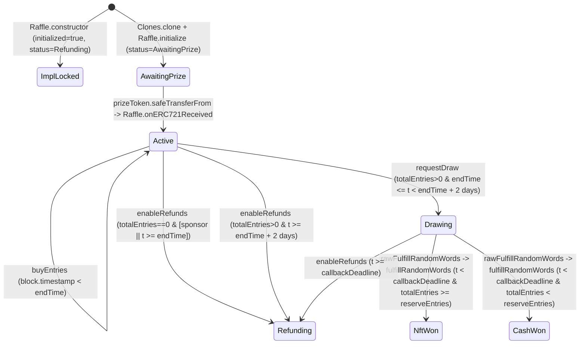

# System Context Dossier — `packages/contracts` (`raffle.fun`)

## 1. System Overview & Module Inventory

`packages/contracts` implements an ownerless, non-upgradeable single-NFT raffle protocol on Ethereum using fixed-price six-decimal USDC entries, transferable ERC-721 range tickets, and Chainlink VRF v2.5 native direct-funding randomness.

| Module | Path | Role |
| --- | --- | --- |
| `RaffleFactory` | `packages/contracts/src/RaffleFactory.sol` (`L21-L186`) | Ownerless factory and canonical registry. Validates and stores immutable `quoteToken`, `vrfWrapper`, and `protocolTreasury` addresses, deploys the locked `Raffle` implementation in its constructor (`L65-L92`), and atomically clones, initializes, registers, and escrows prizes into ERC-1167 `Raffle` instances in `createRaffle` (`L97-L148`). |
| `Raffle` | `packages/contracts/src/Raffle.sol` (`L28-L614`) | ERC-1167 clone implementation inheriting `IRaffle`, OpenZeppelin `ERC721` and `ReentrancyGuard`, `IERC721Receiver`, and Chainlink `VRFV2PlusWrapperConsumerBase`. Escrows one ERC-721 prize (`onERC721Received` at `L416-L431`), sells contiguous 1-based entry ranges as sequential ERC-721 tickets (`buyEntries` at `L209-L237`), requests and receives Chainlink VRF v2.5 randomness (`requestDraw` at `L240-L273`, `fulfillRandomWords` at `L509-L524`), allocates terminal quote-token liabilities (`settleWinningTicket` at `L304-L306`, `_settleWinningTicket` at `L533-L558`), and processes pull-based redemptions, batched refunds, and sponsor/protocol claims (`L309-L407`). |
| `RaffleConstants` | `packages/contracts/src/libraries/RaffleConstants.sol` (`L10-L43`) | Internal constants library defining `BPS = 10_000` (`L12`), `PROTOCOL_FEE_BPS = 500` (`L15`), `CASH_WINNER_BPS = 8000` (`L18`), `ENTRY_PRICE = 1_000_000` (`L21`), `QUOTE_TOKEN_DECIMALS = 6` (`L24`), `MAX_REFUND_TICKET_BATCH_SIZE = 100` (`L27`), `MAX_SALE_DURATION = 30 days` (`L30`), `DRAW_REQUEST_TIMEOUT = 2 days` (`L33`), `DRAW_CALLBACK_TIMEOUT = 2 days` (`L36`), `VRF_CALLBACK_GAS_LIMIT = 300_000` (`L39`), and `VRF_REQUEST_CONFIRMATIONS = 30` (`L42`). |
| `IRaffle` | `packages/contracts/src/interfaces/IRaffle.sol` (`L17-L521`) | Interface for `Raffle` declaring the `Status` enum (`L21-L34`), `RaffleInitParams` struct (`L45-L54`), events (`L62-L180`), custom errors (`L185-L301`), and external function signatures (`L308-L520`). |
| `IRaffleFactory` | `packages/contracts/src/interfaces/IRaffleFactory.sol` (`L11-L150`) | Interface for `RaffleFactory` declaring `CreateRaffleParams` (`L20-L26`), `RaffleCreated` (`L41-L52`), custom errors (`L57-L97`), and external function signatures (`L104-L149`). |

---

## 2. State Inventory, Read/Write Access, and Implied Invariants

### 2.1 `RaffleFactory` State (`packages/contracts/src/RaffleFactory.sol`)

| State Variable | Declaration | Written By | Read By | Implied Invariant |
| --- | --- | --- | --- | --- |
| `quoteToken`, `vrfWrapper`, `protocolTreasury`, `raffleImplementation` | Immutables (`L33, L36, L39, L42`) | `RaffleFactory.constructor` (`L85-L91`) | `createRaffle` (`L106, L114, L143, L144`), `_validateCreateParams` (`L158-L159, L164-L166`), `Raffle._isProtocolDestination` via `raffleImplementation()` (`Raffle.sol:L601`), public getters | All four addresses are non-zero (`L66-L68, L89`), `quoteToken` and `vrfWrapper` had `code.length > 0` at factory deployment (`L66-L67, L184`), `quoteToken.decimals()` returned `6` (`L70-L78`), and `protocolTreasury` is distinct from `address(factory)`, `quoteToken`, `vrfWrapper`, and `raffleImplementation` (`L80-L83, L90`). |
| `raffleCount` | `uint256` (`L45`) | `createRaffle` (`++raffleCount` at `L105`) | `createRaffle` (`L105`), public getter | Monotonically increments by `1` per successful `createRaffle` call starting from `0`; `raffleId` values are sequential 1-based integers `1..raffleCount`. |
| `raffleById` | `mapping(uint256 => address)` (`L48`) | `createRaffle` (`L123`) | Public getter (`L48`) | For every `id` in `1..raffleCount`, `raffleById[id]` holds the unique ERC-1167 clone address deployed at that `raffleCount`; for `id == 0` or `id > raffleCount`, `raffleById[id] == address(0)`. |
| `idByRaffle` | `mapping(address => uint256)` (`L51`) | `createRaffle` (`L124`) | Public getter (`L51`) | Forms a 1-to-1 inverse of `raffleById` over `1..raffleCount`: `idByRaffle[raffleById[id]] == id`, and `idByRaffle[addr] == 0` for unregistered addresses. |
| `isRaffle` | `mapping(address => bool)` (`L54`) | `createRaffle` (`L125`) | `_validateCreateParams` (`L159, L166`), `Raffle._isProtocolDestination` via `isRaffle(destination)` (`Raffle.sol:L603`), public getter | Monotonically growing set of canonical clones: `isRaffle[addr] == true` if and only if `idByRaffle[addr] in 1..raffleCount`. Written at `RaffleFactory.sol:L125` *after* `Raffle.initialize` (`L109-L121`) and *before* `prize.safeTransferFrom` (`L128`). Every address with `isRaffle[addr] == true` has `addr.code.length == 45` (`Clones.sol:L54-L57`). |

### 2.2 `Raffle` Implementation & Clone State (`packages/contracts/src/Raffle.sol` & Inherited Contracts)

| State Variable | Declaration | Written By | Read By | Implied Invariant |
| --- | --- | --- | --- | --- |
| `factory`, `quoteToken` | Immutables (`Raffle.sol:L55, L58`) | `Raffle.constructor` (`L161-L162`) | `initialize` (`L178`), `buyEntries` (`L224`), `onERC721Received` (`L423`), `_transferQuote` (`L566`), `_isProtocolDestination` (`L598-L599`) | Shared across the implementation and all ERC-1167 clones (`Clones.sol:L54-L57`); `factory` is the deploying `RaffleFactory` (`L161`) and `quoteToken` matches `RaffleFactory.quoteToken` (`RaffleFactory.sol:L89`). |
| `i_vrfV2PlusWrapper`, `i_linkToken` | Immutables (`VRFV2PlusWrapperConsumerBase.sol:L34-L35`) | `VRFV2PlusWrapperConsumerBase.constructor` (`L45-L46`, via `Raffle.constructor` at `Raffle.sol:L157, L610-L613`) | `requestRandomnessPayInNative` (`VRFV2PlusWrapperConsumerBase.sol:L82, L84`), `rawFulfillRandomWords` (`L102`), `getVrfRequestPrice` (`Raffle.sol:L437`), `estimateVrfRequestPrice` (`L442`), `vrfWrapper` (`L447`), `_isProtocolDestination` (`L600`), `getLinkToken` (`VRFV2PlusWrapperConsumerBase.sol:L116`) | `i_vrfV2PlusWrapper` is non-zero (`Raffle.sol:L611`) and matches `RaffleFactory.vrfWrapper` (`RaffleFactory.sol:L89`). Note: `i_linkToken` is read from `vrfV2PlusWrapper.link()` at construction (`VRFV2PlusWrapperConsumerBase.sol:L45`), is never used by `Raffle` (which uses native payment), and is not checked in `_isProtocolDestination` (`Raffle.sol:L599-L601`). |
| `initialized` | `bool` (`Raffle.sol:L136`) | `Raffle.constructor` (`L164`), `Raffle.initialize` (`L179`) | `Raffle.initialize` (`L177`), public getter | `true` permanently on the shared implementation from deployment (`L164`) and on every clone after `initialize` (`L177-L179`), ensuring `initialize` executes at most once per clone and never on `raffleImplementation`. |
| `sponsor`, `sponsorRecipient`, `protocolTreasury`, `prizeToken`, `prizeTokenId`, `raffleId`, `reserveEntries`, `endTime` | Clone config (`Raffle.sol:L61-L82`) | `Raffle.initialize` (`L197-L204`) | `buyEntries` (`L216`), `requestDraw` (`L242`), `enableRefunds` (`L281-L282`), `redeemWinningTicket` (`L332-L335`), `releaseSponsorProceeds` (`L379`), `releaseProtocolFees` (`L389`), `releaseSponsorPrize` (`L402-L406`), `onERC721Received` (`L422-L423`), `drawRequestDeadline` (`L459`), `_update` (`L498`), `fulfillRandomWords` (`L521`), `_transferQuote` (`L565`) | Write-once per clone (`L177-L179, L197-L204`). For every initialized clone, `sponsor`, `sponsorRecipient`, `protocolTreasury`, and `address(prizeToken)` are non-zero (`L181-L186`) and passed `_isProtocolDestination` at initialization (`L187-L195`); `reserveEntries >= 1` (`RaffleFactory.sol:L178`); and `creationTime < endTime <= creationTime + 30 days` (`RaffleFactory.sol:L99-L104`). On `raffleImplementation`, all eight fields remain zero/default. |
| `status` | `IRaffle.Status` (`Raffle.sol:L124`) | `Raffle.constructor` (`L165`), `initialize` (`L205`), `onERC721Received` (`L428`), `requestDraw` (`L252`), `enableRefunds` (`L299`), `fulfillRandomWords` (`L521`) | `buyEntries` (`L215`), `requestDraw` (`L241`), `enableRefunds` (`L279, L289, L293`), `redeemWinningTicket` (`L311`), `refundTickets` (`L350`), `releaseSponsorPrize` (`L396`), `onERC721Received` (`L422`), `fulfillRandomWords` (`L511, L514, L523`), `_settleWinningTicket` (`L535`), `_requireStatus` (`L574`), `RaffleFactory.createRaffle` (`RaffleFactory.sol:L132`) | Follows a strict directed acyclic graph on every clone: `AwaitingPrize` (`L205`) -> `Active` (`L428`) -> either `Refunding` (`L299`) or `Drawing` (`L252`) -> `NftWon` (`L521`), `CashWon` (`L521`), or `Refunding` (`L299`). `NftWon`, `CashWon`, and `Refunding` are terminal states with no outgoing transitions. On `raffleImplementation`, `status` is locked at `Status.Refunding` (`L165`). |
| `totalEntries` | `uint128` (`Raffle.sol:L85`) | `buyEntries` (`L230`) | `buyEntries` (`L219, L226-L227`), `requestDraw` (`L243`), `enableRefunds` (`L280`), `grossSales` (`L474`), `fulfillRandomWords` (`L518, L521`) | Monotonically increases during `Status.Active` prior to `endTime` (`L215-L216, L218-L221, L230`) and is immutable once `status != Status.Active` or `block.timestamp >= endTime`. Bounded by `totalEntries <= type(uint128).max`. |
| `ticketCount` | `uint128` (`Raffle.sol:L88`) | `buyEntries` (`L231`) | `buyEntries` (`L228`), public getter | Increments by `1` per `buyEntries` call (`L231`). Because each call requires `entryCount >= 1` (`L218`), `0 <= ticketCount <= totalEntries <= type(uint128).max` always holds. Not decremented when tickets are burned (`L325, L364`). |
| `_ticketRanges` | `mapping(uint256 => TicketRange)` (`Raffle.sol:L139`) | `buyEntries` (`L232`) | `ticketRange` (`L452-L454`), which is called by `refundTickets` (`L362`) and `_requireWinningTicket` (`L580`) | Write-once per `ticketId` in `1..ticketCount` (`L228, L231-L232`), never deleted on burn (`L138`). `_ticketRanges[1..ticketCount]` partitions `[1, totalEntries]` into contiguous, disjoint inclusive intervals `[firstEntry, lastEntry]` with `firstEntry_1 == 1`, `firstEntry_k == lastEntry_{k-1} + 1`, and `lastEntry_{ticketCount} == totalEntries`. For `ticketId == 0` or `ticketId > ticketCount`, `_ticketRanges[ticketId] == (0, 0)`. |
| `unsettledPot` | `uint256` (`Raffle.sol:L91`) | `buyEntries` (`L233`), `enableRefunds` (`L297`), `_settleWinningTicket` (`L553`) | `enableRefunds` (`L296`), `accountedQuoteBalance` (`L469`), `_settleWinningTicket` (`L539`) | Equals `uint256(totalEntries) * ENTRY_PRICE == grossSales()` while `status` is `AwaitingPrize`, `Active`, or `Drawing`, and while in `NftWon` or `CashWon` with `settlementComplete == false`. Zeroed permanently when `enableRefunds` transitions to `Status.Refunding` (`L297`) or when `_settleWinningTicket` sets `settlementComplete = true` (`L551-L553`). |
| `remainingRefundLiability` | `uint256` (`Raffle.sol:L94`) | `enableRefunds` (`L298`), `refundTickets` (`L368`) | `refundTickets` (`L368, L370`), `accountedQuoteBalance` (`L469`) | Zero in all statuses other than `Status.Refunding`. Set once to `unsettledPot` (`totalEntries * ENTRY_PRICE`) in `enableRefunds` (`L296-L298`), and reduced by `sum(lastEntry - firstEntry + 1) * ENTRY_PRICE` for each batch of distinct tickets burned in `refundTickets` (`L362-L368`). Always equals the sum of `(lastEntry - firstEntry + 1) * ENTRY_PRICE` over all currently unburned tickets when `status == Status.Refunding`. |
| `vrfRequestId` | `uint256` (`Raffle.sol:L109`) | `requestDraw` (`L259`) | `fulfillRandomWords` (`L511, L514`), public getter | Written at most once per clone (`requestDraw` requires `status == Status.Active` at `L241` and sets `status = Status.Drawing` at `L252`). Holds `0` before `L259` and the wrapper-returned `requestId` thereafter. |
| `drawRequestedAt` | `uint64` (`Raffle.sol:L112`) | `requestDraw` (`L253`) | `requestDraw` (`L272`), `callbackDeadline` (`L464`, called by `requestDraw` at `L272`, `enableRefunds` at `L290`, and `fulfillRandomWords` at `L512`) | Zero before `requestDraw`; set once to `uint64(block.timestamp)` when `status` transitions to `Status.Drawing` (`L252-L253`). Assuming `block.timestamp <= type(uint64).max`, `drawRequestedAt >= endTime >= 1` whenever `status` is `Drawing`, `NftWon`, `CashWon`, or `Refunding` (reached from `Drawing`). |
| `_requestInFlight` | `bool` (`Raffle.sol:L142`) | `requestDraw` (`L254, L260`) | `fulfillRandomWords` (`L511`) | `true` only during the external call `requestRandomnessPayInNative` (`L254-L260`), and `false` at the start and end of every transaction. Blocks `fulfillRandomWords` (`L511`) from resolving the raffle during a synchronous callback before `vrfRequestId` is written at `L259`. |
| `winningEntry` | `uint128` (`Raffle.sol:L118`) | `fulfillRandomWords` (`L519`) | `_requireWinningTicket` (`L581`), public getter | Zero unless `status` is `Status.NftWon` or `Status.CashWon`, in which case `1 <= winningEntry <= totalEntries` (`L518-L521`). |
| `resolvedAt` | `uint64` (`Raffle.sol:L115`) | `fulfillRandomWords` (`L520`) | Public getter (`L115`) | Zero unless `status` is `Status.NftWon` or `Status.CashWon`, in which case it holds `uint64(block.timestamp)` at resolution (`L520`). Not read by any internal function. |
| `settlementComplete` | `bool` (`Raffle.sol:L127`) | `_settleWinningTicket` (`L551`) | `redeemWinningTicket` (`L314`), `_settleWinningTicket` (`L534`), public getter | `false` until `_settleWinningTicket` executes in `Status.NftWon` or `Status.CashWon`, and `true` permanently thereafter (`L534, L551`). |
| `winningTicketId` | `uint256` (`Raffle.sol:L121`) | `_settleWinningTicket` (`L552`) | `redeemWinningTicket` (`L316-L317`), public getter | Zero while `!settlementComplete`; when `settlementComplete == true`, holds the unique `ticketId` in `1..ticketCount` whose `_ticketRanges[ticketId]` covers `winningEntry` (`L538, L552, L579-L585`). |
| `winnerProceeds` | `uint256` (`Raffle.sol:L100`) | `_settleWinningTicket` (`L548`), `redeemWinningTicket` (`L341`) | `redeemWinningTicket` (`L339`), `accountedQuoteBalance` (`L469`), public getter | Always `0` in `Status.NftWon`. In `Status.CashWon`, set once to `Math.mulDiv(grossPot, 8000, 10_000)` (`>= 800_000`) when `_settleWinningTicket` runs (`L546-L548`), and zeroed when `redeemWinningTicket` executes (`L341`). |
| `sponsorProceeds` | `uint256` (`Raffle.sol:L103`) | `_settleWinningTicket` (`L554`), `releaseSponsorProceeds` (`L378`) | `releaseSponsorProceeds` (`L376`), `accountedQuoteBalance` (`L469`), public getter | Set once in `_settleWinningTicket` (`L544, L547, L554`) to `grossPot - protocolFee` (`NftWon`) or `grossPot - protocolFee - cashAmount` (`CashWon`), and zeroed by `releaseSponsorProceeds` (`L378`). |
| `protocolFees` | `uint256` (`Raffle.sol:L106`) | `_settleWinningTicket` (`L555`), `releaseProtocolFees` (`L388`) | `releaseProtocolFees` (`L386`), `accountedQuoteBalance` (`L469`), public getter | Set once in `_settleWinningTicket` (`L540, L555`) to `Math.mulDiv(grossPot, 500, 10_000)` (`floor(grossPot / 20)`), and zeroed by `releaseProtocolFees` (`L388`). |
| `winnerRecipient`, `winnerRedeemed` | `address` (`L97`), `bool` (`L130`) | `redeemWinningTicket` (`L323-L324`) | `redeemWinningTicket` (`L310`), public getters | `winnerRedeemed` transitions `false -> true` at most once (`L310, L324`) in `Status.NftWon` or `Status.CashWon`, recording the redeeming ticket owner in `winnerRecipient` (`L320, L323`). |
| `prizeClaimed` | `bool` (`Raffle.sol:L133`) | `redeemWinningTicket` (`L331`), `releaseSponsorPrize` (`L403`) | `redeemWinningTicket` (`L330`), `releaseSponsorPrize` (`L400`), public getter | Transitions `false -> true` at most once per clone: either via `redeemWinningTicket` in `Status.NftWon` (`L329-L331`) or via `releaseSponsorPrize` in `Status.CashWon` or `Status.Refunding` (`L397-L403`). |
| `_owners`, `_balances`, `_tokenApprovals`, `_operatorApprovals` | `ERC721.sol:L28-L34` | `ERC721._update` (`L230, L236, L240`), `ERC721._approve` (`L398`), `ERC721._setApprovalForAll` (`L416`) via `Raffle._update` (`Raffle.sol:L497-L502`), `buyEntries` (`L235`), `redeemWinningTicket` (`L325`), `refundTickets` (`L364`), `transferFrom` / `safeTransferFrom` / `approve` / `setApprovalForAll` (`ERC721.sol:L93-L136`) | `ownerOf` (`ERC721.sol:L61`), `balanceOf` (`L53`), `getApproved` (`L98`), `isApprovedForAll` (`L110`), `redeemWinningTicket` (`Raffle.sol:L320`), `refundTickets` (`L359`) | For every `ticketId` with `_owners[ticketId] != address(0)`, `1 <= ticketId <= ticketCount`, `_owners[ticketId]` passed `_isProtocolDestination` at the time of mint or transfer (`Raffle.sol:L498-L500`), and `_balances[owner]` equals the count of unburned tickets owned by `owner`. |
| `REENTRANCY_GUARD_STORAGE` | ERC-7201 slot `0x9b779b17422d0df92223018b32b4d1fa46e071723d6817e2486d003becc55f00` (`ReentrancyGuard.sol:L36-L37`) | `ReentrancyGuard.constructor` (`L59`), `_nonReentrantBefore` (`L99`), `_nonReentrantAfter` (`L105`) | `_reentrancyGuardEntered` (`L113`) | Initialized to `NOT_ENTERED` (`1`) on `RaffleFactory` and `raffleImplementation`, and `0` on fresh ERC-1167 clones (`0 != ENTERED (2)`). Set to `ENTERED` (`2`) during `RaffleFactory.createRaffle` and during the 9 `nonReentrant` external functions on `Raffle`, and reset to `NOT_ENTERED` (`1`) on exit. |

---

## 3. End-to-End Flows and State Progression

### Flow 1: Factory Deployment & Implementation Locking (`RaffleFactory.constructor` & `Raffle.constructor`)
1. `RaffleFactory.constructor(quoteToken_, vrfWrapper_, protocolTreasury_)` (`RaffleFactory.sol:L65-L92`) verifies `quoteToken_.code.length > 0` (`L66, L184`), `vrfWrapper_.code.length > 0` (`L67, L184`), `protocolTreasury_ != address(0)` (`L68`), and `IERC20Metadata(quoteToken_).decimals() == 6` (`L70-L78`).
2. It rejects `protocolTreasury_` if equal to `address(this)`, `quoteToken_`, or `vrfWrapper_` (`L80-L83`), assigns the immutables `quoteToken`, `vrfWrapper`, and `protocolTreasury` (`L85-L87`), and deploys `new Raffle(quoteToken_, vrfWrapper_)` (`L89`).
3. `Raffle.constructor` (`Raffle.sol:L155-L166`) validates `vrfWrapper_ != address(0)` (`L157, L610-L613`), calls `VRFV2PlusWrapperConsumerBase(vrfWrapper_)` which calls `vrfV2PlusWrapper.link()` (`VRFV2PlusWrapperConsumerBase.sol:L45`), sets `factory = msg.sender` and `quoteToken = IERC20(quoteToken_)` (`Raffle.sol:L161-L162`), and permanently locks the implementation by setting `initialized = true` and `status = Status.Refunding` (`L164-L165`).
4. `RaffleFactory.constructor` verifies `protocolTreasury_ != implementation` (`RaffleFactory.sol:L90`) and stores `raffleImplementation = implementation` (`L91`).

### Flow 2: Atomic Raffle Creation, Initialization, Registration, and Prize Escrow (`createRaffle` -> `_validateCreateParams` -> `initialize` -> `onERC721Received`)
1. Any caller invokes `RaffleFactory.createRaffle(params)` (`RaffleFactory.sol:L97-L148`, `nonReentrant`).
2. `_validateCreateParams(params)` (`L98, L154-L179`) verifies `params.prizeToken.code.length > 0` (`L155, L184`), `params.sponsorRecipient != address(0)` (`L156`), neither `prizeToken` nor `sponsorRecipient` is in `{address(this), quoteToken, vrfWrapper, raffleImplementation}` or currently in `isRaffle`, `sponsorRecipient != prizeToken` (`L157-L169`), `IERC165(params.prizeToken).supportsInterface(type(IERC721).interfaceId) == true` (`L171-L177`), and `params.reserveEntries > 0` (`L178`).
3. `createRaffle` checks `block.timestamp < params.endTime <= block.timestamp + 30 days` (`L99-L104`), increments `raffleId = ++raffleCount` (`L105`), and deploys an ERC-1167 proxy via `Clones.clone(raffleImplementation)` (`L106`, `Clones.sol:L32-L62`).
4. `IRaffle(raffle).initialize(...)` (`RaffleFactory.sol:L109-L121` -> `Raffle.sol:L176-L206`) verifies `!initialized` (`L177`) and `msg.sender == factory` (`L178`), sets `initialized = true` (`L179`), checks non-zero addresses (`L181-L186`), screens `sponsor` (`msg.sender`), `protocolTreasury`, and `sponsorRecipient` via `_isProtocolDestination(..., params.prizeToken)` (`L187-L195, L593-L605`), writes the 8 clone config fields (`L197-L204`), and sets `status = Status.AwaitingPrize` (`L205`).
5. `createRaffle` writes `raffleById[raffleId] = raffle`, `idByRaffle[raffle] = raffleId`, and `isRaffle[raffle] = true` (`RaffleFactory.sol:L123-L125`).
6. `createRaffle` calls `prize.safeTransferFrom(msg.sender, raffle, params.prizeTokenId)` (`L128`). During the transfer, `prizeToken` invokes `raffle.onERC721Received(operator, from, tokenId, data)` (`Raffle.sol:L416-L431`), which requires `status == Status.AwaitingPrize`, `msg.sender == address(prizeToken)`, `tokenId == prizeTokenId`, `from == sponsor`, and `operator == factory` (`L421-L426`), sets `status = Status.Active` (`L428`), emits `PrizeDeposited` (`L429`), and returns `IERC721Receiver.onERC721Received.selector` (`L430`).
7. After `safeTransferFrom` returns, `createRaffle` verifies `prize.ownerOf(params.prizeTokenId) == raffle` (`RaffleFactory.sol:L129-L131`) and `IRaffle(raffle).status() == IRaffle.Status.Active` (`L132-L134`), then emits `RaffleCreated` (`L136-L147`).

### Flow 3: Active Entry Sales (`buyEntries` -> `_safeMint` -> `_update` -> `_isProtocolDestination`)
1. While `status == Status.Active` (`Raffle.sol:L215`) and `block.timestamp < endTime` (`L216`), any caller invokes `buyEntries(recipient, entryCount)` (`L209-L237`, `nonReentrant`).
2. `buyEntries` checks `recipient != address(0)` (`L217`), `entryCount > 0` (`L218`), and `entryCount <= type(uint128).max - totalEntries` (`L219-L221`).
3. It pulls `grossAmount = uint256(entryCount) * ENTRY_PRICE` from `msg.sender` via `quoteToken.safeTransferFrom(msg.sender, address(this), grossAmount)` (`L223-L224`).
4. It computes `[firstEntry, lastEntry] = [totalEntries + 1, totalEntries + entryCount]` and `ticketId = uint256(ticketCount) + 1`, updates `totalEntries = lastEntry`, `++ticketCount`, `_ticketRanges[ticketId] = TicketRange(firstEntry, lastEntry)`, and `unsettledPot += grossAmount` (`L226-L233`).
5. It calls `_safeMint(recipient, ticketId)` (`L235`), which routes through `Raffle._update` (`L497-L502`) to reject `_isProtocolDestination(recipient, address(prizeToken))` (`L498-L500`), writes `_balances[recipient] += 1` and `_owners[ticketId] = recipient` (`ERC721.sol:L236, L240`), and if `recipient.code.length > 0`, calls `IERC721Receiver(recipient).onERC721Received(msg.sender, address(0), ticketId, "")` (`ERC721Utils.sol:L32-L48`). Finally, `buyEntries` emits `TicketPurchased` (`Raffle.sol:L236`).

### Flow 4: VRF Draw Request & Callback Resolution (`requestDraw` -> `rawFulfillRandomWords` -> `fulfillRandomWords`)
1. During `endTime <= block.timestamp < drawRequestDeadline()` (`endTime + 2 days`) while `status == Status.Active` and `totalEntries > 0` (`Raffle.sol:L241-L247`), any caller invokes `requestDraw()` (`L240-L273`, `payable`, `nonReentrant`).
2. `requestDraw` checks `msg.value >= getVrfRequestPrice()` (`L249-L250`), sets `status = Status.Drawing` (`L252`), `drawRequestedAt = uint64(block.timestamp)` (`L253`), and `_requestInFlight = true` (`L254`), then calls `requestRandomnessPayInNative(callbackGasLimit, requestConfirmations, 1, extraArgs)` (`L255-L257`, `VRFV2PlusWrapperConsumerBase.sol:L76-L89`).
3. When `requestRandomnessPayInNative` returns `(requestId, paidPrice)`, `requestDraw` verifies `paidPrice <= msg.value` (`Raffle.sol:L258`), stores `vrfRequestId = requestId` (`L259`), resets `_requestInFlight = false` (`L260`), refunds any `excess = msg.value - paidPrice` to `msg.sender` via assembly `call(gas(), refundRecipient, excess, 0, 0, 0, 0)` (`L262-L270`), and emits `DrawRequested` (`L272`).
4. When `i_vrfV2PlusWrapper` calls `rawFulfillRandomWords(requestId, randomWords)` (`VRFV2PlusWrapperConsumerBase.sol:L101-L107`), `fulfillRandomWords` (`Raffle.sol:L509-L524`) checks `_requestInFlight || status != Status.Drawing || requestId != vrfRequestId || randomWords.length != 1 || block.timestamp >= callbackDeadline()` (`L510-L513`). If any condition holds, it emits `VrfCallbackIgnored` and returns without modifying storage (`L514-L515`).
5. Otherwise, `fulfillRandomWords` computes `resolvedEntry = uint128((randomWords[0] % uint256(totalEntries)) + 1)`, writes `winningEntry = resolvedEntry` (`L518-L519`), `resolvedAt = uint64(block.timestamp)` (`L520`), and `status = totalEntries >= reserveEntries ? Status.NftWon : Status.CashWon` (`L521`), and emits `RaffleResolved` (`L523`).

### Flow 5: Winning Ticket Settlement, Winner Redemption, and Independent Proceeds/Prize Releases
1. Once `status` is `Status.NftWon` or `Status.CashWon`, any caller can call `settleWinningTicket(ticketId)` (`Raffle.sol:L304-L306`, `nonReentrant`) — or the winning ticket owner can call `redeemWinningTicket(ticketId)` (`L309-L346`, `nonReentrant`), which calls `_settleWinningTicket(ticketId)` lazily if `!settlementComplete` (`L314-L315`).
2. `_settleWinningTicket(ticketId)` (`L533-L558`) verifies `!settlementComplete` (`L534`), `status` in `{NftWon, CashWon}` (`L535-L536`), and `_requireWinningTicket(ticketId)` (`firstEntry <= winningEntry <= lastEntry` at `L538, L579-L585`). It computes `protocolFee = Math.mulDiv(grossPot, 500, 10_000)` (`L540`). For `NftWon`, `sponsorAmount = grossPot - protocolFee` and `winnerProceeds` remains `0` (`L543-L544`). For `CashWon`, `cashAmount = Math.mulDiv(grossPot, 8000, 10_000)`, `sponsorAmount = grossPot - protocolFee - cashAmount`, and `winnerProceeds = cashAmount` (`L545-L549`). It sets `settlementComplete = true`, `winningTicketId = ticketId`, `unsettledPot = 0`, `sponsorProceeds = sponsorAmount`, and `protocolFees = protocolFee` (`L551-L555`).
3. In `redeemWinningTicket(ticketId)` (`L309-L346`), after settlement (or verifying `ticketId == winningTicketId` at `L316-L318`), the contract checks `msg.sender == ownerOf(ticketId)` (`L320-L321`), sets `winnerRecipient = winner` and `winnerRedeemed = true` (`L323-L324`), and calls `_burn(ticketId)` (`L325`).
   - If `status == Status.NftWon` (`L329-L337`): checks `!prizeClaimed`, sets `prizeClaimed = true`, calls `prizeToken.transferFrom(address(this), winner, prizeTokenId)` (`L334`), and verifies `prizeToken.ownerOf(prizeTokenId) == winner` (`L335-L337`).
   - If `status == Status.CashWon` (`L338-L343`): reads `cashAmount = winnerProceeds` (reverting if `0`), sets `winnerProceeds = 0` (`L341`), and calls `_transferQuote(winner, cashAmount)` (`L342, L564-L567`), which re-checks `!_isProtocolDestination(winner, address(prizeToken))` (`L565`) before calling `quoteToken.safeTransfer(winner, cashAmount)` (`L566`).
4. Independently of winner redemption, any caller can invoke:
   - `releaseSponsorProceeds()` (`L375-L382`, `nonReentrant`): zeroes `sponsorProceeds` and calls `_transferQuote(sponsorRecipient, amount)`.
   - `releaseProtocolFees()` (`L385-L392`, `nonReentrant`): zeroes `protocolFees` and calls `_transferQuote(protocolTreasury, amount)`.
   - `releaseSponsorPrize()` (`L395-L407`, `nonReentrant`): when `status` is `Status.CashWon` or `Status.Refunding` and `!prizeClaimed`, sets `prizeClaimed = true`, calls `prizeToken.transferFrom(address(this), sponsorRecipient, prizeTokenId)` (`L404`), and verifies `prizeToken.ownerOf(prizeTokenId) == sponsorRecipient` (`L405`).

### Flow 6: Refund Activation & Batched Ticket Refunds (`enableRefunds` -> `refundTickets` & `releaseSponsorPrize`)
1. `enableRefunds()` (`Raffle.sol:L276-L301`, `nonReentrant`) transitions the raffle to `Status.Refunding` from:
   - `Status.Active` with `totalEntries == 0` when `msg.sender == sponsor || block.timestamp >= endTime` (`L279-L284`);
   - `Status.Active` with `totalEntries != 0` when `block.timestamp >= drawRequestDeadline()` (`endTime + 2 days`, `L285-L288`);
   - `Status.Drawing` when `block.timestamp >= callbackDeadline()` (`drawRequestedAt + 2 days`, `L289-L291`).
2. `enableRefunds` moves `liability = unsettledPot` into `remainingRefundLiability`, sets `unsettledPot = 0` and `status = Status.Refunding` (`L296-L299`), and emits `RefundsEnabled` (`L300`).
3. In `Status.Refunding`, any ticket owner calls `refundTickets(ticketIds)` (`L349-L372`, `nonReentrant`) with `1 <= ticketIds.length <= 100` (`L351-L354`). For each `ticketId`, it checks `msg.sender == ownerOf(ticketId)` (`L359-L360`), adds `uint256(lastEntry) - uint256(firstEntry) + 1` to `aggregateEntries` (`L362-L363`), and calls `_burn(ticketId)` (`L364`, setting `_owners[ticketId] = address(0)` immediately so duplicate IDs in the same array revert on the next `ownerOf` call). After the loop, it computes `amount = aggregateEntries * ENTRY_PRICE`, subtracts `amount` from `remainingRefundLiability` (`L367-L368`), and calls `_transferQuote(msg.sender, amount)` (`L369`).
4. Concurrently in `Status.Refunding`, any caller can invoke `releaseSponsorPrize()` (`L395-L407`) to return `prizeTokenId` to `sponsorRecipient`.

---

## 4. Cross-Function Invariants & Inter-Record Comparisons

### 4.1 Cross-Function Invariants
1. **Quote-Token Liability Conservation (`accountedQuoteBalance()`):**
   Across all lifecycle states of an initialized clone, `accountedQuoteBalance() = unsettledPot + remainingRefundLiability + winnerProceeds + sponsorProceeds + protocolFees` (`Raffle.sol:L468-L470`) equals total historical deposits `uint256(totalEntries) * ENTRY_PRICE` (`buyEntries` at `L223, L230, L233`) minus total historical quote-token payouts (`redeemWinningTicket` at `L339-L342`, `refundTickets` at `L367-L369`, `releaseSponsorProceeds` at `L376-L380`, and `releaseProtocolFees` at `L386-L390`). Neither `enableRefunds` (`L296-L298`) nor `_settleWinningTicket` (`L539-L555`) changes `accountedQuoteBalance()`: `enableRefunds` moves `unsettledPot` 1-for-1 into `remainingRefundLiability`, and `_settleWinningTicket` partitions `unsettledPot` into `protocolFees + sponsorProceeds + winnerProceeds == grossPot`.
2. **Strict Mutual Exclusion of Post-Sale and Callback Windows:**
   - For a sold raffle (`totalEntries > 0`) in `Status.Active`: `buyEntries` requires `block.timestamp < endTime` (`L216`), `requestDraw` requires `endTime <= block.timestamp < drawRequestDeadline()` (`L242, L245`), and `enableRefunds` requires `block.timestamp >= drawRequestDeadline()` (`L286-L287`).
   - For a raffle in `Status.Drawing`: `fulfillRandomWords` resolves only when `block.timestamp < callbackDeadline()` (`L512`), whereas `enableRefunds` requires `block.timestamp >= callbackDeadline()` (`L290-L291`). Once either transitions `status` out of `Status.Drawing` (`L521` or `L299`), the other cannot transition `status`.
3. **Existence and Uniqueness of the Winning Ticket:**
   `buyEntries` (`L218, L226-L232`) partitions `[1, totalEntries]` into contiguous, disjoint, non-empty intervals `_ticketRanges[1..ticketCount]`, while unminted IDs have `_ticketRanges[id] == (0, 0)`. `requestDraw` (`L243, L252`) requires `totalEntries > 0` to enter `Status.Drawing`, and `fulfillRandomWords` (`L518-L519`) computes `winningEntry = uint128((randomWords[0] % uint256(totalEntries)) + 1)` in `[1, totalEntries]`. Consequently, in `Status.NftWon` and `Status.CashWon`, there exists a unique `ticketId` in `1..ticketCount` satisfying `_requireWinningTicket` (`firstEntry <= winningEntry <= lastEntry` at `L580-L584`), and unminted `(0, 0)` tickets are rejected because `winningEntry >= 1 > 0`.
4. **Single Prize Custody & Disjoint Release Paths:**
   A registered clone transitions to `Status.Active` only after `onERC721Received` (`L421-L428`) and `prize.ownerOf(prizeTokenId) == raffle` (`RaffleFactory.sol:L129-L134`). Thereafter, `prizeToken.transferFrom(address(this), ...)` is reachable only in `redeemWinningTicket` when `status == Status.NftWon` (`Raffle.sol:L329-L337`) or in `releaseSponsorPrize` when `status == Status.CashWon || status == Status.Refunding` (`L396-L405`). Both paths check and set `prizeClaimed = true` (`L330-L331, L400-L403`), and `NftWon` is mutually exclusive with `{CashWon, Refunding}`.
5. **Split Creation Validation Between `RaffleFactory` and `Raffle.initialize`:**
   Neither `RaffleFactory._validateCreateParams` (`RaffleFactory.sol:L154-L179`) nor `Raffle.initialize` (`Raffle.sol:L176-L206`) validates all creation invariants alone:
   - `_validateCreateParams` checks `prizeToken.code.length > 0`, `IERC165(prizeToken).supportsInterface(IERC721)`, `prizeToken` against protocol sinks, and `reserveEntries > 0`, while `createRaffle` checks `block.timestamp < endTime <= block.timestamp + 30 days` (`RaffleFactory.sol:L99-L104`). `Raffle.initialize` does not re-check any of these.
   - Conversely, `_validateCreateParams` does not check `msg.sender` (`sponsor`), does not check `prizeToken == protocolTreasury`, and cannot check `sponsorRecipient == raffle` (because `raffle` is not cloned until `RaffleFactory.sol:L106` or registered in `isRaffle` until `L125`). Those checks are performed only inside `Raffle.initialize` via `_isProtocolDestination` (`Raffle.sol:L187-L195, L599-L600`).

### 4.2 Where Per-Function Records Differ in Framing
- **`uint64(block.timestamp)` Cast Bounds (`drawRequestedAt` at `Raffle.sol:L253` vs. `resolvedAt` at `Raffle.sol:L520`):**
  - `05-requestDraw.md` and `07-enableRefunds.md` record the assumption that `block.timestamp` fits in `uint64` at `drawRequestedAt = uint64(block.timestamp)` (`Raffle.sol:L253`) as `establishedBy: "nothing found"`, noting that `block.timestamp < uint256(endTime) + 2 days` (`L244-L247`) can exceed `type(uint64).max` by up to `2 days` if `endTime > type(uint64).max - 2 days`.
  - `06-fulfillRandomWords.md` records the assumption that `block.timestamp` fits in `uint64` at `resolvedAt = uint64(block.timestamp)` (`Raffle.sol:L520`) as `establishedBy: "RaffleFactory.createRaffle at packages/contracts/src/RaffleFactory.sol:L100-L104 (params.endTime is uint64 > block.timestamp) and Raffle.requestDraw / Raffle.fulfillRandomWords at packages/contracts/src/Raffle.sol:L245,L459,L464,L512 (bounding resolution before uint256(endTime) + 4 days; no explicit check that uint256(endTime) + 4 days <= type(uint64).max)"`.
- **`quoteToken` Balance Sufficiency and Fee-Free Transfer Semantics:**
  - `02-buyEntries.md`, `04-redeemWinningTicket.md`, and `07-enableRefunds.md` record `quoteToken`'s exact balance crediting and fee-free, non-rebasing, non-blacklisting transfer behavior under `establishedBy: "nothing found"` (noting `RaffleFactory.constructor` at `RaffleFactory.sol:L66-L78` checks only `code.length > 0` and `decimals() == 6`).
  - `03-_settleWinningTicket.md` and `08-refundTickets.md` cite `Raffle.buyEntries` (`Raffle.sol:L223-L224, L233`) and `RaffleFactory.constructor` (`RaffleFactory.sol:L65-L85`) as establishing accounted liability and 6-decimal contract configuration while noting that fee-free canonical USDC behavior is an external trust assumption (`nothing found` onchain for token identity beyond decimals and code length).
- **`prizeToken` Escrow and Transfer Compliance:**
  - `01-createRaffle.md`, `09-_validateCreateParams.md`, `10-initialize.md`, and `11-onERC721Received.md` record ongoing ERC-721 custody and transfer compliance of `prizeToken` as `establishedBy: "nothing found"`.
  - `04-redeemWinningTicket.md` cites `RaffleFactory.createRaffle` (`L128-L131`) and `Raffle.onERC721Received` (`L421-L430`) as establishing initial escrow while recording ongoing custody/non-reverting `transferFrom` and truthfulness of `prizeToken.ownerOf(deliveredPrizeTokenId) == winner` (`L335-L337`) as `nothing found` on-chain.

---

## 5. Trust Boundaries, Actors, and Entrypoint Reachability

| Actor (Trust) | Entrypoint | Reachability Conditions & Downstream Execution |
| --- | --- | --- |
| **Factory Deployer** (`trusted`) | `RaffleFactory.constructor` (`RaffleFactory.sol:L65-L92`) | Called once at factory deployment. Calls `_requireContract(quoteToken_)`, `_requireContract(vrfWrapper_)`, `IERC20Metadata(quoteToken_).decimals()`, and deploys `new Raffle(quoteToken_, vrfWrapper_)` (`Raffle.constructor` at `Raffle.sol:L155-L166` -> `VRFV2PlusWrapperConsumerBase.constructor` at `L40-L47`, which calls `vrfWrapper_.link()`). |
| **Sponsor** (`untrusted`) | `RaffleFactory.createRaffle` (`RaffleFactory.sol:L97-L148`) | Any external caller supplying `CreateRaffleParams`. Reaches `_validateCreateParams` (`STATICCALL` to `prizeToken.supportsInterface`), `Clones.clone`, `Raffle.initialize` (`STATICCALL`s to `factory.raffleImplementation()` and `factory.isRaffle(...)`), `prizeToken.safeTransferFrom(msg.sender, raffle, prizeTokenId)` -> `Raffle.onERC721Received`, `prizeToken.ownerOf(prizeTokenId)`, and `Raffle.status()`. |
| **Sponsor** (`untrusted`) | `Raffle.enableRefunds` (`Raffle.sol:L276-L301`) | Before `endTime` when `status == Status.Active` and `totalEntries == 0` (`L280-L284`), only `msg.sender == sponsor` can transition `status` to `Status.Refunding`. |
| **RaffleFactory Contract** (`trusted`) | `Raffle.initialize` (`Raffle.sol:L176-L206`) | Restricted to `msg.sender == factory` and `!initialized` (`L177-L178`). Reaches `_isProtocolDestination` (`L593-L605`), writes clone configuration, and sets `status = Status.AwaitingPrize`. |
| **Prize ERC-721 Contract** (`untrusted`) | `Raffle.onERC721Received` (`Raffle.sol:L416-L431`) | Restricted to `status == Status.AwaitingPrize`, `msg.sender == address(prizeToken)`, `tokenId == prizeTokenId`, `from == sponsor`, and `operator == factory` (`L421-L426`). Transitions `status` to `Status.Active`. |
| **Entry Buyer / Ticket Recipient** (`untrusted`) | `Raffle.buyEntries` (`Raffle.sol:L209-L237`) | Any caller while `status == Status.Active` and `block.timestamp < endTime`. Calls `quoteToken.safeTransferFrom(msg.sender, address(this), grossAmount)`, updates `totalEntries`, `ticketCount`, `_ticketRanges[ticketId]`, and `unsettledPot`, and calls `_safeMint(recipient, ticketId)` -> `Raffle._update` -> `_isProtocolDestination` -> `ERC721Utils.checkOnERC721Received` (external call `recipient.onERC721Received` if `recipient.code.length > 0`). |
| **Permissionless Caller (Draw Requester)** (`untrusted`) | `Raffle.requestDraw` (`Raffle.sol:L240-L273`) | Any caller during `[endTime, drawRequestDeadline())` while `status == Status.Active` and `totalEntries > 0`. Calls `getVrfRequestPrice()`, transitions `status` to `Status.Drawing`, sets `_requestInFlight = true`, calls `i_vrfV2PlusWrapper.calculateRequestPriceNative` and `i_vrfV2PlusWrapper.requestRandomWordsInNative{value: requestPrice}`, sets `vrfRequestId` and `_requestInFlight = false`, and sends `excess = msg.value - paidPrice` to `msg.sender` via assembly `call`. |
| **Chainlink VRF v2.5 Wrapper** (`trusted`) | `VRFV2PlusWrapperConsumerBase.rawFulfillRandomWords` (`VRFV2PlusWrapperConsumerBase.sol:L101-L107`) | Restricted to `msg.sender == address(i_vrfV2PlusWrapper)` (`L103-L105`). Calls `Raffle.fulfillRandomWords` (`Raffle.sol:L509-L524`), which either returns early (`VrfCallbackIgnored`) or writes `winningEntry`, `resolvedAt`, and `status = Status.NftWon` / `Status.CashWon`. |
| **Permissionless Caller (Refund Enabler)** (`untrusted`) | `Raffle.enableRefunds` (`Raffle.sol:L276-L301`) | Any caller at/after `endTime` (`Status.Active`, `totalEntries == 0`), at/after `drawRequestDeadline()` (`Status.Active`, `totalEntries != 0`), or at/after `callbackDeadline()` (`Status.Drawing`). Moves `unsettledPot` to `remainingRefundLiability` and sets `status = Status.Refunding`. |
| **Permissionless Caller (Settler)** (`untrusted`) | `Raffle.settleWinningTicket` (`Raffle.sol:L304-L306`) | Any caller when `status` is `NftWon` or `CashWon` and `!settlementComplete`. Calls `_settleWinningTicket(ticketId)` (`L533-L558`), which verifies `_requireWinningTicket(ticketId)` and partitions `unsettledPot` into `protocolFees`, `sponsorProceeds`, and `winnerProceeds` with no external calls. |
| **Ticket Owner** (`untrusted`) | `Raffle.redeemWinningTicket` (`Raffle.sol:L309-L346`) | Restricted to `msg.sender == ownerOf(ticketId)` when `status` is `NftWon` or `CashWon` and `!winnerRedeemed`. Lazily calls `_settleWinningTicket(ticketId)` if `!settlementComplete`, burns `ticketId`, and either calls `prizeToken.transferFrom(address(this), winner, prizeTokenId)` + `prizeToken.ownerOf(prizeTokenId)` (`NftWon`) or calls `_transferQuote(winner, cashAmount)` -> `quoteToken.safeTransfer(winner, cashAmount)` (`CashWon`). |
| **Ticket Owner** (`untrusted`) | `Raffle.refundTickets` (`Raffle.sol:L349-L372`) | Restricted to `msg.sender == ownerOf(ticketId)` for all `1..100` `ticketIds` when `status == Status.Refunding`. Burns each ticket, decrements `remainingRefundLiability`, and calls `_transferQuote(msg.sender, amount)` -> `quoteToken.safeTransfer(msg.sender, amount)`. |
| **Permissionless Caller (Claim Releaser)** (`untrusted`) | `releaseSponsorProceeds` (`L375-L382`), `releaseProtocolFees` (`L385-L392`), `releaseSponsorPrize` (`L395-L407`) | Any caller: `releaseSponsorProceeds` zeroes `sponsorProceeds > 0` and calls `_transferQuote(sponsorRecipient, amount)`; `releaseProtocolFees` zeroes `protocolFees > 0` and calls `_transferQuote(protocolTreasury, amount)`; `releaseSponsorPrize` (in `CashWon` or `Refunding` when `!prizeClaimed`) sets `prizeClaimed = true` and calls `prizeToken.transferFrom(address(this), sponsorRecipient, prizeTokenId)` + `prizeToken.ownerOf(prizeTokenId)`. |
| **Ticket Owner / Approved Operator** (`untrusted`) | `ERC721.transferFrom`, `safeTransferFrom`, `approve`, `setApprovalForAll` (`ERC721.sol:L93-L136`) | Callable in any lifecycle status (not `nonReentrant`) by the ticket owner or approved operator. Transfers route through `Raffle._update` (`Raffle.sol:L497-L502`), which screens `to != address(0)` via `_isProtocolDestination(to, address(prizeToken))`, and `safeTransferFrom` invokes `IERC721Receiver(to).onERC721Received` when `to.code.length > 0`. |
| **Any Caller** (`untrusted`) | `Raffle.receive` (`Raffle.sol:L171-L173`) | Always reverts with `DirectNativeTransfer()`. |

---

## 6. Fragility Clusters (Where Complexity Concentrates)

1. **Dynamic Protocol-Destination Screening Across Time (`Raffle._isProtocolDestination` at `Raffle.sol:L593-L605` & `RaffleFactory.isRaffle` at `RaffleFactory.sol:L54, L125`):**
   `_isProtocolDestination(destination, prizeToken_)` is called at three distinct lifecycle stages: (a) clone initialization (`Raffle.sol:L187-L195`), (b) ERC-721 ticket minting and transfers (`Raffle._update` at `L498`), and (c) quote-token payouts (`Raffle._transferQuote` at `L565`). However, it is *not* called when delivering the ERC-721 prize in `redeemWinningTicket` (`L334`) or `releaseSponsorPrize` (`L404`). Furthermore, `_isProtocolDestination` skips `canonicalFactory.isRaffle(destination)` when `destination.code.length == 0` (`L602`), and `RaffleFactory.isRaffle` grows over time as new clones are deployed via `CREATE` (`Clones.clone` at `RaffleFactory.sol:L106, L125`). Thus, a precomputed future `CREATE` address of `RaffleFactory` has `code.length == 0` and `isRaffle == false` before that clone is created, and `code.length == 45` and `isRaffle == true` afterward—changing the return value of `_isProtocolDestination` between initialization/ticket acquisition and later `_transferQuote` claim release.
2. **Untrusted `prizeToken` Callbacks During Atomic Creation and Terminal Delivery (`RaffleFactory.sol:L128-L134`, `Raffle.sol:L334-L337, L404-L405, L416-L431`):**
   `params.prizeToken` is an arbitrary sponsor-supplied contract screened only for `code.length > 0` (`RaffleFactory.sol:L155`) and `IERC165.supportsInterface(type(IERC721).interfaceId)` (`L172`). During `createRaffle`, `prize.safeTransferFrom(msg.sender, raffle, params.prizeTokenId)` (`L128`) hands execution control to `prizeToken` *after* the clone is initialized (`L109`) and registered (`L123-L125`). Once `prizeToken` calls `raffle.onERC721Received` (`Raffle.sol:L428`), `raffle.status` is `Status.Active`, allowing external calls into `raffle` (such as `buyEntries`) before `createRaffle` finishes and emits `RaffleCreated` (`RaffleFactory.sol:L136`). Later, `redeemWinningTicket` (`Raffle.sol:L334-L337`) and `releaseSponsorPrize` (`L404-L405`) rely on `prizeToken.transferFrom` and `prizeToken.ownerOf` not reverting or misreporting ownership. Note also that `Raffle` inherits `ERC721` without overriding `supportsInterface` to include `type(IERC721Receiver).interfaceId` (`ERC721.sol:L45-L50`).
3. **VRF Request In-Flight Guard, Dual Fee Quoting, and Deadline Partitioning (`Raffle.sol:L240-L273, L276-L301, L458-L465, L509-L524`):**
   `requestDraw` interacts with `i_vrfV2PlusWrapper` twice (first via `getVrfRequestPrice()` at `L249`, then via `requestRandomnessPayInNative` at `L257`, checking `msg.value` at both `L250` and `L258`), uses `_requestInFlight` (`L254, L260, L511`) to block synchronous `rawFulfillRandomWords` callbacks while `vrfRequestId` is not yet written (`L259`), and refunds excess ETH to `msg.sender` via assembly `call` (`L266-L269`) after `_requestInFlight` is cleared. Meanwhile, `enableRefunds` (`L289-L291`) and `fulfillRandomWords` (`L512`) rely on `callbackDeadline()` (`L463-L465`), which conditionally returns `0` if `drawRequestedAt == 0` and uses `uint64(block.timestamp)` casts at `L253` and `L520`.
4. **Decoupled Settlement vs. Redemption and Un-Guarded ERC-721 Transfers (`Raffle.sol:L235, L304-L346, L497-L502, L533-L558`):**
   Terminal liability allocation (`_settleWinningTicket`) is intentionally separated from asset transfer (`redeemWinningTicket`, `releaseSponsorProceeds`, `releaseProtocolFees`) so that reverts in `prizeToken` or `quoteToken` for one party do not block settlement or claims for others. At the same time, inherited `ERC721` functions (`transferFrom`, `safeTransferFrom`, `approve`, `setApprovalForAll` in `ERC721.sol:L93-L136`) do not carry `nonReentrant` and remain callable in all statuses and during external callbacks (`_safeMint` in `buyEntries` at `Raffle.sol:L235`, native refund in `requestDraw` at `L267`, or token transfers).

---

## 7. Unenforced Assumptions (`establishedBy: "nothing found"`)

The following assumptions were recorded across the per-function analyses as established by nothing on-chain (carried forward verbatim):

- createRaffle: params.prizeToken is an honest, standards-compliant ERC-721 contract that maintains exclusive custody of params.prizeTokenId in raffle after ownerOf(params.prizeTokenId) == raffle succeeds at creation and permits later transferFrom in redeemWinningTicket or releaseSponsorPrize
- createRaffle: params.sponsorRecipient can receive quoteToken via SafeERC20.safeTransfer and params.prizeToken via IERC721.transferFrom without token-level blacklisting or revert
- createRaffle: params.prizeToken does not invoke raffle.buyEntries during safeTransferFrom after calling raffle.onERC721Received before RaffleCreated is emitted
- buyEntries: quoteToken.safeTransferFrom(msg.sender, address(this), grossAmount) increases quoteToken.balanceOf(address(this)) by the exact grossAmount without fee-on-transfer deduction, rebasing, or untrusted callback hooks.
- buyEntries: A future Raffle clone address that has not yet been deployed via Clones.clone (and thus currently has code.length == 0 and isRaffle == false) is not supplied as recipient before its creation.
- redeemWinningTicket: In Status.NftWon, address(this) still holds prizeTokenId on prizeToken at redemption time and prizeToken.transferFrom(address(this), winner, prizeTokenId) transfers ownership to winner without reverting or pausing.
- redeemWinningTicket: In Status.NftWon, prizeToken.ownerOf(deliveredPrizeTokenId) == winner truthfully reflects durable ownership of prizeTokenId by winner after prizeToken.transferFrom returns.
- redeemWinningTicket: In Status.CashWon, quoteToken holds at least cashAmount for address(this) and executes transfer(winner, cashAmount) without fee-on-transfer, rebasing, or blacklisting reverts.
- requestDraw: block.timestamp fits within uint64 without high-bit truncation when cast via drawRequestedAt = uint64(block.timestamp) at Raffle.sol:L253.
- requestDraw: i_vrfV2PlusWrapper implements calculateRequestPriceNative and requestRandomWordsInNative without reverting for callbackGasLimit = 300_000, requestConfirmations = 30, and numWords = 1, accepts requestPrice wei matching calculateRequestPriceNative, and returns the requestId it will later pass to rawFulfillRandomWords.
- fulfillRandomWords: The external i_vrfV2PlusWrapper supplies unbiased, unpredictable randomness in randomWords[0] and delivers valid ABI-encoded (uint256, uint256[]) calldata with sufficient gas to complete rawFulfillRandomWords.
- enableRefunds: When requestDraw sets drawRequestedAt = uint64(block.timestamp), block.timestamp fits in uint64 so the cast does not wrap to 0 or a truncated timestamp used by callbackDeadline() at L290.
- enableRefunds: quoteToken.balanceOf(address(this)) is at least unsettledPot when enableRefunds moves unsettledPot into remainingRefundLiability (no fee-on-transfer or negative rebasing on quoteToken).
- refundTickets: quoteToken is canonical 6-decimal USDC that holds at least remainingRefundLiability for address(this) and executes transfer(msg.sender, amount) without fees, rebasing, or reentrant callbacks into Raffle.
- _validateCreateParams: params.prizeToken is a standards-compliant, non-malicious ERC-721 contract beyond having non-empty bytecode (L155, L184) and returning true from IERC165.supportsInterface(type(IERC721).interfaceId) (L172-L177).
- _validateCreateParams: params.sponsorRecipient is not an undeployed address that will later be deployed and registered as a Raffle clone by this RaffleFactory (which would cause isRaffle[sponsorRecipient] to become true at RaffleFactory.sol:L125 and make Raffle._isProtocolDestination return true during Raffle._transferQuote at Raffle.sol:L565, L602-L603).
- _validateCreateParams: params.reserveEntries requires no upper bound below type(uint128).max (only params.reserveEntries != 0 is checked at L178).
- initialize: params.prizeToken is a standards-compliant, non-malicious ERC-721 contract whose transferFrom and ownerOf behave according to EIP-721 at future redemption or release time.
- initialize: Neither params.sponsorRecipient nor params.protocolTreasury is an undeployed address (code.length == 0 at initialization time) that will later be deployed and registered as a Raffle clone in RaffleFactory.isRaffle before quote-token claims are released via _transferQuote.
- onERC721Received: Calling contract msg.sender (prizeToken) only invokes onERC721Received(factory, sponsor, prizeTokenId, ...) during a genuine transfer that vests ownership of prizeTokenId in the Raffle clone.
- onERC721Received: prizeToken.safeTransferFrom invokes IERC721Receiver.onERC721Received directly without requiring IERC165.supportsInterface(type(IERC721Receiver).interfaceId) to return true on the Raffle clone (ERC721.supportsInterface at packages/contracts/node_modules/@openzeppelin/contracts/token/ERC721/ERC721.sol:L45-L50 does not include IERC721Receiver).
- _isProtocolDestination: An address for which _isProtocolDestination(destination, prizeToken_) returns false during Raffle.initialize (L187-L195) or Raffle._update (L498) will continue to have _isProtocolDestination return false at later claim/payout times (Raffle._transferQuote at L565, Raffle.redeemWinningTicket at L334, or Raffle.releaseSponsorPrize at L404) and across later Raffle.initialize calls (L190).

---

## 8. Open Questions Carried Forward

- `requestDraw` (`audit-context/functions/05-requestDraw.md`): unclear; need to inspect the deployed target-chain `i_vrfV2PlusWrapper` contract and VRF coordinator configuration to verify that `VRF_CALLBACK_GAS_LIMIT = 300_000` (`RaffleConstants.sol:L39`) and `VRF_REQUEST_CONFIRMATIONS = 30` (`RaffleConstants.sol:L42`) are within the wrapper's permitted gas and confirmation bounds.

---

## 9. Per-Function Analysis Index

1. [`createRaffle` (`RaffleFactory.sol:L97-L148`)](functions/01-createRaffle.md)
2. [`buyEntries` (`Raffle.sol:L209-L237`)](functions/02-buyEntries.md)
3. [`_settleWinningTicket` (`Raffle.sol:L533-L558`)](functions/03-_settleWinningTicket.md)
4. [`redeemWinningTicket` (`Raffle.sol:L309-L346`)](functions/04-redeemWinningTicket.md)
5. [`requestDraw` (`Raffle.sol:L240-L273`)](functions/05-requestDraw.md)
6. [`fulfillRandomWords` (`Raffle.sol:L509-L524`)](functions/06-fulfillRandomWords.md)
7. [`enableRefunds` (`Raffle.sol:L276-L301`)](functions/07-enableRefunds.md)
8. [`refundTickets` (`Raffle.sol:L349-L372`)](functions/08-refundTickets.md)
9. [`_validateCreateParams` (`RaffleFactory.sol:L154-L179`)](functions/09-_validateCreateParams.md)
10. [`initialize` (`Raffle.sol:L176-L206`)](functions/10-initialize.md)
11. [`onERC721Received` (`Raffle.sol:L416-L431`)](functions/11-onERC721Received.md)
12. [`_isProtocolDestination` (`Raffle.sol:L593-L605`)](functions/12-_isProtocolDestination.md)
