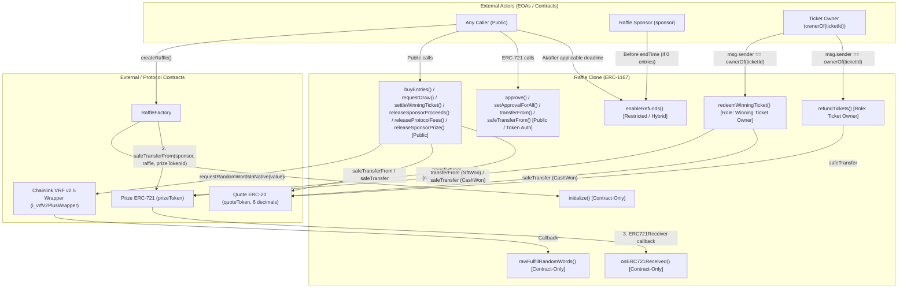

# Stage S2 Report — Trail of Bits `entry-point-analyzer` (`raffle-fun`)

- **Stage**: S2 (`entry-point-analyzer`)
- **Target Project**: `raffle-fun` (`packages/contracts` and `DESIGN.md`)
- **Timestamp**: `2026-10-21T14:08:23-07:00`
- **Execution Mode**: Single-session native execution (no subagents, no external model calls, no modifications to protected source/build/skill inputs)
- **Companion Deliverable**: [scratch/entry-point-analysis.md](file:///Users/hishamel-husseini/.codex/visualizations/2026/10/21/01a15d64-4430-7440-b259-192acf9762b5/raffle-audit-r001/runtime/gemini-native-repairs/TOB/attempt-04/S2/work/scratch/entry-point-analysis.md)
- **Raw Tooling Outputs**:
  - [scratch/slither-entry-points.txt](file:///Users/hishamel-husseini/.codex/visualizations/2026/10/21/01a15d64-4430-7440-b259-192acf9762b5/raffle-audit-r001/runtime/gemini-native-repairs/TOB/attempt-04/S2/work/scratch/slither-entry-points.txt)
  - [scratch/slither-entry-points-clean.txt](file:///Users/hishamel-husseini/.codex/visualizations/2026/10/21/01a15d64-4430-7440-b259-192acf9762b5/raffle-audit-r001/runtime/gemini-native-repairs/TOB/attempt-04/S2/work/scratch/slither-entry-points-clean.txt)
  - [scratch/slither-entry-points.json](file:///Users/hishamel-husseini/.codex/visualizations/2026/10/21/01a15d64-4430-7440-b259-192acf9762b5/raffle-audit-r001/runtime/gemini-native-repairs/TOB/attempt-04/S2/work/scratch/slither-entry-points.json)
  - [scratch/slither-supplementary-printers.txt](file:///Users/hishamel-husseini/.codex/visualizations/2026/10/21/01a15d64-4430-7440-b259-192acf9762b5/raffle-audit-r001/runtime/gemini-native-repairs/TOB/attempt-04/S2/work/scratch/slither-supplementary-printers.txt)

---

# Part 1: Structured Entry Point Analysis Report

# Entry Point Analysis: raffle-fun (`packages/contracts`)

**Analyzed**: 2026-10-21T14:08:23-07:00
**Scope**: Full codebase (`packages/contracts/src/` — 5 owned Solidity files; `packages/contracts/node_modules/` — 31 local dependency Solidity files; 36 Solidity files / 43 pristine workspace inputs total; cross-referenced with [DESIGN.md](file:///Users/hishamel-husseini/.codex/visualizations/2026/10/21/01a15d64-4430-7440-b259-192acf9762b5/raffle-audit-r001/runtime/gemini-native-repairs/TOB/attempt-04/S2/work/DESIGN.md))
**Languages**: Solidity (`0.8.36` for owned contracts; `^0.8.0` / `^0.8.4` / `^0.8.19` / `^0.8.20` / `^0.8.24` across local Chainlink v1.5.0 and OpenZeppelin v5.6.1 dependencies)
**Focus**: State-changing functions only (`view` and `pure` functions excluded)

## Summary

The `raffle-fun` protocol deploys two concrete contracts ([`RaffleFactory`](file:///Users/hishamel-husseini/.codex/visualizations/2026/10/21/01a15d64-4430-7440-b259-192acf9762b5/raffle-audit-r001/runtime/gemini-native-repairs/TOB/attempt-04/S2/work/packages/contracts/src/RaffleFactory.sol#L21-L186) and the [`Raffle`](file:///Users/hishamel-husseini/.codex/visualizations/2026/10/21/01a15d64-4430-7440-b259-192acf9762b5/raffle-audit-r001/runtime/gemini-native-repairs/TOB/attempt-04/S2/work/packages/contracts/src/Raffle.sol#L28-L614) implementation + ERC-1167 minimal proxy clones). Across `Raffle` and `RaffleFactory`, there are **18 recurring state-changing entry points** (plus **1 special `receive()` entry point** that unconditionally reverts to reject unrequested native ETH transfers, and **2 one-time `constructor` initializers**, totaling the **21 rows** reported by `slither . --print entry-points`).

By explicit protocol design ([DESIGN.md](file:///Users/hishamel-husseini/.codex/visualizations/2026/10/21/01a15d64-4430-7440-b259-192acf9762b5/raffle-audit-r001/runtime/gemini-native-repairs/TOB/attempt-04/S2/work/DESIGN.md#L16-L18)), there are **zero** `Admin / Owner`, `Governance`, or `Guardian / Pauser` functions (`0` mutable protocol configuration or upgrade entry points).

| Category | Count |
|----------|-------|
| Public (Unrestricted) | 12 |
| Role-Restricted | 2 |
| Restricted (Review Required) | 1 |
| Contract-Only | 3 |
| **Total** | **18** |

> **Note on Counting Conventions (18 vs. 19 vs. 21)**:
> 1. **Primary Audit Classification (18 recurring state-changing entry points — shown in the Summary table above)**:
>    - **Public (Unrestricted) = 12**: 7 core permissionless protocol functions (`RaffleFactory.createRaffle`, `Raffle.buyEntries`, `Raffle.requestDraw`, `Raffle.settleWinningTicket`, `Raffle.releaseSponsorProceeds`, `Raffle.releaseProtocolFees`, `Raffle.releaseSponsorPrize`) + 5 inherited `ERC721` ticket transfer/approval functions (`setApprovalForAll`, `approve`, `transferFrom`, `safeTransferFrom(address,address,uint256)`, `safeTransferFrom(address,address,uint256,bytes)`), grouped per the `references/solidity.md` checklist (*"All token transfers and approvals (often public)"*).
>    - **Role-Restricted = 2**: `Other Roles (Ticket Owner)` — `Raffle.redeemWinningTicket` and `Raffle.refundTickets`, which enforce strict `msg.sender == ownerOf(ticketId)` checks.
>    - **Restricted (Review Required) = 1**: `Raffle.enableRefunds`, which enforces a hybrid time-conditional check (`msg.sender == sponsor` required before `endTime` when `totalEntries == 0`, permissionless after the applicable deadline).
>    - **Contract-Only = 3**: `Raffle.initialize` (`onlyFactory`), `Raffle.onERC721Received` (`prizeToken` callback during `factory` escrow), and `Raffle.rawFulfillRandomWords` (inherited from `VRFV2PlusWrapperConsumerBase`, restricted to `i_vrfV2PlusWrapper`).
> 2. **Strict Caller-Authorization View (18 recurring state-changing entry points)**:
>    - If the 4 token-specific `ERC721` functions (`approve`, `transferFrom`, `safeTransferFrom(3)`, `safeTransferFrom(4)`) that verify `_isAuthorized(owner, _msgSender(), tokenId)` / owner-or-operator status are moved from **Public** into **Restricted (Review Required)** (or **Role-Restricted: Ticket Owner / Approved Operator**), then **Public = 8** (`7 core` + `setApprovalForAll`), **Role-Restricted = 2** (`redeemWinningTicket`, `refundTickets`), **Restricted (Review Required) = 5** (`enableRefunds` + 4 `ERC721` functions), and **Contract-Only = 3** (**Total = 18**).
> 3. **Including Special `receive()` Entry Point (19 entry points)**:
>    - Adding `Raffle.receive() external payable` ([Raffle.sol:L171-L173](file:///Users/hishamel-husseini/.codex/visualizations/2026/10/21/01a15d64-4430-7440-b259-192acf9762b5/raffle-audit-r001/runtime/gemini-native-repairs/TOB/attempt-04/S2/work/packages/contracts/src/Raffle.sol#L171-L173), which unconditionally reverts with `DirectNativeTransfer()`) brings the post-deployment entry point count to **19**.
> 4. **Full Slither `--print entry-points` Row Count (21 rows)**:
>    - Adding the 2 one-time deployment constructors (`Raffle.constructor` at [Raffle.sol:L155-L166](file:///Users/hishamel-husseini/.codex/visualizations/2026/10/21/01a15d64-4430-7440-b259-192acf9762b5/raffle-audit-r001/runtime/gemini-native-repairs/TOB/attempt-04/S2/work/packages/contracts/src/Raffle.sol#L155-L166) and `RaffleFactory.constructor` at [RaffleFactory.sol:L65-L92](file:///Users/hishamel-husseini/.codex/visualizations/2026/10/21/01a15d64-4430-7440-b259-192acf9762b5/raffle-audit-r001/runtime/gemini-native-repairs/TOB/attempt-04/S2/work/packages/contracts/src/RaffleFactory.sol#L65-L92)) equals the exact **21 rows** output by `slither . --print entry-points` (19 in `Raffle`, 2 in `RaffleFactory`).

---

## Public Entry Points (Unrestricted)

State-changing functions callable by anyone—prioritize for attack surface analysis.

| Function | File | Notes |
|----------|------|-------|
| `createRaffle(IRaffleFactory.CreateRaffleParams calldata params)` | [packages/contracts/src/RaffleFactory.sol:L97-L148](file:///Users/hishamel-husseini/.codex/visualizations/2026/10/21/01a15d64-4430-7440-b259-192acf9762b5/raffle-audit-r001/runtime/gemini-native-repairs/TOB/attempt-04/S2/work/packages/contracts/src/RaffleFactory.sol#L97-L148) | `external nonReentrant returns (address raffle)`. Clones `raffleImplementation` via ERC-1167 (`Clones.clone`), registers `raffleId` (`++raffleCount`), calls `Raffle.initialize` with `sponsor = msg.sender`, and escrows `params.prizeTokenId` via `prize.safeTransferFrom(msg.sender, raffle, params.prizeTokenId)`, verifying `status == Status.Active` and `prize.ownerOf(prizeTokenId) == raffle`. |
| `buyEntries(address recipient, uint128 entryCount)` | [packages/contracts/src/Raffle.sol:L209-L237](file:///Users/hishamel-husseini/.codex/visualizations/2026/10/21/01a15d64-4430-7440-b259-192acf9762b5/raffle-audit-r001/runtime/gemini-native-repairs/TOB/attempt-04/S2/work/packages/contracts/src/Raffle.sol#L209-L237) | `external nonReentrant returns (uint256 ticketId)`. Callable while `status == Status.Active` and `block.timestamp < endTime`. Pulls `entryCount * ENTRY_PRICE` (`1e6` per entry) of `quoteToken` from `msg.sender`, updates `ticketCount`, `totalEntries`, `unsettledPot`, and `_ticketRanges[ticketId]`, and `_safeMint`s ERC-721 ticket `ticketId` to `recipient` (screened against `_isProtocolDestination` in `_update`). |
| `requestDraw()` | [packages/contracts/src/Raffle.sol:L240-L273](file:///Users/hishamel-husseini/.codex/visualizations/2026/10/21/01a15d64-4430-7440-b259-192acf9762b5/raffle-audit-r001/runtime/gemini-native-repairs/TOB/attempt-04/S2/work/packages/contracts/src/Raffle.sol#L240-L273) | `external payable nonReentrant returns (uint256 requestId)`. Callable while `status == Status.Active`, `totalEntries > 0`, and `block.timestamp` in `[endTime, drawRequestDeadline())`. Transitions `status` to `Status.Drawing`, sets `_requestInFlight = true`, requests 1 random word from Chainlink VRF v2.5 wrapper in native ETH (`requestRandomnessPayInNative`), clears `_requestInFlight`, and refunds excess `msg.value` to `msg.sender`. |
| `settleWinningTicket(uint256 ticketId)` | [packages/contracts/src/Raffle.sol:L304-L306](file:///Users/hishamel-husseini/.codex/visualizations/2026/10/21/01a15d64-4430-7440-b259-192acf9762b5/raffle-audit-r001/runtime/gemini-native-repairs/TOB/attempt-04/S2/work/packages/contracts/src/Raffle.sol#L304-L306) | `external nonReentrant returns (uint256 cashAmount)`. Calls `_settleWinningTicket(ticketId)` ([Raffle.sol:L533-L558](file:///Users/hishamel-husseini/.codex/visualizations/2026/10/21/01a15d64-4430-7440-b259-192acf9762b5/raffle-audit-r001/runtime/gemini-native-repairs/TOB/attempt-04/S2/work/packages/contracts/src/Raffle.sol#L533-L558)). Permissionless storage-only settlement when `status` is `NftWon` or `CashWon` and `!settlementComplete`, provided `ticketId` contains `winningEntry`. Allocates `protocolFees` (1%), `sponsorProceeds` (99% or 49%), and `winnerProceeds` (0% or 50%). |
| `releaseSponsorProceeds()` | [packages/contracts/src/Raffle.sol:L375-L382](file:///Users/hishamel-husseini/.codex/visualizations/2026/10/21/01a15d64-4430-7440-b259-192acf9762b5/raffle-audit-r001/runtime/gemini-native-repairs/TOB/attempt-04/S2/work/packages/contracts/src/Raffle.sol#L375-L382) | `external nonReentrant returns (uint256 amount)`. Permissionless payout trigger: transfers full `sponsorProceeds` in `quoteToken` to `sponsorRecipient` via `_transferQuote`. |
| `releaseProtocolFees()` | [packages/contracts/src/Raffle.sol:L385-L392](file:///Users/hishamel-husseini/.codex/visualizations/2026/10/21/01a15d64-4430-7440-b259-192acf9762b5/raffle-audit-r001/runtime/gemini-native-repairs/TOB/attempt-04/S2/work/packages/contracts/src/Raffle.sol#L385-L392) | `external nonReentrant returns (uint256 amount)`. Permissionless fee sweep: transfers full `protocolFees` in `quoteToken` to `protocolTreasury` via `_transferQuote`. |
| `releaseSponsorPrize()` | [packages/contracts/src/Raffle.sol:L395-L407](file:///Users/hishamel-husseini/.codex/visualizations/2026/10/21/01a15d64-4430-7440-b259-192acf9762b5/raffle-audit-r001/runtime/gemini-native-repairs/TOB/attempt-04/S2/work/packages/contracts/src/Raffle.sol#L395-L407) | `external nonReentrant`. Permissionless prize return when `status` is `CashWon` or `Refunding` and `!prizeClaimed`. Sets `prizeClaimed = true`, transfers `prizeTokenId` to `sponsorRecipient` via `prizeToken.transferFrom`, and verifies `prizeToken.ownerOf(prizeTokenId) == sponsorRecipient`. |
| `setApprovalForAll(address operator, bool approved)` | [packages/contracts/node_modules/@openzeppelin/contracts/token/ERC721/ERC721.sol:L105-L107](file:///Users/hishamel-husseini/.codex/visualizations/2026/10/21/01a15d64-4430-7440-b259-192acf9762b5/raffle-audit-r001/runtime/gemini-native-repairs/TOB/attempt-04/S2/work/packages/contracts/node_modules/@openzeppelin/contracts/token/ERC721/ERC721.sol#L105-L107) | `public virtual` (inherited by `Raffle`). Sets `_operatorApprovals[_msgSender()][operator] = approved`. Callable by any address to manage operators for its own raffle tickets. |
| `approve(address to, uint256 tokenId)` | [packages/contracts/node_modules/@openzeppelin/contracts/token/ERC721/ERC721.sol:L93-L95](file:///Users/hishamel-husseini/.codex/visualizations/2026/10/21/01a15d64-4430-7440-b259-192acf9762b5/raffle-audit-r001/runtime/gemini-native-repairs/TOB/attempt-04/S2/work/packages/contracts/node_modules/@openzeppelin/contracts/token/ERC721/ERC721.sol#L93-L95) | `public virtual` (inherited by `Raffle`). Standard ERC-721 single-ticket approval; internally checks `_msgSender() == owner || isApprovedForAll(owner, _msgSender())` ([ERC721.sol:L388-L390](file:///Users/hishamel-husseini/.codex/visualizations/2026/10/21/01a15d64-4430-7440-b259-192acf9762b5/raffle-audit-r001/runtime/gemini-native-repairs/TOB/attempt-04/S2/work/packages/contracts/node_modules/@openzeppelin/contracts/token/ERC721/ERC721.sol#L388-L390)). |
| `transferFrom(address from, address to, uint256 tokenId)` | [packages/contracts/node_modules/@openzeppelin/contracts/token/ERC721/ERC721.sol:L115-L125](file:///Users/hishamel-husseini/.codex/visualizations/2026/10/21/01a15d64-4430-7440-b259-192acf9762b5/raffle-audit-r001/runtime/gemini-native-repairs/TOB/attempt-04/S2/work/packages/contracts/node_modules/@openzeppelin/contracts/token/ERC721/ERC721.sol#L115-L125) | `public virtual` (inherited by `Raffle`). Transfers ticket `tokenId` via overridden `Raffle._update` ([Raffle.sol:L497-L502](file:///Users/hishamel-husseini/.codex/visualizations/2026/10/21/01a15d64-4430-7440-b259-192acf9762b5/raffle-audit-r001/runtime/gemini-native-repairs/TOB/attempt-04/S2/work/packages/contracts/src/Raffle.sol#L497-L502)), enforcing `_checkAuthorized` and rejecting `_isProtocolDestination(to, address(prizeToken))`. |
| `safeTransferFrom(address from, address to, uint256 tokenId)` | [packages/contracts/node_modules/@openzeppelin/contracts/token/ERC721/ERC721.sol:L128-L130](file:///Users/hishamel-husseini/.codex/visualizations/2026/10/21/01a15d64-4430-7440-b259-192acf9762b5/raffle-audit-r001/runtime/gemini-native-repairs/TOB/attempt-04/S2/work/packages/contracts/node_modules/@openzeppelin/contracts/token/ERC721/ERC721.sol#L128-L130) | `public` (inherited by `Raffle`). Delegates to `safeTransferFrom(from, to, tokenId, "")`. |
| `safeTransferFrom(address from, address to, uint256 tokenId, bytes memory data)` | [packages/contracts/node_modules/@openzeppelin/contracts/token/ERC721/ERC721.sol:L133-L136](file:///Users/hishamel-husseini/.codex/visualizations/2026/10/21/01a15d64-4430-7440-b259-192acf9762b5/raffle-audit-r001/runtime/gemini-native-repairs/TOB/attempt-04/S2/work/packages/contracts/node_modules/@openzeppelin/contracts/token/ERC721/ERC721.sol#L133-L136) | `public virtual` (inherited by `Raffle`). Calls `transferFrom(from, to, tokenId)` (enforcing `Raffle._update` protocol-destination guard) and `ERC721Utils.checkOnERC721Received`. |

### Special Native-Value & One-Time Deployment Entry Points (Reported by Slither `--print entry-points`)

| Function | File | Notes |
|----------|------|-------|
| `receive() external payable` | [packages/contracts/src/Raffle.sol:L171-L173](file:///Users/hishamel-husseini/.codex/visualizations/2026/10/21/01a15d64-4430-7440-b259-192acf9762b5/raffle-audit-r001/runtime/gemini-native-repairs/TOB/attempt-04/S2/work/packages/contracts/src/Raffle.sol#L171-L173) | Special native ETH receiver on `Raffle`. Always reverts with `DirectNativeTransfer()` ([Raffle.sol:L172](file:///Users/hishamel-husseini/.codex/visualizations/2026/10/21/01a15d64-4430-7440-b259-192acf9762b5/raffle-audit-r001/runtime/gemini-native-repairs/TOB/attempt-04/S2/work/packages/contracts/src/Raffle.sol#L172)) to block direct ETH sends outside `requestDraw()`. |
| `constructor(address quoteToken_, address vrfWrapper_)` | [packages/contracts/src/Raffle.sol:L155-L166](file:///Users/hishamel-husseini/.codex/visualizations/2026/10/21/01a15d64-4430-7440-b259-192acf9762b5/raffle-audit-r001/runtime/gemini-native-repairs/TOB/attempt-04/S2/work/packages/contracts/src/Raffle.sol#L155-L166) | One-time deployment constructor for the singleton `Raffle` implementation (called by `RaffleFactory.constructor` at [RaffleFactory.sol:L79](file:///Users/hishamel-husseini/.codex/visualizations/2026/10/21/01a15d64-4430-7440-b259-192acf9762b5/raffle-audit-r001/runtime/gemini-native-repairs/TOB/attempt-04/S2/work/packages/contracts/src/RaffleFactory.sol#L79)). Sets immutables `factory = msg.sender`, `quoteToken`, `i_vrfV2PlusWrapper`, `i_linkToken`, and locks the implementation with `initialized = true` and `status = Status.Refunding`. |
| `constructor(address quoteToken_, address vrfWrapper_, address protocolTreasury_)` | [packages/contracts/src/RaffleFactory.sol:L65-L92](file:///Users/hishamel-husseini/.codex/visualizations/2026/10/21/01a15d64-4430-7440-b259-192acf9762b5/raffle-audit-r001/runtime/gemini-native-repairs/TOB/attempt-04/S2/work/packages/contracts/src/RaffleFactory.sol#L65-L92) | One-time deployment constructor for `RaffleFactory`. Validates `quoteToken_` (`decimals() == 6`), `vrfWrapper_`, and `protocolTreasury_`, and deploys `raffleImplementation`. |

---

## Role-Restricted Entry Points

### Admin / Owner
| Function | File | Restriction |
|----------|------|-------------|
| *None (0 functions)* | — | Protocol has no admin, owner, or upgrade authority ([DESIGN.md:L16-L18](file:///Users/hishamel-husseini/.codex/visualizations/2026/10/21/01a15d64-4430-7440-b259-192acf9762b5/raffle-audit-r001/runtime/gemini-native-repairs/TOB/attempt-04/S2/work/DESIGN.md#L16-L18)) |

### Governance
| Function | File | Restriction |
|----------|------|-------------|
| *None (0 functions)* | — | No governance role or parameter setter exists |

### Guardian / Pauser
| Function | File | Restriction |
|----------|------|-------------|
| *None (0 functions)* | — | No pause mechanism or guardian role exists |

### Other Roles
| Function | File | Restriction | Role |
|----------|------|-------------|------|
| `redeemWinningTicket(uint256 ticketId)` | [packages/contracts/src/Raffle.sol:L309-L346](file:///Users/hishamel-husseini/.codex/visualizations/2026/10/21/01a15d64-4430-7440-b259-192acf9762b5/raffle-audit-r001/runtime/gemini-native-repairs/TOB/attempt-04/S2/work/packages/contracts/src/Raffle.sol#L309-L346) | `address winner = ownerOf(ticketId); if (msg.sender != winner) revert NotTicketOwner(ticketId, msg.sender, winner);` ([Raffle.sol:L320-L321](file:///Users/hishamel-husseini/.codex/visualizations/2026/10/21/01a15d64-4430-7440-b259-192acf9762b5/raffle-audit-r001/runtime/gemini-native-repairs/TOB/attempt-04/S2/work/packages/contracts/src/Raffle.sol#L320-L321)) + `nonReentrant` | **Winning Ticket Owner** (`ownerOf(ticketId)`). Strictly requires `msg.sender == ownerOf(ticketId)` (ERC-721 approved operators cannot call). Lazily settles if `!settlementComplete`, verifies `ticketId == winningTicketId` and `!winnerRedeemed`, burns `ticketId`, and delivers either `prizeTokenId` (`NftWon`) or `winnerProceeds` in `quoteToken` (`CashWon`) to `winner`. |
| `refundTickets(uint256[] calldata ticketIds)` | [packages/contracts/src/Raffle.sol:L349-L372](file:///Users/hishamel-husseini/.codex/visualizations/2026/10/21/01a15d64-4430-7440-b259-192acf9762b5/raffle-audit-r001/runtime/gemini-native-repairs/TOB/attempt-04/S2/work/packages/contracts/src/Raffle.sol#L349-L372) | `address owner = ownerOf(ticketId); if (msg.sender != owner) revert NotTicketOwner(ticketId, msg.sender, owner);` ([Raffle.sol:L359-L360](file:///Users/hishamel-husseini/.codex/visualizations/2026/10/21/01a15d64-4430-7440-b259-192acf9762b5/raffle-audit-r001/runtime/gemini-native-repairs/TOB/attempt-04/S2/work/packages/contracts/src/Raffle.sol#L359-L360)) + `nonReentrant` | **Ticket Owner** (`ownerOf(ticketId)` for each ticket in batch). Strictly requires `msg.sender == ownerOf(ticketId)` (ERC-721 approved operators cannot call), `status == Status.Refunding`, and `1 <= ticketIds.length <= 100`. Burns each ticket, decrements `remainingRefundLiability`, and transfers total refund `amount` in `quoteToken` to `msg.sender`. |

---

## Restricted (Review Required)

Functions with access control patterns that need manual verification.

| Function | File | Pattern | Why Review |
|----------|------|---------|------------|
| `enableRefunds()` | [packages/contracts/src/Raffle.sol:L276-L301](file:///Users/hishamel-husseini/.codex/visualizations/2026/10/21/01a15d64-4430-7440-b259-192acf9762b5/raffle-audit-r001/runtime/gemini-native-repairs/TOB/attempt-04/S2/work/packages/contracts/src/Raffle.sol#L276-L301) | `if (msg.sender != sponsor && block.timestamp < deadline) revert RefundsNotAvailable(deadline, block.timestamp);` ([Raffle.sol:L282-L284](file:///Users/hishamel-husseini/.codex/visualizations/2026/10/21/01a15d64-4430-7440-b259-192acf9762b5/raffle-audit-r001/runtime/gemini-native-repairs/TOB/attempt-04/S2/work/packages/contracts/src/Raffle.sol#L282-L284)) + `nonReentrant` | **Hybrid Sponsor / Permissionless Time-Gated Access**: In `Status.Active` when `totalEntries == 0`, only `sponsor` may call `enableRefunds()` prior to `endTime` (early cancellation of a zero-entry raffle), whereas anyone may call it at or after `endTime`. In `Status.Active` with `totalEntries > 0` (at/after `drawRequestDeadline()`) and in `Status.Drawing` (at/after `callbackDeadline()`), it is permissionless (even `sponsor` cannot call before the deadline). |
| `redeemWinningTicket(uint256 ticketId)` *(cross-listed from Role-Restricted)* | [packages/contracts/src/Raffle.sol:L309-L346](file:///Users/hishamel-husseini/.codex/visualizations/2026/10/21/01a15d64-4430-7440-b259-192acf9762b5/raffle-audit-r001/runtime/gemini-native-repairs/TOB/attempt-04/S2/work/packages/contracts/src/Raffle.sol#L309-L346) | `if (msg.sender != winner) revert NotTicketOwner(ticketId, msg.sender, winner);` ([Raffle.sol:L320-L321](file:///Users/hishamel-husseini/.codex/visualizations/2026/10/21/01a15d64-4430-7440-b259-192acf9762b5/raffle-audit-r001/runtime/gemini-native-repairs/TOB/attempt-04/S2/work/packages/contracts/src/Raffle.sol#L320-L321)) | **Dynamic ERC-721 Bearer Role**: The `winner` role is dynamically determined by current ERC-721 ownership of `ticketId` at redemption time (tickets remain transferable via `transferFrom`/`safeTransferFrom` after VRF draw resolution until burned in `redeemWinningTicket`). |
| `refundTickets(uint256[] calldata ticketIds)` *(cross-listed from Role-Restricted)* | [packages/contracts/src/Raffle.sol:L349-L372](file:///Users/hishamel-husseini/.codex/visualizations/2026/10/21/01a15d64-4430-7440-b259-192acf9762b5/raffle-audit-r001/runtime/gemini-native-repairs/TOB/attempt-04/S2/work/packages/contracts/src/Raffle.sol#L349-L372) | `if (msg.sender != owner) revert NotTicketOwner(ticketId, msg.sender, owner);` ([Raffle.sol:L359-L360](file:///Users/hishamel-husseini/.codex/visualizations/2026/10/21/01a15d64-4430-7440-b259-192acf9762b5/raffle-audit-r001/runtime/gemini-native-repairs/TOB/attempt-04/S2/work/packages/contracts/src/Raffle.sol#L359-L360)) | **Dynamic ERC-721 Bearer Role in Batch Loop**: Ticket refund right travels with ERC-721 ownership of each `ticketId` until burned in `refundTickets`. |
| `approve` / `transferFrom` / `safeTransferFrom(3)` / `safeTransferFrom(4)` *(cross-listed from Public)* | [packages/contracts/node_modules/@openzeppelin/contracts/token/ERC721/ERC721.sol:L93-L136](file:///Users/hishamel-husseini/.codex/visualizations/2026/10/21/01a15d64-4430-7440-b259-192acf9762b5/raffle-audit-r001/runtime/gemini-native-repairs/TOB/attempt-04/S2/work/packages/contracts/node_modules/@openzeppelin/contracts/token/ERC721/ERC721.sol#L93-L136) + [packages/contracts/src/Raffle.sol:L497-L502](file:///Users/hishamel-husseini/.codex/visualizations/2026/10/21/01a15d64-4430-7440-b259-192acf9762b5/raffle-audit-r001/runtime/gemini-native-repairs/TOB/attempt-04/S2/work/packages/contracts/src/Raffle.sol#L497-L502) | `_checkAuthorized(owner, _msgSender(), tokenId)` + `if (to != address(0) && _isProtocolDestination(to, address(prizeToken))) revert UnsafeProtocolDestination(to);` | **Token-Level Authorization & Protocol Destination Filter**: Requires `_msgSender()` to be the token owner or approved address/operator, and `Raffle._update` blocks transfers to protocol contracts (`this`, `factory`, `raffleImplementation`, `quoteToken`, `vrfWrapper`, `prizeToken`, or any factory-registered `Raffle` clone). |

---

## Contract-Only (Internal Integration Points)

Functions only callable by other contracts—useful for understanding trust boundaries.

| Function | File | Expected Caller |
|----------|------|-----------------|
| `initialize(IRaffle.RaffleInitParams calldata params)` | [packages/contracts/src/Raffle.sol:L176-L206](file:///Users/hishamel-husseini/.codex/visualizations/2026/10/21/01a15d64-4430-7440-b259-192acf9762b5/raffle-audit-r001/runtime/gemini-native-repairs/TOB/attempt-04/S2/work/packages/contracts/src/Raffle.sol#L176-L206) | **`RaffleFactory` (`factory`)**. Enforced via `if (initialized) revert AlreadyInitialized(); if (msg.sender != factory) revert OnlyFactory();` ([Raffle.sol:L177-L178](file:///Users/hishamel-husseini/.codex/visualizations/2026/10/21/01a15d64-4430-7440-b259-192acf9762b5/raffle-audit-r001/runtime/gemini-native-repairs/TOB/attempt-04/S2/work/packages/contracts/src/Raffle.sol#L177-L178)). Called atomically during `RaffleFactory.createRaffle` ([RaffleFactory.sol:L122-L133](file:///Users/hishamel-husseini/.codex/visualizations/2026/10/21/01a15d64-4430-7440-b259-192acf9762b5/raffle-audit-r001/runtime/gemini-native-repairs/TOB/attempt-04/S2/work/packages/contracts/src/RaffleFactory.sol#L122-L133)) on newly deployed ERC-1167 clones. |
| `onERC721Received(address operator, address from, uint256 tokenId, bytes calldata)` | [packages/contracts/src/Raffle.sol:L416-L431](file:///Users/hishamel-husseini/.codex/visualizations/2026/10/21/01a15d64-4430-7440-b259-192acf9762b5/raffle-audit-r001/runtime/gemini-native-repairs/TOB/attempt-04/S2/work/packages/contracts/src/Raffle.sol#L416-L431) | **`prizeToken` ERC-721 contract (when invoked by `RaffleFactory.createRaffle`)**. Enforced via `if (status != Status.AwaitingPrize || msg.sender != address(prizeToken) || tokenId != prizeTokenId || from != sponsor || operator != factory) revert UnexpectedPrize(msg.sender, tokenId, from, operator);` ([Raffle.sol:L421-L428](file:///Users/hishamel-husseini/.codex/visualizations/2026/10/21/01a15d64-4430-7440-b259-192acf9762b5/raffle-audit-r001/runtime/gemini-native-repairs/TOB/attempt-04/S2/work/packages/contracts/src/Raffle.sol#L421-L428)). Transitions `status` from `AwaitingPrize` to `Active`. |
| `rawFulfillRandomWords(uint256 _requestId, uint256[] memory _randomWords)` | [packages/contracts/node_modules/@chainlink/contracts/src/v0.8/vrf/dev/VRFV2PlusWrapperConsumerBase.sol:L101-L107](file:///Users/hishamel-husseini/.codex/visualizations/2026/10/21/01a15d64-4430-7440-b259-192acf9762b5/raffle-audit-r001/runtime/gemini-native-repairs/TOB/attempt-04/S2/work/packages/contracts/node_modules/@chainlink/contracts/src/v0.8/vrf/dev/VRFV2PlusWrapperConsumerBase.sol#L101-L107) (dispatches to `Raffle.fulfillRandomWords` at [packages/contracts/src/Raffle.sol:L509-L524](file:///Users/hishamel-husseini/.codex/visualizations/2026/10/21/01a15d64-4430-7440-b259-192acf9762b5/raffle-audit-r001/runtime/gemini-native-repairs/TOB/attempt-04/S2/work/packages/contracts/src/Raffle.sol#L509-L524)) | **Chainlink VRF v2.5 Wrapper (`i_vrfV2PlusWrapper`)**. Enforced via `if (msg.sender != vrfWrapperAddr) revert OnlyVRFWrapperCanFulfill(msg.sender, vrfWrapperAddr);` ([VRFV2PlusWrapperConsumerBase.sol:L103-L105](file:///Users/hishamel-husseini/.codex/visualizations/2026/10/21/01a15d64-4430-7440-b259-192acf9762b5/raffle-audit-r001/runtime/gemini-native-repairs/TOB/attempt-04/S2/work/packages/contracts/node_modules/@chainlink/contracts/src/v0.8/vrf/dev/VRFV2PlusWrapperConsumerBase.sol#L103-L105)). `Raffle.fulfillRandomWords` validates `!_requestInFlight && status == Status.Drawing && requestId == vrfRequestId && randomWords.length == 1 && block.timestamp < callbackDeadline()`, returning early with `VrfCallbackIgnored` if invalid, or resolving `winningEntry` and transitioning `status` to `NftWon` or `CashWon`. |

---

## Files Analyzed

- [packages/contracts/src/Raffle.sol](file:///Users/hishamel-husseini/.codex/visualizations/2026/10/21/01a15d64-4430-7440-b259-192acf9762b5/raffle-audit-r001/runtime/gemini-native-repairs/TOB/attempt-04/S2/work/packages/contracts/src/Raffle.sol) (**17 recurring state-changing entry points** [11 defined in `Raffle.sol`, 5 inherited from `ERC721.sol`, 1 inherited from `VRFV2PlusWrapperConsumerBase.sol`] + **1 `receive()` payable entry point** + **1 `constructor`** = **19 Slither entry-point rows**)
- [packages/contracts/src/RaffleFactory.sol](file:///Users/hishamel-husseini/.codex/visualizations/2026/10/21/01a15d64-4430-7440-b259-192acf9762b5/raffle-audit-r001/runtime/gemini-native-repairs/TOB/attempt-04/S2/work/packages/contracts/src/RaffleFactory.sol) (**1 recurring state-changing entry point** [`createRaffle`] + **1 `constructor`** = **2 Slither entry-point rows**)
- [packages/contracts/src/interfaces/IRaffle.sol](file:///Users/hishamel-husseini/.codex/visualizations/2026/10/21/01a15d64-4430-7440-b259-192acf9762b5/raffle-audit-r001/runtime/gemini-native-repairs/TOB/attempt-04/S2/work/packages/contracts/src/interfaces/IRaffle.sol) (**0 concrete state-changing entry points**; interface declaring 10 `external` state-changing function signatures implemented by `Raffle` and 38 `external view` signatures)
- [packages/contracts/src/interfaces/IRaffleFactory.sol](file:///Users/hishamel-husseini/.codex/visualizations/2026/10/21/01a15d64-4430-7440-b259-192acf9762b5/raffle-audit-r001/runtime/gemini-native-repairs/TOB/attempt-04/S2/work/packages/contracts/src/interfaces/IRaffleFactory.sol) (**0 concrete state-changing entry points**; interface declaring 1 `external` state-changing function signature [`createRaffle`] implemented by `RaffleFactory` and 10 `external view` signatures)
- [packages/contracts/src/libraries/RaffleConstants.sol](file:///Users/hishamel-husseini/.codex/visualizations/2026/10/21/01a15d64-4430-7440-b259-192acf9762b5/raffle-audit-r001/runtime/gemini-native-repairs/TOB/attempt-04/S2/work/packages/contracts/src/libraries/RaffleConstants.sol) (**0 state-changing entry points**; library defining 11 `internal constant` values)
- [packages/contracts/node_modules/@chainlink/contracts/src/v0.8/vrf/dev/VRFV2PlusWrapperConsumerBase.sol](file:///Users/hishamel-husseini/.codex/visualizations/2026/10/21/01a15d64-4430-7440-b259-192acf9762b5/raffle-audit-r001/runtime/gemini-native-repairs/TOB/attempt-04/S2/work/packages/contracts/node_modules/@chainlink/contracts/src/v0.8/vrf/dev/VRFV2PlusWrapperConsumerBase.sol) (**1 `external` state-changing entry point** [`rawFulfillRandomWords`] inherited by `Raffle`)
- [packages/contracts/node_modules/@chainlink/contracts/src/v0.8/vrf/dev/interfaces/IVRFV2PlusWrapper.sol](file:///Users/hishamel-husseini/.codex/visualizations/2026/10/21/01a15d64-4430-7440-b259-192acf9762b5/raffle-audit-r001/runtime/gemini-native-repairs/TOB/attempt-04/S2/work/packages/contracts/node_modules/@chainlink/contracts/src/v0.8/vrf/dev/interfaces/IVRFV2PlusWrapper.sol) (**0 concrete state-changing entry points**; interface with 1 `external payable` state-changing declaration `requestRandomWordsInNative` and 7 `external view` declarations)
- [packages/contracts/node_modules/@chainlink/contracts/src/v0.8/vrf/dev/libraries/VRFV2PlusClient.sol](file:///Users/hishamel-husseini/.codex/visualizations/2026/10/21/01a15d64-4430-7440-b259-192acf9762b5/raffle-audit-r001/runtime/gemini-native-repairs/TOB/attempt-04/S2/work/packages/contracts/node_modules/@chainlink/contracts/src/v0.8/vrf/dev/libraries/VRFV2PlusClient.sol) (**0 state-changing entry points**; library with 1 `internal pure` function)
- [packages/contracts/node_modules/@chainlink/contracts/src/v0.8/shared/interfaces/LinkTokenInterface.sol](file:///Users/hishamel-husseini/.codex/visualizations/2026/10/21/01a15d64-4430-7440-b259-192acf9762b5/raffle-audit-r001/runtime/gemini-native-repairs/TOB/attempt-04/S2/work/packages/contracts/node_modules/@chainlink/contracts/src/v0.8/shared/interfaces/LinkTokenInterface.sol) (**0 concrete state-changing entry points**; interface with 6 `external` state-changing declarations and 6 `external view` declarations)
- [packages/contracts/node_modules/@openzeppelin/contracts/token/ERC721/ERC721.sol](file:///Users/hishamel-husseini/.codex/visualizations/2026/10/21/01a15d64-4430-7440-b259-192acf9762b5/raffle-audit-r001/runtime/gemini-native-repairs/TOB/attempt-04/S2/work/packages/contracts/node_modules/@openzeppelin/contracts/token/ERC721/ERC721.sol) (**5 `public` state-changing entry points** [`approve`, `setApprovalForAll`, `transferFrom`, `safeTransferFrom(3)`, `safeTransferFrom(4)`] inherited by `Raffle`)
- [packages/contracts/node_modules/@openzeppelin/contracts/token/ERC721/IERC721.sol](file:///Users/hishamel-husseini/.codex/visualizations/2026/10/21/01a15d64-4430-7440-b259-192acf9762b5/raffle-audit-r001/runtime/gemini-native-repairs/TOB/attempt-04/S2/work/packages/contracts/node_modules/@openzeppelin/contracts/token/ERC721/IERC721.sol) (**0 concrete state-changing entry points**; interface with 5 `external` state-changing declarations and 4 `external view` declarations)
- [packages/contracts/node_modules/@openzeppelin/contracts/token/ERC721/IERC721Receiver.sol](file:///Users/hishamel-husseini/.codex/visualizations/2026/10/21/01a15d64-4430-7440-b259-192acf9762b5/raffle-audit-r001/runtime/gemini-native-repairs/TOB/attempt-04/S2/work/packages/contracts/node_modules/@openzeppelin/contracts/token/ERC721/IERC721Receiver.sol) (**0 concrete state-changing entry points**; interface with 1 `external` state-changing declaration `onERC721Received`)
- [packages/contracts/node_modules/@openzeppelin/contracts/token/ERC721/extensions/IERC721Metadata.sol](file:///Users/hishamel-husseini/.codex/visualizations/2026/10/21/01a15d64-4430-7440-b259-192acf9762b5/raffle-audit-r001/runtime/gemini-native-repairs/TOB/attempt-04/S2/work/packages/contracts/node_modules/@openzeppelin/contracts/token/ERC721/extensions/IERC721Metadata.sol) (**0 state-changing entry points**; interface with 3 `external view` declarations)
- [packages/contracts/node_modules/@openzeppelin/contracts/token/ERC721/utils/ERC721Utils.sol](file:///Users/hishamel-husseini/.codex/visualizations/2026/10/21/01a15d64-4430-7440-b259-192acf9762b5/raffle-audit-r001/runtime/gemini-native-repairs/TOB/attempt-04/S2/work/packages/contracts/node_modules/@openzeppelin/contracts/token/ERC721/utils/ERC721Utils.sol) (**0 externally callable entry points**; library with 1 `internal` state-changing helper `checkOnERC721Received`)
- [packages/contracts/node_modules/@openzeppelin/contracts/token/ERC20/IERC20.sol](file:///Users/hishamel-husseini/.codex/visualizations/2026/10/21/01a15d64-4430-7440-b259-192acf9762b5/raffle-audit-r001/runtime/gemini-native-repairs/TOB/attempt-04/S2/work/packages/contracts/node_modules/@openzeppelin/contracts/token/ERC20/IERC20.sol) (**0 concrete state-changing entry points**; interface with 3 `external` state-changing declarations and 3 `external view` declarations)
- [packages/contracts/node_modules/@openzeppelin/contracts/token/ERC20/extensions/IERC20Metadata.sol](file:///Users/hishamel-husseini/.codex/visualizations/2026/10/21/01a15d64-4430-7440-b259-192acf9762b5/raffle-audit-r001/runtime/gemini-native-repairs/TOB/attempt-04/S2/work/packages/contracts/node_modules/@openzeppelin/contracts/token/ERC20/extensions/IERC20Metadata.sol) (**0 state-changing entry points**; interface with 3 `external view` declarations)
- [packages/contracts/node_modules/@openzeppelin/contracts/token/ERC20/utils/SafeERC20.sol](file:///Users/hishamel-husseini/.codex/visualizations/2026/10/21/01a15d64-4430-7440-b259-192acf9762b5/raffle-audit-r001/runtime/gemini-native-repairs/TOB/attempt-04/S2/work/packages/contracts/node_modules/@openzeppelin/contracts/token/ERC20/utils/SafeERC20.sol) (**0 externally callable entry points**; library with 10 `internal` and 3 `private` state-changing helpers)
- [packages/contracts/node_modules/@openzeppelin/contracts/proxy/Clones.sol](file:///Users/hishamel-husseini/.codex/visualizations/2026/10/21/01a15d64-4430-7440-b259-192acf9762b5/raffle-audit-r001/runtime/gemini-native-repairs/TOB/attempt-04/S2/work/packages/contracts/node_modules/@openzeppelin/contracts/proxy/Clones.sol) (**0 externally callable entry points**; library with 8 `internal` state-changing clone helpers and 6 `internal`/`private` `view`/`pure` helpers)
- [packages/contracts/node_modules/@openzeppelin/contracts/utils/ReentrancyGuard.sol](file:///Users/hishamel-husseini/.codex/visualizations/2026/10/21/01a15d64-4430-7440-b259-192acf9762b5/raffle-audit-r001/runtime/gemini-native-repairs/TOB/attempt-04/S2/work/packages/contracts/node_modules/@openzeppelin/contracts/utils/ReentrancyGuard.sol) (**0 externally callable entry points**; abstract contract providing `nonReentrant` and `nonReentrantView` modifiers)
- [packages/contracts/node_modules/@openzeppelin/contracts/utils/Context.sol](file:///Users/hishamel-husseini/.codex/visualizations/2026/10/21/01a15d64-4430-7440-b259-192acf9762b5/raffle-audit-r001/runtime/gemini-native-repairs/TOB/attempt-04/S2/work/packages/contracts/node_modules/@openzeppelin/contracts/utils/Context.sol) (**0 state-changing entry points**; abstract contract with 3 `internal view`/`pure` helpers)
- [packages/contracts/node_modules/@openzeppelin/contracts/utils/introspection/ERC165.sol](file:///Users/hishamel-husseini/.codex/visualizations/2026/10/21/01a15d64-4430-7440-b259-192acf9762b5/raffle-audit-r001/runtime/gemini-native-repairs/TOB/attempt-04/S2/work/packages/contracts/node_modules/@openzeppelin/contracts/utils/introspection/ERC165.sol) (**0 state-changing entry points**; abstract contract with 1 `public view` function)
- [packages/contracts/node_modules/@openzeppelin/contracts/utils/introspection/IERC165.sol](file:///Users/hishamel-husseini/.codex/visualizations/2026/10/21/01a15d64-4430-7440-b259-192acf9762b5/raffle-audit-r001/runtime/gemini-native-repairs/TOB/attempt-04/S2/work/packages/contracts/node_modules/@openzeppelin/contracts/utils/introspection/IERC165.sol) (**0 state-changing entry points**; interface with 1 `external view` function)
- [packages/contracts/node_modules/@openzeppelin/contracts/interfaces/draft-IERC6093.sol](file:///Users/hishamel-husseini/.codex/visualizations/2026/10/21/01a15d64-4430-7440-b259-192acf9762b5/raffle-audit-r001/runtime/gemini-native-repairs/TOB/attempt-04/S2/work/packages/contracts/node_modules/@openzeppelin/contracts/interfaces/draft-IERC6093.sol) (**0 state-changing entry points**; custom error interfaces)
- [packages/contracts/node_modules/@openzeppelin/contracts/interfaces/IERC1363.sol](file:///Users/hishamel-husseini/.codex/visualizations/2026/10/21/01a15d64-4430-7440-b259-192acf9762b5/raffle-audit-r001/runtime/gemini-native-repairs/TOB/attempt-04/S2/work/packages/contracts/node_modules/@openzeppelin/contracts/interfaces/IERC1363.sol) (**0 concrete state-changing entry points**; interface with 6 `external` state-changing declarations)
- [packages/contracts/node_modules/@openzeppelin/contracts/interfaces/IERC165.sol](file:///Users/hishamel-husseini/.codex/visualizations/2026/10/21/01a15d64-4430-7440-b259-192acf9762b5/raffle-audit-r001/runtime/gemini-native-repairs/TOB/attempt-04/S2/work/packages/contracts/node_modules/@openzeppelin/contracts/interfaces/IERC165.sol) (**0 state-changing entry points**; re-export file)
- [packages/contracts/node_modules/@openzeppelin/contracts/interfaces/IERC20.sol](file:///Users/hishamel-husseini/.codex/visualizations/2026/10/21/01a15d64-4430-7440-b259-192acf9762b5/raffle-audit-r001/runtime/gemini-native-repairs/TOB/attempt-04/S2/work/packages/contracts/node_modules/@openzeppelin/contracts/interfaces/IERC20.sol) (**0 state-changing entry points**; re-export file)
- [packages/contracts/node_modules/@openzeppelin/contracts/utils/Bytes.sol](file:///Users/hishamel-husseini/.codex/visualizations/2026/10/21/01a15d64-4430-7440-b259-192acf9762b5/raffle-audit-r001/runtime/gemini-native-repairs/TOB/attempt-04/S2/work/packages/contracts/node_modules/@openzeppelin/contracts/utils/Bytes.sol) (**0 state-changing entry points**; library with `internal`/`private` helpers)
- [packages/contracts/node_modules/@openzeppelin/contracts/utils/Create2.sol](file:///Users/hishamel-husseini/.codex/visualizations/2026/10/21/01a15d64-4430-7440-b259-192acf9762b5/raffle-audit-r001/runtime/gemini-native-repairs/TOB/attempt-04/S2/work/packages/contracts/node_modules/@openzeppelin/contracts/utils/Create2.sol) (**0 externally callable entry points**; library with 1 `internal` deployment helper and 2 `internal view`/`pure` helpers)
- [packages/contracts/node_modules/@openzeppelin/contracts/utils/Errors.sol](file:///Users/hishamel-husseini/.codex/visualizations/2026/10/21/01a15d64-4430-7440-b259-192acf9762b5/raffle-audit-r001/runtime/gemini-native-repairs/TOB/attempt-04/S2/work/packages/contracts/node_modules/@openzeppelin/contracts/utils/Errors.sol) (**0 state-changing entry points**; custom error library)
- [packages/contracts/node_modules/@openzeppelin/contracts/utils/LowLevelCall.sol](file:///Users/hishamel-husseini/.codex/visualizations/2026/10/21/01a15d64-4430-7440-b259-192acf9762b5/raffle-audit-r001/runtime/gemini-native-repairs/TOB/attempt-04/S2/work/packages/contracts/node_modules/@openzeppelin/contracts/utils/LowLevelCall.sol) (**0 externally callable entry points**; library with `internal` low-level call helpers)
- [packages/contracts/node_modules/@openzeppelin/contracts/utils/Panic.sol](file:///Users/hishamel-husseini/.codex/visualizations/2026/10/21/01a15d64-4430-7440-b259-192acf9762b5/raffle-audit-r001/runtime/gemini-native-repairs/TOB/attempt-04/S2/work/packages/contracts/node_modules/@openzeppelin/contracts/utils/Panic.sol) (**0 state-changing entry points**; library with 1 `internal pure` helper)
- [packages/contracts/node_modules/@openzeppelin/contracts/utils/StorageSlot.sol](file:///Users/hishamel-husseini/.codex/visualizations/2026/10/21/01a15d64-4430-7440-b259-192acf9762b5/raffle-audit-r001/runtime/gemini-native-repairs/TOB/attempt-04/S2/work/packages/contracts/node_modules/@openzeppelin/contracts/utils/StorageSlot.sol) (**0 state-changing entry points**; library with 9 `internal pure` slot helpers)
- [packages/contracts/node_modules/@openzeppelin/contracts/utils/Strings.sol](file:///Users/hishamel-husseini/.codex/visualizations/2026/10/21/01a15d64-4430-7440-b259-192acf9762b5/raffle-audit-r001/runtime/gemini-native-repairs/TOB/attempt-04/S2/work/packages/contracts/node_modules/@openzeppelin/contracts/utils/Strings.sol) (**0 state-changing entry points**; library with 31 `internal`/`private pure` helpers)
- [packages/contracts/node_modules/@openzeppelin/contracts/utils/math/Math.sol](file:///Users/hishamel-husseini/.codex/visualizations/2026/10/21/01a15d64-4430-7440-b259-192acf9762b5/raffle-audit-r001/runtime/gemini-native-repairs/TOB/attempt-04/S2/work/packages/contracts/node_modules/@openzeppelin/contracts/utils/math/Math.sol) (**0 state-changing entry points**; library with 36 `internal`/`private` `view`/`pure` helpers)
- [packages/contracts/node_modules/@openzeppelin/contracts/utils/math/SafeCast.sol](file:///Users/hishamel-husseini/.codex/visualizations/2026/10/21/01a15d64-4430-7440-b259-192acf9762b5/raffle-audit-r001/runtime/gemini-native-repairs/TOB/attempt-04/S2/work/packages/contracts/node_modules/@openzeppelin/contracts/utils/math/SafeCast.sol) (**0 state-changing entry points**; library with 65 `internal pure` helpers)
- [packages/contracts/node_modules/@openzeppelin/contracts/utils/math/SignedMath.sol](file:///Users/hishamel-husseini/.codex/visualizations/2026/10/21/01a15d64-4430-7440-b259-192acf9762b5/raffle-audit-r001/runtime/gemini-native-repairs/TOB/attempt-04/S2/work/packages/contracts/node_modules/@openzeppelin/contracts/utils/math/SignedMath.sol) (**0 state-changing entry points**; library with 5 `internal pure` helpers)

---

# Part 2: Native Skill Procedure & Executable Tooling Evidence

## 2.1 Skill Resource Tree Verification

Every file in the pinned `.agents/skills/entry-point-analyzer` skill tree was inspected and loaded prior to analysis:

| Skill Resource Path | Status | Purpose in Procedure |
|---------------------|--------|----------------------|
| [.agents/skills/entry-point-analyzer/SKILL.md](file:///Users/hishamel-husseini/.codex/visualizations/2026/10/21/01a15d64-4430-7440-b259-192acf9762b5/raffle-audit-r001/runtime/gemini-native-repairs/TOB/attempt-04/S2/work/.agents/skills/entry-point-analyzer/SKILL.md) | Read in full (237 lines) | Master workflow: language detection, Slither `--print entry-points` integration, access classification taxonomy, output format, and analysis guidelines |
| [.agents/skills/entry-point-analyzer/references/solidity.md](file:///Users/hishamel-husseini/.codex/visualizations/2026/10/21/01a15d64-4430-7440-b259-192acf9762b5/raffle-audit-r001/runtime/gemini-native-repairs/TOB/attempt-04/S2/work/.agents/skills/entry-point-analyzer/references/solidity.md) | Read in full (144 lines) | Solidity entry-point identification (`external`/`public` non-`view`/`pure`, `receive`, `fallback`, `constructor`), modifier & inline access control patterns, contract-only callbacks, inheritance, common misses, and quality checklist |
| [.agents/skills/entry-point-analyzer/references/vyper.md](file:///Users/hishamel-husseini/.codex/visualizations/2026/10/21/01a15d64-4430-7440-b259-192acf9762b5/raffle-audit-r001/runtime/gemini-native-repairs/TOB/attempt-04/S2/work/.agents/skills/entry-point-analyzer/references/vyper.md) | Read in full (123 lines) | Vyper reference (0 `.vy` files in workspace) |
| [.agents/skills/entry-point-analyzer/references/solana.md](file:///Users/hishamel-husseini/.codex/visualizations/2026/10/21/01a15d64-4430-7440-b259-192acf9762b5/raffle-audit-r001/runtime/gemini-native-repairs/TOB/attempt-04/S2/work/.agents/skills/entry-point-analyzer/references/solana.md) | Read in full (165 lines) | Solana reference (0 `.rs`/`Cargo.toml` files in workspace) |
| [.agents/skills/entry-point-analyzer/references/move-sui.md](file:///Users/hishamel-husseini/.codex/visualizations/2026/10/21/01a15d64-4430-7440-b259-192acf9762b5/raffle-audit-r001/runtime/gemini-native-repairs/TOB/attempt-04/S2/work/.agents/skills/entry-point-analyzer/references/move-sui.md) | Read in full (158 lines) | Sui Move reference (0 `.move` files in workspace) |
| [.agents/skills/entry-point-analyzer/references/move-aptos.md](file:///Users/hishamel-husseini/.codex/visualizations/2026/10/21/01a15d64-4430-7440-b259-192acf9762b5/raffle-audit-r001/runtime/gemini-native-repairs/TOB/attempt-04/S2/work/.agents/skills/entry-point-analyzer/references/move-aptos.md) | Read in full (161 lines) | Aptos Move reference (0 `.move` files in workspace) |
| [.agents/skills/entry-point-analyzer/references/ton.md](file:///Users/hishamel-husseini/.codex/visualizations/2026/10/21/01a15d64-4430-7440-b259-192acf9762b5/raffle-audit-r001/runtime/gemini-native-repairs/TOB/attempt-04/S2/work/.agents/skills/entry-point-analyzer/references/ton.md) | Read in full (183 lines) | TON FunC/Tact reference (0 `.fc`/`.func`/`.tact` files in workspace) |
| [.agents/skills/entry-point-analyzer/references/cosmwasm.md](file:///Users/hishamel-husseini/.codex/visualizations/2026/10/21/01a15d64-4430-7440-b259-192acf9762b5/raffle-audit-r001/runtime/gemini-native-repairs/TOB/attempt-04/S2/work/.agents/skills/entry-point-analyzer/references/cosmwasm.md) | Read in full (176 lines) | CosmWasm reference (0 `.rs`/`Cargo.toml` files in workspace) |
| [.agents/skills/entry-point-analyzer/agents/openai.yaml](file:///Users/hishamel-husseini/.codex/visualizations/2026/10/21/01a15d64-4430-7440-b259-192acf9762b5/raffle-audit-r001/runtime/gemini-native-repairs/TOB/attempt-04/S2/work/.agents/skills/entry-point-analyzer/agents/openai.yaml) | Read in full (6 lines) | Skill agent metadata |
| [.agents/skills/entry-point-analyzer/assets/trail-of-bits-mark.svg](file:///Users/hishamel-husseini/.codex/visualizations/2026/10/21/01a15d64-4430-7440-b259-192acf9762b5/raffle-audit-r001/runtime/gemini-native-repairs/TOB/attempt-04/S2/work/.agents/skills/entry-point-analyzer/assets/trail-of-bits-mark.svg) | Read in full (29 lines) | Skill brand asset |

## 2.2 Slither Availability & Isolated Execution

Following Steps 1–3 of `SKILL.md` (`Slither Integration (Solidity)`):

### Step 1: Tool Detection & Version Check
```text
$ which slither && slither --version
/opt/homebrew/bin/slither
0.11.6

$ which forge && forge --version
/Users/hishamel-husseini/.foundry/bin/forge
forge Version: 1.7.1-stable
Commit SHA: 35d9364ca3fd8fb4acfe8bd1a8efcfcffb79a1e3
Build Timestamp: 2026-07-07T07:22:30.696480000Z (1783408950)
Build Profile: maxperf

$ which solc && solc --version
/opt/homebrew/Cellar/slither-analyzer/0.11.6/libexec/bin/solc
solc, the solidity compiler commandline interface
Version: 0.8.36+commit.8a079791.Darwin.appleclang
```

### Step 2: Isolated Scratch Workspace Setup & `slither . --print entry-points` Execution
To preserve the protected `packages/contracts/` directory untouched (preventing `forge build` / `slither` from writing `out/`, `cache/`, or `build-info` inside `packages/contracts/`), an exact copy was created at `scratch/contracts-unmodified`:

```bash
mkdir -p scratch
cp -R packages/contracts scratch/contracts-unmodified
cd scratch/contracts-unmodified && slither . --print entry-points > ../slither-entry-points.txt 2>&1
```

Because `solc 0.8.36+commit.8a079791.Darwin.appleclang` matches `pragma solidity 0.8.36;` in the owned contracts and `solc = "0.8.36"` in `foundry.toml`, `slither . --print entry-points` compiled and analyzed all **36 contracts** cleanly on the **unmodified** source tree without requiring any pragma or compiler compatibility patch.

### Step 3: Verbatim Raw Output of `slither . --print entry-points`
From [scratch/slither-entry-points-clean.txt](file:///Users/hishamel-husseini/.codex/visualizations/2026/10/21/01a15d64-4430-7440-b259-192acf9762b5/raffle-audit-r001/runtime/gemini-native-repairs/TOB/attempt-04/S2/work/scratch/slither-entry-points-clean.txt) (ANSI-stripped from [scratch/slither-entry-points.txt](file:///Users/hishamel-husseini/.codex/visualizations/2026/10/21/01a15d64-4430-7440-b259-192acf9762b5/raffle-audit-r001/runtime/gemini-native-repairs/TOB/attempt-04/S2/work/scratch/slither-entry-points.txt)):

```text
Contract Raffle is VRFV2PlusWrapperConsumerBase is ReentrancyGuard is ERC721 is ERC165 is Context (src/Raffle.sol#28-614)
+--------------------------+----------------------------------------------+----------------+
| Variables                | Types                                        | Inherited From |
+--------------------------+----------------------------------------------+----------------+
| _name                    | string                                       | ERC721         |
| _symbol                  | string                                       | ERC721         |
| _owners                  | mapping(uint256 => address)                  | ERC721         |
| _balances                | mapping(address => uint256)                  | ERC721         |
| _tokenApprovals          | mapping(uint256 => address)                  | ERC721         |
| _operatorApprovals       | mapping(address => mapping(address => bool)) | ERC721         |
| sponsor                  | address                                      |                |
| sponsorRecipient         | address                                      |                |
| protocolTreasury         | address                                      |                |
| prizeToken               | IERC721                                      |                |
| prizeTokenId             | uint256                                      |                |
| raffleId                 | uint256                                      |                |
| reserveEntries           | uint128                                      |                |
| endTime                  | uint64                                       |                |
| totalEntries             | uint128                                      |                |
| ticketCount              | uint128                                      |                |
| unsettledPot             | uint256                                      |                |
| remainingRefundLiability | uint256                                      |                |
| winnerRecipient          | address                                      |                |
| winnerProceeds           | uint256                                      |                |
| sponsorProceeds          | uint256                                      |                |
| protocolFees             | uint256                                      |                |
| vrfRequestId             | uint256                                      |                |
| drawRequestedAt          | uint64                                       |                |
| resolvedAt               | uint64                                       |                |
| winningEntry             | uint128                                      |                |
| winningTicketId          | uint256                                      |                |
| status                   | IRaffle.Status                               |                |
| settlementComplete       | bool                                         |                |
| winnerRedeemed           | bool                                         |                |
| prizeClaimed             | bool                                         |                |
| initialized              | bool                                         |                |
| _ticketRanges            | mapping(uint256 => Raffle.TicketRange)       |                |
| _requestInFlight         | bool                                         |                |
+--------------------------+----------------------------------------------+----------------+
+-------------------------------------------------+-----------------------+------------------------------+
| Functions                                       | Modifiers             | Inherited From               |
+-------------------------------------------------+-----------------------+------------------------------+
| constructor(address,address)                    |                       |                              |
| receive()                                       | payable               |                              |
| initialize(IRaffle.RaffleInitParams)            |                       |                              |
| buyEntries(address,uint128)                     | nonReentrant          |                              |
| requestDraw()                                   | nonReentrant, payable |                              |
| enableRefunds()                                 | nonReentrant          |                              |
| settleWinningTicket(uint256)                    | nonReentrant          |                              |
| redeemWinningTicket(uint256)                    | nonReentrant          |                              |
| refundTickets(uint256[])                        | nonReentrant          |                              |
| releaseSponsorProceeds()                        | nonReentrant          |                              |
| releaseProtocolFees()                           | nonReentrant          |                              |
| releaseSponsorPrize()                           | nonReentrant          |                              |
| onERC721Received(address,address,uint256,bytes) |                       |                              |
| approve(address,uint256)                        |                       | ERC721                       |
| setApprovalForAll(address,bool)                 |                       | ERC721                       |
| transferFrom(address,address,uint256)           |                       | ERC721                       |
| safeTransferFrom(address,address,uint256)       |                       | ERC721                       |
| safeTransferFrom(address,address,uint256,bytes) |                       | ERC721                       |
| rawFulfillRandomWords(uint256,uint256[])        |                       | VRFV2PlusWrapperConsumerBase |
+-------------------------------------------------+-----------------------+------------------------------+


Contract RaffleFactory is ReentrancyGuard (src/RaffleFactory.sol#21-186)
+-------------+-----------------------------+----------------+
| Variables   | Types                       | Inherited From |
+-------------+-----------------------------+----------------+
| raffleCount | uint256                     |                |
| raffleById  | mapping(uint256 => address) |                |
| idByRaffle  | mapping(address => uint256) |                |
| isRaffle    | mapping(address => bool)    |                |
+-------------+-----------------------------+----------------+
+-------------------------------------------------+--------------+----------------+
| Functions                                       | Modifiers    | Inherited From |
+-------------------------------------------------+--------------+----------------+
| constructor(address,address,address)            |              |                |
| createRaffle(IRaffleFactory.CreateRaffleParams) | nonReentrant |                |
+-------------------------------------------------+--------------+----------------+
. analyzed (36 contracts)
Multiple frameworks detected: Foundry, Hardhat. Using Foundry (highest priority). Use --compile-force-framework to override.
'forge clean' running (wd: /Users/hishamel-husseini/.codex/visualizations/2026/10/21/01a15d64-4430-7440-b259-192acf9762b5/raffle-audit-r001/runtime/gemini-native-repairs/TOB/attempt-04/S2/work/scratch/contracts-unmodified)
'forge config --json' running
'forge build --build-info --deny never --skip ./test/foundry/** ./script/** --force' running (wd: /Users/hishamel-husseini/.codex/visualizations/2026/10/21/01a15d64-4430-7440-b259-192acf9762b5/raffle-audit-r001/runtime/gemini-native-repairs/TOB/attempt-04/S2/work/scratch/contracts-unmodified)
```

### Step 4: What Slither `--print entry-points` Captures vs. What Manual Inspection Supplements
As noted in `SKILL.md` (`Slither may miss some patterns (callbacks, dynamic access control)—supplement with manual review`):
1. **Inline `msg.sender` Access Control Not Shown in `Modifiers` Column**:
   - In `Raffle` and `RaffleFactory`, the only Solidity `modifier` used on entry points is `nonReentrant` (from OpenZeppelin `ReentrancyGuard`). All caller-identity checks are implemented as inline `if (...) revert ...` statements inside function bodies:
     - `initialize`: `if (msg.sender != factory) revert OnlyFactory();` ([Raffle.sol:L178](file:///Users/hishamel-husseini/.codex/visualizations/2026/10/21/01a15d64-4430-7440-b259-192acf9762b5/raffle-audit-r001/runtime/gemini-native-repairs/TOB/attempt-04/S2/work/packages/contracts/src/Raffle.sol#L178))
     - `enableRefunds`: `if (msg.sender != sponsor && block.timestamp < deadline) revert RefundsNotAvailable(deadline, block.timestamp);` ([Raffle.sol:L282-L284](file:///Users/hishamel-husseini/.codex/visualizations/2026/10/21/01a15d64-4430-7440-b259-192acf9762b5/raffle-audit-r001/runtime/gemini-native-repairs/TOB/attempt-04/S2/work/packages/contracts/src/Raffle.sol#L282-L284))
     - `redeemWinningTicket`: `address winner = ownerOf(ticketId); if (msg.sender != winner) revert NotTicketOwner(ticketId, msg.sender, winner);` ([Raffle.sol:L320-L321](file:///Users/hishamel-husseini/.codex/visualizations/2026/10/21/01a15d64-4430-7440-b259-192acf9762b5/raffle-audit-r001/runtime/gemini-native-repairs/TOB/attempt-04/S2/work/packages/contracts/src/Raffle.sol#L320-L321))
     - `refundTickets`: `address owner = ownerOf(ticketId); if (msg.sender != owner) revert NotTicketOwner(ticketId, msg.sender, owner);` ([Raffle.sol:L359-L360](file:///Users/hishamel-husseini/.codex/visualizations/2026/10/21/01a15d64-4430-7440-b259-192acf9762b5/raffle-audit-r001/runtime/gemini-native-repairs/TOB/attempt-04/S2/work/packages/contracts/src/Raffle.sol#L359-L360))
     - `onERC721Received`: `if (status != Status.AwaitingPrize || msg.sender != address(prizeToken) || tokenId != prizeTokenId || from != sponsor || operator != factory) revert UnexpectedPrize(msg.sender, tokenId, from, operator);` ([Raffle.sol:L421-L428](file:///Users/hishamel-husseini/.codex/visualizations/2026/10/21/01a15d64-4430-7440-b259-192acf9762b5/raffle-audit-r001/runtime/gemini-native-repairs/TOB/attempt-04/S2/work/packages/contracts/src/Raffle.sol#L421-L428))
     - `rawFulfillRandomWords`: `address vrfWrapperAddr = address(i_vrfV2PlusWrapper); if (msg.sender != vrfWrapperAddr) revert OnlyVRFWrapperCanFulfill(msg.sender, vrfWrapperAddr);` ([VRFV2PlusWrapperConsumerBase.sol:L102-L105](file:///Users/hishamel-husseini/.codex/visualizations/2026/10/21/01a15d64-4430-7440-b259-192acf9762b5/raffle-audit-r001/runtime/gemini-native-repairs/TOB/attempt-04/S2/work/packages/contracts/node_modules/@chainlink/contracts/src/v0.8/vrf/dev/VRFV2PlusWrapperConsumerBase.sol#L102-L105))
2. **Supplementary Slither `vars-and-auth` Printer Confirmation**:
   - Running `slither . --print vars-and-auth` ([scratch/slither-supplementary-printers.txt:L4608-L4694](file:///Users/hishamel-husseini/.codex/visualizations/2026/10/21/01a15d64-4430-7440-b259-192acf9762b5/raffle-audit-r001/runtime/gemini-native-repairs/TOB/attempt-04/S2/work/scratch/slither-supplementary-printers.txt#L4608-L4694)) automatically extracted the exact `Conditions on msg.sender` for `Raffle` (`initialize`, `enableRefunds`, `redeemWinningTicket`, `refundTickets`, `onERC721Received`, `rawFulfillRandomWords`, and `constructor`).
3. **Internal Hook Overrides (`Raffle._update`)**:
   - Inherited `ERC721` entry points (`transferFrom`, `safeTransferFrom(3)`, `safeTransferFrom(4)`) invoke `Raffle._update(address to, uint256 ticketId, address auth)` ([Raffle.sol:L497-L502](file:///Users/hishamel-husseini/.codex/visualizations/2026/10/21/01a15d64-4430-7440-b259-192acf9762b5/raffle-audit-r001/runtime/gemini-native-repairs/TOB/attempt-04/S2/work/packages/contracts/src/Raffle.sol#L497-L502)), which injects a custom protocol-destination restriction (`if (to != address(0) && _isProtocolDestination(to, address(prizeToken))) revert UnsafeProtocolDestination(to);`) before delegating to `super._update(to, ticketId, auth)`.

---

# Part 3: Detailed Function-by-Function Analysis of All Concrete Entry Points

## 3.1 `RaffleFactory` Entry Points ([packages/contracts/src/RaffleFactory.sol](file:///Users/hishamel-husseini/.codex/visualizations/2026/10/21/01a15d64-4430-7440-b259-192acf9762b5/raffle-audit-r001/runtime/gemini-native-repairs/TOB/attempt-04/S2/work/packages/contracts/src/RaffleFactory.sol))

### 1. `RaffleFactory.createRaffle(IRaffleFactory.CreateRaffleParams calldata params)`
- **Location**: [packages/contracts/src/RaffleFactory.sol:L97-L148](file:///Users/hishamel-husseini/.codex/visualizations/2026/10/21/01a15d64-4430-7440-b259-192acf9762b5/raffle-audit-r001/runtime/gemini-native-repairs/TOB/attempt-04/S2/work/packages/contracts/src/RaffleFactory.sol#L97-L148)
- **Declaration in Interface**: [packages/contracts/src/interfaces/IRaffleFactory.sol:L93-L96](file:///Users/hishamel-husseini/.codex/visualizations/2026/10/21/01a15d64-4430-7440-b259-192acf9762b5/raffle-audit-r001/runtime/gemini-native-repairs/TOB/attempt-04/S2/work/packages/contracts/src/interfaces/IRaffleFactory.sol#L93-L96)
- **Signature & Modifiers**: `external nonReentrant returns (address raffle)`
- **Category**: **Public (Unrestricted)** — Any address owning an eligible ERC-721 NFT can create a raffle and become its `sponsor` (`msg.sender`).
- **Preconditions / Revert Guards**:
  1. `_validateCreateParams(params)` ([RaffleFactory.sol:L150-L178](file:///Users/hishamel-husseini/.codex/visualizations/2026/10/21/01a15d64-4430-7440-b259-192acf9762b5/raffle-audit-r001/runtime/gemini-native-repairs/TOB/attempt-04/S2/work/packages/contracts/src/RaffleFactory.sol#L150-L178)):
     - `if (params.prizeToken == address(0) || params.sponsorRecipient == address(0)) revert ZeroAddress();` (`L151`)
     - `_requireContract(params.prizeToken);` (`L153`, reverts `NotContract` if `code.length == 0` at `L180-L185`)
     - `if (params.sponsorRecipient == address(this) || params.sponsorRecipient == quoteToken || params.sponsorRecipient == vrfWrapper || params.sponsorRecipient == raffleImplementation || params.sponsorRecipient == params.prizeToken || isRaffle[params.sponsorRecipient]) revert UnsafeProtocolDestination(params.sponsorRecipient);` (`L155-L164`)
     - `if (params.prizeToken == address(this) || params.prizeToken == quoteToken || params.prizeToken == vrfWrapper || params.prizeToken == raffleImplementation || isRaffle[params.prizeToken]) revert UnsafeProtocolDestination(params.prizeToken);` (`L166-L174`)
     - `try IERC165(params.prizeToken).supportsInterface(type(IERC721).interfaceId) returns (bool supported) { if (!supported) revert UnsupportedPrizeToken(params.prizeToken); } catch { revert UnsupportedPrizeToken(params.prizeToken); }` (`L175-L176`)
     - `if (params.reserveEntries == 0) revert ZeroReserveEntries();` (`L177`)
  2. Time window validation (`L103-L114`):
     - `if (params.endTime <= currentTime) revert InvalidEndTime(currentTime, params.endTime);` (`L104-L106`)
     - `if (saleDuration > RaffleConstants.MAX_SALE_DURATION) revert SaleDurationTooLong(saleDuration, RaffleConstants.MAX_SALE_DURATION);` (`L111-L113`, where `MAX_SALE_DURATION = 14 days`)
  3. Post-escrow verification (`L136-L140`):
     - `if (IRaffle(raffle).status() != IRaffle.Status.Active || prize.ownerOf(params.prizeTokenId) != raffle) revert PrizeEscrowVerificationFailed(raffle, params.prizeToken, params.prizeTokenId);`
- **State Variables Written**:
  - `raffleCount` (`++raffleCount` at `L116`)
  - `raffleById[raffleId] = raffle` (`L119`)
  - `idByRaffle[raffle] = raffleId` (`L120`)
  - `isRaffle[raffle] = true` (`L121`)
- **External & Library Calls**:
  - `Clones.clone(raffleImplementation)` (`L117`)
  - `IRaffle(raffle).initialize(...)` (`L122-L133`)
  - `IERC721(params.prizeToken).safeTransferFrom(msg.sender, raffle, params.prizeTokenId)` (`L135`)
  - `IRaffle(raffle).status()` and `IERC721(params.prizeToken).ownerOf(params.prizeTokenId)` (`L136`)
- **Events Emitted**: `RaffleCreated` (`L142-L147`)

### 2. `RaffleFactory.constructor(address quoteToken_, address vrfWrapper_, address protocolTreasury_)`
- **Location**: [packages/contracts/src/RaffleFactory.sol:L65-L92](file:///Users/hishamel-husseini/.codex/visualizations/2026/10/21/01a15d64-4430-7440-b259-192acf9762b5/raffle-audit-r001/runtime/gemini-native-repairs/TOB/attempt-04/S2/work/packages/contracts/src/RaffleFactory.sol#L65-L92)
- **Category**: **One-Time Deployment Initializer** (reported by Slither `--print entry-points`)
- **Behavior**: Validates non-zero addresses (`L66-L68`), checks `quoteToken_` and `vrfWrapper_` have deployed code (`L70-L71`), queries `IERC20Metadata(quoteToken_).decimals()` and requires `== 6` (`L73-L77`), deploys `new Raffle(quoteToken_, vrfWrapper_)` (`L79`), verifies `protocolTreasury_` is not `address(this)`, `quoteToken_`, `vrfWrapper_`, or `implementation` (`L81-L86`), and initializes immutables `quoteToken`, `vrfWrapper`, `protocolTreasury`, and `raffleImplementation`.

---

## 3.2 `Raffle` Entry Points ([packages/contracts/src/Raffle.sol](file:///Users/hishamel-husseini/.codex/visualizations/2026/10/21/01a15d64-4430-7440-b259-192acf9762b5/raffle-audit-r001/runtime/gemini-native-repairs/TOB/attempt-04/S2/work/packages/contracts/src/Raffle.sol))

### 1. `Raffle.initialize(IRaffle.RaffleInitParams calldata params)`
- **Location**: [packages/contracts/src/Raffle.sol:L176-L206](file:///Users/hishamel-husseini/.codex/visualizations/2026/10/21/01a15d64-4430-7440-b259-192acf9762b5/raffle-audit-r001/runtime/gemini-native-repairs/TOB/attempt-04/S2/work/packages/contracts/src/Raffle.sol#L176-L206)
- **Signature & Modifiers**: `external` (no modifier; one-time guard `if (initialized) revert AlreadyInitialized();`)
- **Category**: **Contract-Only (Internal Integration Point)** — Expected caller: `RaffleFactory` (`factory`).
- **Access Control & Preconditions**:
  - `if (initialized) revert AlreadyInitialized();` (`L177`)
  - `if (msg.sender != factory) revert OnlyFactory();` (`L178`)
  - Non-zero checks on `params.sponsor`, `params.sponsorRecipient`, `params.protocolTreasury`, `params.prizeToken` (`L180-L185`)
  - Destination safety checks via `_isProtocolDestination(..., params.prizeToken)` on `params.sponsorRecipient`, `params.protocolTreasury`, and `params.prizeToken` (`L187-L195`)
- **State Variables Written**: `initialized = true`, `sponsor`, `sponsorRecipient`, `protocolTreasury`, `prizeToken`, `prizeTokenId`, `raffleId`, `reserveEntries`, `endTime`, `status = Status.AwaitingPrize`.

### 2. `Raffle.onERC721Received(address operator, address from, uint256 tokenId, bytes calldata)`
- **Location**: [packages/contracts/src/Raffle.sol:L416-L431](file:///Users/hishamel-husseini/.codex/visualizations/2026/10/21/01a15d64-4430-7440-b259-192acf9762b5/raffle-audit-r001/runtime/gemini-native-repairs/TOB/attempt-04/S2/work/packages/contracts/src/Raffle.sol#L416-L431)
- **Signature & Modifiers**: `external returns (bytes4 selector)`
- **Category**: **Contract-Only (Internal Integration Point)** — Expected caller: `prizeToken` ERC-721 contract during `RaffleFactory.createRaffle`.
- **Access Control & Preconditions**:
  - `if (status != Status.AwaitingPrize || msg.sender != address(prizeToken) || tokenId != prizeTokenId || from != sponsor || operator != factory) revert UnexpectedPrize(msg.sender, tokenId, from, operator);` (`L421-L428`)
- **State Variables Written**: `status = Status.Active` (`L429`).

### 3. `Raffle.buyEntries(address recipient, uint128 entryCount)`
- **Location**: [packages/contracts/src/Raffle.sol:L209-L237](file:///Users/hishamel-husseini/.codex/visualizations/2026/10/21/01a15d64-4430-7440-b259-192acf9762b5/raffle-audit-r001/runtime/gemini-native-repairs/TOB/attempt-04/S2/work/packages/contracts/src/Raffle.sol#L209-L237)
- **Signature & Modifiers**: `external nonReentrant returns (uint256 ticketId)`
- **Category**: **Public (Unrestricted)**
- **Preconditions**:
  - `_requireStatus(Status.Active)` (`L210`)
  - `if (block.timestamp >= endTime) revert SaleEnded(endTime, block.timestamp);` (`L211`)
  - `if (recipient == address(0)) revert InvalidRecipient();` (`L212`)
  - `if (entryCount == 0) revert ZeroEntryCount();` (`L213`)
  - `if (entryCount > type(uint128).max - currentEntries) revert TotalEntriesOverflow(currentEntries, entryCount);` (`L216-L218`)
- **State Variables Written**:
  - `ticketCount = uint128(ticketId)` (`L222`)
  - `totalEntries = newTotalEntries` (`L223`)
  - `unsettledPot += grossAmount` (`L224`)
  - `_ticketRanges[ticketId] = TicketRange({startEntry: currentEntries, endEntryExclusive: newTotalEntries})` (`L225-L228`)
  - ERC-721 state via `_safeMint(recipient, ticketId)` (`_balances`, `_owners`)
- **External Calls**:
  - `quoteToken.safeTransferFrom(msg.sender, address(this), grossAmount)` (`L230`)
  - `ERC721Utils.checkOnERC721Received` inside `_safeMint(recipient, ticketId)` (`L232`) if `recipient` is a contract (note: `_update` runs before `checkOnERC721Received` and rejects `_isProtocolDestination(recipient, address(prizeToken))`).
- **Events Emitted**: `Transfer(address(0), recipient, ticketId)` (ERC-721) and `EntriesPurchased` (`L234-L236`).

### 4. `Raffle.requestDraw()`
- **Location**: [packages/contracts/src/Raffle.sol:L240-L273](file:///Users/hishamel-husseini/.codex/visualizations/2026/10/21/01a15d64-4430-7440-b259-192acf9762b5/raffle-audit-r001/runtime/gemini-native-repairs/TOB/attempt-04/S2/work/packages/contracts/src/Raffle.sol#L240-L273)
- **Signature & Modifiers**: `external payable nonReentrant returns (uint256 requestId)`
- **Category**: **Public (Unrestricted)**
- **Preconditions**:
  - `_requireStatus(Status.Active)` (`L241`)
  - `if (block.timestamp < endTime) revert RaffleNotEnded(endTime, block.timestamp);` (`L242`)
  - `if (totalEntries == 0) revert NoEntriesSold();` (`L243`)
  - `if (block.timestamp >= requestDeadline) revert DrawRequestWindowExpired(requestDeadline, block.timestamp);` (`L245-L246`, where `requestDeadline = endTime + 1 days`)
  - `if (msg.value < quotedFee) revert InsufficientVrfFee(quotedFee, msg.value);` (`L249`)
- **State Variables Written**:
  - `status = Status.Drawing` (`L251`)
  - `drawRequestedAt = uint64(block.timestamp)` (`L252`)
  - `_requestInFlight = true` (`L253`), then `_requestInFlight = false` (`L259`)
  - `vrfRequestId = requestId` (`L263`)
- **External Calls**:
  - `getVrfRequestPrice()` -> `i_vrfV2PlusWrapper.calculateRequestPriceNative(callbackGasLimit, 1)` (`L248`)
  - `requestRandomnessPayInNative(callbackGasLimit, requestConfirmations, 1, extraArgs)` -> `i_vrfV2PlusWrapper.requestRandomWordsInNative{value: requestPrice}(...)` (`L256-L258`)
  - Excess native ETH refund to `msg.sender`: `(bool refunded, ) = msg.sender.call{value: excess}(""); if (!refunded) revert NativeRefundFailed(msg.sender, excess);` (`L267-L268`)
- **Events Emitted**: `DrawRequested(requestId, msg.sender, paidPrice, callbackDeadline())` (`L271`).

### 5. `Raffle.rawFulfillRandomWords(uint256 _requestId, uint256[] memory _randomWords)` -> `Raffle.fulfillRandomWords`
- **Locations**:
  - Inherited external entry point: [packages/contracts/node_modules/@chainlink/contracts/src/v0.8/vrf/dev/VRFV2PlusWrapperConsumerBase.sol:L101-L107](file:///Users/hishamel-husseini/.codex/visualizations/2026/10/21/01a15d64-4430-7440-b259-192acf9762b5/raffle-audit-r001/runtime/gemini-native-repairs/TOB/attempt-04/S2/work/packages/contracts/node_modules/@chainlink/contracts/src/v0.8/vrf/dev/VRFV2PlusWrapperConsumerBase.sol#L101-L107)
  - Internal virtual hook override: [packages/contracts/src/Raffle.sol:L509-L524](file:///Users/hishamel-husseini/.codex/visualizations/2026/10/21/01a15d64-4430-7440-b259-192acf9762b5/raffle-audit-r001/runtime/gemini-native-repairs/TOB/attempt-04/S2/work/packages/contracts/src/Raffle.sol#L509-L524)
- **Signature & Modifiers**: `external`
- **Category**: **Contract-Only (Internal Integration Point)** — Expected caller: Chainlink VRF v2.5 Wrapper (`i_vrfV2PlusWrapper`).
- **Access Control & Guard Conditions**:
  - `if (msg.sender != vrfWrapperAddr) revert OnlyVRFWrapperCanFulfill(msg.sender, vrfWrapperAddr);` ([VRFV2PlusWrapperConsumerBase.sol:L103-L105](file:///Users/hishamel-husseini/.codex/visualizations/2026/10/21/01a15d64-4430-7440-b259-192acf9762b5/raffle-audit-r001/runtime/gemini-native-repairs/TOB/attempt-04/S2/work/packages/contracts/node_modules/@chainlink/contracts/src/v0.8/vrf/dev/VRFV2PlusWrapperConsumerBase.sol#L103-L105))
  - In `fulfillRandomWords` ([Raffle.sol:L510-L518](file:///Users/hishamel-husseini/.codex/visualizations/2026/10/21/01a15d64-4430-7440-b259-192acf9762b5/raffle-audit-r001/runtime/gemini-native-repairs/TOB/attempt-04/S2/work/packages/contracts/src/Raffle.sol#L510-L518)): if `_requestInFlight || status != Status.Drawing || requestId != vrfRequestId || randomWords.length != 1 || block.timestamp >= callbackDeadline()`, emits `VrfCallbackIgnored(requestId, status)` and returns without reverting.
- **State Variables Written**:
  - `winningEntry = selectedEntry` (`uint128(randomWords[0] % uint256(totalEntries))` at `L520-L521`)
  - `resolvedAt = uint64(block.timestamp)` (`L522`)
  - `status = result` (`Status.NftWon` if `totalEntries >= reserveEntries`, else `Status.CashWon`, at `L523-L524`)
- **Events Emitted**: `DrawResolved(requestId, selectedEntry, result)` (`L526`) or `VrfCallbackIgnored(requestId, status)` (`L516`).

### 6. `Raffle.enableRefunds()`
- **Location**: [packages/contracts/src/Raffle.sol:L276-L301](file:///Users/hishamel-husseini/.codex/visualizations/2026/10/21/01a15d64-4430-7440-b259-192acf9762b5/raffle-audit-r001/runtime/gemini-native-repairs/TOB/attempt-04/S2/work/packages/contracts/src/Raffle.sol#L276-L301)
- **Signature & Modifiers**: `external nonReentrant`
- **Category**: **Restricted (Review Required)** (hybrid Sponsor-only before `endTime` when `totalEntries == 0`, permissionless after deadlines).
- **Preconditions & Access Control**:
  - Branch 1 (`status == Status.Active && totalEntries == 0`, `L279-L285`): `deadline = endTime`; `if (msg.sender != sponsor && block.timestamp < deadline) revert RefundsNotAvailable(deadline, block.timestamp);`
  - Branch 2 (`status == Status.Active && totalEntries > 0`, `L286-L290`): `deadline = drawRequestDeadline()`; `if (block.timestamp < deadline) revert RefundsNotAvailable(deadline, block.timestamp);`
  - Branch 3 (`status == Status.Drawing`, `L291-L295`): `deadline = callbackDeadline()`; `if (block.timestamp < deadline) revert RefundsNotAvailable(deadline, block.timestamp);`
  - Branch 4 (any other `status`, `L295-L297`): `revert InvalidStatus(currentStatus);`
- **State Variables Written**:
  - `status = Status.Refunding` (`L299`)
  - `remainingRefundLiability = refundLiability` (`unsettledPot`, `L300`)
  - `unsettledPot = 0` (`L301`)
- **External Calls**: None.
- **Events Emitted**: `RefundsEnabled(msg.sender, refundLiability)` (`L303`).

### 7. `Raffle.settleWinningTicket(uint256 ticketId)`
- **Locations**: [packages/contracts/src/Raffle.sol:L304-L306](file:///Users/hishamel-husseini/.codex/visualizations/2026/10/21/01a15d64-4430-7440-b259-192acf9762b5/raffle-audit-r001/runtime/gemini-native-repairs/TOB/attempt-04/S2/work/packages/contracts/src/Raffle.sol#L304-L306) and internal `_settleWinningTicket(uint256 ticketId)` at [packages/contracts/src/Raffle.sol:L533-L558](file:///Users/hishamel-husseini/.codex/visualizations/2026/10/21/01a15d64-4430-7440-b259-192acf9762b5/raffle-audit-r001/runtime/gemini-native-repairs/TOB/attempt-04/S2/work/packages/contracts/src/Raffle.sol#L533-L558)
- **Signature & Modifiers**: `external nonReentrant returns (uint256 cashAmount)`
- **Category**: **Public (Unrestricted)**
- **Preconditions**:
  - `if (settlementComplete) revert SettlementAlreadyComplete();` (`L534`)
  - `if (result != Status.NftWon && result != Status.CashWon) revert InvalidStatus(result);` (`L537`)
  - `_requireWinningTicket(ticketId)` (`L539`, checks `range.endEntryExclusive != 0 && selectedEntry >= range.startEntry && selectedEntry < range.endEntryExclusive` at `L566-L572`)
- **State Variables Written**:
  - `settlementComplete = true` (`L541`)
  - `winningTicketId = ticketId` (`L542`)
  - `unsettledPot = 0` (`L545`)
  - `protocolFees = feeAmount` (`(pot * 100) / 10_000` at `L546-L547`)
  - `winnerProceeds = cashAmount` (`0` in `NftWon`, `(pot * 5_000) / 10_000` in `CashWon` at `L550-L553`)
  - `sponsorProceeds = sponsorAmount` (`pot - feeAmount - cashAmount` at `L555-L556`)
- **External Calls**: None.
- **Events Emitted**: `WinningTicketSettled(ticketId, msg.sender, result, cashAmount, sponsorAmount, feeAmount)` (`L558`).

### 8. `Raffle.redeemWinningTicket(uint256 ticketId)`
- **Location**: [packages/contracts/src/Raffle.sol:L309-L346](file:///Users/hishamel-husseini/.codex/visualizations/2026/10/21/01a15d64-4430-7440-b259-192acf9762b5/raffle-audit-r001/runtime/gemini-native-repairs/TOB/attempt-04/S2/work/packages/contracts/src/Raffle.sol#L309-L346)
- **Signature & Modifiers**: `external nonReentrant returns (uint256 cashAmount)`
- **Category**: **Role-Restricted — Other Roles (Winning Ticket Owner)** (also cross-listed in **Restricted (Review Required)**)
- **Preconditions & Access Control**:
  - `if (winnerRedeemed) revert WinningTicketAlreadyRedeemed();` (`L310`)
  - `if (result != Status.NftWon && result != Status.CashWon) revert InvalidStatus(result);` (`L313`)
  - If `!settlementComplete`, calls `_settleWinningTicket(ticketId)` (`L315-L317`)
  - `if (ticketId != winningTicketId) revert WinningTicketMismatch(ticketId, winningTicketId);` (`L318`)
  - `address winner = ownerOf(ticketId); if (msg.sender != winner) revert NotTicketOwner(ticketId, msg.sender, winner);` (`L320-L321`)
- **State Variables Written**:
  - (If lazily settled: `settlementComplete`, `winningTicketId`, `unsettledPot`, `protocolFees`, `winnerProceeds`, `sponsorProceeds`)
  - `winnerRedeemed = true` (`L323`)
  - `winnerRecipient = winner` (`L324`)
  - ERC-721 state via `_burn(ticketId)` (`L325`)
  - In `Status.NftWon`: `prizeClaimed = true` (`L329`)
  - In `Status.CashWon`: `winnerProceeds = 0` (`L339`)
- **External Calls**:
  - In `Status.NftWon`: `prizeToken.transferFrom(address(this), winner, deliveredPrizeTokenId)` (`L332`) and `prizeToken.ownerOf(deliveredPrizeTokenId)` verification (`L333-L335`)
  - In `Status.CashWon`: `_transferQuote(winner, cashAmount)` -> `quoteToken.safeTransfer(winner, cashAmount)` (`L340`)
- **Events Emitted**: `Transfer(winner, address(0), ticketId)` (burn) and `WinningTicketRedeemed(ticketId, winner, result, cashAmount, deliveredPrizeTokenId)` (`L343`).

### 9. `Raffle.refundTickets(uint256[] calldata ticketIds)`
- **Location**: [packages/contracts/src/Raffle.sol:L349-L372](file:///Users/hishamel-husseini/.codex/visualizations/2026/10/21/01a15d64-4430-7440-b259-192acf9762b5/raffle-audit-r001/runtime/gemini-native-repairs/TOB/attempt-04/S2/work/packages/contracts/src/Raffle.sol#L349-L372)
- **Signature & Modifiers**: `external nonReentrant returns (uint256 amount)`
- **Category**: **Role-Restricted — Other Roles (Ticket Owner)** (also cross-listed in **Restricted (Review Required)**)
- **Preconditions & Access Control**:
  - `_requireStatus(Status.Refunding);` (`L350`)
  - `if (ticketQuantity == 0 || ticketQuantity > RaffleConstants.MAX_REFUND_TICKET_BATCH_SIZE) revert InvalidTicketBatchSize(ticketQuantity, RaffleConstants.MAX_REFUND_TICKET_BATCH_SIZE);` (`L353-L355`, `MAX_REFUND_TICKET_BATCH_SIZE = 100`)
  - For each `ticketId` in `ticketIds`: `address owner = ownerOf(ticketId); if (msg.sender != owner) revert NotTicketOwner(ticketId, msg.sender, owner);` (`L359-L360`)
- **State Variables Written**:
  - ERC-721 state via `_burn(ticketId)` for each ticket (`L364`)
  - `remainingRefundLiability -= amount` (`L368`)
- **External Calls**:
  - `_transferQuote(msg.sender, amount)` -> `quoteToken.safeTransfer(msg.sender, amount)` (`L369`)
- **Events Emitted**: `Transfer(msg.sender, address(0), ticketId)` and `TicketRefunded(ticketId, msg.sender, refundAmount)` per ticket (`L365`).

### 10. `Raffle.releaseSponsorProceeds()`
- **Location**: [packages/contracts/src/Raffle.sol:L375-L382](file:///Users/hishamel-husseini/.codex/visualizations/2026/10/21/01a15d64-4430-7440-b259-192acf9762b5/raffle-audit-r001/runtime/gemini-native-repairs/TOB/attempt-04/S2/work/packages/contracts/src/Raffle.sol#L375-L382)
- **Signature & Modifiers**: `external nonReentrant returns (uint256 amount)`
- **Category**: **Public (Unrestricted)**
- **Preconditions**: `if (amount == 0) revert NoSponsorProceeds();` (`L377`)
- **State Variables Written**: `sponsorProceeds = 0` (`L379`)
- **External Calls**: `_transferQuote(recipient, amount)` -> `quoteToken.safeTransfer(sponsorRecipient, amount)` (`L381`)
- **Events Emitted**: `SponsorProceedsReleased(sponsorRecipient, amount, msg.sender)` (`L382`).

### 11. `Raffle.releaseProtocolFees()`
- **Location**: [packages/contracts/src/Raffle.sol:L385-L392](file:///Users/hishamel-husseini/.codex/visualizations/2026/10/21/01a15d64-4430-7440-b259-192acf9762b5/raffle-audit-r001/runtime/gemini-native-repairs/TOB/attempt-04/S2/work/packages/contracts/src/Raffle.sol#L385-L392)
- **Signature & Modifiers**: `external nonReentrant returns (uint256 amount)`
- **Category**: **Public (Unrestricted)**
- **Preconditions**: `if (amount == 0) revert NoProtocolFees();` (`L387`)
- **State Variables Written**: `protocolFees = 0` (`L389`)
- **External Calls**: `_transferQuote(treasury, amount)` -> `quoteToken.safeTransfer(protocolTreasury, amount)` (`L391`)
- **Events Emitted**: `ProtocolFeesReleased(protocolTreasury, amount, msg.sender)` (`L392`).

### 12. `Raffle.releaseSponsorPrize()`
- **Location**: [packages/contracts/src/Raffle.sol:L395-L407](file:///Users/hishamel-husseini/.codex/visualizations/2026/10/21/01a15d64-4430-7440-b259-192acf9762b5/raffle-audit-r001/runtime/gemini-native-repairs/TOB/attempt-04/S2/work/packages/contracts/src/Raffle.sol#L395-L407)
- **Signature & Modifiers**: `external nonReentrant`
- **Category**: **Public (Unrestricted)**
- **Preconditions**:
  - `if (currentStatus != Status.CashWon && currentStatus != Status.Refunding) revert SponsorPrizeUnavailable(currentStatus);` (`L397-L399`)
  - `if (prizeClaimed) revert PrizeAlreadyClaimed();` (`L400`)
- **State Variables Written**: `prizeClaimed = true` (`L402`)
- **External Calls**:
  - `prizeToken.transferFrom(address(this), recipient, prizeTokenId)` (`L404`)
  - `if (prizeToken.ownerOf(prizeTokenId) != recipient) revert PrizeDeliveryVerificationFailed(recipient);` (`L405-L407`)
- **Events Emitted**: `SponsorPrizeReleased(sponsorRecipient, prizeTokenId, currentStatus, msg.sender)` (`L409`).

### 13–17. Inherited `ERC721` Entry Points on `Raffle`
- **Locations**: [packages/contracts/node_modules/@openzeppelin/contracts/token/ERC721/ERC721.sol:L93-L136](file:///Users/hishamel-husseini/.codex/visualizations/2026/10/21/01a15d64-4430-7440-b259-192acf9762b5/raffle-audit-r001/runtime/gemini-native-repairs/TOB/attempt-04/S2/work/packages/contracts/node_modules/@openzeppelin/contracts/token/ERC721/ERC721.sol#L93-L136) with `Raffle._update` override at [packages/contracts/src/Raffle.sol:L497-L502](file:///Users/hishamel-husseini/.codex/visualizations/2026/10/21/01a15d64-4430-7440-b259-192acf9762b5/raffle-audit-r001/runtime/gemini-native-repairs/TOB/attempt-04/S2/work/packages/contracts/src/Raffle.sol#L497-L502)
- **Functions**:
  - `approve(address to, uint256 tokenId) public virtual` (`ERC721.sol:L93-L95`)
  - `setApprovalForAll(address operator, bool approved) public virtual` (`ERC721.sol:L105-L107`)
  - `transferFrom(address from, address to, uint256 tokenId) public virtual` (`ERC721.sol:L115-L125`)
  - `safeTransferFrom(address from, address to, uint256 tokenId) public` (`ERC721.sol:L128-L130`)
  - `safeTransferFrom(address from, address to, uint256 tokenId, bytes memory data) public virtual` (`ERC721.sol:L133-L136`)
- **State Variables Written**: `_tokenApprovals`, `_operatorApprovals`, `_owners`, `_balances`.
- **Custom Override Behavior**: `Raffle._update` ([Raffle.sol:L497-L502](file:///Users/hishamel-husseini/.codex/visualizations/2026/10/21/01a15d64-4430-7440-b259-192acf9762b5/raffle-audit-r001/runtime/gemini-native-repairs/TOB/attempt-04/S2/work/packages/contracts/src/Raffle.sol#L497-L502)) intercepts all mints and transfers (`to != address(0)`) and reverts with `UnsafeProtocolDestination(to)` if `_isProtocolDestination(to, address(prizeToken))` returns `true` ([Raffle.sol:L575-L598](file:///Users/hishamel-husseini/.codex/visualizations/2026/10/21/01a15d64-4430-7440-b259-192acf9762b5/raffle-audit-r001/runtime/gemini-native-repairs/TOB/attempt-04/S2/work/packages/contracts/src/Raffle.sol#L575-L598)).

### 18–19. Special `receive()` and `constructor` on `Raffle`
- `receive() external payable` ([Raffle.sol:L171-L173](file:///Users/hishamel-husseini/.codex/visualizations/2026/10/21/01a15d64-4430-7440-b259-192acf9762b5/raffle-audit-r001/runtime/gemini-native-repairs/TOB/attempt-04/S2/work/packages/contracts/src/Raffle.sol#L171-L173)): Reverts with `DirectNativeTransfer()`.
- `constructor(address quoteToken_, address vrfWrapper_)` ([Raffle.sol:L155-L166](file:///Users/hishamel-husseini/.codex/visualizations/2026/10/21/01a15d64-4430-7440-b259-192acf9762b5/raffle-audit-r001/runtime/gemini-native-repairs/TOB/attempt-04/S2/work/packages/contracts/src/Raffle.sol#L155-L166)): Initializes implementation immutables (`factory`, `quoteToken`, `i_vrfV2PlusWrapper`, `i_linkToken`) and permanently locks the implementation (`initialized = true`, `status = Status.Refunding`).

---

# Part 4: Lifecycle State Machine & Trust Boundary Diagrams

## 4.1 `Raffle` State Machine & Entry Point Transitions

```mermaid
stateDiagram-v2
    [*] --> AwaitingPrize : RaffleFactory.createRaffle() calls Raffle.initialize() [Contract-Only: onlyFactory]
    AwaitingPrize --> Active : prizeToken.safeTransferFrom() calls Raffle.onERC721Received() [Contract-Only: prizeToken + factory + sponsor]
    Active --> Active : Raffle.buyEntries() [Public: block.timestamp < endTime]
    Active --> Refunding : Raffle.enableRefunds() [Sponsor-Only before endTime if totalEntries == 0; Public at/after endTime if totalEntries == 0; Public at/after drawRequestDeadline() if totalEntries > 0]
    Active --> Drawing : Raffle.requestDraw() [Public: totalEntries > 0 && endTime <= now < drawRequestDeadline()]
    Drawing --> NftWon : VRFWrapper calls Raffle.rawFulfillRandomWords() [Contract-Only: VRFWrapper, totalEntries >= reserveEntries && now < callbackDeadline()]
    Drawing --> CashWon : VRFWrapper calls Raffle.rawFulfillRandomWords() [Contract-Only: VRFWrapper, totalEntries < reserveEntries && now < callbackDeadline()]
    Drawing --> Refunding : Raffle.enableRefunds() [Public: now >= callbackDeadline()]
    NftWon --> NftWon : Raffle.settleWinningTicket() [Public] / Raffle.redeemWinningTicket() [Winning Ticket Owner] / releaseSponsorProceeds() [Public] / releaseProtocolFees() [Public]
    CashWon --> CashWon : Raffle.settleWinningTicket() [Public] / Raffle.redeemWinningTicket() [Winning Ticket Owner] / releaseSponsorProceeds() [Public] / releaseProtocolFees() [Public] / releaseSponsorPrize() [Public]
    Refunding --> Refunding : Raffle.refundTickets() [Ticket Owner] / Raffle.releaseSponsorPrize() [Public]
```



## 4.2 Trust Boundaries & Entry Point Call Graph



---

# Part 5: Complete Inventory of Excluded Read-Only (`view`/`pure`) & Internal Functions Across All 36 Solidity Files

To demonstrate 100% coverage of all 36 Solidity files (5 owned + 31 local dependencies) and verify that no state-changing entry point was missed:

## 5.1 Excluded Read-Only (`view` / `pure`) Externally Callable Functions in Concrete Contracts

### `Raffle` ([packages/contracts/src/Raffle.sol](file:///Users/hishamel-husseini/.codex/visualizations/2026/10/21/01a15d64-4430-7440-b259-192acf9762b5/raffle-audit-r001/runtime/gemini-native-repairs/TOB/attempt-04/S2/work/packages/contracts/src/Raffle.sol))
- **11 Explicit `public view` / `pure` Functions in `Raffle.sol`**:
  1. `getVrfRequestPrice() public view returns (uint256)` (`Raffle.sol:L434-L436`)
  2. `estimateVrfRequestPrice(uint256 requestGasPriceWei) public view returns (uint256)` (`Raffle.sol:L439-L445`)
  3. `vrfWrapper() public view returns (address)` (`Raffle.sol:L448-L450`)
  4. `ticketRange(uint256 ticketId) public view returns (uint128 startEntry, uint128 endEntryExclusive)` (`Raffle.sol:L453-L459`)
  5. `drawRequestDeadline() public view returns (uint256)` (`Raffle.sol:L462-L464`)
  6. `callbackDeadline() public view returns (uint256)` (`Raffle.sol:L467-L470`)
  7. `accountedQuoteBalance() public view returns (uint256)` (`Raffle.sol:L473-L475`)
  8. `grossSales() public view returns (uint256)` (`Raffle.sol:L478-L480`)
  9. `name() public view override returns (string memory)` (`Raffle.sol:L483-L488`)
  10. `symbol() public pure override returns (string memory)` (`Raffle.sol:L491-L493`)
  11. *(Inherited from `ERC721.sol` / `ERC165.sol` — 5 additional `public view` functions)*: `supportsInterface(bytes4)` (`ERC721.sol:L55-L61`), `balanceOf(address)` (`ERC721.sol:L66-L71`), `ownerOf(uint256)` (`ERC721.sol:L76-L78`), `tokenURI(uint256)` (`ERC721.sol:L98-L103`), `getApproved(uint256)` (`ERC721.sol:L100-L102`), `isApprovedForAll(address,address)` (`ERC721.sol:L110-L112`)
  12. *(Inherited from `VRFV2PlusWrapperConsumerBase.sol` — 2 additional `public view` functions)*: `getBalance() public view returns (uint256)` (`VRFV2PlusWrapperConsumerBase.sol:L110-L112`), `getLinkToken() public view returns (LinkTokenInterface)` (`VRFV2PlusWrapperConsumerBase.sol:L115-L117`)
- **31 Compiler-Generated Public State Variable Getters in `Raffle.sol` (`L57-L118`)**:
  - `ENTRY_PRICE`, `callbackGasLimit`, `requestConfirmations`, `factory`, `quoteToken`, `sponsor`, `sponsorRecipient`, `protocolTreasury`, `prizeToken`, `prizeTokenId`, `raffleId`, `reserveEntries`, `endTime`, `totalEntries`, `ticketCount`, `unsettledPot`, `remainingRefundLiability`, `winnerRecipient`, `winnerProceeds`, `sponsorProceeds`, `protocolFees`, `vrfRequestId`, `drawRequestedAt`, `resolvedAt`, `winningEntry`, `winningTicketId`, `status`, `settlementComplete`, `winnerRedeemed`, `prizeClaimed`, `initialized`.

### `RaffleFactory` ([packages/contracts/src/RaffleFactory.sol](file:///Users/hishamel-husseini/.codex/visualizations/2026/10/21/01a15d64-4430-7440-b259-192acf9762b5/raffle-audit-r001/runtime/gemini-native-repairs/TOB/attempt-04/S2/work/packages/contracts/src/RaffleFactory.sol))
- **10 Compiler-Generated Public State Variable Getters in `RaffleFactory.sol` (`L35-L58`)**:
  - `callbackGasLimit`, `requestConfirmations`, `quoteToken`, `vrfWrapper`, `protocolTreasury`, `raffleImplementation`, `raffleCount`, `raffleById`, `idByRaffle`, `isRaffle`.

## 5.2 Excluded `internal` and `private` Functions in Owned Contracts

- **`Raffle.sol` (`L497-L613`)**:
  - `_update(address to, uint256 ticketId, address auth) internal override returns (address)` (`L497-L502`)
  - `fulfillRandomWords(uint256 requestId, uint256[] memory randomWords) internal override` (`L509-L524`)
  - `_settleWinningTicket(uint256 ticketId) private returns (uint256 cashAmount)` (`L533-L558`)
  - `_transferQuote(address to, uint256 amount) private` (`L560-L563`)
  - `_requireStatus(Status expectedStatus) private view` (`L565-L567`)
  - `_requireWinningTicket(uint256 ticketId) private view` (`L569-L575`)
  - `_isProtocolDestination(address destination, address currentPrizeToken) private view returns (bool)` (`L577-L600`)
  - `_validatedVrfWrapper(address vrfWrapper_) private view returns (address)` (`L602-L613`)
- **`RaffleFactory.sol` (`L150-L185`)**:
  - `_validateCreateParams(CreateRaffleParams calldata params) private view` (`L150-L178`)
  - `_requireContract(address account) private view` (`L180-L185`)

---

# Part 6: Pristine Input Integrity Verification (All 43 Files)

All 43 workspace input files (5 owned `.sol` files, 31 local dependency `.sol` files, `DESIGN.md`, `dependency-hashes.json`, `pnpm-lock.yaml`, `packages/contracts/foundry.toml`, `packages/contracts/hardhat.config.ts`, `packages/contracts/package.json`, `packages/contracts/remappings.txt`) and the `.agents/skills/entry-point-analyzer/` tree were verified unmodified.

## 6.1 Quality Checklist (`references/solidity.md`)
- [x] All `external` and `public` functions (non-view/pure) identified across all 36 `.sol` files
- [x] `receive()` and `fallback()` functions checked (`Raffle.receive()` at `Raffle.sol:L171-L173`; no `fallback()` in `Raffle` or `RaffleFactory`)
- [x] Inherited functions from base contracts included (`ERC721`, `VRFV2PlusWrapperConsumerBase`, `ReentrancyGuard`, `ERC165`, `Context`)
- [x] Access control modifiers AND inline checks documented (`nonReentrant` + inline `if (msg.sender != ...) revert ...` checks)
- [x] Contract-only functions (callbacks, initializers) separated (`Raffle.initialize`, `Raffle.onERC721Received`, `Raffle.rawFulfillRandomWords`)
- [x] Ambiguous / hybrid access patterns flagged for review (`Raffle.enableRefunds`, dynamic ERC-721 bearer checks in `redeemWinningTicket` and `refundTickets`, and `Raffle._update` protocol-destination filter on ERC-721 transfers)
