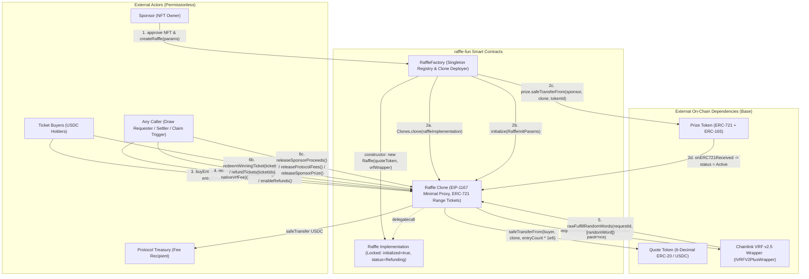
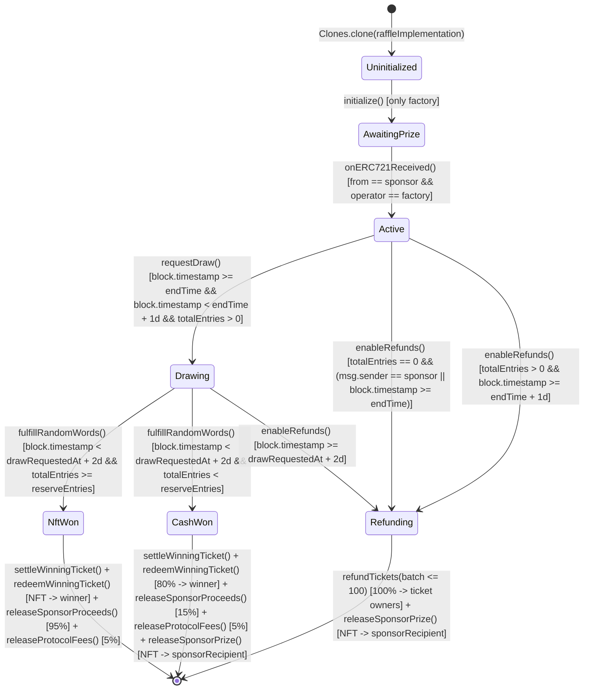
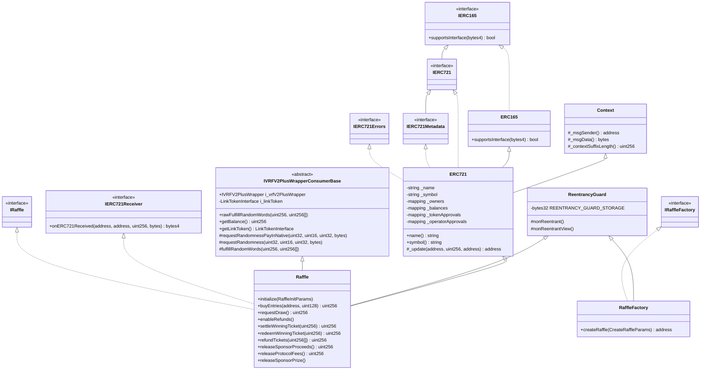

# Deliverable 1: System Documentation — `raffle-fun`

## Phase 2 & Deliverable 1: System Documentation & Specifications (Assessment Area 1)

### 2.1 Plain English System Description

#### System Overview
`raffle-fun` is a non-custodial, permissionless NFT raffle protocol designed for Base (`8453`) and Base Sepolia (`84532`). A sponsor who owns an ERC-721 NFT can create a fixed-price ($1.00 USDC per entry) raffle with a configurable `endTime` (up to 30 days in the future) and a minimum entry target (`reserveEntries >= 1`). Buyers purchase contiguous blocks of entries, each represented by a single transferable ERC-721 range-ticket NFT minted by the `Raffle` contract itself. Once `endTime` arrives, any caller can pay the native ETH Chainlink VRF v2.5 Direct Funding fee within a 24-hour window (`DRAW_REQUEST_TIMEOUT = 1 days`) to request a single random word. When the Chainlink VRF v2.5 wrapper fulfills the request within a 48-hour callback window (`DRAW_CALLBACK_TIMEOUT = 2 days`), the contract selects a 1-indexed `winningEntry` in `[1, totalEntries]` and transitions to `NftWon` (if `totalEntries >= reserveEntries`) or `CashWon` (if `totalEntries < reserveEntries`). If no entries were sold, or if either the 24-hour draw request window or the 48-hour VRF callback window expires, anyone (or the sponsor early when `totalEntries == 0`) can transition the raffle to `Refunding`, allowing ticket holders to burn their tickets for a full $1.00/entry USDC refund and the sponsor to reclaim the escrowed NFT.

#### Core Contracts & Modules

1. **`RaffleFactory` ([`packages/contracts/src/RaffleFactory.sol`](file:///Users/hishamel-husseini/.codex/visualizations/2026/10/21/01a15d64-4430-7440-b259-192acf9762b5/raffle-audit-r001/runtime/gemini-native-repairs/TOB/attempt-04/S4/work/packages/contracts/src/RaffleFactory.sol#L36-L186))**:
   - **Purpose**: Singleton factory and registry that validates protocol-level configuration (`quoteToken` with `decimals() == 6`, `vrfWrapper`, `protocolTreasury`), deploys a single locked `Raffle` master implementation in its constructor (`RaffleFactory.sol:89`), and deploys/initializes EIP-1167 minimal proxy clones for each raffle (`RaffleFactory.sol:97-148`).
   - **Key State**:
     - Immutables: `quoteToken` (`RaffleFactory.sol:45`), `vrfWrapper` (`RaffleFactory.sol:48`), `protocolTreasury` (`RaffleFactory.sol:51`), `raffleImplementation` (`RaffleFactory.sol:54`).
     - Constants: `callbackGasLimit = 300_000` (`RaffleFactory.sol:39`), `requestConfirmations = 30` (`RaffleFactory.sol:42`).
     - Registry storage: `raffleCount` (`slot 0`), `raffleById` (`slot 1`), `idByRaffle` (`slot 2`), `isRaffle` (`slot 3`).
   - **Trust & Access Control**: Completely permissionless. Has no owner or admin role. Only `RaffleFactory` can initialize its freshly cloned `Raffle` instances (`Raffle.sol:178`) and deposit the escrowed ERC-721 prize NFT into `Raffle.onERC721Received` (`Raffle.sol:426-431`).

2. **`Raffle` ([`packages/contracts/src/Raffle.sol`](file:///Users/hishamel-husseini/.codex/visualizations/2026/10/21/01a15d64-4430-7440-b259-192acf9762b5/raffle-audit-r001/runtime/gemini-native-repairs/TOB/attempt-04/S4/work/packages/contracts/src/Raffle.sol#L65-L614))**:
   - **Purpose**: Per-raffle clone contract that simultaneously acts as:
     1. The escrow vault for the sponsor's ERC-721 prize NFT and buyers' 6-decimal USDC entry payments.
     2. An ERC-721 token contract (`name = "Raffle Ticket"`, `symbol = "RAFFLE-TICKET"`) where each minted token ID `1..ticketCount` represents a contiguous range of entries `[firstEntry, lastEntry]`.
     3. A Chainlink VRF v2.5 Direct Funding consumer (`VRFV2PlusWrapperConsumerBase`).
     4. A pull-payment settlement engine for winner prizes/cash, sponsor proceeds/prize returns, protocol fees, and ticket holder refunds.
   - **Lifecycle States (`IRaffle.Status` at [`IRaffle.sol:13-22`](file:///Users/hishamel-husseini/.codex/visualizations/2026/10/21/01a15d64-4430-7440-b259-192acf9762b5/raffle-audit-r001/runtime/gemini-native-repairs/TOB/attempt-04/S4/work/packages/contracts/src/interfaces/IRaffle.sol#L13-L22))**:
     - `Uninitialized (0)`: Default state of a newly cloned proxy before `initialize` runs.
     - `AwaitingPrize (1)`: Transient state set by `initialize()` (`Raffle.sol:205`) within `RaffleFactory.createRaffle` before `prize.safeTransferFrom(msg.sender, raffle, params.prizeTokenId)` triggers `onERC721Received`.
     - `Active (2)`: Set by `onERC721Received` (`Raffle.sol:434`); entry purchases via `buyEntries` are open while `block.timestamp < endTime`.
     - `Drawing (3)`: Set by `requestDraw()` (`Raffle.sol:252`) when `endTime <= block.timestamp < endTime + 1 days` and `totalEntries > 0`; awaits Chainlink VRF v2.5 callback.
     - `NftWon (4)`: Terminal outcome set by `fulfillRandomWords` (`Raffle.sol:520`) when `totalEntries >= reserveEntries`.
     - `CashWon (5)`: Terminal outcome set by `fulfillRandomWords` (`Raffle.sol:520`) when `totalEntries < reserveEntries`.
     - `Refunding (6)`: Terminal outcome set by `enableRefunds()` (`Raffle.sol:299`) (or on the master implementation in its constructor at `Raffle.sol:165`).

3. **`RaffleConstants` ([`packages/contracts/src/libraries/RaffleConstants.sol`](file:///Users/hishamel-husseini/.codex/visualizations/2026/10/21/01a15d64-4430-7440-b259-192acf9762b5/raffle-audit-r001/runtime/gemini-native-repairs/TOB/attempt-04/S4/work/packages/contracts/src/libraries/RaffleConstants.sol#L10-L43))**:
   - **Purpose**: Compile-time constants shared by `Raffle` and `RaffleFactory`:
     - `BPS = 10_000`, `PROTOCOL_FEE_BPS = 500` (5%), `CASH_WINNER_BPS = 8_000` (80%)
     - `ENTRY_PRICE = 1_000_000` ($1.00 in 6-decimal USDC), `QUOTE_TOKEN_DECIMALS = 6`
     - `MAX_REFUND_TICKET_BATCH_SIZE = 100`, `MAX_SALE_DURATION = 30 days`
     - `DRAW_REQUEST_TIMEOUT = 1 days`, `DRAW_CALLBACK_TIMEOUT = 2 days`
     - `VRF_CALLBACK_GAS_LIMIT = 300_000`, `VRF_REQUEST_CONFIRMATIONS = 30`

---

### 2.2 Architectural Diagrams

> [!NOTE]
> Slither's graph printers (`slither . --print inheritance-graph,call-graph`) were executed natively on `Solc 0.8.36`, producing 25 Graphviz `.dot` files under `scratch/diagrams/slither/` (logged in `scratch/tool-logs/slither-graph-printers.log`). Because the Graphviz `dot` binary is not installed on the macOS host (`which dot` -> `dot not found`), the exact structures from `scratch/diagrams/slither/inheritance-graph.dot`, `scratch/diagrams/slither/Raffle.call-graph.dot`, and `scratch/diagrams/slither/RaffleFactory.call-graph.dot` are rendered below in Mermaid alongside the system architecture and state machine diagrams.

#### Diagram 1: System Architecture & Trust Boundaries



#### Diagram 2: Complete `Raffle` State Machine (`IRaffle.Status`)



#### Diagram 3: Inheritance Hierarchy (from `scratch/diagrams/slither/inheritance-graph.dot`)



---

### 2.3 Documentation Gaps Analysis & NatSpec Completeness Review

We audited every contract, interface, library, struct, enum, event, error, state variable, and function across all 5 owned Solidity files for NatSpec completeness (`@title`, `@author`, `@notice`, `@dev`, `@param`, `@return`, `@inheritdoc`).

#### Identified Documentation & Specification Gaps

| # | Location (`file:line`) | Element | Gap Description | Severity |
|---|---|---|---|---|
| D-1 | [`packages/contracts/src/libraries/RaffleConstants.sol:10-42`](file:///Users/hishamel-husseini/.codex/visualizations/2026/10/21/01a15d64-4430-7440-b259-192acf9762b5/raffle-audit-r001/runtime/gemini-native-repairs/TOB/attempt-04/S4/work/packages/contracts/src/libraries/RaffleConstants.sol#L10-L42) | `library RaffleConstants` and all 11 constants (`BPS`, `PROTOCOL_FEE_BPS`, `CASH_WINNER_BPS`, `ENTRY_PRICE`, `QUOTE_TOKEN_DECIMALS`, `MAX_REFUND_TICKET_BATCH_SIZE`, `MAX_SALE_DURATION`, `DRAW_REQUEST_TIMEOUT`, `DRAW_CALLBACK_TIMEOUT`, `VRF_CALLBACK_GAS_LIMIT`, `VRF_REQUEST_CONFIRMATIONS`) | Only the library header has `@title`/`@notice`; none of the 11 constants have `@notice` or `@dev` explaining units (e.g., basis points out of `10_000`, `1_000_000` in 6-decimal USDC base units, seconds vs blocks). | Low |
| D-2 | [`packages/contracts/src/Raffle.sol:69-77`](file:///Users/hishamel-husseini/.codex/visualizations/2026/10/21/01a15d64-4430-7440-b259-192acf9762b5/raffle-audit-r001/runtime/gemini-native-repairs/TOB/attempt-04/S4/work/packages/contracts/src/Raffle.sol#L69-L77) | `ENTRY_PRICE`, `callbackGasLimit`, `requestConfirmations` constants in `Raffle` | All other 31 public state variables in `Raffle.sol` (`lines 80-150`) include `/// @inheritdoc IRaffle`, whereas `ENTRY_PRICE` (`line 69`), `callbackGasLimit` (`line 72`), and `requestConfirmations` (`line 76`) omit `/// @inheritdoc IRaffle`. | Low |
| D-3 | [`packages/contracts/src/Raffle.sol:1-614`](file:///Users/hishamel-husseini/.codex/visualizations/2026/10/21/01a15d64-4430-7440-b259-192acf9762b5/raffle-audit-r001/runtime/gemini-native-repairs/TOB/attempt-04/S4/work/packages/contracts/src/Raffle.sol#L1-L65) & [`packages/contracts/src/RaffleFactory.sol:1-36`](file:///Users/hishamel-husseini/.codex/visualizations/2026/10/21/01a15d64-4430-7440-b259-192acf9762b5/raffle-audit-r001/runtime/gemini-native-repairs/TOB/attempt-04/S4/work/packages/contracts/src/RaffleFactory.sol#L1-L36) | All 5 owned files | None of the 5 owned files include an `@author` or `@custom:security-contact` NatSpec tag at the contract/interface/library level. | Low |
| D-4 | [`packages/contracts/src/Raffle.sol:478-487`](file:///Users/hishamel-husseini/.codex/visualizations/2026/10/21/01a15d64-4430-7440-b259-192acf9762b5/raffle-audit-r001/runtime/gemini-native-repairs/TOB/attempt-04/S4/work/packages/contracts/src/Raffle.sol#L478-L487) | `Raffle.name()` and `Raffle.symbol()` | Both functions have `@notice` but omit `@return` (or `@inheritdoc IERC721Metadata`). | Low |
| D-5 | [`packages/contracts/src/Raffle.sol:65`](file:///Users/hishamel-husseini/.codex/visualizations/2026/10/21/01a15d64-4430-7440-b259-192acf9762b5/raffle-audit-r001/runtime/gemini-native-repairs/TOB/attempt-04/S4/work/packages/contracts/src/Raffle.sol#L65) & [`packages/contracts/src/interfaces/IRaffle.sol`](file:///Users/hishamel-husseini/.codex/visualizations/2026/10/21/01a15d64-4430-7440-b259-192acf9762b5/raffle-audit-r001/runtime/gemini-native-repairs/TOB/attempt-04/S4/work/packages/contracts/src/interfaces/IRaffle.sol) | Inherited `VRFV2PlusWrapperConsumerBase` ABI (`rawFulfillRandomWords`, `getBalance`, `getLinkToken`, `i_vrfV2PlusWrapper`) | `Raffle` inherits 4 public/external selectors from `VRFV2PlusWrapperConsumerBase` (`VRFV2PlusWrapperConsumerBase.sol:35, 101-120`), none of which are documented in `IRaffle.sol` or `DESIGN.md`. Specifically, `getBalance()` returns `address(this).balance` despite `VRFV2PlusWrapperConsumerBase`'s own NatSpec falsely stating *"Return the current LINK balance of the contract"* (`VRFV2PlusWrapperConsumerBase.sol:111`). | Low |
| D-6 | [`DESIGN.md:100`](file:///Users/hishamel-husseini/.codex/visualizations/2026/10/21/01a15d64-4430-7440-b259-192acf9762b5/raffle-audit-r001/runtime/gemini-native-repairs/TOB/attempt-04/S4/work/DESIGN.md#L100) vs [`Raffle.sol:489-504`](file:///Users/hishamel-husseini/.codex/visualizations/2026/10/21/01a15d64-4430-7440-b259-192acf9762b5/raffle-audit-r001/runtime/gemini-native-repairs/TOB/attempt-04/S4/work/packages/contracts/src/Raffle.sol#L489-L504) | Ticket transferability during `Drawing` / after `RaffleResolved` | `DESIGN.md:100` states that *"Valid ticket transfers naturally move future winner or refund claims to the current ERC-721 owner because redemption and refunds check `ownerOf(ticketId)` at claim time"*, but does not warn integrators or users that tickets remain transferable *during* `Drawing` and *after* `RaffleResolved` (`NftWon`/`CashWon`), creating secondary-market front-running exposure if a ticket is listed on an NFT marketplace when VRF resolves. | Medium |

#### Recommended NatSpec Additions Template (`RaffleConstants.sol` and `Raffle.sol`)

```solidity
/// @title RaffleConstants
/// @author raffle-fun
/// @custom:security-contact security@raffle.fun
/// @notice Shared protocol constants for the raffle-fun contracts.
library RaffleConstants {
    /// @notice Basis points denominator representing 100% (10,000 bps).
    uint16 internal constant BPS = 10_000;

    /// @notice Protocol fee share in basis points (500 bps = 5.00% of gross sales on resolved raffles).
    uint16 internal constant PROTOCOL_FEE_BPS = 500;

    /// @notice Cash winner share in basis points when `totalEntries < reserveEntries` (8,000 bps = 80.00% of gross sales; remaining 1,500 bps = 15.00% goes to sponsor).
    uint16 internal constant CASH_WINNER_BPS = 8_000;

    /// @notice Fixed price per raffle entry in 6-decimal quote token base units (1_000_000 = 1.00 USDC).
    uint256 internal constant ENTRY_PRICE = 1_000_000;
    // ...
}
```

---

