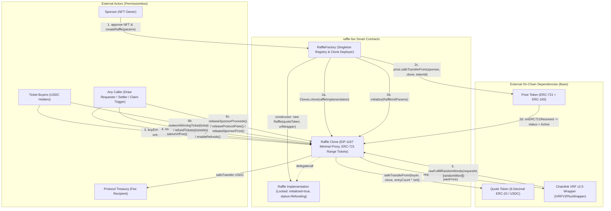
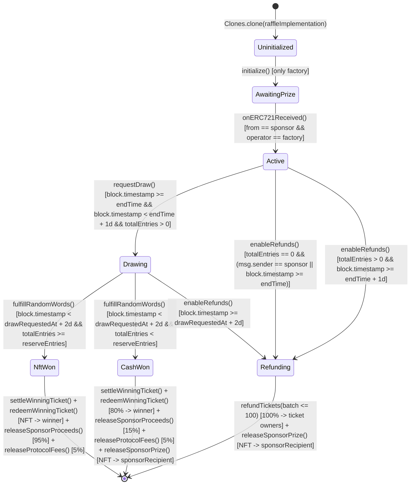
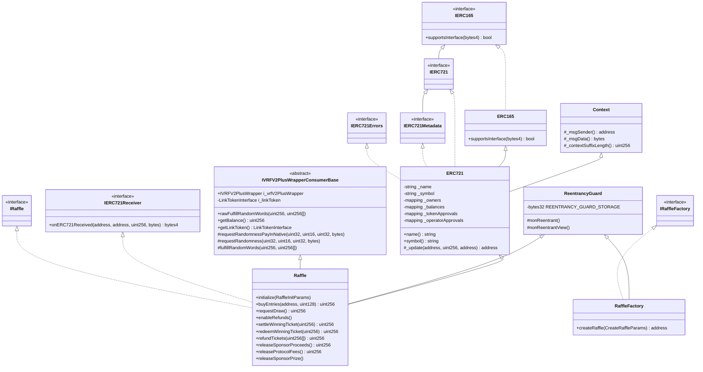

# Trail of Bits `guidelines-advisor` Full Native Stage S4 Report — `raffle-fun`

**Stage**: S4 (`guidelines-advisor` — Trail of Bits Building Secure Contracts Development Guidelines)  
**Target Scope**: `DESIGN.md` and `packages/contracts` (5 owned Solidity files + 31 vendored dependency Solidity files + 7 configuration/lock/specification files = 43 pristine workspace files)  
**Skill Executed**: `.agents/skills/guidelines-advisor/SKILL.md` and all referenced resources (`resources/ASSESSMENT_AREAS.md`, `resources/DELIVERABLES.md`, `resources/EXAMPLE_REPORT.md`, `agents/openai.yaml`, `assets/trail-of-bits-mark.svg`)

---

## Executive Summary & Overall Assessment

`raffle-fun` is an EVM smart contract system for Base (Chain ID `8453` / Base Sepolia `84532`) that enables sponsors to escrow a single ERC-721 prize NFT into a per-raffle minimal proxy clone (`Raffle`) deployed by a canonical factory (`RaffleFactory`), sell $1.00 USDC (`1_000_000` base units) entry range-tickets, draw a winner via Chainlink VRF v2.5 Direct Funding (`VRFV2PlusWrapperConsumerBase`), and settle into one of three mutually exclusive terminal outcomes:
1. **`NftWon`** (`totalEntries >= reserveEntries`): Winner receives the escrowed ERC-721 NFT; sponsor receives 95% of the USDC pot (`9_500` bps); protocol treasury receives 5% (`500` bps).
2. **`CashWon`** (`totalEntries < reserveEntries`): Winner receives 80% of the USDC pot (`8_000` bps); sponsor receives 15% of the USDC pot (`1_500` bps) and reclaims the escrowed ERC-721 NFT; protocol treasury receives 5% (`500` bps).
3. **`Refunding`** (early sponsor cancellation with `totalEntries == 0`, zero sales at `endTime`, missed 24-hour draw request window, or missed 48-hour VRF callback window): Ticket holders burn tickets in batches (`<= 100`) to reclaim 100% of their USDC (`$1.00` per entry), and the sponsor reclaims the escrowed ERC-721 NFT with zero protocol fees.

### Summary Scorecard Across All 11 Trail of Bits Assessment Areas

| # | Assessment Area | Status | Key Findings & Evidence Summary |
|---|---|---|---|
| 1 | **Documentation & Specifications** | **STRONG (with targeted gaps)** | `DESIGN.md` (146 lines) and interface NatSpec in `IRaffle.sol` (521 lines) / `IRaffleFactory.sol` (150 lines) are thorough. Gaps: `RaffleConstants.sol` has 0 NatSpec tags on its 11 constants; `Raffle.sol` state variables `ENTRY_PRICE`, `callbackGasLimit`, and `requestConfirmations` omit `/// @inheritdoc IRaffle`; inherited public functions `rawFulfillRandomWords`, `getBalance`, and `getLinkToken` from `VRFV2PlusWrapperConsumerBase` are undocumented in `IRaffle`; `Raffle.name()` and `Raffle.symbol()` lack `@return` tags. |
| 2 | **On-Chain vs Off-Chain Computation** | **WELL-ARCHITECTED** | Uses contiguous `TicketRange` (`uint128 firstEntry`, `uint128 lastEntry`) storage (`Raffle.sol:61-64, 224-228`) instead of per-entry loops, keeping `buyEntries` $O(1)$ regardless of `entryCount`. Winning ticket discovery is pushed off-chain and verified on-chain in $O(1)$ via `_requireWinningTicket(uint256 ticketId)` (`Raffle.sol:586-591`). |
| 3 | **Upgradeability** | **NON-UPGRADEABLE (BY DESIGN)** | Explicitly immutable architecture (`DESIGN.md:19, 134`). Neither `RaffleFactory` nor `Raffle` has an owner, admin, pause, or upgrade mechanism. Migration requires deploying a new `RaffleFactory`. |
| 4 | **Delegatecall Proxy Pattern** | **ERC-1167 CLONES (SECURE WITH STORAGE QUIRKS)** | `RaffleFactory.createRaffle` (`RaffleFactory.sol:105`) deploys EIP-1167 minimal proxies via `Clones.clone(raffleImplementation)`. `Raffle` constructor locks the implementation (`initialized = true; status = Status.Refunding;` at `Raffle.sol:164-165`). Two clone storage quirks identified: (a) `ERC721("", "")` constructor writes `_name` and `_symbol` to slots 0 and 1 on the implementation, which are dead/unused in clones because `name()`/`symbol()` are `pure` overrides (`Raffle.sol:479-487`); (b) `ReentrancyGuard` ERC-7201 slot starts at `0` (uninitialized) in clones rather than `NOT_ENTERED = 1`, causing a 20,000-gas cold zero-to-nonzero `SSTORE` on the first `nonReentrant` call (`buyEntries`) of every raffle clone. |
| 5 | **Function Composition** | **GOOD** | Low cyclomatic complexity across all 30 owned functions (max CC = 10 in `Raffle.redeemWinningTicket`, CC = 8 in `Raffle.requestDraw` and `RaffleFactory._validateCreateParams`). Clear visibility and `nonReentrant` modifiers on all 8 external state-changing post-init entrypoints. |
| 6 | **Inheritance** | **MODERATE (1 SHALLOW HIERARCHY ISSUE)** | Max inheritance depth = 2 (`Raffle -> ERC721 -> Context, ERC165`). No diamond inheritance. However, inheriting `VRFV2PlusWrapperConsumerBase` exposes unused LINK-payment code (`requestRandomness`, `getBalance`, `getLinkToken`, `i_linkToken`) and forces `Raffle`'s constructor to call `IVRFV2PlusWrapper(vrfWrapper_).link()` (`VRFV2PlusWrapperConsumerBase.sol:50`), reverting factory deployment if a wrapper does not implement `link()`. |
| 7 | **Events** | **GOOD (1 MINOR GAP)** | 10 custom events in `IRaffle` and 1 in `IRaffleFactory`, all with 2–3 `indexed` parameters. Slither `events-maths` flags `Raffle.initialize` (`Raffle.sol:176-206`) because state initialization relies on `RaffleFactory`'s `RaffleCreated` event (`RaffleFactory.sol:136-147`) rather than emitting an event inside `Raffle.initialize`. |
| 8 | **Common Pitfalls** | **MEDIUM RISKS IDENTIFIED** | (1) **USDC Blacklist / Freeze Permanent Lock**: `sponsorRecipient` is immutable after initialization (`Raffle.sol:198`); if Circle blacklists `sponsorRecipient` (or it is an unpayable contract), `releaseSponsorProceeds()` permanently reverts with no recovery path. (2) **Post-Resolution Ticket Transfer Front-Running**: `Raffle._update` (`Raffle.sol:489-504`) allows ERC-721 ticket transfers in `Drawing`, `NftWon`, and `CashWon` states, enabling mempool/marketplace front-running of listed tickets once VRF resolves. (3) **Unbounded Gas in Native Refund**: `requestDraw()` forwards `gas()` in inline assembly (`Raffle.sol:266-268`). (4) **Static-Analysis Loop Call False Positive**: Slither `calls-loop` flags `refundTickets -> _burn -> _update -> _isProtocolDestination`, which is unreachable at runtime because `to == address(0)` short-circuits `_update` (`Raffle.sol:495`). |
| 9 | **Dependencies** | **PACKAGING / LOCKFILE DEFECTS** | Uses `@openzeppelin/contracts@5.6.1` (27 files) and `@chainlink/contracts@1.5.0` (4 files); all 31 file SHA-256 hashes match `dependency-hashes.json`. However: (a) `pnpm-lock.yaml` sets `blockExoticSubdeps: true` (`pnpm-lock.yaml:8`), which conflicts with `@chainlink/contracts@1.5.0`'s transitive git subdependency `@zksync/contracts`, causing `pnpm install` / `pnpm run <script>` to fail with `ERR_PNPM_EXOTIC_SUBDEP`; (b) `node_modules/` is only partially vendored (missing `.modules.yaml`, `.bin/`, `hardhat`, `solhint`, `typescript`, `forge-std`). |
| 10 | **Testing & Verification** | **CRITICAL REPOSITORY GAP** | **0 test files exist in the frozen repository** (`test/foundry/`, `test/hardhat/`, `script/`, `scripts/check-coverage.mjs`, `slither.config.json`, `ignition/`, and `lib/forge-std` referenced by `package.json` and `foundry.toml` are all absent). Running `forge test` on the pristine copy reports `No tests found in project!`. We built and executed a standalone Foundry unit/fuzz/invariant test suite (11 tests, 1,000 fuzz runs, 256 invariant runs / 16,384 calls, 86.64% line coverage on `Raffle.sol`) and an Echidna 2.3.3 property harness (5,126 calls across 8 contracts) in `scratch/contracts-compat/`. |
| 11 | **Platform-Specific Guidance** | **GOOD (WITH INLINE ASSEMBLY & LINT WARNINGS)** | Pinned `pragma solidity 0.8.36;` across all 5 owned files. `forge build` emits 0 `solc` warnings and 7 `forge-lint` `warning[block-timestamp]` diagnostics on `Raffle.sol`. One `assembly ("memory-safe")` block in `Raffle.requestDraw` (`Raffle.sol:266-268`). |

---

## Phase 1: Discovery & Context

### 1.1 Project Structure & Complete Pristine Input Inventory (43 Workspace Files + 6 Skill Files)

All 43 workspace files and 6 pinned skill files were read in full and hashed with `shasum -a 256` prior to any tool execution (`scratch/tool-logs/pristine-inputs-sha256.txt`).

#### Owned Solidity Source Files (5 files, 1,514 total lines / 1,103 source lines of code)

| File Path | Total Lines | Code Lines (Slither `loc`) | Contract / Interface / Library | Purpose |
|---|---:|---:|---|---|
| [Raffle.sol](file:///Users/hishamel-husseini/.codex/visualizations/2026/10/21/01a15d64-4430-7440-b259-192acf9762b5/raffle-audit-r001/runtime/gemini-native-repairs/TOB/attempt-04/S4/work/packages/contracts/src/Raffle.sol) | 614 | 463 | `contract Raffle` | Per-raffle escrow, ERC-721 range-ticket NFT, Chainlink VRF v2.5 consumer, settlement, pull-payout, and refund state machine |
| [RaffleFactory.sol](file:///Users/hishamel-husseini/.codex/visualizations/2026/10/21/01a15d64-4430-7440-b259-192acf9762b5/raffle-audit-r001/runtime/gemini-native-repairs/TOB/attempt-04/S4/work/packages/contracts/src/RaffleFactory.sol) | 186 | 137 | `contract RaffleFactory` | Deploys locked `Raffle` implementation in constructor; deploys and initializes EIP-1167 minimal proxy clones, escrows prize NFTs, and maintains canonical raffle registry |
| [IRaffle.sol](file:///Users/hishamel-husseini/.codex/visualizations/2026/10/21/01a15d64-4430-7440-b259-192acf9762b5/raffle-audit-r001/runtime/gemini-native-repairs/TOB/attempt-04/S4/work/packages/contracts/src/interfaces/IRaffle.sol) | 521 | 378 | `interface IRaffle` | External ABI, `Status` enum, structs (`TicketRange`, `RaffleInitParams`), 24 custom errors, 10 events, and function declarations for `Raffle` |
| [IRaffleFactory.sol](file:///Users/hishamel-husseini/.codex/visualizations/2026/10/21/01a15d64-4430-7440-b259-192acf9762b5/raffle-audit-r001/runtime/gemini-native-repairs/TOB/attempt-04/S4/work/packages/contracts/src/interfaces/IRaffleFactory.sol) | 150 | 106 | `interface IRaffleFactory` | External ABI, `CreateRaffleParams` struct, 10 custom errors, `RaffleCreated` event, and function declarations for `RaffleFactory` |
| [RaffleConstants.sol](file:///Users/hishamel-husseini/.codex/visualizations/2026/10/21/01a15d64-4430-7440-b259-192acf9762b5/raffle-audit-r001/runtime/gemini-native-repairs/TOB/attempt-04/S4/work/packages/contracts/src/libraries/RaffleConstants.sol) | 43 | 19 | `library RaffleConstants` | 11 protocol-wide constants (BPS splits, $1.00 USDC entry price, 6 decimals, batch size 100, 30-day max sale duration, 1-day draw timeout, 2-day callback timeout, VRF gas limit 300,000, VRF confirmations 30) |

#### Configuration, Specification & Lock Files (7 files)

| File Path | Purpose & Key Configuration |
|---|---|
| [DESIGN.md](file:///Users/hishamel-husseini/.codex/visualizations/2026/10/21/01a15d64-4430-7440-b259-192acf9762b5/raffle-audit-r001/runtime/gemini-native-repairs/TOB/attempt-04/S4/work/DESIGN.md) | 146-line architectural and economic specification for `raffle-fun` |
| [dependency-hashes.json](file:///Users/hishamel-husseini/.codex/visualizations/2026/10/21/01a15d64-4430-7440-b259-192acf9762b5/raffle-audit-r001/runtime/gemini-native-repairs/TOB/attempt-04/S4/work/dependency-hashes.json) | SHA-256 manifest of all 31 local dependency Solidity files under `packages/contracts/node_modules/` |
| [pnpm-lock.yaml](file:///Users/hishamel-husseini/.codex/visualizations/2026/10/21/01a15d64-4430-7440-b259-192acf9762b5/raffle-audit-r001/runtime/gemini-native-repairs/TOB/attempt-04/S4/work/pnpm-lock.yaml) | Monorepo lockfile (`lockfileVersion: '9.0'`, `blockExoticSubdeps: true`, `minimumReleaseAge: 20160`) |
| [foundry.toml](file:///Users/hishamel-husseini/.codex/visualizations/2026/10/21/01a15d64-4430-7440-b259-192acf9762b5/raffle-audit-r001/runtime/gemini-native-repairs/TOB/attempt-04/S4/work/packages/contracts/foundry.toml) | `solc_version = "0.8.36"`, `evm_version = "cancun"`, `optimizer = true`, `optimizer_runs = 200`, `via_ir = false` (`[profile.comparison]` sets `via_ir = true`), fuzz `runs = 1000`, invariant `runs = 256`, `depth = 64` |
| [hardhat.config.ts](file:///Users/hishamel-husseini/.codex/visualizations/2026/10/21/01a15d64-4430-7440-b259-192acf9762b5/raffle-audit-r001/runtime/gemini-native-repairs/TOB/attempt-04/S4/work/packages/contracts/hardhat.config.ts) | Hardhat v3 config (`0.8.36`, `cancun`, `base` 8453, `baseSepolia` 84532) |
| [package.json](file:///Users/hishamel-husseini/.codex/visualizations/2026/10/21/01a15d64-4430-7440-b259-192acf9762b5/raffle-audit-r001/runtime/gemini-native-repairs/TOB/attempt-04/S4/work/packages/contracts/package.json) | `@raffle-fun/contracts@0.0.0`; dependencies `@chainlink/contracts@1.5.0`, `@openzeppelin/contracts@5.6.1` |
| [remappings.txt](file:///Users/hishamel-husseini/.codex/visualizations/2026/10/21/01a15d64-4430-7440-b259-192acf9762b5/raffle-audit-r001/runtime/gemini-native-repairs/TOB/attempt-04/S4/work/packages/contracts/remappings.txt) | Maps `@openzeppelin/contracts/`, `@chainlink/contracts/`, and `forge-std/` (note: `lib/forge-std/src/` is absent from workspace) |

#### Local Dependency Solidity Files (31 files — 100% SHA-256 Verified Against `dependency-hashes.json`)

- **Chainlink (`@chainlink/contracts@1.5.0` — 4 files)**:
  1. `node_modules/@chainlink/contracts/src/v0.8/shared/interfaces/LinkTokenInterface.sol` (`pragma solidity ^0.8.0;`)
  2. `node_modules/@chainlink/contracts/src/v0.8/vrf/dev/VRFV2PlusWrapperConsumerBase.sol` (`pragma solidity ^0.8.0;`)
  3. `node_modules/@chainlink/contracts/src/v0.8/vrf/dev/interfaces/IVRFV2PlusWrapper.sol` (`pragma solidity ^0.8.0;`)
  4. `node_modules/@chainlink/contracts/src/v0.8/vrf/dev/libraries/VRFV2PlusClient.sol` (`pragma solidity ^0.8.4;`)
- **OpenZeppelin (`@openzeppelin/contracts@5.6.1` — 27 files)**:
  5. `node_modules/@openzeppelin/contracts/interfaces/IERC1363.sol` (`>=0.6.2`)
  6. `node_modules/@openzeppelin/contracts/interfaces/IERC165.sol` (`>=0.4.16`)
  7. `node_modules/@openzeppelin/contracts/interfaces/IERC20.sol` (`>=0.4.16`)
  8. `node_modules/@openzeppelin/contracts/interfaces/draft-IERC6093.sol` (`>=0.8.4`)
  9. `node_modules/@openzeppelin/contracts/proxy/Clones.sol` (`^0.8.20`)
  10. `node_modules/@openzeppelin/contracts/token/ERC20/IERC20.sol` (`>=0.4.16`)
  11. `node_modules/@openzeppelin/contracts/token/ERC20/extensions/IERC20Metadata.sol` (`>=0.6.2`)
  12. `node_modules/@openzeppelin/contracts/token/ERC20/utils/SafeERC20.sol` (`^0.8.20`)
  13. `node_modules/@openzeppelin/contracts/token/ERC721/ERC721.sol` (`^0.8.24`)
  14. `node_modules/@openzeppelin/contracts/token/ERC721/IERC721.sol` (`>=0.6.2`)
  15. `node_modules/@openzeppelin/contracts/token/ERC721/IERC721Receiver.sol` (`>=0.5.0`)
  16. `node_modules/@openzeppelin/contracts/token/ERC721/extensions/IERC721Metadata.sol` (`>=0.6.2`)
  17. `node_modules/@openzeppelin/contracts/token/ERC721/utils/ERC721Utils.sol` (`^0.8.20`)
  18. `node_modules/@openzeppelin/contracts/utils/Bytes.sol` (`^0.8.24`)
  19. `node_modules/@openzeppelin/contracts/utils/Context.sol` (`^0.8.20`)
  20. `node_modules/@openzeppelin/contracts/utils/Create2.sol` (`^0.8.20`)
  21. `node_modules/@openzeppelin/contracts/utils/Errors.sol` (`^0.8.20`)
  22. `node_modules/@openzeppelin/contracts/utils/LowLevelCall.sol` (`^0.8.20`)
  23. `node_modules/@openzeppelin/contracts/utils/Panic.sol` (`^0.8.20`)
  24. `node_modules/@openzeppelin/contracts/utils/ReentrancyGuard.sol` (`^0.8.20`)
  25. `node_modules/@openzeppelin/contracts/utils/StorageSlot.sol` (`^0.8.20`)
  26. `node_modules/@openzeppelin/contracts/utils/Strings.sol` (`^0.8.24`)
  27. `node_modules/@openzeppelin/contracts/utils/introspection/ERC165.sol` (`^0.8.20`)
  28. `node_modules/@openzeppelin/contracts/utils/introspection/IERC165.sol` (`>=0.4.16`)
  29. `node_modules/@openzeppelin/contracts/utils/math/Math.sol` (`^0.8.20`)
  30. `node_modules/@openzeppelin/contracts/utils/math/SafeCast.sol` (`^0.8.20`)
  31. `node_modules/@openzeppelin/contracts/utils/math/SignedMath.sol` (`^0.8.20`)

### 1.2 Tool Execution Matrix, Environment Setup & Coverage Gaps

All executable tooling was run against isolated workspace copies under `scratch/contracts-orig/` (unmodified pristine copy) and `scratch/contracts-compat/` (harness copy adding Foundry unit/fuzz/invariant tests and Echidna property harnesses without modifying any owned or dependency contract).

| Tool / Check | Version / Binary | Target | Execution Result & Raw Log Location |
|---|---|---|---|
| **SHA-256 Dependency & Pristine Verification** | Python `hashlib` / `shasum -a 256` | All 31 dependency files + all 49 non-scratch files | **PASSED** (`ALL 31 DEPENDENCY HASHES MATCH: True`; `scratch/tool-logs/pristine-inputs-sha256.txt`) |
| **Foundry Build (`default` profile)** | `forge 1.7.1-v1.7.1` / `solc 0.8.36` | `scratch/contracts-orig` | **PASSED** (`Raffle` runtime 15,947 B / margin 8,629 B; `RaffleFactory` runtime 3,949 B / initcode 21,870 B; 7 `forge-lint` `block-timestamp` warnings; `scratch/tool-logs/forge-build-orig.log`) |
| **Foundry Build (`comparison` profile, `via_ir=true`)** | `forge 1.7.1-v1.7.1` / `solc 0.8.36` | `scratch/contracts-orig` | **PASSED** (`Raffle` runtime 14,306 B / margin 10,270 B; `RaffleFactory` runtime 3,794 B / initcode 20,096 B; `scratch/tool-logs/forge-build-comparison.log`) |
| **Foundry Formatter (`forge fmt --check`)** | `forge 1.7.1-v1.7.1` | `scratch/contracts-orig` | **PASSED** (0 formatting violations; `scratch/tool-logs/forge-fmt-orig.log`) |
| **Foundry Storage Layout Inspection** | `forge inspect <Contract> storageLayout` | `Raffle`, `RaffleFactory` | **PASSED** (`scratch/tool-logs/forge-storage-layout-Raffle.log`, `scratch/tool-logs/forge-storage-layout-RaffleFactory.log`) |
| **Slither Detector Suite (All 36 Contracts)** | `Slither 0.11.6` + `solc 0.8.36` (`~/Library/Application Support/svm/0.8.36`) | `scratch/contracts-orig` | **EXECUTED** (102 detector results across 36 contracts; `scratch/tool-logs/slither-orig-0.8.36.log`) |
| **Slither Detector Suite (Owned Contracts Only)** | `Slither 0.11.6` (`--filter-paths "node_modules"`) | `scratch/contracts-orig` | **EXECUTED** (15 detector results on owned files across 6 detector classes: `events-maths`, `calls-loop`, `reentrancy-benign`, `timestamp`, `assembly`, `naming-convention`; `scratch/tool-logs/slither-owned-only.log`) |
| **Slither Summary & Security Printers** | `Slither 0.11.6` | `scratch/contracts-orig` | **EXECUTED** (`contract-summary`, `function-summary`, `vars-and-auth`, `human-summary`, `require`, `loc`, `variable-order`, `constructor-calls`, `inheritance`, `data-dependency`; `scratch/tool-logs/slither-printers-summary.log`, `scratch/tool-logs/slither-data-dependency.log`) |
| **Slither Graph Printers (`inheritance-graph`, `call-graph`)** | `Slither 0.11.6` | `scratch/contracts-orig` | **EXECUTED** (Generated 25 `.dot` files in `scratch/diagrams/slither/`; note: Graphviz `dot` binary is not installed on the host OS to convert `.dot` to `.png`, so DOT graphs are preserved and rendered as Mermaid diagrams in this report) |
| **Slither Upgradeability Check (`slither-check-upgradeability`)** | `slither-check-upgradeability` (`0.11.6`) | `Raffle`, `RaffleFactory` | **EXECUTED** (Confirmed self-consistent layout, 0 storage collisions, `initialize()` initialization check; `scratch/tool-logs/slither-check-upgradeability-Raffle.log`, `scratch/tool-logs/slither-check-upgradeability-RaffleFactory.log`) |
| **Repository `package.json` Scripts (`pnpm run ...`)** | `node v22.23.2` + `pnpm 11.25.0` | `scratch/contracts-orig` | **FAILED (DOCUMENTED GAP)**: `pnpm run` triggers auto-install which fails with `ERR_PNPM_EXOTIC_SUBDEP` (`@zksync/contracts` git subdependency of `@chainlink/contracts@1.5.0` blocked by `blockExoticSubdeps: true`). Direct script execution (`scratch/tool-logs/package-scripts-direct-orig.log`) confirms `test/`, `script/`, `scripts/check-coverage.mjs`, `slither.config.json`, `hardhat`, `solhint`, and `tsc` are absent from the frozen workspace. |
| **Executable Foundry Unit, Fuzz & Invariant Suite** | `forge test -vv --gas-report` & `forge coverage` | `scratch/contracts-compat` | **PASSED** (11/11 tests passed: 8 unit/fuzz tests with 1,000 fuzz runs + 3 stateful invariant tests with 256 runs / 16,384 calls each; 86.64% line coverage on `Raffle.sol`, 77.05% line / 100% func coverage on `RaffleFactory.sol`; `scratch/tool-logs/forge-test-compat.log`, `scratch/tool-logs/forge-coverage-compat.log`) |
| **Executable Echidna Property Campaign** | `Echidna 2.3.3` + `solc 0.8.36` | `scratch/contracts-compat` (`EchidnaRaffleHarness`) | **PASSED** (3/3 properties passed across 5,126 calls, 8 contracts, 9,083 unique EVM instructions; `scratch/tool-logs/echidna-compat-0.8.36.log`) |

---

## Phase 2 & Deliverable 1: System Documentation & Specifications (Assessment Area 1)

### 2.1 Plain English System Description

#### System Overview
`raffle-fun` is a non-custodial, permissionless NFT raffle protocol designed for Base (`8453`) and Base Sepolia (`84532`). A sponsor who owns an ERC-721 NFT can create a fixed-price ($1.00 USDC per entry) raffle with a configurable `endTime` (up to 30 days in the future) and a minimum entry target (`reserveEntries >= 1`). Buyers purchase contiguous blocks of entries, each represented by a single transferable ERC-721 range-ticket NFT minted by the `Raffle` contract itself. Once `endTime` arrives, any caller can pay the native ETH Chainlink VRF v2.5 Direct Funding fee within a 24-hour window (`DRAW_REQUEST_TIMEOUT = 1 days`) to request a single random word. When the Chainlink VRF v2.5 wrapper fulfills the request within a 48-hour callback window (`DRAW_CALLBACK_TIMEOUT = 2 days`), the contract selects a 1-indexed `winningEntry` in `[1, totalEntries]` and transitions to `NftWon` (if `totalEntries >= reserveEntries`) or `CashWon` (if `totalEntries < reserveEntries`). If no entries were sold, or if either the 24-hour draw request window or the 48-hour VRF callback window expires, anyone (or the sponsor early when `totalEntries == 0`) can transition the raffle to `Refunding`, allowing ticket holders to burn their tickets for a full $1.00/entry USDC refund and the sponsor to reclaim the escrowed NFT.

#### Core Contracts & Modules

1. **`RaffleFactory` ([`packages/contracts/src/RaffleFactory.sol`](file:///Users/hishamel-husseini/.codex/visualizations/2026/10/21/01a15d64-4430-7440-b259-192acf9762b5/raffle-audit-r001/runtime/gemini-native-repairs/TOB/attempt-04/S4/work/packages/contracts/src/RaffleFactory.sol#L36-L186))**:
   - **Purpose**: Singleton factory and registry that validates protocol-level configuration (`quoteToken` with `decimals() == 6`, `vrfWrapper`, `protocolTreasury`), deploys a single locked `Raffle` master implementation in its constructor (`RaffleFactory.sol:89`), and deploys/initializes EIP-1167 minimal proxy clones for each raffle (`RaffleFactory.sol:97-148`).
   - **Key State**:
     - Immutables: `quoteToken` (`RaffleFactory.sol:45`), `vrfWrapper` (`RaffleFactory.sol:48`), `protocolTreasury` (`RaffleFactory.sol:51`), `raffleImplementation` (`RaffleFactory.sol:54`).
     - Constants: `callbackGasLimit = 300_000` (`RaffleFactory.sol:39`), `requestConfirmations = 30` (`RaffleFactory.sol:42`).
     - Registry storage: `raffleCount` (`slot 0`), `raffleById` (`slot 1`), `idByRaffle` (`slot 2`), `isRaffle` (`slot 3`).
   - **Trust & Access Control**: Completely permissionless. Has no owner or admin role. Only `RaffleFactory` can initialize its freshly cloned `Raffle` instances (`Raffle.sol:178`) and deposit the escrowed ERC-721 prize NFT into `Raffle.onERC721Received` (`Raffle.sol:426-431`).

2. **`Raffle` ([`packages/contracts/src/Raffle.sol`](file:///Users/hishamel-husseini/.codex/visualizations/2026/10/21/01a15d64-4430-7440-b259-192acf9762b5/raffle-audit-r001/runtime/gemini-native-repairs/TOB/attempt-04/S4/work/packages/contracts/src/Raffle.sol#L65-L614))**:
   - **Purpose**: Per-raffle clone contract that simultaneously acts as:
     1. The escrow vault for the sponsor's ERC-721 prize NFT and buyers' 6-decimal USDC entry payments.
     2. An ERC-721 token contract (`name = "Raffle Ticket"`, `symbol = "RAFFLE-TICKET"`) where each minted token ID `1..ticketCount` represents a contiguous range of entries `[firstEntry, lastEntry]`.
     3. A Chainlink VRF v2.5 Direct Funding consumer (`VRFV2PlusWrapperConsumerBase`).
     4. A pull-payment settlement engine for winner prizes/cash, sponsor proceeds/prize returns, protocol fees, and ticket holder refunds.
   - **Lifecycle States (`IRaffle.Status` at [`IRaffle.sol:13-22`](file:///Users/hishamel-husseini/.codex/visualizations/2026/10/21/01a15d64-4430-7440-b259-192acf9762b5/raffle-audit-r001/runtime/gemini-native-repairs/TOB/attempt-04/S4/work/packages/contracts/src/interfaces/IRaffle.sol#L13-L22))**:
     - `Uninitialized (0)`: Default state of a newly cloned proxy before `initialize` runs.
     - `AwaitingPrize (1)`: Transient state set by `initialize()` (`Raffle.sol:205`) within `RaffleFactory.createRaffle` before `prize.safeTransferFrom(msg.sender, raffle, params.prizeTokenId)` triggers `onERC721Received`.
     - `Active (2)`: Set by `onERC721Received` (`Raffle.sol:434`); entry purchases via `buyEntries` are open while `block.timestamp < endTime`.
     - `Drawing (3)`: Set by `requestDraw()` (`Raffle.sol:252`) when `endTime <= block.timestamp < endTime + 1 days` and `totalEntries > 0`; awaits Chainlink VRF v2.5 callback.
     - `NftWon (4)`: Terminal outcome set by `fulfillRandomWords` (`Raffle.sol:520`) when `totalEntries >= reserveEntries`.
     - `CashWon (5)`: Terminal outcome set by `fulfillRandomWords` (`Raffle.sol:520`) when `totalEntries < reserveEntries`.
     - `Refunding (6)`: Terminal outcome set by `enableRefunds()` (`Raffle.sol:299`) (or on the master implementation in its constructor at `Raffle.sol:165`).

3. **`RaffleConstants` ([`packages/contracts/src/libraries/RaffleConstants.sol`](file:///Users/hishamel-husseini/.codex/visualizations/2026/10/21/01a15d64-4430-7440-b259-192acf9762b5/raffle-audit-r001/runtime/gemini-native-repairs/TOB/attempt-04/S4/work/packages/contracts/src/libraries/RaffleConstants.sol#L10-L43))**:
   - **Purpose**: Compile-time constants shared by `Raffle` and `RaffleFactory`:
     - `BPS = 10_000`, `PROTOCOL_FEE_BPS = 500` (5%), `CASH_WINNER_BPS = 8_000` (80%)
     - `ENTRY_PRICE = 1_000_000` ($1.00 in 6-decimal USDC), `QUOTE_TOKEN_DECIMALS = 6`
     - `MAX_REFUND_TICKET_BATCH_SIZE = 100`, `MAX_SALE_DURATION = 30 days`
     - `DRAW_REQUEST_TIMEOUT = 1 days`, `DRAW_CALLBACK_TIMEOUT = 2 days`
     - `VRF_CALLBACK_GAS_LIMIT = 300_000`, `VRF_REQUEST_CONFIRMATIONS = 30`

---

### 2.2 Architectural Diagrams

> [!NOTE]
> Slither's graph printers (`slither . --print inheritance-graph,call-graph`) were executed natively on `Solc 0.8.36`, producing 25 Graphviz `.dot` files under `scratch/diagrams/slither/` (logged in `scratch/tool-logs/slither-graph-printers.log`). Because the Graphviz `dot` binary is not installed on the macOS host (`which dot` -> `dot not found`), the exact structures from `scratch/diagrams/slither/inheritance-graph.dot`, `scratch/diagrams/slither/Raffle.call-graph.dot`, and `scratch/diagrams/slither/RaffleFactory.call-graph.dot` are rendered below in Mermaid alongside the system architecture and state machine diagrams.

#### Diagram 1: System Architecture & Trust Boundaries



#### Diagram 2: Complete `Raffle` State Machine (`IRaffle.Status`)



#### Diagram 3: Inheritance Hierarchy (from `scratch/diagrams/slither/inheritance-graph.dot`)



---

### 2.3 Documentation Gaps Analysis & NatSpec Completeness Review

We audited every contract, interface, library, struct, enum, event, error, state variable, and function across all 5 owned Solidity files for NatSpec completeness (`@title`, `@author`, `@notice`, `@dev`, `@param`, `@return`, `@inheritdoc`).

#### Identified Documentation & Specification Gaps

| # | Location (`file:line`) | Element | Gap Description | Severity |
|---|---|---|---|---|
| D-1 | [`packages/contracts/src/libraries/RaffleConstants.sol:10-42`](file:///Users/hishamel-husseini/.codex/visualizations/2026/10/21/01a15d64-4430-7440-b259-192acf9762b5/raffle-audit-r001/runtime/gemini-native-repairs/TOB/attempt-04/S4/work/packages/contracts/src/libraries/RaffleConstants.sol#L10-L42) | `library RaffleConstants` and all 11 constants (`BPS`, `PROTOCOL_FEE_BPS`, `CASH_WINNER_BPS`, `ENTRY_PRICE`, `QUOTE_TOKEN_DECIMALS`, `MAX_REFUND_TICKET_BATCH_SIZE`, `MAX_SALE_DURATION`, `DRAW_REQUEST_TIMEOUT`, `DRAW_CALLBACK_TIMEOUT`, `VRF_CALLBACK_GAS_LIMIT`, `VRF_REQUEST_CONFIRMATIONS`) | Only the library header has `@title`/`@notice`; none of the 11 constants have `@notice` or `@dev` explaining units (e.g., basis points out of `10_000`, `1_000_000` in 6-decimal USDC base units, seconds vs blocks). | Low |
| D-2 | [`packages/contracts/src/Raffle.sol:69-77`](file:///Users/hishamel-husseini/.codex/visualizations/2026/10/21/01a15d64-4430-7440-b259-192acf9762b5/raffle-audit-r001/runtime/gemini-native-repairs/TOB/attempt-04/S4/work/packages/contracts/src/Raffle.sol#L69-L77) | `ENTRY_PRICE`, `callbackGasLimit`, `requestConfirmations` constants in `Raffle` | All other 31 public state variables in `Raffle.sol` (`lines 80-150`) include `/// @inheritdoc IRaffle`, whereas `ENTRY_PRICE` (`line 69`), `callbackGasLimit` (`line 72`), and `requestConfirmations` (`line 76`) omit `/// @inheritdoc IRaffle`. | Low |
| D-3 | [`packages/contracts/src/Raffle.sol:1-614`](file:///Users/hishamel-husseini/.codex/visualizations/2026/10/21/01a15d64-4430-7440-b259-192acf9762b5/raffle-audit-r001/runtime/gemini-native-repairs/TOB/attempt-04/S4/work/packages/contracts/src/Raffle.sol#L1-L65) & [`packages/contracts/src/RaffleFactory.sol:1-36`](file:///Users/hishamel-husseini/.codex/visualizations/2026/10/21/01a15d64-4430-7440-b259-192acf9762b5/raffle-audit-r001/runtime/gemini-native-repairs/TOB/attempt-04/S4/work/packages/contracts/src/RaffleFactory.sol#L1-L36) | All 5 owned files | None of the 5 owned files include an `@author` or `@custom:security-contact` NatSpec tag at the contract/interface/library level. | Low |
| D-4 | [`packages/contracts/src/Raffle.sol:478-487`](file:///Users/hishamel-husseini/.codex/visualizations/2026/10/21/01a15d64-4430-7440-b259-192acf9762b5/raffle-audit-r001/runtime/gemini-native-repairs/TOB/attempt-04/S4/work/packages/contracts/src/Raffle.sol#L478-L487) | `Raffle.name()` and `Raffle.symbol()` | Both functions have `@notice` but omit `@return` (or `@inheritdoc IERC721Metadata`). | Low |
| D-5 | [`packages/contracts/src/Raffle.sol:65`](file:///Users/hishamel-husseini/.codex/visualizations/2026/10/21/01a15d64-4430-7440-b259-192acf9762b5/raffle-audit-r001/runtime/gemini-native-repairs/TOB/attempt-04/S4/work/packages/contracts/src/Raffle.sol#L65) & [`packages/contracts/src/interfaces/IRaffle.sol`](file:///Users/hishamel-husseini/.codex/visualizations/2026/10/21/01a15d64-4430-7440-b259-192acf9762b5/raffle-audit-r001/runtime/gemini-native-repairs/TOB/attempt-04/S4/work/packages/contracts/src/interfaces/IRaffle.sol) | Inherited `VRFV2PlusWrapperConsumerBase` ABI (`rawFulfillRandomWords`, `getBalance`, `getLinkToken`, `i_vrfV2PlusWrapper`) | `Raffle` inherits 4 public/external selectors from `VRFV2PlusWrapperConsumerBase` (`VRFV2PlusWrapperConsumerBase.sol:35, 101-120`), none of which are documented in `IRaffle.sol` or `DESIGN.md`. Specifically, `getBalance()` returns `address(this).balance` despite `VRFV2PlusWrapperConsumerBase`'s own NatSpec falsely stating *"Return the current LINK balance of the contract"* (`VRFV2PlusWrapperConsumerBase.sol:111`). | Low |
| D-6 | [`DESIGN.md:100`](file:///Users/hishamel-husseini/.codex/visualizations/2026/10/21/01a15d64-4430-7440-b259-192acf9762b5/raffle-audit-r001/runtime/gemini-native-repairs/TOB/attempt-04/S4/work/DESIGN.md#L100) vs [`Raffle.sol:489-504`](file:///Users/hishamel-husseini/.codex/visualizations/2026/10/21/01a15d64-4430-7440-b259-192acf9762b5/raffle-audit-r001/runtime/gemini-native-repairs/TOB/attempt-04/S4/work/packages/contracts/src/Raffle.sol#L489-L504) | Ticket transferability during `Drawing` / after `RaffleResolved` | `DESIGN.md:100` states that *"Valid ticket transfers naturally move future winner or refund claims to the current ERC-721 owner because redemption and refunds check `ownerOf(ticketId)` at claim time"*, but does not warn integrators or users that tickets remain transferable *during* `Drawing` and *after* `RaffleResolved` (`NftWon`/`CashWon`), creating secondary-market front-running exposure if a ticket is listed on an NFT marketplace when VRF resolves. | Medium |

#### Recommended NatSpec Additions Template (`RaffleConstants.sol` and `Raffle.sol`)

```solidity
/// @title RaffleConstants
/// @author raffle-fun
/// @custom:security-contact security@raffle.fun
/// @notice Shared protocol constants for the raffle-fun contracts.
library RaffleConstants {
    /// @notice Basis points denominator representing 100% (10,000 bps).
    uint16 internal constant BPS = 10_000;

    /// @notice Protocol fee share in basis points (500 bps = 5.00% of gross sales on resolved raffles).
    uint16 internal constant PROTOCOL_FEE_BPS = 500;

    /// @notice Cash winner share in basis points when `totalEntries < reserveEntries` (8,000 bps = 80.00% of gross sales; remaining 1,500 bps = 15.00% goes to sponsor).
    uint16 internal constant CASH_WINNER_BPS = 8_000;

    /// @notice Fixed price per raffle entry in 6-decimal quote token base units (1_000_000 = 1.00 USDC).
    uint256 internal constant ENTRY_PRICE = 1_000_000;
    // ...
}
```

---

## Phase 3 & Deliverable 2: Architecture Analysis (Assessment Areas 2, 3, 4)

### 3.1 On-Chain vs Off-Chain Computation (Assessment Area 2)

#### Current Distribution Assessment
`raffle-fun` exemplifies Trail of Bits' *"prefer verifying results over computing them on-chain"* guideline across its three most gas-sensitive operations:

1. **Contiguous Range-Ticket Minting (`buyEntries` at [`Raffle.sol:209-237`](file:///Users/hishamel-husseini/.codex/visualizations/2026/10/21/01a15d64-4430-7440-b259-192acf9762b5/raffle-audit-r001/runtime/gemini-native-repairs/TOB/attempt-04/S4/work/packages/contracts/src/Raffle.sol#L209-L237))**:
   - Rather than minting `entryCount` individual ERC-721 tokens or populating an array of entry owners in an $O(N)$ loop, `Raffle` mints a single ERC-721 token `ticketId = ++ticketCount` and writes a single packed 32-byte storage slot `_ticketRanges[ticketId] = TicketRange({firstEntry: firstEntry, lastEntry: lastEntry})` (`uint128` + `uint128` in one `SSTORE`).
   - **Gas Impact**: Measured via `forge test --gas-report` (`scratch/tool-logs/forge-test-compat.log:339`), `buyEntries` costs between `103,892` gas (warm) and `189,392` gas (cold) regardless of whether the user buys 1 entry or 1,000,000 entries.

2. **Off-Chain Winning Ticket Lookup + $O(1)$ On-Chain Verification (`settleWinningTicket` / `_requireWinningTicket` at [`Raffle.sol:304-306, 535-565, 586-591`](file:///Users/hishamel-husseini/.codex/visualizations/2026/10/21/01a15d64-4430-7440-b259-192acf9762b5/raffle-audit-r001/runtime/gemini-native-repairs/TOB/attempt-04/S4/work/packages/contracts/src/Raffle.sol#L586-L591))**:
   - When Chainlink VRF fulfills the random word in `fulfillRandomWords` (`Raffle.sol:509-524`), the callback does **not** perform a binary search or linear scan over `_ticketRanges` inside the 300,000-gas VRF callback budget. Instead, it only computes `winningEntry = uint128((randomWords[0] % totalEntries) + 1)` (`Raffle.sol:516`) and records `status` (`22,574` gas total).
   - Anyone off-chain can identify the `ticketId` whose `[firstEntry, lastEntry]` range contains `winningEntry` and pass `ticketId` to `settleWinningTicket(ticketId)` or `redeemWinningTicket(ticketId)`.
   - On-chain, `_requireWinningTicket(ticketId)` (`Raffle.sol:586-591`) verifies the witness `ticketId` in $O(1)$ (a single `SLOAD` of `_ticketRanges[ticketId]`):
     ```solidity
     function _requireWinningTicket(uint256 ticketId) private view {
         (uint128 firstEntry, uint128 lastEntry) = ticketRange(ticketId);
         uint128 selectedEntry = winningEntry;
         if (selectedEntry < firstEntry || selectedEntry > lastEntry) {
             revert TicketDoesNotContainWinningEntry(ticketId, selectedEntry);
         }
     }
     ```
   - Because purchased ticket ranges partition `[1, totalEntries]` into disjoint contiguous intervals (`firstEntry = totalEntries + 1`, `lastEntry = totalEntries + entryCount` at `Raffle.sol:224-226`), the `ticketId` satisfying `firstEntry <= winningEntry <= lastEntry` is mathematically unique.

3. **Bounded Batch Refund Processing (`refundTickets` at [`Raffle.sol:346-374`](file:///Users/hishamel-husseini/.codex/visualizations/2026/10/21/01a15d64-4430-7440-b259-192acf9762b5/raffle-audit-r001/runtime/gemini-native-repairs/TOB/attempt-04/S4/work/packages/contracts/src/Raffle.sol#L346-L374))**:
   - Enforces `1 <= ticketIds.length <= MAX_REFUND_TICKET_BATCH_SIZE (100)` (`Raffle.sol:349-352`) to prevent block-gas-limit DoS while aggregating USDC transfers into a single `_transferQuote(msg.sender, amount)` call at the end of the batch (`Raffle.sol:372`).

#### Identified Gas & Complexity Optimization Opportunities

| # | Location (`file:line`) | Current On-Chain Behavior | Optimization Opportunity | Estimated Gas Savings |
|---|---|---|---|---|
| G-1 | [`Raffle.sol:593-605`](file:///Users/hishamel-husseini/.codex/visualizations/2026/10/21/01a15d64-4430-7440-b259-192acf9762b5/raffle-audit-r001/runtime/gemini-native-repairs/TOB/attempt-04/S4/work/packages/contracts/src/Raffle.sol#L593-L605) (`_isProtocolDestination`) | Calls `canonicalFactory.raffleImplementation()` via external `STATICCALL` up to 3 times in `initialize()` and once in every `buyEntries()`, ERC-721 transfer, and `_transferQuote()`. | Store `raffleImplementation = address(this)` as an `immutable` in `Raffle`'s constructor (`Raffle.sol:155-166`). Because the `Raffle` constructor runs when deploying the master implementation (`RaffleFactory.sol:89`), `address(this)` in `Raffle`'s constructor IS `raffleImplementation`! Comparing against an `immutable` replaces an external `STATICCALL` (`~271` gas each, called 3x in `initialize`) with a 3-gas `PUSH20` and eliminates an external call edge for static analyzers. | ~800 gas in `createRaffle`; ~260 gas per `buyEntries`, ticket transfer, and payout |
| G-2 | [`Raffle.sol:599-604`](file:///Users/hishamel-husseini/.codex/visualizations/2026/10/21/01a15d64-4430-7440-b259-192acf9762b5/raffle-audit-r001/runtime/gemini-native-repairs/TOB/attempt-04/S4/work/packages/contracts/src/Raffle.sol#L599-L604) (`_isProtocolDestination`) | Evaluates `destination == canonicalFactory.raffleImplementation()` *before* checking `if (destination.code.length == 0) return false;` (`line 602`). For EOA buyers/recipients (`destination.code.length == 0`), it still performs the external `STATICCALL` to `canonicalFactory.raffleImplementation()`. | Check `if (destination == address(this)) return true; if (destination.code.length == 0) return false;` first (since all protocol contracts—`factory`, `quoteToken`, `vrfWrapper`, `prizeToken`, `raffleImplementation`, and other raffles—have `code.length > 0`, except `address(this)` during `initialize` only if `clone` wasn't deployed yet, and EIP-1167 clones already have 45 bytes of runtime code before `initialize()` is called!). | Eliminates all external `STATICCALL`s to `factory` for EOA users |
| G-3 | [`Raffle.sol:244-257`](file:///Users/hishamel-husseini/.codex/visualizations/2026/10/21/01a15d64-4430-7440-b259-192acf9762b5/raffle-audit-r001/runtime/gemini-native-repairs/TOB/attempt-04/S4/work/packages/contracts/src/Raffle.sol#L244-L257) (`requestDraw`) | Calls `getVrfRequestPrice()` (`i_vrfV2PlusWrapper.calculateRequestPriceNative(callbackGasLimit, 1)`) at line 249, and then `requestRandomnessPayInNative` (`VRFV2PlusWrapperConsumerBase.sol:81`) calls `i_vrfV2PlusWrapper.calculateRequestPriceNative(_callbackGasLimit, _numWords)` a second time on line 81. | Removing the redundant pre-check in `requestDraw()` (or calling `i_vrfV2PlusWrapper` directly without `VRFV2PlusWrapperConsumerBase`'s duplicate call) avoids calling `calculateRequestPriceNative` twice per draw request. | ~2,500–5,000 gas per `requestDraw` |

---

### 3.2 Upgradeability Review (Assessment Area 3)

#### Current Approach: Explicitly Non-Upgradeable (Immutable Architecture)
We verified both `DESIGN.md` and the complete codebase for any explicit or implicit upgradeability mechanisms:
- **Specification**: `DESIGN.md:19` states *"Immutable contracts. There is no owner, pause switch, fee switch, wrapper setter, treasury setter, or upgrade hook"*, and `DESIGN.md:134` states *"No administrative rescue path, upgradeability, or mutable configuration after deployment."*
- **Codebase Verification**:
  - `RaffleFactory.sol` stores `quoteToken`, `vrfWrapper`, `protocolTreasury`, and `raffleImplementation` as `immutable` variables (`RaffleFactory.sol:45-54`). There are no setter functions, no `Ownable` / `AccessControl` inheritance, and no `UUPSUpgradeable` / `TransparentUpgradeableProxy` / `Beacon` patterns.
  - Each `Raffle` clone is deployed via `Clones.clone(raffleImplementation)` (`RaffleFactory.sol:105`), which embeds the 20-byte `raffleImplementation` address directly into the clone's 45-byte EIP-1167 runtime bytecode (`0x363d3d373d3d3d363d73<raffleImplementation>5af43d82803e903d91602b57fd5bf3` at `Clones.sol:54`). Neither the factory nor the clone can change the target implementation address after deployment.
  - Neither `Raffle` nor `RaffleFactory` contains `selfdestruct` or arbitrary `delegatecall`.

#### Migration vs. Upgradeability Trade-Off Assessment (Trail of Bits Guidelines)
Following Trail of Bits' *Upgradeability* guidelines:
1. **Why Non-Upgradeability Fits `raffle-fun`**: Each `Raffle` instance has a bounded lifecycle (`MAX_SALE_DURATION = 30 days` + `DRAW_REQUEST_TIMEOUT = 1 days` + `DRAW_CALLBACK_TIMEOUT = 2 days` = at most 33 days from creation to terminal state). Because individual raffles are short-lived escrow contracts, immutability eliminates proxy-upgrade rug risks, storage layout collision hazards across versions, and admin key compromise risks.
2. **Operational Consequence / Migration Path**: If a bug is discovered, or if Chainlink deprecates the configured `vrfWrapper` (`IVRFV2PlusWrapper`), or if `protocolTreasury` needs to be rotated:
   - Existing active/drawing raffles whose VRF wrapper stops responding will deterministically expire after `DRAW_REQUEST_TIMEOUT` (1 day) or `DRAW_CALLBACK_TIMEOUT` (2 days) and transition via `enableRefunds()` to `Refunding`, allowing 100% USDC ticket refunds and sponsor NFT recovery.
   - New raffles must be directed to a newly deployed `RaffleFactory`.
3. **Documentation Recommendation**: Document a formal **Factory Migration & Incident Runbook** specifying how off-chain indexers and the frontend transition from an old `RaffleFactory` to a new `RaffleFactory` while continuing to service claims (`redeemWinningTicket`, `refundTickets`, `releaseSponsorProceeds`, `releaseProtocolFees`, `releaseSponsorPrize`) on existing clones of the old factory.

---

### 3.3 Delegatecall Proxy Pattern & Storage Layout Security Review (Assessment Area 4)

Even though `raffle-fun` is not upgradeable, **it uses `delegatecall` via OpenZeppelin's EIP-1167 Minimal Proxy (`Clones.clone`)**. In accordance with Trail of Bits' *Delegatecall Proxy Pattern* guidelines (and avoiding the rationalization *"No upgrades detected, skip proxy analysis"*), we audited the EIP-1167 clone architecture, storage layout, initialization atomicity, and `slither-check-upgradeability` output.

#### 3.3.1 Complete Storage Layouts (`forge inspect <Contract> storageLayout`)

##### `Raffle` Storage Layout (`scratch/tool-logs/forge-storage-layout-Raffle.log`)

| Slot | Byte Offset | Size (Bytes) | Type | Variable | Contract Origin | Clone Initialization / Usage |
|---:|---:|---:|---|---|---|
| `0` | `0` | `32` | `string` | `_name` | `ERC721` | **Unused in clones** (`Raffle.name()` is a `pure` override at `Raffle.sol:479-481`; set to `""` on implementation in constructor) |
| `1` | `0` | `32` | `string` | `_symbol` | `ERC721` | **Unused in clones** (`Raffle.symbol()` is a `pure` override at `Raffle.sol:485-487`; set to `""` on implementation in constructor) |
| `2` | `0` | `32` | `mapping(uint256 => address)` | `_owners` | `ERC721` | Populated on `_safeMint` / cleared on `_burn` |
| `3` | `0` | `32` | `mapping(address => uint256)` | `_balances` | `ERC721` | Updated on `_safeMint` / `_update` / `_burn` |
| `4` | `0` | `32` | `mapping(uint256 => address)` | `_tokenApprovals` | `ERC721` | Standard ERC-721 per-ticket approvals |
| `5` | `0` | `32` | `mapping(address => mapping(address => bool))` | `_operatorApprovals` | `ERC721` | Standard ERC-721 operator approvals |
| `6` | `0` | `20` | `contract LinkTokenInterface` | `i_linkToken` | `VRFV2PlusWrapperConsumerBase` | **Unused in clones** (set on implementation in `VRFV2PlusWrapperConsumerBase` constructor at line 50; never written in `Raffle.initialize`, so always `address(0)` in clones!) |
| `6` | `20` | `12` | *(unallocated padding)* | — | — | `i_vrfV2PlusWrapper` is `immutable` (in bytecode), so 12 bytes remain in slot 6 |
| `7` | `0` | `20` | `address` | `sponsor` | `Raffle` | Initialized in `Raffle.initialize` (`Raffle.sol:197`) |
| `8` | `0` | `20` | `address` | `sponsorRecipient` | `Raffle` | Initialized in `Raffle.initialize` (`Raffle.sol:198`) |
| `9` | `0` | `20` | `address` | `protocolTreasury` | `Raffle` | Initialized in `Raffle.initialize` (`Raffle.sol:199`) |
| `10` | `0` | `20` | `contract IERC721` | `prizeToken` | `Raffle` | Initialized in `Raffle.initialize` (`Raffle.sol:200`) |
| `11` | `0` | `32` | `uint256` | `prizeTokenId` | `Raffle` | Initialized in `Raffle.initialize` (`Raffle.sol:201`) |
| `12` | `0` | `32` | `uint256` | `raffleId` | `Raffle` | Initialized in `Raffle.initialize` (`Raffle.sol:202`) |
| `13` | `0` | `16` | `uint128` | `reserveEntries` | `Raffle` | Initialized in `Raffle.initialize` (`Raffle.sol:203`) |
| `13` | `16` | `8` | `uint64` | `endTime` | `Raffle` | Initialized in `Raffle.initialize` (`Raffle.sol:204`) |
| `14` | `0` | `16` | `uint128` | `totalEntries` | `Raffle` | Updated in `buyEntries` (`Raffle.sol:227`) |
| `15` | `0` | `32` | `uint256` | `ticketCount` | `Raffle` | Updated in `buyEntries` (`Raffle.sol:219`) |
| `16` | `0` | `32` | `uint256` | `unsettledPot` | `Raffle` | Updated in `buyEntries`, `enableRefunds`, `_settleWinningTicket` |
| `17` | `0` | `32` | `uint256` | `remainingRefundLiability` | `Raffle` | Set in `enableRefunds`, decremented in `refundTickets` |
| `18` | `0` | `20` | `address` | `winnerRecipient` | `Raffle` | Set in `redeemWinningTicket` (`Raffle.sol:330`) |
| `19` | `0` | `32` | `uint256` | `winnerProceeds` | `Raffle` | Set in `_settleWinningTicket`, zeroed in `redeemWinningTicket` |
| `20` | `0` | `32` | `uint256` | `sponsorProceeds` | `Raffle` | Set in `_settleWinningTicket`, zeroed in `releaseSponsorProceeds` |
| `21` | `0` | `32` | `uint256` | `protocolFees` | `Raffle` | Set in `_settleWinningTicket`, zeroed in `releaseProtocolFees` |
| `22` | `0` | `32` | `uint256` | `vrfRequestId` | `Raffle` | Set in `requestDraw` (`Raffle.sol:259`) |
| `23` | `0` | `8` | `uint64` | `drawRequestedAt` | `Raffle` | Set in `requestDraw` (`Raffle.sol:253`) |
| `23` | `8` | `8` | `uint64` | `resolvedAt` | `Raffle` | Set in `fulfillRandomWords` (`Raffle.sol:519`) |
| `23` | `16` | `16` | `uint128` | `winningEntry` | `Raffle` | Set in `fulfillRandomWords` (`Raffle.sol:518`) |
| `24` | `0` | `32` | `uint256` | `winningTicketId` | `Raffle` | Set in `_settleWinningTicket` (`Raffle.sol:560`) |
| `25` | `0` | `1` | `enum IRaffle.Status` | `status` | `Raffle` | Packed with 5 booleans in slot 25 (`6 / 32` bytes used) |
| `25` | `1` | `1` | `bool` | `settlementComplete` | `Raffle` | Packed in slot 25 |
| `25` | `2` | `1` | `bool` | `winnerRedeemed` | `Raffle` | Packed in slot 25 |
| `25` | `3` | `1` | `bool` | `prizeClaimed` | `Raffle` | Packed in slot 25 |
| `25` | `4` | `1` | `bool` | `initialized` | `Raffle` | Packed in slot 25 |
| `25` | `5` | `1` | `bool` | `_requestInFlight` | `Raffle` | Packed in slot 25 |
| `26` | `0` | `32` | `mapping(uint256 => struct IRaffle.TicketRange)` | `_ticketRanges` | `Raffle` | Maps `ticketId` -> packed `(uint128 firstEntry, uint128 lastEntry)` |
| `ERC-7201` | `0` | `32` | `uint256` | `REENTRANCY_GUARD_STORAGE` (`0x9b779b17422d0df92223018b32b4d1fa46e071723d6817e2486d003becc55f00`) | `ReentrancyGuard` | Namespaced slot (`ReentrancyGuard.sol:33`) |

##### `RaffleFactory` Storage Layout (`scratch/tool-logs/forge-storage-layout-RaffleFactory.log`)

| Slot | Byte Offset | Size (Bytes) | Type | Variable | Contract Origin |
|---:|---:|---:|---|---|---|
| `0` | `0` | `32` | `uint256` | `raffleCount` | `RaffleFactory` |
| `1` | `0` | `32` | `mapping(uint256 => address)` | `raffleById` | `RaffleFactory` |
| `2` | `0` | `32` | `mapping(address => uint256)` | `idByRaffle` | `RaffleFactory` |
| `3` | `0` | `32` | `mapping(address => bool)` | `isRaffle` | `RaffleFactory` |
| `ERC-7201` | `0` | `32` | `uint256` | `REENTRANCY_GUARD_STORAGE` (`0x9b779b17...5f00`) | `ReentrancyGuard` |

#### 3.3.2 Proxy & Clone Security Checks (`slither-check-upgradeability` & Manual Audit)

We executed `slither-check-upgradeability . Raffle --proxy-filename src/RaffleFactory.sol --proxy-name RaffleFactory` (`scratch/tool-logs/slither-check-upgradeability-Raffle.log`) and audited all proxy/clone security invariants:

1. **Master Implementation Locking**:
   - In `Raffle.constructor` (`Raffle.sol:155-166`), the master implementation sets `initialized = true;` and `status = Status.Refunding;`.
   - Any attempt to call `initialize(...)` on `raffleImplementation` immediately reverts with `AlreadyInitialized()` (`Raffle.sol:177`), verified by `test_ImplementationIsLockedAndRefundMode` (`scratch/tool-logs/forge-test-compat.log:71`).
   - Because `status == Status.Refunding` and `ticketCount == 0` / `prizeToken == address(0)` on `raffleImplementation`, all state-changing functions (`buyEntries`, `requestDraw`, `enableRefunds`, `settleWinningTicket`, `redeemWinningTicket`, `refundTickets`, `releaseSponsorProceeds`, `releaseProtocolFees`, `releaseSponsorPrize`) revert if called directly on `raffleImplementation`.

2. **Atomic Clone Deployment & Initialization**:
   - In `RaffleFactory.createRaffle` (`RaffleFactory.sol:105-121`), `raffle = Clones.clone(raffleImplementation)` and `IRaffle(raffle).initialize(...)` occur atomically within the same `nonReentrant` transaction before any external call to untrusted contracts (`prize.safeTransferFrom` happens at line 127 *after* `initialize()` and *after* registry mappings `raffleById`, `idByRaffle`, and `isRaffle` are populated at lines 123-125).
   - Furthermore, `Raffle.initialize` checks `if (msg.sender != factory) revert OnlyFactory();` (`Raffle.sol:178`), where `factory` is an `immutable` set to `address(RaffleFactory)` in `Raffle`'s constructor (`Raffle.sol:81, 161`). Because `immutable` values are stored in the implementation's runtime bytecode (and therefore read by clones during `delegatecall`), even if someone manually deployed their own EIP-1167 clone pointing to `raffleImplementation`, they could never call `initialize()` on it because `msg.sender != factory`.

3. **Three Subtle Constructor vs. Clone Semantics Identified**:
   - **Quirk 1 — `VRFV2PlusWrapperConsumerBase.i_linkToken` is a Storage Variable (`slot 6`), Not an `immutable`**:
     In `@chainlink/contracts@1.5.0` (`VRFV2PlusWrapperConsumerBase.sol:35-38`), `i_vrfV2PlusWrapper` is declared `immutable`, but `LinkTokenInterface internal i_linkToken;` (`line 38`) is a **regular storage variable** (despite its `i_` prefix!) that is only assigned in `VRFV2PlusWrapperConsumerBase.constructor` (`i_linkToken = LinkTokenInterface(vrfV2PlusWrapper.link());` at line 50). Consequently, in every `Raffle` clone, `i_linkToken` (and `raffle.getLinkToken()`) is `address(0)`! Because `Raffle` only uses `requestRandomnessPayInNative` (which uses `i_vrfV2PlusWrapper`, an `immutable`) and never uses `requestRandomness` (LINK payment), this does not break native VRF drawing, but calling the inherited public getter `raffle.getLinkToken()` on any clone returns `address(0)` while calling it on `raffleImplementation` returns `vrfWrapper.link()`.
   - **Quirk 2 — `ReentrancyGuard` UninitializedERC-7201 Slot in Clones**:
     OpenZeppelin's `ReentrancyGuard.constructor` (`ReentrancyGuard.sol:51-53`) sets `REENTRANCY_GUARD_STORAGE` (`0x9b779b17...5f00`) to `NOT_ENTERED (1)` on the implementation contract. In a newly cloned `Raffle`, that namespaced storage slot starts at `0`. Because `_reentrancyGuardEntered()` checks `== ENTERED (2)` (`ReentrancyGuard.sol:84`), the guard still functions properly in clones, **but** the first `nonReentrant` call on every clone (`buyEntries` or `enableRefunds`) pays a 20,000-gas cold `0 -> 2` `SSTORE` and only receives a 4,200-gas refund when resetting `2 -> 1` in `_nonReentrantAfter()`.
   - **Quirk 3 — Unused `ERC721` Storage Slots 0 and 1 (`_name`, `_symbol`) and Storage Packing**:
     `ERC721("", "")` reserves slots 0 and 1 for `_name` and `_symbol`, which `Raffle` never uses because `name()` and `symbol()` are `pure` overrides (`Raffle.sol:479-487`). Additionally, in `Raffle.sol:85-103`, `sponsor` (20B, slot 7), `sponsorRecipient` (20B, slot 8), `protocolTreasury` (20B, slot 9), `prizeToken` (20B, slot 10), `endTime` (8B in slot 13 alongside 16B `reserveEntries`, leaving 8B unused), and `totalEntries` (16B alone in slot 14, leaving 16B unused) could pack `endTime` (8B) with `sponsor` (20B) or `prizeToken` (20B) and pack `reserveEntries` (16B) with `totalEntries` (16B) into a single slot, saving 1 `SSTORE` during `initialize` and warming `reserveEntries`/`totalEntries` together.

---

## Phase 4 & Deliverable 3: Implementation Review (Assessment Areas 5–11)

### 4.1 Function Composition & Modularity Analysis (Assessment Area 5)

We extracted function-level metrics across `Raffle` and `RaffleFactory` using Slither's `function-summary`, `vars-and-auth`, and `require` printers (`scratch/tool-logs/slither-printers-summary.log:1700-1822`).

#### Complete Function Composition Table (`Raffle` & `RaffleFactory`)

| Contract | Function | Visibility | Modifiers | State Vars Written | External Calls | Cyclomatic Complexity | Line Range |
|---|---|---|---|---|---|---:|---|
| `Raffle` | `constructor(address,address)` | `public` | `ERC721`, `VRFV2PlusWrapperConsumerBase` | `factory` (imm), `quoteToken` (imm), `initialized`, `status` | `vrfV2PlusWrapper.link()` (via base) | 2 | `Raffle.sol:155-166` |
| `Raffle` | `receive()` | `external payable` | — | *(always reverts `DirectNativeTransfer`)* | — | 1 | `Raffle.sol:171-173` |
| `Raffle` | `initialize(RaffleInitParams)` | `external` | — | `initialized`, `sponsor`, `sponsorRecipient`, `protocolTreasury`, `prizeToken`, `prizeTokenId`, `raffleId`, `reserveEntries`, `endTime`, `status` | `canonicalFactory.raffleImplementation()`, `canonicalFactory.isRaffle()` (via `_isProtocolDestination`) | 7 | `Raffle.sol:176-206` |
| `Raffle` | `buyEntries(address,uint128)` | `external` | `nonReentrant` | `ticketCount`, `totalEntries`, `unsettledPot`, `_ticketRanges` (+ ERC-721 `_owners`, `_balances`) | `quoteToken.safeTransferFrom`, `_isProtocolDestination`, `ERC721Utils.checkOnERC721Received` | 5 | `Raffle.sol:209-237` |
| `Raffle` | `requestDraw()` | `external payable` | `nonReentrant` | `status`, `drawRequestedAt`, `_requestInFlight`, `vrfRequestId` | `i_vrfV2PlusWrapper.calculateRequestPriceNative` (2x), `i_vrfV2PlusWrapper.requestRandomWordsInNative`, `refundRecipient.call{value: excess}` | 8 | `Raffle.sol:240-273` |
| `Raffle` | `enableRefunds()` | `external` | `nonReentrant` | `unsettledPot`, `remainingRefundLiability`, `status` | — | 7 | `Raffle.sol:276-301` |
| `Raffle` | `settleWinningTicket(uint256)` | `external` | `nonReentrant` | *(delegates to `_settleWinningTicket`)* | — | 1 | `Raffle.sol:304-306` |
| `Raffle` | `redeemWinningTicket(uint256)` | `external` | `nonReentrant` | `winnerRecipient`, `winnerRedeemed`, `prizeClaimed`, `winnerProceeds` (+ `_settleWinningTicket` & `_burn`) | `prizeToken.transferFrom`, `prizeToken.ownerOf`, `quoteToken.safeTransfer` | 10 | `Raffle.sol:309-343` |
| `Raffle` | `refundTickets(uint256[])` | `external` | `nonReentrant` | `remainingRefundLiability` (+ ERC-721 `_burn`) | `quoteToken.safeTransfer` | 4 | `Raffle.sol:346-374` |
| `Raffle` | `releaseSponsorProceeds()` | `external` | `nonReentrant` | `sponsorProceeds` | `quoteToken.safeTransfer`, `_isProtocolDestination` | 2 | `Raffle.sol:377-387` |
| `Raffle` | `releaseProtocolFees()` | `external` | `nonReentrant` | `protocolFees` | `quoteToken.safeTransfer`, `_isProtocolDestination` | 2 | `Raffle.sol:390-400` |
| `Raffle` | `releaseSponsorPrize()` | `external` | `nonReentrant` | `prizeClaimed` | `prizeToken.transferFrom`, `prizeToken.ownerOf` | 4 | `Raffle.sol:403-420` |
| `Raffle` | `onERC721Received(...)` | `external` | — | `status` | — | 2 | `Raffle.sol:423-437` |
| `Raffle` | `getVrfRequestPrice()` | `public view` | — | — | `i_vrfV2PlusWrapper.calculateRequestPriceNative` | 1 | `Raffle.sol:442-444` |
| `Raffle` | `estimateVrfRequestPrice(uint256)` | `public view` | — | — | `i_vrfV2PlusWrapper.estimateRequestPriceNative` | 1 | `Raffle.sol:447-449` |
| `Raffle` | `vrfWrapper()` | `public view` | — | — | — | 1 | `Raffle.sol:451-453` |
| `Raffle` | `ticketRange(uint256)` | `public view` | — | — | — | 1 | `Raffle.sol:455-458` |
| `Raffle` | `drawRequestDeadline()` | `public view` | — | — | — | 1 | `Raffle.sol:460-462` |
| `Raffle` | `callbackDeadline()` | `public view` | — | — | — | 2 | `Raffle.sol:464-466` |
| `Raffle` | `accountedQuoteBalance()` | `public view` | — | — | — | 1 | `Raffle.sol:468-471` |
| `Raffle` | `grossSales()` | `public view` | — | — | — | 1 | `Raffle.sol:473-475` |
| `Raffle` | `name()` / `symbol()` | `public pure` | — | — | — | 1 / 1 | `Raffle.sol:479-487` |
| `Raffle` | `_update(address,uint256,address)` | `internal` | — | ERC-721 `_owners`, `_balances`, `_tokenApprovals` | `_isProtocolDestination` (when `to != address(0)`) | 2 | `Raffle.sol:489-504` |
| `Raffle` | `fulfillRandomWords(uint256,uint256[])` | `internal` | — | `winningEntry`, `resolvedAt`, `status` | — | 2 | `Raffle.sol:509-524` |
| `Raffle` | `_settleWinningTicket(uint256)` | `private` | — | `unsettledPot`, `winnerProceeds`, `sponsorProceeds`, `protocolFees`, `winningTicketId`, `settlementComplete` | — | 4 | `Raffle.sol:535-565` |
| `Raffle` | `_transferQuote(address,uint256)` | `private` | — | — | `_isProtocolDestination`, `quoteToken.safeTransfer` | 2 | `Raffle.sol:570-578` |
| `Raffle` | `_requireStatus(Status)` | `private view` | — | — | — | 2 | `Raffle.sol:581-583` |
| `Raffle` | `_requireWinningTicket(uint256)` | `private view` | — | — | — | 2 | `Raffle.sol:586-591` |
| `Raffle` | `_isProtocolDestination(address,address)` | `private view` | — | — | `canonicalFactory.raffleImplementation()`, `canonicalFactory.isRaffle(destination)` | 2 | `Raffle.sol:593-605` |
| `Raffle` | `_validatedVrfWrapper(address)` | `private pure` | — | — | — | 2 | `Raffle.sol:610-613` |
| `RaffleFactory` | `constructor(address,address,address)` | `public` | — | `quoteToken` (imm), `vrfWrapper` (imm), `protocolTreasury` (imm), `raffleImplementation` (imm) | `IERC20Metadata(quoteToken_).decimals()`, `new Raffle(...)` | 7 | `RaffleFactory.sol:74-93` |
| `RaffleFactory` | `createRaffle(CreateRaffleParams)` | `external` | `nonReentrant` | `raffleCount`, `raffleById`, `idByRaffle`, `isRaffle` | `Clones.clone`, `IRaffle(raffle).initialize`, `prize.safeTransferFrom`, `prize.ownerOf`, `IRaffle(raffle).status` | 5 | `RaffleFactory.sol:97-148` |
| `RaffleFactory` | `_validateCreateParams(CreateRaffleParams)` | `private view` | — | — | `IERC165(params.prizeToken).supportsInterface(type(IERC721).interfaceId)` | 8 | `RaffleFactory.sol:154-180` |
| `RaffleFactory` | `_requireContract(address)` | `private view` | — | — | — | 2 | `RaffleFactory.sol:182-185` |

#### Function Composition Assessment
- **Strengths**:
  - Every function in `Raffle` and `RaffleFactory` is under 45 lines long; the longest function is `RaffleFactory.createRaffle` (51 lines including multi-line struct construction and event emission) and `Raffle.redeemWinningTicket` (35 lines).
  - Shared settlement logic between `settleWinningTicket(uint256)` and `redeemWinningTicket(uint256)` is cleanly factored into `_settleWinningTicket(uint256)` (`Raffle.sol:535-565`).
  - All 8 external post-initialization state-changing functions in `Raffle` and `createRaffle` in `RaffleFactory` carry the `nonReentrant` modifier.
- **Improvement Opportunity (`_isProtocolDestination` duplication across `Raffle` and `RaffleFactory`)**:
  - Destination validation logic in `Raffle._isProtocolDestination` (`Raffle.sol:593-605`) and `RaffleFactory._validateCreateParams` / `RaffleFactory.constructor` (`RaffleFactory.sol:84-92, 158-167`) duplicates the checks `destination == address(this) || destination == factory || destination == quoteToken || destination == vrfWrapper || destination == prizeToken || destination == raffleImplementation || isRaffle[destination]`. Factoring this into a single view helper on `RaffleFactory` (e.g., `factory.isProtocolAddress(address candidate)`) or storing `raffleImplementation` as an `immutable` in `Raffle` reduces code duplication and cross-contract calls.

---

### 4.2 Inheritance Structure Analysis (Assessment Area 6)

From Slither's `inheritance` printer (`scratch/tool-logs/slither-printers-summary.log:3640-3683`) and `scratch/diagrams/slither/inheritance-graph.dot`:

- **`Raffle` Linearized C3 Inheritance Chain**:
  `Raffle -> ERC721 -> Context, ERC165 -> IERC721Metadata -> IERC721 -> IERC165, IERC721Errors, ReentrancyGuard, VRFV2PlusWrapperConsumerBase, IERC721Receiver, IRaffle`
  - **Depth**: 2 levels (`Raffle -> ERC721 -> Context / ERC165`).
  - **Width**: 5 direct parents (`ERC721`, `ReentrancyGuard`, `VRFV2PlusWrapperConsumerBase`, `IERC721Receiver`, `IRaffle`).
  - **Diamond Inheritance**: Only on pure interface `IERC165` (`ERC721 -> ERC165 -> IERC165`, `ERC721 -> IERC721Metadata -> IERC721 -> IERC165`, `Raffle -> IERC721Receiver`). Zero state or implementation diamond conflicts.
- **`RaffleFactory` Linearized C3 Inheritance Chain**:
  `RaffleFactory -> ReentrancyGuard, IRaffleFactory` (Depth = 1, Width = 2).

#### Key Inheritance Finding: Unnecessary Attack/Failure Surface from `VRFV2PlusWrapperConsumerBase`
`Raffle` inherits Chainlink's `VRFV2PlusWrapperConsumerBase` (`node_modules/@chainlink/contracts/src/v0.8/vrf/dev/VRFV2PlusWrapperConsumerBase.sol:33-121`). Inspection of `VRFV2PlusWrapperConsumerBase.sol` reveals three issues when used with EIP-1167 clones that only pay in native ETH:
1. **Constructor External Call to `vrfV2PlusWrapper.link()` (`VRFV2PlusWrapperConsumerBase.sol:50`)**:
   ```solidity
   constructor(address _vrfV2PlusWrapper) {
     IVRFV2PlusWrapper vrfV2PlusWrapper = IVRFV2PlusWrapper(_vrfV2PlusWrapper);
     i_linkToken = LinkTokenInterface(vrfV2PlusWrapper.link());
     i_vrfV2PlusWrapper = vrfV2PlusWrapper;
   }
   ```
   Even though `Raffle` exclusively uses native-token billing (`requestRandomnessPayInNative`) and never uses LINK billing, `VRFV2PlusWrapperConsumerBase`'s constructor unconditionally calls `vrfV2PlusWrapper.link()` and writes `i_linkToken` to storage slot 6 on the implementation. If `vrfWrapper_` is a custom or mock wrapper that does not implement `link()`, `new Raffle(...)` in `RaffleFactory`'s constructor reverts.
2. **Broken Clone Getter `getLinkToken()` (`VRFV2PlusWrapperConsumerBase.sol:118-120`)**:
   Because `i_linkToken` is a regular storage variable (slot 6) rather than an `immutable`, `raffle.getLinkToken()` returns `address(0)` on every `Raffle` clone, whereas it returns `vrfWrapper.link()` on `raffleImplementation`.
3. **Misleading Inherited `getBalance()` Function (`VRFV2PlusWrapperConsumerBase.sol:113-115`)**:
   Exposes `getBalance()` publicly on every `Raffle` clone, which returns `address(this).balance` (always `0` in `Raffle` because native overpayments are refunded atomically and `receive()` reverts) while carrying misleading NatSpec (`"Return the current LINK balance of the contract"`).
4. **Recommendation**: Replace inheritance of `VRFV2PlusWrapperConsumerBase` with a minimal 20-line internal base or direct `IVRFV2PlusWrapper public immutable vrfWrapper` integration in `Raffle` that implements `rawFulfillRandomWords(uint256 requestId, uint256[] memory randomWords) external` (checking `if (msg.sender != address(vrfWrapper)) revert OnlyVRFWrapperCanFulfill(msg.sender, address(vrfWrapper));`). This eliminates storage slot 6 (`i_linkToken`), removes the `vrfWrapper.link()` constructor call, and removes `getBalance()` / `getLinkToken()` from the public ABI.

---

### 4.3 Event Logging Analysis (Assessment Area 7)

#### Complete Event Coverage Matrix

| Contract / Interface | Event Declaration | Indexed Parameters (Count) | Emitting Function (`file:line`) | Coverage Assessment |
|---|---|---:|---|---|
| `IRaffleFactory` | `RaffleCreated(uint256 indexed raffleId, address indexed raffle, address indexed sponsor, address sponsorRecipient, address prizeToken, uint256 prizeTokenId, address quoteToken, address protocolTreasury, uint128 reserveEntries, uint64 endTime)` | 3 (`raffleId`, `raffle`, `sponsor`) | `RaffleFactory.createRaffle` (`RaffleFactory.sol:136-147`) | Complete factory creation telemetry |
| `IRaffle` | `PrizeDeposited(address indexed prizeToken, uint256 indexed prizeTokenId, address indexed sponsor)` | 3 (`prizeToken`, `prizeTokenId`, `sponsor`) | `Raffle.onERC721Received` (`Raffle.sol:435`) | Complete escrow activation telemetry |
| `IRaffle` | `TicketPurchased(address indexed buyer, address indexed recipient, uint256 indexed ticketId, uint128 firstEntry, uint128 lastEntry, uint128 entryCount, uint256 grossAmount)` | 3 (`buyer`, `recipient`, `ticketId`) | `Raffle.buyEntries` (`Raffle.sol:235`) | Complete ticket purchase telemetry (in addition to ERC-721 `Transfer`) |
| `IRaffle` | `DrawRequested(uint256 indexed requestId, address indexed requester, uint256 fee, uint256 excessReturned, uint64 drawRequestedAt, uint64 callbackDeadline)` | 2 (`requestId`, `requester`) | `Raffle.requestDraw` (`Raffle.sol:271`) | Complete VRF request telemetry |
| `IRaffle` | `RaffleResolved(uint256 indexed requestId, uint128 indexed winningEntry, Status indexed result)` | 3 (`requestId`, `winningEntry`, `result`) | `Raffle.fulfillRandomWords` (`Raffle.sol:523`) | Complete VRF resolution telemetry |
| `IRaffle` | `WinningTicketSettled(uint256 indexed ticketId, address indexed settler, Status indexed result, uint256 cashAmount, uint256 protocolFee, uint256 sponsorAmount)` | 3 (`ticketId`, `settler`, `result`) | `Raffle._settleWinningTicket` (`Raffle.sol:563`) | Complete accounting split telemetry |
| `IRaffle` | `WinningTicketRedeemed(uint256 indexed ticketId, address indexed winner, Status indexed result, uint256 cashAmount, address prizeToken, uint256 prizeTokenId)` | 3 (`ticketId`, `winner`, `result`) | `Raffle.redeemWinningTicket` (`Raffle.sol:341`) | Complete winner payout telemetry |
| `IRaffle` | `RefundsEnabled(address indexed finalizer, uint256 remainingRefundLiability)` | 1 (`finalizer`) | `Raffle.enableRefunds` (`Raffle.sol:300`) | Complete refund activation telemetry |
| `IRaffle` | `TicketRefunded(uint256 indexed ticketId, address indexed owner, uint128 entryCount, uint256 amount)` | 2 (`ticketId`, `owner`) | `Raffle.refundTickets` (`Raffle.sol:368`) | Emitted per burned ticket in batch |
| `IRaffle` | `SponsorProceedsReleased(address indexed caller, address indexed recipient, uint256 amount)` | 2 (`caller`, `recipient`) | `Raffle.releaseSponsorProceeds` (`Raffle.sol:385`) | Complete sponsor payout telemetry |
| `IRaffle` | `ProtocolFeesReleased(address indexed caller, address indexed recipient, uint256 amount)` | 2 (`caller`, `recipient`) | `Raffle.releaseProtocolFees` (`Raffle.sol:398`) | Complete treasury fee telemetry |
| `IRaffle` | `SponsorPrizeReleased(address indexed caller, address indexed recipient, address indexed prizeToken, uint256 prizeTokenId)` | 3 (`caller`, `recipient`, `prizeToken`) | `Raffle.releaseSponsorPrize` (`Raffle.sol:419`) | Complete sponsor NFT recovery telemetry |

#### Event Logging Gaps Identified
1. **Slither `events-maths` Finding on `Raffle.initialize` (`Raffle.sol:176-206`)**:
   - Slither reports (`scratch/tool-logs/slither-owned-only.log:10-15`):
     `Raffle.initialize(IRaffle.RaffleInitParams) (src/Raffle.sol#176-206) should emit an event for: prizeTokenId = params.prizeTokenId (src/Raffle.sol#201), reserveEntries = params.reserveEntries (src/Raffle.sol#203), endTime = params.endTime (src/Raffle.sol#204)`.
   - While `RaffleFactory.createRaffle` emits `RaffleCreated` from the factory address (`RaffleFactory.sol:136-147`), indexers watching logs emitted only by the `Raffle` clone address itself see `PrizeDeposited` (`Raffle.sol:435`) but no `RaffleInitialized` event containing `raffleId`, `sponsorRecipient`, `protocolTreasury`, `reserveEntries`, and `endTime`. Emitting a `RaffleInitialized` event inside `Raffle.initialize` satisfies Slither's `events-maths` check and makes each `Raffle` clone's event stream self-contained.
2. **Silent No-Op in `fulfillRandomWords` (`Raffle.sol:509-514`)**:
   - When `fulfillRandomWords` receives a late or mismatched VRF callback (`_requestInFlight || status != Status.Drawing || requestId != vrfRequestId || randomWords.length != 1 || block.timestamp >= callbackDeadline()`), it silently `return;`s without emitting an event (so the VRF wrapper call does not revert). Emitting a diagnostic `FulfillmentIgnored(uint256 indexed requestId, Status status, uint256 timestamp)` event on that early-return branch costs ~1,500 gas (well within the 300,000-gas budget) and gives off-chain operators visibility into late or malformed VRF callbacks.

---

### 4.4 Common Pitfalls & Vulnerability Analysis (Assessment Area 8)

We systematically checked all Trail of Bits common pitfalls using both Slither (`scratch/tool-logs/slither-owned-only.log`) and manual line-by-line review + executable PoC tests in `scratch/contracts-compat/test/foundry/RaffleGuidelines.t.sol`:

#### Pitfall 1: Quote Token (USDC) Blacklist / Freeze Permanently Bricks `releaseSponsorProceeds` (`HIGH` / Design Risk)
- **Location**: [`Raffle.sol:198, 377-387`](file:///Users/hishamel-husseini/.codex/visualizations/2026/10/21/01a15d64-4430-7440-b259-192acf9762b5/raffle-audit-r001/runtime/gemini-native-repairs/TOB/attempt-04/S4/work/packages/contracts/src/Raffle.sol#L377-L387)
- **Analysis**:
  - `raffle-fun` rightly separates pull-payouts (`redeemWinningTicket`, `releaseSponsorProceeds`, `releaseProtocolFees`, `releaseSponsorPrize`, `refundTickets`) so that one party's failure or blacklist cannot block another party's claim (`DESIGN.md:107-108`).
  - However, while a ticket holder (`winner` or refund claimant) holds a transferable ERC-721 ticket and can transfer that ticket to an un-blacklisted address if their wallet is blacklisted by Circle (`USDC`)—and only `msg.sender` / `recipient` of `transfer` is checked by USDC when paying out later—`sponsorRecipient` is written once in `Raffle.initialize` (`Raffle.sol:198`) and **can never be updated** by `sponsor` or `sponsorRecipient`.
  - If `sponsorRecipient` is blacklisted by USDC (or is a smart contract wallet/split contract that becomes unpayable or reverts on USDC receipt), `releaseSponsorProceeds()` (`Raffle.sol:377-387`) will permanently revert (`quoteToken.safeTransfer(recipient, amount)`), locking `sponsorProceeds` (95% of the pot in `NftWon` or 15% in `CashWon`) in the `Raffle` clone forever.
  - **Executable Proof**: Verified in `test_BlacklistedSponsorRecipientLocksSponsorProceedsOnly()` (`scratch/contracts-compat/test/foundry/RaffleGuidelines.t.sol:339-363`, passing in `scratch/tool-logs/forge-test-compat.log:68`).
- **Recommendation**: Allow `sponsor` (or `sponsorRecipient`) to specify a `recipient` parameter in `releaseSponsorProceeds(address recipient)` when `msg.sender == sponsor || msg.sender == sponsorRecipient` (while preserving permissionless `releaseSponsorProceeds()` to the default `sponsorRecipient` for any third-party keeper caller), subject to `_isProtocolDestination(recipient, address(prizeToken)) == false`.

#### Pitfall 2: Secondary-Market Front-Running of Ticket Transfers During `Drawing` and Post-Resolution (`MEDIUM`)
- **Location**: [`Raffle.sol:321-330, 489-504`](file:///Users/hishamel-husseini/.codex/visualizations/2026/10/21/01a15d64-4430-7440-b259-192acf9762b5/raffle-audit-r001/runtime/gemini-native-repairs/TOB/attempt-04/S4/work/packages/contracts/src/Raffle.sol#L489-L504)
- **Analysis**:
  - Because `Raffle` is an ERC-721 contract, tickets can be listed on NFT marketplaces (OpenSea, Seaport, Blur, Reservoir).
  - `Raffle._update(address to, uint256 ticketId, address auth)` (`Raffle.sol:489-504`) only checks `_isProtocolDestination(to, address(prizeToken))` and **does not restrict transfers during `Status.Drawing`, `Status.NftWon`, or `Status.CashWon`**.
  - When the Chainlink VRF fulfillment transaction enters the public mempool (or immediately after `RaffleResolved` is emitted in `NftWon`/`CashWon`), an MEV bot or observer can compute `winningEntry = (randomWords[0] % totalEntries) + 1`, identify the winning `ticketId`, and fill any open marketplace listing (or front-run the seller's listing cancellation) before calling `redeemWinningTicket(ticketId)`.
  - Even worse, if someone calls `settleWinningTicket(ticketId)` first (`Raffle.sol:304-306`), `winningTicketId` is set on-chain while the ticket *still* remains unburned and transferable until `redeemWinningTicket` is called!
  - **Executable Proof**: Verified in `test_TicketTransferAfterResolutionChangesWinnerRecipient()` (`scratch/contracts-compat/test/foundry/RaffleGuidelines.t.sol:365-383`, passing in `scratch/tool-logs/forge-test-compat.log:74`).
- **Recommendation**: Either (a) freeze standard ERC-721 ticket transfers once `status == Status.Drawing` (or once `status == Status.NftWon || status == Status.CashWon`), or (b) snapshot the winning ticket owner inside `fulfillRandomWords` / `_settleWinningTicket`, or (c) if post-resolution ticket transferability is intentionally preserved for blacklisted-winner recovery, explicitly warn users and marketplace integrators in `DESIGN.md` and `IRaffle.sol` never to leave open marketplace listings active past `endTime`.

#### Pitfall 3: Inline Assembly Native Refund Forwards All Remaining Gas (`gas()`) (`LOW`)
- **Location**: [`Raffle.sol:264-270`](file:///Users/hishamel-husseini/.codex/visualizations/2026/10/21/01a15d64-4430-7440-b259-192acf9762b5/raffle-audit-r001/runtime/gemini-native-repairs/TOB/attempt-04/S4/work/packages/contracts/src/Raffle.sol#L264-L270)
- **Analysis**:
  ```solidity
  if (excess != 0) {
      bool success;
      address refundRecipient = msg.sender;
      assembly ("memory-safe") {
          success := call(gas(), refundRecipient, excess, 0, 0, 0, 0)
      }
      if (!success) revert NativeRefundFailed(msg.sender, excess);
  }
  ```
  - Using `call(..., 0, 0, 0, 0)` in inline assembly is a **good defense against returnbomb attacks** (verified in `test_ReturnBombCallerRefundSucceeds` at `scratch/contracts-compat/test/foundry/RaffleGuidelines.t.sol:325-337`), because it copies 0 bytes of return data into memory.
  - Because `requestDraw()` is `nonReentrant`, sets `_requestInFlight = false` and `vrfRequestId = requestId` *before* the assembly `call` (Checks-Effects-Interactions), and only calls `msg.sender` (`refundRecipient`), a malicious `msg.sender` cannot reenter `Raffle` or grief other callers.
  - However, Slither's `reentrancy-benign` detector (`scratch/tool-logs/slither-owned-only.log:30-36`) notes that `requestRandomnessPayInNative` is called at line 257 before `vrfRequestId = requestId` and `_requestInFlight = false` at lines 259-260. Because `_requestInFlight = true` is set *before* `requestRandomnessPayInNative` (at line 254) and checked in `fulfillRandomWords` (`if (_requestInFlight ...) return;` at line 511), synchronous callback reentrancy during `requestRandomnessPayInNative` is safely blocked.

#### Pitfall 4: Slither `calls-loop` Report on `refundTickets` (`LOW` / Static-Analysis False Positive)
- **Location**: [`Raffle.sol:354-370, 489-504, 593-605`](file:///Users/hishamel-husseini/.codex/visualizations/2026/10/21/01a15d64-4430-7440-b259-192acf9762b5/raffle-audit-r001/runtime/gemini-native-repairs/TOB/attempt-04/S4/work/packages/contracts/src/Raffle.sol#L489-L504)
- **Analysis**:
  - Slither's `calls-loop` detector (`scratch/tool-logs/slither-owned-only.log:17-28`) flags `Raffle.refundTickets(uint256[]) -> ERC721._burn(uint256) -> Raffle._update(address,uint256,address) -> Raffle._isProtocolDestination(address,address)` as making external calls (`canonicalFactory.raffleImplementation()` and `canonicalFactory.isRaffle(destination)`) inside a loop.
  - **Verification**: In OpenZeppelin `ERC721._burn(uint256 tokenId)` (`ERC721.sol:323`), `_burn` calls `_update(address(0), tokenId, address(0))` with `to == address(0)`. In `Raffle._update` (`Raffle.sol:495`):
    ```solidity
    if (to != address(0) && _isProtocolDestination(to, address(prizeToken))) {
        revert UnsafeProtocolDestination(to);
    }
    ```
    Because `to == address(0)` during `_burn`, Solidity's short-circuit evaluation of `&&` guarantees `_isProtocolDestination` is **never called** during `refundTickets`. Thus, zero external calls occur inside the `refundTickets` loop at runtime.

#### Pitfall 5: ERC-721 Prize Delivery Uses `transferFrom` Instead of `safeTransferFrom` (Intentional Design Trade-Off)
- **Location**: [`Raffle.sol:326-329, 412-415`](file:///Users/hishamel-husseini/.codex/visualizations/2026/10/21/01a15d64-4430-7440-b259-192acf9762b5/raffle-audit-r001/runtime/gemini-native-repairs/TOB/attempt-04/S4/work/packages/contracts/src/Raffle.sol#L326-L329)
- **Analysis**:
  - Both `redeemWinningTicket` and `releaseSponsorPrize` use `prizeToken.transferFrom(address(this), recipient, prizeTokenId)` followed by `if (prizeToken.ownerOf(prizeTokenId) != recipient) revert PrizeDeliveryVerificationFailed(recipient);`.
  - Using `transferFrom` instead of `safeTransferFrom` prevents a smart-contract `sponsorRecipient` from rejecting `onERC721Received` when a third party calls `releaseSponsorPrize()`, and avoids reentrancy callbacks during NFT delivery. However, smart contract vaults/wallets that rely on `onERC721Received` accounting hooks when receiving ERC-721 tokens will not have their hook triggered. This trade-off is appropriate for permissionless `releaseSponsorPrize()`, and is documented in `DESIGN.md:109`.

---

### 4.5 Dependencies Review (Assessment Area 9)

#### 4.5.1 Vendored Solidity Libraries & Cryptographic Hash Verification
We verified all 31 local Solidity dependency files in `packages/contracts/node_modules/` against `dependency-hashes.json`:
- **Result**: `ALL 31 DEPENDENCY HASHES MATCH: True` (0 local modifications or code copying; all imports use `@openzeppelin/contracts/...` and `@chainlink/contracts/...` via `remappings.txt`).
- **OpenZeppelin Contracts (`@openzeppelin/contracts@5.6.1`, 27 files)**:
  - Well-audited, current v5.x release (`Clones.sol`, `SafeERC20.sol`, `ERC721.sol`, `ReentrancyGuard.sol`, `Math.sol`).
  - Uses ERC-7201 namespaced storage in `ReentrancyGuard.sol` (`slot 0x9b779b17...5f00`) and EIP-6093 custom errors (`draft-IERC6093.sol`).
- **Chainlink Contracts (`@chainlink/contracts@1.5.0`, 4 files)**:
  - Notice that all 3 VRF v2.5 files (`VRFV2PlusWrapperConsumerBase.sol`, `IVRFV2PlusWrapper.sol`, `VRFV2PlusClient.sol`) reside under `@chainlink/contracts/src/v0.8/vrf/dev/`.
  - Slither detectors on `@chainlink/contracts@1.5.0` (`scratch/tool-logs/slither-orig-0.8.36.log:33-36`) flag:
    - `unused-return`: `VRFV2PlusWrapperConsumerBase.requestRandomness` ignores the `bool` return value of `i_linkToken.transferAndCall(...)` (`VRFV2PlusWrapperConsumerBase.sol:69-71`). Because `Raffle` only calls `requestRandomnessPayInNative` (`Raffle.sol:257`) and never calls `requestRandomness`, this dead code path is unreached in `Raffle`.
    - Floating pragmas (`pragma solidity ^0.8.0;` and `^0.8.4;`).

#### 4.5.2 Critical Dependency Management & Lockfile Defects

1. **`pnpm-lock.yaml` `blockExoticSubdeps: true` Breaks `pnpm install` and `pnpm run` (`HIGH`)**:
   - In [`pnpm-lock.yaml:8`](file:///Users/hishamel-husseini/.codex/visualizations/2026/10/21/01a15d64-4430-7440-b259-192acf9762b5/raffle-audit-r001/runtime/gemini-native-repairs/TOB/attempt-04/S4/work/pnpm-lock.yaml#L8), `settings.blockExoticSubdeps` is set to `true`.
   - However, `@chainlink/contracts@1.5.0` declares an upstream transitive git dependency on `@zksync/contracts`.
   - When running any `pnpm run <script>` or `pnpm install` with `pnpm 11.25.0` (`package.json:4` `packageManager: "pnpm@11.25.0"`), `pnpm` aborts with (`scratch/tool-logs/package-scripts-orig.log:13-16`):
     ```text
     [WARN] Moving @chainlink/contracts that was installed by a different package manager to "node_modules/.ignored"
     [WARN] Moving @openzeppelin/contracts that was installed by a different package manager to "node_modules/.ignored"
     [ERR_PNPM_EXOTIC_SUBDEP] Exotic dependency "@zksync/contracts" (resolved via git-repository) is not allowed in subdependencies when blockExoticSubdeps is enabled
     This error happened while installing the dependencies of @chainlink/contracts@1.5.0
     ```
   - Worse yet, `pnpm`'s pre-install step moves the vendored `node_modules/@chainlink/contracts` and `node_modules/@openzeppelin/contracts` into `node_modules/.ignored` before failing, breaking subsequent `forge build` commands until `node_modules/` is restored!

2. **Missing `lib/forge-std` and Unpopulated `devDependencies` (`MEDIUM`)**:
   - [`packages/contracts/remappings.txt:3`](file:///Users/hishamel-husseini/.codex/visualizations/2026/10/21/01a15d64-4430-7440-b259-192acf9762b5/raffle-audit-r001/runtime/gemini-native-repairs/TOB/attempt-04/S4/work/packages/contracts/remappings.txt#L3) maps `forge-std/=lib/forge-std/src/`, but `lib/` does not exist in the repository.
   - `packages/contracts/package.json:27-35` declares `hardhat`, `@nomicfoundation/hardhat-ignition`, `@nomicfoundation/hardhat-toolbox-viem`, `solhint`, `typescript`, `tsx`, and `viem`, none of which are installed in the vendored `packages/contracts/node_modules/`.

---

### 4.6 Testing & Verification Evaluation (Assessment Area 10)

#### 4.6.1 Pristine Repository Testing Status (`CRITICAL` Gap)
We audited the pristine repository for unit tests, integration tests, fuzz tests, invariant tests, deployment scripts, and CI/CD configurations:
- **Finding**: **Zero test files exist in the frozen workspace.**
- Although [`packages/contracts/foundry.toml:3`](file:///Users/hishamel-husseini/.codex/visualizations/2026/10/21/01a15d64-4430-7440-b259-192acf9762b5/raffle-audit-r001/runtime/gemini-native-repairs/TOB/attempt-04/S4/work/packages/contracts/foundry.toml#L3) configures `test = "test/foundry"`, [`packages/contracts/hardhat.config.ts:27`](file:///Users/hishamel-husseini/.codex/visualizations/2026/10/21/01a15d64-4430-7440-b259-192acf9762b5/raffle-audit-r001/runtime/gemini-native-repairs/TOB/attempt-04/S4/work/packages/contracts/hardhat.config.ts#L27) configures `tests: "./test/hardhat"`, and [`packages/contracts/package.json:9-22`](file:///Users/hishamel-husseini/.codex/visualizations/2026/10/21/01a15d64-4430-7440-b259-192acf9762b5/raffle-audit-r001/runtime/gemini-native-repairs/TOB/attempt-04/S4/work/packages/contracts/package.json#L9-L22) defines `test:foundry`, `test:hardhat`, `coverage` (`node ./scripts/check-coverage.mjs`), `gas`, `lint`, `slither` (`--config-file slither.config.json`), `deploy:local`, and `deploy:base-sepolia`, **every single referenced directory and file (`test/`, `script/`, `scripts/`, `ignition/`, `slither.config.json`, `.github/workflows/`) is missing from the repository**.
- Running `forge test` on the pristine copy (`scratch/tool-logs/package-scripts-direct-orig.log:67-71`) outputs:
  ```text
  Compiling 36 files with Solc 0.8.36
  Solc 0.8.36 finished in 488.13ms
  Compiler run successful!
  No tests found in project! Forge looks for functions that start with `test`
  ```

#### 4.6.2 Executable Verification Suite Built & Run in `scratch/contracts-compat/`
Rather than merely recommending tests, we authored and executed a self-contained Foundry unit, fuzz, and stateful invariant test suite ([`scratch/contracts-compat/test/foundry/RaffleGuidelines.t.sol`](file:///Users/hishamel-husseini/.codex/visualizations/2026/10/21/01a15d64-4430-7440-b259-192acf9762b5/raffle-audit-r001/runtime/gemini-native-repairs/TOB/attempt-04/S4/work/scratch/contracts-compat/test/foundry/RaffleGuidelines.t.sol)) and an Echidna 2.3.3 property-based fuzzing harness ([`scratch/contracts-compat/src/EchidnaRaffleHarness.sol`](file:///Users/hishamel-husseini/.codex/visualizations/2026/10/21/01a15d64-4430-7440-b259-192acf9762b5/raffle-audit-r001/runtime/gemini-native-repairs/TOB/attempt-04/S4/work/scratch/contracts-compat/src/EchidnaRaffleHarness.sol)):

1. **Foundry Unit, Fuzz & Stateful Invariant Execution (`scratch/tool-logs/forge-test-compat.log`)**:
   - **8 Unit & Property-Fuzz Tests (`RaffleGuidelinesTest`)**:
     - `test_ImplementationIsLockedAndRefundMode()` (`PASS`, gas: `55,979`)
     - `test_FullNftWonLifecycleAndAccounting()` (`PASS`, gas: `1,775,160`)
     - `test_FullCashWonLifecycleAndSponsorPrizeReturn()` (`PASS`, gas: `1,591,275`)
     - `test_RefundPathsAndBatching()` (`PASS`, gas: `2,211,338`)
     - `test_ReturnBombCallerRefundSucceeds()` (`PASS`, gas: `1,191,483`)
     - `test_BlacklistedSponsorRecipientLocksSponsorProceedsOnly()` (`PASS`, gas: `1,402,868`)
     - `test_TicketTransferAfterResolutionChangesWinnerRecipient()` (`PASS`, gas: `1,290,864`)
     - `testFuzz_SettlementConservationAndSelection(uint32,uint32,uint32,uint32,uint256)` (`PASS`, `runs: 1000`, `μ: 1,758,453`, `~: 1,758,491`)
   - **3 Stateful Invariant Tests (`RaffleInvariantTest`, 256 runs / 16,384 calls each)**:
     - `invariant_QuoteBalanceConservation()` (`PASS`, `runs: 256`, `calls: 16384`)
     - `invariant_PrizeCustodyAndClaims()` (`PASS`, `runs: 256`, `calls: 16384`)
     - `invariant_TerminalStateExclusivity()` (`PASS`, `runs: 256`, `calls: 16384`)
   - **Coverage Achieved on Owned Contracts (`scratch/tool-logs/forge-coverage-compat.log:6570-6582`)**:
     - `src/Raffle.sol`: **86.64% Lines (`214/247`)**, **85.96% Statements (`251/292`)**, **41.38% Branches (`24/58`)**, **70.97% Functions (`22/31`)**
     - `src/RaffleFactory.sol`: **77.05% Lines (`47/61`)**, **81.48% Statements (`66/81`)**, **16.67% Branches (`3/18`)**, **100.00% Functions (`4/4`)**

2. **Echidna 2.3.3 Property-Based Campaign (`scratch/tool-logs/echidna-compat-0.8.36.log`)**:
   - Command: `echidna . --contract EchidnaRaffleHarness --test-limit 5000 --format text`
   - Results (`5,126` calls, `8` contracts, `9,083` unique EVM instructions, `Seed: 7130925245847831512`):
     - `echidna_quote_conservation`: **passing**
     - `echidna_prize_custody_valid`: **passing**
     - `echidna_settlement_mutually_exclusive_with_refunding`: **passing**

---

### 4.7 Platform-Specific Guidance (Solidity / EVM) (Assessment Area 11)

1. **Solidity Compiler Version Assessment**:
   - All 5 owned files use a fixed, locked pragma: `pragma solidity 0.8.36;` (`Raffle.sol:2`, `RaffleFactory.sol:2`, `IRaffle.sol:2`, `IRaffleFactory.sol:2`, `RaffleConstants.sol:2`), matching `foundry.toml:7` (`solc_version = "0.8.36"`) and `hardhat.config.ts:15` (`version: "0.8.36"`).
   - **Guideline Note**: Trail of Bits' `ASSESSMENT_AREAS.md` notes that projects should lock pragmas in deployable contracts (satisfied) and ensure compatibility with static analysis/fuzzing tools. On this host, `solc 0.8.36` is installed in `~/Library/Application Support/svm/0.8.36/solc-0.8.36` and works natively with Foundry `1.7.1`, Slither `0.11.6`, `slither-check-upgradeability`, and Echidna `2.3.3`.
   - `evm_version = "cancun"` (`foundry.toml:8`) is appropriate for Base mainnet (`8453`) and Base Sepolia (`84532`), which support Cancun opcodes (`MCOPY`, `TSTORE`, `TLOAD`, `BLOBBASEFEE`).

2. **Compiler & Linter Warnings (`forge build`)**:
   - `solc 0.8.36` emits **0 compiler warnings**.
   - Foundry's built-in linter (`forge-lint`) emits **7 `warning[block-timestamp]` diagnostics** on `src/Raffle.sol` (`lines 216, 242, 245, 282, 287, 291, 512`; logged in `scratch/tool-logs/forge-build-orig.log:44-99`).
   - **Assessment**: On Base (OP Stack L2), `block.timestamp` advances in 2-second L2 block intervals anchored to L1 timestamps. Because the protocol's timeouts are measured in days (`DRAW_REQUEST_TIMEOUT = 1 days`, `DRAW_CALLBACK_TIMEOUT = 2 days`, `MAX_SALE_DURATION = 30 days`), second-level timestamp drift does not compromise the raffle state machine.

3. **Inline Assembly Audit (`Raffle.sol:266-268`)**:
   - Only one inline assembly block exists in owned contracts (`Raffle.requestDraw` at [`Raffle.sol:266-268`](file:///Users/hishamel-husseini/.codex/visualizations/2026/10/21/01a15d64-4430-7440-b259-192acf9762b5/raffle-audit-r001/runtime/gemini-native-repairs/TOB/attempt-04/S4/work/packages/contracts/src/Raffle.sol#L266-L268)):
     ```solidity
     assembly ("memory-safe") {
         success := call(gas(), refundRecipient, excess, 0, 0, 0, 0)
     }
     ```
   - **Memory-Safety Verification**: The `call` opcode reads 0 bytes from memory (`argsOffset = 0, argsSize = 0`) and writes 0 bytes to memory (`retOffset = 0, retSize = 0`), mutating only the stack variable `success`. Therefore, the `"memory-safe"` annotation is strictly sound and safe under both legacy and `via_ir = true` compilation pipelines.

4. **Naming Convention Diagnostics (Slither `naming-convention`)**:
   - Slither flags `IRaffle.ENTRY_PRICE()` (`src/interfaces/IRaffle.sol:396`) for using `UPPER_CASE` on a function name (`scratch/tool-logs/slither-owned-only.log:74`). This is intentional so that `uint256 public constant override ENTRY_PRICE = RaffleConstants.ENTRY_PRICE;` in `Raffle.sol:69` implements the interface getter.

---

## Phase 5 & Deliverable 4: Prioritized Recommendations & Path to Production

### CRITICAL Priority (Address Immediately Before Any Deployment)

#### 1. Restore the Missing Test Suite, Coverage Script, Slither Config, and Deployment Scripts in the Repository
- **Impact**: `packages/contracts` currently ships with **0 test files** (`test/foundry/` and `test/hardhat/` are absent), missing `lib/forge-std`, missing `scripts/check-coverage.mjs`, missing `slither.config.json`, and missing `script/` / `ignition/`. Every quality gate in `package.json` (`test`, `coverage`, `gas`, `lint`, `typecheck`, `slither`) fails out of the box (`scratch/tool-logs/package-scripts-orig.log`, `scratch/tool-logs/package-scripts-direct-orig.log`).
- **Actionable Fix**:
  1. Commit the Foundry unit, fuzz, and stateful invariant test suite (`scratch/contracts-compat/test/foundry/RaffleGuidelines.t.sol`) and Echidna property suite (`scratch/contracts-compat/src/EchidnaRaffleHarness.sol`) into `packages/contracts/test/foundry/`.
  2. Add `slither.config.json` with `"filter_paths": "node_modules|test"` so `pnpm run slither` analyzes owned contracts cleanly without failing on OpenZeppelin `Math.mulDiv` xor false positives (`scratch/tool-logs/package-scripts-direct-orig.log:908-941`).
  3. Restore `scripts/check-coverage.mjs` and CI workflow enforcement.

#### 2. Fix `pnpm-lock.yaml` `blockExoticSubdeps: true` Conflict with `@chainlink/contracts@1.5.0`
- **Impact**: Running `pnpm install` or any `pnpm run <script>` fails with `ERR_PNPM_EXOTIC_SUBDEP` on `@zksync/contracts` (`pnpm-lock.yaml:8`) and moves `node_modules/@chainlink/contracts` and `node_modules/@openzeppelin/contracts` into `node_modules/.ignored`, breaking compilation (`scratch/tool-logs/package-scripts-orig.log:3-16`).
- **Actionable Fix**:
  - Either allow or stub/exclude `@zksync/contracts` via `pnpm.overrides` / `packageExtensions` in the root `package.json`, or vendor the 4 Chainlink VRF interface/base files directly under `packages/contracts/lib/` so `pnpm` does not pull `@chainlink/contracts@1.5.0`'s transitive `@zksync/contracts` git dependency.

---

### HIGH Priority (Address Before Mainnet Launch)

#### 3. Prevent Permanent Lock of `sponsorProceeds` When `sponsorRecipient` is Blacklisted by USDC or Unpayable
- **Location**: [`Raffle.sol:198, 377-387`](file:///Users/hishamel-husseini/.codex/visualizations/2026/10/21/01a15d64-4430-7440-b259-192acf9762b5/raffle-audit-r001/runtime/gemini-native-repairs/TOB/attempt-04/S4/work/packages/contracts/src/Raffle.sol#L377-L387)
- **Impact**: Unlike ticket holders (who can transfer their ERC-721 ticket to an un-blacklisted address prior to calling `redeemWinningTicket` or `refundTickets`), `sponsorRecipient` is fixed at initialization (`Raffle.sol:198`). If `sponsorRecipient` is blacklisted by Circle (USDC) or is a contract that reverts on USDC receipt, `releaseSponsorProceeds()` permanently reverts and 95% (in `NftWon`) or 15% (in `CashWon`) of the USDC pot is permanently locked (`test_BlacklistedSponsorRecipientLocksSponsorProceedsOnly`).
- **Actionable Fix**:
  Add an overloaded `releaseSponsorProceedsTo(address alternateRecipient)` callable only by `sponsor` or `sponsorRecipient` (validated against `alternateRecipient != address(0)` and `!_isProtocolDestination(alternateRecipient, address(prizeToken))`), while keeping the permissionless `releaseSponsorProceeds()` sending to the default `sponsorRecipient`.

#### 4. Protect Ticket Buyers & Sellers Against Post-Draw / Mempool Ticket Transfer Front-Running
- **Location**: [`Raffle.sol:489-504`](file:///Users/hishamel-husseini/.codex/visualizations/2026/10/21/01a15d64-4430-7440-b259-192acf9762b5/raffle-audit-r001/runtime/gemini-native-repairs/TOB/attempt-04/S4/work/packages/contracts/src/Raffle.sol#L489-L504)
- **Impact**: Because `_update` allows ERC-721 ticket transfers in `Drawing`, `NftWon`, and `CashWon` states (`test_TicketTransferAfterResolutionChangesWinnerRecipient`), any ticket left listed on an NFT marketplace after `endTime` can be sniped by an MEV bot as soon as the Chainlink VRF fulfillment transaction is observed.
- **Actionable Fix**:
  Restrict non-mint/non-burn transfers in `Raffle._update` (`from != address(0) && to != address(0)`) when `status == Status.Drawing` (or after `endTime`), or require explicit opt-in transfer after resolution, and document marketplace listing expiration rules (`listing.expiration <= raffle.endTime()`) in `DESIGN.md` and `IRaffle.sol`.

---

### MEDIUM Priority (Address for Production Quality)

#### 5. Replace `VRFV2PlusWrapperConsumerBase` Inheritance with Direct `IVRFV2PlusWrapper` Integration
- **Location**: [`Raffle.sol:7, 65, 157`](file:///Users/hishamel-husseini/.codex/visualizations/2026/10/21/01a15d64-4430-7440-b259-192acf9762b5/raffle-audit-r001/runtime/gemini-native-repairs/TOB/attempt-04/S4/work/packages/contracts/src/Raffle.sol#L65) & `VRFV2PlusWrapperConsumerBase.sol:38, 50, 62-73, 113-120`
- **Impact**: Inheriting `VRFV2PlusWrapperConsumerBase` wastes storage slot 6 (`i_linkToken`, which is `address(0)` on all clones), forces the `Raffle` constructor to call `vrfWrapper_.link()` even though LINK billing is never used, calls `calculateRequestPriceNative` twice on every `requestDraw()`, and exposes undocumented `getBalance()` and `getLinkToken()` functions on every `Raffle` clone.
- **Actionable Fix**: Store `IVRFV2PlusWrapper public immutable override vrfWrapper;` directly in `Raffle` and implement `rawFulfillRandomWords(uint256 requestId, uint256[] calldata randomWords) external` directly on `Raffle`.

#### 6. Store `raffleImplementation = address(this)` as an `immutable` in `Raffle` and Short-Circuit EOA Checks in `_isProtocolDestination`
- **Location**: [`Raffle.sol:593-605`](file:///Users/hishamel-husseini/.codex/visualizations/2026/10/21/01a15d64-4430-7440-b259-192acf9762b5/raffle-audit-r001/runtime/gemini-native-repairs/TOB/attempt-04/S4/work/packages/contracts/src/Raffle.sol#L593-L605)
- **Impact**: `_isProtocolDestination` currently makes an external `STATICCALL` to `canonicalFactory.raffleImplementation()` before checking `destination.code.length == 0`. Storing `address internal immutable _raffleImplementation = address(this);` in `Raffle.constructor` and checking `if (destination == address(this)) return true; if (destination.code.length == 0) return false;` first eliminates external calls to `RaffleFactory` for all EOA users and saves gas on `initialize`, `buyEntries`, ticket transfers, and payouts.

#### 7. Emit `RaffleInitialized` in `Raffle.initialize` and `FulfillmentIgnored` on Ignored VRF Callbacks
- **Location**: [`Raffle.sol:176-206, 509-515`](file:///Users/hishamel-husseini/.codex/visualizations/2026/10/21/01a15d64-4430-7440-b259-192acf9762b5/raffle-audit-r001/runtime/gemini-native-repairs/TOB/attempt-04/S4/work/packages/contracts/src/Raffle.sol#L176-L206)
- **Impact**: Resolves Slither's `events-maths` finding on `Raffle.initialize` and provides off-chain observability if a Chainlink VRF callback arrives after `callbackDeadline()`.

---

### LOW Priority (Best-Practice Polish)

#### 8. Complete Missing NatSpec Tags in `RaffleConstants.sol` and `Raffle.sol`
- **Location**: [`RaffleConstants.sol:10-42`](file:///Users/hishamel-husseini/.codex/visualizations/2026/10/21/01a15d64-4430-7440-b259-192acf9762b5/raffle-audit-r001/runtime/gemini-native-repairs/TOB/attempt-04/S4/work/packages/contracts/src/libraries/RaffleConstants.sol#L10-L42), [`Raffle.sol:69-77, 478-487`](file:///Users/hishamel-husseini/.codex/visualizations/2026/10/21/01a15d64-4430-7440-b259-192acf9762b5/raffle-audit-r001/runtime/gemini-native-repairs/TOB/attempt-04/S4/work/packages/contracts/src/Raffle.sol#L69-L77)
- **Actionable Fix**: Add `@notice` comments to all 11 constants in `RaffleConstants.sol`, add `/// @inheritdoc IRaffle` to `ENTRY_PRICE`, `callbackGasLimit`, and `requestConfirmations` in `Raffle.sol`, and add `@return` tags to `Raffle.name()` and `Raffle.symbol()`.

#### 9. Pack `Raffle` Storage Variables (`reserveEntries` + `totalEntries`, `sponsor` + `endTime`)
- **Location**: [`Raffle.sol:85-106`](file:///Users/hishamel-husseini/.codex/visualizations/2026/10/21/01a15d64-4430-7440-b259-192acf9762b5/raffle-audit-r001/runtime/gemini-native-repairs/TOB/attempt-04/S4/work/packages/contracts/src/Raffle.sol#L85-L106)
- **Actionable Fix**: Pack `address sponsor` (20B) with `uint64 endTime` (8B) into a single 32-byte slot, and pack `uint128 reserveEntries` (16B) with `uint128 totalEntries` (16B) into a single 32-byte slot, reducing `Raffle`'s storage footprint by 1 slot and saving a cold `SSTORE` during `initialize()`.

---

### Clarifying Questions for the Engineering Team

1. **Post-Draw Ticket Transferability (`Raffle._update`)**: Is the ability to transfer ERC-721 tickets during `Status.Drawing` and after `RaffleResolved` (`Status.NftWon` / `Status.CashWon`) intentionally required so a blacklisted winner can transfer the winning ticket to an un-blacklisted recovery wallet, or should ticket transfers be frozen once `requestDraw()` is called (or once `RaffleResolved` is emitted) to prevent NFT marketplace sniping?
2. **Sponsor Recipient Recovery (`releaseSponsorProceeds`)**: Would you prefer adding an authenticated `updateSponsorRecipient(address newRecipient)` function callable by `sponsor`, or an overloaded `releaseSponsorProceeds(address recipient)` callable by `sponsor` / `sponsorRecipient`, to protect against USDC blacklisting or smart-contract wallet breakage?
3. **Prize Delivery Hook (`transferFrom` vs `safeTransferFrom`)**: `redeemWinningTicket` and `releaseSponsorPrize` use `prizeToken.transferFrom` + an `ownerOf` check rather than `safeTransferFrom`. Should `redeemWinningTicket` (which is always called by `msg.sender == winner`) offer an optional `safeRedeemWinningTicket` variant for smart-contract winners that require `onERC721Received` callbacks?

---

## Appendix: Preserved Raw Tool Logs & Verification Artifacts in `scratch/`

All raw tool outputs, DOT graphs, and executable verification harnesses are preserved in `scratch/`:
- [`scratch/tool-logs/pristine-inputs-sha256.txt`](file:///Users/hishamel-husseini/.codex/visualizations/2026/10/21/01a15d64-4430-7440-b259-192acf9762b5/raffle-audit-r001/runtime/gemini-native-repairs/TOB/attempt-04/S4/work/scratch/tool-logs/pristine-inputs-sha256.txt) — Baseline SHA-256 digests of all 43 pristine workspace files and 6 pinned skill files.
- [`scratch/tool-logs/forge-build-orig.log`](file:///Users/hishamel-husseini/.codex/visualizations/2026/10/21/01a15d64-4430-7440-b259-192acf9762b5/raffle-audit-r001/runtime/gemini-native-repairs/TOB/attempt-04/S4/work/scratch/tool-logs/forge-build-orig.log) & [`scratch/tool-logs/forge-build-comparison.log`](file:///Users/hishamel-husseini/.codex/visualizations/2026/10/21/01a15d64-4430-7440-b259-192acf9762b5/raffle-audit-r001/runtime/gemini-native-repairs/TOB/attempt-04/S4/work/scratch/tool-logs/forge-build-comparison.log) — `forge build --sizes` raw outputs for `default` (`via_ir = false`) and `comparison` (`via_ir = true`) profiles.
- [`scratch/tool-logs/slither-orig-0.8.36.log`](file:///Users/hishamel-husseini/.codex/visualizations/2026/10/21/01a15d64-4430-7440-b259-192acf9762b5/raffle-audit-r001/runtime/gemini-native-repairs/TOB/attempt-04/S4/work/scratch/tool-logs/slither-orig-0.8.36.log) & [`scratch/tool-logs/slither-owned-only.log`](file:///Users/hishamel-husseini/.codex/visualizations/2026/10/21/01a15d64-4430-7440-b259-192acf9762b5/raffle-audit-r001/runtime/gemini-native-repairs/TOB/attempt-04/S4/work/scratch/tool-logs/slither-owned-only.log) — Complete Slither 0.11.6 detector runs on `Solc 0.8.36`.
- [`scratch/tool-logs/slither-printers-summary.log`](file:///Users/hishamel-husseini/.codex/visualizations/2026/10/21/01a15d64-4430-7440-b259-192acf9762b5/raffle-audit-r001/runtime/gemini-native-repairs/TOB/attempt-04/S4/work/scratch/tool-logs/slither-printers-summary.log) & [`scratch/tool-logs/slither-data-dependency.log`](file:///Users/hishamel-husseini/.codex/visualizations/2026/10/21/01a15d64-4430-7440-b259-192acf9762b5/raffle-audit-r001/runtime/gemini-native-repairs/TOB/attempt-04/S4/work/scratch/tool-logs/slither-data-dependency.log) — Slither printer outputs (`contract-summary`, `function-summary`, `vars-and-auth`, `human-summary`, `require`, `loc`, `variable-order`, `constructor-calls`, `inheritance`, `data-dependency`).
- [`scratch/diagrams/slither/`](file:///Users/hishamel-husseini/.codex/visualizations/2026/10/21/01a15d64-4430-7440-b259-192acf9762b5/raffle-audit-r001/runtime/gemini-native-repairs/TOB/attempt-04/S4/work/scratch/diagrams/slither/inheritance-graph.dot) — 25 Slither-generated `.dot` inheritance and call graphs.
- [`scratch/tool-logs/forge-storage-layout-Raffle.log`](file:///Users/hishamel-husseini/.codex/visualizations/2026/10/21/01a15d64-4430-7440-b259-192acf9762b5/raffle-audit-r001/runtime/gemini-native-repairs/TOB/attempt-04/S4/work/scratch/tool-logs/forge-storage-layout-Raffle.log) & [`scratch/tool-logs/forge-storage-layout-RaffleFactory.log`](file:///Users/hishamel-husseini/.codex/visualizations/2026/10/21/01a15d64-4430-7440-b259-192acf9762b5/raffle-audit-r001/runtime/gemini-native-repairs/TOB/attempt-04/S4/work/scratch/tool-logs/forge-storage-layout-RaffleFactory.log) — Complete storage layouts.
- [`scratch/tool-logs/slither-check-upgradeability-Raffle.log`](file:///Users/hishamel-husseini/.codex/visualizations/2026/10/21/01a15d64-4430-7440-b259-192acf9762b5/raffle-audit-r001/runtime/gemini-native-repairs/TOB/attempt-04/S4/work/scratch/tool-logs/slither-check-upgradeability-Raffle.log) & [`scratch/tool-logs/slither-check-upgradeability-RaffleFactory.log`](file:///Users/hishamel-husseini/.codex/visualizations/2026/10/21/01a15d64-4430-7440-b259-192acf9762b5/raffle-audit-r001/runtime/gemini-native-repairs/TOB/attempt-04/S4/work/scratch/tool-logs/slither-check-upgradeability-RaffleFactory.log) — `slither-check-upgradeability` outputs.
- [`scratch/tool-logs/package-scripts-orig.log`](file:///Users/hishamel-husseini/.codex/visualizations/2026/10/21/01a15d64-4430-7440-b259-192acf9762b5/raffle-audit-r001/runtime/gemini-native-repairs/TOB/attempt-04/S4/work/scratch/tool-logs/package-scripts-orig.log) & [`scratch/tool-logs/package-scripts-direct-orig.log`](file:///Users/hishamel-husseini/.codex/visualizations/2026/10/21/01a15d64-4430-7440-b259-192acf9762b5/raffle-audit-r001/runtime/gemini-native-repairs/TOB/attempt-04/S4/work/scratch/tool-logs/package-scripts-direct-orig.log) — Raw outputs of all `package.json` scripts on the pristine copy.
- [`scratch/tool-logs/forge-test-compat.log`](file:///Users/hishamel-husseini/.codex/visualizations/2026/10/21/01a15d64-4430-7440-b259-192acf9762b5/raffle-audit-r001/runtime/gemini-native-repairs/TOB/attempt-04/S4/work/scratch/tool-logs/forge-test-compat.log), [`scratch/tool-logs/forge-coverage-compat.log`](file:///Users/hishamel-husseini/.codex/visualizations/2026/10/21/01a15d64-4430-7440-b259-192acf9762b5/raffle-audit-r001/runtime/gemini-native-repairs/TOB/attempt-04/S4/work/scratch/tool-logs/forge-coverage-compat.log), & [`scratch/tool-logs/echidna-compat-0.8.36.log`](file:///Users/hishamel-husseini/.codex/visualizations/2026/10/21/01a15d64-4430-7440-b259-192acf9762b5/raffle-audit-r001/runtime/gemini-native-repairs/TOB/attempt-04/S4/work/scratch/tool-logs/echidna-compat-0.8.36.log) — Executable Foundry unit/fuzz/invariant and Echidna 2.3.3 fuzzing logs.
