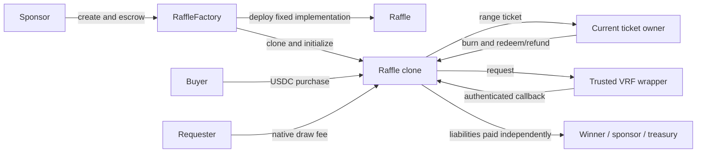
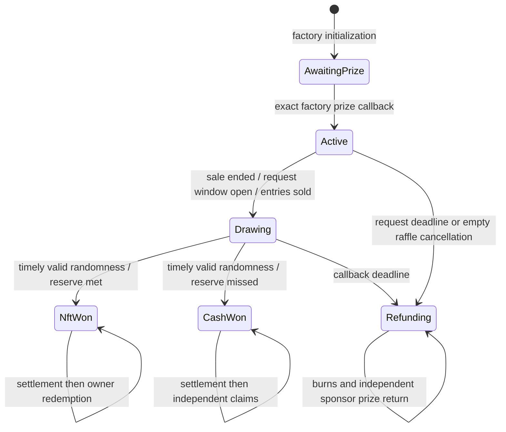
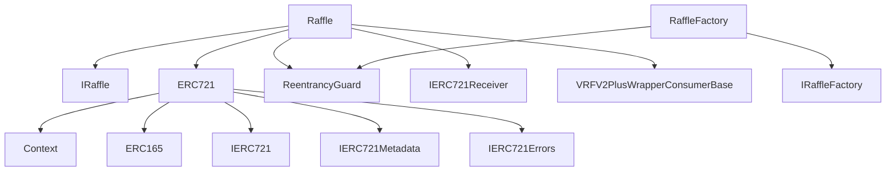

# S4 — Guidelines Advisor independent source review

Status: source-only five-phase assessment completed; native verification pending S6. This is not a production-readiness certification. No confirmed exploitable vulnerability is established by this bounded stage. No other stage conclusions, historical audits, tests, or live systems were consulted. Requested model/effort: gpt-6-astra / ultra; provider-returned fields unknown. No fallback. The attempted parallel spotcheck failed before an agent started; its original error is retained.

## Phase 1 — Discovery

Ethereum Solidity 0.8.36 contracts implement immutable NFT raffles. All five production files and clean DESIGN.md are included. Package configuration pins OpenZeppelin 5.6.1 and Chainlink 1.5.0; Foundry configuration targets Cancun. Dependency source was captured with hashes; security-relevant reachable paths received focused review, not a full independent audit of every dependency routine. Package scripts/configuration are evidence of configuration only: test quality, coverage, actual CI use, and successful execution remain UNKNOWN.

| Source | Review coverage |
|---|---|
| src/Raffle.sol | Initialization; ticket purchase/transfer; draw funding/refunds; authenticated callback; settlement/redemption/refund liabilities; all payout paths and destination checks |
| src/RaffleFactory.sol | Constructor dependency checks; atomic clone creation/initialization/registration/escrow; validation and registry getters |
| src/libraries/RaffleConstants.sol | Price, percentages, timeouts, callback limits and refund batch bound |
| src/interfaces/IRaffle.sol | Lifecycle, parameter structures, events/errors, public function/getter contracts, honest-prize and canonical-USDC assumptions |
| src/interfaces/IRaffleFactory.sol | Atomic creation interface; constructor trust requirements; immutable configuration; registry API/events |
| DESIGN.md | Economics, deadlines, trust boundary, ownership at redemption, separation of settlement and delivery |
| Reachable dependencies | ERC721 ownership/update/mint/burn and receiver calls; ReentrancyGuard storage/zero-state behavior; Clones fixed target; SafeERC20 transfers; Chainlink request/callback authentication; Math arithmetic and transitive imports captured |

Paths above are relative to target/packages/contracts except DESIGN.md, which is target/DESIGN.md. Exact paths, SHA256 and bytes are in raw/001-resources.json. Actual source searches are retained in raw/001-source-search.txt and raw/002-source-search.txt.

## Phase 2 — Source-derived documentation

A sponsor creates a raffle and atomically deposits one prize. Each purchase costs one USDC per entry and creates a transferable ERC721 representing a contiguous entry interval. Anyone can fund the one-word draw after sale end and before its deadline. Authenticated randomness chooses a single entry without searching tickets. A caller proves its containing ticket, allocating the entire pot: NFT result gives sponsor 95% and treasury 5%; cash result gives winner 80%, treasury 5%, and sponsor the remainder. The current ticket owner burns the ticket to redeem. Refund activation moves the full pot into refund liabilities; each owner burns up to 100 tickets per call. Failed outgoing transfers revert the enclosing state changes.

The diagrams below are derived manually from source, not Slither output.

Interfaces provide extensive NatSpec rather than leaving public generated getters unexplained. One documentation boundary needs reconciliation: DESIGN.md:2 describes arbitrary prize contracts as untrusted; IRaffle.sol:12-15 explicitly limits supported prizes to honest standards-compliant ERC721s. Code checks interface support, calls the token, and asks that same token to attest ownership (RaffleFactory.sol:130-136; Raffle.sol:334-336). These checks cannot establish honesty. This is a concrete documentation inconsistency, not evidence that a compliant token can violate escrow.

## Phase 3 — Architecture

The on-chain/off-chain split is appropriate for the source design: purchases, callbacks and range verification avoid entry-count loops; refund work is bounded by 100 tickets. Ticket discovery can use events and historical ranges off chain, while the contract verifies the winning interval. No claimed gas savings were measured. Operational draw funding is permissionless but not incentivized in the inspected source; eventual refunds are the explicit fallback, so successful drawing depends on a willing fee payer and timely wrapper fulfillment.

Proxy review is applicable even though upgrades are absent. Factory creates its own implementation, then Clones.clone uses a fixed target; initialization is factory-only, one-time and occurs in the same transaction as deployment. Implementation constructor sets initialized=true. Code immutables intentionally bind all clones to one factory/token/wrapper. There is no discovered target-changing upgrade function or storage-slot upgrade mechanism. Clone storage starts zero: the imported ReentrancyGuard rejects only ENTERED=2, then sets the guard before execution and resets to 1, so lack of constructor execution on clones does not itself disable the guard. ERC721 name/symbol are overridden with constants. Native storage-layout/upgradeability validation remains pending.

## Phase 4 — Eleven assessment areas

| Area | Source-supported assessment / limit |
|---|---|
| 1 Documentation/specifications | Interfaces extensively document functions, events, errors and units; diagrams supplied; reconcile prize trust wording described above |
| 2 On-chain/off-chain | Constant-time range proof and callback; bounded refund batch; event-driven discovery can remain advisory |
| 3 Upgradeability | Fixed implementation and ownerless factory; code migration/new factory required for changes; operational migration procedures outside reviewed scope |
| 4 Delegatecall proxy | ERC1167 clone library confirmed by search; atomic restricted initialization; implementation locked; immutables intentional; native proxy checks pending |
| 5 Function composition | Dedicated state transitions and private helpers separate validation, settlement and transfer; requestDraw combines necessary funding/refund atomicity; no mandatory refactor demonstrated |
| 6 Inheritance | ERC721 and VRF base supply security-relevant public methods; rawFulfillRandomWords authenticates wrapper; ERC721 transfer routes through overridden _update; no demonstrated shadowing defect |
| 7 Events | Creation, deposit, purchase, request, ignored callback, resolution, settlement, redemption, refunds and payouts emit events; inherited ERC721 logs transfers/approvals; indexed identifiers support discovery |
| 8 Common pitfalls | NonReentrant guards economic functions; redemption burns and zeros liabilities before interactions; native refund checks success; 0.8 arithmetic and explicit uint128 entry cap; exact timestamp inequalities inspected; no tx.origin found; untrusted token behavior remains a trust-boundary concern |
| 9 Dependencies | Pinned declared versions; standard imports used; SafeERC20 checks operation success but cannot prove canonical token identity; wrapper address authentication inspected; package provenance and latest-version status not externally verified |
| 10 Testing/verification | UNKNOWN quality, coverage, fuzz adequacy and CI execution; tests/history forbidden. Configuration alone cannot establish successful verification. Native tooling deferred to S6 |
| 11 Solidity/platform | Exact 0.8.36 pragma and Cancun target observed; source assembly only native refund call, with checked result; library assembly exists; compiler warnings, bytecode size, tool compatibility and gas not executed here |

Pitfall follow-through: callback ignores in-flight, late, wrong-request, duplicate and wrong-length decoded responses; VRF base authenticates sender. Ticket ownership is checked at redemption, so transferability does not freeze payout rights at settlement. Duplicate refund tickets revert upon second owner lookup after burn, reverting the whole batch. Accounted liabilities are distinct from unsolicited donations. No signature scheme exists to assess replay protection. Timestamp-based sales/draw/refund boundaries are deliberate, not an automatically classified vulnerability. No catastrophic arithmetic or reentrancy exploit is established here.

## Phase 5 — Prioritized recommendations

**CRITICAL/HIGH confirmed security defects:** none established in this source-only stage. This is limited negative evidence, not proof of safety.

**MEDIUM — reconcile the prize trust contract.** Amend DESIGN.md and user-facing integration requirements to distinguish permissionless listing from guarantees that require honest ERC721 behavior. Refer to IRaffle.sol:12-15 and factory escrow postchecks. Keep adversarial prize contracts in subsequent verification; do not interpret supportsInterface/ownerOf as proof of truthful implementation.

**MEDIUM — complete deferred verification before a release decision.** S6 should compile the pinned compiler/EVM combination, record warnings and size, produce actual inheritance/control-flow output, and evaluate proxy initialization/storage behavior. Independently review test quality when authorized. Suggested properties are liability conservation, one-time redemption, owner-controlled burn, boundary timestamps, rollback on transfer failure, and no same-factory clone payout. These are proposed checks, not assertions that existing tests omit them.

**LOW — specify operational failure behavior.** Preserve explicit documentation of irreversible configuration, no rescue, unsolicited assets, wrapper delays, funding responsibility, and recipient capability. Source already documents many constraints; deployment verification should authenticate canonical USDC and wrapper independently of code/decimal checks (IRaffleFactory.sol:7-9).

**Unconfirmed leads, not findings:** cross-factory destination isolation deserves explicit scope clarification because _isProtocolDestination checks only its canonical factory registry (Raffle.sol:626-640); whether other deployments are in the intended invariant is unestablished. Adversarial prize dishonesty can invalidate ownership assertions, but lies outside the interface's honest-prize guarantee. Neither lead is promoted to an exploitable security finding here.

## Stage completion and limits

Discovery, documentation/diagrams, architecture, eleven-area implementation review and prioritized recommendations: COMPLETE as a bounded source-only assessment. Full skill native diagram generation, compilation, compiler warnings, upgradeability tools, dynamic tests and CI evaluation: PENDING / NOT PERFORMED by stage authorization. Source capture does not imply exhaustive dependency audit. Target source unchanged. Root must seal this stage; this report does not self-seal.
